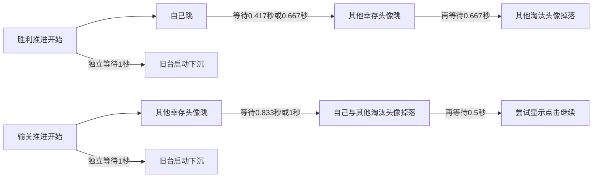
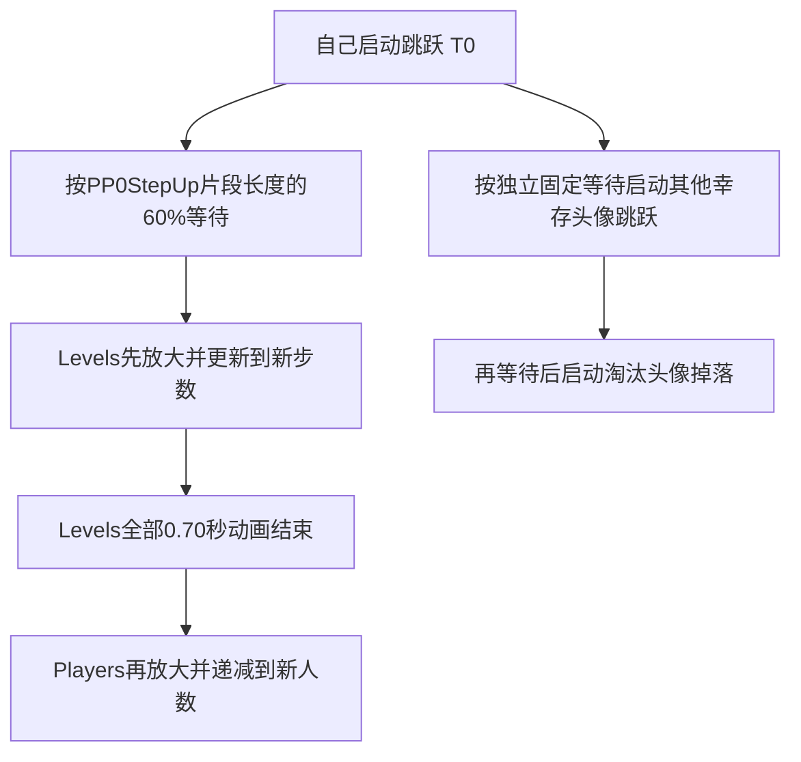

# Lava Quest 跳台与数字刷新时序

来源：https://chatgpt.com/space/page_bc06b2daa1788191bfe7ff487a7f2f0d

读取版本：sequence 1；更新 2026-11-09。以下为只读来源快照。

Lava Quest胜利时自己先跳，输关时其他幸存头像先跳；个人超时本身不触发自己跌落。Levels先更新，整段结束后Players才更新，数字与头像动作按不同计时安排。以下按39781客户端固化表现说明，用于TS复刻参考。

# 胜利失败与倒计时结束的动作顺序

2026-11-09以39781代码重验。Lava使用Animator片段播放头像跳跃与跌落，不能套用Ancient的两点跳跃参数。下表的“先后”指代码启动先后；同一批头像在循环内启动，各片段内部的起跳、落地时间仍可不同。

| 情况 | 谁先动作 | 后续动作与界面 |
|---|---|---|
| 普通胜利且有待播放推进 | **自己先跳** | 其他幸存头像跳 → 其他淘汰头像掉落；Levels动画先、Players动画后，与头像动作并行计时 |
| 第七胜且有待播放推进 | **自己先跳**，复用胜利分批顺序 | 主界面另有完成计时，尝试关闭后衔接已安排的领奖场景；不是等待最后一个头像动画结束才开始计时 |
| 普通关卡最终失败且有待播放推进 | **其他幸存头像先跳** | 自己与其他淘汰头像同批掉落 → 尝试显示点击继续；仍受场景加载状态限制。Levels与Players均隐藏 |
| 个人挑战倒计时归零 | **超时本身不触发自己掉落** | 已消费推进动画时，下次打开静态超时页；Levels与Players隐藏。若仍有未消费推进，仍可播放该推进，不能将其误认作超时专属跳台 |
| 仅服务器报名期限结束，个人尚有时间 | 不由这个截止触发跳台或跌落 | 正常本地路径继续个人挑战，另受旧组恢复和后台禁用等条件影响 |
| 手动重开、没有新推进 | 不重播跳台与淘汰 | 进行中页直接显示当前步数／人数；已胜利待领奖可走完成页，已结算状态不等同再次赢第七关 |

判断拆成两层：`PrepareCompetitionDialogData 0x363E1A8`读取动画消费标记，且只用`DidFailByLosingLevel`决定本人是否属于跌落者；`PrepareForDialog 0x3829E0C`以`beforeStep < afterStep`决定是否启动推进。因此**超时失败不等于输关跌落**。打开比赛页会在生成展示数据后消费动画标记；不是每次打开都重播。

以**头像推进开始为T0**，不含界面加载、滑入和关卡退场。等待使用`FramesToSeconds`的帧数÷60，与设备帧率不是一回事。

| 相对T0 | 胜利，本人存活 | 输关，本人淘汰 |
|---|---|---|
| 0 | 本人启动StepUp | 其他幸存头像同批启动StepUp |
| 0.417秒；特殊步为0.667秒 | 其他幸存头像同批启动StepUp | — |
| 0.833秒；特殊步为1.000秒 | — | 本人＋其他淘汰头像同批启动Fall1 |
| 1.083秒；特殊步为1.333秒 | 其他淘汰头像同批启动Fall1 | — |
| 1.333秒；特殊步为1.500秒 | — | 尝试显示点击继续，非保证此刻已经可点击 |
| 1.000秒，独立时钟 | 当前旧台Animator启动BuryRock | 同样启动BuryRock，不以头像落水完成为前提 |
| 1.500秒，独立时钟 | 存在淘汰头像时播放落水相关音效 | 本人跌落满足音效条件 |
| 1.700秒，独立时钟 | 尝试启用头像提示交互 | 同一调用仍受状态判断；不是点击继续的统一时点 |

“特殊步”精确条件是`animationData.beforeStep == 3或6`，不是afterStep；旧台选`clamp(beforeStep-1,0,7)`，对应Step2／Step5。正常逐关推进时是第三／第六次胜利。失败时也按失败前的beforeStep判断。没有某批头像时，该批自然没有可见动作。

七胜自动收尾另以`PrepareForDialog`启动完成计时为起点：有推进时默认5.0秒；映射列表至少2项、且除本人外没有淘汰者时改为4.3秒；无推进时为0.8秒。仅`Completed=3`使用这条计时，`CompletedLastSession=5`不等同。到点调用关闭，来源、场景加载和已安排动作仍影响后续，不能写成“T0后5秒必已弹出奖励”。

# Levels与Players数字如何配合跳跃

**先更新Levels，再更新Players；两者没有逐头像结算绑定。** 初始展示在`StepUp=0`／`Completed=3`保留推进前数字，随后动画到推进后数字；普通静态页直接显示推进后值；`Fail=1`与`TimeOut=4`隐藏两组数字。

本人存活分支启动StepUp后，从当前台AnimatorController查找名为`PP0StepUp`的片段，令`D = 片段长度 × 0.6`，在T0＋D调用`AnimateLevelsAndPlayersTexts`。这表示按片段长度安排时点，**不是收到本人实际落地事件后更新**。代码在取得空Unity引用时有0.5秒替代值，但前面的`First`查找未匹配并不保证能走到这个替代值，不能称为通用缺资源补偿。

| 相对T0的时间 | Levels | Players |
|---|---|---|
| 初始 | 显示`beforeStep-1`／7 | 显示beforeStepPlayerCount |
| D | 开始放大／回弹序列 | 保持原值 |
| D＋0.19～D＋0.49秒 | 整数Tween由`beforeStep-1`到`afterStep-1`，持续0.30秒，OutQuad | 保持原值 |
| D＋0.63秒 | 文字撞击粒子／音效回调 | 保持原值 |
| D＋0.70秒 | Levels整段缩放结束 | 由Levels的OnComplete启动人数缩放 |
| D＋0.95～D＋1.55秒 | 保持新值 | 人数整数Tween由before到after，持续0.60秒，OutQuad |
| D＋1.75秒 | — | 人数文字撞击粒子／音效回调 |
| D＋1.85秒 | — | 人数整段缩放结束 |

以上是Tween调度区间，不是“整数第一次肉眼变动”的精确时刻。整数插值取整会使新值在区间内才出现、也可能在区间结束前已显示目标值；缺少逐帧实拍时不把Tween开始等同文本已变。Players动画过程中每次显示整数改变可触发人数变化音效／触觉；不要求每一位都在屏幕出现，也不依赖淘汰头像的数量或落水事件。人数来自业务快照，包含存活的本人，不能直接用画面头像数反推。

数字的缩放是**原localScale按分量加减**，不是固定乘140%：依次到原值＋0.4 → 原值＋0.3 → 数字Tween → 原值＋0.4 → 原值－0.2 → 回原值。Levels各段为0.12／0.07／0.30／0.07／0.07／0.07秒，总0.70秒；Players为0.15／0.10／0.60／0.10／0.10／0.10秒，总1.15秒。仅整数Tween明确设OutQuad，不能给其余缩放擅自补同一缓动。

例如**仅为讲解而假设**PP0StepUp长1秒，则D=0.6秒：自己在0秒开始跳，普通步其他幸存头像在0.417秒开始跳、淘汰头像在1.083秒开始掉落；Levels的整数变化区间为0.79～1.09秒，Players为1.55～2.15秒。这个例子不代表新版每个台的片长均为1秒。

# 代码证据与资源边界

新增定向证据：`Motion-Parameters/lava-flow-20261109/`，`motion-audit/manifest.json`记录74段SceneView等方法，`branch-audit/`记录状态、数据和页头方法。两者复用同一39781二进制与脚本索引。二进制SHA256为 ea4eaf596b64ff255cc042d52d32e44078ed773d70be6c3368db9459a12b3a22。关键定位：`InstantiateProfileCards 0x382C46C`识别本人并置首；`PlaceProfileCards 0x382CABC`将本人先加入动画映射；`MoveCardsRoutine.MoveNext 0x362F458`分批动作；`StartPictureAnimationsIfNecessary 0x38298D8`独立下沉时钟；`PrepareTopPanel 0x3829168`决定数字可见与初值；`AnimateLevelsAndPlayersTexts 0x382A770`／`AnimateAText 0x382A824`／回调`0x382BC10`决定先Levels后Players。`MoveCardsRoutine`跳表与字符串重定位均已核对。代码结论为静态核验，非新版实机逐帧计时。

[Lava Quest 跳台与数字时序证据附件](library-file:fde1_bGliZmlsZV9WVXJGNVBtTnJPSkZWaVdlTkJ3ZzdB_FileDrive_30bca9da68708191806c0af3d11faa03)

附件包含状态与动作方法摘录、数字刷新调用、地址与SHA256清单，以及本版说明。

# 资料管理

更新日期：2026年11月9日。长期正文维护于LG的 Royal Match／活动／Lava Quest／资源与表现 第五章，本页为TS使用说明。

[返回TS资料空间](https://chatgpt.com/space/page_6aec790fa76c81918408b13d39d710ed) · [Ancient跳跃与下沉参数](library-file:fde1_bGliZmlsZV9MT1dqTDZRRXo1czQ3eXNxMWJvUXVR_FileDrive_30bca9da68708191806c0af3d11faa03)
