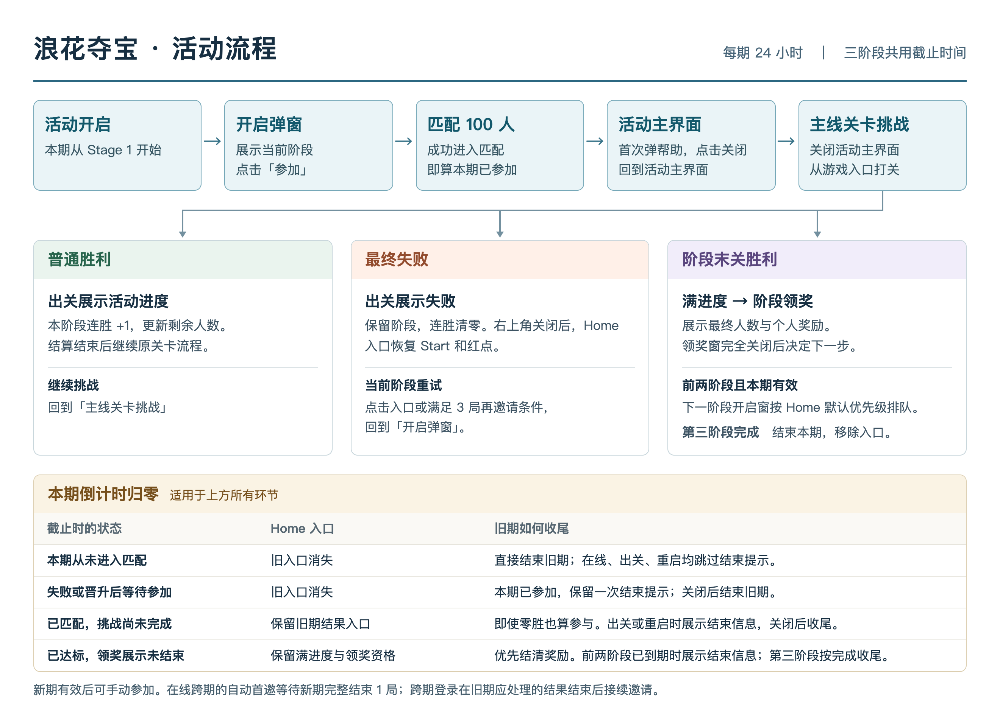

# 浪花夺宝 Splash Quest — AI迁移与实施主档

> [!important] 2026-11-18 收尾准备：沿用已导出的新三档
> 11 月 16 日旧体系归档后，已在新对话完成三档设计与多次导表核对；11 月 18 日用户明确“先不改，还是用上一版”。当前基础总奖为少发 **2573**、正常 **3720**、多发 **4787**，正常档约 3000／系数减半候选未采用。免费失败重报名涨奖、每次匹配重判档与现代码的差异仍待处理。当前状态是**准备收尾，尚未完成整体验收**；长短屏适配另一个对话仍在实施。

先读[玩家流程](#玩家流程)核对功能，再看[当前进度与剩余待办](#当前进度与剩余待办)安排交付。T01～T16 保留迁移原版与新需求的完整对照；历次实现与验证记录在文末。

## 改造目标与比较基线

将迁入 TS 的钻石联盟改为浪花夺宝 / Splash Quest：每日固定 24h，一期三个阶段，目标 5/7/10 关、钻石总奖池 5000/10000/20000，全部完成后关闭本期；首版在审清当前数值隐患后，设计多发／正常／少发三套配置及用户分组，不新增活动专属难度调控。

**比较起点为迁移原版提交 `4905ae46c93dd605b3ddb005fb409a5a9476118a`，不含迁移后的改造提交及工作区改动。** 正文按“迁移原版 → 新需求”定义完整调整项、实现顺序和验收条件。调整项表新增“进度”列供逐项查看；详细代码证据与验证记录仍放在文末，不据此缩减产品改造范围。

正文中的“沿用原版”仅指原版实际已有能力；例如首次帮助在主场景入场后展示、胜利操作和固定周期晚加入余时规则。24h 排期、CD=0、三阶段单次领奖等属于改造目标，即使已有本地实现也仍列入差异。

## 已确认规则

| 项目 | 新规则 |
|---|---|
| 周期 | 一期 24 小时，每日循环，沿用现有配置切期时间点 |
| 时间口径 | 当前配置 08:00:00 按现有时间解析为 UTC，即北京时间 16:00；不改为本地 08:00 |
| 阶段一 | 100 人起始，连续通关 5 关，总奖池 5000 钻石 |
| 阶段二 | 重新匹配 100 人，连续通关 7 关，总奖池 10000 钻石 |
| 阶段三 | 重新匹配 100 人，连续通关 10 关，总奖池 20000 钻石 |
| 领奖 | 总奖池按剩余人数分配，沿用当前向上取整方式；每阶段只领一次 |
| 失败 | 阶段不退回，当前阶段进度归零；初版无失败冷却，结算结束后可经开启弹窗立即重新参与、匹配 |
| 晋升 | 阶段一、二领奖界面关闭后进入下一阶段，将共享开启弹窗加入后续弹窗列表，展示新阶段配置 |
| 完成 | 第三阶段领奖表现结束后活动关闭、入口消失；本期不再开启，下期从第一阶段开始 |
| 到期 | 整期未匹配直接结束；已参加才展示主界面结束信息栏。已取得奖励优先结清，第三阶段完成按成功收尾 |
| 移除 | 独立段位总览页面、第三档循环、累计奖励、中途宝箱及其提示和领奖链路 |
| 首版分层 | 当前少发／正常／多发三档已导出，50～104归正常；保留上一版，具体数值及未决差异见当前配置节 |
| 活动专属难度 | 首版不新增活动专属调控，TS 原有主线调控保持；后续基于首版线上反馈设计 DDAV3 策略接入，统一资源折算及判断链路 |

首次开启与下一阶段开启使用同一弹窗；必须点击参与才匹配。三个阶段共用一期截止时间，参与、重试、晋升均不重新计算 24 小时。已获得待领取奖励不得因到期或重启被丢失或重复发放。TS 作为全新活动上线，不处理 MT / 迁移测试旧存档兼容。

### 活动周期与开启

| 项目 | 需求 |
|---|---|
| 开启条件 | 沿用现有活动解锁与开启条件，本次不调整解锁门槛 |
| 单期时长 | 固定 24 小时，每天一期，期与期之间无额外间隔 |
| 每日切期 | 沿用现有配置切点；当前方案口径为 UTC 08:00，即北京时间 16:00 |
| 计时起点 | 按统一活动周期计算，不从玩家首次参与时间开始计算 |
| 晚加入 | 沿用原版固定周期规则，仅获得本期剩余时间；例如距离切期 2 小时参与，剩余时间为 2 小时 |
| 共用截止时间 | 三阶段共用本期截止时间；参与、重试、晋升均不延长活动 |
| 新期开始 | 满足开启条件时，从第一阶段、0 进度开始；上一期未完成进度不带入新期 |
| 本期提前完成 | 完成全部阶段并结束领奖表现后，关闭活动、移除入口；等待下一期 |

活动开启时展示开启弹窗。玩家点击参与后才进入匹配，首次帮助在匹配后进入活动主场景时展示。仅打开或关闭开启弹窗不视为开始挑战。

## 玩家流程

每期 24 小时，按配置时间统一切期。Stage 1、2、3 分别挑战 **5、7、10 关**，对应总奖池 **5,000、10,000、20,000 钻石**，由该阶段最终剩余玩家平分。晚加入、失败重试和晋升都沿用本期截止时间。



### 入口状态与刷新时机（2026-11-11）

表中 `k/N` 表示进度条填充比例，`N` 为当前阶段目标。入口显示还须满足公共活动展示条件。匹配与到期分流已合入，游戏内表现待联验。

| 玩家所处环节 | Home 入口 | 状态切换与操作 |
|---|---|---|
| 本期未开放或已经结束 | 隐藏 | 满足新期开放条件后，从 Stage 1 开始 |
| 本期有效，等待首次参加或下一阶段参加 | `Start`、红点、`0/N` | 内部为 `Ready`。关闭开启窗仍可从入口再次打开同一阶段 |
| 成功进入匹配，尚未赢过一关 | 倒计时、无红点、`0/N` | 写入并保存 `InRun`。此时退出游戏，恢复后仍算已参加。匹配窗未成功打开则仍待参加 |
| 正在挑战，普通胜利 | 倒计时、无红点、`k/N` | 有效胜利推进一关，在出关流程展示后回 Home。复活继续同一局时保留进度 |
| 最终失败，退出失败界面 | 当前阶段 `Start`、红点、`0/N` | 失败结算已写回 `Ready`。右上角关闭只退出，回 Home 可手动重试；自动邀请沿用现有 3 局规则，初版失败冷却为 0 |
| 末关达标，待领奖或奖励到账但领奖窗尚未完全关闭 | **保持本阶段满进度**（5/5、7/7、10/10），无红点；截止前显示倒计时，截止后显示结束文案 | 结算已写入 `Ready`，入口优先读取待领取或待展示标记。领奖以完成阶段的活动主界面为背景，恢复游戏时按已有结果继续 |
| 领奖窗完全关闭 | 前两阶段且仍有效时，切到下一阶段 `Start`、红点、`0/N`；第三阶段完成则移除 | 下一阶段共用开启窗按 Home 默认开启类优先级排队。领奖关闭后直接接后续流程；前两阶段若已过期，转旧期结束流程 |
| 截止时正在等参加，且没有待领奖 | **旧入口自动消失** | 首次待参加、失败后重试、晋升后待参加都适用。即使本期曾参加过也一样。本期从未成功进入匹配时直接结束，在线、出关和重启均跳过旧期结束界面。失败重试或晋升待参加时，本期已有匹配记录，保留一次到期结束提示 |
| 截止时已经匹配、仍在挑战 | 旧期结果待处理时保留入口，显示结束文案与已取得进度，无红点 | 即使是 `0/N` 也按挑战中处理。关内不打断，出关时展示活动主界面的到期信息栏。到期后完成的这关不再增加旧期进度 |
| 跨期后新一期已有效 | 旧结果处理完刷新新入口，Stage 1、`Start`、红点、0/5 | 在线时可立即手动参加，自动首邀等新期完整结束 1 局；跨期登录先处理旧结果，再按 Home 队列邀约。提前完成的玩家等配置切点开启新期 |

**刷新时机。** Home 创建入口、活动发出 UI 刷新通知、入口每秒更新倒计时，都会重新判断入口。即使玩家一直停在 Home，待参加入口也会在截止后的刷新中自动消失。完成末关后，从「待领取」切到「已到账、待展示结束」期间一直保留满进度；只有领奖窗完全关闭才决定晋升或结束。

**联验重点。** 在 Stage 1 分别停在「失败后待重试」「已匹配但 0/5」「已达标 5/5，领奖窗仍开着」直到截止，依次应看到入口消失、保留旧期结果、保留满进度且领奖后结束旧期。再以 Stage 3 的 10/10 跨截止领奖，确认只发一次并关闭本期。

### 开启、匹配与首次帮助

1. 满足解锁、档期和展示条件后弹出开启弹窗；只打开或关闭不算参加，后续提醒遵循“弹窗规则”。
2. 点击参加进入匹配。每个阶段、每次重试均从 100 人开始；阶段、奖池及奖励图片读取对应配置。
3. 首次匹配后进入活动主场景，再自动展示首次引导。点击任意位置关闭引导并回到原活动主场景；重试、进入下一阶段及新一期不重复首次引导。
4. 主场景底部 Tap to Continue 在每一阶段开启和失败时隐藏；胜利出关时展示。引导关闭回主场景后仍隐藏该提示，移除活动主界面底部的关卡开启按钮；关闭活动主界面后从游戏原有入口打关。阶段完成继续沿用原领奖衔接，不增加强制确认。

### 主场景区域与阶段配置

| 区域 | 配置与交互要求 |
|---|---|
| 阶段地图与台子 | 各阶段地图依据 5 / 7 / 10 关目标手工配置，运行时读取对应配置；正确对应起点、进度位置和终点，区分已通过、当前与未到达。程序不新增自动排布方案 |
| 奖励堆 | 按阶段配置切换资源和奖池信息；装饰宝箱或金币不引入中途奖励，也不改变钻石奖励类型 |
| 告示牌 | 按当前阶段配置显示资源与信息，与目标和奖励保持一致 |
| 主场景 UI | 阶段、进度/目标、剩余人数、共用倒计时及相关图片读取当前阶段配置 |
| 活动 icon | 挑战中显示当前阶段进度条；失败退出后恢复待参与状态及红点；本期完成后移除，新期有效时重新显示 |

匹配以 Home 为背景，标题显示 Stage n；领奖以完成阶段的主场景为背景，与匹配共用对应阶段的奖池表现。匹配和主场景显示当前阶段数据；领奖使用完成时的阶段与奖励快照。正式资源可替换，阶段切换不得残留上一阶段资源或信息。

### 挑战、失败与晋升

#### 连续通关

参加后，每次有效主线胜利推进当前阶段一关。在关卡结算流程中展示活动前进、其他参与者淘汰和剩余人数变化。胜利表现、已有点击/快进以及阶段达标后进入领奖的衔接沿用 MT，不另加统一的 Tap to Continue 确认步骤。

主线最终胜负、退出与复活沿用现有口径。出现复活机会或继续当前关卡不算活动失败；最终失败才清空本阶段进度。活动 icon 与主场景进度保持一致。

#### 失败与重试

最终失败后，在活动主场景展示失败过程和失败信息栏，保留当前阶段和前序已领奖励，清空本阶段进度。玩家通过右上角关闭按钮退出；关闭后不立即弹开启窗，icon 恢复待参与状态并显示红点。

无失败 CD。玩家可立即点击 icon 打开当前阶段开启弹窗，再点击参加，重新匹配 100 人并从本阶段起点开始。未主动参加时沿用 3 局再次邀请。重试不重置本期截止时间。

#### 晋升与全部完成

完成阶段后进入领奖界面，展示最终人数、总奖池与个人所得。前两阶段领奖界面关闭后，更新阶段，在后续弹窗流程中安排下一阶段开启弹窗，重新走“参加 → 匹配 → 主场景”。不额外回旧主场景做晋升展示，不增加独立晋升或段位总览界面。

“开启下一轮”仍属于同一期，不增加活动时长。第三阶段领奖结束后关闭本期、移除入口、清除本期待弹邀请；不重复第三阶段。

### 关卡挽留

当前仅在主线提供复活机会时，浪花夺宝参与公共挽留展示。玩家正在挑战，或正在展示失败且有失败前进度时，用「已通过关数 + 正在挑战的这一关」计算进度。达到阶段目标的 50% 后具备展示资格，即 Stage 1 第 3 关、Stage 2 第 4 关、Stage 3 第 5 关起。公共复活界面仍按优先级及分组选择最终展示项。

气泡展示当前阶段总奖池和挑战进度。选择复活后继续同一局；放弃复活并形成最终失败后，才清空本阶段连胜。

### 弹窗规则

| 时机 | 玩家看到什么 | 计数与触发 |
|---|---|---|
| 首次开启，或手动点击可参加入口 | 当前阶段共用开启窗；关闭后仍可再次打开 | 成功进入匹配才记录本期参与。手动参加不受自动邀请额度限制 |
| 失败后关闭 | 返回原流程，Home 入口恢复当前阶段的 Start 和红点 | 玩家可立即手动重试。未主动参加时，按活动外完整结束 3 局的规则再次邀请 |
| 前两阶段领奖窗完全关闭 | 有效期内把下一阶段开启窗加入 Home 队列，使用默认开启类优先级 | 仍需点击参加；独立于失败后的 3 局计数 |
| 在线跨期 | 旧期结果处理完后，有效新期入口可立即参加；自动首邀等待新期完整结束 1 局 | 跨截止的当局和展示旧结果的当局均不计入。手动处理后取消对应的待弹邀请 |
| 跨期登录 | 先恢复应处理的旧期奖励或结束信息，再按队列展示当前新期邀请 | 整期未进入匹配直接跳过旧期结束界面。登录首邀无需额外打一局，错过多期只开当前有效期 |

**本版再次邀请**沿用 3 局间隔，配置每日上限为 2。现实现按自然日记数，开始新一轮也会清零，在检查待弹时记次，实际次数受这些重置时机影响。胜利、退出失败、放弃复活按最终结果计局；复活继续同一关、直接导致本次活动失败的那一局均不计入随后 3 局。

**R05 暂缓目标**为每活动期最多 2 次，只在成功展示再次邀请后扣次；本期重试、跨自然日保留额度，手动处理过的邀请去重。领奖、晋升、到期结果与新期首邀各走自己的流程。

### 奖励结算契约

每个阶段的 5000、10000、20000 钻石均为**阶段总奖池**，不是每位通关玩家固定获得的奖励。

**个人奖励 = 阶段总奖池 ÷ 阶段完成时的剩余人数，结果向上取整。**

例如第二阶段结束时剩余14人，个人获得 `向上取整（10000 ÷ 14）= 715` 钻石。沿用现有取整方式，不额外分配尾差。领奖界面必须区分“总奖池”和“本次个人所得”。

- 奖励在阶段挑战完成后取得领取资格；失败或未完成阶段没有该阶段通关奖励。
- 每阶段只发放一次；重复点击、关闭再打开、重启均不能重复发放。
- 领奖时使用该次阶段完成的奖池和剩余人数，不使用晋升后新阶段的数据。
- 已取得的待领奖励不因活动到期或重启而丢失。
- 无中途宝箱奖励、累计奖励或额外第三阶段循环奖励。

### 到期与中断处理

到期判定、待处理结果和奖励保护沿用已有机制；结束展示改为活动主界面的结束信息栏，不再使用独立结束弹窗。到期后停止旧期参加、重试和计分，不打断主线关卡，不改变主线自身胜负与奖励。

| 场景 | 处理规则 |
|---|---|
| 已参加且活动界面中到期 | 处理待结算／待领奖后在活动主界面展示结束信息栏，关闭后按既有跨期规则衔接 |
| 已参加且打关中到期 | 不打断关卡，出关后处理活动结束；到期后的胜利不计入旧期，也不补记到尚未参加的新期 |
| 截止前已取得待领奖励 | 保留领取资格及完成快照，沿用已有待领奖恢复和发奖保护，不因换期丢失或重复发放 |
| 第三阶段已经完成并发奖 | 保持完成结果，领奖表现结束后关闭本期 |
| 在线处理旧期结束，新期已有效 | 旧期结束后刷新新期入口，可主动参加；再完整结束 1 局后自动弹新期开启窗 |
| 跨期登录 | 先处理旧期已有结果，再安排当前新期开启窗；不补开错过的历史各期 |
| 关闭、重启或中断恢复 | 沿用待处理结果标记恢复；不重置活动时间，不重复发奖或重复执行已处理结果 |
| 旧期回调晚于新期开启 | 旧期关闭仅清理旧期，不误关新期入口、阶段或待弹流程 |

结束提示须同时满足本期到期和本期成功进入过匹配。只展示、关闭开启窗或匹配窗未成功打开，均按未参加静默结束。普通失败仍可重试当前阶段；到期结束不能重试旧期。新一期始终按固定排期开放，等待自动邀请不增加剩余时间。

## 当前进度与剩余待办

2026-11-18 对话整理与当前分支静态复核后，任务保持 `in-progress`，阶段定位为**收尾准备**。已有实现、历史验证、未采用方案和待验收分别记录；不因对话归档将业务标为完成。

| 顺序 | 范围 | 当前状态 | 收尾条件 |
|---|---|---|---|
| 1 | 三阶段表现与长短屏适配 | 5／7／10关资源已有；适配试作进行中 | 等适配对话形成最终结果；1920与2160下核对起点、台子边缘空隙、终点、头像及跳跃落点，帮助／关闭按钮可用 |
| 2 | 结算、领奖与跨期 | 基础链路已有实现，完整联验未闭合 | 从普通胜利、复活继续、放弃、主动退出走到活动结算／Try Again／Home；末关到账一次、领奖关闭晋升或终局；覆盖未匹配、零胜、待重试、待领奖跨截止及重启 |
| 3 | R07 当前三档与奖励 | 已导出；用户决定保留2573／3720／4787基础总奖 | 核对实际使用档位与到账；免费重报名涨奖、每匹配重判档差异明确保留待决，3000候选不落表，不在收尾整理中扩大算法改动 |
| 4 | 边界风险与兼容范围 | 按最新决定分层保留 | SceneModule依赖前置仍待评估；C1／C2按现版路径复核；奖励接口风险保留说明；C4旧90%算例不冒充当前阈值问题；旧层兼容遵守新活动范围 |
| 5 | 首版线上反馈／后续DDAV3 | 尚无本轮线上效果证据 | 后续按用户组×档位×阶段观察完成、重试、消费、净发放；活动专属DDA仍未接入，不作为本次文档收尾前置 |
| 暂缓 | 公共切期精简方案 | 用户要求保留背景、后续评估；当前未采用 | 若重启该项，再核对 `AdvanceFinishedPeriod`、公共ClosedPoll、在线一关首邀及待领奖保护；不复用中途暂存结论 |
| 暂缓 | R05再次邀请、R13地图气泡偏移 | 维持既有暂缓决定 | 单独恢复时再处理每期计次／展示成功扣次、去重，以及地图气泡落点；顶部气泡局部修正不覆盖全部R13 |

### 后续实现顺序建议

1. **Step1 固定交付基线**：先回读适配对话最终结果与实际分支，逐项区分已合入、尚在本地、暂缓；保留当前三档，避免将旧候选误落表。
2. **Step2 做一轮精简串测**：三阶段各跑起始／过关／失败／末关领奖；重点对照1920与2160、Try Again返回、待领奖重启与跨截止。只记录观察到的结果，专项／静态检查不替代运行验收。
3. **Step3 明确剩余项去向**：免费重报涨奖与每匹配判档记录为未决产品／实现差异；缺依赖边界、余额和到账契约按实际风险决定本版处理或后续跟进。用户未授权时不自动实施。
4. **Step4 完成文档与交付收束**：将实际验收结果回写本主档，按需要同步项目交付副本，再由用户决定提交和发布；R05、R13及未采用候选留追溯入口，不提前勾完。

### 当前三档配置与发放（2026-11-18）

依据“设计百人七关数值配置”11 月 18 日最后两轮及本次 `dev@44abc00cf` 本地静态回读。Main／Stage／Attribute／Rule 分别为 **3／9／12／82 行**；本地四表与 `d056db083` 的差异为空。JSON／bytes 一致性沿用原数值对话的导表检查记录，本次仅回读可读 JSON、代码与 Git，未重跑二进制解码或游戏模拟。

| 档位／层号 | Stage ID | 上限＝初始期望（1／2／3阶段） | 首轮零消费最终人数 | 三阶段个人奖励 | 总奖励 |
|---|---|---|---|---|---:|
| 少发／1 | 1／2／3 | 20／14／14 | 19／13／13 | 264／770／1539 | **2573** |
| 正常／2 | 4／5／6 | 14／10／10 | 13／9／9 | 385／1112／2223 | **3720** |
| 多发／3 | 7／8／9 | 11／8／8 | 10／7／7 | 500／1429／2858 | **4787** |

- 各档均为 100 人、5／7／10 关、奖池 5000／10000／20000、下限 2／3／6、调整强度 1，关型权重均为 `[1,1,1,1,1]`。首次人数减 1 来自当前半开随机区间与“上限等于期望”的组合，不是另加一条产品规则。
- 旧补偿数组未替换。按当前 Stage ID，少发首关系数 0.30、正常 0.25、多发 0.20，之后递减；不能因“多发”命名推断其补偿系数更高。数组仍有超出 5／7／10 的尾项，不把未裁剪尾项写成已修复。
- 50～104 关统一正常档；活动常规从 55 关开启。旧“55～104 独立保留第 5 层”安排已被新三档取代。≥105 按余额、连胜表现、复活倾向组合选档，不是只看余额。
- 当前分桶静态回读：钻石为 3000／6000，连胜表现为 0.3／0.8，复活倾向为 0.1／0.4。旧六层审查中的 4000／10000、0.5／0.9 不能继续当作当前阈值；历史 C4 的 90% 算例须随当前阈值重新判断，不直接列为现版同条件故障。
- 当前只记录**成功钻石复活的实际扣钻**。库存道具、购买道具及广告折算曾进入新设计试算，尚未接入活动补偿。系数产生额外淘汰预算，每关最多额外淘汰 1 人，不是直接返现比例。
- 当前代码在开期刷新并保存 UserLayer，匹配沿用本期快照；用户描述的“每次匹配重新判断档位”**尚未实现**。重报名还继承人数与补偿余额，因此不能把“失败重报是一轮新活动”的产品口径写成数据已完全重置。

以下沿用数值对话中“最终完成三个阶段”的条件情景结果，**净发放＝活动奖励－全部尝试中的钻石消费**；不含主线收入、道具折值，也不是线上参与者平均值。

| 情景 | 累计钻石消费 | 少发：总奖／净发放 | 正常：总奖／净发放 | 多发：总奖／净发放 |
|---|---:|---:|---:|---:|
| 首轮零消费全通 | 0 | 2573／+2573 | 3720／+3720 | 4787／+4787 |
| 各阶段首关花 900 后直接完成 | 2700 | 3025／+325 | 4029／+1329 | 4912／+2212 |
| 22 关每关花 300 后直接完成 | 6600 | 3470／−3130 | 4375／−2225 | 5150／−1450 |
| 每阶段零消费失败 5 次，再完成 | 0 | 约3197／+3197 | 约5090／+5090 | 约6338／+6338 |
| 每阶段首关花 900 失败 3 次，再零消费完成 | 8100 | 约3656／−4444 | 约5179／−2921 | 约5877／−2224 |

“失败 5 次”指**每阶段各 5 次，共 15 次失败，再成功过 22 关**；失败本身不发奖。用户确认局内免费复活仅一次，活动失败后仍可重新报名，两者不混用。新配置下最低人数对应阶段奖励上限为 2500／3334／3334，合计 9168；此处沿用当前全 1 权重模拟，不扩大为任意未来关型配置的保证。

**明确保留的决定与未决项：**整体发奖感觉偏多、零消费重报名不应持续涨奖已经记下；正常档约 3024、系数乘 0.5 的候选未采用。固定本轮人数、仅补本轮消费、重报名清余额／重判档是建议，尚未授权实施，且会放弃失败轮消费的跨轮补偿。本次整理不改代码或运行配置。

配置与候选证据：[[02-PROJECTS/TileScape/游戏逻辑/任务-钻石联盟每日三阶段改造.assets/SplashQuest-三档本地配置快照-2026-11-18.zip|当前本地四表与哈希快照]]；[[02-PROJECTS/TileScape/游戏逻辑/任务-钻石联盟每日三阶段改造.assets/SplashQuest-3000候选-未采用-2026-11-18.zip|未采用的3000候选及原模拟数据]]。原“新三档配置”工作簿曾交付于 TS `Docs/Analysis/SplashQuest_Redesign_20261116/outputs/`；本次当前目录未找到该工作簿，不声称其已归位。当前数值以表格、配置快照和原对话为依据。

## 收尾证据与对话索引（2026-11-18）

**范围：**本机 Codex 活跃历史与已归档历史分别检索；列表均覆盖至 10 月 27 日之前。回读下列 11 个相关对话的消息记录，早期分叉继承的相同轮次按同一来源理解，不重复算作独立交付。整理范围为 2026-10-27～2026-11-18；ChatGPT、Windows 及其他主机历史未在本轮检查范围内。归档状态是应用列表快照，不代表业务完成。

| 对话原题 | 应用状态 | Thread ID | 归入的主题 |
|---|---|---|---|
| 梳理百人七关阶段流程 | 已归档 | `01a17b9f-9efd-7260-932b-fd2fe8cf353b` | 流程、动画、交付拆分、失败衔接、兼容范围 |
| 梳理百人七关阶段流程 (2) | 未归档 | `01a19af7-a312-79d3-bc75-34217d221c0c` | 到期入口、领奖保护、帮助、二阶段头像堆、切期暂缓 |
| 百人七关资源接入 | 已归档 | `01a1a141-0cbc-7461-a2cf-8edce672efb4` | 蓝湖正式资源、三阶段地图、匹配、挽留 |
| 了解 Unity Lanhu Importer | 已归档 | `01a1aace-0fa8-72b1-b254-76cdcd3548a1` | 11语言、字库、领奖货币栏、星星金币与透明边缘 |
| 评估头像跳跃挂载方案 | 已归档 | `01a1c389-ab52-7b23-9ab5-be38ce2404c7` | 失败／前进头像分流、父节点与层级 |
| 修复 SplashQuest 奖励与人数边界 | 已归档 | `01a1ca99-9216-78d1-b80d-70f8f6167f50` | 两项补丁已按用户决定撤回，不能记作现版已修复 |
| 查找钻石联盟数值与调控逻辑 | 未归档 | `01a19a63-bcad-7d01-9190-9fd3a40d7722` | MT旧基线、补偿解释及早期数值候选 |
| 梳理 SplashQuest 三档数值方案 | 已归档 | `01a1e22a-a892-7312-88b2-38fc06f6cc9f` | 旧体系审查、三档试算、停止旧模型与重设计交接 |
| 设计百人七关数值配置 | 未归档 | `01a1e3f0-caf0-7d12-9b4b-f21aa77e131c` | 新三档、源表导出、当前奖励、3000候选未采用 |
| 调研 SplashQuest 长短屏适配方案 | 活跃、实施中 | `01a1edf5-c032-7ac0-84c6-e74c1230b4ac` | 2160／1920主界面，紧凑顶部＋地图等比缩放试作 |
| 查找_GiftState引入时间 | 已归档 | `01a1ecba-5a37-7103-8c85-aca5e8e56200` | 公共活动字段历史；与Splash新活动旧层兼容分开 |

### 已实现记录与本次状态核对

| 主题 | 已有交付与当前结论 | 验证边界／收尾注意 |
|---|---|---|
| 基础功能 | 每日一期、三阶段、阶段单次领奖、失败留阶段、移除旧宝箱／累计奖、入口与结果队列已有实现 | 迁移范围与历次专项测试保留正文；没有一次覆盖所有最新改动的整期验收记录 |
| 失败衔接 | 11月16日交付“放弃／主动退出 → Splash失败结算 → Try Again → 关闭回Home”；当时Unity编译及24项专项通过 | 缺少SceneModule／UI依赖时，最终判负前校验的补丁后来按用户要求等待切分支；本次 `TileMatchUIService.TryGiveUpRevive/TryQuitLevel` 仍先判负再开失败流程，保留待评估，不自动修复 |
| 跨期与入口 | `ddee711a3` 记录匹配参与和待领奖入口保护；满进度保留至领奖窗关闭。到期显示Finished | 11月16日“取消关闭回调主动切期”方案最后被用户暂缓。当前仍有 `AdvanceFinishedPeriod()` 及两处调用，不能按中途“已修改暂存”写成最终采用 |
| 头像与层级 | 程序提交 `7f9e43b87` 已覆盖初始化、跳跃、快进排序；固定玩家金黄框12002、NPC米白框12001，领奖NPC非本人 | 冗余关闭恢复补丁不作为必须继续提交项。现版头像整体缩放0.9；“去掉额外缩小”只是建议，尚未实施 |
| 位置与帮助 | 三阶段小船挂点对齐；二阶段头像堆按截图左11、上14，`1b4db24d6`；帮助标题／字距按射箭，后续有 `0dbe52656`、`1503efb8e` | 隔离预览与专项不代替三阶段运行表现；当前适配试作可能继续调整布局，应以该对话最终结果更新 |
| 倒计时与顶部气泡 | 入口浅黄、倒计时参考射箭；顶部奖励气泡专用字号38、三阶段点击区域统一；`85f197e95`、`fd1a701f3` 为历史交付定位 | R13地图气泡整体偏移仍保留原暂缓范围，不因本次顶部气泡局部修正宣称全部完成 |
| 多语言与美术 | 标题／阶段／奖池说明补11语言；字库“瓜／눠”曾补齐；匹配与领奖共用星星金币图，开启／三阶段城堡／帮助图同步，纠正PNG自带橙光和透明边缘 | GUID、尺寸、阶段宝箱区别保留。领奖货币栏对齐Home的 `ae07218d7` 有历史专项记录；后来改为只显金币并保留槽位占宽，不能只写最早双栏状态 |
| 奖励与随机边界评审 | 11月11日按MT试做过两项修复，用户随后说程序评估可以忽略，全部撤回 | 标记为“评审记录／不继续处理”，不以临时143项回归或临时补丁冒充现版通过；当前随机算法仍为原半开区间 |
| 公共GiftState兼容 | 删除来自 `e6d0a7798`；本地现有 `3e6e33a14` 回退及 `86e3d251a`、`b261c725d` 后续兼容处理，旧字段读取与迁移入口存在 | 当前恢复口径已包含“新值非零优先，否则考虑旧值”，不同于原对话临时补丁“显式State=0优先”。只记静态现状，本轮未重新验证完整升级链 |
| Splash旧层4／5 | `d056db083` 缩减成三档；若恢复旧层快照，精确查Main的风险链成立 | 用户已确认TS作为新活动、不兼容MT／迁移测试旧档；按此范围不列阻断。若正式投放事实改变，再重审。公共GiftState属于已有活动共享范围，不能一并豁免 |

### 本次核对的实际工作区

TS 为 `dev@44abc00cf`。三个主界面Prefab、适配脚本及 `.meta`、`TileScape.slnx`、`Tools/Lanhu/` 有既有或并行修改，10关Prefab存在暂存／未暂存两部分；本轮只读，不改变其暂存状态。LG也有已有未提交内容，本轮按现状增补，不提交或推送。

长短屏适配对话已经获得用户“按推荐方向试效果”的授权，仍在推进；当前临时实现文件存在不能证明已完成。参考产品画面没有同版本、同进度长短屏成对证据，适配方向属于结合现有界面作出的设计推导，不能写成竞品已验证采用同算法。

历史测试数字只对应当时提交、资源和环境，不能求和当作现版覆盖率；既有BestHTTP等整工程构建失败记录保留，本轮文档整理没有重跑Unity或整工程构建。TS `Docs/SplashQuest_Implementation_Plan.md` 为项目交付副本，本轮未同步写入；继续执行以本主档的收尾状态为入口，再核对实际分支。

### 数值后续任务（2026-11-16）

> [!note] 以下为旧体系历史审查与试算
> 本节中的“当前”“下一步”“待定稿”均指11月16日旧对话当时状态；新三档已在上方记录。保留原数值、分桶与C1～C4用于追溯，不覆盖11月18日实际配置及最新决定。

**最新决定：旧数值体系不作为新设计前提，以下审查和试算保留为历史证据，所有继续调参／落表建议已停止。** 当前入口为 [[02-PROJECTS/TileScape/游戏逻辑/归档-SplashQuest旧数值体系问题与重设计交接-2026-11-16|旧数值体系问题与重设计交接]]；用户将另起对话设计，本轮不提供新数值。

#### 历史实施顺序（已停止）

| 步骤 | 工作与边界 | 完成条件 |
|---|---|---|
| Step1 当前数值风险审查 | 以当前源码、实际生效配置及覆盖链为依据，梳理基础人数、随机与取整、失败重试、补偿结余、系数、最终发放及用户分组映射；区分代码缺陷、设计选择与配置风险。MT 第一阶段不作数值参考，关卡类型及其权重先不变 | 列出每项问题的触发条件、证据、影响区间、处理建议及是否影响首版；已有模拟仅作为证据，不替代完整审查 |
| Step2 三档参数与用户分组设计 | 在不增加活动专属难度或额外动态调控的前提下，设计多发／正常／少发三套完整参数，每套均覆盖5/7/10三个阶段；同步设计用户组指标、阈值依据、档位映射、规则优先级、兜底和生效时点 | 提交三档参数候选、分组方案及依据；不把三个活动阶段当作三个用户组，也不预设沿用 MT 六组。数据不足的阈值标为待验证 |
| Step3 模拟与首版定稿 | 对三档分别验证不复活、多次失败重试、付费复活及道具消耗场景；重新审视补偿系数的实际作用。资源价值分析统一按 DDAV3 折算，另列真实资源流水；是否扩展当前补偿输入属于待评估实现项，不把模拟口径当成代码已接入 | 给出按阶段、档位及用户组的发放均值、分位区间、极端值和累计消耗；区分完成者、参与者统计与情景假设。明确风险处理后才能定稿；必要时再做可载入配置的 HTML 编辑／模拟工具 |
| Step4 首版实施与线上反馈 | 方案确认后再处理必要修复、配置源表与真实导出、回读和游戏内验收；沿用主线已有 DDA，不额外接活动策略。核对现有埋点和资源流水能否支持观察，缺项列入最小补充范围 | 按用户组×档位×阶段观察参与率、完成率、重试、退出、复活／道具消耗、补偿触发和发放分布；记录配置与 DDA 版本。区分人群差异和配置影响，必要时设计同人群对照，不能直接将跨组差异归因为数值档位 |
| Step5 结合 DDAV3 的后续策略 | 基于首版线上反馈，确定是否、何时及怎样启用百人七关阶段版策略；复用 DDAV3 资源折算及决策链，研究策略覆盖目标、顺序与循环承接，不建设独立活动 DDA | 产出有数据依据的策略方案，明确进入／阶段切换／失败重试／退出时的行为、已有循环和已回收量处理，再单独验证效果；当前不实施 |

已知结论与约束：

- **补偿旧余额**：判定与余额更新存在口径不一致，列为待处理的代码问题；旧余额全额继承还是衰减属于待明确的设计语义。不能通过调系数掩盖问题，也不在本次任务更新中直接修复。
- **人数下限**：约束基础期望／额外淘汰判断，不保证实际最终人数硬下限；用户已接受这一行为，不据此追加硬限制。模拟仍按实际人数计算发放。
- **资源折算**：分析及后续设计以 DDAV3 当前代码为准，覆盖复活与道具消耗；保留其不同来源和有效消耗条件，折算回收值与真实资产扣减分别展示，不另造估值表。
- **首版范围**：“不作额外调控”指不新增活动难度策略和额外动态干预；不等于关闭原有主线 DDA，也不等于已决定删除现有补偿与人数规则。必要正确性修复与新增调控分开评估。
- **当前动作**：静态审查、离线复核并更新任务文档及候选框架，不改游戏逻辑、数值配置、用户分组规则或线上表。三档旧候选、历史 B1 方案和历史模拟均不能直接当作上线定稿。

#### 当前配置与用户分组核对

**状态：Step1 静态审查已完成，4 项代码／接口问题待原程序确认；Step2 已建立分组和三档候选框架；Step3 消费模拟 R1 与上午三档细化 R2 已按当前逻辑完成，数值尚未定稿。** 本轮没有修改游戏代码、配置或用户分组规则。

来源为 2026-11-16 的 `migrate-diamondchampion@eddb1775f560f6805806bc59d980c819e55979cb`。实际加载路径下的 Main／Stage／Attribute／Rule 共 6／18／12／82 行，已反序列化客户端 `.bytes` 并与 `.json~` 逐项对齐。以下“当前生效”指当前本地导出和代码加载链，不代表已经取得线上服务器版本、账号快照或用户占比。

**加载与选组链路**：`UserLayer type=21 / SplashQuest / ul_splashquest` → 注册的上下文贡献器 → 全局属性、活动属性 → 按顺序首条命中的 Rule → 每期开启时存入活动 `UserLayer` → 按 `Main.id=260101 + userLayer` 选三个 Stage。同一期重试、晋升沿用活动快照；全局 UserLayer 缓存变动不等于正在进行的活动换组。

| 当前层号 | Stage ID | 三阶段期望人数 E | 三阶段 min～max | AdjustIntensity | 系数族 |
|---|---|---|---|---|---|
| 1 | 1/2/3 | 30/15/10 | 20～40 / 10～30 / 5～20 | 1 | A |
| 2 | 4/5/6 | 40/20/12 | 30～50 / 10～30 / 5～20 | 1 | B |
| 3 | 7/8/9 | 50/25/15 | 40～60 / 10～30 / 5～20 | 2 | C |
| 4 | 10/11/12 | 50/25/15 | 同第 3 层 | 2 | C，与第 3 层相同 |
| 5 | 13/14/15 | 50/25/15 | 同第 3 层 | 2 | C，与第 3 层相同 |
| 0 | 16/17/18 | 40/20/12 | 同第 2 层 | 1 | B，与第 2 层相同 |

各层均为 100 人、5/7/10 关、总奖池 5000/10000/20000；关卡类型权重均为 `[1,1.1,1.2,0.1,0.5]`。当前没有“全体 B1”，而是 6 个层号、3 套不同参数。

有效补偿系数如下（仅列实际使用的 5/7/10 项；其余尾项另见配置隐患）。这是当前值记录，不是建议调整值。

| 系数族 | 第一阶段 | 第二阶段 | 第三阶段 |
|---|---|---|---|
| A | 0.3 / 0.25 / 0.2 / 0.15 / 0.15 | 0.3 / 0.25 / 0.2 / 0.15 / 0.15 / 0.1 / 0.1 | 0.3 / 0.25 / 0.25 / 0.2 / 0.2 / 0.2 / 0.15 / 0.15 / 0.15 / 0.15 |
| B | 0.25 / 0.2 / 0.15 / 0.15 / 0.1 | 0.25 / 0.2 / 0.15 / 0.15 / 0.1 / 0.1 / 0.05 | 0.25 / 0.25 / 0.25 / 0.2 / 0.2 / 0.2 / 0.15 / 0.15 / 0.15 / 0.1 |
| C | 0.2 / 0.15 / 0.15 / 0.1 / 0.1 | 0.2 / 0.15 / 0.15 / 0.1 / 0.1 / 0.05 / 0.05 | 0.2 / 0.2 / 0.2 / 0.15 / 0.15 / 0.15 / 0.1 / 0.1 / 0.1 / 0.1 |


| 特征 | 实际计算口径 | 当前分桶 |
|---|---|---|
| `level_streak_will_4` | 进入关卡前连胜至少 4 次时，满槽复活次数 ÷ 复活弹窗次数；不是仅付费复活，也不是独立玩家转化率 | `<0.1` / `0.1～<0.4` / `≥0.4` |
| `level_streak_rate` | 进入关卡前连胜超过 3 次且非保过的胜利次数 ÷ 全部胜利次数；不是完成活动连胜的概率 | `<0.5` / `0.5～<0.9` / `≥0.9`，另见 C4 精度问题 |
| `DIAMOND_NUM` | 当前钻石库存，不含有限道具折算 | `<4000` / `4000～<10000` / `≥10000` |
| `MAX_LEVEL` | `max(1, GetNextLevelId())`，是下一关编号口径 | `<50` / `50～104` / `≥105` |

两项行为指标取最近最多 30 条日记录，不保证覆盖最近 30 个自然日；无分母时为 0，不能据此判定真实低意愿或低能力。配置属性顺序和首条匹配规则有效，82 条规则不等于 82 个实际用户群。

- **55～104 关保护入口**：当前规则对 50～104 关统一选第 5 层，正常活动从 55 关开启，因此常规可见区间是 55～104。用户提出这应是前期保护用途，框架按此意图保留独立组；原始设计动机尚待确认。第 5 层数值与第 3 层相同，不能仅凭层号或发放较少证明已经实现保护。保护效果要看早期资源净变化、完成率及消费压力，不直接把该组定性为“应少发用户”。
- `<50` 统一第 4 层，常规开启条件下不应成为活动主体；保留兼容记录，不作为正常新手投放入口。55／105 边界以实际 `MAX_LEVEL` 值为准。
- `≥105` 才按其余三个特征选择第 1～3 层。下表完整展开 27 种组合；每格为“钻石低／中／高”三档对应的层号。

| 复活倾向桶 | 连胜表现低 | 连胜表现中 | 连胜表现高 |
|---|---|---|---|
| 低 | 1 / 2 / 3 | 2 / 3 / 3 | 3 / 3 / 3 |
| 中 | 1 / 2 / 3 | 2 / 2 / 3 | 3 / 3 / 3 |
| 高 | 1 / 1 / 3 | 1 / 2 / 3 | 3 / 3 / 3 |

**覆盖与兜底边界**：当前检索到的 ConfigOverride 没有指向这 4 张活动数值表或 UserLayer 全局表；相关 AB_Test006_b 的活动开启行与常规 SplashQuest 行一致。GM 构建仍可用 `UserLayer_SplashQuest` 覆盖分组，调试配置亦有覆盖入口，本次没有读取具体账号的覆盖状态。负值导致属性未赋值时，第 82 条 `==""` 条件不能覆盖 null，可能返回层 0；原始特征缺失则数值运算按 0，反而会静默落入低桶／第 4 层。层 0 有 Main 配置，但活动初始化补齐路径仅将正层号视为 ready，存在反复刷新风险，不能将现有 0 层称为可靠兜底。

#### 代码问题与原程序确认清单

以下为待沟通清单，尚未联系原程序。C1、C4 已离线复核算术／表达式；C2、C3 为静态链路风险，尚未在 Unity、设备或线上复现。它们与“系数偏大／偏小”分开处理。

| 编号 | 问题、触发与影响 | 建议及需原程序确认的内容 | 首版关系 |
|---|---|---|---|
| C1 旧余额口径不一致 | 重试首关将旧余额 C 加进消耗记录，又在额外淘汰判定加一次 C：判定预算 `(S+C)×k+C`，更新余额却为 `Round((S+C)×k−奖励增量)`。会在余额不足时额外淘汰并记负余额，改变后续补偿 | 先确认 C 是已折算补偿余额，还是待折算消费；确认全额继承还是衰减。随后让判定和扣账使用同一预算，不先靠系数或截零掩盖 | 影响付费／重试模拟可信度；定稿前确认语义和处理方式 |
| C2 本关复活记录未持久化 | 成功扣费后只累加内存 `_jewelUse`，关卡结算才写 `JewelUseList`；关中重启恢复缺少该值的恢复链。可能丢失当关复活补偿，实际扣费仍存在 | 确认重连是否保证回放该消费事件；若无，评估随消费存档或从权威消费记录恢复并去重。复测扣费后关中退出、恢复后胜／败、二次重启 | 先确认实际重连路径；不能用经济参数弥补漏记 |
| C3 领奖“成功”不保证入账 | 活动收到 `TryGrant=true` 即标记已领取；公共奖励系统对已解析奖励可返回 true，即使 AddItem 拒绝或抛错。单个钻石奖励也可能出现已领取、未到账 | 确认 TryGrant 的契约。公共测试明确允许失败项继续处理，不能擅自改全局语义；活动应取得可核验入账结果，并有失败重试及幂等约束 | 领奖正确性风险；上线前确认失败路径，不等于正常发奖必然失败 |
| C4 90% 分桶精度偏移 | 统计先转 float，0.9 变为约 0.899999976，再与表达式 double 的 0.9 比较；数学上达到 90% 仍落中桶。特定组合由第 3 层误落第 2 层，发放变化 | 确认统计与规则阈值的统一精度方案，例如一致定点口径。不要随意下调阈值，也不要未经影响评估给全局表达式加容差 | 影响分组边界和人群解释；保留当前值与理想边界双标记 |

**C1 可达示例（当前第 1 层第二阶段）**：奖池 10000、min=10、首关系数 0.3。某次期望 E=14，首关消耗 900 后失败，按当前算法产生 1 个额外淘汰、余额 215。重试的 E 可以取 12；新消费为 0 时，判定预算为 `215×0.3+215=279.5`，再淘汰 1 人需 `10000/11−10000/12≈75.76`，因此触发；更新余额却得到 `Round(64.5−75.76)=−11`。不是负消费输入，也不是候选参数才会发生。

**C4 边界示例**：`MAX_LEVEL=105`、钻石 5000、复活倾向 0.4，统计返回 float 的连胜表现 0.9 时命中规则 69／第 2 层；0.9001 时命中规则 78／第 3 层。0.5 可精确表示，不能将此问题笼统归为所有边界均向下偏移。

确认时请原程序分别答复“原设计意图／现实现是否符合／建议改动范围／应覆盖的恢复或失败场景”；未确认项留空，不代填设计动机。C1 的修正模型与当前缺陷模型需分别留结果，不能在模拟器里悄悄修复后当作当前行为。

#### 设计选择与配置隐患

| 分类／事项 | 当前行为与影响 | 处理建议 |
|---|---|---|
| 设计待确认：免费重试也提高发放 | 整数随机上界不包含，非边界零消费重试可使 E 等概率变为 E−1 或 E；保存后会向下漂移，步长设为 0 也不能消除该效应 | 可能是失败扶持，也可能原意是对称抖动。先问原程序；试算必须包含重试次数，不能只看首次 E |
| 已接受设计：人数下限不是硬底 | min 约束基础期望及额外淘汰判断，取整和实际过程不保证最终剩余人数≥min | 保留；按实际剩余人数给奖励，不新增硬限制，也不把 `ceil(奖池/min)` 宣称为严格奖励上限 |
| 设计选择：补偿不是固定返还率 | 每关最多多淘汰 1 人且判定为严格大于；相同消费发生在同关、分散到不同关或较晚关卡，效果不同；失败不直接发奖 | 系数按“边际增加多少完成奖励、花多少资源、是否完成”评估，不能解释为消费返还百分比 |
| 设计待确认：余额衰减与 200 阈值 | 旧余额会重新乘首关系数；失败余额>200 可再减少基础期望人数。200 判断的是补偿余额，不是累计实付，且对三个奖池的相对作用不同 | 与 C1 的双口径问题分开确认；先量化实际效果，暂不修改阈值、步长或系数 |
| 设计选择：补偿输入范围 | 当前只接成功的钻石复活支出，广告复活和道具不会增加活动补偿；DDAV3 已有更宽的有效消费口径 | 报告分别展示实际活动补偿与 DDAV3 有效消费；扩展到道具是待设计项，不把分析折算直接当成已接入 |
| 配置／指标风险：前期保护依赖不清 | 55～104 独立分组，但与第 3 层共用全部数值；从表中不能证明原保护目标或保护收益 | 保留前期组，不直接合并成一般少发组；先看早期净资源、消费和留存／完成数据，再选择三档中的目标档位 |
| 配置风险：兜底不是无条件匹配 | 现第 82 条空字符串判断不覆盖所有异常；缺上下文可能静默当 0 | 后续区分无样本与非法／缺失数据，建议有明确正层号的正常档兜底；须一起确认代码 ready 行为，本轮不改规则 |
| 指标设计选择：稀疏记录与零样本 | 最近 30 条日记录可能跨很长时间；无样本与真实低倾向均为 0 | 首版保留现口径用于可比基线，同时记录样本分母和跨度；新手保护组优先，不用低样本指标给新用户贴消费倾向标签 |
| 配置风险：档间尾部趋同 | 当前三套参数第二阶段 min 都是 10、第三阶段都是 5；高重试／消费下差距会收窄甚至相同 | 分别看首次、重试和高消费结果；三档只能先要求目标场景均值有序，不承诺每条路径互不重叠 |
| 配置维护：重复行与无效尾项 | 第 3/4/5 层参数相同；第一、三阶段补偿数组仍为 7/15 项而实际只用 5/10 项。当前不是数组不足，也无引用失效 | 后续导出可复用阶段行、去除无效尾项，但保持已用前缀不变；本轮不顺手整理配置 |
| 配置交付：覆盖键与期中变化 | Main 六行共用 id=260101，业务以 id+layer 匹配，但通用增量覆盖键只有 id；若以后按该键做增量覆盖可能合并丢层。当前未发现这种覆盖 | 发布必须选可保留各层的覆盖方式并回读六组；尽量新期开启生效。活动只锁层号，没有冻结完整参数快照，不将期中改表视为无影响 |

**零消费重试的量级示例**：当前第 1 层，若基础淘汰最终收敛到当次 E，完成各阶段的条件均值在首次分别约 170／691／2111.5；经历 10 次零消费失败后约 205.55／964.25／3749.87，20 次后约 242.79／999.61／3997.21。这里只枚举期望人数随机，不含真实关型取整、失败位置和玩家退出；不是线上参与者平均发放，也不是承诺奖励区间。它说明“免费重试次数”本身已足以显著影响数值。

#### 首版三档配置框架

> 历史试算：已停止沿用。下列建议和当时约束不再构成实施指令。

**框架 R0：先保护入口，再分组，再选择数值包。** 保持现有 `UserLayer → Main → Stage` 的配置结构，不增加活动难度控制。人群定义、奖励档位、补偿输入分别标版本，便于后续只调整一部分并追溯结果。

| 用户组入口 | 当前事实 | R0 设计安排（未实施） |
|---|---|---|
| 前期保护组：55～104 | 当前统一第 5 层，参数族 C | 本轮保持当前层 5 全套配置和 Stage 13/14/15；105 关后的三档另行细化。后续确需调整保护组时单独列影响依据，不将当前 C 直接替换成少发候选 |
| 常规组：≥105 | 当前按上述 27 种组合选层 1/2/3 | 按现有特征、阈值与规则，层 1→多发、2→正常、3→少发连接上午候选；本轮不改入组条件，保留币量主导下的行为例外，适用人群见 R2 |
| 开启前／异常组 | <50 为层 4；50～54 为层 5，但正常未开启 | 维持活动开启门槛。异常输入单列观察，建议未来采用正常档的显式正层号兜底；不要扩大到未解锁玩家 |

同一期选定组和档位后，重试、复活、晋升均不即时换档。105 关后的三包共 9 个候选阶段；保护组继续独立保留现有 3 行，不因当前层 3 与层 5 参数相同就合并引用。保留原层号／保护标签用于数据分析。当前第 0 层的表行可以作为兼容背景，不能等同于兜底机制已经完善。

**继续此前的三档候选，不重新随意定一套数值**。下表只是 R0 试算输入，各格依次为三个活动阶段；旧 B1 不是本表定稿依据。

| 候选包 | E | min | max | 步长 | 零消费首次通关条件均值参考 |
|---|---|---|---|---|---|
| 多发 R0 | 15/12/9 | 12/10/7 | 18/14/11 | 1 | 346 / 872 / 2361.5 |
| 正常 R0 | 20/16/12 | 16/13/10 | 24/19/14 | 1 | 257 / 646 / 1743 |
| 少发 R0 | 30/24/18 | 25/20/15 | 35/28/21 | 1 | 170 / 426 / 1144.5 |

均值引用此前默认关型序列试算，只作为无消费基线；没有付费／完成概率权重，也不代表每个真实关卡序列。5/7/10、100 人、奖池和关型权重不变。补偿基础稿保留当前 TS A/B/C；R2 已额外测试多发第三阶段统一 0.35／0.40，发现单次复活收益与付费失败重试扶持存在取舍，候选尚未定稿。MT 旧第一阶段不发货币不作依据，第一阶段按当前 5000 奖池重新评估。

| 迭代项 | R0 固定或记录 | 下一次调整依据 |
|---|---|---|
| 分组版本 | 当前原始钻石余额模型；保护组单列；原规则及样本分母可追溯 | 先确认 C4、兜底和保护目标；有数据后再评估阈值，不先按付费用户身份重分组 |
| 人数包版本 | 上表三个完整候选，每包三阶段；当前 A/B/C 另作对照 | 比较首次、免费重试、低／高消费的均值与分位，而非只改 E |
| 补偿版本 | 原算法、原系数可复现；C1 修正方案待原程序确认 | 同消费量不同时间／来源的奖励增量与消耗效率，重试结余及阶段后净资源 |
| 保护组范围 | 本轮保持现有配置，三档聚焦≥105 | 后续只有保护效果或线上数据提供依据时再调整；不从当前发放顺序直接推断应套某个候选 |
| 结果版本 | 代码、配置、分组、DDA、消费模型版本与场景假设一起记录 | 参数只在可比较的同场景下迭代；没有人群权重时不输出总体参与者期望 |

**统一 DDAV3 估值但分开三本账**：真实资源流水、DDAV3 有效回收值、活动补偿预算分别展示。存量／消费的换算及有效来源复用 DDAV3 当前代码；当前分组仍读取裸钻石，不能把包含道具的总资产直接套入 4000／10000 阈值。将来若用于分组，需要共享 DDAV3 存量取值入口并重新验证阈值，不另写估值表。分析统一折算不等于现在改分组指标，也不等于活动已接道具补偿。

**模拟矩阵与输出要求**：每包×每阶段×保护／常规组分别记录首次无复活；1/3/10/20 次失败重试及不同失败位置；单次 900 复活发生在早／晚关；同关多次复活与跨关消费；道具和广告来源。当前活动补偿输入按实际钻石复活，扩展消费输入只作标明的反事实对照。每格给出发放均值、P05/P50/P95、极值、真实消耗、DDAV3 有效消耗、活动结余、净资源变化；同时说明是否以阶段完成为条件。参与者期望应为各阶段“到达且完成概率×该条件下奖励”的总和，不能直接相加三阶段完成者均值。

**后续顺序**：先把 C1～C4 交原程序确认，同时继续无争议的分组／人数／原系数对比；保护组和入组规则本轮保留，继续在上午三档内确定均值／系数及必要人数范围调整，再定稿首版并做真实导出和运行验收。上线观察后才设计 DDAV3 策略覆盖。HTML 配置编辑／模拟器作为后续可选工具，本轮先保存可复用的分组矩阵、候选输入及证据，不新增游戏配置或工具界面。

#### 三档消费模拟 R1（按当前逻辑，2026-11-16）

> 本节保留此前保护组跨候选的分析对照；当前执行范围见 R2：上午三档聚焦105关后，保护组保留现有配置，未采用下表中的保护组候选替换。

用户确认先保留 C1～C4 待程序确认，模拟按当前逻辑执行，具体系数不改。使用前述 R0 三档人数候选；保护组将三档均配当前第 5 层 C 系数，另保留当前第 5 层完整参数对照。常规组以多发 A／正常 B／少发 C 比较，并补齐三档×A/B/C 的同系数对照；候选调整步长沿用 R0 的 1，当前 C 基线保留 2；补偿系数和关型权重未变。这些是离线输入，未改游戏配置或确认保护组目标档位。

**统计口径**：保护组按活动选组时下一关 55～104 扫描，常规对照扫描 105～200；一期内跨过 105 仍保留原分组。每个入口关卡等权、人数随机分支精确枚举，先按指定失败／消费路径，再完成三个阶段。下表是“三阶段全部完成”的条件发放与活动相关净资产变化，不是线上参与者均值或实际到账保证。净资产＝活动奖励−实付钻石−已消耗库存道具的 DDAV3 存量价值；不含主线过关奖励、其他活动收入、购买补充和时间／体力成本。不预设道具、复活对胜率的提升。

**保护组：同 C 系数下的三档差异**。每格为“发放均值 / 净资产变化”，单位为钻石等值。“每阶段”表示三个阶段都执行一次该消费或重试安排。

| 固定行为场景 | 当前保护组 | 多发候选 | 正常候选 | 少发候选 |
|---|---|---|---|---|
| 无消费直接完成 | 1,891.5 / 1,891.5 | 3,579.5 / 3,579.5 | 2,646.0 / 2,646.0 | 1,740.5 / 1,740.5 |
| 每阶段末关失败3次再完成 | 2,089.1 / 2,089.1 | 4,081.0 / 4,081.0 | 2,927.7 / 2,927.7 | 1,885.3 / 1,885.3 |
| 每阶段末关失败10次再完成 | 2,806.0 / 2,806.0 | 4,271.0 / 4,271.0 | 3,077.1 / 3,077.1 | 2,024.4 / 2,024.4 |
| 每阶段首关失败20次再完成 | 4,469.2 / 4,469.2 | 4,275.0 / 4,275.0 | 3,083.0 / 3,083.0 | 2,033.9 / 2,033.9 |
| 每阶段首关复活1次（各900） | 2,169.5 / -530.5 | 3,778.5 / 1,078.5 | 2,902.0 / 202.0 | 1,992.0 / -708.0 |
| 每阶段末关复活1次（各900） | 1,911.5 / -788.5 | 3,605.0 / 905.0 | 2,681.0 / -19.0 | 1,834.5 / -865.5 |
| 每阶段首关复活2次（各2800） | 2,504.5 / -5,895.5 | 4,096.0 / -4,304.0 | 3,083.0 / -5,317.0 | 2,034.0 / -6,366.0 |
| 每阶段末关付900后失败3次，再无消费完成 | 2,136.2 / -5,963.8 | 4,101.2 / -3,998.8 | 2,959.3 / -5,140.7 | 1,918.6 / -6,181.4 |
| 每阶段用1个库存自动配对 | 1,891.5 / -808.5 | 3,579.5 / 879.5 | 2,646.0 / -54.0 | 1,740.5 / -959.5 |
| 每关用1个库存自动配对 | 1,891.5 / -17,908.5 | 3,579.5 / -16,220.5 | 2,646.0 / -17,154.0 | 1,740.5 / -18,059.5 |
| 每阶段首关复活900＋每关库存自动配对 | 2,169.5 / -20,330.5 | 3,778.5 / -18,721.5 | 2,902.0 / -19,598.0 | 1,992.0 / -20,508.0 |

**保护组分阶段首次无消费发放范围**（三阶段为 5/7/10 关）：

| 配置 | 第一阶段 | 第二阶段 | 第三阶段 | 全通范围 |
|---|---|---|---|---|
| 当前保护组（层5） | 100～103 | 400～417 | 1334～1429 | 1834～1949 |
| 多发 | 334～358 | 834～910 | 2223～2500 | 3391～3768 |
| 正常 | 250～264 | 625～667 | 1667～1819 | 2542～2750 |
| 少发 | 167～173 | 417～435 | 1112～1177 | 1696～1785 |

**常规组与系数对照**：无消费三档全通均值同为 3579.5／2646.0／1740.5；每阶段首关复活 900 时，按 A/B/C 原对应关系为 3778.5／2992.5／1992.0，净资产为 +1078.5／+292.5／−708.0。保护组的正常档采用 C 时为 2902.0／净 +202.0。同样人数下，正常档 A/B 比 C 多 90.5；多发档首关同关复活两次，A/B 发 4275.0、C 发 4096.0。系数差异是离散触发效果，不能按系数倍数线性放大奖励。完整阶段分布及所有同系数对照见附件。

若最终未完成当前阶段，该阶段发放为 0，净资产变化为负的累计消耗。例如同一阶段 3 次各花 900 复活后仍失败并退出，则该阶段发放 0、净钻石 −2700，额外道具另扣；此前阶段已领取的奖励不追回。主表是重试后最终完成的分支，不含退出概率。

**本轮读数与下一步判断**：

- 三档在本轮固定行为下的均值保持多发≥正常≥少发；在同样消费下，净资产差距等于发放差距。这不表示跨行为区间不重叠，也不表示三档对同一玩家的完成率相同。
- 当前保护组首次全通 1891.5，新的少发候选仅 1740.5；每阶段末关免费失败 10 次后，当前为 2805.97、少发仅 2024.41。每阶段首关免费失败 20 次后，当前约 4469.17，还超过多发候选约 4274.99。原因是现有第二／三阶段 min=10/5，而候选收紧了人数下限；保护组不能直接按“原来层 5 数值较低”迁到少发。
- 900 复活不是返 900：保护组多发候选每阶段首关各花 900，总花 2700，全通发放仅比无消费多 199；第三阶段单次 900 在本轮覆盖路径下不增加奖励。阶段末关消费通常更少获得后续补偿机会。
- 道具不增加活动补偿：每阶段用 1 个库存自动配对共折算 2700，三档发放不变，净资产为 +879.5／−54.0／−959.5。每关用 1 个则共消耗 22 个、折算 19800，属于高消费压力样例，不代表前期用户常态。
- DDAV3 当前库存单价为撤回 500、移出 900、自动配对 900、洗牌 1300；广告与库存消费配置比例均为 100%。广告取得并立即使用的道具不减少原有净库存，广告复活不扣钻石，但满足 V3 有效记录条件时仍有回收折算；不能将“奖励减有效回收”误写为真实资产净变化。无限道具不消耗有限库存时，本口径不计其存量扣减或有效回收。
- 付费失败重试保留了旧余额问题及负余额，不截零、不修正。报告的负余额路径概率只针对指定行为与随机分支，不是线上问题发生率；这些场景的绝对数值仍随未来代码确认结果变化。
- 本轮足以比较在既定完成路径下的发放、资源负担与档位差距；尚不能证明保护效果或最终选择某档。下一轮优先明确保护组希望覆盖的消费水平，再结合完成／退出数据评估净资源；当前不调系数、不改分组、不接活动 DDA。

**复核与附件**：原计算方法未改，直接使用 Unity 6000.0.60f1 的 Mathf 做离线计算；重新解析 500 个本地关卡，重试每通过一关就推进主线并在新一轮重取类型序列。25 个行为场景×12 个参数／系数组合×2 个入口区间，共 600 行组合、2400 个阶段／全通分布；180 项独立二项分布核对、576 项余额转移与关型独立性核对通过。三张消费／价格表 bytes 与 JSON 对齐。失败立即手动重试、期内时间与消费库存充足、奖励成功入账均为本次情景假设；没有模拟 UI 故障、关中重启、玩家胜率或在线配置覆盖。报告包含最低初始钻石需求，避免把高消费压力路径当作所有低余额用户都能走的路径。

附件：[[02-PROJECTS/TileScape/游戏逻辑/任务-钻石联盟每日三阶段改造.assets/SplashQuest-三档消费模拟-2026-11-16.html|完整模拟报告与筛选表]]；[[02-PROJECTS/TileScape/游戏逻辑/任务-钻石联盟每日三阶段改造.assets/SplashQuest-三档消费模拟-2026-11-16.zip|场景明细与复现包]]。

#### 第1版确认与消费系数调整（2026-11-16）

> 历史试算：已停止沿用。下列建议和当时约束不再构成实施指令。

用户已将上午三档人数包定为V1，随后要求按DDAV3统一消耗口径重新调整系数。最新V1.1建议：第一阶段原系数保留；多发第二阶段低项提高至0.20、第三阶段有效10项统一0.75；正常第二阶段末项提高至0.10、第三阶段有效10项统一0.40；少发第三阶段前3项0.20、后7项0.15。保留数组未生效尾项，人数、55～104保护组、入组规则和关型不变。

校准依据是最小有限道具价值500跨过首次额外淘汰门槛；系数不是返还率。当前只认钻石复活，完整道具/广告效果需复用DDAV3成功消费记录。MT原版明确过滤非revive支出，统一消费是新设计，并非迁移漏接。真实钻石、库存折值和广告有效回收分列，避免重复计入或混淆净消耗。

内置表格已更新Stage!K4:K12，新增系数说明、消耗口径和当前/统一输入模拟。在线表操作后已恢复原状态，用户改为手动复制；尚未确认粘贴、导出或发布，不能标记为线上生效。源表仍需补齐当前5/7/10与5000/10000/20000，不能按旧列号操作。

主轮45场景、1080组、4320分布；另做更高低项比较，7029项重现/等价/净值核对通过。统一消费后第三阶段首关消耗900的发放均值为多发2858、正常2000、少发1292；无消费不变。4个道具失败重试场景相对原系数小幅下降（最大16.875），当前余额/200阈值问题保留待原程序确认。单关最多额外淘汰1人和人数空间限制仍在，高消费不保证同比增发。

实施顺序：Step1核对DDAV3口径与MT来源（完成）；Step2保留当前算法比较系数与消费输入（完成）；Step3更新内置配置及证据（完成，在线未写）；Step4程序确认消费事件复用、去重、生命周期及非V3边界后再接入，随后真实导出与运行/到账验证。当前没有游戏代码、运行配置、保护组或入组规则变更，没有自动提交/推送。

详细方案：[[02-PROJECTS/TileScape/游戏逻辑/任务-钻石联盟每日三阶段改造.assets/SplashQuest-第1版消费系数调整-2026-11-16]]。

#### 三档初版细化 R2（沿用上午候选，2026-11-16）

> 历史试算：已停止沿用。下列建议和当时约束不再构成实施指令。

**当前基线明确为上午已形成的三档候选**：多发 E=15/12/9，正常 E=20/16/12，少发 E=30/24/18，继续验证、细化这三套。保护组和入组规则本轮保留；后续确有依据时再单独提出调整。

**首版建议**：上午三档的人数均值、上下限及步长先保留；三档仍分别使用当前 A/B/C 系数作基础稿。多发第三阶段的 0.35／0.40 已做敏感性试算，列为待决候选，不直接覆盖基础稿。理由是提高系数会改善单次复活完成的补偿，却可能减少付费失败后的重试扶持；需要同时明确两条路径的目标，不能只按一次复活结果定值。C1～C4 代码问题仍保留待原程序确认，本轮按当前算法跑，未改游戏配置。

**105 关后的实际入组与适用人群**：币量取 `DIAMOND_NUM`，阈值仍是 4000／10000，不是付费身份，也不是含道具的总资产。以下连胜表现和复活倾向沿用现有统计口径；C4 的 90% 精度问题仍按当前实现保留。

| 钻石存量 | 当前规则在≥105的选择 | 本轮处理 |
|---|---|---|
| <4000 | 连胜表现<0.5：多发；0.5～<0.9且复活倾向≥0.4：多发，否则正常；连胜表现≥0.9：少发 | 低存量是多发主要来源，但保留原有行为例外，不在本轮改规则 |
| 4000～<10000 | 连胜表现<0.5：复活倾向≥0.4时多发，否则正常；0.5～<0.9：复活倾向<0.1时少发，否则正常；≥0.9：少发 | 主要是正常／少发，保留高复活倾向且低连胜表现的多发例外 |
| ≥10000 | 全部少发，不再受另外两个桶影响 | 对应货币存量较高人群，规则保持 |

这里的 27 个组合是规则空间，不是用户占比。层 1/2/3 暂对应多发／正常／少发；55～104 继续原层 5 的全套配置，不应用以下三档，也不与少发层共用候选阶段行。同一期选组后，重试、消费或跨过 105 不即时换组。先看同组实际结果，再决定行为例外是否仍需要；不能仅凭“钱少多发”的总体方向把现规则悄悄换掉。

**上午人数包与分阶段基线**：各阶段为5/7/10关、奖池5000/10000/20000、100人开局，关型权重不变。所有候选的 AdjustIntensity=1。

| 档位 | 阶段 | 期望人数 | min～max | 无消费完成发放均值 | 发放区间 |
|---|---|---|---|---|---|
| 多发 | 1 | 15 | 12～18 | 346.0 | 334～358 |
| 多发 | 2 | 12 | 10～14 | 872.0 | 834～910 |
| 多发 | 3 | 9 | 7～11 | 2361.5 | 2223～2500 |
| 正常 | 1 | 20 | 16～24 | 257.0 | 250～264 |
| 正常 | 2 | 16 | 13～19 | 646.0 | 625～667 |
| 正常 | 3 | 12 | 10～14 | 1743.0 | 1667～1819 |
| 少发 | 1 | 30 | 25～35 | 170.0 | 167～173 |
| 少发 | 2 | 24 | 20～28 | 426.0 | 417～435 |
| 少发 | 3 | 18 | 15～21 | 1144.5 | 1112～1177 |

**发放与净消耗拆分**：以下每格为“本阶段发放均值 / 本阶段净消耗”。净消耗＝实付钻石＋按 DDAV3 折算的库存道具−活动发放，正数表示资源净流出，负数表示净获得；不含其他游戏收入、体力或时间。每个阶段独立以最终完成为条件，不是参与者均值。失败3次的例子均在本阶段末关失败后立即重试，付费失败为每次在末关花900后仍失败，最后一次不消费完成。

| 档位 | 阶段 | 免费失败3次 | 首关复活900 | 末关复活900 | 用1个库存自动配对（值900） | 付费失败3次（共2700） |
|---|---|---|---|---|---|---|
| 多发 | 1 | 385.1 / -385.1 | 417.0 / 483.0 | 371.5 / 528.5 | 346.0 / 554.0 | 405.3 / 2294.7 |
| 多发 | 2 | 967.1 / -967.1 | 1000.0 / -100.0 | 910.0 / -10.0 | 872.0 / 28.0 | 967.1 / 1732.9 |
| 多发 | 3 | 2728.8 / -2728.8 | 2361.5 / -1461.5 | 2361.5 / -1461.5 | 2361.5 / -1461.5 | 2728.8 / -28.8 |
| 正常 | 1 | 279.2 / -279.2 | 313.0 / 587.0 | 271.0 / 629.0 | 257.0 / 643.0 | 294.4 / 2405.6 |
| 正常 | 2 | 714.6 / -714.6 | 770.0 / 130.0 | 667.0 / 233.0 | 646.0 / 254.0 | 734.3 / 1965.7 |
| 正常 | 3 | 1933.9 / -1933.9 | 1909.5 / -1009.5 | 1743.0 / -843.0 | 1743.0 / -843.0 | 1933.9 / 766.1 |
| 少发 | 1 | 179.4 / -179.4 | 200.0 / 700.0 | 176.0 / 724.0 | 170.0 / 730.0 | 192.6 / 2507.4 |
| 少发 | 2 | 455.9 / -455.9 | 500.0 / 400.0 | 445.0 / 455.0 | 426.0 / 474.0 | 476.1 / 2223.9 |
| 少发 | 3 | 1250.0 / -1250.0 | 1292.0 / -392.0 | 1213.5 / -313.5 | 1144.5 / -244.5 | 1250.0 / 1450.0 |

第一阶段现在按5000钻石奖池完整计算，不采用 MT 旧第一阶段不发货币的前提。当前三档无消费分别发346／257／170；首关花900后为417／313／200，对应净消耗483／587／700。系数不能当返还率：这三条路径已到各自人数下限，再提高第一阶段系数也不能提高同路径奖励；若要改变该阶段基础补给，应该明确调整人数目标或下限的理由。本轮没有据此改变上午人数包。

当前三个阶段的基础发放约有三分之二集中在第三阶段。单次复活或道具支出后，前两阶段可能净消耗、第三阶段净获得；这是完成条件下的结构，不能假定每个参与者最终都能拿到第三阶段奖励。若失败后放弃，当前阶段发放0，净消耗为累计支出；此前已领奖励保留。

**多次重试的档位区分**：每阶段各免费失败10次再完成时，三阶段均值分别为多发415.78／999.44／2855.77，正常310.32／767.90／1998.87，少发197.02／496.55／1330.84。上午配置的不同 min 已使这批高重试结果继续保持档位差异，本轮没有证据要求再扩大上下限调整。min 不是实际剩余人数硬底，表内区间只代表已扫描路径，不作为全系统理论上限。

**系数敏感性：只测试多发第三阶段，其余阶段及两档不变**。

| 第三阶段系数 | 无消费 | 首关900后完成 | 末关900后完成 | 首关付费失败3次再完成 | 末关付费失败3次再完成 | 每关900后完成 |
|---|---|---|---|---|---|---|
| 上午人数＋原系数 | 2361.5 | 2361.5 | 2361.5 | 2858.0 | 2728.8 | 2858.0 |
| 多发第三阶段统一0.35 | 2361.5 | 2500.0 | 2500.0 | 2773.6 | 2795.9 | 2858.0 |
| 多发第三阶段统一0.40 | 2361.5 | 2679.0 | 2679.0 | 2728.8 | 2728.8 | 2858.0 |

- 原多发第三阶段的单次900在初始 E=8/9 两个分支都不足以多淘汰1人。第一个额外淘汰的成本分别约357.14／277.78，系数需严格大于约0.3968／0.3086；统一0.35只能覆盖其中一支，统一0.40能覆盖两支，因此有明确算术依据，未参考 MT 第一阶段系数。
- 但系数提高并不保证失败重试后发得更多。已用原方法复核：首关 E=9、付900后失败，原首系数0.30没有额外淘汰，结余270>200，下一轮 E抽7/8；0.40先额外淘汰1人，结余82≤200，下一轮 E抽8/9。失败轮的额外淘汰没有兑现为奖励，却改变了重试扶持。这个例子即使不讨论旧余额双口径，也说明不能孤立调系数。
- 0.40方案使三阶段每阶段首关各付900后的总发放从3778.5变4096.0，但每阶段首关付900后失败3次、再完成的总发放从4275.0变4145.81。它属于补偿时机的取舍，不是无副作用的优化。
- 统一0.35／0.40也改变了原第三阶段按位置递减的系数设计；原递减理由尚未确认。因此**当前初版基础稿仍保留A/B/C原系数，0.40作为“希望单次900在第三阶段有明确补偿”的备选**。若选它，需要同时接受并评估付费失败重试的影响，再确定是否调整相关联动；本轮未改代码或配置。

道具现阶段不进入活动补偿：一个库存自动配对按DDAV3计900，发放与同路径不使用道具相同，净消耗增加900。撤回／移出／洗牌按500／900／1300分别换算；实际钻石流水与库存折值分列。广告复活和广告获得即用的道具另列有效回收，不当成真实钻石支出。以后是否将道具纳入补偿输入，仍是独立设计项。

**验证边界与产物**：入口按105～200逐关等权扫描，使用本地关卡类型，失败已通过的主线关卡继续推进；没有给完成率、失败率或消费位置编造玩家概率。29个场景×5个参数版本=145组，580个阶段／全通分布；原C#计算方法、实际Unity Mathf离线运行，75项独立二项分布、240项余额与关型独立性、225项与R1既有分布对照通过。55～104和规则表没有改变；现有代码问题继续保留。报告不等于Unity业务、设备到账或线上经济验证。

完整明细：[[02-PROJECTS/TileScape/游戏逻辑/任务-钻石联盟每日三阶段改造.assets/SplashQuest-上午三档细化-R2-2026-11-16.html]]；复现及CSV：[[02-PROJECTS/TileScape/游戏逻辑/任务-钻石联盟每日三阶段改造.assets/SplashQuest-上午三档细化-R2-2026-11-16.zip]]。

#### 核对证据与验证边界

- 配置与覆盖：`Assets/Module/Activity/SplashQuest/Config/Data/`；`Assets/Module/UserLayer/Config/Data/type.json~`；`Assets/Module/ConfigOverride/Scripts/ConfigOverrideSystem.cs`；`Packages/BettaFramework/Scripts/Runtime/Utils/UtilsConfig.cs`。4 表 bytes／JSON 对齐；当前表约束及引用正常，不代表远端全部覆盖已查验。
- 分组链与时机：`Assets/Module/UserLayer/Scripts/UserLayerSystem.cs`、`UserLayerAttributeEvaluator.cs`、`UserLayerRuleEvaluator.cs`、`UserLayerSystem.GM.cs`；`Assets/Game/TileV2/Scripts/Entry/TileMatchUserLayerContextContributor.cs`；`Assets/Module/Item/Scripts/Logic/ItemUserLayerContextContributor.cs`；活动 `ActSplashQuest.Config.cs`、`ActSplashQuest.FlowAndConfig.cs`。
- C1/C2 与人数：`Assets/Module/Activity/SplashQuest/Scripts/ActSplashQuest.PeopleRule.cs` 的 `_jewelUse`、`ApplyPeopleRuleAndAdvance`、`GetExpectPeople`、`GetFailPeople`；`Assets/Module/Activity/Profile/SplashQuestData.cs`。C1 当前配置可达反例已由提取的原方法离线重算，C2 待实际恢复路径复现。
- C3：`ActSplashQuest.InternalHelpers.cs` 的发奖包装及 `FlowAndConfig.cs` 的领奖成功分支；`Assets/Module/Reward/Core/RewardModule.cs`、`Assets/Module/Item/Scripts/Logic/ItemSystem.cs`；既有 `Assets/Module/Reward/Tests/EditMode/RewardModuleNewItemSystemTests.cs` 的拒绝／抛错测试说明公共契约。本轮未执行 Unity 测试。
- C4 与统计：`Assets/Game/TileV2/Scripts/DataCenter/TileMatchDataCenter.Statistics.cs` 的 `DivideAndRound` 和统计窗口；表达式 `Packages/BettaFramework/Scripts/Runtime/Expression/Executor.cs`。使用原表达式实现离线复核 135 个分组输入、9 个缺失／负值／阈值输入，另枚举 45 组零消费重试。
- DDAV3：`Assets/Game/TileV2/Scripts/DataCenter/TileMatchDataCenter.Recovery.cs` 的 `TryPrepareDdaV3Configuration`、`GetDdaV3AssetValue`、`ResolveDdaV3Recovery`、`ApplyDdaV3Retry`。链路仍为入口／开关→新循环默认或 Coins 覆盖（已有循环沿用）→目标减已回收→Retry 修改→局内保护；当前没有 SplashQuest 策略。设计入口见 [[02-PROJECTS/TileScape/游戏逻辑/任务-DDAV3逻辑策略持续研究#活动策略接入边界]]。
- 本次证据包见 [[02-PROJECTS/TileScape/游戏逻辑/任务-钻石联盟每日三阶段改造.assets/SplashQuest-数值审查与分组框架-2026-11-16.zip]]，包含配置快照、源码哈希、离线结果、27 组合矩阵及 R0 候选输入；旧试算附在包内作历史参考。原试算 5 个核心输入哈希本轮一致，但未重新核验所有关卡资源，不把旧全量试算描述为新跑的验证。


### 核对依据

以下为 2026-11-11 的功能核对记录，不代表本次数值计划已验证。版本为 `Exp@a5e2b3e5f`。参与、到期与跨期取自 SplashQuest 的 PanelRouting、PendingAndTimeout、FlowAndConfig 及入口判断；挽留取自 UISplashQuestExitNode；数值取自本地活动 Main、Stage、Rule 导出文本。本次完成文档与源码、配置的核对。游戏内联验、线上表与实际产出按待办分别验证。

<a id="首版统一数值与调控边界"></a>

## 历史 B1 数值方案（已被三档任务取代）

> 本节保留此前 B1 参数、算法说明和方案比较以供追溯，其中“全部映射 B1”“可据此实施”等指令已失效。当前执行依据为上方“数值后续任务（2026-11-16）”；历史参数不作为三档定稿或当前生效配置证明。余额口径与补偿系数按新任务重新审查。

### 首版数值基线与适用范围

本节定义首版基础档位B1：所有玩家共用一套数值，后续分组单独扩展；数值基线可用于配置实施，经济效果仍需验证。

- **当前产品基线**：5/7/10 连胜；5000/10000/20000 钻石瓜分奖池；每次 100 人；期望人数30/15/10；一个基础档位，所有玩家共用；不接活动专属难度。
- **状态**：已暂定，可据此准备首版配置；不等于经济平衡已验证或游戏配置已生效。
- **目标流程**：每日固定24h、失败即时重试、每阶段只领奖一次、第三阶段后结束、无中途宝箱/累计/末档循环。

### 基础档位与用户分组的关系

先定义一个完整的**基础档位包 B1**，其中包含第一、二、三阶段的数值。B1 是本文的策划称呼，不是要求新增的配置字段。“档位包”不等于玩家阶段，也不等于已上线的用户分群。

| 层次 | 首版配置 | 后续扩展方式 |
|---|---|---|
| 玩家阶段 | 同一档位包内按5→7→10关推进 | 首版三阶段结构保持；不把阶段序号当用户层级 |
| 基础档位包 | B1，三行Stage共同构成一套参数 | 根据实测需求增加独立档位包；不预设高/中/低三套数值 |
| 用户分组规则 | 所有符合活动条件的用户映射B1 | 再定义分组指标、阈值与优先级，把用户组映射到相应档位包 |
| 活动档位选择 | 复用现有UserLayer→Main→Stage链路 | 保留可配置选择能力，不把B1数值硬编码到业务或UI |
| 生效时点 | 本期开启时记录UserLayer快照 | 用户分组变化从下一期重新选档，本期重试/晋升不换档 |

首版建议用现有 `userLayer=1` 标识 B1，`Main.id=260101` 引用 `Stage 1/2/3`，与当前30/15/10所在的源行一致。层号和Stage ID是配置绑定，不代表“高价值用户”或其他人群含义。未来不同分组可以共用同一档位包；只有参数确实需要区别时才增加新包。

暂不定义付费/余额/连胜率/复活意愿等用户分组门槛，不恢复MT默认六层，也不为了“以后分组”复制多套完全相同配置。现有UserLayer接口和本期快照保留，旧多维规则退出本活动首版的有效匹配链。

### 统一配表建议

以下为首版 **B1 数值基线**，用于配置实施；实际经济效果另行验证。

| 字段 | 阶段一 | 阶段二 | 阶段三 | 用途 |
|---|---:|---:|---:|---|
| Stage.id | 1 | 2 | 3 | 建议复用现有基础行；三个ID组成B1 |
| winNum | 5 | 7 | 10 | 各阶段独立连胜目标 |
| DiamondCount | 5000 | 10000 | 20000 | 总奖池，非个人固定奖励 |
| PlayerNum | 100 | 100 | 100 | 每次新挑战重新初始化 |
| UserSegmentationExpect | 30 | 15 | 10 | 初始期望基数，不是固定结算人数 |
| MinExpectNum | 20 | 10 | 5 | 基础人数及额外淘汰的下界 |
| MaxExpectNum | 40 | 30 | 20 | 基础人数调整上界 |
| AdjustIntensity | 1 | 1 | 1 | 同档跨次挑战条件调整步长 |
| Reward | 空 | 空 | 空 | 不额外发固定道具奖励 |
| midChestIds | 空 | 空 | 空 | 不启用中途宝箱 |

三档 `LevelCoefList` 均为 `[1,1.1,1.2,0.1,0.5]`，依次对应普通、困难、极难、奖励关、指引关。五项是**关卡类型索引**，不是阶段内关卡位置；不随5/7/10关裁剪。该字段只分配模拟淘汰节奏，不修改玩家棋盘难度；TS接口类型映射须核对。

`ExtraJewelCoef` 是**阶段内关卡位置索引**，数组与目标关数精确对应：

| 阶段 | 系数数组 | 取值依据 |
|---|---|---|
| 5关 | `[0.05,0.04,0.03,0.02,0.02]` | TS新设轻补偿；MT第一阶段原为道具奖，不将原数组视为已验证钻石补偿 |
| 7关 | `[0.30,0.25,0.20,0.15,0.15,0.10,0.10]` | MT第1层原值；10000奖池和15人期望与原版对应 |
| 10关 | `[0.30,0.25,0.25,0.20,0.20,0.20,0.15,0.15,0.15,0.15]` | MT第1层前十项，不乘2/3；20000奖池下有意保留较强补偿，须观察产出 |

第一阶段固定期望30人时，多淘汰一人的奖励差额约5.75；低系数避免少量消费就快速用满每关一次的补偿机会。第二阶段差额约47.62，原系数作为迁移基线。第三阶段固定10人时差额约222.22，且从12人降至10人会提高触发门槛，因此暂定保留MT前十项原系数。所有系数都是内部补偿权重，不是对玩家承诺的返钻比例。

### 玩家实际所得与经济边界

`个人奖励 = ceil(奖池 / 实际最终剩余人数)`。TS现有ResolveDiamondReward直返数量，不迁MT通用奖励系数实验。必须完成阶段才取得领奖资格。

| 口径 | 阶段一 | 阶段二 | 阶段三 | 三阶段合计 |
|---|---:|---:|---:|---:|
| 按基数30/15/10瓜分 | 167 | 667 | 2000 | 2834 |
| 首次无补偿，按原整数随机正常收敛 | 167～173 | 667～715 | 2000～2223 | 2834～3111 |
| 配置人数上下限对应的理论奖励区间 | 125～250 | 334～1000 | 1000～4000 | 1459～5250 |

这些是算术口径，不是统计均值或每日必得奖励。上下限推算也不代表首次挑战可达：例如固定E=30、5关最多额外淘汰5人，最低到25人、奖励200；不能直接以人数下限20推定首轮可得250。奖池合计35000不等于个人获得35000。取整与异常权重下实际人数边界仍需运行验证。

无复活、全部关卡权重为1、期望固定30/15/10时的基础剩余人数示例：

- 5关：`100 → 79 → 62 → 49 → 39 → 30`。
- 7关：`100 → 76 → 58 → 44 → 33 → 25 → 19 → 15`。
- 10关：`100 → 79 → 63 → 50 → 40 → 32 → 25 → 20 → 16 → 13 → 10`。

固定上述期望、初始补偿结余0且最终完成阶段时，暂定系数的算术模拟如下（不是实际复活价格或实机结果）：

| 假设消费 | 第一阶段：总花费→奖励增量 | 第二阶段：总花费→奖励增量 | 第三阶段：总花费→奖励增量 |
|---|---|---|---|
| 每关花100钻石 | 500→+12 | 700→+103 | 1000→+0 |
| 每关花300钻石 | 1500→+33 | 2100→+333 | 3000→+500 |

第三阶段单次300钻石复活并不保证额外淘汰；本机制定位为有多次/较高复活投入且最终完成时增加部分奖励，不宣传“每次复活必加奖”。日参与人均产出按 `P(完成阶段i｜当日参与) × E(个人奖励｜完成阶段i)` 分阶段求和，结合TS参与率、完成率、重试和复活分布评估，不用全通合计替代人均产出。

### 人数调控保留项

沿用现有PeopleRule，不因首版统一档位另建算法。流程为“档位参数→抽本轮期望→分配基础淘汰→按复活额外淘汰→按实际人数瓜分”。

1. **本轮期望E**：首次取UserSegmentationExpect；后续同档成功基数加AdjustIntensity，失败且保存的补偿结余>200时减AdjustIntensity，条件调整限于Min/Max。随后执行整数随机 `[max(Min,E-1), min(Max,E+1))`，上界不含。初始30/15/10通常抽到29～30、14～15、9～10。上次随机结果会保存，未触发条件调整的失败重试也可能向下漂移；AdjustIntensity=0并不能固定人数。按活动期重置、每阶段只领奖一次下，同档成功重开分支通常不会触发。
2. **基础淘汰**：令初始人数S、关数K，`q=(E/S)^(1/K)`，第i关原始淘汰比例为 `q^i×(1-q)`（i从0开始）；按关卡类型权重加权归一化后，前K-1关RoundToInt，末关补足S-E的剩余差额且不小于0。关卡类型主要改变淘汰时点；正常收敛时不直接改变最终基础人数，最终发奖仍以实际人数为准。
3. **额外淘汰**：令奖池P、已额外淘汰X、N=E-X。本关记入花费×本关系数+前次计算结余，大于 `P/(N-1)-P/N` 且N>Min时，额外淘汰1人；每关最多1人，不循环消耗额度。这个N是预计最终人数，不是界面当前剩余人数。
4. **结余精确口径**：`RoundToInt(累计记入花费×各关系数之和 - P/(E-X) + P/E)`。它不是累计原始消费。跨次重试首关的“记入花费”还包含上次保存结余，首关触发判定同时读取旧结余；之后按累计加权记录重算。保留该实际消费顺序，不将其替换为未经确认的永久全额返利账户。
5. **输入和时点**：只有TS的ReviveDiamondSpent实际付费复活事件计入；普通买道具、广告复活不误计。复活继续本局，不立即算活动失败。最终关卡结果才更新人数；失败另计玩家淘汰且不发阶段奖励，胜利才加连胜。
6. **保存与重置**：同档数据按winNum=5/7/10分桶，失败重试保留；新期开启清空，不跨期继承。不同用户分组不是这些分桶，首版不增加另一套存档结构。

例：第二阶段P=10000、E=15、初始结余0，前三关分别消费200/100/100，系数0.30/0.25/0.20。第一关60>47.62，额外淘汰1人、结余约12；第二关25+12=37<54.95不触发；第三关20+37=57>54.95再淘汰1人，结余约2。后面不再触发且正常收敛时，最终13人，实发ceil(10000/13)=770，而非667。

### 实施方案比较与推荐

| 方案 | 优点 | 代价/边界 | 结论 |
|---|---|---|---|
| 保留UserLayer映射，首版全部映射B1 | 单套参数易维护，后续可按用户分组选择新档位 | 需使旧规则退出有效匹配，检查本期快照及正数就绪门槛 | 采用；建议layer=1、Stage1/2/3 |
| 六层各复制一套相同值 | 可短期对照 | 冗余表易漂移、旧分群仍生效，不符合先建基础档位的方向 | 不采用 |
| 删掉分组接口，在代码固定参数 | 初期调用看似简单 | 后续分组需重新接入，不能复用现有配置/快照 | 不采用 |

首版通过源表配置一个无条件命中的正数层1规则，业务仍按UserLayer读取Main。规则表达式由真实导出器编译，不手写编译产物；不把GetMainCfg改成永久返回固定行。不要用层0替代：现有OnLifecycleTick存在UserLayer>0就绪门槛。

## 状态归属与实现边界

| 数据/能力 | 归属与写入者 | 消费者与约束 |
|---|---|---|
| 周期、阶段目标、奖池、人数/补偿参数 | 配置源；真实导出链生成产物 | 活动只读；UI 不拼装另一套奖励规则 |
| 本期阶段、连胜、剩余人数、尝试序号 | 活动 Profile，由 ActDiamondChampion 推进 | UI/入口只读；主线只上报结果 |
| 分层 | 既有 UserLayer 系统按确认后的用户分组映射正数层；活动保存本期快照 | Main 查询读取快照；不能多处修改或使用实时余额导致期中漂移 |
| 分档补偿结余 | 活动 Profile，按 winNum 的 5/7/10 分桶 | 同期同档重试延续，新期清空 |
| 待领奖快照和已领奖标记 | 活动唯一发奖流程写入；通过现有奖励服务到账 | 防重复领取；晋升或到期不得用新阶段值覆盖已得奖励 |
| 当前动画、布局、展示缓存 | UI 持有并随窗口释放 | 关闭或杀端不能成为丢失奖励、重复发奖或清零玩法状态的原因 |
| 主线状态与关卡类型 | Game 模块生产；现有接口/消息桥接 | 活动不直接依赖 Game 实现或 MT 数据中心 |
| 生命周期截止、入口和弹窗 | TS 公共活动框架编排，活动钩子响应 | 各窗口不能单独重启期限；旧期回调不能关闭新期 |

主链路：主线有效结果 → 活动核对本期/运行状态/截止时间 → 计算人数并推进或失败 → 写 Profile → 驱动 UI/入口。实际钻石复活通过既有 `ReviveDiamondSpent` 通知累计；生命周期按既有订阅/退订位置对称维护。普通关卡失败弹出复活机会不等于最终失败。

### 状态转换与门禁

以下是行为契约，复用当前 RunState/MainViewState 等字段表达，不要求新增一套状态枚举。

| 触发 | 前置条件 | 写入与结果 |
|---|---|---|
| 新期开启 | 旧期待领/结束处理已妥善结清，当前期开启条件满足 | 第一阶段、0 连胜、清本期领奖与补偿数据、取本期分层快照 |
| 点击参与 | 本期有效、配置/资源就绪、未完成、无待领奖、非重复 InRun | 成功打开匹配界面后初始化本轮并保存参与记录；开窗失败维持待参加 |
| 有效关卡胜利 | InRun 且截止前 | 人数更新、连胜+1；未达目标继续，达到目标保存结算/待领奖信息 |
| 最终失败/退出 | InRun 且沿用 TS 主线最终失败语义 | 更新失败结算、清当前连胜、不降阶段；CD=0，待失败表现后允许重试 |
| 领取前两阶段奖励 | 本期对应阶段已完成且未领 | 按完成时快照发奖并标记，晋升后将共享开启弹窗加入后续列表，展示前复核状态 |
| 领取第三阶段奖励 | 同上 | 发奖并标记；领奖表现完成后关闭本期、移除入口，不能再参与 |
| 到期 | 公共截止到达 | 拒绝新参与/计分；保留已得待领，处理完旧期后释放生命周期 |
| 关闭/重启 | 任意有效状态 | 从 Profile 重建 UI；不重复发奖、不改期限、不丢待领 |

发奖与持久化的真实写回次序须沿用并检查 TS 奖励/存档约定；不能仅靠 UI 按钮禁用宣称防重。无需迁移 MT 或旧测试存档；新版本自身仍需序列化恢复、防重和跨期隔离。优先复用现有状态；实现前核对按期提醒和跨期首弹所需的最小状态。若需要新增本活动字段，必须经定义源及真实生成链更新，不能手改生成 Profile。旧循环字段可保留结构但退出新业务；不因整理规则清理无关共享代码。

## 具体修改点

### 迁移原版与新需求的完整差异

以下 T01～T16 是本次改造的完整产品与工程范围，以迁移提交为比较起点，不按当前代码完成情况删减。已落地部分在实施时核验复用；“进度”列概括当前状态，详细剩余动作见“当前进度与剩余待办”。路径以 TS 仓库为根，当前活动脚本与配置主要位于 `Assets/Module/Activity/SplashQuest/`；历史证据保留当时旧路径。

**核对版本为 `Exp@a5e2b3e5f`。** 单项实现和整体验收分别记录。

| 编号 / 调整项 | 迁移原版 | 新需求 | 具体修改位置与动作 | 进度 |
|---|---|---|---|---|
| T01 名称与主题 | 钻石联盟，沿用 MT 界面与资源 | 正式名称浪花夺宝 / Splash Quest，水上乐园主题；代码词根统一SplashQuest，活动标识统一ActSplashQuest | Locale 实际绑定、共享开启窗、Match/Main/Win/结束展示及 ResDLC；替换玩家可见内容，清除旧玩法描述 | 🟨 技术命名及主题资源已接入；中文更新为浪花夺宝，客户端文案／资源待最终验收 |
| T02 活动排期 | 约 4 天开放、3 天间隔，固定周期 | 每日固定 24h、无间隔；沿用 UTC 08:00 切期；晚加入仅余时，重试和晋升不补时 | Activity/Config/Data/main 及实际生效 AB 覆盖；核对生命周期截止、提前完成后等待下一期 | ✅ 本地周期基础已实现；完整跨期运行待验收 |
| T03 阶段结构 | 前两档晋升，第三档循环挑战 | 三阶段各完成、领奖一次；第三阶段领奖表现结束关闭本期并移除入口 | ActSplashQuest.FlowAndConfig / Config / ViewAndQuery / PendingAndTimeout；停止末档循环，维护三阶段完成与待领奖状态 | ✅ 三阶段单次领奖及末阶段关闭已实现；联合验收待完成 |
| T04 通关目标 | 3 / 7 / 15 关 | 5 / 7 / 10 关；各阶段失败只清当前进度 | Stage.winNum、进度查询、目标文案及地图位置；逐关补偿数组同步为 5/7/10 项 | ✅ 本地全部Stage为5/7/10，对应地图已存在；补偿收敛另归R07 |
| T05 阶段奖励 | 第一档固定道具；第二档 10000、第三档 30000 钻石奖池 | 全部改为钻石总奖池 5000 / 10000 / 20000；按最终人数向上取整分配，每阶段一次 | Stage.DiamondCount/Reward、PeopleRule、领奖快照与 Win 展示；第一阶段切换到钻石奖池计算路径 | ✅ 本地全部Stage为5000/10000/20000总奖池；显示已调整，实际到账联合验收待完成 |
| T06 参数与分层 | 六组 Main / 十八组 Stage，按旧规则分层 | 首版设计多发／正常／少发三套配置与用户分组，先审查风险；不新增活动难度调控 | Main/Stage/Rule/Attribute、GetMainCfg 与本期 UserLayer 快照；具体参数及映射待方案，配置行数实施前重新核对 | 🟨 R07 分析中，三档未定稿、未配置 |
| T07 附加奖励 | 第三档中途宝箱及循环累计奖励 | 移除中途宝箱、累计进度和累计奖励及相应提示 | Stage.midChestIds、Main.totalProgress/loopClaimMaxTimes/loopAccumRewards；退出提示、展示、领取业务链，按引用处理旧资产 | ✅ 旧循环累计与中途宝箱业务已移除；资源／运行最终验收待完成 |
| T08 参加入口 | 存在独立段位总览及对应路由 | 首次、失败重试、下一阶段共用开启弹窗；点击参加才匹配，再进入主场景 | PanelRouting、Tips/Stage/Match 与入口；主流程移除独立总览，关闭开启窗不算参与 | ✅ 共享开启窗和匹配已接通；新增结束主界面需求见R09 |
| T09 阶段衔接 | 领奖后回段位展示/总览，再进入后续挑战 | 前两阶段领奖关闭后将下一阶段开启窗加入后续弹窗流程，按新阶段再开启一轮；无独立晋升页或旧主场景中转 | WinPanel.ClosePanelAfterWinClaim、HandleAfterWinClaim 与 Flow 接缝；新阶段手动参与、重新匹配 100 人，共用截止时间 | ✅ R04已提交bc8637529；与已接入的出关结算联验 |
| T10 失败冷却 | 失败 CD 为 1800 秒；冷却跨截止可提前判超时 | 初版 CD=0，可立即重新参与当前阶段；取消该冷却导致的提前结束 | Main.CDtime、失败门禁与 CheckTimeOut；保留阶段、清连胜，禁止因旧 CD 分支提前关闭 | ✅ 本地CDtime=0，旧冷却提前结束分支已移除 |
| T11 失败退出与入口 | 失败关闭后进入段位相关路由 | 右上角关闭只退出；icon 恢复待参与并显示红点；主动点击进入同阶段开启窗 | MainPanel.OnClickClose、PanelRouting、Entry；不在关闭失败时立即弹开启窗，重新参加时重置人数 | 🟨 失败关闭与入口红点已实现；失败信息栏已接入，待整流程联验 |
| T12 再次邀请 | 通用 3 局提醒、每日最多 2 次；开窗检查时计次 | 保留 3 局，改为每期最多 2 次；实际展示成功后计次，手动处理或已参加后取消对应邀请 | FlowAndConfig、PopupFlowItem、PanelRouting、Entry；不加失败 1 局例外，结果/下一阶段/新期首弹不占再次邀请额度 | ⬜ R05未完成：仍按日额度，需每期计次／去重闭环 |
| T13 跨期衔接 | 沿用固定周期的超时、待处理结果和登录提示流程 | 在线先处理旧期，新期入口立即可用，后续完整结束 1 局再自动首弹；登录先旧期后当前新期，无额外 1 局 | PendingAndTimeout、OnOpen 与 Flow 接缝；复用到期/待领奖保护，区分在线与登录，不补开错过各期，整期未参加则跳过旧期结束提示 | 🟨 R06已提交ff11ac9c4；到期入口与参与分流已合入 ddee711a3，待联合验收 |
| T14 地图与区域资源 | 按目标动态拼接旧地图段，主要使用旧固定资源 | 每阶段手工配置地图；按配置切换台子数量、奖励堆、告示牌、匹配奖励图及 UI | MainPanel.MapAndScroll、MapSection、RewardDisplay、Match 与 ResDLC；运行时选择配置，不开发新自动排布 | 🟨 5/7/10地图、当前台挂接和主题资源已接入；R11动态绑定待联验，R13气泡偏移暂缓 |
| T15 入场与操作 | 主场景入场显示 Play；首次帮助在首次进入主场景后展示；胜利有既有操作/快进/领奖衔接 | 首次引导在主场景后展示，点击任意位置关闭；每阶段开启/失败隐藏Tap to Continue，胜利出关展示，胜利操作沿用MT | MainPanel / DOTweenFlows 与预制体；仅调整入场提示和对应操作绑定，保留首次帮助记录 | 🟨 首次帮助／Tap基础已实现；R10保留现有规则，R12已接入出关队列，待联合验收 |
| T16 配套验证 | 原版参数、循环、冷却和资源对应的用例/文案 | 围绕新周期、三阶段、奖励、弹窗、跨期和阶段资源更新配置校验、用例与验收 | SplashQuestFlowTests、实际本地化和相关配置/资源验证；保留 TS 主线难度，不引入活动专属难度；新活动自身需恢复和发奖防重 | 🟨 已有动画29/29、绑定5/5等专项证据；专项记录仅供追溯，整期尚待联验 |

### 原版沿用与实施边界

2026-11-09变更优先：到期展示按R09改为活动主界面；活动进度按R12进入关卡结算。下列沿用项不豁免这两项新接入与验收。

- 每次匹配均为 100 人；人数淘汰算法继续复用，参数按 R07 三档方案设计；已发现的余额口径问题单独评估处理。
- 首次帮助沿用原版“首次匹配进入主场景后展示”，关闭后回到该场景；不是本次新增的时机变更。重试、晋升、新一期不重复首次帮助。
- 普通胜利表现、点击/快进及阶段完成进入领奖的操作沿用 MT；不新增统一胜利确认。
- 失败保留阶段、当前进度清零；变更的是冷却、退出去向和再次邀请规则。
- 晚加入沿用统一截止时间；到期状态及待领奖保护沿用已有机制，展示按R09改为主界面结束信息栏，仅本期成功进入过匹配才展示到期结束提示。
- TS 保留自身主线难度；不接 MT 活动专属难度，不做旧 MT / 迁移测试存档兼容；新活动自身仍须支持重启恢复与奖励防重。

### 数据与实施边界

不处理MT或旧迁移测试存档兼容；新活动自身的重启恢复仍需保留。再次邀请优先复用现有计数；在线跨期1局首弹和邀请去重需先核对现有Flow上下文能否表达，必要的最小本活动状态通过定义源生成，不手改生成Profile、不扩大公共协议。

不重新复制已迁入资源，不顺手删除仍有引用的旧资产，不修改其他活动或共享难度模块。在线表由用户操作；本地能完成的配置修改与真实序列化在后续实施时落实。

## 配置与导出契约

> 2026-11-16：下方 B1 主键绑定、全体单组及后续才分组的内容为历史方案，暂不执行；待三档方案确定后更新具体行与映射。真实源表导出、JSON/bytes 回读、配置引用及本期快照校验原则继续保留。本轮不改源表或生成物。

<a id="首版表结构及主键绑定"></a>

### 历史 B1 表结构及主键绑定

目标是“一套B1基础档位＋全体用户映射”，沿用现有表结构，不新增档位包表、用户画像系统或Profile字段。以下是**目标配置说明**，不是已生成或已生效的数据。

| 配置位置 | 首版目标 | 后续扩展约束 |
|---|---|---|
| Activity主表（含实际生效AB覆盖） | id=260101，Name=ActSplashQuest，effective=1，startTimeType=2，cycleId=1，numOfCycles=-1；timeStart沿用2026-05-04 08:00:00，timeEnd=2026-05-05 08:00:00，duration=0，coolingTime=0；preLevel=28/openLevel=55沿用当前本地值 | 核对普通配置与有效 AB 覆盖的时间窗口；全局Activity.UserLayer不等于活动内部档位，不误改其语义 |
| SplashQuest Main | id=260101，userLayerType=SplashQuest，userLayer=1，stages=[1,2,3] | 通过现有UserLayer匹配，保留本期层级快照 |
| Main流程字段 | CDtime=0；循环/累计字段退出业务。当前分支已删除totalProgress/loopClaimMaxTimes/loopAccumRewards，不为赋0重新加入；旧配置形态仅供对照 | 日后分组不自动恢复循环、累计、失败冷却 |
| Main弹窗字段 | loginForcePopup=1，postSettleForcePopupAfterLevels=3，postSettleForcePopupDailyLimit=2 | R05 恢复后保留字段和数值，次数业务口径改为每期2次；历史字段名中的Daily不代表继续按自然日重置。在线跨期新期首弹1局单独处理，不改通用间隔 |
| 阶段展示绑定 | 当前Main已删除stageTitleKey/stageIconKey；按实际阶段UI和资源绑定替换文案/图片，不为恢复旧总览重新加字段 | 玩家可见阶段、关数和奖励必须一致；内部键名不作为玩法状态依据 |
| Stage | id=1/2/3，逐字段采用B1表；Reward=[]；midChestIds字段已删除，不恢复 | ExtraJewelCoef长度分别5/7/10；LevelCoefList每行固定5项 |
| Rule | 一条有效无条件规则返回userLayer=1；规则行id在源表核对后建议复用1 | 所有有效玩家都匹配B1；日后具体分组规则在前、B1兜底在后，避免提前全命中 |
| Attribute | 首版规则不依赖余额、复活、连胜率、进度等派生属性 | 可保持表/加载能力，未引用历史行按引用检查处理；未来按实际分组需要增加属性 |
| UserLayer类型注册 | 类型统一SplashQuest、BI名统一ul_splashquest，attribute/rule映射同步新目录；分层机制保留 | 不把层号1写死到代码；配置输出必须为正数以满足现有就绪条件 |
| 旧层与覆盖入口 | 旧多层Main/Stage不再被首版规则选中；最终只有一套有效配置；核对ConfigOverride等生效链 | 无引用历史行清理由实施时决定；不误删其他活动共用表，不直接迁入MT的AB75/95/89 |

### 后续用户分组的接入方式

1. 先观察B1下阶段完成率、重试次数、最终人数、补偿触发率、复活花费及钻石产出；有具体差异目标后再定义人群和档位，不现在预填“高/中/低付费”阈值。
2. 为确需不同参数的档位建立独立Stage行并绑定对应Main层级。新Stage ID核对当前占用后分配；不同参数不共用同一行，避免修改一组影响另一组；同参数用户组可继续映射B1。
3. 保留当前按Main列表的id和userLayer组合筛选方式，不能因首版只有一行就改成单纯按id取值；未来Main.id可能仍为260101、多行通过层号区分。
4. 分组规则配置优先级与B1兜底；每期开启选档并保存层级，本期重试、晋升不重新按实时余额等换档。部署新分组应从新期生效，已完成阶段的待领奖快照独立结清。
5. 本期层级快照只固定选择结果，不等于所有配置值已自动快照。后续调整活跃档位参数时须核对真实配置加载/缓存和发布时点，不能期中改写正在使用的Stage后宣称奖励不变。

### 配置导出与校验

- 权威链：源表/当前授权输入→真实ConfigFetcher→JSON与bytes→ConfigManager运行读取。禁止只改一端宣称生效；不手写编译表达式、bytes、生成C#或Profile。
- 配置路径以TS `Assets/Module/Activity/Activity/Config/Data/`、`Assets/Module/Activity/SplashQuest/Config/Data/` 为准；表源绑定见文末“工作区与来源”。MT和TS源表ID不同，不能混用。
- B1数值作为本地配置实施基线；需要在线表变更时列出字段、主键及操作清单，由用户操作；通过真实导出链校验生成物，不手写bytes或编译表达式。
- 写表前按主键核对行号、结构、规则优先级、普通/AB覆盖及未引用行。文末六层历史坐标不是最新可直接执行清单。
- 校验一条有效Main引用三条Stage，5/7/10与系数长度一致；Min≤UserSegmentationExpect≤Max且Min>1；新老关卡/余额/复活历史均映射B1；新期取档、本期不漂移、待领奖数据不被换档覆盖。

## 界面与交互需求

界面交付按下表核对；R09 至 R12 已有实现，R13 暂缓。

| 界面或入口 | 必须表达的信息 | 操作与后续行为 |
|---|---|---|
| 活动入口 | 当前阶段、挑战进度条、待参与红点 | 失败退出恢复待参与；本期完成移除，当前新期有效时刷新入口 |
| 共享开启弹窗 | 阶段、目标、总奖池与参与按钮 | 首次、重试和下一阶段新一轮共用；点击参加才匹配 |
| 匹配界面 | 当前阶段、奖池、奖励图片、100 人匹配过程 | 完成后进入当前阶段主场景 |
| 首次帮助 | 连胜、淘汰、瓜分、失败重试及三阶段规则 | 首次匹配后进入主场景时自动展示；关闭回原场景 |
| 活动主场景 | 手工配置的阶段地图、台子、奖励堆、告示牌、进度、人数、倒计时 | 每阶段开启和失败隐藏Tap to Continue，胜利出关展示；首次引导点击任意位置关闭回主场景，后续操作沿用MT |
| 普通失败表现 | 主界面失败信息栏：本次挑战失败、阶段保留、进度清零 | 右上角关闭退出，不立即再弹开启窗；恢复 icon 与红点 |
| 阶段领奖界面 | 完成阶段、最终人数、总奖池与个人所得 | 前两阶段关闭后开启下一阶段新一轮，第三阶段关闭本期 |
| 活动结束提示 | 本期已结束、旧期不可继续 | 活动主界面结束信息栏承载，不使用独立结束弹窗；关闭后按在线出关/跨期登录规则衔接新期 |

不增加独立晋升或段位总览界面。关闭界面本身不会降阶段、清空有效进度或重新匹配；正式资源按阶段配置读取。

## 资源与 UI 验收范围

三个阶段按 5、7、10 关手动配置地图。入场核对当前阶段、剩余人数与个人位置；普通胜利核对幸存头像移至下一台、淘汰头像留在原台退场；失败、快进和关闭后重进核对位置与遮挡。水上乐园主题沿用当前已接入资源，匹配与领奖的奖池图、帮助按钮、奖池木牌、货币栏和飞入目标均按当前分支验收。金币与宝箱图属于奖池表现，实际结算钻石。

原始草图见 LibraryG 策划需求稿“美术与表现方向”，历史资源对照见文末。三阶段仍需不同屏幕、安全区和多语言布局联验，地图气泡偏移单列 R13。

## 实现顺序建议

下表保留全量改造的依赖顺序。当前版本的执行顺序和暂缓项见“当前进度与剩余待办”。

| 步骤 | 修改内容与依赖 | 最小验证输出 |
|---|---|---|
| Step1 固定基线与作用范围 | 固定原版提交，逐项确认 T01～T16；另查暂存/工作区进度、配置覆盖和资源状态；确定本期、尝试、待领奖及弹窗状态归属 | 原版/目标完整对照与工作区差异分开；保护已有修改，明确受影响文件和验证范围 |
| Step2 周期与基础配置 | T02/T04～T07/T10：按 R07 完成风险审查、三档及用户分组设计后，再实施目标/奖池/人数/补偿；24h、CD0、无循环累计和宝箱规则保持 | 普通/AB 排期一致；三档各含完整三阶段，组映射与兜底正确，5/7/10 系数长度、JSON/bytes 和运行读取一致 |
| Step3 三阶段与奖励闭环 | T03/T05/T07/T09：钻石奖池分配、阶段单次领奖、前两阶段新一轮、第三阶段关闭；保留待领奖快照及恢复，退出循环/累计领取链路 | 第一阶段钻石算法正确；三阶段发奖不丢不重；晋升不补时、待领快照不被覆盖，最终移除入口 |
| Step4 参与、失败与弹窗 | T08/T11/T12/T15：移除总览，开启窗手动参加；保留原版首次帮助与胜利操作，调整入场提示、失败退出；3局/每期2次、成功展示计次和去重 | 首次/重试/新阶段均正确；失败不立即弹窗，手动已处理不重复；自然日不重置期额度，结果和首弹独立 |
| Step5 到期与跨期 | T13，依赖阶段及弹窗状态：沿用 MT 到期与迁移奖励保护；在线入口立即可用/后续1局首弹；登录先旧期后新期；取消 CD 导致的提前结束 | 关内外到期、待领、重启和旧回调晚到正确；旧期停计分，新期不误关，整期未参加时跳过旧期提示 |
| Step6 地图与正式内容 | T01/T14/T15：按配置读取手工地图，接入台子/奖励堆/告示牌/匹配图片/UI/文案，清除旧主题及旧玩法描述 | 阶段与位置一致；滚动、动画、DLC/引用、多语言和安全区通过；临时资源不作正式美术验收 |
| Step7 验证与交付 | T16及全部调整：更新必要用例，配置、活动专项、所属程序集编译和受影响UI回归；维护文末进度和用户改表清单 | A01～A22按适用范围记录结果与证据；功能/正式资源/经济效果分开，不以历史测试替代当前验证 |

正式美术未到位时可先验证流程和绑定；回退仅覆盖本次增量，不重置已有暂存改动。在线表由用户操作；无关构建问题单列，不扩大到第三方修改。2026-11-03交付方式调整为逐条实施，每条独立staged并审核，由用户测试和手动提交后再继续。Step1～7保留为完整依赖说明，现行次序见“当前进度与剩余待办”；在线表仅列同步清单，由用户操作。

## 验收清单

以下为目标验收条件；具体执行结果和当前验收进度独立放在文末，历史结果不替代本表。

| 编号 | 验收项 | 通过条件 |
|---|---|---|
| A01 | 周期 | 固定24小时，切期时间正确；晚加入、重试和下一阶段开启均不补时；提前完成不立即重开。 |
| A02 | 三档配置与分组 | 三档各含5/7/10关、5000/10000/20000奖池、100人；人数与补偿参数按确认方案，用户组映射及兜底正确，本期不漂移，配置与实际读取一致。 |
| A03 | 首次帮助 | 点击参加才匹配，首次匹配进入主场景后自动帮助；点击任意位置关闭返回原场景，重试/晋升/新一期不重复。 |
| A04 | 入场与胜利 | 每阶段开启和失败不显示Tap to Continue，胜利出关显示；首次引导任意点击关闭回主场景，且主场景提示仍隐藏；胜利点击/快进和阶段领奖衔接沿用MT。 |
| A05 | 失败退出 | 最终失败保留阶段、清进度、无CD；右上角关闭只退出，不立即弹开启窗；icon恢复红点，主动重试重新100人。 |
| A06 | 阶段转换 | 前两阶段领奖关闭后按新阶段开启一轮；不回旧主场景展示晋升，不出现独立晋升页；第三阶段结束移除入口。 |
| A07 | 3局提醒 | 失败后与通用未参与均按活动外3局计数；胜利、退出失败、放弃复活各计一次，复活继续不重复计数。 |
| A08 | R05 暂缓目标：按期额度 | 每期最多2次再次邀请；同一期跨自然日不额外恢复额度，新期开启重置；不限制手动参加。 |
| A09 | R05 暂缓目标：展示与去重 | 成功展示才计次，未展示不扣次数；手动处理、已参加、阶段变化或跨期后不再执行过时邀请。 |
| A10 | 独立提示 | 下一阶段开启、新期首弹、领奖与旧期结果不消耗通用再次邀请额度。 |
| A11 | 在线跨期 | 旧期结果处理后有效新期入口可用，可主动参加；再完整结束1局才自动首弹，处理旧期结果的那局不计入。 |
| A12 | 跨期登录 | 按MT既有待处理状态处理旧期，再安排当前新期；不重复执行已处理结果，不补开错过各期，仅已参加的旧期需要结束提示。 |
| A13 | 到期与奖励 | 截止后旧期不可参加或计分；不打断主线；已有待领奖不丢不重，领奖快照不被下一阶段或新期覆盖。 |
| A14 | 奖励与人数 | 个人奖励向上取整且显示/到账一致；每阶段一次，人数单调且不越界/除零，复活消费补偿不误计道具或广告。 |
| A15 | 中断恢复 | 匹配、失败、待领、已领、阶段转换及到期时关闭/重启可恢复；旧期回调不误关新期，补偿结余按期重置。 |
| A16 | 地图资源 | 按阶段加载手工配置地图，台子与进度位置一致；奖励堆、告示牌、匹配图片与UI无串阶段；多语言、安全区、滚动及动画正常。 |
| A17 | 名称与移除项 | 玩家可见名称统一浪花夺宝/Splash Quest；无独立段位总览、中途宝箱、累计奖励、末档循环及活动专属难度。 |
| A18 | 失败／结束信息栏 | 两种主界面信息正确；到期不用独立结束窗，覆盖关内到期、重启、待领奖与跨期。 |
| A19 | 挽留稳定性及UI | 应展示时不漏弹，按规则不展示有明确原因；三阶段文字、进度与关闭重试正确。 |
| A20 | 头像动态绑定 | 当前／目标台正确绑定，快进、关闭、重开、失败无错位或重复绑定，玩家前景保持。 |
| A21 | 关卡结算进度 | 在关卡结算展示活动进度，一次结果只推进一次，末关、失败、超时及领奖衔接正确。 |
| A22 | R13 暂缓目标：气泡箭头 | 三阶段各台子、起点与终点及不同屏幕下准确指向目标，无偏移或越界。 |

每项记录构建/配置版本、验证方式、结果及证据路径。代码静态存在、配置文本正确、界面截图和真实流程通过分别记录，不互相替代。

### 验证规模与结果记录

后续实施默认按 Standard 风险冻结最小必要检查：配置语义与序列化一致性、活动专项 EditMode、受影响所属程序集的受控编译及相关玩家流程。启动前确认唯一 TS 项目/Unity 实例、过滤条件、日志位置与进展信号。UI/资源改动再触发对应绑定/导入检查；设备或全量测试不是本方案默认门禁，不因整理文档启动验证。

受控构建按当前所属项目选择：`dotnet build <owning-project>.csproj --no-restore --disable-build-servers /nr:false /m:1 /p:UseSharedCompilation=false -v:m`。历史全解决方案构建有第三方错误，不要求为此修第三方。无实际变化不重复运行；环境歧义、无净进展或设施开始扩大范围时停止该验证通道并记录。

### 观察指标

优先复用 `act_diamondchampion` 与 TS 资源流水，核对活动期、尝试、阶段和状态的关联。需要说明收益时再最小补充最终人数、实发钻石、同档尝试次数、实际复活消耗。观察参与率、各阶段完成率、重试分布、每参与用户/完成用户钻石产出和补偿触发，不新建重复事件体系。经济数据与功能正确性分别验收。

## 待确认项与继续入口

当前先完成 R07 的现有数值风险审查，再设计三档与用户分组。首版不新增活动调控；上线反馈取得后，再设计 DDAV3 统一策略。当前待明确的是余额继承语义及处理方案、补偿系数实际影响、三档参数和分组阈值，不提前选定 DDAV3 覆盖时机。

## 来源、修订过程与参考资料

本节集中对话决策、工作区来源、迁移参照与历史附件；当前规则和唯一实施顺序以上文为准。

## 文档职责与读取方式

本文是 LG 中本活动的持续任务主档，集中维护当前规则、数值任务、实施次序和验收边界；TS `Docs/SplashQuest_Implementation_Plan.md` 保留项目交付副本。两者按主题同步当前内容，既有历史记录与本地附件路径按各自来源保留，不整篇覆盖。代码事实以当前源码为准。

[[02-PROJECTS/TileScape/游戏逻辑/需求-钻石联盟每日三阶段活动|策划需求文档]] 从 LG 实施主档派生，描述玩法与表现，不独立维护另一套规则。规则变更归入 LG 主档对应主题，同步策划稿与 TS 交付副本；建议未确认前，两份文档均标待定。用户新指令优先于文档；当前源码可修正“实现现状”，不能自行覆盖产品目标。

当前只维护这两份活动正文。Daily 只记工作索引，图片/PDF 是附件，MOC 只做入口，不再另建迁移计划、数值说明或验收主文档。保留原文件路径和已引用的小节锚点，避免历史链接断裂。

**快速读取**：先看页首“当前进度与剩余待办”，再看“改造目标与比较基线”→“已确认规则”→“具体修改点”→“数值后续任务（2026-11-16）”，再按任务读状态、配置、UI 和实施步骤。末尾来源与历史附件仅供追溯，实施前以页首总览和当前源码核对状态；后文旧快照保留追溯，不以历史参数或暂存状态覆盖目标。

### 工作区与来源

以下为迁移初期的环境快照；本次合入基线与正式命名分别见“核对依据”和“已确认规则”。

- 本机 MT：`/Users/dean/Downloads/meatloaf_client/client`，最近只读基线 `dev@0f338c0c96`；源行为参照，不修改。
- 本机 TS：`/Users/dean/TileScape`，当前核对为 `migrate-diamondchampion@7b3271c0b4bebcab16c8eb7e327c01917eb2b46f`（2026-11-03）；工作区有既存slnx修改和两个未跟踪meta，均未触碰；原版比较起点仍为 `4905ae46c93dd605b3ddb005fb409a5a9476118a`。执行前重查分支、工作区、目标文件，保护用户改动，不自动提交或推送。
- 原活动标识：`ActDiamondChampion`，配置/规则 ID `260101`。正式展示名：中文“水上夺宝”，英文 `Splash Quest`；不为展示命名重命名内部类、存档和配置 ID。
- 规则依据：用户已确认的每日三阶段改造、无失败 CD、正式名称、单套参数及不接活动难度；目标为5/7/10；本轮确认基础档位，奖池采用5000/10000/20000，覆盖旧奖池方案。
- 证据依据：本机静态源码/配置检查及文末历史执行记录；没有线上配置、最新实机或正式美术验收证据。
- 实施前按 TS `AGENTS.md`、迁移 skill、配置规则进入；最新代码与工具链重新核对。已有迁移继续补差异，不重新跑整套复制、全量测试或资源审计。

已记录配置源：Activity工作簿`1ej3S2jy4oTt1qrTTg0AO3bwRQ1rjq9kYaCAXViqh5Og`，DiamondChampion工作簿`1Leu5hOAWLqlFLgtOYXTCjaO0vbH3SKQxXSQgaYQVW7E`。实施前复核实际Config Asset绑定；线上内容本次未读取，在线修改由用户操作，不能直接使用旧六层表坐标。

### 流程依据与当前实现差异

对比基线修正：通过 `git show 4905ae46c:<路径>` 读取迁移原版，确认 Tips 的 OnClickConfirm 原先只关闭，首次帮助在 MainPanel.DOTweenFlows 的入场动画末尾展示；原领奖后 HandleAfterWinClaim 返回 StagePanel。工作区后续出现的前置帮助、24h/CD0和三阶段单次领奖不算迁移原版行为。上文 T01～T16 按原版到目标比较，文末 G01～G10 仅表达当前剩余动作。

2026-11-02最终对话确认：胜利操作保持MT；失败再邀请保留3局；再次邀请次数可按期重置；展示成功后计次；前两阶段领奖后开启下一阶段新一轮；地图依据配置手工配置。此前失败首次1局例外、按自然日维持额度、统一改胜利点击操作、独立晋升展示和地图自动排布均不作为本版任务。在线跨期新期首弹1局与失败重试3局分别保留。

MT到期核查：`Assets/Activity/DiamondChampion/Scripts/ActDiamondChampion.PendingAndTimeout.cs`标记Timeout与待提示，不直接清待领奖；`.PanelRouting.cs`先恢复结算、奖励和阶段表现，再处理结束提示，并在打开Tips时消费待提示；`UI/UIActDiamondChampionMainPanel/UIActDiamondChampionMainPanel.DOTweenFlows.cs`的TryHandleTimeoutFlow打开结束Tips并关闭主场景。没有额外“未参与则跳过”的过滤。TS 按 2026-11-11 确认的参与条件跳过未参加旧期的结束提示；MT失败CD跨截止提前到期分支因CD0不保留。

MT再邀请来源为`Config/main.json~`的loginForcePopup=1、postSettleForcePopupAfterLevels=3、postSettleForcePopupDailyLimit=2，以及FlowAndConfig的结果计数、CanPopup/Check；原日额度口径在本版改为期额度。原代码的局数包括胜利、退出失败和放弃复活。

RM参考见 [[02-PROJECTS/产品分析/Royal Match/活动定位-Lava Quest与Ancient Adventure-38911]] 与 [[02-PROJECTS/产品分析/Royal Match/系统拆解-弹窗框架-38911]]；不能把其自动入场或静态证据当作本活动的实际运行行为，也未证明固定失败1局提醒。本版按上述MT基线和已确认差异实施。

本次只更新文档与索引，未修改游戏代码、资源、配置、在线表或原PDF，未运行Unity/编译/测试。

## MT 原版配置基线与 TS 配置对照

本节于 2026-11-02 重新读取 MT `dev@0f338c0c96` 的本地配置和消费代码。下述 MT 数值是仓库快照，不代表某个线上账号实际命中的 AB/远端配置；本轮没有联网读表、运行游戏或修改配置。TS 目标仍以本文已确认规则为准。

### 配置入口与读取关系

MT 根目录：`/Users/dean/Downloads/meatloaf_client/client`。下表均为相对 MT 根目录路径。

| 层次 | 文件/表 | 用途与关联 |
|---|---|---|
| 源表绑定 | `Assets/Betta/EditorConfig/Config/Activity.asset` | DiamondChampion 工作簿 `1iYrK-2vxr-KP-hEax9GngRg2rkzGQQO-eLZtIEahFyk`；Activity 工作簿 `1G-cD7H-DpzqrLb58MNgi-7hTfPtj52ZXwp9UVVufmCA`；均不同于下文 TS 工作簿 |
| 活动排期 | `Assets/Activity/Activity/Config/activityconfig.json~`、`activityconfig_tile.json~` | id=260101，活动类 ActDiamondChampion，ruleId=260101 |
| 分层注册 | `Assets/Module/UserLayer/Config/type.json~` | id=21，type=DiamondChampion，BI 名 ul_diamondchampion；指向本活动 attribute/rule.bytes |
| 分层属性/规则 | `Assets/Activity/DiamondChampion/Config/attribute.json~`、`rule.json~` | 连胜复活意愿、连胜率、钻石、主线进度 → 分层；默认 12 属性行、82 规则行 |
| 活动主表 | 同目录 `main.json~` | 6 行均 id=260101，按 userLayerType/userLayer 区分，再引用三个 Stage ID |
| 阶段表 | 同目录 `stage.json~` | 18 行；目标、奖励、人数与补偿系数 |
| 中途宝箱 | 同目录 `midchest.json~` | 2 行；Stage 以 midChestIds 引用 |
| AB 覆盖注册 | `Assets/Module/ConfigOverride/Config/main.json~` | AB75、AB95 的实际覆盖入口；覆盖文件的存在不等于账号命中 |
| 通用奖励转换 | `Assets/Module/Common/Config/globalconstcfg*.json~`、`Assets/Module/RewardTransform/` | 额外影响显示/实发奖励，不能仅看 Stage.DiamondCount 推断到账 |

读取关系：活动排期取 ruleId → 本期开启保存 UserLayer → `GetMainCfg` 先按层筛选 Main 列表、再比对 id → stages 按顺序取 Stage → 按 midChestIds 取宝箱。Main 的 id 在多层间重复，不能用单个按 id 查找替代分层列表筛选。`ConfigManager` 通过 `UtilsConfig.GetConfigOverrideList` 读取覆盖后配置。

### 排期与 Main 公共字段

| 字段 | MT 本地原值 | TS 首版处理 |
|---|---|---|
| preLevel / openLevel | 28 / 55 | TS 现有解锁门槛不因本次方案改变；不是本轮重新指定为 28/55 |
| timeStart / timeEnd | 2026-05-04 08:00:00 / 2026-05-08 07:59:59 | 保留切期基准；改为每日精确 24h |
| cycleId / numOfCycles | 1 / -1 | 沿用固定周期及无限循环能力 |
| duration / coolingTime | 0 / 259200（3 天） | 原约 4 天开放、3 天间隔；TS 窗口 86400 秒、期间隔 0，按排期代码正确表达 |
| backHome / weight / bannerWeight / popLevel | 0 / 95 / 0 / 0 | 非本次数值修改目标；沿用 TS 当前值 |
| Main.id / userLayerType | 260101 / DiamondChampion | 保留活动标识；一套有效分层参数 |
| userLayer → stages | 1→1/2/3；2→4/5/6；3→7/8/9；4→10/11/12；5→13/14/15；0→16/17/18 | 建议首版全体映射正数层1，仅一条有效Main引用1/2/3，后续扩展分组 |
| CDtime | 1800 秒（30 分钟） | 0；这是失败冷却，与排期 coolingTime 分开 |
| stageTitleKey | str_id_DiamondChampion_StageTitle1/2/3 | 三阶段文案按正式设计处理 |
| stageIconKey | Promot1 / Promot2 / Loop | 第三阶段去循环语义，资源键是否沿用由 UI 绑定决定 |
| loginForcePopup | 1 | 沿用 TS 当前规则 |
| postSettleForcePopupAfterLevels / DailyLimit | 3 / 2（完整后者字段为 postSettleForcePopupDailyLimit） | 未参与时的关后强弹阈值及每日非登录强弹上限；沿用 TS 当前规则 |
| totalProgress / loopClaimMaxTimes | 3 / 3 | TS 关闭累计与循环业务，建议值均 0；不是限制失败重试三次 |
| loopAccumRewards | `[[2,500],[15,1],[24,1],[25,1],[131002,3],[120002,3],[138002,3],[146002,3]]` | TS 置空并退出该领取链路；保留原 ID 便于追溯，不迁移此奖励包 |

上述排期两份本地表在活动 260101 的字段值一致。排期字段与 Main.CDtime 属于两张表，不能将二者混成一个“冷却开关”。

### Stage 全量数值

全部阶段 PlayerNum=100，LevelCoefList=`[1,1.1,1.2,0.1,0.5]`。所有第一阶段 Reward=`[[31,900],[34,900]]`（限时体力、限时魔法棒各 900 秒），DiamondCount=0；第二、三阶段 Reward 为空。第三阶段 midChestIds=`[1]`，其余为空。

| MT 层 | 阶段序号 / Stage ID | winNum | 钻石总奖池 | 初始期望字段 | 人数下限～上限 | AdjustIntensity |
|---|---|---:|---:|---:|---|---:|
| 1 | 1 / 1 | 3 | 0 | 30 | 20～40 | 1 |
| 1 | 2 / 2 | 7 | 10000 | 15 | 10～30 | 1 |
| 1 | 3 / 3 | 15 | 30000 | 10 | 5～20 | 1 |
| 2 | 1 / 4 | 3 | 0 | 40 | 30～50 | 1 |
| 2 | 2 / 5 | 7 | 10000 | 20 | 10～30 | 1 |
| 2 | 3 / 6 | 15 | 30000 | 12 | 5～20 | 1 |
| 3 | 1 / 7 | 3 | 0 | 50 | 40～60 | 2 |
| 3 | 2 / 8 | 7 | 10000 | 25 | 10～30 | 2 |
| 3 | 3 / 9 | 15 | 30000 | 15 | 5～20 | 2 |
| 4 | 1 / 10 | 3 | 0 | 50 | 40～60 | 2 |
| 4 | 2 / 11 | 7 | 10000 | 25 | 10～30 | 2 |
| 4 | 3 / 12 | 15 | 30000 | 15 | 5～20 | 2 |
| 5 | 1 / 13 | 3 | 0 | 50 | 40～60 | 2 |
| 5 | 2 / 14 | 7 | 10000 | 25 | 10～30 | 2 |
| 5 | 3 / 15 | 15 | 30000 | 15 | 5～20 | 2 |
| 0 | 1 / 16 | 3 | 0 | 40 | 30～50 | 1 |
| 0 | 2 / 17 | 7 | 10000 | 20 | 10～30 | 1 |
| 0 | 3 / 18 | 15 | 30000 | 12 | 5～20 | 1 |

层 0 的三档参数与层 2 相同，但层 0 不是建议的 TS 固定层。层 3、4、5 的三档数值相同，只是原版分层入口和 Stage ID 不同。

**字段值不等于实际生效值**：原第一阶段 DiamondCount=0，代码走 `GetExpectPeopleNoDiamond`，直接在 MinExpectNum～MaxExpectNum 闭区间随机；表内 UserSegmentationExpect、AdjustIntensity 和 ExtraJewelCoef 不用于这条钻石期望/补偿计算。因此原第二层第一阶段实际可抽 30～50 人，不是围绕 40 抽 39～40。这解释的是MT第二层原值；当前TS基础档位已选第1层人数30，改为钻石后使用30的初始基数及本档轻补偿，不采用第二层40。

### 分层属性与命中矩阵

区间按表达式枚举核对为下限包含、上限不包含；下表 1/2/3 是属性档位，不是最终活动层。

| 输入 → 属性 | 档位 1 | 档位 2 | 档位 3 |
|---|---|---|---|
| level_streak_will_4 → level_streak_will_4_jt | [0,0.1) | [0.1,0.4) | ≥0.4 |
| level_streak_rate → level_streak_rate_jt | [0,0.5) | [0.5,0.9) | ≥0.9 |
| DIAMOND_NUM → diamond_num_jt | [0,4000) | [4000,10000) | ≥10000 |
| MAX_LEVEL → max_level_jt | [0,50) | [50,105) | ≥105 |

默认规则的正常有效输入：MAX_LEVEL<50 统一层 4，50～104 统一层 5；MAX_LEVEL≥105 时按下表。复活意愿和连胜率原始指标由 Tile 数据侧提供；这里核对分桶与配置，不重新定义指标统计窗口。

| 复活意愿档位 | 连胜率档位 | 钻石档位 1 → 活动层 | 钻石档位 2 → 活动层 | 钻石档位 3 → 活动层 |
|---|---|---:|---:|---:|
| 1 | 1 | 1 | 2 | 3 |
| 1 | 2 | 2 | 3 | 3 |
| 1 | 3 | 3 | 3 | 3 |
| 2 | 1 | 1 | 2 | 3 |
| 2 | 2 | 2 | 2 | 3 |
| 2 | 3 | 3 | 3 | 3 |
| 3 | 1 | 1 | 1 | 3 |
| 3 | 2 | 1 | 2 | 3 |
| 3 | 3 | 3 | 3 | 3 |

默认最后一条规则：任一上述派生属性为空字符串时取层 1。规则系统按表顺序首个命中；没有命中才回系统默认层 0。不要把 Main 的层 0 行与“属性缺失”规则混为一谈。低关卡层 4 虽有配置，活动 openLevel=55，因此该层配置存在不证明正常流程有可参与用户。

### 淘汰权重与复活补偿数组

`LevelCoefList` 的五项按普通、困难、极难、奖励关、指引关排列；它是**关卡类型索引**，不是每关一个值。MT 映射见 `PeopleRule.GetLevelTypeList`：LevelType=5→索引3；非无尽教学关→索引4；LevelType=2→LevelHard；其余→索引0。TS 接口必须保持含义一致。

`ExtraJewelCoef` 才是**阶段内关卡位置索引**。MT 原表完整数组如下；第一阶段虽然只需 3 关，仍存了 7 项，但该阶段走无钻石算法，不将其解读为 7 次实际补偿。

| MT 层 | 阶段 | ExtraJewelCoef 原数组 |
|---|---|---|
| 1 | 第一、二阶段（相同数组） | `[0.3,0.25,0.2,0.15,0.15,0.1,0.1]` |
| 1 | 第三阶段 | `[0.3,0.25,0.25,0.2,0.2,0.2,0.15,0.15,0.15,0.15,0.01,0.01,0.01,0.01,0.01]` |
| 2、0 | 第一、二阶段（相同数组） | `[0.25,0.2,0.15,0.15,0.1,0.1,0.05]` |
| 2、0 | 第三阶段 | `[0.25,0.25,0.25,0.2,0.2,0.2,0.15,0.15,0.15,0.1,0.1,0.1,0.05,0.05,0.05]` |
| 3、4、5 | 第一、二阶段（相同数组） | `[0.2,0.15,0.15,0.1,0.1,0.05,0.05]` |
| 3、4、5 | 第三阶段 | `[0.2,0.2,0.2,0.15,0.15,0.15,0.1,0.1,0.1,0.1,0.05,0.05,0.05,0.05,0.05]` |

钻石阶段的算法消费关系：

- 首次以 UserSegmentationExpect 为基数；同档后续成功基数加 AdjustIntensity，失败且未补偿结余>200 时减 AdjustIntensity，限于 Min/Max；随后整数随机，上界不含。无复活花费的失败重试也可能因随机再次漂移。
- 基础淘汰先按目标人数生成几何比例，再按 LevelCoefList 加权归一化；前面关卡四舍五入，末关补剩余差额。权重调整淘汰节奏，不给主线棋盘加难。
- 本关实际钻石复活花费×ExtraJewelCoef 加上算法结余，超过多淘汰一人对应的个人奖励差额时，每关最多多淘汰 1 人，不突破 MinExpectNum。判定里的 N 是期望最终人数减已额外淘汰人数，不是当前界面剩余人数。
- 结余字段 TotalJewelUsed 是加权花费减已体现奖励增量后的结果，并非累计原始消费；后续重试及分桶规则见“人数调控保留项”。

### 中途宝箱与实验差异

| 项目 | MT 默认/实验快照 | TS 处理 |
|---|---|---|
| MidChest | id=1、2 均 pilePosition=7，rewards=`[[21,1],[34,900]]`；第三阶段实际引用 id=1 | 取消中途宝箱；不因旧表仍在而恢复入口 |
| AB75_b | 覆盖注册 id=266：midchest 全量替换，奖励变为 `[[-2,1],[34,900]]` | 不迁移该奖励替换；-2 保留原编码，不解释成负数数量 |
| AB95_b Main/Stage | 覆盖注册 323/324：4 条 Main（层1/2/3/0）、12 条 Stage；层0改引10/11/12，参数等同默认层2；1～9行无数值变化 | 单套参数时必须核对覆盖注册，避免旧实验覆盖回多层/旧关数 |
| AB95_b Attribute/Rule | 覆盖注册321/322：9属性、28规则，移除 MAX_LEVEL 分桶；全部有效用户直接按上方9行矩阵；缺失属性取层2 | 初版不沿用该分群；统一规则也要处理覆盖入口 |
| AB95_b 关内微调 | 覆盖注册325另替换 microcontrol5jungle15 | 与活动人数表不同；TS 不接活动专属难度，不迁为 Jungle10 |
| AB89_b 奖励缩放 | Common.globalconstcfg 默认/Tile RewardFactor=1，ab89_b 的本地 JSON 为 **0.5**；ActHundredSeven 在来源白名单，物品1/2在缩放白名单 | 不迁此实验；TS 首版个人奖励按总奖池瓜分取整 |

奖励消费代码为 `ActDiamondChampion.ViewAndQuery.ResolveDiamondReward` → `ConfigRewardResolver` → `ReductionRewardTransformer`。满足来源和物品白名单时，数量为 `min(原数量, ceil(原数量×RewardFactor/5)×5)`；先算个人瓜分向上取整，再做该通用转换。例如原瓜分667钻石、系数0.5时为335，不是简单整数减半。表内总奖池仍为10000/30000，折后展示/发奖不能倒写成源表奖池。

注意源码旁 `Assets/Module/RewardTransform/实现原理.md` 有“AB89=0.3”的描述，与本轮读取的 JSON 0.5 不一致。本档以实际 JSON 和消费代码描述本地配置；未验证 bytes 一致性或线上生效值，不引用旧说明推定账号效果。

### TS 首版配置收敛清单

当前TS首版参数统一见“统一配表建议”的B1表，不重复维护第二套值。MT原版数值与实验配置只作为来源；首版产品基线已由用户暂定，尚未导表或通过经济验证。

### 正式资源接入对话快照（2026-11-04 巡检补录）

- 来源：聊天「百人七关资源接入」`01a1a141-0cbc-7461-a2cf-8edce672efb4`；本轮只补最近已完成交付，截止宝箱互换轮次 `01a1a5c7-184c-74c2-9c2a-6561989af20e`。后续布局调整轮次 `01a1a5d0-c7ee-7a51-a429-17a6ae5bbb67` 在读取时仍进行中，不能标成资源全部完成。
- 已交付快照：5/7/10 关分别使用 4/6/9 个中间气垫，各另有一个起点和一个终点；阶段 1 银边木箱、阶段 2 绿金、阶段 3 粉金。后续明确的阶段映射覆盖早先按外观推测的映射，不以切图包文件名中的 4/6/12 作为关卡配置。
- 结构与位置：运行资源保留在 TS `Assets/Module/Activity/SplashQuest/ResDLC/Default/`；主场景 `Panel/Prefab/UIActSplashQuestMainPanel_{5,7,10}.prefab`，地图保留 Bottom/Middle/Top 与人物 ItemRoot；水面、泳池墙、滑梯、皮划艇、鸭子、酒桶和吊牌已在该轮接入，木告示牌仍为占位。运行资源属于工程，不因 LG 归档而搬走。
- 验证与边界：原聊天报告 Unity 静态画面、引用和数量检查，尚未 Play 验证人物落点、跳跃及失败表现；staged/未提交是交付当时的状态，本巡检不修改暂存区，不推断目前提交结果。源图切包保存在 Downloads 的外部输入不等于 LG 的设计说明产物。
- 后续：资源任务完成后补最终目录/图集分工、布局验收和最新交付断点。仅在 `Panel/Texture` 导入的图片不会自动进入既有 UI/场景图集，目录整理是该任务已讨论的待办，本次不代为移动。文中较早的“资源WIP暂停”须按各自时间读取，当前资源对话已继续。

#### 布局复测增量（2026-11-04）

- 后续聊天轮次 `01a1a6ba-8cd3-7ef2-907a-affd86d3ebad` 曾完成第 1 阶段的静态原始尺寸核对：`SceneBackdrop` 水面恢复为 1700×2084，水面与后墙按当时像素比对使用 `X=25`、顶部距界面顶 256.5；城堡、滑梯、鸭子、冰桶、皮划艇与四个气垫也核对为各自原始切图尺寸。
- 这不是最终布局结论。紧接着的活动轮次 `01a1a6bf-8d02-7382-af69-a85cafe110da` 要求不再把此前滑梯坐标当作约束，而是以参考图中央 1080×2340 区域重新测量间距；截至 2026-11-04 本轮仍在分析，第 1 阶段没有新的最终交付或 Play 验收。
- 验证边界：上述尺寸、坐标和水纹匹配仅来自当时的 Prefab/像素静态检查；未验证底部铺满、人物落点、跳跃、失败表现或 Unity/设备运行。工程改动仍留在 TS，不将本条归档视为实现或业务验收完成。

## 历史依据与附件

本节集中旧实现、源配置坐标和验证证据。当前目标以正文为准，历史记录的旧关数、旧 UI、测试通过状态不得反向覆盖当前方案。

### 数值讨论版本记录（2026-11-02）

早期产品目标为2000/5000/10000，曾建议40/20/12及固定层2；之后讨论第一档不补偿、第三档系数按奖池乘2/3。这些均已由当前B1替代：5000/10000/20000、30/15/10、第一档轻补偿、第二档MT第1层原系数、第三档原前十项。用户确认“可以暂定这版”，并在理解算法后要求先构建基本档位、后续再按用户分组。本轮只同步文档，旧代码配置与历史验证仍保持原事实。

### 晚加入的原有行为核对

2026-11-02 只读核对 TS 改造前基线 `4905ae46c` 与本机 MT `0f338c0c96` 的代码和配置：晚加入沿用本期统一截止时间，不从点击参与时重新获得完整活动时长。

| 对照项 | MT 本机来源 | TS 改造前 / 当前来源 | 结论 |
|---|---|---|---|
| 活动时间配置 | `Assets/Activity/Activity/Config/activityconfig.json~` 与 `activityconfig_tile.json~`，260101 | `Assets/Module/Activity/Activity/Config/Data/main.json~` 与 AB 表，260101 | MT duration=0、无限循环；TS 映射为 startTimeType=2 固定周期。改造前均为约 4 天开放、3 天间隔；本次改为 24h / 无间隔，计时方式未变 |
| 计算截止时间 | `Assets/Activity/Activity/Scripts/ActivityBase.cs` 的 `TryGetTimeWindow` | `Assets/Module/Activity/Core/TimeCycle/TimeCycleCalculator.cs` 的 `FixedCycle` | 按配置起始锚点与周期定位当前窗口；晚加入仍返回该窗口的固定结束时间 |
| 点击参与 | `Assets/Activity/DiamondChampion/Scripts/ActDiamondChampion.FlowAndConfig.cs` 的 `StartRun` | 同名业务文件位于 `Assets/Module/Activity/DiamondChampion/Scripts/` | 开始本轮挑战并初始化人数，不重写 TimeEnd；未发现临近截止禁止首次参与的最短剩余时长门槛 |
| 旧版特殊处理 | `ActDiamondChampion.PendingAndTimeout.cs` 的 `CheckTimeOut` | TS 改造前存在同样分支，本次已移除 | 失败冷却结束时间达到或超过本期截止时，旧版会直接按超时结束；这不是晚加入补时或首次加入门槛 |

例如本期还剩 2 小时时首次加入，原版仅可玩剩余 2 小时；新每日版本沿用此方式。本结论为本机代码与配置静态核对，不代表线上热更配置或实机验证。

### 在线表待同步清单（由用户操作）

本轮未读取或修改在线表。以下按页签、主键和字段给出目标值，**替代旧六层单元格坐标清单**；在线定位请依据字段名，不直接沿用旧行号。同步后统一导出，核对生成代码与本地已删除字段，避免把旧循环/宝箱结构带回。

| 工作簿 / 页签与主键 | 后续在线操作 | 当前本地状态 |
|---|---|---|
| Activity / Main及Main_AB_Tset006_b，id=260101 | effective=1；timeStart保持2026-05-04 08:00:00，timeEnd=2026-05-05 08:00:00，duration=0，coolingTime=0；startTimeType=2、cycleId=1、numOfCycles=-1；preLevel=28、openLevel=55保持。两个时间保持原表文本格式 | 普通/AB本地排期此前已改；不改既有每日切点 |
| DiamondChampion / Main | 首版仅保留id=260101、userLayerType=DiamondChampion、userLayer=1、stages=[1,2,3]有效行；CDtime=0，loginForcePopup=1，postSettleForcePopupAfterLevels=3，postSettleForcePopupDailyLimit=2 | JSON修改已备份，未纳入当前工作区；DailyLimit字段沿用名称，业务语义为每期 |
| DiamondChampion / Stage，id=1/2/3 | 只保留三条有效配置，字段值见下表；Reward均为空数组，PlayerNum均100，AdjustIntensity均1 | JSON修改已备份，尚待分条落地和导出 |
| DiamondChampion / Rule | 仅保留一条全体映射规则，建议复用id=1，userLayer=1，源条件表达式为`1 == 1`；停用旧82条分层规则，不能让旧规则先命中 | 本地仍为旧规则；待使用真实ExpressionCompiler与导出器生成，禁止手写编译结果 |
| DiamondChampion表结构 | 若在线仍保留midchest页签、Stage.midChestIds，或Main.totalProgress/loopClaimMaxTimes/loopAccumRewards/stageTitleKey/stageIconKey，删除对应生成定义/旧字段；不为填0恢复已删除代码字段 | 本地已删除这些结构；线上实际表结构未重新核对 |
| Locale，str_id_DiamondChampion_Title | 中文水上夺宝，英文Splash Quest；其他语言与帮助/规则文案另行校对，不改内部键名 | 本地标题暂未改，需连同正式资源一起验收 |

| Stage字段 | id=1 | id=2 | id=3 |
|---|---|---|---|
| winNum | 5 | 7 | 10 |
| DiamondCount | 5000 | 10000 | 20000 |
| MinExpectNum | 20 | 10 | 5 |
| UserSegmentationExpect | 30 | 15 | 10 |
| MaxExpectNum | 40 | 30 | 20 |
| LevelCoefList | [1,1.1,1.2,0.1,0.5] | [1,1.1,1.2,0.1,0.5] | [1,1.1,1.2,0.1,0.5] |
| ExtraJewelCoef | [0.05,0.04,0.03,0.02,0.02] | [0.3,0.25,0.2,0.15,0.15,0.1,0.1] | [0.3,0.25,0.25,0.2,0.2,0.2,0.15,0.15,0.15,0.15] |

Attribute沿用现有结构，不新增用户画像。在线操作完成后对照本地目标重新导出、回读JSON/bytes，验证所有用户映射B1，并确认所有Main引用均存在、5关地图可加载。不要只改Stage数值而遗漏Rule或Main。

## 钉钉需求稿对照

> 本节描述历史PDF快照，原文与旧图保留；最新5/7/10、5000/10000/20000及本次流程需同步团队稿，原PDF未改。

2026-11-02 用户提供部分编辑后的钉钉需求 PDF，原样保存为 [[02-PROJECTS/TileScape/游戏逻辑/任务-钻石联盟每日三阶段改造.assets/钉钉需求稿-2026-11-02.pdf|钉钉需求稿快照]]。本轮检查全部 11 页文字与页面缩略图，并放大核对第 6、8、10、11 页；不修改原 PDF，不据未同步的旧附件反向覆盖当前规则。

- 正文已使用 3/7/10 关、2000/5000/10000 钻石总奖池、初版无失败 CD，以及每日固定切期、晚加入仅获剩余时间。
- 交付结构变化：去掉技术基线与部分过程说明；“界面与交互需求”新增“图示”列，当前为空；美术部分改为链接《百人七关迁移美需》，末尾附两张历史流程图。独立美需链接内容不在此 PDF 内，本轮未读取。
- 标题待同步：第 1 页仍为“aaa / 钻石联盟每日三阶段活动需求”，尚未改为已确认的“水上夺宝 Splash Quest”。
- 附件待统一：第 10 页旧图仍包含“进入冷却 CD”；第 11 页仍为 5/7/12 关、2000/3000/5000 奖励且含冷却 CD，与当前正文及第 6 页新图冲突。建议只保留一份当前流程图，或把旧图明确标为历史参考。
- 表述待清理：第 3 页还保留“用户修订”“同日用户补充”等对话过程措辞，团队需求可改成直接规则。
- 导出排版：第 5 页为空白页面（仅页框、水印与页码）；可在下一次导出时检查分页。此为当前 PDF 现象，不推断钉钉在线原稿也是空白。
- PDF 未保留本地的完整验收表及 UI 待细化清单；这属于本次提供稿件的范围差异，不视为用户取消对应规则。

## 当前实现进度（独立记录）

> 下方从2026-11-03／04起保留实施历史。“当前／待改／staged”指对应记录当时；2026-11-09有效进度与待办统一见页首。

本节以2026-11-04工作区为准：HEAD为`21cdb9d8d 入口红点逻辑`，红点已由用户提交。当前独立staged为SplashQuest命名统一，相关线上源表已按用户后续授权定点修改并回读核验；具体清单及验证见文末「SplashQuest 命名统一与在线表修改清单」。出关结算仍在原“结算流程”stash；正式资源对话已暂停，其工作区改动随目录改名保留于unstaged。未操作Play，未提交或推送。下方历史代码路径如含DiamondChampion，当前TS对应名称统一替换为SplashQuest；MT原项目及历史记录保留原名。

### 当前结论与实施状态

| 层次 | 当前结论 |
|---|---|
| 已确认目标 | 5/7/10连胜，5000/10000/20000钻石瓜分奖池；100人开局；先构建基础档位B1，首版全体共用，后续再按用户分组；不接活动专属难度调控 |
| 目标流程（非原版基线） | 每日固定 24h 窗口，失败无冷却且不降阶段，每阶段只领奖一次，第三阶段后结束；无末档循环、累计奖励和中途宝箱 |
| 首版数值已暂定 | 期望30/15/10；范围20～40、10～30、5～20；步长均1；第一档轻补偿、第二档MT第1层原系数、第三档原前十项。可准备配表，经济平衡未验证 |
| 最近本机实现快照 | GM、首次引导及按钮移除已提交ec5ee8d2d/95a92e5fb/0ed79e58d；R03失败关闭已提交f7de569ea；入口红点已提交21cdb9d8d；命名统一单独staged待测，配置/B1及其他草稿未恢复 |
| 验证状态 | R01b用户确认测试通过并提交；R03静态审核、diff检查及活动/测试程序集独立编译通过，Unity用例和实际关闭流程待用户测试；受控build仍既有第三方六处CS0506 |
| 当前流程目标 | 完整产品目标保持；按下表逐条完成、审核和测试，不在等待期间推进下一条 |
| 当前任务边界 | Agent只修改当前条并单独stage、审核；用户测试和手动提交。下一条须等用户反馈继续；本次命名相关线上表已授权Agent修改，其余在线配置仍按后续安排 |


### 已有基础与保留范围（工作区）

当前分支已具备24小时普通/AB排期、CD=0、三阶段单次领奖、待领奖保护、到期停止计分及icon进度/红点。中途宝箱表、Stage.midChestIds字段、领取/提示及地图表现代码已删除；独立总览与循环累计此前已退出。地图改为UIActDiamondChampionMainPanel_3/_7/_10预制体内手工节点，主场景按MaxLevel选择；晋升已取消旧主场景中转。以上均为静态事实，仍需当前版本运行回归和资源引用验收。

胜利表现及操作保持MT；人数算法继续复用；到期沿用原超时/待处理结果机制和迁移版奖励保护。不新增活动专属难度、自动地图排布或失败1局邀请。到期提示的参与条件见“入口状态与刷新时机”。


Activity普通/AB排期保持既有24h配置。为保证逐条测试，Main/Stage JSON已恢复HEAD版本；B1草稿与其余流程修改保存在备份。后续配置条目须连同Rule/bytes和5关地图统一生成、回读和验收。

### 剩余修改点

> 历史快照（2026-11-04）：G表的缺地图、未提交、跨期草稿等状态由后续记录更新，当前剩余项见页首R05/R07及R09—R13。

下表只记录迁移后工作区的剩余动作，不作为原版到新需求的完整范围。以TS仓库根目录为基准；`DC/`仅在本表代表`Assets/Module/Activity/DiamondChampion/`。状态“待改”是已核对到差异，“待资源”表示正式内容未验收，“保留核验”不代表新增需求。

| 编号 | 状态 | 当前工作区快照 | 剩余修改与位置 | 交付/验收 |
|---|---|---|---|---|
| G01 配置统一 | 🟨 关数/奖池已更新，B1收敛待做 | 本地6 Main/18 Stage已统一5/7/10、5000/10000/20000；JSON/bytes回读一致 | R07统一落地B1、真实规则/bytes与5关地图 | 核对层映射、5/7/10系数长度、JSON/bytes和实际读取；原排期/CD0保留 |
| G02 首次帮助 | ✅ 已提交95a92e5fb | Participate直接匹配；主场景实际显示后的PlayOpenAnimation回调排入首次引导；校验期号、剩余时间和未见标记 | 首次引导链路按当前提交回归；本轮只做R01b | 首次后置、关闭回原场景、重试/晋升/新期不重复 |
| G03 入场与失败退出 | ✅ 失败关闭路由已staged，待用户测试 | 移除失败关闭直接OpenOpeningPanel；退出保留Flow由OnClose完成；首次邀请门禁排除已参加轮次，失败结果不消费入口红点 | 失败关闭不立即再弹、入口仍可手动同阶段重试、活动外3局再邀请；到期与胜利不变 | 入场提示与点击行为一致；失败不支持全屏退出、不立即再弹；普通/末关胜利沿用既定操作 |
| G04 下一阶段新一轮 | ✅ R04已实现并单独staged，待用户测试 | 关闭完成回调推进阶段，Home注册开启项按20006排序；待邀请标记保留中断恢复 | 仅验收R04；资源由另一对话处理，出关流程继续保留stash | 第一/二阶段重开一轮但不补时；第三阶段关闭；不恢复已移除的旧主场景中转 |
| G05 3局与按期额度 | ⬜ 待分条落地 | 按期计数草稿已备份；工作区仍旧计数 | R05将额度、成功展示计次与去重作为同一闭环 | 同期开自然日/重试/晋升不多给额度，新期重置；失败无1局例外 |
| G06 展示计次与去重 | ⬜ 待分条落地 | 成功展示计次/去重草稿已备份 | 随R05共同实施，避免中间状态重复扣次或漏弹 | 展示失败不计次；手动已处理不重复弹；结果与首弹不占2次额度 |
| G07 到期及跨期衔接 | ⬜ 待分条落地 | 跨期分流草稿已备份；旧期保护沿用当前HEAD | R06在前序队列与邀请稳定后单独实施跨期 | 仅已参加时展示到期结果；旧期结果不丢、不重，不误关新期；到期后旧期不能计分 |
| G08 地图与阶段资源 | 部分实现、待资源 | `MainPanel.AssetPath`按MaxLevel选择_3/_7/_10；`Map.cs.InitMap`读取预制体Bottom、Middle/Level_n、Top手工节点；已复用7关图补_5，运行待验收 | `UIActDiamondChampionMainPanel.Map.cs`、`UIDiamondChampionMapSection.cs`、`RewardDisplayPanel`、Match及ResDLC：补5关地图与对应节点，接入奖励堆/告示牌/匹配图/UI；复用当前手工配置方案 | 5/7/10配置均有对应可加载地图；切到5关前补齐资源，不能只改winNum；位置/进度/动画和正式主题验收 |
| G09 正式名称与文案 | ✅ 技术命名与品牌名已staged，运行待验收 | 类/路径/注册名、配置、资源引用、DLC、Locale键及品牌名统一SplashQuest | ✅ 命名源表已同步；正式资源和旧玩法文案另行验收 | 不混入另一对话资源改动；详见文末命名清单 |
| G10 测试与交付 | 🟡 按条验证 | R03新增阶段1/3失败关闭与3局再邀用例；独立编译通过，尚未执行Unity测试 | 每条静态审核、适当编译/测试；用户通过后手动提交 | A01～A17按真实结果记录，旧30/30不代表当前提交通过 |


### MT / TS 对位与剩余工作

以下为当前已读取的路径，不表示全部资源迁移已验证。

| 职责 | MT（client 根） | TS（仓库根） | 本轮结论 |
|---|---|---|---|
| 活动生命周期与阶段 | `Assets/Activity/DiamondChampion/Scripts/ActDiamondChampion.FlowAndConfig.cs` | `Assets/Module/Activity/DiamondChampion/Scripts/ActDiamondChampion.FlowAndConfig.cs` | TS 已有三阶段改造；复用目标活动框架，补统一层规则与就绪核对 |
| 配置选择 | 同目录 `ActDiamondChampion.Config.cs` | 同目录 `ActDiamondChampion.Config.cs` | 当前仍按本期层级快照选 Main；首版全体映射基础档位B1；保留选择器供后续分组 |
| 人数算法 | 同目录 `ActDiamondChampion.PeopleRule.cs` | 同目录 `ActDiamondChampion.PeopleRule.cs` | 目标已有迁移；三阶段均走钻石算法，重点检查 5/10 关和较小奖池 |
| 源表生成物 | `Assets/Activity/DiamondChampion/Config/` | `Assets/Module/Activity/DiamondChampion/Config/Data/` | B1的1/3条JSON草稿已备份；工作区仍6/18条，后续统一真实导出 |
| 主线数据与复活 | TileV2 数据中心、`DiamondConsume(reason,count)` | `Assets/Interface/Game/IDiamondChampionGameData.cs`、`Assets/Game/TileV2/Scripts/Entry/TileMatch.Props.cs` | 通过现有接口读取未来关卡类型，通过专用事件记录实际复活消耗，不直接引用 MT 数据中心 |
| 个人奖励 | `ActDiamondChampion.ViewAndQuery.cs` 的 ResolveDiamondReward | TS 同名文件的 ResolveDiamondReward | TS 当前直返数量；沿用 TS Item/Reward 服务，不迁 MT 奖励系数实验 |
| 难度接入 | MT JungleDiffIncreaseService / MicroControl5 / V2 Jungle 配置 | TS `TileMatchGame.RecordController.cs` 保持 JungleState=-1，存在 V2 选择器和旧表 | 历史静态核对未接通活动状态（本轮未重查难度链）；不新增接线，不因存在旧表就判为正在调控；实施时验证活动开启前后不改变专属难度贡献 |

TS 当前仍有 V2 代码与 `JungleCfg.JungleDiffRank=2`，因此本方案的准确边界是“不让此活动触发专属难度”，不是“删除 TS 所有 V2”。不新增 Jungle10 难度表，不迁移收益净额累加服务，不改其他活动/玩法共用 DDA。


### 本次分支核对依据（2026-11-02）

> 历史快照：保留前次核对来源，当前进度以2026-11-03记录和上方进度列为准。

- 比较 `4905ae46c..8caa61e12`；期间提交为 `b3f41334d 关闭循环档位`、`8caa61e12 删除循环相关逻辑`。`git status --short` 为空，不再沿用“存在27个暂存文件”的旧状态；本轮未进行Git写操作。
- **T02/T04/T05/T06/T10**：读取 Activity 普通/AB 的260101行及 DiamondChampion Main/Stage/Rule：24h、coolingTime=0；6 Main/18 Stage/82 Rule；全部CD0；每组三阶段仍3/7/10和2000/5000/10000，补偿长度7/7/15。只核对JSON与消费代码，未重新校验bytes或线上源表。
- **T03/T07/T08/T09**：核对 `FlowAndConfig.ApplyStageProgressAfterWinClaim/ClaimCurrentStageWinReward`、`PendingAndTimeout`、`PanelRouting`及删除文件列表；单次领取和终期关闭已有，主路由无StagePanel；领奖后仍 `OpenMainPanel(showOpeningPopup:true)`。Stage宝箱引用为空，但宝箱表/代码未删除；旧StagePanel预制体仍在，本轮未审计其失效引用。
- **T11/T12/T13/T15**：核对 `MainPanel.OnClickClose`、`PanelRouting.Participate/OpenOpeningPanel`、`FlowAndConfig.CanPopup/Check/OnAnyLevelFinishedOutsideActivity/OnOpen`、`MainPanel.DOTweenFlows` 和 PopupFlowItem。直接失败再弹、前置帮助、日额度、展示前计次及缺少在线/登录首弹分流均仍存在；入场预制体绑定 `str_id_TileUI_Play`。
- **T01/T14**：`Assets/Betta/Res/Locale/{zh,en}.json~` 的 `str_id_DiamondChampion_Title` 仍为钻石联赛/DIAMOND LEAGUE；`MainPanel.MapAndScroll.InitMap` 仍循环生成Bottom/MiddleLeft/MiddleRight/Top旧段。未核验正式资源或运行时语言加载。
- **T16**：只读取 `Assets/Module/Activity/Tests/EditMode/DiamondChampionFlowTests.cs` 的用例与断言；测试代码存在不代表本HEAD已通过。以下历史测试及构建记录保留原日期，不作为最新提交的验证结果。

### 实施前分支核对依据（2026-11-03）

> 以下保留本日实施前的HEAD事实；实施后的工作区状态以进度表及下节为准。

- 基线：`migrate-diamondchampion@7b3271c0b4bebcab16c8eb7e327c01917eb2b46f`；对比 `8caa61e12..HEAD` 的三个提交及当前文件。既存slnx修改、两个未跟踪meta未处理；本轮无Git写操作。
- **T07**：活动Scripts/Config/Profile内未检出MidChest/midChest业务引用；midchest表、生成类型、ConfigManager入口和主场景宝箱表现已删除。测试对应夹具也已移除。源码清理已落地，未代替Unity资源引用验收。
- **T09**：`ActDiamondChampion.PanelRouting.HandleAfterWinClaim` 末尾直接 `OpenOpeningPanel`；旧主场景中转已取消，后续弹窗队列仍未接入。
- **T14**：`UIActDiamondChampionMainPanel.AssetPath` 使用 `MaxLevel()` 拼接预制体路径；`UIActDiamondChampionMainPanel.Map.cs` 读取手工节点而非动态实例化地图段。文件仅有_3、_7、_10，无_5；因此修改目标为5关必须同步准备5关地图。
- **T11/T15**：三套主场景包含TapToContinue节点及单独Play按钮。`btn_FullPageClose`仍绑定`OnClickClose`，打关入口在`OnClickPlay`；匹配进入主场景启用FullPageClose。`PlayFailAnim`结束启用全屏关闭，`OnClickClose`在失败时立即OpenOpeningPanel；首次帮助仍在Participate中前置。需核验并调整入场/失败的实际点击区域与行为，不能只按节点名称判完成。
- **T12**：`CanPopup/OnAnyLevelFinishedOutsideActivity`仍使用日键，`StartRun`重置PostSettlePopupCountToday，`Check`开窗前扣次；按期额度尚未落实。**T13**的OnOpen首弹及到期处理基础未发生目标分流改造。
- **T01/T02/T04～T06/T10/T16**：重读本地中英标题、Activity普通/AB、DC Main/Stage/Rule及测试断言。标题仍旧名；24h/CD0保持；6/18/82配置、3/7/10关、2000/5000/10000奖池、7/7/15项补偿保持。未运行Unity、编译、测试或bytes回读；当前HEAD的运行效果未确认。

### 本次实施与验证（2026-11-03）

> 历史批量草稿记录：以下描述分条整理前的实现和编译。随后这些增量已备份撤下，当前只保留首条首次帮助；不能按本节把全部草稿标记为当前已实现。

- **P0配置**：本地`main.json~`保留260101一行；`stage.json~`保留1/2/3，目标、奖池、人数和系数均按B1更新。未手写protobuf或编译表达式，Rule/bytes未生成。5关预制体尚未创建，下一次导出前必须配齐。
- **P1代码**：首次帮助移回主场景；入场Tap接原打关入口；失败仅右上角关闭且不再立即邀请；领奖后下一阶段通过Home Flow排队；通用邀请改为3局、每期2次，成功开窗才计次，手动开窗去重；在线新期等待后续完整1局，登录不等待。复用PendingFlags与原计数，不新增Profile字段、不扩大公共协议。
- **独立编译通过**：使用当前Unity Bee的`1300b0aE.dag`响应文件与已有依赖，Roslyn编译`Betta.Module`及`Activity.Tests.EditMode`，退出码均0。输出只放`Temp/ActivityMigration/SplashQuest20261103/`，没有覆盖运行中的Unity程序集；这不是Unity测试通过证明。
- **受控全项目构建未通过**：`dotnet build Betta.Module.csproj --no-restore --disable-build-servers /nr:false /m:1 /p:UseSharedCompilation=false -v:m`停在BestHTTP/BouncyCastle六处`Stream.CopyTo`重写CS0506。未扩大修改第三方库。
- **证据**：同一Temp目录的`build.log`、`module-compile.log`、`test-compile.log`和两份`.rsp`；临时Editor生成工具已移出Assets，备份为`SplashQuestLocalTask.cs`，无待执行请求。Temp仅用于本次复现，稳定结论保存在本文。
- **静态检查通过**：本次活动/测试文件的`git diff --check`无问题；本地JSON通过行数、阶段引用、目标/奖池、补偿长度与人数范围检查；T01～T16、G01～G10表格完整。全工作区diff检查只报告既存TileScape.slnx空白问题，未修改该文件。
- **验证边界**：保留用户当前Play；未执行EditMode/PlayMode测试、未刷新生成资源、未验证配置序列化、未接入正式美术。源码评审核对了期号/阶段校验、队列与token收尾、订阅解绑、奖励保护和胜利操作沿用；运行时UI顺序仍待验收。

### 分条交付计划

**固定节奏：只处理当前一条 → stage该条 → Agent代码审核 → 用户Unity测试 → 用户手动提交 → 用户反馈继续后才处理下一条。** 不自动提交、不一口气恢复全部补丁。每条的必要测试和文档随条更新；存在强依赖的改动合成一个可测试闭环。

| 顺序 | 独立交付项 | 验收重点 | 当前状态 |
|---|---|---|---|
| R00 | GM测试前置工具 | 只保留Activity；首次参加重置；阶段/已过关双输入；按阶段弹三种界面 | ✅ 用户测试通过，已提交ec5ee8d2d |
| R01 | 首次引导后置与Tap显隐 | 开启→匹配→主场景→首次引导→任意点击返回；阶段开启/失败隐藏Tap，胜利出关显示 | ✅ 已提交95a92e5fb，运行反馈以用户为准 |
| R01b | 移除活动主界面底部打关按钮 | 各阶段主界面均不再出现/点击底部Play；右上角关闭、帮助和胜利Tap保持 | ✅ 用户测试通过，已提交0ed79e58d |
| R02 | 原入场Tap方案撤销 | 不再将入场Tap绑定打关；显隐修正并入R01，沿用现有打关入口 | — 用户2026-11-03最新纠正覆盖旧方案，不再单独实施 |
| R03 | 失败右上角只退出 | 禁用全屏退出；不立即再邀；同阶段icon红点与手动重试 | ✅ 弹窗已提交f7de569ea；红点已提交21cdb9d8d |
| R04 | 领奖后的下一阶段队列 | 领奖完全关闭后按默认开启类20006进入后续Flow；过期邀请跳过；末阶段关闭 | ✅ 已提交bc8637529；与R12联验 |
| R05 | 3局/每期2次邀请闭环 | 成功展示计次；重试/跨自然日不重置；手动处理去重；首弹不占额度 | ⬜ 未完成；仍每日2次，见页首R05 |
| R06 | 在线与登录跨期分流 | 在线后续完整1局首弹；登录旧结果后新期；旧期奖励不丢不重 | ✅ 已提交ff11ac9c4；R09更新结束展示，跨期联验待完成 |
| R07 | B1本地配置与5关地图成套落地 | 1 Main/3 Stage/1 Rule、真实bytes回读、5/7/10地图加载；在线清单留用户 | 🟨 关数／奖池／5关图已落实；B1及补偿收敛未完成 |
| R08 | 正式名称、阶段美术与最终回归 | 名称与美术分条交付 | 🟨 技术命名／主题UI已接入；剩余UI及最终验收见R09—R13 |

### R00 GM前置工具（2026-11-03）

**状态**：用户确认GM测试无问题并已提交`ec5ee8d2d`。以下保留实现和验收说明；GM不再是待暂存条目，当前转入R01。

#### 实现顺序建议

1. **Step1 注册归一**：定位原Activity由`ActivityModule.GM.cs`注册，迁入Active仅由`ActDiamondChampion.GM.cs`注册三个旧工具。删除活动初始化中的独立注册，统一从Activity模块注册五个命令，不改GM公共界面或其他页签。
2. **Step2 准备测试状态**：活动自身GM partial负责校验阶段/进度、关闭旧活动面板、清除本活动当前进度/待领奖/已领标记/补偿记录，恢复当前期生命周期；保留当前期时间、期号和UserLayer，并保持活动轮次计数。首次重置额外清帮助与匹配已见状态；不清钱包余额或其他活动。
3. **Step3 连接界面**：阶段进度用两个输入框；开启/匹配/领奖各自用一个阶段输入框。模拟连胜复用现有人数算法，不写死地图关数或奖池；从当前配置读取。
4. **Step4 审核与交付**：检查非法输入无状态改动、满关领奖与旧领奖快照清理、状态机同步；独立编译并单独stage，等待用户Unity测试后手动提交。

#### 工具与语义

| Activity页签命令 | 输入 | 行为 |
|---|---|---|
| 水上夺宝-重置为首次参加 | 无 | 当前期回阶段1、进度0、待参加；清帮助和匹配已见状态及本活动领奖/重试数据，下一次参加按首次流程走 |
| 水上夺宝-设置阶段进度（满关实际发奖） | 阶段（1起）、已通关数（0起） | 1/1表示阶段1已过1关；3/5表示阶段3已过5关，打开对应主场景；输入等于目标关数时转领奖并实际发奖 |
| 水上夺宝-开启界面 | 阶段（1起） | 准备该阶段待参加状态并打开共享开启弹窗 |
| 水上夺宝-匹配界面 | 阶段（1起） | 准备该阶段0进度、配置初始人数，重播匹配动画；后续按原流程进入主场景 |
| 水上夺宝-领奖界面（实际发奖） | 阶段（1起） | 模拟该阶段连胜完成，按配置与人数生成真实待领奖快照并打开领奖；窗口沿用现有实际发奖逻辑 |

所有工具改的是本地测试档案，非只读预览。仅在当前活动时间有效且资源就绪时执行；已完成本期但仍未到截止可重置。过期/尚未开始/配置或资源未就绪时日志提示并不修改状态，不通过GM虚构24小时截止。输入阶段越界、负进度、超过当前阶段目标均拒绝，不能静默截断。重新设置可重复领取测试奖励，已发钱包奖励不撤回。

#### 审核及验收

- ✅ 静态审核：Active没有剩余注册；Activity原有工具保留；五个命令使用现有IGMSystem输入描述/默认值机制。状态写入局限DiamondChampion GM方法；关闭旧面板后清待领奖与快照，按配置重建人数和连胜。恢复生命周期时保留本期层级与轮次计数，避免仅改Profile造成状态机仍停在Finished。
- ✅ 含MODULE_GM的Betta.Module独立编译退出码0；证据`Temp/ActivityMigration/SplashQuest20261103/gm-compile.log`。输出只到Temp，未覆盖正在运行的Unity程序集。
- 🟡 全项目受控构建仍受既有BestHTTP/BouncyCastle六处CS0506阻断，见同目录`gm-build.log`；未修改第三方代码。
- ⬜ Unity验收：重新进入Play后仅见Activity，不再见Active；五工具均有对应输入框。阶段1/1和3/5显示正确地图与进度，非法输入无改档；三个阶段分别打开开启、匹配、领奖。领奖后衔接和末阶段结束仍按当前版本；完成阶段3后，在截止前可重置回首次参加。
- ⬜ 首次标记验收：先看过帮助再执行重置，下一次参加重新触发帮助；普通阶段切换工具保留已见帮助状态。本条尚未恢复R01，所以帮助仍按HEAD在匹配前展示；R01恢复后才验主场景后展示。
- **交付结论**：用户已确认本条测试无问题并手动提交ec5ee8d2d；按用户指示恢复R01。用户反馈作为运行验收来源，本轮Agent未代替用户重跑Unity。

### R01 暂存与审核记录（2026-11-03）

> 本条已在GM提交ec5ee8d2d基础上恢复，当前单独staged。恢复来源为item01-staged.patch，未夹带其他草稿；本轮重新审核与编译后交给用户测试。

- **暂存范围**：`ActDiamondChampion.PanelRouting.cs`移除Participate内匹配前首次帮助；`UIActDiamondChampionMainPanel.cs`改为在主场景实际入栈/可见后的PlayOpenAnimation回调打开首次引导，校验期号/剩余时间/未见标记；不再在OnOpen→OnShow内嵌套打开。本轮再增加普通/入场状态关闭全屏Tap、失败结束仅启用右上角关闭；含本轮窗口时序修复，合计3文件，新增15行、删除8行。
- **审核结论**：此前只核对业务调用而遗漏窗口入栈顺序，用户实测发现引导被主界面盖住；现已按下节根因修正并重新审核。匹配仍持有原Flow并传给主场景；帮助使用独立无token开窗，关闭不会提前完成主场景Flow或再次启动匹配；只在InRun且未处理到期、首次未见时自动显示，沿用原HelpLastPopTime生命周期。不改胜利、失败、奖励及配置。
- **验证**：staged diff检查通过；本条工作区使用Unity Bee响应文件独立编译Betta.Module，退出码0，输出只在Temp，本轮窗口顺序修复证据`Temp/ActivityMigration/SplashQuest20261103/r01-window-order-compile.log`。本轮未操作Play或运行Unity测试；受控build仍有既有BestHTTP/BouncyCastle六处CS0506，证据同目录`r01-window-order-build.log`。不以编译替代运行验收。
- **用户测试**：用首次未看帮助的活动档案，点击参加应先匹配，进入主场景才弹帮助；点击任意位置关闭后仍在该场景，底部Tap不显示。核对第一/二/三阶段入场和失败均隐藏Tap，普通胜利出关显示且保留原点击/快进。再进入/失败重试/下一阶段/新一期不重复首次帮助，手动帮助仍可用；临近到期时不得继续匹配或留下遮罩。当前仍使用HEAD的3/7/10配置，属于本条测试基线。
- **停止点**：等用户测试和手动提交，不提前开始R03；R02旧入场Tap方案撤销。

### 首次引导与Tap显隐修订（2026-11-03）

最新用户纠正覆盖此前“入场显示Tap并用它进入打关”的方案：开启弹窗→匹配界面→活动主界面→首次引导→点击任意位置返回活动主界面。每阶段开启和失败隐藏主界面底部Tap to Continue，胜利出关展示；阶段完成仍沿用MT原领奖衔接，不新增确认。

本轮复用帮助Prefab已有的全屏透明btn_Close（拉伸铺满、Root最后一个子节点、已有点击关闭绑定），不另加输入处理或改生成脚本。静态核对当前3/7/10三套主场景，TapToContinue均是btn_FullPageClose子节点：普通/入场状态设为隐藏，失败动画结束启用右上角关闭并隐藏全屏按钮，胜利原分支保留。没有修改Prefab；Unity实际点击、安全区和动画表现仍待用户验收。该条只修正显隐和帮助时机，失败关闭后不再立即邀请的路由仍在R03。

### R01窗口入栈顺序修复（2026-11-03）

**复现条件**：首次未见引导，开启窗参加→匹配→主界面；过渡时短暂闪动，主界面上没有引导，退出主界面后引导才出现。用户提供现象，本机Editor.log提供实际调用顺序。

```text
Match.OnClickFullPage
  UIManager.Open<Main>
    Main.OnOpen → Main.OnShow（此时Main尚未排入显示队列）
      UIManager.Open<Help> → QueueWindowOpen(Help)
    QueueWindowOpen(Main)
  Close(Match)
```

**根因**：OnShow只是活动脚本自定义方法，并非UIManager的窗口可见回调。主界面OnOpen返回后框架才QueueWindowOpen，而嵌套打开的Help已先排队；随后Main置顶盖住Help。引导并非直到退出才创建，而是先创建后被遮住。该顺序能够解释闪现，但未凭日志确认闪动的具体画面。

**修复**：从Main.OnShow移除首次引导打开，将逻辑放到既有PlayOpenAnimation回调。框架在MoveWindowToFront、ResumeWindowForTransition之后调用此回调，Main此时已在栈内并可见，Help会在其后排队。保留原来主场景无开场动画，不加固定延时，不改共享UIManager。加入期号、余时、InRun和首次未见检查。首次引导关闭仍仅关闭Help，不完成主场景Flow；Tap显隐修正保留。

**证据与验证**：Editor.log约6196202～6196296行显示Main.OnShow嵌套打开Help，Help的QueueWindowOpen先于Main。提取的调用链存于`Temp/ActivityMigration/SplashQuest20261103/r01-window-order-evidence.log`。独立编译退出码0，见同目录`r01-window-order-compile.log`；受控全项目build仍是既有第三方6处CS0506，见`r01-window-order-build.log`。staged检查通过，未操作Play，修复后的画面和点击仍待用户复测。

**复测**：先GM重置首次参加（前一版可能已记为看过引导），再完整走开启弹窗→匹配→主界面，确认引导在主界面之上显示且不再先闪后藏；任意点击引导回主界面，再关闭主界面不得冒出第二个引导。重试/下一阶段不重复，临近到期不弹过期引导；阶段开启/失败隐藏Tap、胜利出关显示继续回归。

### R01b移除底部打关按钮（2026-11-03）

用户明确移除活动主界面底部直达关卡开启的按钮。基于95a92e5fb，MainPanel在组装UI后立即停用btn_Play节点，删除OnClickPlay、事件绑定和RefreshPlayButtonState及其调用，避免刷新后又显示或触发关前界面。沿用当前临时Prefab及生成绑定，不手改生成文件；正式资源更换时可清理已停用节点。活动内关闭/帮助/胜利Tap及游戏自身打关入口不受此修改影响。

实现顺序建议：Step1核对按钮绑定与自动显隐引用；Step2仅停用该节点并删除对应逻辑；Step3独立编译、代码审核并单独stage；Step4用户检查首次/后续阶段和重新进主界面均无底部Play，右上角关闭、首次帮助及胜利Tap正常，测试后手动提交。

静态审核和独立编译通过，日志`Temp/ActivityMigration/SplashQuest20261103/remove-play-button-compile.log`；受控build仍有既有BestHTTP/BouncyCastle六处CS0506，见同目录`remove-play-button-build.log`。本轮未运行Unity测试或操作Play，未改线上表。当前只有MainPanel一个文件staged，不推进失败关闭路由等后续条目。

### R03失败右上角关闭只退出（2026-11-03）

基于0ed79e58d单独修改本条，不恢复此前整包草稿。

#### 实现顺序建议

1. **Step1 定位退出与二次邀请链**：MainPanel.OnClickClose原先直接OpenOpeningPanel并转交Flow；即使删除此调用，CanPopup仍会把失败留下的HasPopCD=0当成立即邀请条件。入口红点也依赖HasPopCD，不能只把它设为1掩盖自动弹窗。
2. **Step2 修改退出及门禁**：失败关闭只清阶段表现快照并关闭MainPanel，保留Flow由其OnClose正常结束。CanPopup的HasPopCD=0立即首弹仅适用于RunSerial=0；已参加后的失败走现有局数提醒。Check展示失败结果时不把HasPopCD改为1，保留入口红点。后续确认：手动打开开启窗仍更新既有弹窗标记，但入口红点改为可参加状态驱动，不再随该标记清除。
3. **Step3 验证并交付**：增加第一、第三阶段的失败关闭回归用例；独立编译活动及测试程序集并审核，单独stage，等待用户运行测试和手动提交。

**范围**：三个业务源码文件`ActDiamondChampion.FlowAndConfig.cs`、`UIActDiamondChampionMainPanel.cs`、`UIActDiamondChampionEntry.cs`，以及`DiamondChampionFlowTests.cs`。不增加存档字段，不改奖励/阶段/到期处理，不提前实现R05按期额度；现有提醒计数与日额度实现继续保留到R05处理。失败全屏按钮隐藏和右上角可见已在前条提交，本轮不重复改。

**审核结论**：未发现当前条静态阻断问题。失败关闭不会创建新窗口或把Flow转交给不存在的窗口；期号失效与Timeout路径仍沿用原保护。结果尚未展示时仍允许结果弹窗，结果消费后不会仅因HasPopCD=0再立即邀请；首次未参与仍可首弹。阶段/进度和同阶段手动参加保持原逻辑。

**验证**：新测试`FailureDismissalPreservesRetryAndWaitsThreeLevelsBeforeInvitation`覆盖阶段1/3：首次邀请正常、失败结果可展示、消费并关闭失败后CanPopup=false、CanJoin=true、HasPopCD=0、阶段保留/进度0、活动外前2局不邀/第3局可邀。活动和测试程序集独立编译退出码0，日志在`Temp/ActivityMigration/SplashQuest20261103/r03-failure-close-compile.log`、`r03-failure-close-test-compile.log`；仅编译通过，未执行Unity用例。受控build仍在既有BestHTTP/BouncyCastle六处CS0506失败，见`r03-failure-close-build.log`。本条staged diff检查通过。

**用户测试**：正常参加后打一关失败，失败表现结束点击右上角，应直接退出且不出现开启窗；入口有红点，主动点击打开失败时同阶段开启窗，再参加从0进度/100人开始。另一轮失败关闭后不主动点击入口，完成活动外3局再检查邀请。补测第三阶段失败、普通胜利、到期提示，确认未改变各自操作。测试通过后用户手动提交，再继续R04领奖队列。

### 草稿备份与恢复边界

本机备份位于`/Users/dean/Documents/Codex/Backups/SplashQuest-20261103-single-item/`：`manifest.json`记录基线与12文件SHA-256；`files/`保存完整原文件；`full-before-split.patch`保存拆分前全部增量；`item01-staged.patch`保存首条；`remaining-after-item01.patch`保存首条之外的草稿。已验证备份文件哈希和剩余补丁可应用。备份保留，不自动删除。

剩余补丁是恢复来源，**不要整包直接应用进工作区**；后续按R03～R08提取对应改动，备份中R02旧入场Tap改法已被新需求覆盖，不再恢复；其余草稿逐条重新审查依赖、编译和验证。R00已提交；当前源码仅保留R01帮助时机与Tap显隐增量，原item01-staged.patch备份继续保留。JSON/测试为HEAD版本，用户原有slnx和两个meta仍原样保留。

### 当前验收进度

A01～A17 的最新完整目标均待本版实际验收；R00用户测试通过且已提交；当前R01进入逐条验收，其他草稿仍备份且未作为当前工作区实现。Unity测试及后续配置一致性验证待各条执行；历史结果不替代本版。正式资源及经济效果未验证。后续每项记录构建/配置版本、验证方法、结果、证据路径和未通过原因；历史 30/30 不视为最新需求已通过。

### 当前数值调整与验证（2026-11-02）

> 历史实施记录：以下 3/7/10 是更正前已落地配置，不反向改写历史。最新要求为 5/7/10，本轮仅同步文档，代码和配置未改。


- 已按用户要求将六分层共 18 行 Stage 统一调整为 3 / 7 / 10 关与 2000 / 5000 / 10000 钻石总奖池，仅修改关卡目标与奖池字段；周期和淘汰参数不变；同日后续补充关闭初版失败 CD，六组 Main.CDtime 由 1800 改为 0。
- 通过现有 ConfigFetcher 生成 Stage bytes 与关闭 CD 后的 Main bytes；四组 JSON/bytes 按生成类型回读一致。三阶段生命周期用例同步为新数值，并校验失败后不推进时间即可立即重新匹配。
- 本轮 EditMode 已启动，但 Unity 当前处于 Play 状态并出现运行场景异常，测试未返回结果，已取消本轮测试。不以此前 30/30 代替新数值回归，不停止用户当前 Play 状态。
- 受控解决方案构建仍由 BestHTTP / BouncyCastle 6 个 CS0506 阻塞；未修改第三方代码。
- 在线表未修改；用户同步清单已更新为 Stage C4:C21 的 `2000,5000,10000` 与 E4:E21 的 `3,7,10`，各重复六组；Main E4:E9 全部设为 `0` 关闭失败 CD。
- 本地验证资料：`Temp/ActivityMigration/DiamondChampion/tests-20261102.json`、`build-20261102.log`、`build-no-cooldown-20261102.log`（关闭 CD 后复核仍为同一第三方库 6 个 CS0506）；旧静态预览保留历史标记，新数值下的正式界面效果待后续检查。

### 历史验证记录（2026-10-30，数值调整前）

- Unity Editor 编译：`script recompile_status` 返回 `completed`，`failed=false`，错误列表为空。
- EditMode：过滤 `DiamondChampion`，最终 **30 / 30 通过，0 失败，0 跳过**，耗时 4.93 秒。包含新三阶段完整生命周期、每阶段失败重试、待领取重启、重复领取、到期拒收胜利、旧期结束提示不误关新期，以及已有参与人数与 DLC 资源检查。
- 配置：6 条 Main、18 条 Stage 已核验；4 组 JSON/bytes 使用实际生成类型反序列化后相同。
- 界面：检查 Tips / Match / Main 实际预制体文本绑定；在独立预览场景渲染共享开启弹窗，第三阶段 `3 / 3`、5000 奖池、12 关说明与 Play 按钮无重叠。该图是静态预览，不是完整游戏运行证据。
- 受控全解决方案构建：还原依赖后仍有 6 个 `CS0506`，全部位于未改动的 `Packages/BettaSDK/Packages/BestHTTP/Runtime/3rdParty/BouncyCastle/`，涉及 `CopyTo(Stream, int)` 的重写兼容。Unity 编译结果与此构建结果分别记录，不扩大修改第三方库。
- 文本差异检查：本次 `.cs` / `.json~` 通过 `git diff HEAD --check`；protobuf `.bytes` 按二进制处理。
- 在线表恢复：重新导出 Activity / DiamondChampion，对比本轮开始快照，所有非空单元格值与类型均一致。后续按上方清单由用户改表。
- 本地证据位于 TS 的 `Temp/ActivityMigration/DiamondChampion/`：`tests-final.json`、`build-restored.log`、`opening-preview.png`、`ExportLocalConfig.cs`、`VerifyLocalConfig.cs`。此目录为临时验证资料，持久结论以本文为准。

## 关联

- 派生说明：[[02-PROJECTS/TileScape/游戏逻辑/需求-钻石联盟每日三阶段活动|水上夺宝策划需求]]。
- 导航：[[02-PROJECTS/TileScape/_MOC|TileScape MOC]]。
- 过程索引：[[01-DAILY/2026-11-02-mac]]、[[01-DAILY/2026-10-30-mac]]。
- 机制参考：[[02-PROJECTS/产品分析/Royal Match/活动定位-Lava Quest与Ancient Adventure-38911]]。


### R03补充：各阶段待参与红点（2026-11-03）

入口红点从“Ready且HasPopCD=0”改为“CanJoinCurrentStage且不在失败冷却”。首次开启、阶段晋升后待参加、失败重试均显示；仅查看或关闭开启窗不消失，实际参加后消失。待领奖、活动到期及全部完成不显示待参与红点。不改自动邀请频率，也不把红点显示视为立即弹窗条件。

实现顺序建议：Step1核对入口/参加/晋升及领奖状态；Step2复用CanJoinCurrentStage，仅修改入口判定；Step3静态审核、独立编译并合入R03暂存；Step4用户验证Stage1/2/3关闭开启窗仍有红点、参加后消失、失败后恢复、待领奖和到期无待参与红点。

到期继续按需求正文：沿用超时状态、结束提示及待领奖保护，本条不改为主场景失败动画；跨期在线/登录衔接仍是后续事项。

验证：入口新增改动仅1处条件替换，无新存档/配置。独立活动程序集编译通过，日志Temp/ActivityMigration/SplashQuest20261103/r03-entry-reddot-compile.log；受控构建仍有此前已记录的BestHTTP/BouncyCastle六处CS0506，日志同目录r03-entry-reddot-build.log。未操作Play、未执行Unity运行测试；整条共4文件暂存，未提交。


### R03交付拆分确认（2026-11-03）

按用户要求，弹窗与红点分开提交。当前staged仅ActDiamondChampion.FlowAndConfig.cs、UIActDiamondChampionMainPanel.cs、DiamondChampionFlowTests.cs：失败关闭不立即再邀、保留原失败标记及同阶段重试、沿用3局邀请计数。UIActDiamondChampionEntry.cs红点规则单独保留在unstaged，未撤销代码。前文“4文件暂存”是拆分前记录，以本节及当前状态表为准。

工作区运行仍包含两组改动；分开暂存只隔离提交范围，不隔离Unity测试内容。未提交，未操作Play；暂存diff检查通过。下一步先由用户测试并提交弹窗项，再暂存红点项供单独提交。


### 红点单独交付与结算时机待办（2026-11-03）

已核对HEAD=f7de569ea，失败退出及再次邀请修改已由用户提交。按最新指示先交付红点：仅UIActDiamondChampionEntry.cs暂存，规则为各阶段可参加时显示、查看开启窗不清除、参加后消失；不包含弹窗计数或出关流程修改。沿用此前独立编译证据，本轮仅核对差异与暂存diff检查，未重新执行Unity测试或操作Play，未提交。

用户新增要求：关卡结束后的活动主界面胜利/失败展示应在关卡退出流程中完成，再回Home。仅开始只读定位，未改代码；按用户指示暂缓，先完成红点测试提交。


### 活动结果接入关卡退出流程（2026-11-03）

**当前交付**：基于本机HEAD=f7de569ea，本条13文件单独staged，未提交。用户反馈红点测试通过并已提交；本机暂未看到对应提交，入口红点代码保留在unstaged，未混入本条。另一个对话新增的开启窗Prefab、切图与Editor资源工具，以及原有slnx/meta均未处理或暂存。

**根因与链路**：
- 原链路：主线胜利结果关闭 / 确认失败退出 → TileMatchUIService直接TransitionState(Home) → Home活动弹窗队列 → 活动胜利/失败结果。
- 新链路：主线胜利结果关闭 / 确认失败退出 → TileV2.LevelExit → DiamondChampion待处理结果 → 结束退出流程 → TransitionState(Home)。
- 已有失败放弃复活后的TryAgain保留；选择退出回Home时进入上述退出流程。不改变复活、重试、主线胜负结算和奖励计算。

#### 实现顺序建议

1. **Step1 定位回Home入口与结果消费**：成功由UIWinPanel结束成功流程后调用TryReturnToMain，失败确认由TryQuitLevel返回首页；活动只有Home注册，缺关卡退出注册。
2. **Step2 接入退出队列**：在Game.Interface定义共享流程组；TileGameUIFlowController持有退出完成项，活动注册待处理结果项；无结果直接完成，有结果等窗口完成token。
3. **Step3 衔接领奖与清理**：关卡退出中的阶段领奖结束后仅标记下一阶段待弹，Home负责开启邀请；领奖关窗完成后才继续业务路由。场景异常退出先取消退出流程再关闭窗口，避免迟到回调再次回Home。
4. **Step4 审核与验证**：检查注册/释放、重复请求、取消、结果消费以及Home兜底恢复；独立编译实际程序集，运行不依赖Unity界面的流程用例；单独暂存后交由用户Unity测试及手动提交。

**修改点**：
- TileMatch / TileMatchUIService / TileMatchSceneState：胜利与确认退出统一进入退出流程；保留Success/Fail回Home参数；切场景取消在关窗前。
- TileGameUIFlowController：等待活动结果；重复退出不重复关闭结果；无结果立即继续；取消后丢弃回Home回调。
- GameFlowGroups：共享流程组常量，未改程序集引用或公共活动接口。
- DiamondChampion：注册/释放关卡退出结果项，只处理胜利、失败、待领奖及已有超时提示；普通邀请保留Home，重启后的未消费结果仍由Home兜底。
- PanelRouting / WinPanel：阶段领奖后在Home邀请下一阶段；关窗完成后才释放退出流程。
- 测试：真实FlowSystem与退出控制器的等待/重复/空结果/取消/忙碌测试，以及活动结果消费与领奖后邀请路由测试。

**审核结论**：静态审查未发现阻断项；无新存档或在线配置修改，无对Game实现的活动模块反向依赖。修改包含关卡返回公共接缝，无活动时行为应保持直接返回，须实测回归。现有显示/快进/失败右上角退出操作保留。

**验证证据**：
- Game.Interface、Betta.Module、TileMatch.UI、TileMatch及Activity.Tests.EditMode、TileMatch.DataCenter.Tests.EditMode共6程序集独立编译通过；后续取消清理补充后重新编译TileMatch和Activity测试通过。
- 直接链接实际FlowSystem、TileGameUIFlowController及现有测试源码，在隔离.NET环境执行6项流程测试，6通过/0失败。UI和模块接口使用桩；这不等于Unity运行验证。日志：Temp/ActivityMigration/SplashQuest20261103/level-exit/flow-harness-results.log。
- 受控TileMatch.csproj构建仍被既有BestHTTP/BouncyCastle六处CS0506阻断；同目录controlled-build.log。各程序集日志也在该目录。
- 暂存diff检查通过。未操作Play、未执行Unity活动测试或实际场景交互。

**验收项**：
- [ ] 普通胜利：主线结算完成后仍处关卡退出流程，展示活动胜利；沿用点击/快进，关闭后才出现Home，Home不重播同一结果。
- [ ] 主动退出失败：完成退出确认后展示活动失败；右上角关闭才回Home，不立即再次邀请。
- [ ] 放弃复活：保留现有TryAgain；选择退出时在Home之前展示失败，之后正常回Home。
- [ ] 阶段达标：活动胜利衔接领奖，领奖关闭后才回Home；下一阶段邀请在Home展示。
- [ ] 最后一阶段：领奖后回Home，入口关闭，不出现下一阶段开启窗。
- [ ] 倒计时/待领奖：沿用已有结束提示和领奖保护，不丢奖励、不重复展示。
- [ ] 未参加活动：正常胜利/失败退出不会被开启邀请拦在关卡场景。
- [ ] 重复退出与异常切场景：不重复弹结果，不被旧窗口关闭回调拉回Home，不残留流程等待。


### 后续跟进：出关展示待验收、入口红点绑定排查（2026-11-03，结论已更正）

**出关展示**：用户表示本条先暂存、后续处理；当前13文件退出流程修改保持staged，尚未获得Unity实测通过反馈，不推进其他退出改动。后续按上一节验收项继续跟进。

**红点重新核对（更正）**：此前只搜索入口Prefab直接节点，误判为缺少红点节点和RedNotify。展开嵌套Prefab后确认，Root/UnlockRoot/Red已引用公共Assets/Module/RedHub/Res/Red.prefab，通知组件、图片和位置完整；实际根因是嵌套实例监听Activity.ActDiamondChampion，而入口脚本写入ActDiamondChampion，两个键不一致。

**资源事实**：嵌套公共Red.prefab GUID为6737ce78861aa4092ba5de1edb278fd6；RedNotify脚本GUID为e72dccffc286e2942af8aba38d5b13f5。红底GUID 9f87ed9d7f32e483191f6580d3d216c6和感叹号GUID 8c0c3756bbef54b1b8bf39f93c7f4f40均对应现有公共资源，红底子Sprite ID可解析。无需新增节点或切图。


### 红点绑定修复单独交付（2026-11-03）

本机HEAD仍为f7de569ea，当前仅2文件staged：UIActDiamondChampionEntry.cs保留当前阶段可参加即显示红点的规则；ActDiamondChampionEntry.prefab将嵌套RedNotify.path从Activity.ActDiamondChampion修正为ActDiamondChampion。Prefab只有1处字符串修改，沿用原节点、图片、位置、缩放和动画，不新增资源。

实现顺序建议：Step1展开公共Red嵌套实例核对通知组件与生产者键；Step2只修正实例绑定名称；Step3检查实例父子关系、启用状态、Sprite引用及diff；Step4单独暂存后由用户测试Stage1/2/3待参加显示、关闭开启窗保留、参加后消失及失败后恢复。

静态检查通过，证据Temp/ActivityMigration/SplashQuest20261103/red-dot-binding/static-validation.json；暂存diff检查通过。入口条件代码沿用此前已编译版本，本轮新增仅Prefab绑定修改，未启动Unity编译/运行或操作Play。需要重新创建活动入口实例后验证新Prefab绑定，旧的运行实例可能仍持有原监听键。

出关结算修改已在用户stash“结算流程”（核对时stash@{0}），未恢复、未修改，后续按对应验收清单跟进。正式开启窗资源等其他工作区变化均未暂存，未提交。

### SplashQuest 命名统一与在线表修改清单（2026-11-04）

**状态：✅ 本地改名已实现、审核并独立 staged，未提交；✅ 命名相关线上源表已同步并回读核验；Unity 运行验收待处理。** 基线为 `21cdb9d8d 入口红点逻辑`。本次只统一命名，不调整关数、奖池、周期、人数算法和弹窗行为；B1配置等后续事项仍按原计划处理。用户随后授权Agent定点修改线上表；下表已按2026-11-04云端实际读写结果更新。

#### 本地范围与名称约定

| 范围 | 新名称 |
|---|---|
| 代码词根、模块目录 | `SplashQuest`、`Assets/Module/Activity/SplashQuest/` |
| 活动类型、活动注册ID、入口与红点键 | `ActSplashQuest` |
| UI、状态、数据和游戏接口 | `UIActSplashQuest*`、`SplashQuest*State`、`SplashQuestData`、`SplashQuestCarryData`、`ISplashQuestGameData` |
| 配置命名空间 | `Module.SplashQuest.Config`；Config Asset 的 Name 同步改为 SplashQuest |
| DLC | `Activity.ActSplashQuest.Default`、`Activity.ActSplashQuest.Config`、`Activity.ActSplashQuest.Theme.Default` |
| 埋点、原因与参数前缀 | `act_splashquest`、`splashquest_*`、`ul_splashquest`；复活消息为 `Game.SplashQuest.ReviveDiamondSpent` |
| 多语言技术键 | `str_id_SplashQuest_*`、`str_id_TileUI_retain_SplashQuest*` |
| 玩家显示名称 | 英文 Splash Quest，简中水上夺宝，繁中水上奪寶；其余语言本次使用英文品牌名，替换标题及两条挽留提示中的旧活动名，其他文案保留 |

目录、脚本、预制体、动画、图集与 XAsset 文件一起改名，.meta GUID 保留；公共美术继续复用。涉及 642 个既有文件移动，主要是整个模块连同资源目录换名，不是新增一套资源。技术名称全量扫描无 DiamondChampion 残留；其他模块关于旧 MT 难度规则的历史中文注释不在本次范围。

ProfileActivity 的字段也改为 SplashQuest。按“TS作为全新活动、不处理旧存档”决定，本机迁移测试数据不做名称迁移；更新后需从新活动字段重新建立测试进度。活动数字ID、配置行ID及 protobuf 字段序号均不变。

#### 在线源表修改结果（✅ 已保存并回读核验）

| 源表 | 实际定位与修改 | 进度 |
|---|---|---|
| [Activity](https://docs.google.com/spreadsheets/d/1ej3S2jy4oTt1qrTTg0AO3bwRQ1rjq9kYaCAXViqh5Og/edit) | Main!C10、Main_AB_Tset006_b!C10：ActDiamondChampion → ActSplashQuest；DlcMap!A7:B7：三个包标识中的ActDiamondChampion → ActSplashQuest | ✅ 4格 |
| [UIMain](https://docs.google.com/spreadsheets/d/13eV1nys6krJ8L_v90LwhK0ghPya2aOKit6myVNZ4dGE/edit) | EntryCfg!A19：ActDiamondChampion → ActSplashQuest | ✅ 1格 |
| [UserLayer](https://docs.google.com/spreadsheets/d/1OstvPK1uB06PN3QusEaUzDif9Qso2MC_46Nh4QnLE3U/edit) | Type!B24:F24，id=21：SplashQuest、水上夺宝、ul_splashquest，以及attribute.bytes/rule.bytes的SplashQuest目录 | ✅ 5格 |
| [活动专表](https://docs.google.com/spreadsheets/d/1Leu5hOAWLqlFLgtOYXTCjaO0vbH3SKQxXSQgaYQVW7E/edit) | 文件名已为SplashQuest，Main!B4:B9的userLayerType均已为SplashQuest | ✅ 核对正确，未修改 |
| [Activity Profile](https://docs.google.com/spreadsheets/d/14PRblGKmS4xAks5U7A0vPuOkCPNvLiXnyAcvAbcV13g/edit) | ProfileActivity!A13:B13改为SplashQuest/SplashQuestData；原DiamondChampionData!B12改为ProfileDict<int,SplashQuestCarryData>；两类型页签分别改名SplashQuestData、SplashQuestCarryData | ✅ 3格＋2个页签名 |
| [Locale原始维护表](https://docs.google.com/spreadsheets/d/1SM3zfMYbMUhxzCw9mETgAQV0wkld9uQlDaJnZjT1rBE/edit?gid=951765346) | Main!A859:A870、A874:A903共42个键替换DiamondChampion词根；C859:M859标题及C901:M902两条挽留文案只替换品牌名，共33格 | ✅ 75格 |

合计修改5个工作簿、88个单元格、2个页签名。关数、奖池、日期、难度、其他活动配置、字段序号和其他文案保持。普通/AB活动行的effective实读均已为1，本次未改启用值；旧“源表启用值为0”的记录不再代表当前状态。B1配置整理未混入本次命名同步。

此前列出的[Locale自动汇总表](https://docs.google.com/spreadsheets/d/1vVgHgAb9MpmJmQkCn2pCqgJP6ERlSdCwZYSbu_dHmxY/edit)使用IMPORTRANGE，实际修改应在上方原始维护表，不能覆盖汇总公式。已回读11种语言各42条活动键和值，均与修改后的源表一致，A3/B3导入公式不变。已核对MT当前使用另一份原始Locale表；未写入MT表。

Activity Config.asset的Name已本地改为SplashQuest，SpreadsheetId保持不变。线上命名同步完成后，仍需单独安排Unity导出/导入及运行验收，本轮未重新生成本地代码或配置。埋点字典/分析依赖、DLC配置与主题包及发布索引按后续安排更新，不视为本轮已发布。

**验证**：编辑前后云端XLSX快照进行全表单元格差异核对，实际变化恰好命中上述允许清单；无额外值/公式变动、无缺项、无有效样式变化。导出中的样式编号重排及显式readingOrder=0按语义归一化比较。证据位于TS的`Temp/ActivityMigration/SplashQuest20261104/online/`：`ui-edits.json`、`verification.json`、`derived-verification.json`及`activity-after.jpg`。本轮不改本地游戏代码、Git暂存区或stash，未操作Play；表格保存与回读不替代Unity运行验证。

#### 实现顺序建议

- Step1（✅）：核对红点提交及暂停资源任务，备份现有未提交改动、记录文件路径映射。
- Step2（✅）：统一代码、Profile、GM、事件、测试与注册名；同步资源目录/文件名、序列化字符串及构建配置，保留GUID。
- Step3（✅）：同步本地JSON和17份bytes；配置调用现有ConfigFetcher.TrySerializeSheetToProto，多语言采用现有LocaleStringRow与同一protobuf序列化链，逐份校验改前JSON/bytes一致及改后反序列化一致。
- Step4（✅）：静态审核及独立编译；仅暂存改名，保留另一对话的资源WIP于unstaged。
- Step5（✅ 线上同步；⬜ 运行验收）：命名相关源表已按用户授权修改并回读；Unity结束旧Play后刷新并重进，执行下列验收，再由用户手动提交。
- Step6（⬜）：恢复正式资源接入或出关结算时使用新路径/类型；功能改动继续逐条交付。

#### 验收与证据

- ✅ 7个受影响程序集独立编译通过：Game.Interface、TileMatch.Config、Betta.Module、TileMatch、Activity.Tests.EditMode、TileMatch.DataCenter.Tests.EditMode、TileScape.XAsset.Editor.Tests。剔除另一对话TipsPanel改动的staged版本Betta.Module再次编译通过。
- ✅ 341份涉及改名的meta GUID不变；所有移动资源与改前内容逐字节比较，仅允许已列出的名称替换；10份未跟踪资源字节保留。
- ✅ 17份JSON/bytes回读一致；非名称配置值保持；28个字面资源路径核对，无新增缺失。测试里的ResEmbedded路径用于断言“不应存在”，按断言语义检查。
- ✅ Assets（含bytes）旧技术名扫描清零；staged文本diff检查通过。protobuf的main.bytes被Git识别为文本时会产生“trailing whitespace”误报，属于合法二进制载荷，未为消除提示改写载荷。
- ✅ Review：类型与注册名、Profile引用、红点生产/订阅、UI字符串路径、配置生成Name、DLC包ID、Locale键及事件生产/订阅成对更新；无新增依赖、时序、数值或状态分支。
- ⬜ 受控 `dotnet build Betta.Module.csproj --no-restore --disable-build-servers -m:1 -p:UseSharedCompilation=false` 仍被既有BestHTTP/BouncyCastle六处CS0506阻塞；不宣称整项目构建通过。
- ⬜ 未操作Play/Unity刷新，未执行Unity EditMode、PlayMode或真机回归。需要验证：新活动正常注册与入口红点；GM首次重置/阶段设定/三种弹窗；开启→匹配→主场景→首次帮助；阶段1/2/3地图；领奖与失败展示；多语言标题/挽留文案；DLC构建后实际加载。

本次本机复现目录为 `Temp/ActivityMigration/SplashQuest20261104/rename/`：manifest.json、before/、before.patch、exports.json、audit.json、compile/、controlled-build.log。Temp为复现证据，本文为稳定结论入口。

#### 在途修改交接

- 正式资源WIP保留在 `Assets/Module/Activity/SplashQuest/ResDLC/Default/Panel/Prefab/UIActSplashQuestTipsPanel.prefab`、`Scripts/UIActSplashQuestTipsPanel.cs` 与 `ResDLC/Default/Panel/Texture/`，均不混入本次staged。另一对话恢复时使用这些新路径。
- 原 `stash@{0}: 结算流程` 保持原样，未应用/删除。本次另存 `Temp/ActivityMigration/SplashQuest20261104/rename/level-exit-renamed.patch`，只对该补丁做名称映射；`git apply --check`已通过，尚未实际应用。后续恢复前仍需基于届时HEAD复查，不直接套回旧目录。
- 原有TileScape.slnx、Assets/Art.meta、Assets/Framework.meta保持；本次未提交或推送。


### 导表后配置调整与公共产物评估（2026-11-04）

**当前结论：✅ 本地阶段与奖池更新；⬜ Unity地图/奖励运行验收；⬜ 线上数值待同步。** 本轮用户确认按需求文档：5/7/10关，总奖池5000/10000/20000，仍按剩余人数平分。仅更新Stage.winNum/DiamondCount；暂保留6个Main、18个Stage及当前Rule/人数算法/补偿系数，不等于已完成B1收敛。现有ExtraJewelCoef长度足够覆盖各阶段，失败CD仍为0。

- 本地`SplashQuest/Config/Data/stage.json~`、`stage.bytes`已更新。使用当前Stage类型与项目protobuf-net库，先核对原JSON/bytes，再序列化新值并回读全部18行一致；不是手写二进制字段。
- 新增`UIActSplashQuestMainPanel_5.prefab`与meta：从现有7关预制体复制，仅移除副本中的Level_5、Level_6及对应实例引用，保留Bottom、Level_1～4、Top和原UI绑定/布局。原3/7/10关资源及正式资源WIP保持。新GUID唯一，无新增外部GUID，文档内fileID引用完整；不据此宣称实际画面验收。
- 现有配置/三阶段领奖测试预期同步5/7/10及新奖池；第二阶段14人快照奖励改为ceil(10000/14)=715。测试程序集基于当前Unity Bee响应文件独立编译通过，输出仅在Temp；受控dotnet build因重启后缺project.assets.json（NETSDK1004）未进入编译。未执行Unity测试。
- 本轮新增5项改动保留unstaged/未跟踪，不混入既有686项命名暂存。用户测试后再独立提交。

#### 共享源表导出项的处理口径

- 用户确认BattlePass/免广告等是主分支使用的共享配置，保留，不自动回退。当前迁移分支没有ActBattlePass实现，ActivityModule创建失败后跳过；新增EntryCfg只提供布局，不主动创建入口。Profile新增字段与3份生成类必须成套保留。射箭3条effective从0到1是实际行为变化，满足等级和排期时可开启，不能描述为完全无影响。
- 用户确认AB_Tset001_b已废弃，接受本地旧表删除，本任务不恢复、不另行清理覆盖注册。仍存引用仅作为已知事实保留，后续若重启该AB需先修复。
- 字符集：LocaleFetcher由全量多语言生成。日/韩/俄仅顺序变化，无字符集合增删；简中新增“芝”、繁中新增“司”，来自已有通行证标题，不是SplashQuest品牌名需要的新字。建议中文两份保留以匹配当前全量文案；其余三份功能上非必需，可随真实导表结果保留。
- `zht-Word_Title3.mat`仅ScaleRatioA由0.5变0.8333333、ScaleRatioC由0.40625变0.6770833；按现有GradientScale=6、WeightBold=0.75及TMP.UpdateShaderRatios公式计算一致，属于派生比例更新，没有改字体/图集引用及描边颜色/宽度。无法仅凭diff证明是某次特定操作触发；可保留，但不是本次改名必须的资源修改。本轮未清理或暂存这些公共产物。

#### 实现顺序建议

- Step1（✅）：确认需求文档数值，备份改前配置并记录暂存树；仅改本地18行的目标关数/奖池。
- Step2（✅）：真实protobuf库序列化与回读；补齐5关地图及已有测试数值预期，静态核对动态加载路径和引用。
- Step3（⬜）：Unity刷新后验证5关场景入场、4个中间台子与终点、逐关跳转/失败、5关领奖及7/10关晋升；验证匹配/领奖奖池显示5000/10000/20000。开启窗资源WIP另行验收。
- Step4（⬜）：线上SplashQuest专表Stage：id1～18依每组三行将DiamondCount设5000/10000/20000、winNum设5/7/10；按当前表结构对应C4:C21及E4:E21。回读后重新导表，否则下次直接导出会覆盖本地本轮新数值。本轮未写在线表。

本机证据：`Temp/ActivityMigration/SplashQuest20261104/stage-update/`下改前JSON/bytes、validation.json及编译日志。Temp重启可能被清理，长期结论以本节为准。


### R04 领奖关闭后的下一阶段队列（2026-11-04）

状态：✅ 实现与静态审核完成，7个代码/测试文件单独staged，未提交；⬜ Unity运行验收。代码基线为`588344904`。

- 领奖动画结束后通过UIManager关闭完成回调调用`HandleAfterWinClaim`，原Flow token保持到关闭完成。前两阶段推进后激活已注册的Home开启项，再释放原token，按`HomePopupPriority.GetPopupPriority(HomePopupStep.Start, 6)`即20006与其他开启项统一排序；不使用动态队列末尾插入。
- 活动初始化时注册结算项19006和下一阶段开启项20006，释放时成对注销。领奖关闭回调校验期号和Stage ID；开启项执行前校验待邀请标记、阶段、Ready、余时、配置及无待领奖。存在有效下一阶段邀请时，结算项让出处理，避免提前按结算优先级消费。手动领奖无token且Home调度器存在时，触发默认Home扫描。
- 复用已有`PendingFlags`新增下一阶段邀请位，不增加Profile字段。成功打开开启窗或实际参加时清理；流程中断保留待邀请标记，下一次Home仍按开启优先级恢复；新期清理旧标记。末阶段保持完成收尾，不激活下一阶段。
- 下一阶段邀请不走通用3局邀请的计次入口；R05日额度/重新参加清零等旧逻辑未在本条调整。

#### 实现顺序建议

1. Step1（✅）：核对UIManager关闭完成时机、Home默认注册项排序与token传递，限定R04范围。
2. Step2（✅）：接入关闭完成回调、待邀请标记和默认优先级注册项，增加失效及恢复保护。
3. Step3（✅）：补8个回归用例并独立编译，检查暂存区仅包含R04七文件；资源退回unstaged且不改内容，结算流程stash不恢复。
4. Step4（⬜）：用户Unity测试通过后手动提交。

#### 验证与验收

- ✅ `git diff --cached --check`通过。活动模块与测试程序集使用Unity Bee编译参数、输出到Temp，独立编译通过；日志位于TS的`Temp/ActivityMigration/SplashQuestR04/`。
- ⚠️ 常规受控`dotnet build Activity.Tests.EditMode.csproj --no-restore --disable-build-servers -m:1 -p:UseSharedCompilation=false`被缺失`project.assets.json`（NETSDK1004）阻塞。独立编译不代表Unity测试通过。
- ⬜ 新增8例尚未执行Unity测试：阶段1/2领奖关闭后才激活且不占邀请额度、真实FlowSystem按20005→20006→20007排序、手动参加/新期重置/到期失效、末阶段不再邀请、重启按开启优先级恢复且不重复领奖。测试同时禁止动态Insert/Enqueue，并检查注册项随活动释放注销。
- ⬜ 实机操作：第1/2阶段领奖窗口完全关闭后，再按默认开启类优先级20006出现下一阶段开启窗；与其他活动开启窗同时待弹时确认相对顺序，继续手动参加并重新匹配100人。
- ⬜ 排队期间手动参加、到期或换期后不再弹旧邀请；第三阶段领奖后关闭活动，不再邀请。

本条未改资源、普通再次邀请规则、跨期1局规则、B1数值或关卡退出结算。此前已确认的命名提交`7e6877758`、阶段及5关地图提交`588344904`保持；5关地图由原3关资源扩展并保留原GUID，旧新增地图描述仅为历史记录。


### 蓝湖工具首批正式 UI 接入（2026-11-05）

状态：✅ 7 个正式 Prefab 的资源/布局已落盘、静态验证通过；⬜ Unity 实际画面、动画和业务流程验收。用户授权直接接入正式界面并保留交互和业务绑定；字体先用项目现有字体并记录差异。

- 可复用能力为 [[02-PROJECTS/Agent/Skills/lanhu-unity-import/SKILL|lanhu-unity-import Skill]] + Python 标准库工具。LG 为唯一正文维护源，本机发现目录通过链接读取；没有安装或完整执行 UnityLanhuImporter，也没有新增 MCP 服务。
- 正式接入：`SplashQuest/ResDLC/Default/Panel/Prefab/` 下 MainPanel_5、_7、_10、TipsPanel、MatchPanel、HelpPanel，以及 `ResDLC/Default/Entry/ActSplashQuestEntry.prefab`。共 225 项映射，18 张原样 PNG；未改 C#、玩法配置或已有暂存。
- 数据：三阶段主画板按 1700×2340 → 1080×2340 原比例中心裁切（x=-310）；位置、尺寸、图片引用及明确视觉样式通过清单写入。嵌套气垫只改实例覆盖，共享源保持；点击区、头像落点随气垫校正。
- 用户确认第3阶段仍为 10 关，从蓝湖 11 气垫中选择 9 个；没有改关数。领奖和退出确认暂无设计稿，沿用原样式。入口页 image_id 为 `99ee9a7c-49fe-446d-8178-671d4ee33191`，已使用 `入口_slices.zip`，原始图层坐标当前未取到，采用现有入口槽位适配，不能称为精确坐标还原。
- 字体、右吊牌切图复用、木牌文字水平、时钟动画沿用、匹配人数动态单值与插画内烘焙金币/示例数字等差异已记录。蓝湖“提示”为主界面气泡，未将它误映射到退出确认；通用气泡仍沿用项目组件。
- 静态校验：最终文件回读最大矩形误差小于 0.001 像素；原 GameObject、ID、层级、非 Sprite 引用、动态文案和 Locale 保留；重复预演全部字节不变；9 项工具测试通过；`git diff --check` 通过。这些不证明 Unity 导入/运行画面、字体、交互或屏幕适配通过。
- TS 执行入口：`Tools/Lanhu/SplashQuest/Report.md`、`Manifests/`、`Sources/index.json`、`Reports/verification.json`。完整应用前备份与差异位于该任务 `Reports/local/{stage1,stages2-3,popups,entry}/`，局部 Git 忽略且不放 Unity Temp；只在文件未发生后续编辑时允许工具回滚。

#### 实现顺序建议

1. Step1（✅）：按源画板、切图和现有脚本盘点正式界面；保留原始输入及已有修改。
2. Step2（✅）：完成 Skill、清单导入、嵌套覆盖、预演、应用、校验与回滚，测试与重复执行验证通过。
3. Step3（✅）：第1阶段先落盘回读，再应用其余阶段、三个弹窗和入口；原有 main_5 暂存内容保持。
4. Step4（⬜）：Unity 中实际预览七个界面，覆盖字体/长文案、三个主界面的头像跳跃与失败动画、开启窗各状态、入口进度/解锁/计时，以及短屏长屏与安全区。实际可用的浏览器/Unity 交互能力恢复后，补入口原始坐标与对应画面证据。


## 状态刷新与新增待办（2026-11-05）

本节追加最新状态，原文不覆盖。较早章节中“命名/R04仍staged”“资源暂停”“待补5关图”等是历史快照，当前以本节及后续实际验收记录为准。

核对基线：TS `migrate-diamondchampion`，HEAD `0ad7d301f`。开始本轮时staged为空，已跟踪文件无修改，`Tools/Lanhu/`未跟踪。只读核对不代表Unity运行验收。

| 项目 | 最新进度 | 剩余动作 |
|---|---|---|
| GM、首次帮助、移除底部Play | ✅ 已提交；用户此前反馈通过 | 正式资源替换后回归绑定与显隐 |
| 失败只退出、入口红点 | ✅ 已提交f7de569ea/21cdb9d8d | 最终资源与流程联合回归 |
| SplashQuest命名 | ✅ 已提交7e6877758 | 正式文案检查 |
| 5/7/10、奖池5000/10000/20000、5关地图 | ✅ 已提交588344904 | B1收敛不重复制作地图；线上数值需按实际源表核对 |
| R04 领奖关闭后下一阶段邀请 | ✅ 已提交bc8637529 | 默认开启类20006；运行验收不由提交事实代替 |
| 正式资源及对应展示逻辑 | 🟨 已有162b9063d/3be04268d/0ad7d301f提交，交程序继续 | 运行画面、动画、交互和适配验收；本轮不修改资源 |
| R06 跨期分流 | 🟨 本轮优先实施 | 在线后续完整1局；登录处理旧期后新期；旧奖励保护 |
| R07 B1收敛 | ⬜ 前移，排在跨期之后 | 当前6 Main/18 Stage/82 Rule；统一首版映射及第一档轻补偿、第三档前10项，真实生成bytes并回读 |
| 出关结算 | ⬜ 保留stash，待单独处理 | 活动胜败表现完成后才回Home；草稿含旧命名，不能直接整体套用 |
| 关卡挽留 | 🟨 已有节点与复活链路，需按设计确认适配范围 | Revive机会、50%门槛、优先级210；当前阶段奖池与进度动态显示；替换图片并核对节点、动画；触发/交互变更另做逻辑 |
| 领奖界面 | 🟨 已有发奖、人数、展示和R04衔接 | 旧奖励主体的数字/特效节点有代码依赖；保留操作时主要适配资源，若改变到账时机或领奖操作则另改逻辑 |
| R05 再次邀请 | ⬜ 后续独立交付 | 每日改每期2次，修正重试清零、展示前扣次与去重，保留3局触发 |

### R06 实现顺序建议

1. **Step1（✅ 定位）**：现状OnOpen无差别标记弹窗；超时提示OnClose完成旧期后，状态机按Finished→Closed→Open逐步推进。复用现有状态机、奖励快照和Home注册开启项，不修改公共Profile或配置结构。
2. **Step2（🟨 实现）**：活动持有本次会话的期号、登录过期判定、在线等待及开始打关标记；在线新期只能由新的一次Start与结束事件解除自动首邀等待，手动参加可清理。重启按登录恢复，不迁旧活动存档。
3. **Step3（🟨 衔接）**：超时窗用户关闭的完成回调处理旧期并推进新期，token到关闭完成才释放；新期邀请复用20006开启项。到期最后一档领奖收尾也能推进当前新期；正常提前完成仍等配置切点。
4. **Step4（⬜ 验证交付）**：跨期场景测试、静态审核、编译检查；仅stage本条代码/测试，用户运行验收后手动提交。资源、出关stash、R05和B1配置均单独保留。

状态归属：新增判定全部为ActSplashQuest拥有的运行时状态；既有PendingFlags与奖励快照仍负责旧期结果持久化。UI只在关闭完成时通知活动，Home Flow决定排序。变化轴限于新期邀请时机与触发来源，不引入新的周期计算、资源策略或公共接口。

### R06 验收项

- [ ] 在线到期后展示旧结果/超时提示，新期入口可手动参加；自动首邀不会立即弹出。
- [ ] 跨期当局的结束不计数；新一期Start后成功、退出失败或放弃复活失败，均能解锁自动首邀。
- [ ] 登录旧期到期：旧提示完全关闭后，按Home开启类优先级展示当前新期；跳过错过各期，不补时。
- [ ] 旧奖励待领/待演出时不能切期；处理后仅发一次，旧窗口重复回调不能影响新期。
- [ ] 最后一阶段到期后领奖可进入当前新期；提前完成三阶段不会提前开启新期。
- [ ] 等待期间手动参加不再自动邀请；重启后按登录规则恢复。
- [ ] 整秒切点、Home准备/退出与过期回调不导致重叠弹窗或卡住队列。

### 来源与边界

2026-11-05对话确认优先做跨期分流，B1可前移，资源与相应界面逻辑交程序。定位代码：SplashQuest的FlowAndConfig、Config、PanelRouting、PendingAndTimeout、PopupFlowItem、WinPanel、TipsPanel、UISplashQuestExitNode；通用Revive面板承接活动挽留。独立ConfirmPanel未找到打开调用，不等于实际使用的关卡挽留。只记录静态事实，不把未运行场景写为测试通过。


### R06 本轮实现与交付结果（2026-11-05）

**进度：✅ 代码与静态审核完成，6个代码/测试文件单独staged，未提交；⬜ Unity运行验收。** 本段更新上方Step2～Step4的实际进度，不覆盖此前说明。

- FlowAndConfig：初始化记录本次登录时旧期是否已过期；新期按来源选择自动首邀等待。在线必须观察新期内完整的Start→结束事件；胜利、退出失败、放弃复活失败均可，其他游戏和仅有结束事件不计入。手动参加清理等待；未新增存档字段、配置或协议。
- Config：登录强弹标记不能绕过在线1局等待；普通失败后的3局计数和每日额度逻辑保持，R05另行处理。
- PanelRouting/PopupFlowItem：新一期首邀与R04晋升邀请共享Home开启项20006；旧结果仍按结算项处理。超时收尾按默认状态机推进Finished→Closed→Open，最后一档过期领奖亦适用；提前完成不会补开未到期的新期。
- TipsPanel：超时窗确认和右上角关闭都等UIManager关闭完成回调后处理旧期并释放token，防止新期开启窗和旧窗重叠。保留被动关闭的原有清理。没有修改Prefab、美术或出关流程。
- 整秒切点下默认Finished状态会等待下一秒，后续tick仅在完成旧窗口时的Home调度器仍在场、队列空闲时恢复邀请；不会在初始化期间主动启动Home弹窗。开始新关、调度器离场/替换、邀请已处理时清理恢复引用。

**验证记录**：`git diff --cached --check`通过；以Unity Bee编译参数独立编译Betta.Module与Activity.Tests.EditMode，两者退出码0，产物仅在`Temp/ActivityMigration/SplashQuestR06/`。常规受控构建`dotnet build Activity.Tests.EditMode.csproj --no-restore --disable-build-servers -m:1 -p:UseSharedCompilation=false`因缺少`Temp/obj/Activity.Tests.EditMode/project.assets.json`报NETSDK1004；未扩大恢复第三方依赖。新增11个测试用例已编译，未执行Unity测试，不将编译成功写成业务验收通过。

**审核范围与结论**：需求/架构/风格/边界与生命周期/分配/奖励与配置/测试七项静态检查未发现阻断项；运行时标记唯一由活动持有，关闭回调保留期号隔离，未改公共框架。测试覆盖在线三种结束、跨期当局排除、登录旧提示、跨多期、手动参加、旧奖励只发一次、末阶段过期领奖、整秒切点和重新登录。尚需Unity验证实际窗口关闭动画、Home准备及互斥、完整关卡事件和资源可用性。

**用户验证顺序**：先GM设置快到期活动，在线等到期并关闭旧提示；确认新期入口可用但无自动首邀，旧当局不计入，再完整打一关触发。随后重新登录带过期结果的存档，确认旧提示关闭后自动邀请当前新期；补测旧期有待领奖、手动参加以及重复旧窗口回调。通过后用户手动提交，再处理B1配置收敛。


### R06 到期换窗补充与 Ancient 差异复核（2026-11-05）

**进度：✅ 到期换窗修复及静态审核完成；✅ 活动与测试程序集独立编译；⬜ Unity 窗口交接和业务验收。** 本节修正上轮“静态未发现阻断项”的覆盖边界：开启窗停留到期时，原 PollPeriod 立即关闭并重开同类型 TipsPanel；关闭排队时 Open 返回 null，但路由返回 true，可能丢失流程令牌承接。默认关闭动画为 0 秒，因此是转场排队等情况下的风险，不宣称所有到期均复现。

#### 本轮修改与实现顺序建议

1. **Step1（✅）**：TipsPanel 的定时到期、到期点击参加、到期点击关闭共用换窗入口。停止轮询并防重复，将流程令牌交给关闭完成回调；原关联主界面及开启窗完成关闭后才路由超时结果。
2. **Step2（✅）**：关闭回调复核期号、Home 调度器身份及资源可展示状态。离开 Home、旧回调或资源未就绪时只释放旧流程，保留待处理结果；不误消费超时或已获奖励。
3. **Step3（✅）**：TryOpenRoutedPanel 各窗口分支返回真实打开结果；返回 null 时交接方释放令牌，避免队列永久等待。
4. **Step4（✅ 编译 / ⬜ 运行）**：新增旧期回调、Home 离场、资源不可用三项用例，用真实 FlowSystem 验证取消交接能继续后续队列且不清旧结果。测试程序集编译通过，未执行 Unity 测试。实际 UI 动画时序须运行验收。
5. **Step5（✅）**：R06 原有 6 个代码/测试文件更新暂存；同时在 TS `Docs/SplashQuest_Implementation_Plan.md` 放置完整实施主档交付副本，`Docs/Knowledge/TaskIndex.md` 增加入口。资料库原稿保留并追加记录；TS 副本将机器绝对路径改为仓库/资料库相对说明，未删原有实施内容。用户手动测试和提交。

本轮未修改资源、出关结算、R05 邀请额度、B1 数值或在线表。没有新增存档字段或公共接口。

#### 跨期与 Ancient 的准确对照

| 事项 | Ancient 39781 已核对内容 | Splash Quest 当前需求与实现 | 判断 |
|---|---|---|---|
| 期与期限的来源 | 保存服务端期号与剩余时间；服务端换 ID、ID 无效或剩余时间归零均影响旧期有效性；服务端是否全服统一日切未证实 | 配置固定 UTC 切点，24h 循环，以当前窗口计算期号，不依赖服务端活动 ID 切换 | 已确认机制差异 |
| 新期参加 | 活动管理流程在资格满足后自动建立参与状态；教程等条件仍限制计分 | 新期先准备入口/邀请，玩家点击参加后匹配，才开始当前阶段挑战 | 已确认流程差异 |
| 在线/登录首邀 | 未证明存在在线完整一局与登录立即邀请的同款分流 | 在线新期 Start→最终结果后解锁首邀；登录处理旧期后不等一局；重启按登录规则 | TS 自定规则，不能作为 RM 复刻结论 |
| 晚加入与阶段期限 | 入场未另写个人 24h，阶段共用该期有效期限 | 只给当前期剩余时间；阶段晋升与失败重试不延长截止 | 原则一致 |
| 到期与旧奖励 | 普通推进停止，旧期可领取奖励有保留及收尾链；具体过期到账未实测 | 先保留奖励快照和待展示标记；完成奖励/超时表现后才能切期，按快照单次发奖 | 原则一致，不能宣称细节完全相同 |
| 跨截止当局 | 存在 hasTimeWhenLevelEntered，且自动过期 Claim 有对应排除条件；不足以证明过期仍计胜或必补发 | 结束事件先检查到期；过期后不增加旧期胜场、不新建达标奖励；已到手的待领奖结果保留 | TS 明确，RM 边界尚未验证，暂不认定差异或增加宽限 |
| 结束展示与顺序 | 已定位关卡结束及旧期处理入口；所有到期场景的实际曝光顺序未完整实测 | 当前使用 Timeout 提示窗；登录旧窗完全关闭后进入默认 Home 开启类队列。主场景失败资源和出关链另项处理 | 展示等价尚未确认 |

Ancient 的“普通失败后无需重新参加、下一关自动从 0 开始累计”是同一期重试差异，不能混作跨期分流；本轮不据此改 Splash Quest 的重新参加和 3 局再次邀请规则。

#### 补充验收项

- [ ] 自动开启窗停留至到期，超时窗在旧窗完全关闭后出现，关闭后 Home 队列继续。
- [ ] 到期瞬间点击参加或右上角关闭，不进入过期匹配、不重开旧窗、不重复释放当前令牌。
- [ ] 转场队列忙、关联主界面存在时，仍按关闭完成顺序交接。
- [ ] 关闭过程中离开 Home 或期号变化，不在新场景弹旧窗；待处理超时/奖励仍可恢复。
- [ ] 资源不可展示或开窗返回 null，不卡队列、不把未展示的超时结果当作处理完毕。
- [ ] 回归原 R06 的在线完整一局、登录旧结果后新期、跨多期和旧奖只发一次。

验证：`git diff --check`；常规受控构建仍因缺少 `Temp/obj/Activity.Tests.EditMode/project.assets.json` 报 NETSDK1004。使用 Unity Bee 参数独立编译 Betta.Module 与 Activity.Tests.EditMode 均退出 0，日志为 `Temp/ActivityMigration/SplashQuestR06/expiry-{build,module-compile,tests-compile}.log`。本轮新增 3 项加原 R06 11 项均未执行 Unity 测试，不将编译视为运行通过。

来源：当前分支代码及 UIManager 关闭完成契约；资料库 `02-PROJECTS/产品分析/Royal Match/活动定位-Lava Quest与Ancient Adventure-38911.md` 的 3.1～3.3 和 `系统拆解-弹窗框架-38911.md` 的 39781 代表性速览。RM 为静态链核对，不扩写服务端规则或未完成的实机结论。


### R06 只读复查：新期刷新与邀请分离（2026-11-05）

**状态修正：🟨 发现新期自然刷新缺口，待补齐；当前 staged 保持不变。** 本次仅查现有活动，不修改代码或 TS 仓库交付副本。修复时需把本结论同步至 `Docs/SplashQuest_Implementation_Plan.md`，不能继续按旧记录认定 R06 已无静态阻断。

- 框架：ActivityModule.OnUpdate 在存在 Finished/Closed 活动时每1秒发出 ClosedPoll；ActivityBase.ShouldRefreshForReason 默认未接入该事件。生命周期按 Finished→Closed→Open 逐次推进，新期 Open 写入期号、起止时间并触发业务重置及入口刷新；事件刷新与 Home 弹窗展示是不同链路。
- 射箭：有未领排行结算时保留旧期；新期 OnOpen 重置数据、进入 WAITING_FIRST_LEVEL、标记开启邀请。实际弹窗由 Home 开启类优先级和可参加条件决定。该模块没有找到 ClosedPoll 专属接入，不把它描述为完整的闲置跨期轮询范本。
- 金卡：专门在 ShouldRefreshForReason 接受 ClosedPoll，用于结束/关闭态的自然刷新；旧表现挂起仍由自身 CanMaintainOpen 等规则保护。续开弹窗另按 HasForcePopupContinuePanel 判断，不能称为每期必弹或每期重置邀请。
- Splash Quest staged 正常超时链：旧结果关闭回调主动推进 Finished→Closed→Open，通常此时已经刷新新期；完整一局只约束自动邀请，不延后新期状态和手动入口。
- **缺口**：SplashQuest.SingleFunctionProxy.ShouldRefreshForReason 仅接受 PendingChangedTiming 和基类时机，忽略 ClosedPoll。提前完成全部阶段后停在 Home 等切期，或整秒边界关闭旧结果、需等下一次生命周期推进时，新期不能依靠现有定时轮询恢复，需其他业务事件推动。此前 ExactDeadline 测试手动调用 OnTimer，而生产已定位轮询发送 ClosedPoll，未验证真实入口。
- 建议下一步：单独为 Splash Quest 接入已有 ClosedPoll；补实际刷新原因的回归，覆盖提前完成后闲置跨期、整秒边界和新入口先出现而自动邀请仍等完整一局。保留旧期待领奖/待结束提示保护，不改公共框架或邀请次数。

证据：TS `Assets/Module/Activity/Core/ActivityModule.cs`、`Core/Entity/ActivityBase.cs`、`Core/DefaultLifecycle/States/`、`Archery/Scripts/ActArchery.cs`、`GoldCard/Scripts/ActGoldCard.cs`、`SplashQuest/Scripts/ActSplashQuest.SingleFunctionProxy.cs`；只读静态链确认，未运行 Unity。此项是此前审核遗漏，需要明确修正而非继续沿用已通过结论。


### ClosedPoll 接入范围评估（2026-11-05）

本轮仅评估，TS代码、暂存和交付副本不变。结论：推荐优先按金卡/成长礼包的现有方式，在 Splash Quest 显式接受 ClosedPoll；不将其替换为 OnTimer，不直接加入 ActivityBase 默认刷新列表，也不另建一套活动计时器。历史提交 8000a666da“添加活动刷新时机”同时添加发送端和金卡 opt-in，支持这是独立刷新机制，而非命名拼错。

- 发出条件是任意活动处于框架 Finished/Closed，运行时每累积1秒广播；不是每活动独立计时器，也不是所有 Open 活动的持续心跳。接收后仍由各活动 ShouldRefreshForReason 决定是否执行。
- Finished→Closed→Open 为逐次推进，正常活跃运行且门槛已满足时可能需要约两个轮询周期；不是截止时刻同一帧必刷新。新期起止时间仍取固定周期窗口，晚刷新不延长本期。
- ClosedPoll 本身不发起下载、不全量刷新入口UI、不刷新主分层；新期 OnOpen 自身会发送 Splash Quest UI刷新通知，因此新期入口刷新应随真实状态转换发生。
- 只接入 Splash Quest 的收益：补提前完成后闲置跨期、整秒关窗后后续推进和关闭态等待准入条件的刷新，不改其他活动时序。现有 NeedToWaitForClaim/CanMaintainOpen 仍保护旧奖励、表现和超时提示；在线完整一局的邀请门槛仍独立。
- 副作用边界：广播可能因另一活动 Closed 而持续存在，故显式接入后 Splash Quest Open 态也可能收到每秒 Tick。需验证它不会误弹、重置阶段或消耗邀请次数，不把这种偶然持续轮询当作可靠的 Open 态驱动。
- **队列恢复仍需核对**：R06 的 _periodClosingScheduler 在生命周期 Tick 中等待队列空闲；全部活动进入 Open 后 ClosedPoll 可停止。必须验证“新期开启时 Home 队列忙、稍后才空闲”的真实接续，不可只新增一个判断就认定全部跨期验收完成。
- 最少回归：通过 ActivityModule.OnUpdate 真实发送端验证（1）提前完成后闲置切期；（2）整秒关闭旧期；（3）Closed 且资源迟到；（4）旧奖励/超时待处理不被清；（5）新入口出现但邀请仍等完整一局；（6）所有活动Open、轮询停止时队列忙的恢复；（7）其他活动Closed造成广播时Splash Quest进行中无额外副作用。

依据：当前 ActivityModule、ActivityBase、GoldCard/GrowthPack.ShouldRefreshForReason、SplashQuest.OnOpen/OnLifecycleTick、MainUserLayerRefresh 及 git 历史。性能判断为静态估计：复用已有广播，增加单活动一次状态评估，不增加轮询频率；未做Profiler测量或Unity运行验证。


### R06 ClosedPoll 补齐与 Home 邀请接续（2026-11-05）

**最新进度：✅ 代码补齐及静态审核完成；✅ R06 单独暂存；⬜ Unity 运行验收；⬜ 用户手动提交。** 本节更新前两次只读复查所记录的缺口，保留此前正文及历史记录。TS 暂存范围为 6 个活动脚本、1 个测试脚本及本实施主档交付副本，共 8 个文件。

#### 三层口径与修改边界

| 层次 | 已确认现状或要求 | 本次处理 |
|---|---|---|
| TS 通用框架 | 任意活动 Finished/Closed 时，ActivityModule.OnUpdate 每累计 1 秒发送 ClosedPoll；ActivityBase 默认不接收；全部 Open 时停止轮询 | Splash Quest 局部接入，公共框架、其他活动和下载策略不改 |
| MT 迁移逻辑 | 此刷新过滤部分仍沿用迁移状态，未适配 TS 的 ClosedPoll；既有旧奖励/表现保护继续有效 | 补 TS 生命周期适配，保留旧结果保护，不将此缺口描述成此前改坏 |
| 新需求 | 旧结果处理完后刷新新期；在线新期的自动邀请等完整一局，登录不等一局；默认开启类优先级 | 新期状态/入口刷新与自动邀请分离，窗口完全关闭后再接续 |
| 补充参考 | Ancient 等只用于核对流程完整性 | 不引入自动入场、额外服务端规则或未经确认的跨期获胜逻辑 |

#### 本轮修改点与进度

| 修改项 | 进度 | 实现与边界 |
|---|---|---|
| ClosedPoll 适配 | ✅ 已补齐，待实机 | SingleFunctionProxy 显式接受 ClosedPoll；复用 Finished→Closed→Open。提前完成后在 Home 等待，也能在固定切点后刷新新期；正常情况下可能经过约两个轮询周期 |
| 新期状态与邀请分离 | ✅ 保留并复核，待实机 | OnOpen 按当前配置窗口重置并刷新入口。在线只延迟自动邀请，手动入口可用；跨旧期的当局不计入新期完整一局 |
| 忙队列接续 | ✅ 已补齐，待实机 | 旧窗关闭后需要新期邀请、但 Home 队列忙时，由活动持有一次协程等待。空闲后重新 Invoke Home，由已注册开启项按默认 Start 优先级 20006 参与排序；不动态插到末尾，也不依赖 ClosedPoll 继续发送 |
| 等待生命周期 | ✅ 已补齐，待实机 | 初始化、释放、新期开启、开局、手动展示邀请/参加时取消等待；每帧复核期号、Home 调度器及执行器身份、待邀请条件。离开 Home、换期或上下文失效后不补弹旧邀请 |
| 回归用例 | ✅ 编译通过；⬜ 执行 | 补真实 ActivityModule.OnUpdate 发送链、队列已越过开启项时的重新排序、轮询停止、上下文取消等用例；未将仅替换 OnTimer 字符串当成发送端验证 |
| 主档与暂存 | ✅ 本轮更新 | 资料库追加本节和 DAILY；TS 同步完整主档、保留来源及对话记录在末尾；不提交、不推送 |

协程仅承担这一次 Home 队列交接，结束或取消即释放；不是另建活动周期计时器。广播由别的 Closed 活动触发时，Splash Quest 的 Open 态也会收到 Tick，因此一并覆盖进行中进度、邀请计数与旧结果不被错误重置的用例。未修改存档结构、配置表、资源、关卡退出链路或公共 FlowSystem。

#### 实现顺序建议

1. **Step1（✅）**：核对 TS 实际 ClosedPoll 发送条件、基类过滤及 MT 迁移接收逻辑，确认局部适配范围。
2. **Step2（✅）**：Splash Quest 接受 ClosedPoll，沿用旧结果处理完成后的主动推进及固定周期配置。
3. **Step3（✅）**：补忙队列独立接续与成对取消，保留旧窗关闭完成、默认优先级和在线完整一局门槛。
4. **Step4（✅ 静态；⬜ 运行）**：审核调用链、周期/场景归属、奖励幂等保护及范围；独立编译活动和测试程序集。
5. **Step5（✅）**：更新本次 R06 暂存与主档，资源、出关流程和其他待办保持独立。
6. **Step6（⬜）**：用户按下列清单实测，确认后手动提交；再进入 B1 配置收敛等下一条任务。

#### 验收项

- [ ] 提前完成全部阶段，在 Home 闲置跨配置切点：无需先打一关即可刷新新期状态和入口，不能提前续开或额外延长 24h。
- [ ] 在线新期自动邀请仍需新期内 Start→胜利/失败/放弃复活完整一局；跨期当局不计，手动参加立即可用并取消等待。
- [ ] 登录有旧结果时先展示旧奖励/超时；窗口完全关闭后，新期邀请按默认开启类顺序展示，不要求再打一关。
- [ ] 恰好在截止整秒关闭旧结果，后续 ClosedPoll 可继续 Finished→Closed→Open，不依赖额外 EnterHome 或 LevelPass。
- [ ] Closed 状态资源尚未就绪时不强开；资源就绪后轮询可恢复新期，窗口长度仍取原配置。
- [ ] 旧奖励尚未领取、奖励表现未完成或超时提示待处理时，轮询不覆盖旧期；重复回调不重复发奖。
- [ ] 新期打开时 Home 正在展示其他窗口，即使全部活动 Open、ClosedPoll 已停止，也能在队列空闲后补邀；排序走 20006，不直接插尾。
- [ ] 等待期间离开 Home、开始关卡、手动参加、切换期号或释放活动，不在错误场景补弹；重复操作不卡队列。
- [ ] 其他活动处于 Closed 导致持续广播时，Splash Quest 挑战进度、阶段与邀请次数不被重置或消耗。
- [ ] 回归开启窗到期换窗：旧窗及关联主界面完全关闭后才路由超时窗；点击竞态、资源不可用和旧回调不重复开窗。

#### 验证记录与剩余边界

- `git diff --check` 与暂存检查通过；审核未发现本轮仍需修正的静态阻断。
- 常规受控构建 `dotnet build Activity.Tests.EditMode.csproj --no-restore --disable-build-servers -m:1 -p:UseSharedCompilation=false` 仍被缺少 `Temp/obj/Activity.Tests.EditMode/project.assets.json` 的 NETSDK1004 阻断，未改依赖或执行全量还原。
- 使用 Unity Bee 参数独立编译 Betta.Module 与 Activity.Tests.EditMode，退出码均为 0。活动程序集仍有未改动文件的既有警告，测试程序集无编译诊断。日志：`Temp/ActivityMigration/SplashQuestR06/closedpoll-{build,module-compile,tests-compile}.log`。
- 本轮增加 8 个测试案例，R06 累计 22 个案例；包括真实公共模块发送端及手动推进等待迭代器的逻辑测试。**均未执行 Unity 测试；协程实际调度、窗口关闭动画和 Home 场景联动仍需用户运行验证。** 独立编译不等于运行验收。
- 资源、Tools/Lanhu、出关流程 stash 均未改动。R05 邀请次数按期、B1 配置收敛、正式资源与对应界面逻辑、出关结算及关卡挽留仍独立处理。

来源：本次对话确认的三层口径及当前分支代码；`Assets/Module/Activity/Core/ActivityModule.cs`、`Core/Entity/ActivityBase.cs`、`Core/DefaultLifecycle/States/`、`Assets/Module/Flow/FlowSystem.cs`、SplashQuest 的 SingleFunctionProxy/FlowAndConfig/PanelRouting 和 `Tests/EditMode/SplashQuestFlowTests.cs`。本节以当前静态事实更新此前审核遗漏，不把参考产品行为当成新增需求。


### 分支提交进度核对（2026-11-09）

基线：`migrate-diamondchampion@507a87984`。本次只读核对提交、当前代码与本地配置，不改TS代码、资源、暂存或出关stash；不执行Unity验收。

| 事项 | 当前状态 | 证据与剩余动作 |
|---|---|---|
| R06 跨期分流 | ✅ 已提交；运行验收未新增确认 | `ff11ac9c4`已包含原8文件交付；Config、FlowAndConfig、PanelRouting、PopupFlowItem及FlowTests在后续提交未变，ClosedPoll接入仍在。历史“staged/未提交”已过时 |
| 资源与界面接入 | 🟨 继续推进 | `ecea14b66`资源处理；`dbdb62131`清理旧资源并统一5/7/10关绑定；`507a87984`再次调整预制体及Generate绑定。最新主界面地图为Content/trans_MapRoot，关闭及Tap按钮在Root，不能继续以11月8日Content/Background路径记录作为最新依据 |
| 阶段、奖池、失败CD | ✅ 已有配置 | 5/7/10关、5000/10000/20000总奖池；Main各组CDtime=0。本轮读取JSON并核对配置提交记录，未重新反序列化bytes或核对在线表 |
| R07 B1收敛 | ⬜ 未落实 | 当前6 Main、18 Stage、82 Rule；Main仍按分层分别映射六套阶段，配置最近提交为588344904 |
| R05 再次邀请 | ⬜ 未落实 | 仍使用GetDays及PostSettlePopupCountDayKey；3局触发、每日2次。重试清零及开窗前扣次仍在，未改为每期 |
| 出关结算 | ⬜ 未合入 | stash@{0}“结算流程”仍保留，含旧DiamondChampion路径；不能直接整包恢复 |
| 关卡挽留 | 🟨 既有逻辑待适配验收 | UISplashQuestExitNode最后改动为命名提交7e6877758；现有Revive机会、50%门槛、优先级210，不能按后续资源提交认定已完成新适配 |
| 领奖界面 | 🟨 发奖及R04衔接已存在 | 资源清理后的数字、特效、动画及完整操作链仍需联合验收 |

工作区：staged为空，28个受控文件为未暂存资源差异（2个图集、开启窗Prefab、25个图片meta），另有未跟踪Start_Frame图片及meta、Tools/Lanhu目录。资源由另一工作流继续处理，本次全部保留。TS实施主档已包含11月8日资源清理和重新绑定记录，但未反映R06已提交和11月9日新布局；本轮只在资料库追加核对记录，不自动改动TS交付文档。

下一条建议仍为R07 B1配置收敛（本地优先、在线表修改另列），随后R05每期邀请；资源/绑定联合验收由程序继续，出关与挽留单独排期。提交事实不等同于运行通过；R06历史22例、11月8日UI绑定5例的运行结果未在本轮取得，最新11月9日布局未重新编译或运行测试。

### 跳跃与轻侧倾下沉复刻（2026-11-09）

> 初版历史记录：下沉时长、淘汰头像跟台方式已由下方「侧跳淘汰与快速下沉调整」替代；原曲线与动图保留用于对照。

用户确认本轮只做“跳跃＋轻侧倾下沉”，使用 TS 当前充气垫和头像资源。范围为表现层：不改阶段、奖池、淘汰算法、存档或开启/结算业务规则；未改资源布局、图片、在线表或出关流程。

#### 参考来源与适配边界

资料库工作目录本轮尚未合入新版，但本机缓存 `origin/main@fb74c6e` 已包含资料。直接通过 `git show` 读取，无 pull、切库分支或覆盖本地未提交内容。

- 来源文档：`02-PROJECTS/产品分析/Royal Match/活动定位-Lava Quest与Ancient Adventure-38911.md`，章节“活动页进入与胜利跳台的表现参数（39781）”“台阶下沉、破裂与对象处理参数（39781代码／38911资源）”。
- 曲线来源：同一提交 `可视化/Ancient-跳跃与台子下沉对比.html` 的内嵌数据，三个阶段 Fall1 / STEP_1_CTRL 的 60 Hz 局部位移、旋转采样。只引用参数，不导入 RM 图片、模型、骨骼或音频。
- 39781 跳跃代码参数和 38911 下沉资源属于跨版本参考；本轮不是 RM 实机逐帧一致性验收。

| 项目 | 参考参数 / TS 落地 |
|---|---|
| 起跳准备 | 等待 0.4 秒，使用当前头像做 0.16 秒压缩/拉伸准备 |
| 空中移动 | 0.56 秒开始；DOLocalJump，一跳，0.256 秒，0.816 秒到位；起终点统一换算到头像父节点的局部坐标 |
| 跳高 | 参考 1.2 单位；TS 初版映射为 120 个 Canvas 参考单位，再换算到头像父节点，避免父节点 0.7 缩放改变可见跳高 |
| 落点和缩放 | 保留当前三个 Prefab 的 ItemRoot 与头像槽位；飞行缩放回到当前资源原始缩放。不照搬 RM 台柱的远近缩放值 |
| 成功下沉 | 幸存者一起跳到下一台，落地后旧中间台开始下沉；淘汰头像保持旧台位置并挂到旧台下。首个起点气筏不下沉，淘汰头像独立入水，保留 0.9 秒衔接 |
| 失败下沉 | 幸存机器人跳走，玩家和淘汰机器人随当前中间台下沉；起点失败仅头像入水，不下沉起点气筏 |
| 下沉时长 | 阶段 1/2/3：3.5 / 3.5 / 2.9 秒，按片段长度等待后续表现；只做 Fall1 |
| 位移曲线 | 参考 1 单位映射 TS 100 UI 单位；对 60 Hz 采样做分段线性简化，位移最大误差不超过 0.002 参考单位（0.2 UI 单位），Z 位移不套入 UGUI 层级 |
| 旋转 | 约 1.667 秒到局部 X=-14.53°、Y=-5.208°、Z=11.903°，三阶段相同；不是屏幕倾角的直接保证 |
| 水面适配 | 当前资源没有 RM 水面遮罩与折射：下降 60～270 UI 单位间整体淡出，台子与挂载头像共同淡出；这是 TS 适配值，不是 RM 原参数 |
| 缓动与形变 | 位移外层显式 Linear，DOLocalJump 内部抛物线/纵向位移沿用项目 DOTween；准备与回缩 OutQuad。RM 全局缓动和头像逐帧形变未被原资料核定，本版不宣称完全等价 |
| 中断与关闭 | 主流程持有跳跃/下沉 Tween，关闭时统一终止；快速结束恢复幸存头像到目标点、隐藏淘汰头像和旧台；释放时恢复头像父节点/同级顺序/缩放及台子姿态、透明度 |

#### 修改位置

均相对 TS 项目根目录：

- `Assets/Module/Activity/SplashQuest/Scripts/SplashQuestMotion.cs`：参考常量、三个阶段轻侧倾位移曲线、旋转和当前资源淡出规则。
- `UIActSplashQuestAnimPortrait.cs`：两点跳跃、保持现有落点、随台下沉、起点独立入水及关闭恢复。
- `UISplashQuestMapSection.cs`：停用中间台旧柱子破碎 Animator，改为当前充气垫整体轻侧倾下沉；起点/终点保留。
- `UIActSplashQuestMainPanel.DOTweenFlows.cs`：成功/失败衔接、等待完整下沉时长、父序列持有子动画及输入锁释放；`UIActSplashQuestMainPanel.cs` 移除不再使用的旧时长字段。
- `Assets/Module/Activity/Tests/EditMode/SplashQuestMotionTests.cs`：7 个动画专项用例；`SplashQuestUiBindingTests.cs` 改为加载隔离 Prefab 实例并传入活动对象，避免在资源资产本体上新增透明组件。

#### 实现顺序建议

1. Step1（完成）：读取资料库缓存版本，区分代码参数、原始曲线和 TS 空间适配；核对现有 5/7/10 三张主界面、落点、0.7 头像父缩放及旧动画。
2. Step2（完成）：接入两点跳跃；接入三阶段 Fall1 轻侧倾与淡出；由主序列组织成功、失败、起点例外及关闭清理。
3. Step3（完成）：Unity 编译、专项测试、现有绑定测试、三张主界面隔离渲染以及第一阶段成功/失败动态预览。
4. Step4（待联合验收）：真实活动中从关卡胜负返回，验证机器人数量、点击快进、末关领奖、截止切换、实际音效以及不同屏幕。隔离预览不替代完整生产流程。

#### 验证结果与边界

- Unity 最新编译完成，无编译错误；`git diff --check` 通过。
- 动画专项 **7/7 通过**；主界面与入口等绑定 **5/5 通过**。覆盖各级既有落点、0.816 秒跳跃时长、空中采样、快进后位置/缩放、三阶段下沉时长、失败头像跟台、释放恢复，以及起点气筏保留。
- 测试是 EditMode 隔离验证：为手动推进 Tween 的生命周期显式设置并恢复 DOTween 初始化标记；不依靠未初始化状态下返回的 Kill 结果判定通过。
- `SplashQuest` 全过滤 **87 项：71 通过、16 失败**。剩余 8 项图集测试被空成员图集前置检查阻断，8 项流程测试涉及跨期、活动表达式 `ActIsNeverOpen` 和旧出关入口反射；本轮未改这些源逻辑。不能宣称整个活动回归全绿。初次检查中本轮导致的 3 项绑定问题已修正，最终绑定全绿。
- 受控整解决方案构建先遇到 NETSDK1004，完成还原后仍有未修改 BestHTTP/BouncyCastle 的 6 项 `CopyTo` CS0506；日志 `Temp/SplashQuestMotion/build-restored.log`。未以替换库或修改通用协议绕过。
- 三阶段当前 Prefab 已在隔离 Unity 场景逐帧渲染；第一阶段成功/失败动图为当前资源＋生产动画方法的编辑器预览，不是实机视频。画面里的阶段/人数/计时文案来自 Prefab 占位，未执行业务绑定。
- 证据位于 TS `Temp/SplashQuestMotion/`：`reference.md/json/html`、`tests-motion-final.json`、`tests-binding.json`、`tests-all-final.json`、`PreviewSequence.cs`、`frames/`。临时预览场景已关闭，不保存场景或 Prefab。
- 本轮不暂存或提交；过程中另一路 UI 调整形成的资源提交及匹配窗未提交变化均保留，不计入本轮动画改动。

动图（24 fps，现有资源隔离预览）：

![[02-PROJECTS/TileScape/游戏逻辑/任务-钻石联盟每日三阶段改造.assets/跳跃与旧台下沉-2026-11-09.gif|360]]

![[02-PROJECTS/TileScape/游戏逻辑/任务-钻石联盟每日三阶段改造.assets/失败随台下沉-2026-11-09.gif|360]]


### 侧跳淘汰与快速下沉调整（2026-11-09）

本节为 V2 历史口径。其同时起跳、失败曲线与数字刷新时序已由下方「Lava Quest 分批跳台与数字刷新适配」替代；头像大小、2～3个淘汰名额、快速下沉与起点例外保留。

#### 当前表现规则

| 项目 | 当前实现 |
|---|---|
| 头像大小 | 主地图玩家及其他头像统一为资源原缩放的 80%；跳跃结束保持该大小，关闭释放后恢复资源原值，避免重复打开累乘 |
| 淘汰头像 | 每轮表现随机 2 或 3 个，交替向左、右侧跳下，首个方向随机；这是视觉表现数量，不修改实际人数算法。可用头像不足时按实际数量显示 |
| 玩家失败 | 玩家占用上述 2～3 个名额之一，替换一个机器人，不额外增加淘汰头像 |
| 成功 | 玩家与幸存头像跳到下一台；淘汰头像同时向两侧跳下；旧中间台随后快速下移淡出 |
| 中途失败 | 幸存头像跳到下一台；玩家及其他淘汰头像侧跳入水；当前中间台随后下移淡出 |
| 起点失败 | 只播放玩家及其他淘汰头像侧跳；幸存头像原地保留、起点气筏不下沉。成功从起点到第一台仍正常跳跃 |
| 侧跳参数 | 等待 0.4 秒、准备 0.16 秒；侧跳 0.35 秒，左右位移 ±180、下移 200、跳高 80 个参考 UI 单位；再用 0.15 秒下移 65 并淡出，总计 1.06 秒。坐标统一换算到头像父节点 |
| 台子参数 | 三阶段统一 0.55 秒下移并消失；最大下移 120 个背景父节点 UI 单位，加速下移、全程线性淡出；保留原始旋转，不再使用初版 3.5/3.5/2.9 秒 Fall1 曲线 |
| 普通跳跃 | 保持 0.56 秒开始位移、0.256 秒空中移动、0.816 秒到位，沿用现有 ItemRoot 和头像槽位 |
| 玩家层级 | 初始化和胜利收尾确保玩家处于头像组最上层；快进只处理位置、缩放与透明度，不重排头像同级顺序 |

#### 玩家头像遮挡问题

复现条件：旧版成功表现先将淘汰头像移到旧台下；数字刷新及动画收尾后，玩家被其他幸存头像覆盖。

执行链路：

```text
RenderSettleSuccessState → PlaySuccessAnim
  AppendSuccessCoreSegment → AppendSinkSegment（初版会迁移淘汰头像父节点）
    序列完成 / 快进 → onKill
      玩家 FastJump → 依次调用幸存头像 FastJump
        按创建时的同级序号恢复顺序 → 头像组人数改变，原序号越界后被夹取，玩家被挤到后面
```

已用当前主界面隔离实例复现：原玩家 index=9；移走两个淘汰头像，再执行旧整理逻辑后，玩家变为 index=0。数字更新只是同一收尾阶段的可见信号，并非文字组件修改了头像层级。

修复：侧跳版本不再改变淘汰头像父节点；`FastJump` 删除多余的父节点/同级顺序重设；初始化和胜利收尾明确把玩家置于头像组最后一个绘制位置。关闭释放仍恢复原资源布局。修改仅影响主地图头像显示，未改真实人数和奖励。

#### 数字刷新时机：当前位置与后续待办

| 数字 | 本轮核对到的现状 | 后续状态 |
|---|---|---|
| Players | 进入胜负表现先显示上一轮人数；`AppendSuccessCoreSegment` / `PlayFailAnim` 用 0.7 秒数字 Tween 更新到结算后人数，通过 Join 接入表现序列；成功快进在 onKill 直接补齐最终人数 | 等资料空间新内容核定开始点及是否需要分段，不把当前 Join 时序当成最终策划要求 |
| Levels | 成功开始显示上一关进度，核心表现及人数 Tween 结束后更新；快进直接补齐。失败显示失败前进度，不向下一关加进度 | 待对照新资料 |
| Stage | `FinalizeRefreshUI → RefreshStageTitleTexts` 根据当前阶段刷新 | 待对照新资料 |
| 奖池 | `InitMap` 从当前阶段读取奖池 | 待对照新资料；不调整数值 |

#### 具体修改点与实现顺序建议

1. Step1（完成）：`SplashQuestMotion.cs` 收敛为头像缩放、跳跃/侧跳/快速下沉常量及视觉淘汰数量；删去被替代的初版采样曲线。
2. Step2（完成）：`UIActSplashQuestAnimPortrait.cs` 接入侧跳与渐隐，缩小显示；`UISplashQuestMapSection.cs` 接入 0.55 秒下移淡出，起点/终点保留。
3. Step3（完成）：`UIActSplashQuestMainPanel.DOTweenFlows.cs` 接入 2～3 个淘汰名额、玩家替换、起点失败幸存者静止；结合 `UIActSplashQuestMainPanel.Map.cs` 修复玩家绘制顺序。
4. Step4（完成）：Unity 编译、11 项动画专项与 5 项绑定测试；生成成功、中途失败、起点失败编辑器动图，记录层级问题复现证据。
5. Step5（待办）：资料空间新内容到位后，核对 Players / Levels / Stage / 奖池等数字刷新时机，形成独立调整；随后真实活动返回关卡、快速结束和末关领奖联合验收。

#### 验收记录与边界

- Unity 编译无错误；动画专项 **11/11 通过**，其中包含 5/7/10 三张主界面的层级错位回归；绑定测试 **5/5 通过**。
- 覆盖：正常跳跃落点和时长、缩小后保持大小、侧跳位移和渐隐、0.55 秒台子下沉、起点气筏保留、2～3 名淘汰及玩家替换、低人数上限、快进及释放恢复。
- 三份动图使用当前第一阶段资源及生产动画方法隔离渲染；画面数字仍为 Prefab 占位，不是数字刷新方案的预览。预览场景已关闭，编辑器恢复为非运行状态、单场景；未保存资源或游戏存档。
- 本轮代码范围 `git diff --check` 通过；整个工作区检查另报匹配窗 Prefab 的既有/并行编辑空白问题，未改动该资源。
- 整解决方案受控构建仍被未修改的 BestHTTP/BouncyCastle 6 项 CS0506 阻断，见 `Temp/SplashQuestMotion/build-v2.log`。本轮没有重跑全活动测试；上节 87 项中 16 项失败仍是历史未解决边界，不能宣称完整活动回归通过。
- 证据：TS `Temp/SplashQuestMotion/tests-motion-v2.json`、`tests-binding-v2.json`、`InspectOrder.cs`、`PreviewSequenceV2.cs`、`frames-v2/`。本轮未操作 Git 暂存、提交、推送或资料库同步，保留用户并行资源调整。
- [ ] 真实成功返回与点击快进后，玩家头像始终在最前面。
- [ ] 真实中途失败显示合计 2～3 个侧跳头像，含玩家；起点失败其他头像和气筏不移动。
- [ ] 台子速度、侧跳幅度和头像大小由用户确认；不同屏幕下不产生新的遮挡。
- [ ] 对照资料空间新内容补齐数字刷新时机后，再验收完整衔接。

当前动图（从上到下：成功、中途失败、起点失败）：

![[02-PROJECTS/TileScape/游戏逻辑/任务-钻石联盟每日三阶段改造.assets/成功侧跳与快速下沉-v2-2026-11-09.gif|360]]

![[02-PROJECTS/TileScape/游戏逻辑/任务-钻石联盟每日三阶段改造.assets/失败侧跳与快速下沉-v2-2026-11-09.gif|360]]

![[02-PROJECTS/TileScape/游戏逻辑/任务-钻石联盟每日三阶段改造.assets/起点失败侧跳-v2-2026-11-09.gif|360]]


### 迁移初版动画对照留档（2026-11-09）

用户要求保留迁移过来的原版动图，后续用于对照动画节奏、淘汰曲线以及 Players / Levels 刷新。当前 V2 的同时起跳和直接侧跳已经收到用户反馈，**不能视为最终验收通过**。参考调整等待新资料，未继续凭经验修改生产动画。

**历史基线：`8ebcd7990`**（迁移百人七关原项目代码并修复生命周期与流程衔接）。`a137b7829` 是最早骨架导入，未含完整跳跃；本次采用恢复原项目完整表现逻辑的提交。旧 DIAMOND LEAGUE / ROOKIE 主界面、石台、头像和动画资源独立导入后渲染，未用当前水上资源替代旧画面。

| 时间（核心表现开始计时） | 迁移原版成功 | 迁移原版失败 |
|---|---|---|
| 0.0 秒 | 启动玩家跳跃序列 | 等待 |
| 0.5 秒 | 玩家动作进行中 | 启动幸存头像跳跃序列 |
| 0.7 秒 | 启动其他头像：幸存者前进、淘汰者侧跳 | 幸存头像动作进行中 |
| 1.2 秒 | 旧台破碎；Players 开始用 0.7 秒更新 | 启动玩家及淘汰头像侧跳 |
| 1.7 秒 | Players 更新中 | 旧台破碎；Players 开始用 0.7 秒更新 |
| 1.9 秒 | Players 更新完成；Levels 更新到下一关 | Players 更新中 |
| 2.4 秒 | 核心数字更新已完成 | Players 完成；Levels 保持失败前进度 |

每个头像序列内部另含 0.25 秒等待。0.7 秒形变中的第 0.07 秒插入路径，实际位移耗时 0.56 秒。因此成功玩家位移约 0.32～0.88 秒，其他头像位移约 1.02～1.58 秒。不能将表中的调用时点误读为头像位移立即开始。

**预览边界**：这是固定提交代码/旧资源的编辑器重建，非历史实机录屏。演示人数 100→70、成功 1/7→2/7；失败保持 1/7。随机台子偏移取零、侧跳目标取原允许范围内固定样本；不代表实际人数算法。沿用原 Animator 片段采样及原路径参数，公共字体/头像组件使用当前环境；音效、粒子模拟、真实账号与全局流程不在本次留档范围。关闭临时场景并删除临时导入资源后，正式工作区修改全部保留。

实现顺序建议：
1. Step1（完成）：定位完整迁移提交、导出源代码和旧资源，记录 SHA256。
2. Step2（完成）：隔离重建原成功/失败的头像路径、先后关系、台子与数字刷新；逐帧渲染两份动图。
3. Step3（完成）：原版动图、原始源码、预览驱动与边界归档；V1、V2 动图继续保留。
4. Step4（待资料更新）：新参考到位后，先整理“迁移原版 → 新参考 → TS 拟调整”时序表，再改代码并验证。当前远端最近复核仍为 `fb74c6e`，未看到新时序文档，不以旧资料补猜。

![[02-PROJECTS/TileScape/游戏逻辑/任务-钻石联盟每日三阶段改造.assets/迁移原版-成功-8ebcd7990.gif|360]]

![[02-PROJECTS/TileScape/游戏逻辑/任务-钻石联盟每日三阶段改造.assets/迁移原版-失败-8ebcd7990.gif|360]]

[固定基线源码、预览驱动及证据包](任务-钻石联盟每日三阶段改造.assets/迁移基线-8ebcd7990-源码与预览证据.zip)。TS 临时证据目录：`Temp/SplashQuestMotion/baseline/`。


### Lava Quest 分批跳台与数字刷新适配（2026-11-09）

资料已在 ChatGPT TS 资料空间找到：[Lava Quest 跳台与数字刷新时序](https://chatgpt.com/space/page_bc06b2daa1788191bfe7ff487a7f2f0d)。此前仅核对 LibraryG Git，误将 Git 未更新当作资料未到；本节纠正该结论。原文快照保留在同目录 assets，来源与当前 TS 适配值分开记录。

当前方案：胜利从 T0 启动本人，25/60 秒启动幸存机器人，65/60 秒启动淘汰者；特殊步分别为40/60、80/60秒。失败从 T0 启动幸存机器人，50/60秒启动玩家＋淘汰者，特殊步为1秒。原文 beforeStep 是一基步号，TS 失败/上一轮已完成进度为零基，映射 beforeStep=progress+1，因此特殊进度为2或5，不能误写成3或6。起点失败仍按用户例外只播淘汰者。

旧台按 T0+1秒独立启动下移，持续0.55秒沿用上轮 TS 要求，不照搬 Lava 岩柱片长。头像80%和每次2～3个淘汰名额保留，玩家失败占其中一个。

数字按参考先 Levels 后 Players：Levels缩放0.12/0.07、整数更新0.30（OutQuad）、回弹0.07/0.07/0.07，总0.70秒；之后 Players缩放0.15/0.10、整数更新0.60（OutQuad）、回弹0.10/0.10/0.10，总1.15秒。缩放按原值加减0.4、0.3、0.4、-0.2，再恢复原值，不是乘固定倍数。失败时隐藏两组数字，正常静态打开直接显示当前值，不重播。

适配边界：TS没有原版 PP0StepUp片段，采用TS已有成功头像表现总时长0.816秒的60%，即D=0.4896秒，作为数字起始等待；这不是Lava实测片长。普通跳跃几何保留TS现有实现。失败曲线原文没有逐帧轨迹，采用TS二次贝塞尔适配：0.16秒起跳准备、0.80秒侧向上抛后下落，最后0.20秒淡出；侧向终点±200、向下220，控制点侧向±100、向上260参考UI单位。不得宣称原版曲线完全复刻。

保持既有阶段领奖、期限和关闭路由；不引入Lava个人超时规则或七胜5秒关闭规则。失败在当前所有头像表现结束后解锁，未改成参考1.333/1.5秒的提前尝试继续。Stage和奖池仍在阶段加载时刷新，独立倒计时沿用既有逻辑。

#### 实现顺序建议

1. Step1：记录原文及来源，梳理参考时点和TS适配边界（完成）。
2. Step2（完成）：拆分本人、幸存者、淘汰者三批，独立安排台子下沉，调整失败抛物线。
3. Step3（完成）：接入Levels→Players数字形变和整数变化；失败隐藏、静态恢复；保留快进终态和玩家层级。
4. Step4（完成）：专项检查普通/特殊步、成功/失败/起点、数字时点、关闭中断及快进；生成V3对比动图。
5. Step5：真实活动验收节奏、曲线和数字衔接，仍不把编辑器预览当完整运行证明。


#### V3 当前时序表与验证结果

以下为TS V3实际调度，T0为核心头像表现启动，不含开窗与关卡退场。头像启动仍包括各自的准备动作，不等于位移立即发生。

| 动作 | 普通胜利 | 特殊步胜利 | 普通失败 | 特殊步失败 |
|---|---|---|---|---|
| 玩家启动 | 0秒 | 0秒 | 随淘汰者，0.8333秒 | 随淘汰者，1秒 |
| 幸存机器人启动 | 0.4167秒 | 0.6667秒 | 0秒 | 0秒 |
| 淘汰者启动 | 1.0833秒 | 1.3333秒 | 0.8333秒，含玩家 | 1秒，含玩家 |
| 旧中间台下沉 | 1～1.55秒 | 1～1.55秒 | 1～1.55秒 | 1～1.55秒 |
| Levels开始形变 | 0.4896秒 | 0.4896秒 | 整组隐藏 | 整组隐藏 |
| Levels整数变化 | 0.6796～0.9796秒 | 同左 | 不播 | 不播 |
| Levels形变完成／Players开始形变 | 1.1896秒 | 同左 | 不播 | 不播 |
| Players整数变化 | 1.4396～2.0396秒 | 同左 | 不播 | 不播 |
| Players形变完成 | 2.3396秒 | 同左 | 不播 | 不播 |

起点失败例外：幸存者不跳、气筏不下沉；0.8333秒启动玩家与淘汰者侧跳，合计最多2～3个头像。成功从起点到第一台仍按普通胜利分批。

- 修改文件：`SplashQuestMotion.cs` 增加批次调度和数字动画；`UIActSplashQuestAnimPortrait.cs` 改为上抛再下落的连续二次曲线；`UIActSplashQuestMainPanel.DOTweenFlows.cs` 拆分三批、独立台子时钟、先Levels后Players；`UIActSplashQuestMainPanel.cs` 处理数字显隐与关闭恢复。
- 普通跳跃和失败弧线均沿用当前头像及平台资源，未导入RM头像或动画。Lava片段长度、原失败逐帧曲线未取得，D和失败几何明确属于TS适配值。
- 数字形变按参考的相对增减及分段时长执行。整数Tween显式OutQuad；缩放沿用TS Tween默认缓动，未冒称Lava缩放缓动已核定。当前只复用已有Players特效回调，没有新增RM撞击粒子或音频资源。
- Unity编译通过；动画专项 **18/18**、现有UI绑定 **5/5** 通过。新增验证包括特殊步零/一基映射、失败先上升再下降、Levels完成前Players保持旧值、两组数字的持续时长和中断缩放恢复。三张地图的落点及玩家前景顺序回归保留。
- 当前代码范围`git diff --check`通过。受控整解决方案构建仍有未改动BestHTTP/BouncyCastle的6项CS0506，见`Temp/SplashQuestMotion/build-v3.log`；未重跑全活动测试，不能宣称全量回归通过。
- 已逐帧渲染普通成功、中途失败、起点失败与特殊步成功四种预览；数字使用演示快照100→70，预览调用生产头像与数字动画方法，不是业务实际发奖/人数计算。临时场景已关闭，编辑器非运行状态、恢复单场景。
- 证据：`Temp/SplashQuestMotion/tests-motion-v3.json`、`tests-binding-v3.json`、`PreviewSequenceV3.cs`、`frames-v3/`。原版、V1、V2动图及源稿继续保留；无Git暂存、提交、推送，无在线配置或存档修改。
- [ ] 用户确认三批先后、失败弧线与数字衔接；如需严格匹配原片段，补齐PP0StepUp长度和Fall1曲线后再替换TS适配值。
- [ ] 真实关卡返回、末关领奖、途中关闭/快进和跨期联动待联合验收。

[[02-PROJECTS/产品分析/Royal Match/活动/Lava Quest/附件/时序参考-2026-11-09/LavaQuest-时序资料空间快照-2026-11-09|资料空间原文快照]]。

当前预览：

![[02-PROJECTS/TileScape/游戏逻辑/任务-钻石联盟每日三阶段改造.assets/V3-胜利分批跳跃与数字刷新-2026-11-09.gif|360]]

![[02-PROJECTS/TileScape/游戏逻辑/任务-钻石联盟每日三阶段改造.assets/V3-失败分批跳跃-2026-11-09.gif|360]]

![[02-PROJECTS/TileScape/游戏逻辑/任务-钻石联盟每日三阶段改造.assets/V3-起点失败-2026-11-09.gif|360]]

![[02-PROJECTS/TileScape/游戏逻辑/任务-钻石联盟每日三阶段改造.assets/V3-特殊步胜利-2026-11-09.gif|360]]


### V4 固定两名淘汰与Lava内部节奏（2026-11-09）

用户反馈V3淘汰头像和台子节奏仍不像Lava，要求淘汰表现固定2个。资料空间此时已更新到sequence 7，新增原资源30Hz采样可视化（上一轮读取的sequence 1尚无此数据）。原页面：https://chatgpt.com/space/page_bc06b2daa1788191bfe7ff487a7f2f0d 。可视化原文件SHA256：`7eda2b35dbc1acbb6b716f07a5359d11506e4ff8bf7a2f42c03566d616405168`。

**差异根因**：V3只对齐代码启动时点，内部仍为额外0.16秒准备＋TS自定0.8秒弧线，以及台子0.55秒从头淡出。原资源PP0Fail1启动即进入轨迹，约0.2秒到顶、0.47秒进入落水段，随后有缓慢下沉/摆动；BuryRock主体前段晃动、渐进下移，到局部1.5秒仍不透明，1.533～1.667秒快速淡出。不能把“启动BuryRock”解释成“台子立刻明显下沉并淡出”。

当前改动：
- 视觉淘汰固定2名，玩家失败时为本人＋1名机器人；成功时为2名机器人。可用头像不足才按实际数量收敛，真实人数算法不变。
- 用原PP0Fail1位移/旋转采样替代V3自定贝塞尔，不再添加准备等待。当前TS要求两侧跳下，因此两名头像共用该代表曲线并左右镜像；未照搬原PP3/PP4向其他水域的落点。1个源单位映射100个参考UI单位，再换算到当前头像父节点。
- 原片段时长4.316667秒，但头像active在2.666667秒已关闭；仅保留前80/30秒可见过程，剔除隐藏尾段。当前无RM水面遮罩，按原遮罩矩形和头像高度估算露出比例，转换为CanvasGroup淡出；不宣称原Shader/逐像素裁剪一致。
- 台子从T0+1秒启动，使用BuryRock内真正台面节点`Step1/Rock1/02100_platform_b`的位移及透明度轨道。可见过程50/30秒，总T0+2.666667秒消失；不等待原6秒片段的不可见尾段，也不误用浪花/焦散节点曲线。
- 胜负批次启动点、起点失败不动气筏/幸存者、80%头像、Levels→Players时序保留。本轮不调整普通胜利跳跃和其数字等待D；新资料中0.733333秒PP0StepUp片长仅补记为后续可对齐来源。
- 失败在淘汰批启动后0.5秒恢复已有关闭入口与输入，动画继续；避免新增落水尾段强制锁住界面。关闭会中断并恢复位置/旋转/透明度。对应参考“尝试继续”的时点，不新增全屏继续按钮。

#### 实现顺序建议
1. Step1（完成）：重新读资料空间、提取内嵌纯数据，核定PP0Fail1与BuryRock台面节点和可见截止；不执行外部HTML。
2. Step2（完成）：固定2名名额，接入30Hz线性插值轨迹、两侧镜像及台面alpha；保留当前资源与坐标体系。
3. Step3（完成）：专项验证原采样关键时刻、两名替换规则、低人数、关闭/快进旋转恢复；重新生成成功/失败/起点动图。
4. Step4：与资料空间原资源重放对照，由用户确认当前充气垫上的节奏；真实活动流程仍待联合验收。


#### V4验收记录

- Unity编译通过；动画专项 **23/23**、界面绑定 **5/5** 通过。覆盖2名名额与玩家替换、少于2名时收敛、3张地图的起跳/落水/台面采样、旋转恢复、已有数字先后与普通/特殊步调度。
- 当前代码范围`git diff --check`通过。整解决方案构建仍有未修改BestHTTP/BouncyCastle的6项CS0506，见`Temp/SplashQuestMotion/build-v4.log`；没有把专项通过当作完整活动回归通过。
- 四份V4预览调用当前生产动画方法，沿用演示人数100→70。已查看成功及失败关键帧，确认只有2个代表头像淘汰，台子在前段保留并随后快速淡出。起点仍只播淘汰者，气筏和幸存者不动。
- 原始数据来自资料空间可视化内嵌DATA，并非本轮重新解包/实机采集。保留了来源sequence 7快照、无图片的原运动采样、TS适配采样及生成器/代码快照；两侧镜像、单位换算与水面透明度仍是当前TS资源适配。
- 临时预览场景已关闭，Unity非运行状态、单场景。无Git暂存/提交/推送，无正式Prefab、配置、图片或存档修改；用户并行修改保留。
- [ ] 用户对照资料空间动画确认节奏；真实关卡返回、早关窗、特殊步、末关领奖和跨期仍待联合验收。

[[02-PROJECTS/产品分析/Royal Match/活动/Lava Quest/附件/时序参考-2026-11-09/LavaQuest-时序资料空间快照-seq7|来源页面快照 seq7]] · [曲线生成与检查证据](任务-钻石联盟每日三阶段改造.assets/SplashQuest-V4曲线生成与验证-2026-11-09.zip)

![[02-PROJECTS/TileScape/游戏逻辑/任务-钻石联盟每日三阶段改造.assets/V4-固定两名淘汰-胜利-2026-11-09.gif|360]]

![[02-PROJECTS/TileScape/游戏逻辑/任务-钻石联盟每日三阶段改造.assets/V4-固定两名淘汰-失败-2026-11-09.gif|360]]

![[02-PROJECTS/TileScape/游戏逻辑/任务-钻石联盟每日三阶段改造.assets/V4-起点失败-2026-11-09.gif|360]]

![[02-PROJECTS/TileScape/游戏逻辑/任务-钻石联盟每日三阶段改造.assets/V4-特殊步胜利-2026-11-09.gif|360]]


#### V5 跌落头像与起点小船遮挡修正

> 历史方案，已按用户要求撤回：不再按下降位置动态切到整张地图后方。当前方案见下方V6；V5动图仅保留对照。

用户指出V4动图中跌落头像盖住初始小船。实际Prefab中`Content/trans_ItemParent`整体在`Content/trans_MapRoot`之后绘制；失败头像一直留在前者，落至`Bottom/Root/Background`（`ActSplashQuest_Main_StartRaft`）区域时仍覆盖船身。

执行链：`AppendEliminationSegment` → `JumpOffPlatform` → 跌落轨迹更新；正常跳台仍走`JumpToNext`。本次只修正失败头像的绘制层级，沿用V4的两名淘汰、轨迹、淡出、台子与数字时序。

- 失败头像先保留前景起跳；采样纵向位移低于起跳位置后，移入`trans_MapRoot`最前面的子节点位置，绘制在船、台子及存活头像后面。采用原头像坐标系计算世界位置，换父节点时保持世界缩放，避免轨迹或大小跳变。
- `FastJump`仅在父节点改变时回到原头像组，不恢复幸存者旧兄弟索引；`OnRelease`恢复原父节点、顺序、位置、旋转和缩放。胜利玩家保持前景。
- 修改文件：`Assets/Module/Activity/SplashQuest/Scripts/UIActSplashQuestAnimPortrait.cs`、`UIActSplashQuestMainPanel.DOTweenFlows.cs`；测试位于`Assets/Module/Activity/Tests/EditMode/SplashQuestMotionTests.cs`。未改Prefab或配置。

实现顺序建议（已完成）：Step1，核对V4重叠帧及实际Prefab绘制顺序；Step2，修正下降后的层级与坐标转换；Step3，三张地图回归世界轨迹、起跳/下降层级、快进及释放恢复；Step4，重导并检查四种动图，保留V4作为前版对照。

验证：Unity当前编译通过；动画专项 **26/26** 通过。新增逐帧世界轨迹/快进恢复检查覆盖5、7、10关地图，已有台面、计数时序与玩家前景测试保持通过。V5中途失败第50帧右侧头像已被小船遮住，成功第56帧玩家仍位于存活头像前景；起点失败船及幸存者不动。四种预览调用生产动画，仍为编辑器隔离重建，人数100→70为演示数据。未重跑完整活动业务链。受控解决方案构建仍被未修改BestHTTP/BouncyCastle的6项CS0506阻断；`git diff --check`通过。预览场景已关闭，Unity非运行状态、单场景；未暂存、提交或推送。

证据包：[[02-PROJECTS/TileScape/游戏逻辑/任务-钻石联盟每日三阶段改造.assets/SplashQuest-V5层级修正与验证-2026-11-09.zip|V5代码、测试、预览与构建记录]]。

![[02-PROJECTS/TileScape/游戏逻辑/任务-钻石联盟每日三阶段改造.assets/V5-跌落遮挡修正-失败-2026-11-09.gif|360]]

![[02-PROJECTS/TileScape/游戏逻辑/任务-钻石联盟每日三阶段改造.assets/V5-跌落遮挡修正-起点失败-2026-11-09.gif|360]]

其他场景：[[02-PROJECTS/TileScape/游戏逻辑/任务-钻石联盟每日三阶段改造.assets/V5-跌落遮挡修正-胜利-2026-11-09.gif|普通胜利]] · [[02-PROJECTS/TileScape/游戏逻辑/任务-钻石联盟每日三阶段改造.assets/V5-跌落遮挡修正-特殊步胜利-2026-11-09.gif|特殊步胜利]]。


#### V6 失败头像固定低于初始小船

> 历史方案：2026-11-09后续按用户新要求升级为V7当前台动态挂接，见文末V7；本节保留对比证据。

按用户“回退这次修改，可以先把失败头像的层级调低于初始小船”的要求，撤回V5下降时动态切至整张地图后方的处理。当前在淘汰批次实际启动、位移开始前，将两名失败头像置于`trans_MapRoot/Bottom`之前、`Middle`之后：**幸存头像 > 初始小船 > 失败头像 > 其他台子**。不会提前在构造整段动画时改变等待中的头像层级，跳跃过程中也不再次切层。

沿用V4轨迹、两名淘汰、数字与台子时序。换父节点仍用原坐标系计算世界位置并保持缩放；关闭恢复原层级，快进恢复头像组。代码范围仍为`UIActSplashQuestAnimPortrait.JumpOffPlatform`和`UIActSplashQuestMainPanel.AppendEliminationSegment`，未改Prefab或配置。

实现顺序建议：Step1（完成）撤回动态判定；Step2（完成）失败批次起跳前固定为小船下方、其他台子上方；Step3（完成）专项测试检查起跳时即生效、逐帧世界轨迹、关闭/快进恢复及玩家前景。动画测试26/26通过；测试改为真实手动推进以执行起跳回调，单独Goto采样不会调用序列零时刻回调。完整活动运行未验证，受控解决方案构建仍被既有第三方6项CS0506阻断。

已核对中途失败第37/50帧与起点失败第25帧，小船正确覆盖失败头像；起跳阶段失败头像保留在其他台子上方。四种场景已重建为编辑器帧序列，其中中途失败与起点失败导出GIF；不是完整活动实机录像。Unity编译通过，临时场景已关闭，编辑器非运行状态、恢复单场景。

当前预览与证据：[[02-PROJECTS/TileScape/游戏逻辑/任务-钻石联盟每日三阶段改造.assets/SplashQuest-V6小船下方固定层级与验证-2026-11-09.zip|V6代码与验证包]]。

![[02-PROJECTS/TileScape/游戏逻辑/任务-钻石联盟每日三阶段改造.assets/V6-小船下方固定层级-失败-2026-11-09.gif|360]]

![[02-PROJECTS/TileScape/游戏逻辑/任务-钻石联盟每日三阶段改造.assets/V6-小船下方固定层级-起点失败-2026-11-09.gif|360]]


提交前检查（2026-11-09）：TS分支`migrate-diamondchampion`，HEAD为`94f31bd42`。已暂存14文件：4个Prefab、6份生产脚本及1份meta、2份测试及1份meta；多语言已由HEAD单独提交，`Tools/Lanhu/`仍未跟踪，不纳入本次动画提交。新增meta均已暂存且GUID唯一；5个相关Prefab无Missing Script，最新资源动画26/26、绑定5/5通过。代码审查未发现明确功能阻断；匹配Prefab暂存差异有3处行尾空格（4960、4961、5044行），建议提交前清理。

检查期间第三阶段Prefab又产生未暂存差异：暂存快照三阶段头像数为10/8/6（含玩家），工作区为10/8/10，另有台子位置调整；后到的差异不能视为已由前述测试覆盖。提交时需明确选择第三阶段最终版本并补入暂存；本轮只检查，未改代码、资源、暂存或提交。证据位于TS `Temp/SplashQuestMotion/review-motion.json`、`review-binding.json`。完整活动运行与整解决方案构建本轮未重跑。

提交复查：用户要求清理空格后再检查，已仅清理匹配Prefab的3处行尾空格，并用精确补丁同步原暂存内容。当前暂存13文件，工作区与暂存一致；第三阶段Prefab已恢复HEAD，无待提交差异，当前三阶段头像数为10/8/10（含玩家）。重新运行动画26/26、绑定5/5通过，工作区与暂存的diff检查均通过；检查后按SHA256确认13文件未漂移。证据：TS `Temp/SplashQuestMotion/recheck-motion.json`、`recheck-binding.json`、`review-final-manifest.json`。`Tools/Lanhu/`继续排除，未提交或推送；未宣称完整活动实机验收通过。上述复查替代前一次“第三阶段未暂存、空格未清理”的待办状态。

第三阶段恢复确认：用户在提交`34f5c136c`后指出第三阶段应保留6个头像，并补充台子位置也一并恢复。已从此前暂存Git对象`252ca318e0a8e5d39106a8d7dc5bf572961a7581`完整找回`UIActSplashQuestMainPanel_10.prefab`，恢复当时头像数量、头像布局和全部台子位置。最终文件哈希与该旧对象完全一致；Unity重新加载验证6个头像（含玩家）、玩家节点存在、Missing Script为0；加载后再次核对哈希不变。当前阶段头像数恢复为10/8/6。只恢复第三阶段文件，保留用户并行的第一阶段修改；尚未暂存或提交本次恢复。过程中先跑的26项测试发生在完整恢复前，不作为恢复后测试证据；最终验证为旧版本字节一致、Unity资源加载和diff检查。

### 三阶段主界面样式统一（2026-11-09）

用户要求在合理前提下尽量统一三个阶段UI与字体。对照当前三个正式Prefab及编辑器渲染后，标题、Players/Levels标签、倒计时、帮助/关闭按钮和字体材质原本一致，保留其语义样式；本轮统一以下差异：

- 奖池数字统一46号上限，继续保留自动缩小；当前5000/10000/20000均实际渲染为46号。
- Players与Levels数字统一60号上限、62.3高文本框与Y=-65.9基线；Players保留自身图标对应的横向布局。
- 三阶段Levels文本框统一X=54、宽140、居中pivot，容纳0/5、0/7、0/10及最大10/10，减少阶段间横向漂移。
- 阶段牌统一屏幕位置：第一阶段局部(-334,-291)，二/三阶段(-334,-513)，补偿Top父级222单位的位置差；没有移动Top、城堡、台子和落点。
- 保留三阶段10/8/6头像数量、头像布局、台子路线及位置、不同城堡外观；第三阶段鸭子和桶的避让位置保留。

实现顺序建议：Step1（完成）保存修改前Prefab与属性快照；Step2（完成）只修改Stage/Count/txt_Progress/txt_LeftNum对应组件；Step3（完成）三阶段正常与满进度预览、文本边界与绑定验证；Step4（完成）保留前后资源和证据入库。当前每个Prefab仅8行参数替换，没有业务脚本、字体资产或共享材质改动。

验证：逐Unity序列化块对比证明地图、头像及其他节点未改；6组普通/满进度预览中计数60号、奖池46号且TMP无溢出，查看10/10边界正常；界面绑定5/5通过，diff检查通过。此为当前英文资源的编辑器隔离预览，未覆盖其他语言、真实关卡联动和全设备安全区。导出检查中部分动画特效的内存缩放会随编辑器预览变化，因此以Prefab序列化块比较作为资源未改的依据。未暂存或提交本轮样式修改，用户已有暂存状态保留。

![[02-PROJECTS/TileScape/游戏逻辑/任务-钻石联盟每日三阶段改造.assets/三阶段UI统一预览-2026-11-09.png]]

[[02-PROJECTS/TileScape/游戏逻辑/任务-钻石联盟每日三阶段改造.assets/三阶段UI统一检查-2026-11-09.zip|前后Prefab、渲染与检查证据]]。

### 中文活动名调整为浪花夺宝（2026-11-09）

用户确认中文活动名由“水上夺宝”改为“浪花夺宝”，繁中为“浪花奪寶”，英文和代码标识仍为Splash Quest / SplashQuest。历史需求与来源记录保留原称呼。

已修改本地 `Assets/Betta/Res/Locale/zh.json~`、`zh.bytes`、`zht.json~`、`zht.bytes`，每种语言仅3条：`str_id_SplashQuest_Title`、`str_id_TileUI_retain_SplashQuest1`、`str_id_TileUI_retain_SplashQuest2`。后两条只替换活动名称，保留句式与富文本标签。逐行解码protobuf与JSON对比，两种语言各1516行一致，变更键严格为上述3项。未运行Unity；未修改资源、代码或其他语言，未暂存或提交。

线上源表已核对并补齐（2026-11-09）：[Locale → Main](https://docs.google.com/spreadsheets/d/1SM3zfMYbMUhxzCw9mETgAQV0wkld9uQlDaJnZjT1rBE/edit?gid=951765346#gid=951765346) 的 D 列为 zh、E 列为 zht。标题 D859:E859 在本次写入前已是“浪花夺宝／浪花奪寶”，未重复修改；两条挽留提示 D901:E902 共4格仅替换活动名称，保留原句式、标点与富文本标签。已逐格回读上述6格并确认云端保存。项目配置指向的 Locale-Main(Auto Generate, DO NOT EDIT) 为生成表，本次未直接修改，也未验证源表到生成表的刷新或重新导入Unity。本次为已有配置的两列定点修改，不向通用翻译工作表追加重复的11语言记录。

### V7 Lava原速与当前台头像层级（2026-11-09）

用户要求进一步按Lava调整节奏和速度，并动态将`trans_ItemParent`挂到当前`Level_n/Root/Background/ItemRoot`。本轮以资料空间《Lava Quest 跳台与数字刷新时序》sequence 7（2026-11-09更新）及其中可视化原始采样为依据，覆盖V6的固定全图头像层；V4—V6动图保留用于对比。

#### 节奏修改

| 项目 | V6 | V7当前实现 |
|---|---|---|
| 本人胜利跳跃 | 0.4秒准备等待＋缩放＋两点跳跃，合计0.816秒 | PP0StepUp的30Hz采样，原始1倍速0.733333秒，保留预压、腾空、触地回弹 |
| 其他幸存头像 | 与本人复用同一段跳跃 | 交替采用PP0SingleStepUp／PP1SingleStepUp采样，时长0.833333／0.816667秒 |
| Levels整段启动 | T0＋0.4896秒 | T0＋0.44秒；整数更新0.63—0.93秒 |
| Players整数更新 | 由旧启动值顺延 | 1.39—1.99秒；两组数字完整结束2.29秒 |

胜利由本人T0先跳，幸存者统一在0.416667秒启动，淘汰者统一在1.083333秒启动（2026-11-09后续用户要求取消特殊胜利，第三、第六次推进也使用普通胜利节奏）；失败时幸存者T0先跳，本人与另一名淘汰者在0.833333秒（特殊步1秒）启动。旧台1秒独立启动下沉，保留已采样的轻侧倾和末段快速渐隐。起点失败保留TS确认的例外：仅两名淘汰者跳下，小船和幸存者保持不动。

资料查看器的保存状态为0.5倍慢放；游戏使用原始1倍时长，不把查看器倍率带入。

#### 动态层级与生命周期

1. 初始化先记录头像组原父节点、顺序、位置、缩放和旋转，再将组挂到当前显示进度的`ItemRoot`，玩家保持组内最后一个兄弟节点。
2. 胜利本人片段结束（0.733333秒）后，组转挂目标台`ItemRoot`；失败有幸存者时在幸存片段结束（0.833333秒）转挂下一台。换父节点保留世界位置和缩放，将组原点对齐新台，并补偿子节点位置，避免仍在跳跃或等待淘汰的头像瞬移。
3. 淘汰批次启动时，失败头像离开组，挂在出发台`Root`下、位于`Background`之前。其世界起点、方向和旋转在创建动画时冻结，不受随后头像组换台、旧台下沉或旧台透明度影响；起点小船自然遮挡下落头像。该规则替代V6统一挂到地图根节点的方式。
4. 胜利快进也执行换台、归位和玩家置顶。关闭时先停止序列，恢复台子和各头像，再还原头像组父节点与布局，以便界面复用。

#### 实现位置与顺序

- Step 1：`SplashQuestMotion.cs`加入三组跳跃采样及各自时长，调整数字等待；`UIActSplashQuestAnimPortrait.cs`按采样驱动位移、旋转、缩放。
- Step 2：`UIActSplashQuestMainPanel.Map.cs`实现捕获、挂接、恢复；`DOTweenFlows.cs`接入胜负时间线与快进；`MainPanel.cs`关闭还原。
- Step 3：更新动画专项测试，新增三阶段换台时位置／缩放、旧台移动不拖动落水轨迹、还原复用检查；绑定测试只检查生成字段，排除在初始化后才赋值的运行时父节点快照。
- Step 4：用真实Prefab及生产动画方法生成四种隔离预览，保留旧版本，并同步本文与DAILY。

#### 验收与复刻边界

- 已核对：三阶段头像10／8／6与台子布局保留；动画29／29、绑定5／5通过；Unity编译无错误；工作区与暂存的空格检查通过。
- 四种预览使用当前真实资源、生产采样方法与生产挂接方法，检查关键帧的先后、玩家前景、初始小船遮挡以及失败独立轨迹。属于编辑器隔离重建，不是完整活动流程实机录像；尚未验证整机输入、奖励衔接和全设备适配。
- 原始曲线来自38911资源Step1→Step2，分批时序来自39781代码核验，不代表每一台都有相同实测片长。TS保留现有台子落点、80%头像尺寸、双侧跌落和透明度近似水面遮罩；没有复制Lava水面Shader、粒子或所有失败片段。本轮对齐的是已有证据范围内的节奏和采样曲线，不宣称全资源逐像素一致。
- 受控解决方案构建先遇到Temp依赖缓存缺失，恢复依赖后仍被第三方BestHTTP/BouncyCastle原有6项CS0506阻断；未修改第三方依赖。Unity编译和上述专项测试已独立通过。
- 保留用户已有暂存和并行资源修改；本轮未暂存、提交或推送。

证据包：[[02-PROJECTS/TileScape/游戏逻辑/任务-钻石联盟每日三阶段改造.assets/SplashQuest-V7-Lava原速与当前台层级验证-2026-11-09.zip|原始采样、代码快照、测试结果与预览脚本]]。

![[02-PROJECTS/TileScape/游戏逻辑/任务-钻石联盟每日三阶段改造.assets/V7-Lava原速与当前台层级-胜利-2026-11-09.gif|360]]
![[02-PROJECTS/TileScape/游戏逻辑/任务-钻石联盟每日三阶段改造.assets/V7-Lava原速与当前台层级-失败-2026-11-09.gif|360]]
![[02-PROJECTS/TileScape/游戏逻辑/任务-钻石联盟每日三阶段改造.assets/V7-Lava原速与当前台层级-起点失败-2026-11-09.gif|360]]
历史对比：以下特殊步胜利动图已被后续“取消特殊胜利”要求取代，不代表当前胜利节奏。

![[02-PROJECTS/TileScape/游戏逻辑/任务-钻石联盟每日三阶段改造.assets/V7-Lava原速与当前台层级-特殊步胜利-2026-11-09.gif|360]]


### 木板按第一阶段同步与五位数格式（2026-11-09）

用户再次调整第一阶段木板后，以其当前资源为准同步第二、三阶段：奖励区域位置／尺寸、金币1.5倍缩放、奖池字号上限60、文字边距保持一致。此要求覆盖前文奖池统一46号的旧规范；保留自动字号，实际英文预览约51.2／48.1／45.5，三阶段均无溢出。阶段木板位置及各阶段关卡数字的用户调整保留。

主界面奖池五位数在末三位前插入普通空格：5000保持5000，10000显示10 000，20000显示20 000。运行时格式与Prefab预览同时更新，仅改变展示。

实现顺序：Step 1读取用户最新第一阶段样式；Step 2同步其奖励区到第二、三阶段并设置预览文字；Step 3修改InitMap中的奖池格式；Step 4用真实Prefab渲染三阶段并检查差异。已完成以上步骤。

验收：Unity编译通过；三阶段编辑器渲染无文本溢出。序列化比较确认第二、三阶段各仅Reward布局、Icon缩放和Count文本组件变化，地图与头像不变；diff检查通过。本轮为局部格式／样式修改，未新增或重跑动画专项测试。整工程受控构建仍为第三方既有6项CS0506。未提交或推送。

![[02-PROJECTS/TileScape/游戏逻辑/任务-钻石联盟每日三阶段改造.assets/三阶段木板与五位数空格-2026-11-09.png]]


### 取消特殊胜利节奏（2026-11-09）

按用户“去掉特殊胜利的跳跃”要求，所有胜利推进统一使用普通胜利的分批节奏：本人T0、其他幸存者0.416667秒、淘汰者1.083333秒，第三／第六次推进不再额外等待。每个头像的采样曲线、动态父节点、数字刷新继续沿用当前实现。本次仅调整胜利分支；失败分支的参考时序保留。

实现顺序：Step 1将SurvivorStart改为无进度参数的固定普通起点；Step 2更新胜利调用与进度2／5的回归期望；Step 3编译并运行现有动画专项检查。以上已完成。Unity编译通过，动画29／29通过，diff检查通过；整解决方案构建仍被第三方原有6项CS0506阻断。本轮未重新录制或宣称完整活动实机验证，旧特殊胜利动图仅作历史留档。未暂存、提交或推送。


## TS历史补录：旧项目图片与特效清理（2026-11-08）

> 从TS交付版合并保留的历史记录；后续路径、运行检查与当前待办以页首及11月9日记录为准。

本节为资源清理完成时的历史快照；后续界面结构和代码绑定以文末“界面结构重新绑定”记录为准，清理JSON/Excel中的行号不作为新版界面的当前行号。基线为 `migrate-diamondchampion@ecea14b66`，初始工作区干净。源资源只读核对 `meatloaf_client/client`。用户明确选择“删除旧文件，保留引用与替换清单；补新资源前会出现 Missing”。该策略覆盖本次旧图片与特效，优先于历史“旧资源暂存”的约定。

已删除 **151 个资源及其 meta**：129 张 PNG、17 个材质、2 个特效 Prefab、2 个 Shader、1 个 FBX。另删除5个不再需要的空目录 meta，共307个受控文件删除。保留38张新图片及其导入设置；UI Prefab、动画、脚本、配置、奖励、音频和3个图集均未改写。其余248个保留文件的 SHA256 与清理前一致。

129张旧图均通过源 GUID 与 SHA256 确认。特效依据源 GUID、迁移提交沿革及实际依赖确认；其中 `ActSplashQuest_Effect_Add_Stare_02.mat` 虽采用隔离 GUID，但与源 `Assets/GameSystem/Effect/Material/Add_Stare_02.mat` 的 SHA256 一致。只删除本活动副本，目标已有公共资源未删除。活动外匹配到的4处内容均为历史 UI 检查报告文字，没有实际序列化资源消费者。

逐项来源、目标旧路径、GUID、SHA256、删除依据及引用位置见 JSON清单（TS `Docs/ActivityMigration/SplashQuest_ResourceCleanup.json`）。Excel替换清单（TS `Docs/ActivityMigration/SplashQuest_ResourceCleanup.xlsx`）包含删除明细、25处直接 Prefab 图片引用、384处保留引用（含动画与图集缓存）、154张原图预览；奖励变化为0。静态解析无法完整还原嵌套 Prefab override 的节点路径，相关项保留原始行与 fileID 以便定位。

本次有意保留失效引用，不批量清空 GUID。补齐前会出现图片空白、材质或特效缺失以及 Missing Prefab，当前状态不代表可运行或视觉验收通过。删除的两个特效 Prefab 为 `ActSplashQuest_Effect_ActEnter_CommonAdd.prefab` 和 `ActSplashQuest_Effect_eff_UI_GemStar01.prefab`；其嵌套实例及动画引用也需在新特效接入时核对。Effect/Texture、Scene/TexturePacker、Panel/TexturePacker 用 `.gitkeep` 保留空目录，原目录 GUID 与图集 packables 保持不变；图集缓存暂保留原引用，补图后由 Unity 重建。

完整活动资源备份已保存到非导入目录 `Temp/ActivityMigration/SplashQuest-before-resource-cleanup-20261108.tar.gz`（本地 Temp，不随 Git 提交），SHA256：`b70c026055f92ede548ce8ddcd7017265edbd2f4a74a7c21bea2e815458f0e9d`。备份包含清理前资源与 meta。若新资源沿用原路径并恢复对应 meta，可保留 GUID；Sprite 切片、fileID、特效层级及导入设置仍须与实际消费者核对。采用新 GUID 时，按清单逐处重新绑定。

验证记录（2026-11-08，输入为上述基线）：

- 执行 `resource-reference-check` 的活动目录双向扫描，并对151个待删资源进行全项目 GUID 文本反查；4处活动外命中已识别为报告文字。
- 用 `audit_activity_migration.py` 对同一活动范围执行删除前后审计；输入与结果保存在 `Temp/ActivityMigration/SplashQuest-cleanup-audit-manifest.json`、`SplashQuest-cleanup-audit-before.json` 和 `SplashQuest-cleanup-audit-after.json`。运行方式为 `python3 .cursor/skills/migrate-unity-activity/scripts/audit_activity_migration.py --manifest Temp/ActivityMigration/SplashQuest-cleanup-audit-manifest.json --json`。两次审计均非全绿：清理前61处既存未解析引用，其中1处消费者随旧特效删除；清理后保留60处既存问题，新增267处引用缺失均属于本次明确删除的122个被引用 GUID。新增非预期缺失为0，Missing Script 为0，相关重复 GUID 与重复 Resources 加载键为0。原有4处失效序列化路径保持不变，详见JSON。
- 文件与 meta 配对、备份内容校验、248个保留文件哈希及 `git diff --check` 通过；未改动 C#，未运行编译、Unity导入、PlayMode或构建。
- Excel 5个Sheet已逐一渲染检查；导出包内154张原图预览、明细筛选、冻结表头与公式结果已核对，公式错误为0。

### 后续资源接入顺序

Step1：按Excel的 RemovedAssets 与 MissingImages 选择新图；复用原 meta 或按 References 逐处绑定新 GUID，保留38张已接入的新图片。

Step2：替换旧材质、网格、Shader与两个特效 Prefab；核对嵌套实例的 local fileID、层级及动画曲线，不仅恢复文件名。

Step3：刷新 Unity 并重建3个图集缓存，核对DLC打包；逐一检查入口、开启、帮助、匹配、5/7/10关主界面、胜利、领奖、退出节点和头像跳跃特效。确认本次267处授权缺失已消除，再区分处理原有60处引用及4处路径问题。


## TS历史补录：界面结构重新绑定（2026-11-08）

当前主界面绑定统一以用户修改后的5关结构为准，不保留旧布局分支。用户另行确认：以5关模板重建已删除的7/10关Prefab，保留其各自原来的地图关数和摆位。

### 实现顺序建议与落实情况

1. Step1（已完成）：核对用户当前Prefab与代码路径，冻结5关模板。代码图索引未覆盖SplashQuest，已回退实际源码和Prefab检查。用户的5关、开启窗、入口和胜利Prefab保持原样。
2. Step2（已完成）：主界面代码统一绑定 `Content/Background` 下的地图、头像、阶段、人数、进度、计时与奖池；关闭/帮助按钮绑定 `Root/btn_Close`、`Root/btn_Help`。移除已被用户删除的正常/超时双区域和第二个计时器的展示依赖，失败/成功动画、关闭与超时路由保持现有业务逻辑。
3. Step3（已完成）：7/10关按5关模板重建界面外层，并接回原7/10关地图子树。分别保留57/63个地图序列化对象，除地图根父节点及YAML行尾空格外保持原内容；中间节点数分别为6/9。原Prefab meta/GUID保持不变，无悬空本地fileID。
4. Step4（已完成）：开启窗按新结构绑定背景标题、关闭按钮、阶段标题/数值、倒计时，以及嵌套确认按钮的 `Root/Text`。预览/结束态不写已删除的奖池预览；通用开启态显示阶段与倒计时。入口改为绑定UnlockRoot下唯一Slider，避免其路径中两个同名Image兄弟节点的歧义。胜利界面现有必需节点绑定通过检查，可选trans_Point继续使用已有空值保护。
5. Step5（静态与编译已完成，运行待验收）：加入5个真实Prefab绑定EditMode案例，覆盖3个主界面、开启窗和入口。活动与测试程序集基于当前Unity Bee响应文件独立编译通过；实际Unity EditMode测试未执行。

主界面新版奖池绑定到 `Content/Background/Stage/Reward/Count`，按当前活动总钻石奖池刷新，不再加载已删除的旧RewardDisplayPanel/Item Prefab。当前Stage.Reward均为空，仅显示本活动既定钻石奖池；未修改配置、奖励发放与存档。入口提示tra_tips已被用户删除，沿用原有可选分支，不播放缺失的入口提示动画。

本次核对5/7/10关主界面各12个绑定、开启窗10个绑定、胜利界面必需绑定及入口唯一Slider；嵌套Prefab展开后均可解析。三种主界面分别保留4/6/9个中间地图段，每段按钮与ItemRoot存在；本地fileID引用完整。用户5关Prefab与冻结模板SHA256一致。

明细与输入/输出哈希见 UI绑定检查记录（TS `Docs/ActivityMigration/SplashQuest_UIRebind.json`）。编译日志与地图重建快照位于 `Temp/ActivityMigration/SplashQuestUIRebind/`：`module-compile.log`、`tests-compile.log`、`binding-check.json`、`variant-rebuild.json`。受控 `dotnet build` 因本机未安装.NET SDK而无法启动，已采用Unity自带Roslyn和Bee参数独立编译，没有改动第三方依赖。本次代码与重建Prefab范围的 `git diff --check` 通过；用户其他Prefab差异中的行尾空格未代为修改。

当前状态为“代码绑定与重建完成，运行待验收”。此前允许的图片/材质Missing仍待补充。后续在Unity刷新后依次验证：入口进度、开启与参加、5/7/10关地图及人数进度、胜败头像动画、倒计时跨期、帮助/关闭、胜利领奖；特别确认新层级下的动画路径、滚动和坐标表现。本轮不以独立编译或静态路径通过代替运行验收。


### V8 参考迁移版加快消失收尾（2026-11-10）

> 历史草稿：V8／V8.1对应“跳跃”stash，当前HEAD未采用该速度方案。保留来源和测试证据，不作为当前实施状态；以文末2026-11-10核对为准。

用户以“迁移原版-成功-8ebcd7990.gif”为参考，要求台子与失败头像更早消失。本轮仅调整消失段，沿用当前Lava起跳先后／弧线、数字刷新、头像挂接与固定两名淘汰；初始小船仍不下沉。R09—R13等待办没有因此标记完成。

**来源与根因**：核对固定提交`8ebcd7990`及对应原版动图。原版PillarBreak长0.45秒，Background立即关闭、替代Effect在13/60—25/60秒淡出，26/60秒关闭；头像Disappear片段长0.5秒，缩放1→0、前0.25秒不透明、后0.25秒淡出。旧原版成功序列还在约T0＋2秒执行FastFall，因此动图中的最终消失不能只按片长推算。当前TS则把台子透明保持到下沉后1.5秒，头像完整落水采样持续2.667秒，导致落下后长时间停留。

| 项目 | 调整前 | 本轮实现 |
|---|---|---|
| 台子下沉总时长 | 1.667秒 | 0.45秒，将现有位移采样压缩到该时长 |
| 台子透明度 | 下沉后1.5—1.667秒才淡出 | 下沉后0.216667—0.416667秒淡出，0.45秒收尾 |
| 淘汰头像 | 起跳后2.667秒才完全隐藏 | 保留前0.45秒起跳落下轨迹，然后0.5秒缩小收尾；最后0.25秒淡出，合计0.95秒 |
| 普通胜利全局时点 | 台子约T0＋2.667秒、淘汰头像约T0＋3.75秒消失 | 台子约T0＋1.417秒透明；淘汰头像约T0＋2.033秒消失 |

这是对现有水上资源的速度适配：不恢复石台破碎资源、不搬回旧跳跃调度，也不声称与历史画面逐像素一致。头像0.45秒收尾起点取当前弧线已落下的位置，避免照搬旧0.25秒等待＋0.7秒跳跃后再额外等待。台子姿态沿用用户当前版本。

实现顺序：
1. Step1：对照历史GIF、固定提交FallDown与内嵌PillarBreak／Disappear曲线，保留当前版本三种场景的改前预览。
2. Step2：`SplashQuestMotion.cs`收紧时长与透明度，`UIActSplashQuestAnimPortrait.cs`增加半秒缩小；换父节点后捕获实际局部缩放，避免父节点比例不同造成瞬间放大。
3. Step3：更新既有三阶段动画测试，覆盖中段缩放／透明度、落水轨迹、初始小船、快进及关闭还原。
4. Step4：导出成功／失败／起点失败预览与成功前后对比，回写资料库和TS实施文档。

验证：Unity编译及动画29／29通过，diff检查通过；检查隔离预览关键帧，台子与淘汰头像按新时点消失，起点小船和幸存头像保留。第一轮专项检查发现换父节点后缩小使用错误局部基准，已改为重挂后的实际缩放并复验通过。真实资源布局按用户最新NormalRoot结构读取；预览不是完整活动实机录像。消失段缩短后，成功序列自然以数字动画结束为最长项，连同既有0.1秒尾间隔约2.39秒收尾；末关领奖及超时联动仍需完整活动验收。本轮未改Prefab或图集，用户原有图集修改保持不变；整工程受控构建仍被第三方既有6项CS0506阻断。未暂存／提交。收尾核对时另发现主界面Map／DOTweenFlows的头像挂接并行修改，本轮保留原样；此前隔离预览和29项结果不作为这部分后到修改的验收证据。

- [[02-PROJECTS/TileScape/游戏逻辑/任务-钻石联盟每日三阶段改造.assets/V8-消失速度-前后对比-2026-11-10.gif|成功：左改前、右改后]]
- [[02-PROJECTS/TileScape/游戏逻辑/任务-钻石联盟每日三阶段改造.assets/SplashQuest-V8-消失速度证据-2026-11-10.zip|固定参考曲线、代码快照、测试与预览证据]]

![[02-PROJECTS/TileScape/游戏逻辑/任务-钻石联盟每日三阶段改造.assets/V8-消失速度-成功-2026-11-10.gif|360]]
![[02-PROJECTS/TileScape/游戏逻辑/任务-钻石联盟每日三阶段改造.assets/V8-消失速度-失败-2026-11-10.gif|360]]
![[02-PROJECTS/TileScape/游戏逻辑/任务-钻石联盟每日三阶段改造.assets/V8-消失速度-起点失败-2026-11-10.gif|360]]


### V8.1 头像框改为仅渐隐（2026-11-10）

> 历史草稿，与V8一同保留在“跳跃”stash；以下“已完成”仅描述当时草稿。

用户确认头像框采用前后对比左侧的渐隐表现，不使用右侧缩小表现。已取消淘汰头像收尾的缩放插值，保持当前显示尺寸；起跳／落下轨迹不变，0.45秒后开始0.5秒渐隐，起跳后0.95秒完全透明。普通胜利约T0＋2.033秒消失。台子0.45秒收尾与其透明时序不变。本条覆盖V8中的“头像缩小＋末0.25秒淡出”。

实现顺序：Step1移除JumpOffPlatform中的缩放插值；Step2将SampleFall透明度覆盖完整0.5秒收尾；Step3更新现有三阶段尺寸／透明度与还原检查。代码与检查已完成；新预览待补。Unity编译及动画专项35项通过，diff检查通过；整工程仍受第三方既有CS0506阻断。本次Unity测试XML记录35项通过（含并行新增的6项挂接测试）；API状态停留running，结果以XML为准。重录预览时Unity已进入Play模式，未停止用户运行，故未生成本次新动图；完整活动联动仍待验收。未修改资源、暂存或提交。

验收项：失败头像保持显示大小并渐隐，约起跳后0.95秒不可见；台子0.45秒收尾；首次起点失败不下沉小船。前三项参数／动画方法已检查，整流程视觉待补验。


## 主界面头像逐级挂接与入水轨迹修正（2026-11-10）

本节替代 V7 中整组挂接和旧跌落曲线的当前实现说明。此次用户明确要求按头像等级和跳跃阶段切换父节点，并重新设计水中掉落；不变更等级、人数规则、配置、存档或 Prefab。

触发链路：

```text
InitAvatars → FastJump（当前等级 ItemRoot）
PlaySuccessAnim / PlayFailAnim
  → JumpToNext（每个头像自己的起跳时刻切换到目标 ItemRoot）
  → AppendEliminationSegment → JumpOffPlatform（留在原等级 ItemRoot）
```

原问题来自整组 AttachPortraitGroup：玩家落地时会把尚未起跳的头像一起带至目标等级；淘汰开始又将头像移出台面，导致原等级层级失效。旧 Lava 采样横移约190、下降约289，且入水后长时间保持可见，不适合当前充气台与小船。代码图索引未覆盖本活动，本次以实际源码、调用点与三张真实 Prefab 为依据。

### 实现顺序建议与落实情况

1. Step1（完成）：逐个头像初始挂接当前等级 ItemRoot，移除整组挂接和对应的整组布局快照；原头像组仅作为布局模板和释放后的归还位置。
2. Step2（完成）：升级在个人预备动作结束时换父节点；不连带等待或淘汰头像。保持世界坐标、布局偏移、80%头像显示尺寸和同等级玩家前景；延迟批次从实际开始时的位置计算轨迹。
3. Step3（完成）：掉落全程保持原父节点，从实际起跳点向较近外沿运动；根据台面宽度和头像半宽把触水点移至台面外，使用图片实体边缘附近的入水高度。0.07秒预备、0.62秒触水、0.82秒完全隐去；保留原80/30秒的序列时长，避免改变失败流程和超时处理时序。父台面下沉不会重复叠加到世界轨迹上；此处用短暂淡出近似入水，没有新增真实水面裁切或粒子。
4. Step4（专项回归完成，实际动画视觉待验收）：更新实际Prefab动画回归，覆盖三种跳跃采样、六组起点/方向、分批换父、台面下沉、快进和释放恢复；保留人数和数字时序回归。

验证记录：本次脚本与测试分别使用当前 Unity Bee 的 Betta.Module 和 Activity.Tests.EditMode 响应文件、Unity 自带 Roslyn 独立编译，均成功，输出位于 `Temp/SplashQuestPortraits-20261110/`。受控解决方案命令 `dotnet build TileScape-migrate-diamondchampion-ebc88ed4.sln --no-restore --disable-build-servers -m:1 -p:UseSharedCompilation=false` 因本机 PATH 无 .NET SDK 无法启动。

验证初期误触发未筛选测试，请求取消后出现命令超时和测试回调串入；首次专项报告存在12项SetUp/TearDown的TargetException，并包含无关测试，未作为功能结论。清理后，先在Unity中逐条创建测试实例执行25个用例，25/25通过（`direct-editor-cases.json`）；随后标准Test Runner重新执行 `test run --mode editor --filter SplashQuestMotionTests --async_tests`，25/25通过（`motion-final.json`），覆盖5/7/10关、分批换父、原父节点保留、掉落起点延迟采集、台面移动、快进与释放恢复。

本轮当前Editor编译状态为完成、无错误，代码与测试独立编译亦成功；`git diff --check`通过。离屏PreviewScene渲染尝试仅得到空白帧，已剔除，不作为视觉证据。尚未完成完整活动流程和真机视觉验收，尤其需要核对实际水面位置、入水淡出和下层台面的遮挡；不以25个专项用例代替上述验收。


### R12关卡退出与R14入口展示衔接（2026-11-10）

> 初稿记录：本节LevelExit接入方式已由文末“R12关卡结算沿用TS队列、参考MT顺序”替代；入口状态规则仍有效。

**本次基线与文档核对**：TS为`migrate-diamondchampion@5e0b4e634`，本轮开始受控工作区干净，仅未跟踪Tools/Lanhu。旧“结算流程”位于stash@{1}，只提取仍适用的Game退出接缝，不整包恢复旧DiamondChampion代码。stash@{0}“跳跃”包含上次TS文档V8／V8.1同步；这些记录在LG保留，而TS HEAD保留今日逐头像挂接记录。两边历史已合并保留，未恢复stash中的图集和动画代码。

**当前表现事实**：HEAD使用逐头像挂接，WATER_CONTACT_TIME=0.62、SUBMERGED_TIME=0.82、SINK_DURATION=50/30。V8／V8.1是另一份已测试草稿的历史记录，不能当作当前HEAD已落地，也不因本次补文档恢复其代码。无法从已提交历史证明未提交回退的每一步操作；上述差异有两份工作文档、HEAD及stash内容对应。

**根因**：AfterSettle同时写Ready和待领奖；旧入口仅按Ready显示Start并清进度，未考虑PendingWinReward／PendingWinPresentation。失败同样在退出展示前过早恢复可参加红点。Royal Match参考见LG的《活动定位-Lava Quest与Ancient Adventure-38911》3.3及《活动/Lava Quest/逻辑与配置-38911》“结束后下一期如何触发”：达标与结算、过渡标记清除与图标刷新分开。仅作静态逻辑参考，不作为精确入口画面实测。

#### 实现顺序建议

1. **Step1：关卡退出接缝。** TileMatchUIService胜利／确认失败出口进入共享TileV2.LevelExit；TileGameUIFlowController持有一次完成回调，重复请求不重入，取消先停止流程再关窗。Game负责切场景，活动只注册结果展示项，无跨模块实现依赖。
2. **Step2：活动结果衔接。** 注册／释放SplashQuest退出项，只接受未消费结果、待领奖和到期；窗口通过token完成后回Home。领奖后的下一阶段仅保留Home待邀请，不在关卡中弹下一阶段开启窗。现有R04关闭完成回调可直接复用。
3. **Step3：入口统一判定。** 依据现有Profile待领奖／失败展示标记派生Start与红点，进度用当前阶段及展示进度；活动持有一个仅运行时的成功动画标记，开始展示时接管，完成／快进关闭时清除，跨期／释放时清理。无配置和存档结构修改。
4. **Step4：验证和交付。** 真实FlowSystem验证等待、重复、取消、空结果及不打断忙队列；活动测试覆盖三阶段满进度／发奖／领奖关闭、普通胜利、失败退出和到期。审核后仅本条代码、测试及TS文档暂存，交用户实机测试和手动提交。

**验收项**：
- [ ] 普通胜利：主线结果关闭后先展示活动进度，完成／快进关闭后回Home，入口为新进度，Home不重播。
- [ ] 第1／2阶段末关：结算前不Start；活动推进结束N/N；发奖与领奖动画期间仍N/N，领奖完全关闭后下一阶段Start＋红点，Home按默认优先级邀请。
- [ ] 第3阶段末关：领奖完回Home，入口消失，本期不重复开启。
- [ ] 失败／主动退出／放弃复活后退出：活动失败页在Home之前；关闭前入口不Start、无参加红点；关闭后本阶段0/N、Start＋红点；不立刻自动邀请。
- [ ] 未参与、复活继续、Try Again、重复退出、异常切场景：不误弹开启、不重复计分或发奖，取消后的旧回调不拉回Home。
- [ ] 到期与待领奖跨期：已取得奖励不丢不重，旧期不可Start；保留R06新期邀请分流。R09“用活动主界面取代独立到期窗”尚未在本条完成，不混称已验收。

**验证状态（2026-11-10）**：Unity重新编译完成、无错误；关卡退出队列专项6/6通过；活动流程69项中61通过、8失败，本次新增的10项入口／退出用例全部通过。剩余8项为4项测试环境缺少ActIsNeverOpen表达式、1项跨期Closed/Open预期差异、3项旧测试仍反射已移除的Play入口，未在本条扩大修复，不能认定完整活动测试通过。整工程受控构建仍被BestHTTP/BouncyCastle的6项CS0506阻断。证据位于TS本地Temp/SplashQuestExit-20261110/，包含活动和队列测试结果、构建日志与本条文件哈希。完整活动／实际界面仍待用户验收。

**初稿交付记录（已由后续提交状态替代）**：R12出关流程代码、测试与对应TS文档单独进入staged；R14入口状态及其测试、入口方案和历史同步补充留在unstaged，之后单独提交。共用文件按代码块分离，未提交。工作区仍包含两条实现，Unity运行时为合并效果。MatchPanel.prefab资源修改、Tools/Lanhu及两份stash保留；LG暂存区不调整。


### R12关卡结算沿用TS队列、参考MT顺序（2026-11-10）

**当前方案**：撤下首次草稿新增的TileV2.LevelExit及GameFlowGroups，保留TS的FlowSystem、IFlowItem、TokenFinished和原有TileV2.LevelSuccess。数据结算与通知活动保持原样，只调整结果展示和回Home的位置。此节覆盖此前R12“新建公共退出分组”的实现描述。

| 链路 | MT参考 | TS适配 |
|---|---|---|
| 胜利 | GameUIWorkflowSuccess中，祝贺／胜利窗之后检查活动结算，最后FinishWinWorkflow | 原LevelSuccess依次执行祝贺100、胜利窗200、SplashQuest结果300、队尾返回Home |
| 主动退出 | GameUIWorkflowQuit：ActivityQuitFailedSettlement → GoHomeFail | TS原来直接回Home，仅补LevelFailed分组：SplashQuest结果300 → 队尾回Home，仍用同一FlowSystem |
| 活动展示 | DiamondChampion通过ActivitySettleUpTodo／ActivityQuitFailedToDo将自身PushFirst，关闭后继续原队列 | 同一ActSplashQuestLevelSettlementFlowItem分别注册胜利／失败组，窗口通过现有PanelFlowArgs归还token |
| 登录／下一阶段 | 源版本的ReturnFlow／段位和循环逻辑不照搬 | Home兜底及下一阶段默认Start优先级保持；旧期及待奖励处理沿用现有规则 |

**MT证据与边界**：源仓库HEAD为8d246fb32a；源仓库相对路径为Assets/Game/TileV2/Scripts/UILogic/ToDo/UIWorkflow/GameUIWorkflowSuccess.cs、GameUIWorkflowQuit.cs，ToDo/UIToDoActivitySettlement.cs、UIToDoActivityQuitFailedSettlement.cs，以及Assets/Activity/DiamondChampion/Scripts/ActDiamondChampion.SingleFunctionProxy.cs。UIToDoWin.DelayGoHome在部分分支会提前切Merge、但不自动启动Merge队列；参考的是活动检查属于关卡执行链，不声称MT所有分支均在活动展示后才切场景。TS按本次需求实际等待活动展示结束再回Home。MT放弃复活后的Try Again顺序亦不在本次同步修改范围内。

#### 实现顺序建议

1. Step1：保持胜负落盘与活动事件通知；把回Home收尾接到原胜利队列最后，胜利窗完全关闭只归还token，不抢先切场景。无token的独立调试打开保留原返回行为。
2. Step2：注册活动结果项，优先级300，复用既有路由、领奖与关闭回调；资格检查只读，到期状态在实际Run时处理，避免Flow预判输入策略时修改活动状态。
3. Step3：TS失败出口缺少展示队列，最小补充LevelFailed分组并复用同一结果项。仅确认退出才触发；复活继续、Try Again维持原行为。取消／销毁先停止本次待完成队列再关闭UI，忽略迟到回调。
4. Step4：以真实FlowSystem验证胜利窗 → 活动 → Home顺序、失败等待、无结果、重复和取消；出关流程单独暂存，入口状态规则留在未暂存区。无新增公共接口、调度器、存档字段或配置。

**验收项**：
- [ ] 普通胜利：胜利窗关闭后展示活动推进，再回Home；Home不重复展示结果。
- [ ] 三阶段末关：活动推进与领奖均阻塞队尾；前两阶段回Home后按默认优先级邀请，第三阶段结束。
- [ ] 主动退出／放弃复活后选择退出：先展示活动失败，再回Home；复活继续与Try Again不误触发。
- [ ] 无参与、到期、待领奖跨期、重复关闭和异常切场景：不误邀请、不重算、不丢奖励，旧回调不拉回Home。
- [ ] 主线奖励飞行及Home进度仍在回Home后执行；R09到期改用活动主界面未在本条完成。

**验证状态**：本轮Unity重新编译通过；真实FlowSystem专项8/8通过，含胜利窗→活动→Home、失败等待及取消回调。活动流程69项中61通过、8失败，本条4项活动结算检查与入口6项均通过；8项失败与上一轮相同（4项测试环境缺ActIsNeverOpen、1项跨期Closed/Open预期、3项旧Play入口反射），未在本条扩大修复。整工程受控构建仍有第三方BestHTTP/BouncyCastle的6项CS0506。当前证据为TS本地Temp/SplashQuestExit-20261110下的game-flow-mt-adapted.json、activity-mt-adapted.json、build-mt-adapted.log。拆分后的暂存区源码快照另用Unity编译器验证，Game.Interface、Betta.Module与Activity.Tests.EditMode均通过；验证未依赖未暂存的入口新增属性。完整活动实机仍待验收。

**提交状态更新**：R12已由用户提交为3b7bce751；R14入口状态按下节独立复核交付。资源修改、Tools/Lanhu及原stash保持，不纳入入口提交。


### R14入口状态复核与独立暂存（2026-11-10）

> 历史草稿，已撤回：以下额外状态／回调和9文件暂存已由文末最小方案替代，6/6为当时测试记录。

基于已提交的R12版本3b7bce751复核：Start和红点共用CanShowEntryInvitation，排除失败待展示、待领奖／奖励表现、到期和终局。进度读取EntryProgressLevel；普通胜利在表现结束或快进关闭后更新，末关在领奖完全关闭前保持当前阶段满进度，失败关闭后恢复当前阶段0/N。参加成功即时刷新，旧期窗口不能刷新新期。

#### 实现顺序建议

1. Step1：核对结算队列、主界面表现、领奖关闭回调和入口定时刷新，保持业务计分时点与公共框架不变。
2. Step2：复验三阶段领奖前后、普通胜利、失败恢复和旧期回调；独立测试临时隔离并恢复运行环境的ILogger，避免调用真实埋点。
3. Step3：仅暂存7个入口相关活动脚本、对应测试和TS主档；图集、匹配／挽留预制体、新图片及Tools/Lanhu保留未暂存。用户实测后手动提交。

验收重点：第1阶段第5关后不提前Start或归零；领奖完全关闭才进入第2阶段；第3阶段领奖后入口消失；失败关闭前无参加红点，关闭后恢复本阶段；到期不可参加，旧期回调不改变新期展示。

验证：入口专项最终6/6通过，Unity重新编译通过，本条diff检查通过。初次6项被编辑器残留的真实埋点服务干扰（缺ProfileTileMatch），已仅在入口测试辅助方法内临时隔离并恢复ILogger；不改业务代码和既有结算测试。整工程受控构建仍有第三方6项CS0506；本轮未重跑完整活动套件，上一轮69项中的8项失败记录仍保留，不宣称全量通过。证据位于TS本地Temp/SplashQuestEntry-20261110。9个入口相关文件单独staged，未提交，完整实机待用户验收。


### R14最小方案收缩与独立交付（2026-11-10）

**重新评估结论**：R12已提交3b7bce751，正常出关在活动结算／领奖完成后才回Home。此前R14通过运行时状态和回调延迟入口进度属于重复补偿，已撤回；前节6/6只代表被撤回草稿，不作为本次交付证据。

**最终代码范围**：仅UIActSplashQuestEntry.cs两处判断：ApplyTimeLeftText用现有CanJoinCurrentStage决定Start；ApplyUnlockPhasePresentation先判断待领奖／待领奖表现，存在时沿用当前进度显示，避免Ready将其清零。红点代码保持HEAD原样。不新增公开属性、状态字段、事件、回调或配置。

撤回到HEAD的六个文件：ActSplashQuest.FlowAndConfig.cs、ActSplashQuest.PanelRouting.cs、ActSplashQuest.ViewAndQuery.cs、ActSplashQuest.cs、UIActSplashQuestMainPanel.cs、UIActSplashQuestMainPanel.DOTweenFlows.cs。R12结算队列不动，资源不动。

#### 实现顺序建议

1. Step1：备份原暂存差异，仅撤回R14多余状态和回调，保留已提交R12。
2. Step2：入口文案与待领奖进度使用现有状态判断；测试直接调用实际入口文字／进度刷新，覆盖三阶段领奖前后及到期。
3. Step3：审核、Unity编译与专项验证后，仅暂存入口脚本、对应测试、TS主档三个文件；LG同步记录，用户实测后手动提交。

验收：首次可参加显示Start；参加后显示倒计时；三阶段待领奖及已到账未关闭均显示满进度且无Start；前两阶段领奖关闭后显示下一阶段Start和0进度；第三阶段结束移除入口；Ready但已到期显示End。正常出关无额外入口动画同步要求。

**验证状态**：收缩版本Unity重新编译通过，入口专项4/4通过，实际执行入口文案和Slider刷新，覆盖5／7／10关的待领取、已到账待关闭、领奖后下一阶段／终局，以及Ready状态恰好到期。本条代码审核与暂存diff检查通过。整工程受控构建仍有BestHTTP/BouncyCastle既有6项CS0506；本轮未重跑全量活动测试，既有8项失败记录仍保留，不代表完整活动验收。证据位于TS本地Temp/SplashQuestEntry-Minimal-20261110。

**交付**：仅UIActSplashQuestEntry.cs、SplashQuestFlowTests.cs和TS实施主档3个文件staged，未提交。额外状态及回调所在6个脚本与HEAD一致，资源不纳入本次提交；LG主档同步更新，完整活动实机待用户验收。

### 信息栏数字缩放核查与人数粒子挂点修正（2026-11-10）

- 核查：出关胜利依次播放Levels、Players计数。AnimateCounter以当前缩放为基准，末段短暂回弹到基准减0.2，再恢复基准；Kill亦还原。当前三个阶段数字基准缩放均为1、字号60、自动字号范围42～60。以实际资源隔离播放及逐帧采样，0/5→1/5、0/7→1/7、0/10→1/10及100→72结束后均保持字号60和缩放1；另查满关及1／2／3位人数，未复现永久缩小。此结论不替代真实出关全流程验收。
- 参考图对比：当前数字占木牌比例略小；用户本轮要求先查是否有变小逻辑，故不调整字号、不修改缩放动画。实际运行截图和检查记录位于TS本地Temp/SplashQuestCounterFix。
- 粒子根因：三个阶段人数数字已在(40.3,-65.9)，特效仍沿用旧位置(67,-1)，因而偏右上。仅将NormalRoot/LeftNum/trans_Effect_PenShe对齐当前数字位置；不改特效大小、触发时机、数字或其他布局。

#### 实现顺序建议

1. Step1：核对数字写入、缩放还原和自动字号，并用三阶段实际资源复验；已完成。
2. Step2：仅修正三个主界面Prefab的人数特效挂点；已完成。
3. Step3：Unity重新导入并在隔离实例激活特效，验证数字和特效中心距离均为0；已通过，diff检查通过。当前游戏未重开界面，完整出关粒子视觉仍待验收。无C#变更，未运行整工程构建；未暂存或提交。

#### 信息栏数字字号调整至66（2026-11-10）

用户确认后，三个阶段NormalRoot内的人数和关卡数字共6处统一固定字号66，关闭这6处自动缩字；文字框宽高同步增加10%，保持中心位置、材质、对齐和数字回弹动画不变，确保100与10/10可完整显示。此条覆盖前节“字号暂未调整”。

实现顺序：Step1仅调整6处数字字号和文字框；Step2 Unity重新导入3个Prefab；Step3使用实际资源检查动画前后字号、三位人数及满关内容。均已完成：字号始终66，无文字溢出，diff检查通过。证据：TS本地Temp/SplashQuestCounterFix/font66.json。属于资源修改，未改C#或运行整工程构建，未停止当前游戏；已打开的旧界面需要重新打开后查看。本次字号改动未暂存、未提交，原有暂存内容保留。
