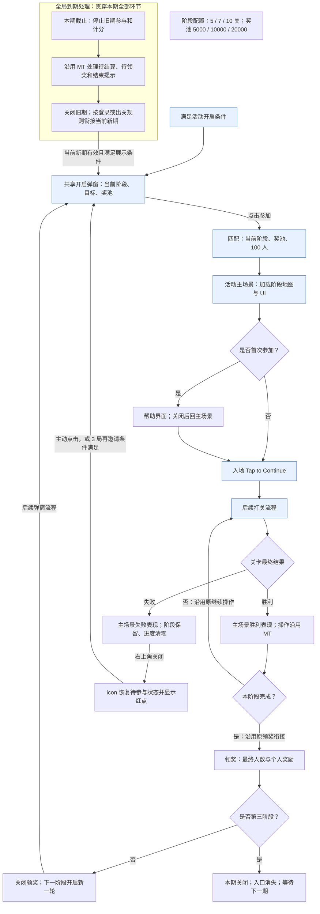

# 水上夺宝 Splash Quest — AI迁移与实施主档

## 改造目标与比较基线

将迁入 TS 的钻石联盟改为水上夺宝 / Splash Quest：每日固定 24h，一期三个阶段，目标 5/7/10 关、钻石总奖池 5000/10000/20000，全部完成后关闭本期；首版全体共用基础档位 B1。

**比较起点为迁移原版提交 `4905ae46c93dd605b3ddb005fb409a5a9476118a`，不含迁移后的改造提交及工作区改动。** 正文按“迁移原版 → 新需求”定义完整调整项、实现顺序和验收条件。调整项表新增“进度”列供逐项查看；详细代码证据与验证记录仍放在文末，不据此缩减产品改造范围。

正文中的“沿用原版”仅指原版实际已有能力；例如首次帮助在主场景入场后展示、胜利操作和固定周期晚加入余时规则。24h 排期、CD=0、三阶段单次领奖等属于改造目标，即使已有本地实现也仍列入差异。

## 已确认规则

| 项目 | 新规则 |
|---|---|
| 周期 | 一期 24 小时，每日循环，沿用现有配置切期时间点 |
| 时间口径 | 当前配置 08:00:00 按现有时间解析为 UTC，即北京时间 16:00；不改为本地 08:00 |
| 阶段一 | 100 人起始，连续通关 5 关，总奖池 5000 钻石 |
| 阶段二 | 重新匹配 100 人，连续通关 7 关，总奖池 10000 钻石 |
| 阶段三 | 重新匹配 100 人，连续通关 10 关，总奖池 20000 钻石 |
| 领奖 | 总奖池按剩余人数分配，沿用当前向上取整方式；每阶段只领一次 |
| 失败 | 阶段不退回，当前阶段进度归零；初版无失败冷却，结算结束后可经开启弹窗立即重新参与、匹配 |
| 晋升 | 阶段一、二领奖界面关闭后进入下一阶段，将共享开启弹窗加入后续弹窗列表，展示新阶段配置 |
| 完成 | 第三阶段领奖表现结束后活动关闭、入口消失；本期不再开启，下期从第一阶段开始 |
| 到期 | 全流程统一截止；进度终止、展示结束提示、入口消失。初版不设失败冷却，失败不提前结束活动 |
| 移除 | 独立段位总览页面、第三档循环、累计奖励、中途宝箱及其提示和领奖链路 |
| 首版分层 | 先建一个基础档位B1，全部玩家共用；后续再配置用户组到档位的映射，不沿用MT六类分群 |
| 活动专属难度 | 不接 MT 收益驱动关间加难，不接活动 DDA V2 关内保底；TS 原有主线调控保持 |

首次开启与下一阶段开启使用同一弹窗；必须点击参与才匹配。三个阶段共用一期截止时间，参与、重试、晋升均不重新计算 24 小时。已获得待领取奖励不得因到期或重启被丢失或重复发放。TS 作为全新活动上线，不处理 MT / 迁移测试旧存档兼容。

### 活动周期与开启

| 项目 | 需求 |
|---|---|
| 开启条件 | 沿用现有活动解锁与开启条件，本次不调整解锁门槛 |
| 单期时长 | 固定 24 小时，每天一期，期与期之间无额外间隔 |
| 每日切期 | 沿用现有配置切点；当前方案口径为 UTC 08:00，即北京时间 16:00 |
| 计时起点 | 按统一活动周期计算，不从玩家首次参与时间开始计算 |
| 晚加入 | 沿用原版固定周期规则，仅获得本期剩余时间；例如距离切期 2 小时参与，剩余时间为 2 小时 |
| 共用截止时间 | 三阶段共用本期截止时间；参与、重试、晋升均不延长活动 |
| 新期开始 | 满足开启条件时，从第一阶段、0 进度开始；上一期未完成进度不带入新期 |
| 本期提前完成 | 完成全部阶段并结束领奖表现后，关闭活动、移除入口；等待下一期 |

活动开启时展示开启弹窗。玩家点击参与后才进入匹配，首次帮助在匹配后进入活动主场景时展示。仅打开或关闭开启弹窗不视为开始挑战。

## 玩家流程

主线为 **活动开启 → 点击参加 → 匹配 → 活动主场景 → 主线关卡挑战 → 活动结算**。首次、失败重试和进入下一阶段共用开启弹窗；只有点击参加才开始匹配。三个阶段共用本期截止时间。

首次及新一期显示 Stage 1；失败重开保持当前阶段，前两阶段领奖后显示下一阶段。提前完成本期后等待每日切点，不立即重开。

### 开启、匹配与首次帮助

1. 满足解锁、档期和展示条件后弹出开启弹窗；只打开或关闭不算参加，后续提醒遵循“弹窗规则”。
2. 点击参加进入匹配。每个阶段、每次重试均从 100 人开始；阶段、奖池及奖励图片读取对应配置。
3. 首次匹配后进入活动主场景，再自动展示帮助。关闭帮助后回到原主场景；重试、进入下一阶段及新一期不重复首次帮助。
4. 主场景底部显示 Tap to Continue，点击进入后续打关流程，不跳过已有结算或关前环节。

### 主场景区域与阶段配置

| 区域 | 配置与交互要求 |
|---|---|
| 阶段地图与台子 | 各阶段地图依据 5 / 7 / 10 关目标手工配置，运行时读取对应配置；正确对应起点、进度位置和终点，区分已通过、当前与未到达。程序不新增自动排布方案 |
| 奖励堆 | 按阶段配置切换资源和奖池信息；装饰宝箱或金币不引入中途奖励，也不改变钻石奖励类型 |
| 告示牌 | 按当前阶段配置显示资源与信息，与目标和奖励保持一致 |
| 主场景 UI | 阶段、进度/目标、剩余人数、共用倒计时及相关图片读取当前阶段配置 |
| 活动 icon | 挑战中显示当前阶段进度条；失败退出后恢复待参与状态及红点；本期完成后移除，新期有效时重新显示 |

匹配和主场景显示当前阶段数据；领奖使用完成时的阶段与奖励快照。正式资源可替换，阶段切换不得残留上一阶段资源或信息。

### 挑战、失败与晋升

#### 连续通关

参加后，每次有效主线胜利推进当前阶段一关。在关卡结算流程中展示活动前进、其他参与者淘汰和剩余人数变化。胜利表现、已有点击/快进以及阶段达标后进入领奖的衔接沿用 MT，不另加统一的 Tap to Continue 确认步骤。

主线最终胜负、退出与复活沿用现有口径。出现复活机会或继续当前关卡不算活动失败；最终失败才清空本阶段进度。活动 icon 与主场景进度保持一致。

#### 失败与重试

最终失败后，在活动主场景展示失败过程，保留当前阶段和前序已领奖励，清空本阶段进度。玩家通过右上角关闭按钮退出；关闭后不立即弹开启窗，icon 恢复待参与状态并显示红点。

无失败 CD。玩家可立即点击 icon 打开当前阶段开启弹窗，再点击参加，重新匹配 100 人并从本阶段起点开始。未主动参加时沿用 3 局再次邀请。重试不重置本期截止时间。

#### 晋升与全部完成

完成阶段后进入领奖界面，展示最终人数、总奖池与个人所得。前两阶段领奖界面关闭后，更新阶段，在后续弹窗流程中安排下一阶段开启弹窗，重新走“参加 → 匹配 → 主场景”。不额外回旧主场景做晋升展示，不增加独立晋升或段位总览界面。

“开启下一轮”仍属于同一期，不增加活动时长。第三阶段领奖结束后关闭本期、移除入口、清除本期待弹邀请；不重复第三阶段。

### 弹窗规则

自动邀请只决定展示时机，玩家主动参加不受再次邀请次数限制。首次开启、登录检查、结果恢复沿用现有机制；再次邀请和每日切期按下表处理。

| 触发场景 | 展示规则 | 次数与重置 |
|---|---|---|
| 首次开启、登录检查 | 检查开启与登录提示资格，显示当前有效阶段；既有待结算、待领奖先处理 | 保留登录提示机制；登录提示不等于每次登录必弹 |
| 通用未参与或失败后再次邀请 | 活动外累计结束 3 局后可再次邀请 | 每期最多 2 次再次邀请，新期开启重置；不再因自然日变化额外重置 |
| 前两阶段领奖结束 | 后续弹窗流程中开启下一阶段新一轮，仍需手动参加 | 不占通用再次邀请额度 |
| 在线出关处理旧期结束 | 关闭旧期结果后刷新有效新期入口；可主动参加，再完整结束 1 局后自动展示新期 Stage 1 开启窗 | 新期首弹不占再次邀请额度；延迟展示不延迟开期或倒计时 |
| 跨期登录 | 先处理旧期结果，再安排当前新期开启窗，无需额外打一局 | 沿用旧期结果的待处理标记；不重复排入相同提示 |
| 第三阶段完成 | 关闭本期，不再安排本期邀请 | 下一期从第一阶段重新开始 |

3 局计数沿用现有最终结果口径：胜利、退出失败、放弃复活均计入；复活继续同一局不重复计数，导致本次活动失败的那局不算随后活动外的再次邀请局数。在线跨期后的 1 局首弹计数从旧期结果关闭后开始，展示旧期结果的那局不计入。

实际展示成功后记录再次邀请次数并重新开始对应间隔；未展示成功不消耗次数。玩家手动处理对应开启邀请或已参加后，取消对应待弹邀请，后续按通用规则判断。

领奖、旧期结果、新期首弹和下一阶段开启不占每期 2 次再次邀请额度。展示前检查活动期、阶段、参与状态、到期状态及是否已处理，同一原因不重复安排；旧期邀请不能进入新期执行。

**失败后再次邀请为 3 局；在线跨期后的新期自动首弹为 1 局。两者独立，不共用一个间隔值。**

### 奖励结算契约

每个阶段的 5000、10000、20000 钻石均为**阶段总奖池**，不是每位通关玩家固定获得的奖励。

**个人奖励 = 阶段总奖池 ÷ 阶段完成时的剩余人数，结果向上取整。**

例如第二阶段结束时剩余14人，个人获得 `向上取整（10000 ÷ 14）= 715` 钻石。沿用现有取整方式，不额外分配尾差。领奖界面必须区分“总奖池”和“本次个人所得”。

- 奖励在阶段挑战完成后取得领取资格；失败或未完成阶段没有该阶段通关奖励。
- 每阶段只发放一次；重复点击、关闭再打开、重启均不能重复发放。
- 领奖时使用该次阶段完成的奖池和剩余人数，不使用晋升后新阶段的数据。
- 已取得的待领奖励不因活动到期或重启而丢失。
- 无中途宝箱奖励、累计奖励或额外第三阶段循环奖励。

### 到期与中断处理

到期逻辑沿用 MT 的超时状态、待处理结果和结束提示机制，保留迁移版已有的奖励保护。到期后停止旧期参加、重试和计分，不打断主线关卡，不改变主线自身胜负与奖励。

| 场景 | 处理规则 |
|---|---|
| 活动界面中到期 | 按原有到期流程处理待结算、待领奖与结束提示；结束界面表现随正式资源落实 |
| 打关中到期 | 不打断关卡，出关后处理活动结束；到期后的胜利不计入旧期，也不补记到尚未参加的新期 |
| 截止前已取得待领奖励 | 保留领取资格及完成快照，沿用已有待领奖恢复和发奖保护，不因换期丢失或重复发放 |
| 第三阶段已经完成并发奖 | 保持完成结果，领奖表现结束后关闭本期 |
| 在线处理旧期结束，新期已有效 | 旧期结束后刷新新期入口，可主动参加；再完整结束 1 局后自动弹新期开启窗 |
| 跨期登录 | 先处理旧期已有结果，再安排当前新期开启窗；不补开错过的历史各期 |
| 关闭、重启或中断恢复 | 沿用待处理结果标记恢复；不重置活动时间，不重复发奖或重复执行已处理结果 |
| 旧期回调晚于新期开启 | 旧期关闭仅清理旧期，不误关新期入口、阶段或待弹流程 |

不新增“未参加旧期则跳过结束提示”等过滤条件，不另建一套到期判定。普通失败仍可重试当前阶段；到期结束不能重试旧期。新一期始终按固定排期开放，等待自动邀请不增加剩余时间。

## 首版统一数值与调控边界

### 首版数值基线与适用范围

本节定义首版基础档位B1：所有玩家共用一套数值，后续分组单独扩展；数值基线可用于配置实施，经济效果仍需验证。

- **当前产品基线**：5/7/10 连胜；5000/10000/20000 钻石瓜分奖池；每次 100 人；期望人数30/15/10；一个基础档位，所有玩家共用；不接活动专属难度。
- **状态**：已暂定，可据此准备首版配置；不等于经济平衡已验证或游戏配置已生效。
- **目标流程**：每日固定24h、失败即时重试、每阶段只领奖一次、第三阶段后结束、无中途宝箱/累计/末档循环。

### 基础档位与用户分组的关系

先定义一个完整的**基础档位包 B1**，其中包含第一、二、三阶段的数值。B1 是本文的策划称呼，不是要求新增的配置字段。“档位包”不等于玩家阶段，也不等于已上线的用户分群。

| 层次 | 首版配置 | 后续扩展方式 |
|---|---|---|
| 玩家阶段 | 同一档位包内按5→7→10关推进 | 首版三阶段结构保持；不把阶段序号当用户层级 |
| 基础档位包 | B1，三行Stage共同构成一套参数 | 根据实测需求增加独立档位包；不预设高/中/低三套数值 |
| 用户分组规则 | 所有符合活动条件的用户映射B1 | 再定义分组指标、阈值与优先级，把用户组映射到相应档位包 |
| 活动档位选择 | 复用现有UserLayer→Main→Stage链路 | 保留可配置选择能力，不把B1数值硬编码到业务或UI |
| 生效时点 | 本期开启时记录UserLayer快照 | 用户分组变化从下一期重新选档，本期重试/晋升不换档 |

首版建议用现有 `userLayer=1` 标识 B1，`Main.id=260101` 引用 `Stage 1/2/3`，与当前30/15/10所在的源行一致。层号和Stage ID是配置绑定，不代表“高价值用户”或其他人群含义。未来不同分组可以共用同一档位包；只有参数确实需要区别时才增加新包。

暂不定义付费/余额/连胜率/复活意愿等用户分组门槛，不恢复MT默认六层，也不为了“以后分组”复制多套完全相同配置。现有UserLayer接口和本期快照保留，旧多维规则退出本活动首版的有效匹配链。

### 统一配表建议

以下为首版 **B1 数值基线**，用于配置实施；实际经济效果另行验证。

| 字段 | 阶段一 | 阶段二 | 阶段三 | 用途 |
|---|---:|---:|---:|---|
| Stage.id | 1 | 2 | 3 | 建议复用现有基础行；三个ID组成B1 |
| winNum | 5 | 7 | 10 | 各阶段独立连胜目标 |
| DiamondCount | 5000 | 10000 | 20000 | 总奖池，非个人固定奖励 |
| PlayerNum | 100 | 100 | 100 | 每次新挑战重新初始化 |
| UserSegmentationExpect | 30 | 15 | 10 | 初始期望基数，不是固定结算人数 |
| MinExpectNum | 20 | 10 | 5 | 基础人数及额外淘汰的下界 |
| MaxExpectNum | 40 | 30 | 20 | 基础人数调整上界 |
| AdjustIntensity | 1 | 1 | 1 | 同档跨次挑战条件调整步长 |
| Reward | 空 | 空 | 空 | 不额外发固定道具奖励 |
| midChestIds | 空 | 空 | 空 | 不启用中途宝箱 |

三档 `LevelCoefList` 均为 `[1,1.1,1.2,0.1,0.5]`，依次对应普通、困难、极难、奖励关、指引关。五项是**关卡类型索引**，不是阶段内关卡位置；不随5/7/10关裁剪。该字段只分配模拟淘汰节奏，不修改玩家棋盘难度；TS接口类型映射须核对。

`ExtraJewelCoef` 是**阶段内关卡位置索引**，数组与目标关数精确对应：

| 阶段 | 系数数组 | 取值依据 |
|---|---|---|
| 5关 | `[0.05,0.04,0.03,0.02,0.02]` | TS新设轻补偿；MT第一阶段原为道具奖，不将原数组视为已验证钻石补偿 |
| 7关 | `[0.30,0.25,0.20,0.15,0.15,0.10,0.10]` | MT第1层原值；10000奖池和15人期望与原版对应 |
| 10关 | `[0.30,0.25,0.25,0.20,0.20,0.20,0.15,0.15,0.15,0.15]` | MT第1层前十项，不乘2/3；20000奖池下有意保留较强补偿，须观察产出 |

第一阶段固定期望30人时，多淘汰一人的奖励差额约5.75；低系数避免少量消费就快速用满每关一次的补偿机会。第二阶段差额约47.62，原系数作为迁移基线。第三阶段固定10人时差额约222.22，且从12人降至10人会提高触发门槛，因此暂定保留MT前十项原系数。所有系数都是内部补偿权重，不是对玩家承诺的返钻比例。

### 玩家实际所得与经济边界

`个人奖励 = ceil(奖池 / 实际最终剩余人数)`。TS现有ResolveDiamondReward直返数量，不迁MT通用奖励系数实验。必须完成阶段才取得领奖资格。

| 口径 | 阶段一 | 阶段二 | 阶段三 | 三阶段合计 |
|---|---:|---:|---:|---:|
| 按基数30/15/10瓜分 | 167 | 667 | 2000 | 2834 |
| 首次无补偿，按原整数随机正常收敛 | 167～173 | 667～715 | 2000～2223 | 2834～3111 |
| 配置人数上下限对应的理论奖励区间 | 125～250 | 334～1000 | 1000～4000 | 1459～5250 |

这些是算术口径，不是统计均值或每日必得奖励。上下限推算也不代表首次挑战可达：例如固定E=30、5关最多额外淘汰5人，最低到25人、奖励200；不能直接以人数下限20推定首轮可得250。奖池合计35000不等于个人获得35000。取整与异常权重下实际人数边界仍需运行验证。

无复活、全部关卡权重为1、期望固定30/15/10时的基础剩余人数示例：

- 5关：`100 → 79 → 62 → 49 → 39 → 30`。
- 7关：`100 → 76 → 58 → 44 → 33 → 25 → 19 → 15`。
- 10关：`100 → 79 → 63 → 50 → 40 → 32 → 25 → 20 → 16 → 13 → 10`。

固定上述期望、初始补偿结余0且最终完成阶段时，暂定系数的算术模拟如下（不是实际复活价格或实机结果）：

| 假设消费 | 第一阶段：总花费→奖励增量 | 第二阶段：总花费→奖励增量 | 第三阶段：总花费→奖励增量 |
|---|---|---|---|
| 每关花100钻石 | 500→+12 | 700→+103 | 1000→+0 |
| 每关花300钻石 | 1500→+33 | 2100→+333 | 3000→+500 |

第三阶段单次300钻石复活并不保证额外淘汰；本机制定位为有多次/较高复活投入且最终完成时增加部分奖励，不宣传“每次复活必加奖”。日参与人均产出按 `P(完成阶段i｜当日参与) × E(个人奖励｜完成阶段i)` 分阶段求和，结合TS参与率、完成率、重试和复活分布评估，不用全通合计替代人均产出。

### 人数调控保留项

沿用现有PeopleRule，不因首版统一档位另建算法。流程为“档位参数→抽本轮期望→分配基础淘汰→按复活额外淘汰→按实际人数瓜分”。

1. **本轮期望E**：首次取UserSegmentationExpect；后续同档成功基数加AdjustIntensity，失败且保存的补偿结余>200时减AdjustIntensity，条件调整限于Min/Max。随后执行整数随机 `[max(Min,E-1), min(Max,E+1))`，上界不含。初始30/15/10通常抽到29～30、14～15、9～10。上次随机结果会保存，未触发条件调整的失败重试也可能向下漂移；AdjustIntensity=0并不能固定人数。按活动期重置、每阶段只领奖一次下，同档成功重开分支通常不会触发。
2. **基础淘汰**：令初始人数S、关数K，`q=(E/S)^(1/K)`，第i关原始淘汰比例为 `q^i×(1-q)`（i从0开始）；按关卡类型权重加权归一化后，前K-1关RoundToInt，末关补足S-E的剩余差额且不小于0。关卡类型主要改变淘汰时点；正常收敛时不直接改变最终基础人数，最终发奖仍以实际人数为准。
3. **额外淘汰**：令奖池P、已额外淘汰X、N=E-X。本关记入花费×本关系数+前次计算结余，大于 `P/(N-1)-P/N` 且N>Min时，额外淘汰1人；每关最多1人，不循环消耗额度。这个N是预计最终人数，不是界面当前剩余人数。
4. **结余精确口径**：`RoundToInt(累计记入花费×各关系数之和 - P/(E-X) + P/E)`。它不是累计原始消费。跨次重试首关的“记入花费”还包含上次保存结余，首关触发判定同时读取旧结余；之后按累计加权记录重算。保留该实际消费顺序，不将其替换为未经确认的永久全额返利账户。
5. **输入和时点**：只有TS的ReviveDiamondSpent实际付费复活事件计入；普通买道具、广告复活不误计。复活继续本局，不立即算活动失败。最终关卡结果才更新人数；失败另计玩家淘汰且不发阶段奖励，胜利才加连胜。
6. **保存与重置**：同档数据按winNum=5/7/10分桶，失败重试保留；新期开启清空，不跨期继承。不同用户分组不是这些分桶，首版不增加另一套存档结构。

例：第二阶段P=10000、E=15、初始结余0，前三关分别消费200/100/100，系数0.30/0.25/0.20。第一关60>47.62，额外淘汰1人、结余约12；第二关25+12=37<54.95不触发；第三关20+37=57>54.95再淘汰1人，结余约2。后面不再触发且正常收敛时，最终13人，实发ceil(10000/13)=770，而非667。

### 实施方案比较与推荐

| 方案 | 优点 | 代价/边界 | 结论 |
|---|---|---|---|
| 保留UserLayer映射，首版全部映射B1 | 单套参数易维护，后续可按用户分组选择新档位 | 需使旧规则退出有效匹配，检查本期快照及正数就绪门槛 | 采用；建议layer=1、Stage1/2/3 |
| 六层各复制一套相同值 | 可短期对照 | 冗余表易漂移、旧分群仍生效，不符合先建基础档位的方向 | 不采用 |
| 删掉分组接口，在代码固定参数 | 初期调用看似简单 | 后续分组需重新接入，不能复用现有配置/快照 | 不采用 |

首版通过源表配置一个无条件命中的正数层1规则，业务仍按UserLayer读取Main。规则表达式由真实导出器编译，不手写编译产物；不把GetMainCfg改成永久返回固定行。不要用层0替代：现有OnLifecycleTick存在UserLayer>0就绪门槛。

## 状态归属与实现边界

| 数据/能力 | 归属与写入者 | 消费者与约束 |
|---|---|---|
| 周期、阶段目标、奖池、人数/补偿参数 | 配置源；真实导出链生成产物 | 活动只读；UI 不拼装另一套奖励规则 |
| 本期阶段、连胜、剩余人数、尝试序号 | 活动 Profile，由 ActDiamondChampion 推进 | UI/入口只读；主线只上报结果 |
| 分层 | 既有 UserLayer 系统计算统一正数层；活动保存本期快照 | Main 查询读取快照；不能多处修改或使用实时余额导致期中漂移 |
| 分档补偿结余 | 活动 Profile，按 winNum 的 5/7/10 分桶 | 同期同档重试延续，新期清空 |
| 待领奖快照和已领奖标记 | 活动唯一发奖流程写入；通过现有奖励服务到账 | 防重复领取；晋升或到期不得用新阶段值覆盖已得奖励 |
| 当前动画、布局、展示缓存 | UI 持有并随窗口释放 | 关闭或杀端不能成为丢失奖励、重复发奖或清零玩法状态的原因 |
| 主线状态与关卡类型 | Game 模块生产；现有接口/消息桥接 | 活动不直接依赖 Game 实现或 MT 数据中心 |
| 生命周期截止、入口和弹窗 | TS 公共活动框架编排，活动钩子响应 | 各窗口不能单独重启期限；旧期回调不能关闭新期 |

主链路：主线有效结果 → 活动核对本期/运行状态/截止时间 → 计算人数并推进或失败 → 写 Profile → 驱动 UI/入口。实际钻石复活通过既有 `ReviveDiamondSpent` 通知累计；生命周期按既有订阅/退订位置对称维护。普通关卡失败弹出复活机会不等于最终失败。

### 状态转换与门禁

以下是行为契约，复用当前 RunState/MainViewState 等字段表达，不要求新增一套状态枚举。

| 触发 | 前置条件 | 写入与结果 |
|---|---|---|
| 新期开启 | 旧期待领/结束处理已妥善结清，当前期开启条件满足 | 第一阶段、0 连胜、清本期领奖与补偿数据、取统一分层快照 |
| 点击参与 | 本期有效、配置/资源就绪、未完成、无待领奖、非重复 InRun | 初始化本阶段 100 人与人数算法，增加尝试序号，再匹配 |
| 有效关卡胜利 | InRun 且截止前 | 人数更新、连胜+1；未达目标继续，达到目标保存结算/待领奖信息 |
| 最终失败/退出 | InRun 且沿用 TS 主线最终失败语义 | 更新失败结算、清当前连胜、不降阶段；CD=0，待失败表现后允许重试 |
| 领取前两阶段奖励 | 本期对应阶段已完成且未领 | 按完成时快照发奖并标记，晋升后将共享开启弹窗加入后续列表，展示前复核状态 |
| 领取第三阶段奖励 | 同上 | 发奖并标记；领奖表现完成后关闭本期、移除入口，不能再参与 |
| 到期 | 公共截止到达 | 拒绝新参与/计分；保留已得待领，处理完旧期后释放生命周期 |
| 关闭/重启 | 任意有效状态 | 从 Profile 重建 UI；不重复发奖、不改期限、不丢待领 |

发奖与持久化的真实写回次序须沿用并检查 TS 奖励/存档约定；不能仅靠 UI 按钮禁用宣称防重。无需迁移 MT 或旧测试存档；新版本自身仍需序列化恢复、防重和跨期隔离。优先复用现有状态；实现前核对按期提醒和跨期首弹所需的最小状态。若需要新增本活动字段，必须经定义源及真实生成链更新，不能手改生成 Profile。旧循环字段可保留结构但退出新业务；不因整理规则清理无关共享代码。

## 具体修改点

### 迁移原版与新需求的完整差异

以下 T01～T16 是本次改造的完整产品与工程范围，以迁移提交为比较起点，不按当前代码完成情况删减。已落地部分在实施时核验复用；“进度”列概括当前状态，详细剩余动作在文末记录。路径以 TS 仓库为根，活动脚本与配置主要位于 `Assets/Module/Activity/DiamondChampion/`。

**进度核对：2026-11-02，`migrate-diamondchampion@8caa61e12da87a881b5ced2a30985e15b41c554b`，工作区干净。** ✅ **已实现，待验收**仅表示当前源码/本地配置已具备；🟡 **部分实现**表示目标仍有明确缺口；⬜ **待实施/待调整**表示尚未达到要求。本轮未运行 Unity、编译、测试或配置反序列化，不使用完成百分比。

| 编号 / 调整项 | 迁移原版 | 新需求 | 具体修改位置与动作 | 进度 |
|---|---|---|---|---|
| T01 名称与主题 | 钻石联盟，沿用 MT 界面与资源 | 正式名称水上夺宝 / Splash Quest，水上乐园主题；内部活动标识不必重命名 | Locale 实际绑定、共享开启窗、Match/Main/Win/结束展示及 ResDLC；替换玩家可见内容，清除旧玩法描述 | ⬜ **待实施**：本地中英标题仍为钻石联赛 / DIAMOND LEAGUE；正式主题资源未接入验收 |
| T02 活动排期 | 约 4 天开放、3 天间隔，固定周期 | 每日固定 24h、无间隔；沿用 UTC 08:00 切期；晚加入仅余时，重试和晋升不补时 | Activity/Config/Data/main 及实际生效 AB 覆盖；核对生命周期截止、提前完成后等待下一期 | ✅ **已实现，待验收**：普通/AB 配置均为24h、无间隔，固定切点保持 |
| T03 阶段结构 | 前两档晋升，第三档循环挑战 | 三阶段各完成、领奖一次；第三阶段领奖表现结束关闭本期并移除入口 | ActDiamondChampion.FlowAndConfig / Config / ViewAndQuery / PendingAndTimeout；停止末档循环，维护三阶段完成与待领奖状态 | ✅ **已实现，待验收**：三阶段单次发奖、末阶段关闭及移除入口；循环逻辑已删除 |
| T04 通关目标 | 3 / 7 / 15 关 | 5 / 7 / 10 关；各阶段失败只清当前进度 | Stage.winNum、进度查询、目标文案及地图位置；逐关补偿数组同步为 5/7/10 项 | 🟡 **部分实现**：仍为3/7/10，首阶段未改5；逐关补偿仍为7/7/15项 |
| T05 阶段奖励 | 第一档固定道具；第二档 10000、第三档 30000 钻石奖池 | 全部改为钻石总奖池 5000 / 10000 / 20000；按最终人数向上取整分配，每阶段一次 | Stage.DiamondCount/Reward、PeopleRule、领奖快照与 Win 展示；第一阶段切换到钻石奖池计算路径 | 🟡 **部分实现**：已全部走钻石瓜分和领奖快照，奖池仍为2000/5000/10000 |
| T06 参数与分层 | 六组 Main / 十八组 Stage，按旧规则分层 | 首版全体映射一个基础档位 B1；期望 30/15/10，范围 20～40 / 10～30 / 5～20；保留以后分组能力 | Main/Stage/Rule/Attribute、GetMainCfg 与本期 UserLayer 快照；复用人数算法，配置人数、步长及补偿 | ⬜ **待实施**：仍为6 Main、18 Stage、82条规则，未收敛B1 |
| T07 附加奖励 | 第三档中途宝箱及循环累计奖励 | 移除中途宝箱、累计进度和累计奖励及相应提示 | Stage.midChestIds、Main.totalProgress/loopClaimMaxTimes/loopAccumRewards；退出提示、展示、领取业务链，按引用处理旧资产 | 🟡 **部分实现**：循环/累计业务及字段已删除，Stage宝箱引用已清空；宝箱旧代码/资源仍保留，退出链路与资源引用待核验 |
| T08 参加入口 | 存在独立段位总览及对应路由 | 首次、失败重试、下一阶段共用开启弹窗；点击参加才匹配，再进入主场景 | PanelRouting、Tips/Stage/Match 与入口；主流程移除独立总览，关闭开启窗不算参与 | ✅ **已实现，待验收**：共享开启窗、手动参加与匹配路由已接通；独立总览脚本已删除 |
| T09 阶段衔接 | 领奖后回段位展示/总览，再进入后续挑战 | 前两阶段领奖关闭后将下一阶段开启窗加入后续弹窗流程，按新阶段再开启一轮；无独立晋升页或旧主场景中转 | WinPanel.ClosePanelAfterWinClaim、HandleAfterWinClaim 与 Flow 接缝；新阶段手动参与、重新匹配 100 人，共用截止时间 | 🟡 **部分实现**：领奖后会升阶段，但仍经旧主场景 ShowOpeningPopup 直接弹窗，未接后续弹窗列表 |
| T10 失败冷却 | 失败 CD 为 1800 秒；冷却跨截止可提前判超时 | 初版 CD=0，可立即重新参与当前阶段；取消该冷却导致的提前结束 | Main.CDtime、失败门禁与 CheckTimeOut；保留阶段、清连胜，禁止因旧 CD 分支提前关闭 | ✅ **已实现，待验收**：六套CDtime=0；冷却跨截止提前结束分支已移除 |
| T11 失败退出与入口 | 失败关闭后进入段位相关路由 | 右上角关闭只退出；icon 恢复待参与并显示红点；主动点击进入同阶段开启窗 | MainPanel.OnClickClose、PanelRouting、Entry；不在关闭失败时立即弹开启窗，重新参加时重置人数 | 🟡 **部分实现**：icon待参与/红点已有，失败关闭仍立即打开开启窗，退出行为待改 |
| T12 再次邀请 | 通用 3 局提醒、每日最多 2 次；开窗检查时计次 | 保留 3 局，改为每期最多 2 次；实际展示成功后计次，手动处理或已参加后取消对应邀请 | FlowAndConfig、PopupFlowItem、PanelRouting、Entry；不加失败 1 局例外，结果/下一阶段/新期首弹不占再次邀请额度 | 🟡 **部分实现**：3局/2次及开窗清标记已有；仍按自然日计数且展示前扣次，期额度/完整去重待改 |
| T13 跨期衔接 | 沿用固定周期的超时、待处理结果和登录提示流程 | 在线先处理旧期，新期入口立即可用，后续完整结束 1 局再自动首弹；登录先旧期后当前新期，无额外 1 局 | PendingAndTimeout、OnOpen 与 Flow 接缝；复用到期/待领奖保护，区分在线与登录，不补开错过各期，不新增未参与过滤 | 🟡 **部分实现**：到期停计分、待领奖与期号保护已有；在线1局首弹和登录分流未落实 |
| T14 地图与区域资源 | 按目标动态拼接旧地图段，主要使用旧固定资源 | 每阶段手工配置地图；按配置切换台子数量、奖励堆、告示牌、匹配奖励图及 UI | MainPanel.MapAndScroll、MapSection、RewardDisplay、Match 与 ResDLC；运行时选择配置，不开发新自动排布 | ⬜ **待实施**：仍动态拼接旧地图段，未按阶段加载手工地图与正式区域资源 |
| T15 入场与操作 | 主场景入场显示 Play；首次帮助在首次进入主场景后展示；胜利有既有操作/快进/领奖衔接 | 入场改为 Tap to Continue；首次帮助时机和胜利操作沿用原版，不增加胜利统一强制确认 | MainPanel / DOTweenFlows 与预制体；仅调整入场提示和对应操作绑定，保留首次帮助记录 | ⬜ **待调整**：入场仍为Play，首次帮助仍在匹配前；主场景后置帮助检查已被删，需恢复；胜利操作保留 |
| T16 配套验证 | 原版参数、循环、冷却和资源对应的用例/文案 | 围绕新周期、三阶段、奖励、弹窗、跨期和阶段资源更新配置校验、用例与验收 | DiamondChampionFlowTests、实际本地化和相关配置/资源验证；保留 TS 主线难度，不引入活动专属难度；新活动自身需恢复和发奖防重 | 🟡 **部分实现**：已有三阶段/到期/重启等测试代码，但仍断言旧数值；当前HEAD未执行验证，最新弹窗与正式资源未验收 |

### 原版沿用与实施边界

- 每次匹配均为 100 人；人数淘汰算法继续复用，参数按 B1 调整。
- 首次帮助沿用原版“首次匹配进入主场景后展示”，关闭后回到该场景；不是本次新增的时机变更。重试、晋升、新一期不重复首次帮助。
- 普通胜利表现、点击/快进及阶段完成进入领奖的操作沿用 MT；不新增统一胜利确认。
- 失败保留阶段、当前进度清零；变更的是冷却、退出去向和再次邀请规则。
- 晚加入沿用统一截止时间；到期沿用 MT 超时、待处理结果与结束提示机制，并保留迁移版待领奖保护，不新增未参加旧期的过滤逻辑。
- TS 保留自身主线难度；不接 MT 活动专属难度，不做旧 MT / 迁移测试存档兼容；新活动自身仍须支持重启恢复与奖励防重。

### 数据与实施边界

不处理MT或旧迁移测试存档兼容；新活动自身的重启恢复仍需保留。再次邀请优先复用现有计数；在线跨期1局首弹和邀请去重需先核对现有Flow上下文能否表达，必要的最小本活动状态通过定义源生成，不手改生成Profile、不扩大公共协议。

不重新复制已迁入资源，不顺手删除仍有引用的旧资产，不修改其他活动或共享难度模块。在线表由用户操作；本地能完成的配置修改与真实序列化在后续实施时落实。

## 配置与导出契约

### 首版表结构及主键绑定

目标是“一套B1基础档位＋全体用户映射”，沿用现有表结构，不新增档位包表、用户画像系统或Profile字段。以下是**目标配置说明**，不是已生成或已生效的数据。

| 配置位置 | 首版目标 | 后续扩展约束 |
|---|---|---|
| Activity主表（含实际生效AB覆盖） | id=260101，Name=ActDiamondChampion，effective=1，startTimeType=2，cycleId=1，numOfCycles=-1；timeStart沿用2026-05-04 08:00:00，timeEnd=2026-05-05 08:00:00，duration=0，coolingTime=0；preLevel=28/openLevel=55沿用当前本地值 | 普通/AB路径时间窗口一致；全局Activity.UserLayer不等于活动内部档位，不误改其语义 |
| DiamondChampion Main | id=260101，userLayerType=DiamondChampion，userLayer=1，stages=[1,2,3] | 通过现有UserLayer匹配，保留本期层级快照 |
| Main流程字段 | CDtime=0；循环/累计字段退出业务。当前分支已删除totalProgress/loopClaimMaxTimes/loopAccumRewards，不为赋0重新加入；旧配置形态仅供对照 | 日后分组不自动恢复循环、累计、失败冷却 |
| Main弹窗字段 | loginForcePopup=1，postSettleForcePopupAfterLevels=3，postSettleForcePopupDailyLimit=2 | 保留现有字段和数值，次数业务口径改为每期2次；历史字段名中的Daily不代表继续按自然日重置。在线跨期新期首弹1局单独处理，不改通用间隔 |
| Main展示字段 | stageTitleKey沿用现有三项str_id_DiamondChampion_StageTitle1/2/3；stageIconKey当前为Promot1/Promot2/Loop，正式UI替换循环语义 | 图标键按真实资源绑定处理；键名Loop存在不代表启用循环业务 |
| Stage | id=1/2/3，逐字段采用B1表；Reward=[]，midChestIds=[] | ExtraJewelCoef长度分别5/7/10；LevelCoefList每行固定5项 |
| Rule | 一条有效无条件规则返回userLayer=1；规则行id在源表核对后建议复用1 | 所有有效玩家都匹配B1；日后具体分组规则在前、B1兜底在后，避免提前全命中 |
| Attribute | 首版规则不依赖余额、复活、连胜率、进度等派生属性 | 可保持表/加载能力，未引用历史行按引用检查处理；未来按实际分组需要增加属性 |
| UserLayer类型注册 | 保留DiamondChampion类型、原BI名与TS本活动attribute/rule的加载映射 | 不把层号1写死到代码；配置输出必须为正数以满足现有就绪条件 |
| 旧层与覆盖入口 | 旧多层Main/Stage不再被首版规则选中；最终只有一套有效配置；核对ConfigOverride等生效链 | 无引用历史行清理由实施时决定；不误删其他活动共用表，不直接迁入MT的AB75/95/89 |

### 后续用户分组的接入方式

1. 先观察B1下阶段完成率、重试次数、最终人数、补偿触发率、复活花费及钻石产出；有具体差异目标后再定义人群和档位，不现在预填“高/中/低付费”阈值。
2. 为确需不同参数的档位建立独立Stage行并绑定对应Main层级。新Stage ID核对当前占用后分配；不同参数不共用同一行，避免修改一组影响另一组；同参数用户组可继续映射B1。
3. 保留当前按Main列表的id和userLayer组合筛选方式，不能因首版只有一行就改成单纯按id取值；未来Main.id可能仍为260101、多行通过层号区分。
4. 分组规则配置优先级与B1兜底；每期开启选档并保存层级，本期重试、晋升不重新按实时余额等换档。部署新分组应从新期生效，已完成阶段的待领奖快照独立结清。
5. 本期层级快照只固定选择结果，不等于所有配置值已自动快照。后续调整活跃档位参数时须核对真实配置加载/缓存和发布时点，不能期中改写正在使用的Stage后宣称奖励不变。

### 配置导出与校验

- 权威链：源表/当前授权输入→真实ConfigFetcher→JSON与bytes→ConfigManager运行读取。禁止只改一端宣称生效；不手写编译表达式、bytes、生成C#或Profile。
- 配置路径以TS `Assets/Module/Activity/Activity/Config/Data/`、`DiamondChampion/Config/Data/` 为准；表源绑定见文末“工作区与来源”。MT和TS源表ID不同，不能混用。
- B1数值作为本地配置实施基线；需要在线表变更时列出字段、主键及操作清单，由用户操作；通过真实导出链校验生成物，不手写bytes或编译表达式。
- 写表前按主键核对行号、结构、规则优先级、普通/AB覆盖及未引用行。文末六层历史坐标不是最新可直接执行清单。
- 校验一条有效Main引用三条Stage，5/7/10与系数长度一致；Min≤UserSegmentationExpect≤Max且Min>1；新老关卡/余额/复活历史均映射B1；新期取档、本期不漂移、待领奖数据不被换档覆盖。

## 界面与交互需求

| 界面或入口 | 必须表达的信息 | 操作与后续行为 |
|---|---|---|
| 活动入口 | 当前阶段、挑战进度条、待参与红点 | 失败退出恢复待参与；本期完成移除，当前新期有效时刷新入口 |
| 共享开启弹窗 | 阶段、目标、总奖池与参与按钮 | 首次、重试和下一阶段新一轮共用；点击参加才匹配 |
| 匹配界面 | 当前阶段、奖池、奖励图片、100 人匹配过程 | 完成后进入当前阶段主场景 |
| 首次帮助 | 连胜、淘汰、瓜分、失败重试及三阶段规则 | 首次匹配后进入主场景时自动展示；关闭回原场景 |
| 活动主场景 | 手工配置的阶段地图、台子、奖励堆、告示牌、进度、人数、倒计时 | 入场通过 Tap to Continue 进入打关流程；胜利表现及后续操作沿用 MT |
| 普通失败表现 | 本次挑战失败、阶段保留、进度清零 | 右上角关闭退出，不立即再弹开启窗；恢复 icon 与红点 |
| 阶段领奖界面 | 完成阶段、最终人数、总奖池与个人所得 | 前两阶段关闭后开启下一阶段新一轮，第三阶段关闭本期 |
| 活动结束提示 | 本期已结束、旧期不可继续 | 到期处理机制沿用 MT；关闭后按在线出关/跨期登录规则衔接新期 |

不增加独立晋升或段位总览界面。关闭界面本身不会降阶段、清空有效进度或重新匹配；正式资源按阶段配置读取。

## 资源与 UI 设计状态（2026-10-30 补充）

参考 RM Ancient 的活动体验方向，当前主界面草图采用水上乐园主题：水面上的踏垫构成关卡路径，顶部城堡及奖励陈列区域作为终点视觉。

![[02-PROJECTS/TileScape/游戏逻辑/任务-钻石联盟每日三阶段改造.assets/主界面草图-2026-10-30.png|360]]

当前迁移资源与临时界面仅用于流程联调，后续允许重做或修改。正式资源需支持三种关卡长度，并清楚区分已通过、当前目标及后续路径；各阶段布局手工配置，运行时按阶段读取；具体摆位、滚动与镜头仍待正式资源确认，不新增自动排布方案。

草图中的金币和宝箱仅表示当前美术构想，不代表奖励币种或新功能。实际奖励仍为钻石总奖池，不恢复中途宝箱。下一阶段以开启新一轮衔接，不单独制作晋升界面或回旧地图展示晋升。

### 待细化的 UI 设计

| 待定项 | 需要形成的设计结果 |
|---|---|
| 5 / 7 / 10 关地图 | 各阶段路径、起点终点、滚动与镜头定位方案 |
| 主界面信息栏 | 阶段、进度、人数、倒计时与挑战按钮的位置及视觉层级 |
| 玩家与淘汰表现 | 玩家位置、人数变化、通关推进与失败反馈 |
| 下一阶段开启 | 共享开启弹窗正式构图与阶段信息切换，后续重新参加和匹配 |
| 匹配、领奖、结束 | 各界面正式资源、动画、关闭与继续操作布局 |
| 文案与适配 | 正式按钮及规则文案、多语言长度、安全区与不同屏幕比例 |

上述待定项影响表现方案，不改变已确认的周期、阶段目标、奖池、失败重试与晋升规则。

正式展示名称统一为“水上夺宝 / Splash Quest”。现有迁移资源仅供联调，结束提示和共享开启弹窗的正式构图待资源确认，不保留独立晋升展示要求。正式 UI 的允许变化按本节定义，不以源界面逐像素一致作为此次改造目标。

资源实现继续沿用 TS DLC、入口与公共 UI 约定；资源和 .meta 成对，GUID、动态加载路径、字体/材质加载键、按钮音频和动画中断需要核对。只在发生对应资源改动时触发引用/导入检查；不要重新复制已迁入内容或建立第二套公共框架。旧总览/循环资源暂存不等于业务仍启用，删除前查真实引用。

## 实现顺序建议

下表按迁移原版到新需求的完整范围安排依赖顺序。实施前对照文末工作区快照，已落地内容核验复用，不重复覆盖。每步记录结果后再进入依赖该步的内容。

| 步骤 | 修改内容与依赖 | 最小验证输出 |
|---|---|---|
| Step1 固定基线与作用范围 | 固定原版提交，逐项确认 T01～T16；另查暂存/工作区进度、配置覆盖和资源状态；确定本期、尝试、待领奖及弹窗状态归属 | 原版/目标完整对照与工作区差异分开；保护已有修改，明确受影响文件和验证范围 |
| Step2 周期与基础配置 | T02/T04～T07/T10：24h/无间隔，全体映射 B1，目标/奖池/人数/补偿；CD0、无循环累计和宝箱配置；真实导出/序列化 | 普通/AB 排期一致，单套有效 Main/三 Stage，5/7/10 系数长度、JSON/bytes 和运行读取一致 |
| Step3 三阶段与奖励闭环 | T03/T05/T07/T09：钻石奖池分配、阶段单次领奖、前两阶段新一轮、第三阶段关闭；保留待领奖快照及恢复，退出循环/累计领取链路 | 第一阶段钻石算法正确；三阶段发奖不丢不重；晋升不补时、待领快照不被覆盖，最终移除入口 |
| Step4 参与、失败与弹窗 | T08/T11/T12/T15：移除总览，开启窗手动参加；保留原版首次帮助与胜利操作，调整入场提示、失败退出；3局/每期2次、成功展示计次和去重 | 首次/重试/新阶段均正确；失败不立即弹窗，手动已处理不重复；自然日不重置期额度，结果和首弹独立 |
| Step5 到期与跨期 | T13，依赖阶段及弹窗状态：沿用 MT 到期与迁移奖励保护；在线入口立即可用/后续1局首弹；登录先旧期后新期；取消 CD 导致的提前结束 | 关内外到期、待领、重启和旧回调晚到正确；旧期停计分，新期不误关，无新增未参与过滤 |
| Step6 地图与正式内容 | T01/T14/T15：按配置读取手工地图，接入台子/奖励堆/告示牌/匹配图片/UI/文案，清除旧主题及旧玩法描述 | 阶段与位置一致；滚动、动画、DLC/引用、多语言和安全区通过；临时资源不作正式美术验收 |
| Step7 验证与交付 | T16及全部调整：更新必要用例，配置、活动专项、所属程序集编译和受影响UI回归；维护文末进度和用户改表清单 | A01～A17逐条记录结果与证据；功能/正式资源/经济效果分开，不以历史测试替代当前验证 |

正式美术未到位时可先验证流程和绑定；回退仅覆盖本次增量，不重置已有暂存改动。在线表由用户操作；无关构建问题单列，不扩大到第三方修改。当前任务仅整理文档，不启动上述代码或配置实施。

## 验收清单

以下为目标验收条件；具体执行结果和当前验收进度独立放在文末，历史结果不替代本表。

| 编号 | 验收项 | 通过条件 |
|---|---|---|
| A01 | 周期 | 固定24小时，切期时间正确；晚加入、重试和下一阶段开启均不补时；提前完成不立即重开。 |
| A02 | 统一配置 | 全体共用B1，5/7/10关、5000/10000/20000奖池、100人、人数上下限及补偿系数正确，配置与实际读取一致。 |
| A03 | 首次帮助 | 点击参加才匹配，首次匹配进入主场景后自动帮助；关闭返回原场景，重试/晋升/新一期不重复。 |
| A04 | 入场与胜利 | 入场Tap to Continue正确衔接打关；胜利表现、点击/快进及阶段完成进入领奖沿用MT，无额外强制确认。 |
| A05 | 失败退出 | 最终失败保留阶段、清进度、无CD；右上角关闭只退出，不立即弹开启窗；icon恢复红点，主动重试重新100人。 |
| A06 | 阶段转换 | 前两阶段领奖关闭后按新阶段开启一轮；不回旧主场景展示晋升，不出现独立晋升页；第三阶段结束移除入口。 |
| A07 | 3局提醒 | 失败后与通用未参与均按活动外3局计数；胜利、退出失败、放弃复活各计一次，复活继续不重复计数。 |
| A08 | 按期额度 | 每期最多2次再次邀请；同一期跨自然日不额外恢复额度，新期开启重置；不限制手动参加。 |
| A09 | 展示与去重 | 成功展示才计次，未展示不扣次数；手动处理、已参加、阶段变化或跨期后不再执行过时邀请。 |
| A10 | 独立提示 | 下一阶段开启、新期首弹、领奖与旧期结果不消耗通用再次邀请额度。 |
| A11 | 在线跨期 | 旧期结果处理后有效新期入口可用，可主动参加；再完整结束1局才自动首弹，处理旧期结果的那局不计入。 |
| A12 | 跨期登录 | 按MT既有待处理状态处理旧期，再安排当前新期；不重复执行已处理结果，不补开错过各期，不新增未参加过滤。 |
| A13 | 到期与奖励 | 截止后旧期不可参加或计分；不打断主线；已有待领奖不丢不重，领奖快照不被下一阶段或新期覆盖。 |
| A14 | 奖励与人数 | 个人奖励向上取整且显示/到账一致；每阶段一次，人数单调且不越界/除零，复活消费补偿不误计道具或广告。 |
| A15 | 中断恢复 | 匹配、失败、待领、已领、阶段转换及到期时关闭/重启可恢复；旧期回调不误关新期，补偿结余按期重置。 |
| A16 | 地图资源 | 按阶段加载手工配置地图，台子与进度位置一致；奖励堆、告示牌、匹配图片与UI无串阶段；多语言、安全区、滚动及动画正常。 |
| A17 | 名称与移除项 | 玩家可见名称统一水上夺宝/Splash Quest；无独立段位总览、中途宝箱、累计奖励、末档循环及活动专属难度。 |

每项记录构建/配置版本、验证方式、结果及证据路径。代码静态存在、配置文本正确、界面截图和真实流程通过分别记录，不互相替代。

### 验证规模与结果记录

后续实施默认按 Standard 风险冻结最小必要检查：配置语义与序列化一致性、活动专项 EditMode、受影响所属程序集的受控编译及相关玩家流程。启动前确认唯一 TS 项目/Unity 实例、过滤条件、日志位置与进展信号。UI/资源改动再触发对应绑定/导入检查；设备或全量测试不是本方案默认门禁，不因整理文档启动验证。

受控构建按当前所属项目选择：`dotnet build <owning-project>.csproj --no-restore --disable-build-servers /nr:false /m:1 /p:UseSharedCompilation=false -v:m`。历史全解决方案构建有第三方错误，不要求为此修第三方。无实际变化不重复运行；环境歧义、无净进展或设施开始扩大范围时停止该验证通道并记录。

### 观察指标

优先复用 `act_diamondchampion` 与 TS 资源流水，核对活动期、尝试、阶段和状态的关联。需要说明收益时再最小补充最终人数、实发钻石、同档尝试次数、实际复活消耗。观察参与率、各阶段完成率、重试分布、每参与用户/完成用户钻石产出和补偿触发，不新建重复事件体系。经济数据与功能正确性分别验收。

## 待确认项与继续入口

| 项目 | 当前状态 | 后续工作 |
|---|---|---|
| B1人数、奖池、系数 | 首版基线已定，见“统一配表建议” | 按基线准备源表及实施；功能与经济效果仍待验证 |
| 配置绑定 | 建议复用layer=1、Main260101、Stage1/2/3，首版全体映射 | 导表前复核源表、占用和覆盖，保留后续分组能力 |
| 用户分组 | 后续阶段，不在首版启用 | 有数据和目标后定义指标、阈值、优先级及档位映射 |
| 正式UI | 水上乐园方向，共享开启弹窗 | 正式构图/动画/资源仍待细化 |

实施从Step1确认完整改造范围，再对照文末进度确定实际需执行的增量。B1作为首版配置依据，经济效果待验证；用户分组及新增档位不属于首版实施范围。

## 来源、修订过程与参考资料

本节集中对话决策、工作区来源、迁移参照与历史附件；当前规则和唯一实施顺序以上文为准。

## 文档职责与读取方式

本文是本活动唯一完整迁移与实施主档，供 AI 和开发续接任务：集中维护产品规则、数值建议、迁移原版与新需求差异、代码与配置对位、状态契约、实施步骤、验收和证据。阅读本文后再按具体路径检查代码，无需从 Daily 或聊天记录拼装需求。

[[02-PROJECTS/TileScape/游戏逻辑/需求-钻石联盟每日三阶段活动|策划需求文档]] 从本文派生，描述玩法与表现，不独立维护另一套规则。规则变更先更新本文的对应主题，再同步策划稿；建议未确认前，两份文档均标待定。用户新指令优先于文档；当前源码可修正“实现现状”，不能自行覆盖产品目标。

当前只维护这两份活动正文。Daily 只记工作索引，图片/PDF 是附件，MOC 只做入口，不再另建迁移计划、数值说明或验收主文档。保留原文件路径和已引用的小节锚点，避免历史链接断裂。

**快速读取**：先看“改造目标与比较基线”→“已确认规则”→“具体修改点”→“首版统一数值与调控边界”，再按任务读状态、配置、UI 和实施步骤。末尾来源与历史附件仅供追溯，实施前另读“当前实现进度（独立记录）”，不以历史参数覆盖目标。

### 工作区与来源

- 本机 MT：`/Users/dean/Downloads/meatloaf_client/client`，最近只读基线 `dev@0f338c0c96`；源行为参照，不修改。
- 本机 TS：`/Users/dean/TileScape`，当前核对为 `migrate-diamondchampion@8caa61e12da87a881b5ced2a30985e15b41c554b`，工作区干净；原版比较起点仍为 `4905ae46c93dd605b3ddb005fb409a5a9476118a`。执行前重查分支、工作区、目标文件，保护用户改动，不自动提交或推送。
- 原活动标识：`ActDiamondChampion`，配置/规则 ID `260101`。正式展示名：中文“水上夺宝”，英文 `Splash Quest`；不为展示命名重命名内部类、存档和配置 ID。
- 规则依据：用户已确认的每日三阶段改造、无失败 CD、正式名称、单套参数及不接活动难度；目标为5/7/10；本轮确认基础档位，奖池采用5000/10000/20000，覆盖旧奖池方案。
- 证据依据：本机静态源码/配置检查及文末历史执行记录；没有线上配置、最新实机或正式美术验收证据。
- 实施前按 TS `AGENTS.md`、迁移 skill、配置规则进入；最新代码与工具链重新核对。已有迁移继续补差异，不重新跑整套复制、全量测试或资源审计。

已记录配置源：Activity工作簿`1ej3S2jy4oTt1qrTTg0AO3bwRQ1rjq9kYaCAXViqh5Og`，DiamondChampion工作簿`1Leu5hOAWLqlFLgtOYXTCjaO0vbH3SKQxXSQgaYQVW7E`。实施前复核实际Config Asset绑定；线上内容本次未读取，在线修改由用户操作，不能直接使用旧六层表坐标。

### 流程依据与当前实现差异

对比基线修正：通过 `git show 4905ae46c:<路径>` 读取迁移原版，确认 Tips 的 OnClickConfirm 原先只关闭，首次帮助在 MainPanel.DOTweenFlows 的入场动画末尾展示；原领奖后 HandleAfterWinClaim 返回 StagePanel。工作区后续出现的前置帮助、24h/CD0和三阶段单次领奖不算迁移原版行为。上文 T01～T16 按原版到目标比较，文末 G01～G10 仅表达当前剩余动作。

2026-11-02最终对话确认：胜利操作保持MT；失败再邀请保留3局；再次邀请次数可按期重置；展示成功后计次；前两阶段领奖后开启下一阶段新一轮；地图依据配置手工配置。此前失败首次1局例外、按自然日维持额度、统一改胜利点击操作、独立晋升展示和地图自动排布均不作为本版任务。在线跨期新期首弹1局与失败重试3局分别保留。

MT到期核查：`Assets/Activity/DiamondChampion/Scripts/ActDiamondChampion.PendingAndTimeout.cs`标记Timeout与待提示，不直接清待领奖；`.PanelRouting.cs`先恢复结算、奖励和阶段表现，再处理结束提示，并在打开Tips时消费待提示；`UI/UIActDiamondChampionMainPanel/UIActDiamondChampionMainPanel.DOTweenFlows.cs`的TryHandleTimeoutFlow打开结束Tips并关闭主场景。没有额外“未参与则跳过”的过滤。本版不新加该过滤；MT失败CD跨截止提前到期分支因CD0不保留。

MT再邀请来源为`Config/main.json~`的loginForcePopup=1、postSettleForcePopupAfterLevels=3、postSettleForcePopupDailyLimit=2，以及FlowAndConfig的结果计数、CanPopup/Check；原日额度口径在本版改为期额度。原代码的局数包括胜利、退出失败和放弃复活。

RM参考见 [[02-PROJECTS/产品分析/Royal Match/活动定位-Lava Quest与Ancient Adventure-38911]] 与 [[02-PROJECTS/产品分析/Royal Match/系统拆解-弹窗框架-38911]]；不能把其自动入场或静态证据当作本活动的实际运行行为，也未证明固定失败1局提醒。本版按上述MT基线和已确认差异实施。

本次只更新文档与索引，未修改游戏代码、资源、配置、在线表或原PDF，未运行Unity/编译/测试。

## MT 原版配置基线与 TS 配置对照

本节于 2026-11-02 重新读取 MT `dev@0f338c0c96` 的本地配置和消费代码。下述 MT 数值是仓库快照，不代表某个线上账号实际命中的 AB/远端配置；本轮没有联网读表、运行游戏或修改配置。TS 目标仍以本文已确认规则为准。

### 配置入口与读取关系

MT 根目录：`/Users/dean/Downloads/meatloaf_client/client`。下表均为相对 MT 根目录路径。

| 层次 | 文件/表 | 用途与关联 |
|---|---|---|
| 源表绑定 | `Assets/Betta/EditorConfig/Config/Activity.asset` | DiamondChampion 工作簿 `1iYrK-2vxr-KP-hEax9GngRg2rkzGQQO-eLZtIEahFyk`；Activity 工作簿 `1G-cD7H-DpzqrLb58MNgi-7hTfPtj52ZXwp9UVVufmCA`；均不同于下文 TS 工作簿 |
| 活动排期 | `Assets/Activity/Activity/Config/activityconfig.json~`、`activityconfig_tile.json~` | id=260101，活动类 ActDiamondChampion，ruleId=260101 |
| 分层注册 | `Assets/Module/UserLayer/Config/type.json~` | id=21，type=DiamondChampion，BI 名 ul_diamondchampion；指向本活动 attribute/rule.bytes |
| 分层属性/规则 | `Assets/Activity/DiamondChampion/Config/attribute.json~`、`rule.json~` | 连胜复活意愿、连胜率、钻石、主线进度 → 分层；默认 12 属性行、82 规则行 |
| 活动主表 | 同目录 `main.json~` | 6 行均 id=260101，按 userLayerType/userLayer 区分，再引用三个 Stage ID |
| 阶段表 | 同目录 `stage.json~` | 18 行；目标、奖励、人数与补偿系数 |
| 中途宝箱 | 同目录 `midchest.json~` | 2 行；Stage 以 midChestIds 引用 |
| AB 覆盖注册 | `Assets/Module/ConfigOverride/Config/main.json~` | AB75、AB95 的实际覆盖入口；覆盖文件的存在不等于账号命中 |
| 通用奖励转换 | `Assets/Module/Common/Config/globalconstcfg*.json~`、`Assets/Module/RewardTransform/` | 额外影响显示/实发奖励，不能仅看 Stage.DiamondCount 推断到账 |

读取关系：活动排期取 ruleId → 本期开启保存 UserLayer → `GetMainCfg` 先按层筛选 Main 列表、再比对 id → stages 按顺序取 Stage → 按 midChestIds 取宝箱。Main 的 id 在多层间重复，不能用单个按 id 查找替代分层列表筛选。`ConfigManager` 通过 `UtilsConfig.GetConfigOverrideList` 读取覆盖后配置。

### 排期与 Main 公共字段

| 字段 | MT 本地原值 | TS 首版处理 |
|---|---|---|
| preLevel / openLevel | 28 / 55 | TS 现有解锁门槛不因本次方案改变；不是本轮重新指定为 28/55 |
| timeStart / timeEnd | 2026-05-04 08:00:00 / 2026-05-08 07:59:59 | 保留切期基准；改为每日精确 24h |
| cycleId / numOfCycles | 1 / -1 | 沿用固定周期及无限循环能力 |
| duration / coolingTime | 0 / 259200（3 天） | 原约 4 天开放、3 天间隔；TS 窗口 86400 秒、期间隔 0，按排期代码正确表达 |
| backHome / weight / bannerWeight / popLevel | 0 / 95 / 0 / 0 | 非本次数值修改目标；沿用 TS 当前值 |
| Main.id / userLayerType | 260101 / DiamondChampion | 保留活动标识；一套有效分层参数 |
| userLayer → stages | 1→1/2/3；2→4/5/6；3→7/8/9；4→10/11/12；5→13/14/15；0→16/17/18 | 建议首版全体映射正数层1，仅一条有效Main引用1/2/3，后续扩展分组 |
| CDtime | 1800 秒（30 分钟） | 0；这是失败冷却，与排期 coolingTime 分开 |
| stageTitleKey | str_id_DiamondChampion_StageTitle1/2/3 | 三阶段文案按正式设计处理 |
| stageIconKey | Promot1 / Promot2 / Loop | 第三阶段去循环语义，资源键是否沿用由 UI 绑定决定 |
| loginForcePopup | 1 | 沿用 TS 当前规则 |
| postSettleForcePopupAfterLevels / DailyLimit | 3 / 2（完整后者字段为 postSettleForcePopupDailyLimit） | 未参与时的关后强弹阈值及每日非登录强弹上限；沿用 TS 当前规则 |
| totalProgress / loopClaimMaxTimes | 3 / 3 | TS 关闭累计与循环业务，建议值均 0；不是限制失败重试三次 |
| loopAccumRewards | `[[2,500],[15,1],[24,1],[25,1],[131002,3],[120002,3],[138002,3],[146002,3]]` | TS 置空并退出该领取链路；保留原 ID 便于追溯，不迁移此奖励包 |

上述排期两份本地表在活动 260101 的字段值一致。排期字段与 Main.CDtime 属于两张表，不能将二者混成一个“冷却开关”。

### Stage 全量数值

全部阶段 PlayerNum=100，LevelCoefList=`[1,1.1,1.2,0.1,0.5]`。所有第一阶段 Reward=`[[31,900],[34,900]]`（限时体力、限时魔法棒各 900 秒），DiamondCount=0；第二、三阶段 Reward 为空。第三阶段 midChestIds=`[1]`，其余为空。

| MT 层 | 阶段序号 / Stage ID | winNum | 钻石总奖池 | 初始期望字段 | 人数下限～上限 | AdjustIntensity |
|---|---|---:|---:|---:|---|---:|
| 1 | 1 / 1 | 3 | 0 | 30 | 20～40 | 1 |
| 1 | 2 / 2 | 7 | 10000 | 15 | 10～30 | 1 |
| 1 | 3 / 3 | 15 | 30000 | 10 | 5～20 | 1 |
| 2 | 1 / 4 | 3 | 0 | 40 | 30～50 | 1 |
| 2 | 2 / 5 | 7 | 10000 | 20 | 10～30 | 1 |
| 2 | 3 / 6 | 15 | 30000 | 12 | 5～20 | 1 |
| 3 | 1 / 7 | 3 | 0 | 50 | 40～60 | 2 |
| 3 | 2 / 8 | 7 | 10000 | 25 | 10～30 | 2 |
| 3 | 3 / 9 | 15 | 30000 | 15 | 5～20 | 2 |
| 4 | 1 / 10 | 3 | 0 | 50 | 40～60 | 2 |
| 4 | 2 / 11 | 7 | 10000 | 25 | 10～30 | 2 |
| 4 | 3 / 12 | 15 | 30000 | 15 | 5～20 | 2 |
| 5 | 1 / 13 | 3 | 0 | 50 | 40～60 | 2 |
| 5 | 2 / 14 | 7 | 10000 | 25 | 10～30 | 2 |
| 5 | 3 / 15 | 15 | 30000 | 15 | 5～20 | 2 |
| 0 | 1 / 16 | 3 | 0 | 40 | 30～50 | 1 |
| 0 | 2 / 17 | 7 | 10000 | 20 | 10～30 | 1 |
| 0 | 3 / 18 | 15 | 30000 | 12 | 5～20 | 1 |

层 0 的三档参数与层 2 相同，但层 0 不是建议的 TS 固定层。层 3、4、5 的三档数值相同，只是原版分层入口和 Stage ID 不同。

**字段值不等于实际生效值**：原第一阶段 DiamondCount=0，代码走 `GetExpectPeopleNoDiamond`，直接在 MinExpectNum～MaxExpectNum 闭区间随机；表内 UserSegmentationExpect、AdjustIntensity 和 ExtraJewelCoef 不用于这条钻石期望/补偿计算。因此原第二层第一阶段实际可抽 30～50 人，不是围绕 40 抽 39～40。这解释的是MT第二层原值；当前TS基础档位已选第1层人数30，改为钻石后使用30的初始基数及本档轻补偿，不采用第二层40。

### 分层属性与命中矩阵

区间按表达式枚举核对为下限包含、上限不包含；下表 1/2/3 是属性档位，不是最终活动层。

| 输入 → 属性 | 档位 1 | 档位 2 | 档位 3 |
|---|---|---|---|
| level_streak_will_4 → level_streak_will_4_jt | [0,0.1) | [0.1,0.4) | ≥0.4 |
| level_streak_rate → level_streak_rate_jt | [0,0.5) | [0.5,0.9) | ≥0.9 |
| DIAMOND_NUM → diamond_num_jt | [0,4000) | [4000,10000) | ≥10000 |
| MAX_LEVEL → max_level_jt | [0,50) | [50,105) | ≥105 |

默认规则的正常有效输入：MAX_LEVEL<50 统一层 4，50～104 统一层 5；MAX_LEVEL≥105 时按下表。复活意愿和连胜率原始指标由 Tile 数据侧提供；这里核对分桶与配置，不重新定义指标统计窗口。

| 复活意愿档位 | 连胜率档位 | 钻石档位 1 → 活动层 | 钻石档位 2 → 活动层 | 钻石档位 3 → 活动层 |
|---|---|---:|---:|---:|
| 1 | 1 | 1 | 2 | 3 |
| 1 | 2 | 2 | 3 | 3 |
| 1 | 3 | 3 | 3 | 3 |
| 2 | 1 | 1 | 2 | 3 |
| 2 | 2 | 2 | 2 | 3 |
| 2 | 3 | 3 | 3 | 3 |
| 3 | 1 | 1 | 1 | 3 |
| 3 | 2 | 1 | 2 | 3 |
| 3 | 3 | 3 | 3 | 3 |

默认最后一条规则：任一上述派生属性为空字符串时取层 1。规则系统按表顺序首个命中；没有命中才回系统默认层 0。不要把 Main 的层 0 行与“属性缺失”规则混为一谈。低关卡层 4 虽有配置，活动 openLevel=55，因此该层配置存在不证明正常流程有可参与用户。

### 淘汰权重与复活补偿数组

`LevelCoefList` 的五项按普通、困难、极难、奖励关、指引关排列；它是**关卡类型索引**，不是每关一个值。MT 映射见 `PeopleRule.GetLevelTypeList`：LevelType=5→索引3；非无尽教学关→索引4；LevelType=2→LevelHard；其余→索引0。TS 接口必须保持含义一致。

`ExtraJewelCoef` 才是**阶段内关卡位置索引**。MT 原表完整数组如下；第一阶段虽然只需 3 关，仍存了 7 项，但该阶段走无钻石算法，不将其解读为 7 次实际补偿。

| MT 层 | 阶段 | ExtraJewelCoef 原数组 |
|---|---|---|
| 1 | 第一、二阶段（相同数组） | `[0.3,0.25,0.2,0.15,0.15,0.1,0.1]` |
| 1 | 第三阶段 | `[0.3,0.25,0.25,0.2,0.2,0.2,0.15,0.15,0.15,0.15,0.01,0.01,0.01,0.01,0.01]` |
| 2、0 | 第一、二阶段（相同数组） | `[0.25,0.2,0.15,0.15,0.1,0.1,0.05]` |
| 2、0 | 第三阶段 | `[0.25,0.25,0.25,0.2,0.2,0.2,0.15,0.15,0.15,0.1,0.1,0.1,0.05,0.05,0.05]` |
| 3、4、5 | 第一、二阶段（相同数组） | `[0.2,0.15,0.15,0.1,0.1,0.05,0.05]` |
| 3、4、5 | 第三阶段 | `[0.2,0.2,0.2,0.15,0.15,0.15,0.1,0.1,0.1,0.1,0.05,0.05,0.05,0.05,0.05]` |

钻石阶段的算法消费关系：

- 首次以 UserSegmentationExpect 为基数；同档后续成功基数加 AdjustIntensity，失败且未补偿结余>200 时减 AdjustIntensity，限于 Min/Max；随后整数随机，上界不含。无复活花费的失败重试也可能因随机再次漂移。
- 基础淘汰先按目标人数生成几何比例，再按 LevelCoefList 加权归一化；前面关卡四舍五入，末关补剩余差额。权重调整淘汰节奏，不给主线棋盘加难。
- 本关实际钻石复活花费×ExtraJewelCoef 加上算法结余，超过多淘汰一人对应的个人奖励差额时，每关最多多淘汰 1 人，不突破 MinExpectNum。判定里的 N 是期望最终人数减已额外淘汰人数，不是当前界面剩余人数。
- 结余字段 TotalJewelUsed 是加权花费减已体现奖励增量后的结果，并非累计原始消费；后续重试及分桶规则见“人数调控保留项”。

### 中途宝箱与实验差异

| 项目 | MT 默认/实验快照 | TS 处理 |
|---|---|---|
| MidChest | id=1、2 均 pilePosition=7，rewards=`[[21,1],[34,900]]`；第三阶段实际引用 id=1 | 取消中途宝箱；不因旧表仍在而恢复入口 |
| AB75_b | 覆盖注册 id=266：midchest 全量替换，奖励变为 `[[-2,1],[34,900]]` | 不迁移该奖励替换；-2 保留原编码，不解释成负数数量 |
| AB95_b Main/Stage | 覆盖注册 323/324：4 条 Main（层1/2/3/0）、12 条 Stage；层0改引10/11/12，参数等同默认层2；1～9行无数值变化 | 单套参数时必须核对覆盖注册，避免旧实验覆盖回多层/旧关数 |
| AB95_b Attribute/Rule | 覆盖注册321/322：9属性、28规则，移除 MAX_LEVEL 分桶；全部有效用户直接按上方9行矩阵；缺失属性取层2 | 初版不沿用该分群；统一规则也要处理覆盖入口 |
| AB95_b 关内微调 | 覆盖注册325另替换 microcontrol5jungle15 | 与活动人数表不同；TS 不接活动专属难度，不迁为 Jungle10 |
| AB89_b 奖励缩放 | Common.globalconstcfg 默认/Tile RewardFactor=1，ab89_b 的本地 JSON 为 **0.5**；ActHundredSeven 在来源白名单，物品1/2在缩放白名单 | 不迁此实验；TS 首版个人奖励按总奖池瓜分取整 |

奖励消费代码为 `ActDiamondChampion.ViewAndQuery.ResolveDiamondReward` → `ConfigRewardResolver` → `ReductionRewardTransformer`。满足来源和物品白名单时，数量为 `min(原数量, ceil(原数量×RewardFactor/5)×5)`；先算个人瓜分向上取整，再做该通用转换。例如原瓜分667钻石、系数0.5时为335，不是简单整数减半。表内总奖池仍为10000/30000，折后展示/发奖不能倒写成源表奖池。

注意源码旁 `Assets/Module/RewardTransform/实现原理.md` 有“AB89=0.3”的描述，与本轮读取的 JSON 0.5 不一致。本档以实际 JSON 和消费代码描述本地配置；未验证 bytes 一致性或线上生效值，不引用旧说明推定账号效果。

### TS 首版配置收敛清单

当前TS首版参数统一见“统一配表建议”的B1表，不重复维护第二套值。MT原版数值与实验配置只作为来源；首版产品基线已由用户暂定，尚未导表或通过经济验证。

## 历史依据与附件

本节集中旧实现、源配置坐标和验证证据。当前目标以正文为准，历史记录的旧关数、旧 UI、测试通过状态不得反向覆盖当前方案。

### 数值讨论版本记录（2026-11-02）

早期产品目标为2000/5000/10000，曾建议40/20/12及固定层2；之后讨论第一档不补偿、第三档系数按奖池乘2/3。这些均已由当前B1替代：5000/10000/20000、30/15/10、第一档轻补偿、第二档MT第1层原系数、第三档原前十项。用户确认“可以暂定这版”，并在理解算法后要求先构建基本档位、后续再按用户分组。本轮只同步文档，旧代码配置与历史验证仍保持原事实。

### 晚加入的原有行为核对

2026-11-02 只读核对 TS 改造前基线 `4905ae46c` 与本机 MT `0f338c0c96` 的代码和配置：晚加入沿用本期统一截止时间，不从点击参与时重新获得完整活动时长。

| 对照项 | MT 本机来源 | TS 改造前 / 当前来源 | 结论 |
|---|---|---|---|
| 活动时间配置 | `Assets/Activity/Activity/Config/activityconfig.json~` 与 `activityconfig_tile.json~`，260101 | `Assets/Module/Activity/Activity/Config/Data/main.json~` 与 AB 表，260101 | MT duration=0、无限循环；TS 映射为 startTimeType=2 固定周期。改造前均为约 4 天开放、3 天间隔；本次改为 24h / 无间隔，计时方式未变 |
| 计算截止时间 | `Assets/Activity/Activity/Scripts/ActivityBase.cs` 的 `TryGetTimeWindow` | `Assets/Module/Activity/Core/TimeCycle/TimeCycleCalculator.cs` 的 `FixedCycle` | 按配置起始锚点与周期定位当前窗口；晚加入仍返回该窗口的固定结束时间 |
| 点击参与 | `Assets/Activity/DiamondChampion/Scripts/ActDiamondChampion.FlowAndConfig.cs` 的 `StartRun` | 同名业务文件位于 `Assets/Module/Activity/DiamondChampion/Scripts/` | 开始本轮挑战并初始化人数，不重写 TimeEnd；未发现临近截止禁止首次参与的最短剩余时长门槛 |
| 旧版特殊处理 | `ActDiamondChampion.PendingAndTimeout.cs` 的 `CheckTimeOut` | TS 改造前存在同样分支，本次已移除 | 失败冷却结束时间达到或超过本期截止时，旧版会直接按超时结束；这不是晚加入补时或首次加入门槛 |

例如本期还剩 2 小时时首次加入，原版仅可玩剩余 2 小时；新每日版本沿用此方式。本结论为本机代码与配置静态核对，不代表线上热更配置或实机验证。

### 在线表待同步清单（由用户操作）

以下是六层布局时期的定位参考，不是最新可直接执行的写表清单。旧本地已改为 3/7/10，最新需求为 5/7/10 并收敛为一套参数；单元格行号、在线当前值和有效规则必须重新核对后生成一次完整差异。

| 工作簿 / 页签 | 单元格 | 用户待改值 |
|---|---|---|
| Activity / Main | N10、P10 | `2026-05-05 08:00:00`（保持文本类型）、`0` |
| Activity / Main_AB_Tset006_b | N10、P10 | 同上 |
| Activity / Main 与 Main_AB_Tset006_b | F10 | 本地为 `1`，在线仍为 `0`；正式同步启用由用户操作 |
| DiamondChampion / Stage | B4:B21 | 全部清空，移除中途宝箱引用 |
| DiamondChampion / Stage | C4:C21 | `2000,5000,10000` 按三行一组重复六次 |
| DiamondChampion / Stage | D4:D21 | 全部清空，三阶段均使用钻石总奖池 |
| DiamondChampion / Stage | E4:E21 | 历史落地为 `3,7,10`；最新目标为 `5,7,10`，统一规则后仅按有效行同步 |
| DiamondChampion / Main | E4:E9 | 全部 `0`，初版关闭失败冷却 CDtime |
| DiamondChampion / Main | K4:L9 | 全部 `0`，停用累计进度与循环次数 |
| DiamondChampion / Main | M4:M9 | 全部清空，停用累计奖励 |

Activity 的 M10 起始锚点、O10 duration=0 与 J/K/L 循环字段保持现值。Stage 的 F 列初始人数仍为 100。上表记录本轮之前已实现的数值同步项；G:L 过去未修改的六层参数不再是首版目标。新增统一规则、Main生效行与三条Stage按已定B1重新生成精确同步清单，不能直接执行旧清单声称已统一。

## 钉钉需求稿对照

> 本节描述历史PDF快照，原文与旧图保留；最新5/7/10、5000/10000/20000及本次流程需同步团队稿，原PDF未改。

2026-11-02 用户提供部分编辑后的钉钉需求 PDF，原样保存为 [[02-PROJECTS/TileScape/游戏逻辑/任务-钻石联盟每日三阶段改造.assets/钉钉需求稿-2026-11-02.pdf|钉钉需求稿快照]]。本轮检查全部 11 页文字与页面缩略图，并放大核对第 6、8、10、11 页；不修改原 PDF，不据未同步的旧附件反向覆盖当前规则。

- 正文已使用 3/7/10 关、2000/5000/10000 钻石总奖池、初版无失败 CD，以及每日固定切期、晚加入仅获剩余时间。
- 交付结构变化：去掉技术基线与部分过程说明；“界面与交互需求”新增“图示”列，当前为空；美术部分改为链接《百人七关迁移美需》，末尾附两张历史流程图。独立美需链接内容不在此 PDF 内，本轮未读取。
- 标题待同步：第 1 页仍为“aaa / 钻石联盟每日三阶段活动需求”，尚未改为已确认的“水上夺宝 Splash Quest”。
- 附件待统一：第 10 页旧图仍包含“进入冷却 CD”；第 11 页仍为 5/7/12 关、2000/3000/5000 奖励且含冷却 CD，与当前正文及第 6 页新图冲突。建议只保留一份当前流程图，或把旧图明确标为历史参考。
- 表述待清理：第 3 页还保留“用户修订”“同日用户补充”等对话过程措辞，团队需求可改成直接规则。
- 导出排版：第 5 页为空白页面（仅页框、水印与页码）；可在下一次导出时检查分页。此为当前 PDF 现象，不推断钉钉在线原稿也是空白。
- PDF 未保留本地的完整验收表及 UI 待细化清单；这属于本次提供稿件的范围差异，不视为用户取消对应规则。

## 当前实现进度（独立记录）

本节记录 2026-11-02 `migrate-diamondchampion@8caa61e12` 的静态快照，核对时工作区干净；此前暂存改动已进入提交。它与正文的迁移原版比较基线不同，仅用于后续避免重复实施、定位剩余动作；代码继续变化时应重查。**本次只读取当前分支并更新进度文档，未修改游戏代码、配置、资源和在线表，未运行 Unity、编译或测试。**

### 当前结论与实施状态

| 层次 | 当前结论 |
|---|---|
| 已确认目标 | 5/7/10连胜，5000/10000/20000钻石瓜分奖池；100人开局；先构建基础档位B1，首版全体共用，后续再按用户分组；不接活动专属难度调控 |
| 目标流程（非原版基线） | 每日固定 24h 窗口，失败无冷却且不降阶段，每阶段只领奖一次，第三阶段后结束；无末档循环、累计奖励和中途宝箱 |
| 首版数值已暂定 | 期望30/15/10；范围20～40、10～30、5～20；步长均1；第一档轻补偿、第二档MT第1层原系数、第三档原前十项。可准备配表，经济平衡未验证 |
| 最近本机实现快照 | HEAD为8caa61e12，工作区干净；已有每日三阶段改造，独立总览及循环脚本已删除；本地仍为六套 3/7/10 参数，奖池已是 2000/5000/10000。最新5关、5000/10000/20000奖池与基础档位未落地 |
| 验证状态 | 最新目标尚未完成运行验收；历史结果仅见文末，不作为本版通过依据 |
| 当前流程目标 | 恢复原版首次帮助时机、失败关闭只退出、下一阶段开启新一轮、3局/每期2次再邀请、在线跨期1局首弹及手工地图配置；胜利操作和到期机制沿用MT，增量尚待实施 |
| 当前任务边界 | 仅更新需求和实施文档；游戏源码、资源、配置、在线表保持不变，实施步骤等待后续执行 |

### 已有基础与保留范围（工作区）

当前分支已具备24小时普通/AB排期、CD=0、三阶段单次领奖、待领奖保护、到期停止计分及icon进度/红点。最新提交已删除独立总览、晋升/循环StageItem、WinToStageContext以及循环累计业务和Main/Profile对应字段；Stage.midChestIds全部为空，但midchest表、宝箱通用代码及旧StagePanel预制体仍保留，资源引用未做专项核验。以上为静态代码/配置事实，仍需本版整体回归，不重复实施。

胜利表现及操作保持MT；人数算法继续复用；到期沿用原超时/待处理结果机制和迁移版奖励保护。不新增活动专属难度、自动地图排布、失败1局邀请或未参加旧期跳过提示等条件。

当前TS只读核对：普通及main_ab_tset006_b的260101排期已符合正文目标24h配置；DiamondChampion仍保留六层旧Stage。后续只补真实差异，复用当前分支已提交的改造。

源码核对为当前HEAD而非旧暂存快照：首次帮助由 `Tips.OnClickConfirm → Participate → OpenHelpPanel(startMatchOnClose:true)` 在匹配前展示，主场景动画末尾的原后置帮助检查已删除；失败关闭仍直接开开启窗；领奖仍经主场景ShowOpeningPopup中转；3局/2次按日键计数，Check在实际开窗前计次；OnOpen直接标记可弹，未实现在线1局首弹与登录分流。最新需求仍有缺口，对应G01～G10如下。

### 剩余修改点

下表只记录迁移后工作区的剩余动作，不作为原版到新需求的完整范围。以TS仓库根目录为基准；`DC/`仅在本表代表`Assets/Module/Activity/DiamondChampion/`。状态“待改”是已核对到差异，“待资源”表示正式内容未验收，“保留核验”不代表新增需求。

| 编号 | 状态 | 当前工作区快照 | 剩余修改与位置 | 交付/验收 |
|---|---|---|---|---|
| G01 配置统一 | 待改 | 6 Main、18 Stage、82条规则；3/7/10与2000/5000/10000仍生效；第一阶段补偿7项、第三阶段15项 | `DC/Config/Data/{main,stage,rule,attribute}`及真实定义源；全体映射B1正数层，单套有效Main→Stage1/2/3，5/7/10、5000/10000/20000及既定人数/补偿 | 核对层映射、5/7/10系数长度、JSON/bytes和实际读取；原排期/CD0保留 |
| G02 首次帮助 | 待改 | 迁移原版已在主场景后展示；当前`Tips.OnClickConfirm→Participate`在匹配前帮助，主场景后置检查已删除 | `DC/Scripts/ActDiamondChampion.PanelRouting.cs`、`UIActDiamondChampionHelpPanel.cs`与`UIActDiamondChampionMainPanel.DOTweenFlows.cs`：调整`Participate`及HelpPanel的自动匹配衔接，恢复主场景后置帮助并复用已见记录 | 首次后置、关闭回原场景、重试/晋升/新期不重复 |
| G03 入场与失败退出 | 待改 | 入场结束显示Play；主场景`OnClickClose`在失败时立即打开开启窗；胜利快进和直接领奖链已存在 | `UIActDiamondChampionMainPanel.cs`、`.DOTweenFlows.cs`及相关预制体：入场Tap to Continue；失败关闭只退出并恢复入口；不重做胜利操作 | 不跳过后续打关节点，失败不立即再弹，icon状态正确 |
| G04 下一阶段新一轮 | 待改 | `WinPanel.ClosePanelAfterWinClaim`→`HandleAfterWinClaim`→主场景`ShowOpeningPopup`直接开窗 | `UIActDiamondChampionWinPanel.cs`、`ActDiamondChampion.PanelRouting.cs`及现有Flow接缝：关闭领奖后安排下一阶段开启，去掉旧主场景中转，保持手动参加 | 第一/二阶段重开一轮但不补时；第三阶段关闭，待领快照不串阶段 |
| G05 3局与按期额度 | 待改 | Main值3/2已有；`OnAnyLevelFinishedOutsideActivity`和`CanPopup`仍按日键检查，`ResetForNewPeriod`又重置 | `ActDiamondChampion.FlowAndConfig.cs`：统一再次邀请按期计数/重置，保留3局与最多2次；自然日不额外清零。登录提示日标记不因这次修改一并重做 | 同期跨自然日不多给额度；开新期重置；失败无1局例外 |
| G06 展示计次与去重 | 待改 | `Check`在`TryOpenRoutedPanel`之前加次数；入口点击调用路由，`OpenOpeningPanel`已有清标记/局数；尚未按弹窗原因区分额度和完整去重 | `.FlowAndConfig.cs`、`.PanelRouting.cs`、`ActDiamondChampionPopupFlowItem.cs`、`UIActDiamondChampionEntry.cs`：展示成功后计次，区分再次邀请/结果/新轮首弹，执行前复核并取消过时邀请 | 展示失败不计次；手动已处理不重复弹；结果与首弹不占2次额度 |
| G07 到期及跨期衔接 | 待改+保留核验 | Timeout待提示、奖励优先和结束清理已有；`OnOpen`直接标记可弹，未区分在线出关/跨期登录；当前到期展示Tips | `.PendingAndTimeout.cs`、`.FlowAndConfig.cs`、`.PanelRouting.cs`及现有生命周期/Flow接缝：保留到期基础，补在线新期入口立即可用/1局首弹与登录先旧期后新期 | 不新增未参与过滤；旧期结果不丢、不重，不误关新期；到期后旧期不能计分 |
| G08 地图与阶段资源 | 待接入、待资源 | `InitMap`按目标动态拼接旧地图段；台子、奖励陈列、匹配主要使用固定旧路径 | `UIActDiamondChampionMainPanel.MapAndScroll.cs`、`UIDiamondChampionMapSection.cs`、`UIActDiamondChampionRewardDisplayPanel.cs`、Match及`DC/ResDLC/Default/`：按阶段加载手工配置地图及区域资源 | 位置/进度一致，阶段不串图；布局、滚动、动画、引用/加载和适配通过；无新增自动排布 |
| G09 正式名称与文案 | 待核对、待资源 | UI仍引用DiamondChampion键；本地`Assets/Betta/Res/Locale`中英文值为钻石联赛/DIAMOND LEAGUE，正式资源未验收 | 核对实际Locale绑定、标题、规则、帮助、结束文案及对应资源；沿用内部标识，玩家可见统一水上夺宝/Splash Quest | 实际加载语言正确、无旧玩法描述；不将旧键名本身判为错误 |
| G10 测试与交付 | 待更新 | `DiamondChampionFlowTests.cs`已有三阶段、跨期隔离、待领恢复及移除字段用例，仍断言6/18配置与3/7/10、2000/5000/10000；最新交互未覆盖，本HEAD未执行 | 更新最新参数和必要状态/弹窗用例，运行受影响检查；正式资源到位后验证界面与中断流程 | 对照正文A01～A17验收矩阵记录真实结果；历史测试不作为新版通过 |

### MT / TS 对位与剩余工作

以下为当前已读取的路径，不表示全部资源迁移已验证。

| 职责 | MT（client 根） | TS（仓库根） | 本轮结论 |
|---|---|---|---|
| 活动生命周期与阶段 | `Assets/Activity/DiamondChampion/Scripts/ActDiamondChampion.FlowAndConfig.cs` | `Assets/Module/Activity/DiamondChampion/Scripts/ActDiamondChampion.FlowAndConfig.cs` | TS 已有三阶段改造；复用目标活动框架，补统一层规则与就绪核对 |
| 配置选择 | 同目录 `ActDiamondChampion.Config.cs` | 同目录 `ActDiamondChampion.Config.cs` | 当前仍按本期层级快照选 Main；首版全体映射基础档位B1；保留选择器供后续分组 |
| 人数算法 | 同目录 `ActDiamondChampion.PeopleRule.cs` | 同目录 `ActDiamondChampion.PeopleRule.cs` | 目标已有迁移；三阶段均走钻石算法，重点检查 5/10 关和较小奖池 |
| 源表生成物 | `Assets/Activity/DiamondChampion/Config/` | `Assets/Module/Activity/DiamondChampion/Config/Data/` | 当前 6 Main / 18 Stage 未统一人数；建议单套有效配置，生成链不变 |
| 主线数据与复活 | TileV2 数据中心、`DiamondConsume(reason,count)` | `Assets/Interface/Game/IDiamondChampionGameData.cs`、`Assets/Game/TileV2/Scripts/Entry/TileMatch.Props.cs` | 通过现有接口读取未来关卡类型，通过专用事件记录实际复活消耗，不直接引用 MT 数据中心 |
| 个人奖励 | `ActDiamondChampion.ViewAndQuery.cs` 的 ResolveDiamondReward | TS 同名文件的 ResolveDiamondReward | TS 当前直返数量；沿用 TS Item/Reward 服务，不迁 MT 奖励系数实验 |
| 难度接入 | MT JungleDiffIncreaseService / MicroControl5 / V2 Jungle 配置 | TS `TileMatchGame.RecordController.cs` 保持 JungleState=-1，存在 V2 选择器和旧表 | 历史静态核对未接通活动状态（本轮未重查难度链）；不新增接线，不因存在旧表就判为正在调控；实施时验证活动开启前后不改变专属难度贡献 |

TS 当前仍有 V2 代码与 `JungleCfg.JungleDiffRank=2`，因此本方案的准确边界是“不让此活动触发专属难度”，不是“删除 TS 所有 V2”。不新增 Jungle10 难度表，不迁移收益净额累加服务，不改其他活动/玩法共用 DDA。

### 本次分支核对依据（2026-11-02）

- 比较 `4905ae46c..8caa61e12`；期间提交为 `b3f41334d 关闭循环档位`、`8caa61e12 删除循环相关逻辑`。`git status --short` 为空，不再沿用“存在27个暂存文件”的旧状态；本轮未进行Git写操作。
- **T02/T04/T05/T06/T10**：读取 Activity 普通/AB 的260101行及 DiamondChampion Main/Stage/Rule：24h、coolingTime=0；6 Main/18 Stage/82 Rule；全部CD0；每组三阶段仍3/7/10和2000/5000/10000，补偿长度7/7/15。只核对JSON与消费代码，未重新校验bytes或线上源表。
- **T03/T07/T08/T09**：核对 `FlowAndConfig.ApplyStageProgressAfterWinClaim/ClaimCurrentStageWinReward`、`PendingAndTimeout`、`PanelRouting`及删除文件列表；单次领取和终期关闭已有，主路由无StagePanel；领奖后仍 `OpenMainPanel(showOpeningPopup:true)`。Stage宝箱引用为空，但宝箱表/代码未删除；旧StagePanel预制体仍在，本轮未审计其失效引用。
- **T11/T12/T13/T15**：核对 `MainPanel.OnClickClose`、`PanelRouting.Participate/OpenOpeningPanel`、`FlowAndConfig.CanPopup/Check/OnAnyLevelFinishedOutsideActivity/OnOpen`、`MainPanel.DOTweenFlows` 和 PopupFlowItem。直接失败再弹、前置帮助、日额度、展示前计次及缺少在线/登录首弹分流均仍存在；入场预制体绑定 `str_id_TileUI_Play`。
- **T01/T14**：`Assets/Betta/Res/Locale/{zh,en}.json~` 的 `str_id_DiamondChampion_Title` 仍为钻石联赛/DIAMOND LEAGUE；`MainPanel.MapAndScroll.InitMap` 仍循环生成Bottom/MiddleLeft/MiddleRight/Top旧段。未核验正式资源或运行时语言加载。
- **T16**：只读取 `Assets/Module/Activity/Tests/EditMode/DiamondChampionFlowTests.cs` 的用例与断言；测试代码存在不代表本HEAD已通过。以下历史测试及构建记录保留原日期，不作为最新提交的验证结果。

### 当前验收进度

A01～A17 的最新完整目标均待本版实际验收；目前仅有静态源码/配置核对和下列历史执行记录。正式资源及经济效果未验证。后续每项记录构建/配置版本、验证方法、结果、证据路径和未通过原因；历史 30/30 不视为最新需求已通过。

### 当前数值调整与验证（2026-11-02）

> 历史实施记录：以下 3/7/10 是更正前已落地配置，不反向改写历史。最新要求为 5/7/10，本轮仅同步文档，代码和配置未改。

- 已按用户要求将六分层共 18 行 Stage 统一调整为 3 / 7 / 10 关与 2000 / 5000 / 10000 钻石总奖池，仅修改关卡目标与奖池字段；周期和淘汰参数不变；同日后续补充关闭初版失败 CD，六组 Main.CDtime 由 1800 改为 0。
- 通过现有 ConfigFetcher 生成 Stage bytes 与关闭 CD 后的 Main bytes；四组 JSON/bytes 按生成类型回读一致。三阶段生命周期用例同步为新数值，并校验失败后不推进时间即可立即重新匹配。
- 本轮 EditMode 已启动，但 Unity 当前处于 Play 状态并出现运行场景异常，测试未返回结果，已取消本轮测试。不以此前 30/30 代替新数值回归，不停止用户当前 Play 状态。
- 受控解决方案构建仍由 BestHTTP / BouncyCastle 6 个 CS0506 阻塞；未修改第三方代码。
- 在线表未修改；用户同步清单已更新为 Stage C4:C21 的 `2000,5000,10000` 与 E4:E21 的 `3,7,10`，各重复六组；Main E4:E9 全部设为 `0` 关闭失败 CD。
- 本地验证资料：`Temp/ActivityMigration/DiamondChampion/tests-20261102.json`、`build-20261102.log`、`build-no-cooldown-20261102.log`（关闭 CD 后复核仍为同一第三方库 6 个 CS0506）；旧静态预览保留历史标记，新数值下的正式界面效果待后续检查。

### 历史验证记录（2026-10-30，数值调整前）

- Unity Editor 编译：`script recompile_status` 返回 `completed`，`failed=false`，错误列表为空。
- EditMode：过滤 `DiamondChampion`，最终 **30 / 30 通过，0 失败，0 跳过**，耗时 4.93 秒。包含新三阶段完整生命周期、每阶段失败重试、待领取重启、重复领取、到期拒收胜利、旧期结束提示不误关新期，以及已有参与人数与 DLC 资源检查。
- 配置：6 条 Main、18 条 Stage 已核验；4 组 JSON/bytes 使用实际生成类型反序列化后相同。
- 界面：检查 Tips / Match / Main 实际预制体文本绑定；在独立预览场景渲染共享开启弹窗，第三阶段 `3 / 3`、5000 奖池、12 关说明与 Play 按钮无重叠。该图是静态预览，不是完整游戏运行证据。
- 受控全解决方案构建：还原依赖后仍有 6 个 `CS0506`，全部位于未改动的 `Packages/BettaSDK/Packages/BestHTTP/Runtime/3rdParty/BouncyCastle/`，涉及 `CopyTo(Stream, int)` 的重写兼容。Unity 编译结果与此构建结果分别记录，不扩大修改第三方库。
- 文本差异检查：本次 `.cs` / `.json~` 通过 `git diff HEAD --check`；protobuf `.bytes` 按二进制处理。
- 在线表恢复：重新导出 Activity / DiamondChampion，对比本轮开始快照，所有非空单元格值与类型均一致。后续按上方清单由用户改表。
- 本地证据位于 TS 的 `Temp/ActivityMigration/DiamondChampion/`：`tests-final.json`、`build-restored.log`、`opening-preview.png`、`ExportLocalConfig.cs`、`VerifyLocalConfig.cs`。此目录为临时验证资料，持久结论以本文为准。

## 关联

- 派生说明：[[02-PROJECTS/TileScape/游戏逻辑/需求-钻石联盟每日三阶段活动|水上夺宝策划需求]]。
- 导航：[[02-PROJECTS/TileScape/_MOC|TileScape MOC]]。
- 过程索引：[[01-DAILY/2026-11-02-mac]]、[[01-DAILY/2026-10-30-mac]]。
- 机制参考：[[02-PROJECTS/产品分析/Royal Match/活动定位-Lava Quest与Ancient Adventure-38911]]。
