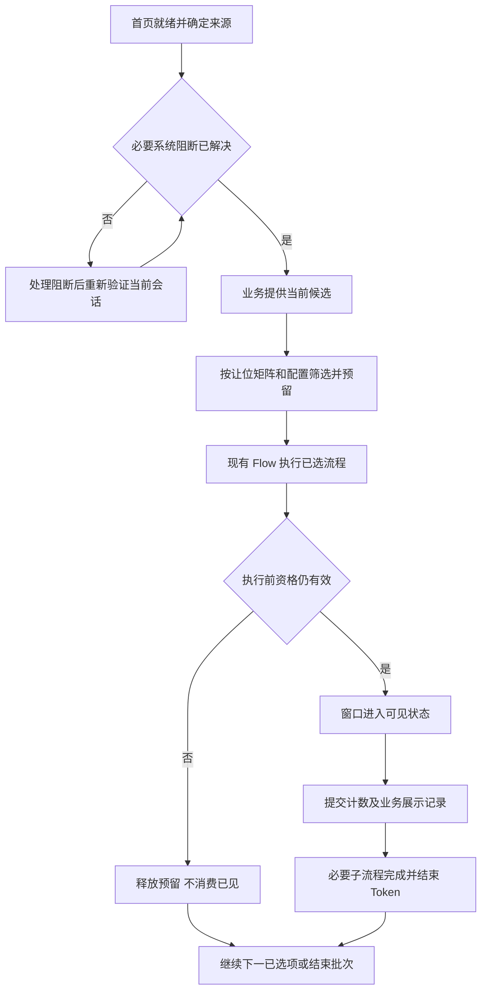

# TS 首页弹窗规则设计方案

初稿：2026-10-30。入库：2026-11-05。状态：待评审，未实施。此文为唯一持续主档，后续设计、决策与实施进展在本主题中维护。

TS 首页弹窗采用“业务模块决定当前内容、首页规则决定本轮选谁、Flow 负责执行”的三层结构。保留登录最多 4 个、关卡返回最多 5 个的基础要求，增加明确的让位、计数和延期重查约定，避免仅靠排序把所有就绪内容依次弹完。

本方案忽略《弹窗规则补充》的“拓展规则”部分。登录与出关均保持常规礼包低于活动，不采用登录礼包降级、出关礼包升优先级的差异策略。下文标注“建议”的产品选择均未视为已批准；第 9 节集中列出待确认项。

## 1 需求范围与成功标准

### 1.1 已明确的要求

- 主要触发场景为登录进入首页与关卡返回首页。
- GameLaunch 上限为 4，TileToMerge 上限为 5；后者沿用需求文档名称，TS 实际目标场景为 Home。
- 活动自己决定是否需要弹以及展示哪个界面。首页层按活动 ID 管理，不推演活动状态机。
- 常规礼包按配置顺序，优先级低于活动；系统内容通常优先。
- 同活动的旧期结算与新期开启需要由业务规则隔开，原文以“打一关后再开启”描述。
- 当前范围为方案设计与知识入库；尚未授权修改代码、配置、存档或运行时行为。

### 1.2 成功标准

1. 每次有效首页批次有唯一来源和预算，重复回调不会刷新额度。
2. 给定候选集合，可以确定入选内容、顺序、让位原因和未入选内容的下一次检查入口。
3. 未展示不写成已展示；展示失败不永久消耗首弹资格；本轮额度不会因多次检查而重复扣减。
4. 达到上限或没有合适候选后释放首页操作，不为填满额度追加内容。
5. 自动静态弹窗与动态弹窗遵守同一预算；必要系统阻断及玩家主动操作有明确边界。
6. 未入选内容不阻塞玩家进关；进入关卡后旧批次不能继续弹窗。

### 1.3 范围

覆盖首页自动弹窗及其必要后续流程。局内复活、关前窗口、商店主动点击、活动内说明页不套用首页自动名额。奖励入账本身不受弹窗限额控制，不得为了延期显示而吞掉或重复发放奖励。

暂不引入通用规则脚本、全局新队列、每日全局限额或自动优先级老化。实际配置表尚未取得：原文链接的 Google Sheet 需在评审时补齐，不能把当前代码常量视为已确认的产品顺序。

## 2 RM 参考与 TS 当前基础

### 2.1 借鉴范围

RM 分析以 38911 为全量基线，并包含 39781 的定向复核。可借鉴的设计思想是区分候选检查、内容选中和实际展示，以及按内容组让位、执行前再次验证。

| RM 已核对结论 | TS 采用方式 |
|---|---|
| 登录、胜利、失败的候选编排与让位关系不同 | TS 保存返回来源；本版胜败使用相同上限和让位政策，候选资格仍可不同 |
| 特定教程或活动组命中后，常规礼包组让位 | 建议形成 TS 自己的明确让位矩阵，不照搬 RM 活动名单 |
| 常规礼包链命中首个即停止；活动可选多个 | 建议常规礼包每批最多一个，活动在总预算内选多个 |
| 所查主执行器未发现统一 N 个弹窗截断 | TS 的 4／5 是自身需求，不宣称来自 RM |
| 同活动可能接续多个动作或页面 | TS 区分业务展示流程数与实际页面曝光数 |
| 普通 Offer 部分路径入队前写已见，存在条件性漏弹风险 | TS 明确预留与实际展示分离，不复制提前消费已见的行为 |
| 跳过不代表下一局必弹 | TS 下次重新查询当前业务状态，不持久化旧窗口队列 |

### 2.2 TS 当前实现

| 代码入口 | 当前行为与影响 |
|---|---|
| `Assets/Module/HomeHub/State/HomeSceneState.cs` | 可判断 `fromTile`，首页就绪后检查存档冲突并调用 Home Flow；尚未把登录／关卡结果传入弹窗筛选 |
| `Assets/Module/HomeHub/Flow/HomeFlowManager.cs` | 使用 `FlowContext(Group)`；缓存和插入动态项，适合持有本次首页弹窗会话 |
| `Packages/BettaInterface/Flow/IFlowItem.cs` | `FlowContext` 只有 Group；契约要求 `CanRun` 无副作用，输入预判会重复调用 |
| `Assets/Module/Flow/FlowSystem.cs` | 静态项按 Priority 排序，动态项按插入位置处理；Token 完成后推进，尚无首页弹窗数量预算 |
| `Assets/Module/Activity/Core/Flow/HomePopupPriority.cs` | 固定结算段 19000、开启段 20000；开启段礼包与活动混排，部分优先值相同 |
| `Assets/Module/Activity/Archery/Scripts/ActArcheryFlowItems.cs` | 同活动注册结算与开启两个入口，业务判断轮次并选择实际面板 |
| `Assets/Module/Activity/GrowthPack/Scripts/GiftGrowthPack.Popup.cs` | 业务内部解析主界面、结算、挽留与结束面板，说明不能按 Gift 类名前缀判断每次展示的性质 |
| `Assets/Module/Mail/Scripts/MailPopupFlowItem.cs` | 邮件可以动态入队，不能只限制活动静态列表 |

当前 Flow 还承载奖励飞行、入口表现、章节流程和引导。不能对整个 Home Flow 截取前 4／5 项，也不能通过停止整个 Flow 实现弹窗限额。

## 3 三层职责与数据归属

| 层次 | 负责 | 不负责 |
|---|---|---|
| 活动、礼包、系统业务模块 | 当前资格、内容类型、期次、已见、冷却、状态迁移、具体页面和必要子流程 | 其他活动排名、首页总预算 |
| 首页弹窗规则 | 场景来源、候选筛选、让位、稳定排序、活动去重、预留与计数、批次结束 | 发奖、支付、活动状态机、UI 栈 |
| 现有 Flow 与 UI | 串行执行、插入、Token、取消、窗口生命周期及展示回执 | 决定礼包是否应向活动让位 |

首页筛选只需业务提供稳定身份、业务归属 ID、内容类别、配置优先级、当前内容版本和执行入口。一个活动在一次查询中最多返回一个当前自动展示流程；多个现有 FlowItem 由业务适配时归并选择，不允许首页层遍历每个活动的内部枚举。

活动 ID 用于本批去重；活动期次／内容版本用于执行前确认候选仍有效。新一期不能因为版本不同绕过同活动本批一次的限制。

| 数据 | 类型 | 唯一写入方 |
|---|---|---|
| 场景上限、类别顺序、活动与礼包优先级 | 配置 | 配置加载与校验入口；调度只读 |
| 批次 ID、来源、名额、已选活动、让位结果 | 运行时 | 首页弹窗会话 |
| 候选集合与排序结果 | 派生缓存 | 首页筛选器；只读业务状态 |
| 首弹已见、每日记录、冷却、已领、下一轮资格 | 持久化 Profile | 对应业务模块；首页层只能通知展示结果 |
| Token 与当前执行项 | 运行时 | 现有 FlowSystem |

HomeFlowManager 创建、持有并在离开首页时关闭会话。业务模块沿用现有注册／注销生命周期；UI 展示回调必须携带会话与候选身份，过期回调不得影响新会话。新规则内部优先直接调用；不因规划先增加只有一个实现的公共接口。

## 4 场景与让位规则

### 4.1 批次边界

建议一次有效登录进入 Home 开启 GameLaunch 批次，一次真实关卡返回开启 TileToMerge 批次。关卡结果保留 Win／Fail／Quit 来源，三者是否都触发批次见 Q6。

同一批次从首页就绪延续到自动展示完成或被取消。切换首页 Tab、关闭一个弹窗、重复收到就绪通知、回前台均不自动重置预算。批次完成后不会因后台计时或活动刷新再次自行弹出常规内容。

### 4.2 内容分类建议

| 类别 | 示例 | 默认处理 |
|---|---|---|
| 必要系统阻断 | 强制更新、存档冲突、必须解决的登录异常 | 独立阻断常规批次，解决后检查业务状态 |
| 普通系统弹窗 | 非阻断公告、普通通知、适用的邮件提示 | 纳入预算，先于活动和礼包 |
| 关键教程 | 必须完成后才能继续操作的首次引导 | 让常规自动内容本轮让位；已有必要结果流程先完整收尾 |
| 活动内容 | 开启介绍、当前活动页、进度或结算 | 按活动配置优先级，具体内容由业务决定 |
| 常规商业化礼包 | 首充、破冰、普通付费推广、挽留促销 | 低于活动，建议每批最多一个 |

“礼包模块”不等于“本次一定是促销”。已支付待到账、已获得奖励的必要处理不能被促销让位规则丢弃；纯礼包推销归商业化。成长礼包待领奖、每日奖励、邮件等具体归类需逐项确认，见 Q5。

### 4.3 让位矩阵建议

以下政策同时用于登录和出关，仅总上限不同；不引入原文拓展规则。

| 条件 | 本轮处理 | 未入选内容 |
|---|---|---|
| 必要系统阻断未解决 | 不启动或暂停后续常规弹窗；不得随意中断正在支付／入账的流程 | 阻断解决后重新检查；若账号／存档切换则废弃旧候选 |
| 关键教程入选 | 保留必要系统内容与已开始的必要收尾；活动推广、常规礼包均让位 | 下个合法批次重查，不在教程关闭后立即补齐 |
| 普通系统内容入选 | 先展示并占用总名额 | 剩余名额仍可检查活动；系统命中本身不自动让活动整组让位 |
| 至少一个活动内容入选 | 本轮常规礼包整组让位，即使还有剩余名额 | 下个合法批次重新竞争 |
| 无活动入选、无教程阻断且有剩余预算 | 按配置尝试常规礼包，最多选一个 | 其余礼包本批停止检查或记录为礼包配额不足 |
| 总预算已满 | 停止接受新的常规自动展示流程 | 下个合法批次重查 |
| 同活动已预留或展示 | 不再接受该活动另一个自动流程 | 由业务判断下一次合法时机 |

“入选”指通过本批规则并预留名额，不是简单的 `CanPopup == true`。规则决策完成后锁定本批让位结果：活动执行失败可释放名额，但不在同批突然改弹礼包。这样让位可预测，也避免反复扫描造成连环弹窗。此选择见 Q4。

同组顺序为配置优先值升序，相同值使用明确的稳定业务 ID 作为次序；不依赖注册先后或不稳定排序。若产品希望结算跨活动优先，应另行确认并允许业务提供内容角色；本版不同时保留一套隐藏的 19000／20000 跨活动排序覆盖配置。

## 5 数量统计与展示提交

### 5.1 推荐计数口径

建议 4／5 统计“自动发起的顶层业务展示流程”，而非 FlowItem 数、UIManager.Open 调用数或同时存在的窗口数。一个活动的自动结算流程可含结果页与必要领奖页，占一个名额，但两个实际页面分别记曝光。

必要子流程必须属于同一业务原因及内容版本。旧期结算后新期开启、另一个礼包推销属于新流程，不能借子流程绕过限额。若产品要求严格限制用户看到的页面数，则必须改为逐页预算并定义结算中途如何续接；两种口径不可混用，见 Q1。

| 情况 | 计入 4／5 | 记录实际页面曝光 |
|---|---|---|
| 常规自动活动／礼包／普通系统流程首次真正展示 | 是，一次 | 是 |
| 同一流程必要的结果详情或领奖页 | 不新增流程名额 | 是，逐页记录 |
| 用户主动点击活动、商店、邮件或说明 | 否 | 是，来源标为手动 |
| 奖励飞行、入口动画、红点 | 否 | 不记弹窗曝光 |
| 必要系统阻断或关键教程 | 建议不计常规额度，但通过让位限制其他内容 | 单独记录 |
| 仅条件成立、预留、排队，未展示 | 否 | 否 |

### 5.2 名额生命周期

定义 `ShownCount` 为已展示流程数，`ReservedCount` 为尚未展示的预留数，始终满足：

`ShownCount + ReservedCount <= SceneLimit`

1. 候选查询与排序不修改计数和已见；成功入选时预留一个名额并预留活动身份。
2. 执行前复查活动期次、资格、资源、会话有效性和当前界面条件。失败则释放预留，标记本批已尝试，不在本批无限重试。
3. UI 确认已进入可见展示状态后，幂等地把预留转为已展示；业务模块提交对应的已见／冷却记录。
4. 仅调用 `Open`、创建对象或加载成功均不足以提交展示；实现时需核对现有 UI 生命周期并选定可靠回执。
5. 展示后用户关闭、离开首页或后续子页失败，不退还已经消耗的流程名额。必要业务收尾由原模块恢复。
6. 展示前取消不写已见；会话关闭时释放尚未执行预留，晚到回调直接失效。

建议本批候选快照有限，已选项失败后不自动填满空位，也不借失败重新开放被让位组。4／5 是最大值而非目标值。业务存档与可见回执无法在进程崩溃时天然原子提交；极端情况下允许重启后重新展示，不能宣称绝对一次。奖励幂等仍由业务系统保证。

数量至少分别记录：入选流程数、实际展示流程数、实际页面数、礼包展示数、首页恢复自由操作耗时。诊断原因包括教程让位、活动让位、总额已满、同活动重复、礼包限额、资格失效、资源未就绪和会话取消；是否接入线上埋点另行确认，不默认修改公共事件协议。

## 6 延期重查与同活动换期

### 6.1 重查语义

延期不持久化窗口实例、旧面板参数或“下次必弹”承诺。当前批次只记录未入选原因，业务的未展示资格保留；下一次合法首页批次重新从业务状态产生候选。

| 情况 | 当前批次 | 后续行为 |
|---|---|---|
| 总额度不足或向其他组让位 | 不消费已见、冷却或自动次数 | 下个合法批次重新判断 |
| 玩家在延期期间手动打开或领奖 | 本批执行前复查，失效候选取消 | 是否满足自动已见由业务定义，已处理结果不得再弹旧内容 |
| 活动过期或切换期次 | 旧内容失效 | 业务返回新的结算或新期候选，不能把旧开启页直接执行 |
| 资源尚未就绪、异步状态未返回 | 不等待无限下载、不在本批反复补弹 | 下批资源就绪后重查 |
| 常规内容在批次封口后才到达 | 不开启第二批 | 留待下个合法入口；必要系统异常走独立处理 |
| 队列执行中收到新的普通邮件／活动内容 | 不绕过快照和预算插队 | 下批检查；当前业务流程必要子项仍按原流程处理 |
| 仅回前台或切换 Home 分区 | 不发放新额度 | 本版不新增自动批次；暂停流程的恢复须重新确认会话有效 |
| 游戏退出／重启 | 内存候选和预留丢弃 | 新登录按持久化业务状态重建，不恢复旧窗口队列 |

固定优先级与活动整组压制可能导致礼包或低优先活动长时间没有曝光。本版接受“有资格不保证下一关展示”，不擅自增加强制保底；先观察延期次数和时长，再由产品决定是否需要保底或频控调整。

### 6.2 旧期结算与新期开启

建议规则为：同活动在本批至多选择一次；旧期结算成功后，由业务锁住新期自动开启资格，直到发生下一次符合要求的关卡完成事件。结算后立刻关闭重开首页或重启游戏，不应自动绕过这条业务门槛。

“符合要求”暂建议胜利或失败的已完成尝试，不包含直接退出；这是待确认项 Q6，并非 RM 已证明的统一规则。各活动如果已有不同的正式门槛，应列出差异后确认，不由首页统一强改活动状态。

门槛需要跨重启成立时，优先复用业务已有的持久化关卡事件序号／资格记录；若没有可靠字段，另行评审最小 Profile 扩展及旧存档默认值。不要用已通关等级代替尝试序号，因为失败不会提升等级；也不要让首页负责推进活动轮次。

## 7 接入现有实现的建议

### 7.1 方案比较

| 方案 | 优点 | 成本与风险 | 结论 |
|---|---|---|---|
| 在各 PopupFlowItem 分散增加计数和场景判断 | 单点修改直观 | 重复逻辑、动态入口容易漏控、输入预判可能扣额度 | 不推荐 |
| HomeFlowManager 持有会话，增加集中筛选，复用现有 Flow | 规则集中，业务和执行器职责清晰 | 需适配现有候选、动态入口、展示回执和输入判断 | 推荐，工作量中等 |
| 重建全局弹窗执行器并替换 Home Flow | 可统一所有动作 | 影响奖励、章节、教程和 UI 生命周期，范围过大 | 本次不采用 |

### 7.2 主链路

### 7.3 需要保住的现有行为

- 奖励飞行、入口动画和章节表现保留原有顺序，不纳入数量，也不被弹窗预算截断。筛选放在必要前置完成、即将进入自动弹窗阶段的稳定位置，不强行移动既有引导。
- 注册的业务弹窗只有入选后才能运行和参与阻塞判断。`FlowSystem.EvaluateCanUserSkip` 与金币卡对后续阻塞项的查询都应读取相同的入选状态，不能仍按所有原始候选锁输入。
- `CanRun` 必须只读。成长礼包现有 `CanRun` 会调用 `NoteRewardPanelBlockedForcePopup` 写标记，且内部查询还有任务状态同步路径；接入时需逐项核查，把有副作用的业务更新移到明确的刷新或执行阶段。
- 金币卡打开前 `RecordForcePopup`、射箭打开前 `MarkForPopup(false)` 等现有路径，应区分运行中防重与持久化已展示，迁移到实际展示提交时机前先确认其业务语义。
- `FlowSystem.Insert` 的动态位置插入不是业务 ID 去重。邮件等自动入口需经过会话筛选；用户主动操作及必要业务后续不得误归入自动礼包限制。
- 当前 `FlowSystem.Invoke` 会重新构造只有 Group 的上下文。若采用上下文扩展方案，必须同步保留新增来源字段，不能仅修改调用端。优先由 Home 会话保存来源，避免无必要地扩大公共 Flow 协议。
- 动态插入可导致执行链重扫，已展示与已尝试标记必须防止本批重复运行。会话取消、Flow Cancel 和 UI 回执均应幂等。

### 7.4 复杂度与兼容性

设业务候选数为 N，每批收集 O(N)、排序 O(N log N)，执行前仅复查已选候选。不在每帧重建列表、排序或逐项轮询资源；遵守项目无 LINQ 和运行时分配约束。

首版预算与让位记录只保存在内存，不新增统一待弹 Profile。现有已见、每日记录、冷却不批量清零，不追溯推断旧标记是否实际曝光。若新增换期关卡门槛字段，必须逐活动定义迁移默认值。配置顺序调整和成长礼包内容归类会改变实际曝光，应分别评审；不顺手改公共配置协议。

实际变化轴为：场景上限 → 场景配置；类别让位 → 小规模明确规则表；活动具体内容 → 业务候选适配。仅在出现真实新场景或新规则时扩展，不提前引入规则表达式引擎。

## 8 场景示例与验收用例

以下示例按建议政策执行，用于评审；Q 项改变后需同步调整预期。

| 输入或操作 | 预期 |
|---|---|
| 登录，2 个活动与 3 个礼包全部合格 | 选择 2 个活动，礼包本轮让位；不补满 4 |
| 登录，6 个活动合格 | 按配置选 4 个不同活动，其他下批重查 |
| 出关，1 个普通系统提示、6 个活动、2 个礼包合格 | 系统占 1，活动占 4，礼包让位 |
| 出关，无活动，3 个礼包合格 | 只选择配置最高且合格的 1 个礼包；不因出关提高礼包相对活动的优先级 |
| 登录只有 1 个普通系统提示和 2 个礼包 | 系统后可选 1 个礼包；普通系统不是活动让位开关 |
| 关键教程与活动、礼包同时合格 | 教程优先，常规活动与礼包本轮让位 |
| 活动已选但执行时资源失效 | 释放预留，不写已见，不立刻改弹礼包 |
| 结算流程自动展示结果与领奖两页 | 消耗 1 个流程名额，记录 2 个页面曝光 |
| 同活动结算后新期立刻变为可开启 | 本批不再选中；满足指定关卡事件后下批重查 |
| 延期活动被手动领取或过期 | 下批不得打开旧奖励／旧开启页 |
| 邮件在批次封口后动态到达 | 不绕过预算自动插入；手动读邮件不受自动限额阻止 |
| 重复首页就绪或连续重复 CanRun | 批次、计数、已见均不改变 |
| 未入选的后续活动声明不可跳过 | 不因此继续锁住首页操作 |
| 展示前退出首页，旧窗口异步加载随后完成 | 不展示，不向新批次提交计数 |
| 相同配置优先级、不同注册顺序 | 结果稳定，按约定业务 ID 次序 |
| 本轮大量新活动一直产生 | 快照封口后不无限追加，玩家能恢复自由操作 |

验证分三层：纯筛选测试覆盖矩阵和预算；Flow 集成测试覆盖动态重扫、输入策略、取消和回执；Unity 实机流程验证登录、胜败返回、邮件、成长礼包和同活动换期。实施后按仓库受控编译流程运行，不裸跑 dotnet build。本次仅文档整理，不执行编译或声称运行时验证通过。

## 9 需要确认的点

| 编号 | 决策 | 推荐值 | 未确认的影响 |
|---|---|---|---|
| Q1 | 4／5 统计流程数还是实际页面数 | 顶层自动业务流程数，另记逐页曝光 | 决定结果页与领奖页是否拆额度，以及能否中途延期 |
| Q2 | 活动选中后礼包仅排后，还是整轮让位 | 登录与出关都整轮让位 | 整轮让位更保护心流，但礼包曝光会减少；属于新增建议 |
| Q3 | 常规礼包每轮是否最多一个 | 是 | 原文只有总上限，没有明确此子配额 |
| Q4 | 已选活动失效后是否补选及重新开放礼包 | 不补满，不重新开放礼包 | 决定是否允许一次批次内再次构建候选 |
| Q5 | 必要系统、教程、每日奖励、邮件、成长礼包领奖／挽留的归类 | 必要阻断与关键教程独立；其他按本次内容性质逐项登记 | 决定预算、让位及现有模块的迁移清单 |
| Q6 | “打一关”与出关批次是否包含失败、主动退出 | 换期门槛建议完成胜／败尝试，不含直接退出；Quit 是否有普通出关批次单独确认 | 决定关卡事件、跨重启记录与业务资格 |
| Q7 | 活动排序仅按 ID 配置，还是结算跨活动优先 | 按原文采用活动 ID 配置；活动内部选当前内容 | 现有结算段先于开启段的全局顺序将改变，需确认是否保留例外 |
| Q8 | 胜利与失败是否同一让位政策 | 首版相同，上限均为 5，只保留来源 | 不照搬 RM 的复杂胜败分支 |
| Q9 | 回前台、延迟下载完成、后台刷新是否可新开批次 | 首版不新开 | 避免静止首页反复弹窗；必要异常仍可处理 |
| Q10 | 低优先级延期多久必须获得展示机会 | 首版不保证下一关／前 N 关必弹 | 若要求每日前几关清空积压，需要额外窗口、保底或业务频控 |
| Q11 | 最终优先级配置与稳定同分规则 | 补齐 Google Sheet，并统一“小值先”；同分按稳定业务 ID | 当前常量不能代替产品配置，影响最终验收顺序 |
| Q12 | 展示成功的 UI 回执及跨重启门槛数据 | 可见生命周期回执；业务持有必要持久化字段 | 需代码专项核对，不能只以 Open 返回成功代替曝光 |

Q1、Q2、Q3、Q5、Q6、Q7、Q11 应在行为实现前确认。其余可采用表中建议作为评审基线，但仍需记录决定；本方案不自动授权开始编码。

## 10 实现顺序建议

以下步骤用于方案获准后的实施，本次不执行。

### Step1 确认产品规则与候选清单

确认第 9 节决策，补齐优先级表；逐项登记现有活动、礼包、邮件、教程与系统入口，明确自动／手动、归属 ID、必要子流程和计数类别。范围为本方案、`HomePopupPriority.cs` 对照清单及相关业务入口审计；复杂度中，依赖产品确认。

Verify：用第 8 节案例手工推演选中内容与名额，尤其确认结算跨活动顺序和礼包让位。回滚点：仅调整方案与对照表，不变更运行时。配置只读，未开始任何 Profile 写入。

### Step2 建立首页会话与纯筛选逻辑

在 `Assets/Module/HomeHub/Flow` 增加由 HomeFlowManager 唯一持有的会话和简单筛选逻辑；从 `HomeSceneState` 显式传入来源，定义批次开始、封口、结束与取消。配置含场景上限和已确认排序；运行时数据由会话唯一写入，业务资格只读。复杂度中，依赖 Step1；不改通用 Flow 的其他 Group 行为。

Verify：纯逻辑测试覆盖让位矩阵、稳定排序、去重、预留和重复回调。回滚点：移除新筛选调用即可恢复原 Home 链路，不涉及存档迁移。

### Step3 适配业务候选与展示提交

逐个接入 `Assets/Module/Activity` 的现有 PopupFlowItem 和业务 Presenter；先选一个普通礼包、一个多页面结算活动验证，再扩展全部清单。业务自己归并结算／开启候选，剥离查询副作用，预留防重与已见记录分开。业务模块唯一写入自身 Profile；会话只提交展示结果。复杂度较高，依赖 Step2，主要风险为历史已见语义和异步 UI 回执。

Verify：展示前失败不耗已见、可见回执仅计一次、结算多页计一流程、活动版本改变取消旧候选。回滚点：逐模块恢复原适配路径；不清除旧存档。若需新增字段，先提交字段默认值和迁移方案再实施。

### Step4 接入动态入口与统一输入判定

适配 `MailModule`、HomeFlowManager 的动态入队以及必要系统阻断入口，区分自动、用户主动和已开始流程的必要续接。核对 `FlowSystem.EvaluateCanUserSkip`、金币卡后续阻塞查询及动态重扫，确保只由有效已选弹窗阻塞，保留其他必要 Flow 的输入语义。复杂度较高，依赖 Step3，主要风险为动态内容绕过和首页无法释放输入。

Verify：批次封口后邮件不补弹、未选项不锁输入、动态重扫不重复、退出后旧回执无效。回滚点：按入口恢复原调度接线，通用奖励与章节链保持可独立验证。

### Step5 接入同活动换期门槛

仅对清单中需要“结算后打一关再开启”的活动接入已确认的关卡事件。优先复用持久化记录，确需新增时由该活动唯一写入并兼容旧 Profile。复杂度中到较高，依赖 Q6 与 Step3；风险为失败不计数、退出误计数和重启绕过。

Verify：胜利、失败、主动退出、结算后重启逐项验证；旧存档升级后既不永久禁弹，也不重领。回滚点：业务门槛调用与新增字段读取独立可撤回，新增兼容字段不删除、不回退已领取状态。

### Step6 完成集成验收与文档定稿

运行第 8 节完整用例、项目受控编译与适用测试，在 Unity 中验证实际可见回执和自由操作恢复时机。记录流程数与逐页曝光数差异，确认没有未纳管的自动入口。复杂度中，依赖前序步骤。

Verify：满足第 1 节成功标准并逐项关闭 Q 决策。回滚点：按前述步骤逆序撤回行为接入，保留业务存档兼容；避免仅撤回筛选却保留新的已见提交时序而形成混用。

## 11 参考资料

- 《弹窗规则补充.docx》（原始附件位于 Windows `D:/Downloads/弹窗规则补充.docx`，未作为跨设备共享附件入库）：背景、目的、职责分层、弹窗分类、基础数量规则；不采用其拓展规则。
- [[02-PROJECTS/产品分析/Royal Match/系统拆解-弹窗框架-38911|Royal Match 38911 弹窗框架与展示规则]]，采用 2026-10-30 阅读时的结论：登录／胜败编排、让位、数量边界、同活动接续及普通 Offer 曝光审计；39781 定向结果不泛化到所有版本和模块。
- 优先级表：[Google Sheet](https://docs.google.com/spreadsheets/d/1rzzYdtge6nU2mSNyt3Fl8dzKtFmUZ7UKsfK9Y2M8YG0/edit?gid=943955110)。当前未取得正文，待 Q11 补齐。
- 仓库入口见第 2 节；补充参考 `Assets/Module/Activity/Core/Popup/ForcePopupPolicy.cs`、`Assets/Module/Activity/Tests/EditMode/ActivityPopupFlowPriorityTests.cs` 及 `Assets/Module/Flow/Tests/EditMode/FlowSystemUserSkipTests.cs`。

## 12 任务进展与接续

- 2026-10-30：完成需求文档、RM研究与TS代码的静态对照，形成当前方案、12项待确认决策及实现顺序；当时误存于TS仓库 `Docs/TS_Home_Popup_Rules_Design.md`，未完成LG入库。
- 2026-11-05：用户确认以LG为唯一知识库。原方案归入本任务主档，补齐元信息、MOC导航、关联和当日Windows日志；核验后移除TS重复正文。保留原始产出日期，不倒填为当日已入库。
- 来源范围：第2节TS代码描述反映2026-10-30静态阅读，路径相对TS项目根目录；本次归位不代表已按11月5日代码重新审计。RM跨项目结论保留对应版本边界。
- 当前待办：确认第9节产品决策并补齐Google优先级表，再按第10节实施顺序接续。知识入库不代表方案获批、实现完成或运行验收通过。

## 关联

- [[02-PROJECTS/TileScape/_MOC|TileScape知识库入口]]
- [[02-PROJECTS/产品分析/Royal Match/系统拆解-弹窗框架-38911|RM弹窗框架与展示规则]]
- [[02-PROJECTS/Agent/工作流/规范-任务产出入库与维护|任务产出入库与维护规范]]
- [[02-PROJECTS/Agent/工作流/规范-本机项目执行与LG知识库桥接|项目执行与LG知识库边界]]
- [[01-DAILY/2026-11-05-win|入库与归位记录]]
