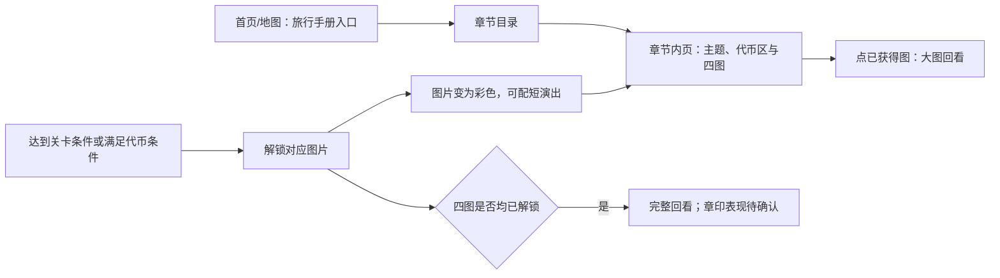

# 旅行手册：每章四图收集系统与美术需求

> 用户已确认归属 TileScape。本文是供策划、美术、程序讨论的方案，不代表已实现或定稿。Toy Story Drop 的 Collection 提供“按主题分组、进度展示、收集后回看”的形式参考；四图规则是本次新设计。

> 逐章美术设计与可浏览样稿：[[02-PROJECTS/TileScape/游戏逻辑/设计-旅行手册章节美术需求-2026-11-09.html|旅行手册章节美术需求网页]]。网页依据当前可读六章配置估算 24 个图片位，并用 Forest 路径概念图说明四图构图；Ocean～Garden 的具体场景均为创作提案，需以正式路径图和章节故事校对。

> 2026-11-11 UI 参考更新：用户指定 LG 的 Resort Match / Resort Story 剧情卡牌 UI 为主参考；沿用画廊棕褐书壳与无主题通用背景，只提 UI，暂不涉及图片内容。见 [[02-PROJECTS/TileScape/游戏逻辑/需求-旅行手册UI拆解-2026-11-11.html|UI 拆解需求（三列表）]]。11-10 视觉稿作为旧提案保留。用户已确认卡片外轮廓统一为 Resort Match 的915∶1440（61∶96）竖版，章节页固定2×2，详情与条件预览等比复用；钉钉暂不处理。

## 1. 系统定位与一章的体验

旅行手册按**章节**装订，每章固定四个图片位。四张图依次记录“抵达地点 → 遇到故事 → 变化/行动 → 章节收束”，玩家在章节推进过程中逐张获得，收齐后该章变为完整的旅行记录。手册承担收藏与回看，不承载额外抽卡概率或重复图兑换。

建议将既有方案中的**章节明信片作为第 4 张图**，兼作该章收束画面和收藏物，避免制作语义相同的第二张图。原先“章末完成时自动发放”的建议与新增的“代币解锁”示意尚需统一；第 4 图最终条件待策划确认。现有任务卡图鉴及拓展图鉴不因本方案自动替换；旅行手册是章节图片的独立陈列入口，未来是否合并导航需另定。

| 玩家阶段 | 手册表现 | 主要反馈 |
|---|---|---|
| 尚未进入章节 | 章节封面可预告，四个图片位为锁定状态 | 告知目的地，隐藏未到达的剧情细节 |
| 章节进行中 | 已解锁图片彩色呈现；未解锁图片置灰，叠加 `Level n–m` 或所需代币文案；页内不显示 `x/4` | 条件明确，获得结果可直接对比 |
| 新图入册 | 本次解锁图片短暂翻页/贴入，之后展示为彩色；图片位不再显示“新”角标 | 将解锁转换成可见纪念物 |
| 四图全部解锁 | 四张彩色图均可回看；第四图可作为章节明信片，章印是否展示待确认 | 完整回看与章末成就感 |
| 回看旧章 | 从目录进入章节，点图查看大图、说明和前后张 | 留存故事与美术价值 |

### 玩家流程



## 2. 收集规则与状态

每章四个 `photoId` 固定，位置固定。当前界面需求给出两类未解锁提示：关卡区间 `Level n–m`，或所需代币数。它们应由单图配置驱动；具体关卡、代币数、代币是否消耗及购买动作尚未确认。此前“第 1–3 张叙事里程碑、第 4 张章末自动发放”的提案需与这两类条件重新对齐，不再作为确定规则。

| 规则项 | 方案 |
|---|---|
| 身份 | `chapterId + slotIndex(1..4)` 唯一；同一章永远四位，排序由 `slotIndex` 决定。 |
| 解锁条件 | 每图配置条件类型：`levelRange` 或 `tokenCost`；对应关卡起止/代币数量。是否存在章末自动解锁需另定。 |
| 状态 | 每张图在本页只有 `locked → unlocked` 两种视觉状态；锁定置灰并显示条件，解锁恢复彩色。章节内部可从四张状态计算收集数，但本页不显示 `x/4`。 |
| 幂等 | 重播关卡、重进地图、重复回调不能重复发图；已拥有图片仍可回看。 |
| 离线与资源 | 发图进度可先可靠记录；图片尚未下载时显示占位和加载/重试，不回退为未获得。 |
| 旧账号兼容 | 初次上线时按已完成章节/节点回填可确定的四图；不能从旧数据确定的中途节点要单独定补发口径。 |
| 红点 | 本页图片不设“新”第三态或角标；若总入口仍需新内容提示，应单独定义通知标记，不改变图片双状态。 |

**配置最小字段草案**：`chapterId`、`chapterTitleKey`、`slotIndex`、`photoId`、`unlockMode`、`levelStart`/`levelEnd` 或 `tokenCost`、`imageKey`、`captionKey`、`chapterSort`、`spoilerMode`。标题、关卡区间与代币数量在文字层动态填充，不烘焙进图片。资源下载状态与图片解锁状态分别记录。

## 3. 界面规格草案

| 页面 | 必备内容 | 状态与交互 |
|---|---|---|
| 首页/地图入口 | 手册图标、总收集数或新图提示 | 点击进入目录；红点只提示新内容 |
| 章节目录 | 章节序号/名称、封面缩图、`x/4`、完成章印 | 可浏览当前及已开放章节；未来章节只露非剧透封面/剪影 |
| 章节内页 | 主题名、右上代币区、四个等权图片位（2×2）、单图标题或编号、翻章 | 未解锁图置灰并写关卡区间或代币数量；已解锁图彩色且可点大图；无 `x/4`、无“新”角标 |
| 图片详情 | 单张完整插画、标题、短说明、上一张/下一张、关闭 | 默认只在已得图片间切换；缺资源时显示占位及重试 |
| 获得/完章演出 | 单图贴入、轻量翻页、第四张后盖章 | 演出可跳过，跳过不影响拥有和已查看状态；中断后仍可回看 |

章节内页按用户 2026-11-09 的最新修订：画面只保留**半本书的一页**，四张照片均在这一页按 2×2 排布；主题名置于页面上方：

```text
┌───────── 主题名 ──── [代币区] ─┐
│ [图 01 · 彩色] [图 02 · 彩色]   │
│ [图 03 · 灰/Level] [图 04 · 灰/代币] │
│ 上一章                下一章  │
└─────────────────────────────────┘
```

目录与章节内页沿用同一本手册的装帧语言：封面、纸张、页签和照片角贴构成统一视觉，章印是否保留待确认；不把 Playsets、Inventory、Achievements 四个竞品页签原样搬入。横竖屏、不同长宽比的留白和安全区由共用模板承担，图片主体不靠裁切维持可读。

### 单页书界面草图（2026-11-09）

![[02-PROJECTS/TileScape/游戏逻辑/旅行手册草图.assets/单页-代币双状态-无字页签.png]]

此图为**两张已解锁、两张未解锁的概念草图**，主题名“森林旅途”、代币余额 240、Level 21–30 和所需 120 代币均为排版示意值，不代表 TS 已有配置或正式美术。只显示书的**一半/一页**：左缘留窄书脊与封皮厚度，四张照片在同一纸页按 **2×2** 排列。主题名在页顶，右上保留代币区并将关闭入口放在旁边；右侧仅保留无字彩色页签的装帧样式，不表示具体章节或目录。页脚只保留左右翻章位置，不显示“第 n 页”。

| 部位 | 草图约束 | 美术交付关注点 |
|---|---|---|
| 书体轮廓 | 只显示半本封皮、一张纸页、左侧窄书脊；书页内缘做轻阴影，不用厚重遮挡 | 共用底图可分层拉伸；书脊、阴影与页边分开交付 |
| 四图版心 | 同一页 2 列×2 行，视觉行序为 01、02 / 03、04；照片画面为 4:3，四格宽高、间距一致 | 统一相纸与角贴模板；图像、题名、序号分层，缩图不烘焙文字 |
| 图片状态 | 每格只显示未解锁/已解锁：未解锁原图置灰并叠加 `Level n–m` 或“需要 n 代币”；已解锁恢复彩色，无“新”角标 | 灰度与条件文字做共用状态层，条件文案和数字动态填充，不为每图重画灰版 |
| 代币区 | 主题标题右侧预留代币图标与余额；草图 240 仅为占位 | 图标、余额底板及可扩展数字位独立交付，不在背景图烘焙金额 |
| 导航与安全区 | 关闭在代币区右侧；右外缘页签只作无字装饰；上/下一章在页脚两端，中间不放页码 | 按触控热区与短/长屏安全区调整；概念草图尺寸不是最终像素规格 |

此版是静态视觉草图；正式美术稿需在 TS 目标分辨率上复核相框和可触控尺寸。此前[[02-PROJECTS/TileScape/游戏逻辑/旅行手册草图.assets/打开书-章节四图2x2-进行中.png|左页信息＋右页四图]]、[[02-PROJECTS/TileScape/游戏逻辑/旅行手册草图.assets/横向展开-主题四图2x2-进行中.png|四图跨双页]]、[[02-PROJECTS/TileScape/游戏逻辑/旅行手册草图.assets/单页-主题四图2x2-进行中.png|单页带进度版]]和[[02-PROJECTS/TileScape/游戏逻辑/旅行手册草图.assets/单页-代币与双状态-无页码.png|有字页签版]]保留作历史草图，不再作为当前版式依据。

## 4. 美术需求：可直接拆单

### 4.1 每章内容资产（设章节数为 N）

| 资产 | 数量 | 用途与制作要求 | 复用方式 |
|---|---:|---|---|
| 章节图片 01–04 | **4N 张原画** | 四张构成连续旅程：地点建立、事件、变化、结果；人物造型、时间与道具连续。第 4 张承担章末明信片，构图需同时适合收藏和结算展示。 | 同一原画导出详情图与缩图；不得用缩图放大做详情。 |
| 章节标题、四图标题与短说明 | 每章 1 + 4 + 4 条文案 | 与画面内容一一对应，支持多语言；说明不烘焙进图。 | 文案与图按 `chapterId + slotIndex` 配对。 |
| 目录封面 | 每章 1 张派生图 | 优先从本章四图裁切或合成，提前暴露时不得剧透结局。 | 首版不另开 1N 张原画；仅视觉不足时增补。 |
| 章节色板/识别纹样 | 每章 1 套轻量规范 | 用于页签、纸张边饰、章印配色，保持全册一致的装帧体系。 | 不要求每章重新绘制一整套 UI。 |

**单章画面 Brief 模板**：章节名与目的地；四个剧情节点与获得条件；每图的主体角色/动作、地点、关键道具、情绪与色彩；与地图场景的对应点；可剧透范围；第四图与章节结算/明信片的裁切要求。首章先用此模板产四张图做风格试点，再批量制作后续章节。

### 4.2 全系统共用资产

| 优先级 | 资产包 | 需交付的状态/内容 |
|---|---|---|
| P0 | 手册基础装帧 | 封面、单页书脊/纸页、章节目录行、四图相框、照片角贴、页签、上一章/下一章、关闭按钮、右上代币图标与余额底板。 |
| P0 | 图片状态层 | 未解锁灰度层、条件文字层、已解锁彩色态、资源加载占位和失败重试态；不制作“新”角标。状态用可复用图层实现，不为每张图重画灰版。 |
| P0 | 单图详情与章末 | 大图展示框、标题/说明容器、四图完成排版、第四图兼用明信片框。 |
| P1 | 动效与反馈 | 照片贴入、轻翻页；章印和入口红点是否保留待确认。提供静态首末帧与动效时长建议，低性能设备可用简化版。 |
| P1 | 音效需求 | 翻页、照片贴入两类短音效；如保留章印再补盖章音效。与动效分开交付，避免每次回看重复播获得音效。 |

### 4.3 文件与适配约束

- **建议画幅**：每张主图按 4:3 横构图制作，源文件建议至少 `2048×1536`，重要人物和信息放在中心约 80% 安全区。章节内页按等比缩图，详情页完整展示；最终导出尺寸与压缩格式须在 UI 试点和目标机内存测试后确认。
- **可编辑源**：分层 PSD/等价源文件保留主体、背景、光效；交付透明状态图层和独立文字层。游戏运行图由制作流程导出，不把本地化文案、固定关数或动态进度画进图片。
- **资源命名**：`TravelBook/Chapter_{chapterId}/Photo_{01..04}`；缩图、详情图、动效和文案键共享同一 `chapterId/slotIndex`，避免内容错配。建议在资源表列源文件、导出文件、用途、版本与负责人。
- **适配验收**：至少用短屏/长屏两种竖屏比例检视四图排版、详情留白、文字扩展和安全区；锁定与已得状态仅靠颜色区分不够，应有图形/文字差异。低内存机检查四张详情图按需加载和退出释放。
- **版权与风格**：参考竞品的是收藏形式；人物、场景、装帧和图像内容必须使用本项目自己的设定与授权素材。

## 5. 首章试点交付与验收

首批制作范围建议为**一章四图 + 全系统 P0 共用界面**，先走通目录、章节内页、单图详情、关卡与代币条件展示、逐张解锁和旧章回看。策划提交四图解锁条件与 Brief；美术提交四张分层原画、派生缩图、通用灰度/彩色状态和第四图的明信片/结算裁切；程序接入四图配置、代币余额占位和进度幂等；共同在目标机检查画面、性能和中断恢复。

验收口径：四张图顺序与配置一一对应；每张只登记一次；未解锁图置灰且条件文案正确、不剧透；已解锁图彩色；代币余额区与数字扩展不挤压标题；缺资源仍保有解锁状态且能重试；重进手册可回看全部已解锁图；左右翻章位置保留，页脚不显示页码。章印与第 4 图条件定稿后再补对应验收。单章通过后再按 `4N` 张原画估算全量制作量。

## 6. 需要项目确认的内容

1. 每张图采用关卡区间还是代币条件、具体关卡起止与代币数量；代币是否消耗及解锁操作方式。草图的 Level 21–30、120 和余额 240 都是占位值。
2. 第 4 张是否正式复用章节明信片、如何解锁，以及收齐后是否显示章印；如明信片必须独立存在，需要增加一张章末资产及两个入口的展示关系。
3. 首批章节数、首章题材及角色/场景设定；决定 `4N` 张原画的排期和风格样张。
4. 现有画廊/图鉴的导航关系与旧账号回填口径；不以本方案改变既有已实现流程。

## 来源与验证边界

- 竞品事实：[[02-PROJECTS/产品分析/Toy Story Drop/Collection内容拆解-1.20.0|Toy Story Drop Collection 1.20.0 静态拆解]]，已确认按主题分组、完成进度与图片回看；其画廊账号实拍尚未取得。
- TS 既有方向：[[02-PROJECTS/TileScape/游戏逻辑/任务-买量承接与章节拆分长期任务|章节明信片与图鉴方案]]、[[02-PROJECTS/TileScape/游戏逻辑/任务-DLC全链路梳理与维护|画廊资源加载边界]]。二者是当前文档参考，四图规则、新 UI 和发放方式均为本次提案，未做代码或设备验收。

## 关联

- [[02-PROJECTS/TileScape/游戏逻辑/设计-旅行手册章节美术需求-2026-11-09.html|旅行手册章节美术需求网页]]
- [[02-PROJECTS/TileScape/_MOC|TileScape MOC]]
- [[02-PROJECTS/TileScape/游戏逻辑/任务-买量承接与章节拆分长期任务|买量承接与章节拆分长期任务]]
- [[02-PROJECTS/产品分析/Toy Story Drop/Collection内容拆解-1.20.0|Toy Story Drop Collection 内容拆解]]
