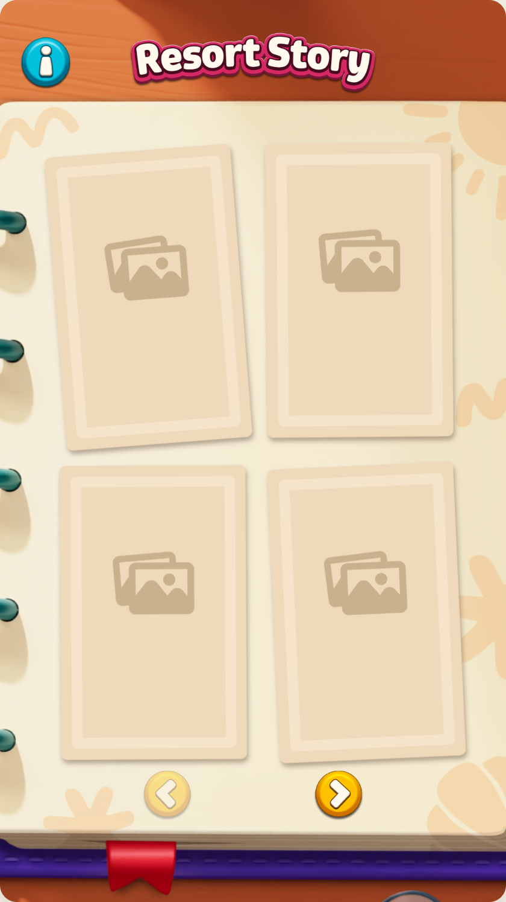
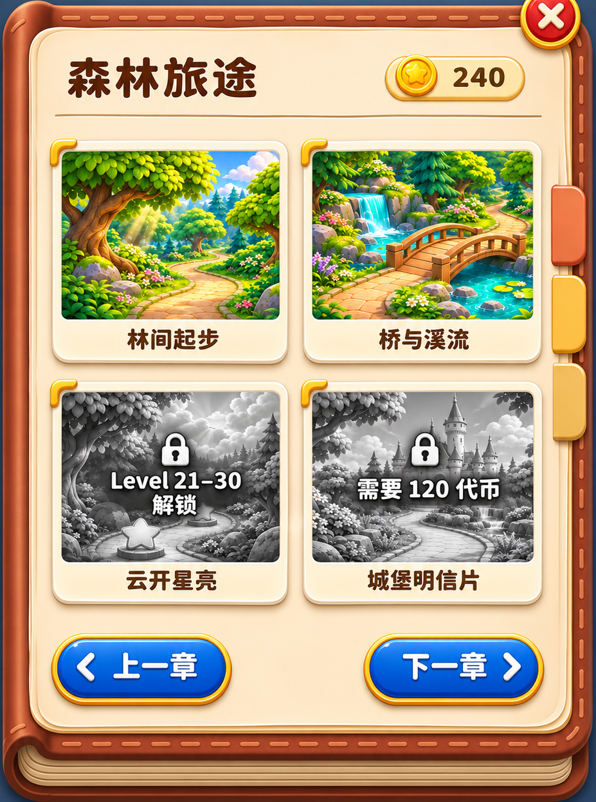
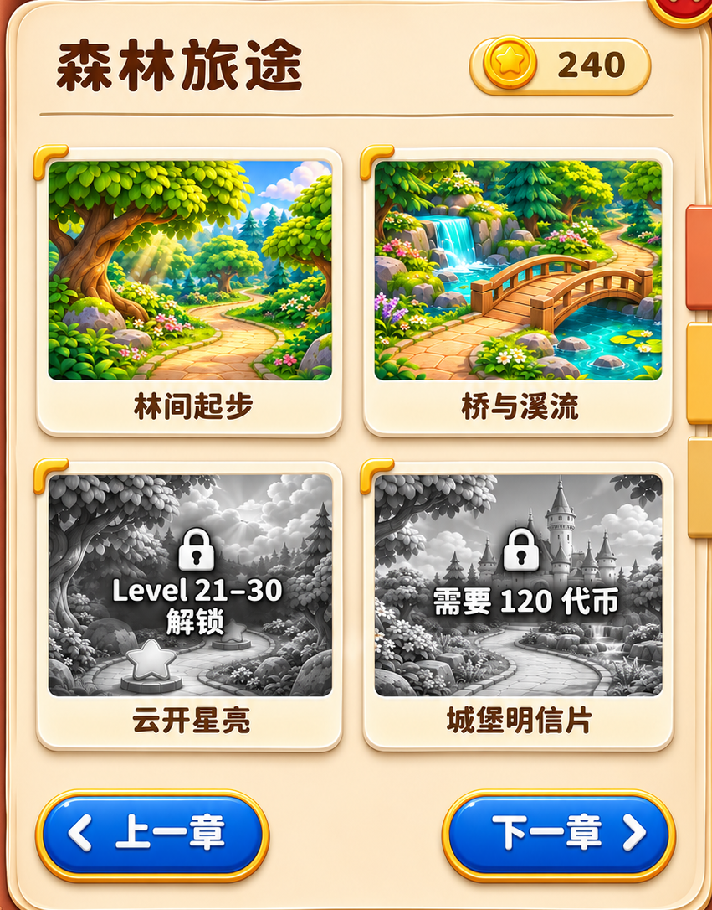
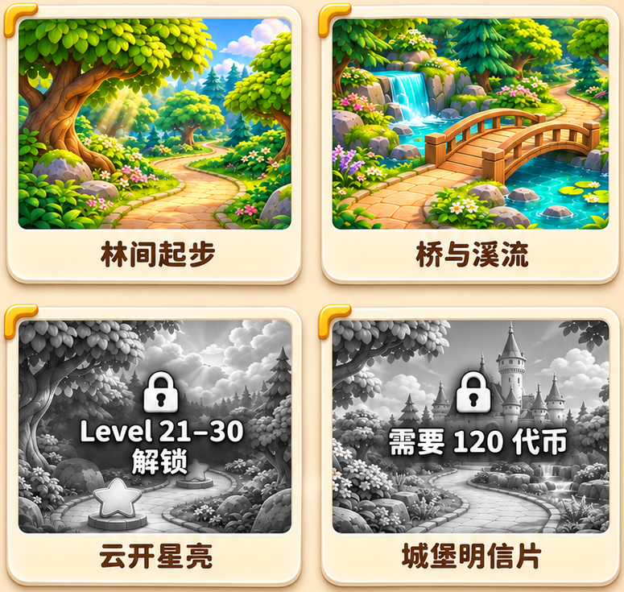
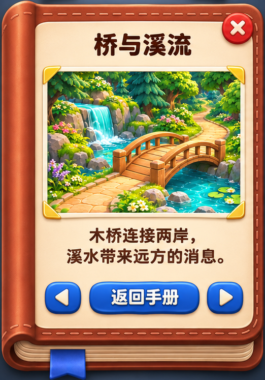
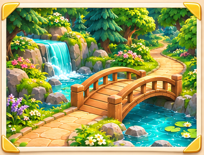
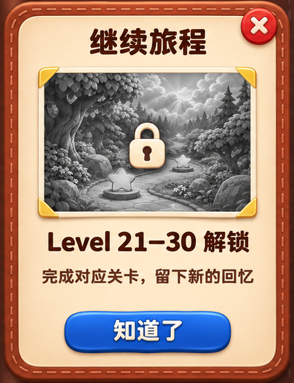

# 进度收集美术需求

## 旅行手册 UI（2026-11-11）

**主参考：LG 的 Resort Match 1.18.0 / Resort Story 剧情卡牌 UI。** Royal Match 仅为欧卡体积与质感补充参考。

沿用现有画廊棕褐皮革书壳、单页半本书及通用无主题背景。只拆 UI，不要求照片场景、人物、构图或剧情内容。

参考来源：LG《右下角照片剧情拆解-1.18.0》、同版相册静态场景与原 UI 素材。尚未验证实机动效。R01 为静态空卡复原；后续 C/P/D/T 图片为11-10旧稿部件定位，以文字及主参考为准。

## 主参考与 TS 转化

| 图示 | 描述 | 功能 |
|---|---|---|
|  | **R01 四卡相册与装帧** 主参考 Resort Match 1.18.0 的 Resort Story：纸页承托四张相纸卡，2×2 阅读顺序、少量错位与小幅旋转。 图示由原素材与静态槽位复原，并替换为空卡；不是实机截图。 TS 保留现有画廊棕褐皮革书壳、单页结构和无主题背景；不照搬 Resort 的紫壳、木桌、铃铛或度假村贴纸。 | 指导整体层级、卡片占比与留白；TS 的关闭、余额等入口仍按自身功能布置。 |
|  | **R02 相纸卡框与占位** 暖白相纸、圆角、适度下沿厚度和柔和投影；图像是视觉重点。 原正式照片为 915×1440 竖图且自带白边；此处是独立空卡槽素材。 TS 图像、边框、题名与状态分层；画面内容本轮不提需求。 | 统一已获得、锁定、加载及异常的容器，状态层分别设计。 |
|  | **R03 标题字形层级** 参考粗圆字体、浅色字面、深色描边和短投影带来的小屏辨识度。 TS 标题仍为“旅行手册”；重新设计字形及配色，不使用 Resort 商标字样。 原蓝色大绸带不再作为必须沿用的要求。 | 标识功能，保持标题与四卡内容的主次关系。 |
|  | **R04 成对翻页按钮** 主参考圆形厚实按钮、浅色大箭头和明确高光；左右成对。 TS 最终配色统一到共用控件，保证与棕褐书壳协调；无页码。 需要正常、按下、禁用三种视觉；图示仅为原素材正常态。 | 上一章／下一章；首末章的禁用或隐藏规则待定。 |
|  | **R05 照片题名与剧情说明层级** 参考资料已核实每张照片有独立短题名与正文，以及新照片界面的说明条结构。 TS 卡片页使用短题名，详情页展示大图、题名和短说明；本次不编写剧情正文。 现有 LG 复原网页的弹窗、字体和页码为整理辅助，不能当作游戏原版 UI 依据；空卡图只示意内容容器。 | 指导本地化文字区与阅读顺序；不引入 Resort 的发奖、进度或玩法规则。 |

## 一、通用装帧与基础控件

以下部件在所有章节中复用，颜色与形态不随照片主题改变。

| 图示 | 描述 | 功能 |
|---|---|---|
|  | **C01 通用背景** 蓝灰色抽象底色，中央柔和提亮，四周适度压暗。 背景不出现森林、海洋、糖果、冰雪等主题元素。 | 承托手册主体，无点击功能。 |
|  | **C02 书壳与书脊** 沿用现有画廊的棕褐色皮革风格，带缝线、圆角和纸页叠层。 主体为半本书／单页，左侧保留窄书脊。 书壳、书脊与阴影需可分层交付。 | 构成所有章节共用的手册底板，无独立点击功能。 |
|  | **C03 纸页底板** 奶油色纸页，保留柔和内阴影和页边厚度。 为页头、四图区域与页脚提供统一内容区。 适配时优先调整外部留白与底板，保持照片比例。 | 承载章节内容，无独立点击功能。 |
|  | **C04 界面标题** 顶部展示“旅行手册”，主参考 Resort Story 的粗圆字、浅色字面、深色描边和短投影。 文字与承托底板分层，保持小屏可读。 原稿蓝色大绸带仅作旧方案位置示意，是否保留底板由本轮统一设计确定。 | 标识当前功能，无点击功能。 |
|  | **C05 通用关闭按钮** 红色圆形按钮、浅色叉号，带立体高光。 主界面、详情与条件提示复用同类样式。 图形大小与点击热区分别处理，避免遮挡标题和余额。 | 主界面：关闭手册，返回进入前的界面。 详情／提示：关闭当前层，回到下层手册。 |
|  | **C06 无字装饰页签** 位于书页右侧，使用统一的暖色页签组合。 不显示文字、图标或选中态，各章节颜色一致。 | 仅作装帧装饰，不承担目录或切章操作。 |

## 二、章节内页

章节名、照片题名和条件文案按内容替换；版式、相框与导航保持一致。旧稿图示仅供定位；本轮卡框、标题、导航以主参考区为准。

| 图示 | 描述 | 功能 |
|---|---|---|
|  | **P01 章节主题名** 位于页头左侧，采用深褐色粗圆字体。 显示当前章节名称，文字独立于底图。 长标题需预留扩展空间，避免与代币栏重叠。 | 切换章节时刷新当前主题名；无独立点击功能。 |
|  | **P02 代币图标与余额栏** 位于页头右侧，由代币图标、余额底板与数字组成。 三者分别交付，数字支持动态变化和位数扩展。 图示余额 240 为示例。 | 展示玩家当前代币余额，余额变化时刷新。 当前设计不包含购买或充值入口。 |
|  | **P03 四图布局区** 同一页固定 2 列×2 行，阅读顺序为左上、右上、左下、右下。 主参考 Resort Story 的四张相纸卡片：允许小幅错位和轻微旋转，保持阅读顺序及点击热区清晰。 Resort 原图为 915×1440 竖版；TS 旧稿为横版 4:3。本轮需出竖版参考与横版兼容对比，再统一卡框比例。 不增加 x/4 进度、页码或“新”角标。 | 承载本章四个照片条目；点击行为由每张照片的解锁状态决定。 |
|  | **P04 照片相框** 主参考 Resort Story 的暖白相纸边框、略厚下沿与柔和落影，图像为页面视觉重点。 相框、阴影与题名分层，整体保持简洁，四格和各章节使用同一套组件。 Resort 原照片自带白边；TS 制作时拆出独立边框，避免图片和 UI 重复加框。 | 作为照片的展示容器，点击热区覆盖相片条目。 |
|  | **P05 照片固定装饰（可选）** 旧稿金色角贴仅为位置示意，不作为主参考中的必备元素。 优先保持 Resort Story 的简洁相纸观感；如确需角贴，只做少量通用点缀并可独立关闭。 | 纯装饰，无独立点击功能；是否保留在本轮视觉稿评审时确定。 |
|  | **P06 照片题名** 参考相纸下沿短题名的层级，位于底部留白区，不挤占卡片画面。 TS 文案独立于插画；使用可读的中文及多语言字体，长题名另行适配。 复原网页中的字体为阅读辅助，不视为已核实的游戏原字体。 | 标识对应照片，无单独按钮行为；随所属条目响应点击。 |
|  | **P07 已解锁照片** 照片完整彩色显示；保留统一相框和题名。 不额外增加“新”、奖励或进度标记。 本项仅规定 UI 状态，不规定照片里的场景内容。 | 点击打开该照片详情。 |
|  | **P08 未解锁锁图形** 锁图形位于照片内部，与灰度和条件文字一起表达未解锁。 已解锁后隐藏；不单独为每张照片绘制一套锁。 | 作为条目状态提示，不作为独立按钮。 |
|  | **P09 关卡条件照片** 原图置灰，并叠加锁图形与“Level n–m 解锁”。 白色条件文案需有清晰描边／暗底，避免被画面干扰。 关卡起止值动态填充，21–30 为示例。 | 点击显示关卡条件提示；满足并完成解锁后切换为已解锁视觉。 实际发放时点由策划规则确定。 |
|  | **P10 代币条件照片** 原图置灰，并叠加锁图形与“需要 n 代币”。 代币数量动态填充，120 为示例。 | 未满足条件时显示代币条件提示。 余额足够后的操作方式、是否消耗代币，列为待确认。 |
|  | **P11 上一章按钮** 位于页脚左侧，主参考 Resort Story 的圆形厚实箭头按钮。 参考其清晰浅色箭头、圆润描边、上部高光和下沿厚度；最终配色统一到 TS 共用控件。 主稿优先使用简洁箭头，旧稿“上一章／下一章”长条按钮为旧方案。 包含可用、按下与禁用状态；两按钮间不显示页码。 | 点击切换至允许浏览的上一章，并刷新主题名、四图及对应状态。 |
|  | **P12 下一章按钮** 位于页脚右侧，与上一章按钮成对；箭头方向相反。 参考其清晰浅色箭头、圆润描边、上部高光和下沿厚度；最终配色统一到 TS 共用控件。 主稿优先使用简洁箭头，旧稿“上一章／下一章”长条按钮为旧方案。 包含可用、按下与禁用状态；两按钮间不显示页码。 | 点击切换至允许浏览的下一章。 最后一章及未开放章节的访问表现需补定。 |

## 三、照片详情

详情页承接已解锁照片的回看。图片题材与叙事内容不在本次需求范围内。

| 图示 | 描述 | 功能 |
|---|---|---|
|  | **D01 详情底板** 使用同套棕褐皮革与奶油纸页语言。 容纳照片标题、大图、说明、切图按钮和返回入口。 | 打开时显示所选已解锁照片；关闭后回到当前章节内页。 |
|  | **D02 照片标题** 位于详情顶部，使用深褐色粗圆字。 显示当前照片题名，与照片内容及说明一起更新。 | 标识当前查看条目，无点击功能。 |
|  | **D03 大图展示框** 延续同一套相纸卡框，大图保持原始照片比例，避免裁切和拉伸。 横竖比例跟随章节卡片最终方案；旧稿 4:3 不作为本轮已定尺寸。 使用详情图资源；资源尺寸与导出规范另行确认。 | 展示当前已获得照片；本稿未定义额外缩放或拖动操作。 |
|  | **D04 照片短说明** 参考 Resort Story 将短题名与剧情说明分开的信息层级，说明位于大图下方。 图、题名与说明分别交付，预留多行及本地化扩展空间。 本次不编写照片剧情；Resort 新照片层有说明条素材，现有复原网页详情布局不视为游戏原版详情。 | 展示当前照片的说明，切图时同步刷新。 |
|  | **D05 上一张按钮** 位于详情底部左侧，小型蓝色立体箭头按钮。 需要明确可用与边界状态。 | 切换至可回看的上一张已解锁照片；首张边界及是否循环需确认。 |
|  | **D06 下一张按钮** 位于详情底部右侧，样式与上一张成对。 未解锁照片不作为默认回看目标。 | 切换至可回看的下一张已解锁照片；末张边界及是否跨章需确认。 |
|  | **D07 返回手册按钮** 位于详情底部中央，显示“返回手册”。 与左右切图按钮保持间隔，防止误触。 | 关闭详情，返回打开详情时的章节内页。 |

## 四、解锁条件提示

关卡与代币提示使用同一套弹窗底板、关闭和确认控件，按条件类型替换内容。

| 图示 | 描述 | 功能 |
|---|---|---|
|  | **T01 通用条件弹窗** 棕褐色边框配奶油内容面板，右上保留关闭按钮。 弹窗出现时对下层界面压暗，集中阅读当前提示。 标题、预览、条件、说明与按钮使用一致的层级。 | 展示当前未解锁照片对应的条件。 弹窗期间下层界面不响应点击；点空白是否关闭需确认。 |
|  | **T02 提示标题** 顶部显示条件提示标题。 当前文案示例：关卡提示“继续旅程”；代币提示“收藏这段回忆”。 标题独立，可随本地化替换。 | 帮助玩家识别提示用途，无点击功能。 |
|  | **T03 灰态预览与锁** 统一照片比例与相框，叠加锁图形及条件文字。 可参考 Resort 的暖色空卡槽；TS 沿用灰态预览方案，具体剧透程度待确认。 相框、锁和状态层分别复用；不将素材缺失占位当作锁定态。 | 关联玩家点选的未解锁条目，无额外点击操作。 |
|  | **T04 关卡条件文案** 突出显示“Level n–m 解锁”。 下方保留一段短说明，如“完成对应关卡，留下新的回忆”。 文案和关数均为独立内容。 | 告知获得条件；本提示只提供关闭操作，不直接跳入或改变关卡。 |
|  | **T05 所需代币** 用代币图标配“需要 n 代币”显示要求。 代币图标复用，数值与文字单独更新。 | 展示当前条目的代币条件。 |
|  | **T06 当前代币余额** 在所需代币下方显示“当前拥有 n”。 与主界面余额使用同一数值来源；80 为示例。 | 供玩家对照余额与条件，余额变化时同步刷新。 |
|  | **T07 代币不足提示** 余额低于所需数量时，显示“代币不足”。 使用清晰的暖色提示字，保证文字可读。 | 明确说明条件未满足；当前视觉稿未定义商店／充值跳转。 |
|  | **T08 确认提示按钮** 底部使用共用蓝色按钮，文案为“知道了”。 关卡与代币提示复用相同样式和反馈。 | 点击关闭提示，返回当前章节；不执行代币扣除或照片发放。 |

## 待确认项

- 照片比例：Resort 为 915×1440 竖图，TS 旧稿横向 4:3；先做两版容器布局对比，再锁定规格。
- 代币条件：是否扣除、主动解锁或自动获得、是否二次确认。
- 关卡条件：自动发放还是领取。
- 首末章边界、未开放章节、详情切图范围及是否循环。
- 遮罩关闭、缺图加载与重试、最长文案与目标屏幕。

## 交付与验收

- 可编辑源文件及共用切图：背景、书壳、纸页、相纸框、页签、代币、关闭、箭头、锁和状态遮罩分层。
- 标题、题名、余额、条件数字及说明独立；不为每章重复制作通用组件。
- 必要状态：已解锁、未解锁、加载、失败、按钮可用／按下／禁用。
- 各章只替换内容；背景与控件不依赖森林、海洋等主题。
- 适配保持 2×2 与最终确认比例，校验长短屏、安全区、文字长度和点击热区。
- 240、120、80、Level 21–30 均为旧稿占位数值，非正式配置。
