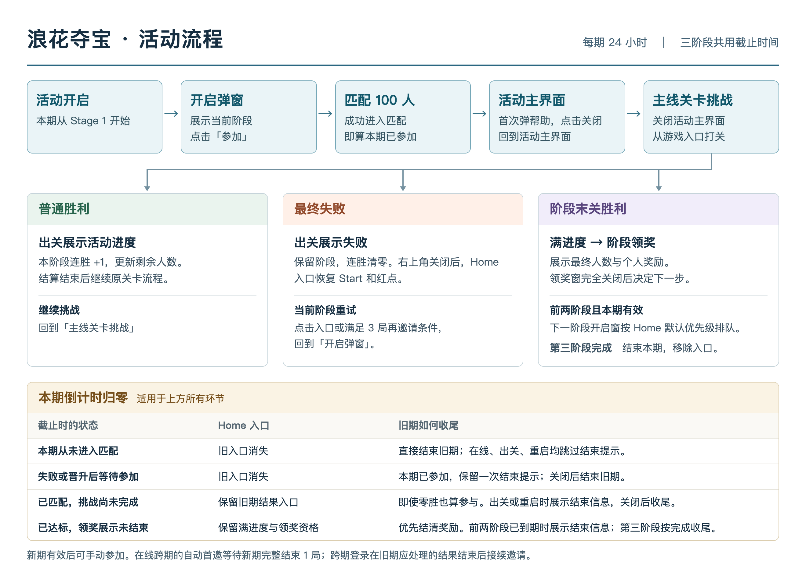

# 浪花夺宝 Splash Quest 活动需求

## 活动概述

浪花夺宝是随主线关卡推进的每日限时连胜活动。玩家从第一阶段开始参与一组 100 人的挑战，连续通过本阶段要求的关卡后，与剩余参与者瓜分钻石奖池，再向下一阶段晋升。阶段越靠后，连续通关目标越长，奖池越大。

活动共有三个阶段。完成第三阶段并领完奖励后，当天活动结束；下一期重新从第一阶段开始。玩家可以在失败后继续尝试当前阶段，已经完成的前序阶段不会丢失。

人数和淘汰表现由活动规则模拟，首版不做实时联网组队。首版配置目标为全体玩家共用一套基础参数（B1），配置收敛见后续待办，关卡沿用 TS 原有难度规则，不因为参加活动或领取奖池而增加专属难度。

## 阶段与奖励配置

| 阶段 | 初始人数 | 连续通关目标 | 钻石总奖池 | 完成后 |
|---|---:|---:|---:|---|
| 第一阶段 | 100 | **5 关** | **5000** | 领奖，晋升第二阶段 |
| 第二阶段 | 100 | **7 关** | **10000** | 领奖，晋升第三阶段 |
| 第三阶段 | 100 | **10 关** | **20000** | 领奖，结束本期活动 |

每个阶段独立计算连胜。进入新阶段或失败后重新参与，都会从 100 人、当前阶段第 1 关重新开始；上一阶段的剩余人数不带入下一阶段。

每阶段只完成领奖一次。“三个阶段”不代表最多只能挑战三次：只要本期还未结束，玩家失败后可以重新尝试，不额外限制三次参与。活动不包含中途宝箱、累计奖励或第三阶段循环奖励。

## 活动周期与开启

TS 本地基础活动配置的开启等级为 55，实际展示还需满足活动开放与资源就绪条件。活动每天一期，每期固定 24 小时，期与期连续开启。切期时刻沿用现有配置：UTC 08:00，即北京时间 16:00。三个阶段共用同一个截止时间。

满足现有解锁与开启条件后展示活动。晚加入的玩家只能使用本期剩余时间；例如距离切期只剩 2 小时，此时参与也只有 2 小时，不会重新获得 24 小时。临近截止不额外设置首次参与禁入时段。

本期提前完成后，活动关闭、入口消失，等待下个切期再从第一阶段开启。未完成进度不带入新一期。首次参与、失败重试和阶段晋升都不会延长本期时间。

## 完整活动流程

开启窗展示当前阶段。玩家点击「参加」且成功进入匹配界面，才记为本期已参加；此后即使没有赢过一关，或立即退出再登录，这次参与也有效。同一期里，每次失败只影响当前阶段这一轮。

### 界面与操作

| 环节 | 界面内容与玩家操作 |
|---|---|
| 开启与匹配 | 首次、重试、晋升共用开启窗。匹配以 Home 为背景，标题为 Stage n，展示该阶段奖池和匹配人数。每轮重新从 100 人开始 |
| 入场与帮助 | 匹配后先进入当前阶段主场景。首次参加才自动弹帮助，点击任意位置关闭后回到原主场景；重试、晋升和新一期均不重复自动教学。每阶段入场隐藏 Tap to Continue，关闭后从游戏原有入口打关 |
| 关卡胜利 | 在主线出关结算中先展示本次推进、头像淘汰和剩余人数，再接后续流程。普通胜利沿用已有点击继续、快进操作。末关直接衔接领奖；同一局只推进一次 |
| 关卡失败 | 复活继续同一局保留进度。最终失败在主场景显示失败信息栏，隐藏 Tap to Continue；右上角关闭只退出。当前阶段连胜归零，前面已领的奖励保留，初版失败冷却为 0 |
| 阶段领奖 | 领奖窗叠在已完成阶段的活动主场景上，奖池美术与匹配界面一致，分开展示总奖池、最终人数、个人所得。关窗后直接接原流程，通常回 Home |
| 下一阶段或结束 | 前两阶段在本期有效且领奖窗完全关闭后晋升，下一阶段开启窗按 Home 默认开启类优先级排队。玩家需再次点击参加。第三阶段领奖结束后关闭本期、移除入口，等待下一切期 |

### 入口、到期与重启

| 截止前的情况 | 有效期内的 Home 入口 | 截止及恢复 |
|---|---|---|
| 本期从未成功进入匹配，包括只开过开启窗 | Stage 1，Start、红点、0/5 | 入口自动消失，直接结束旧期。在线、出关或重启均跳过旧期结束提示 |
| 已匹配，零胜或已胜部分关卡 | 本阶段倒计时、当前进度，无红点 | 即使零胜也保留旧期结果入口。关内不打断，出关或重启时展示活动主界面的结束信息栏，关闭后收尾；截止后的胜利不计入旧期 |
| 曾参加，本阶段失败待重试或下一阶段待参加 | 当前可参加阶段的 Start、红点、空进度 | 到期自动移除旧入口。本期已有匹配记录，仍保留一次结束提示 |
| 末关已达标，或钻石到账但领奖窗仍开着 | 保留 5/5、7/7 或 10/10，无红点 | 奖励及本阶段满进度优先，重启可恢复。前两阶段领奖时若已过期，结清后结束旧期；第三阶段完成按成功收尾 |
| 本期三阶段已全部领完 | 入口消失 | 到配置切点才开启下一期，重新从 Stage 1 开始 |

进入 Home、活动状态变化和入口每秒更新倒计时时刷新入口。只查看开启窗会保留红点，匹配成功后清除。已达标时必须等领奖窗完全关闭才能切换下一阶段的 Start。

### 关卡挽留

当前仅在主线提供复活机会时，浪花夺宝参与公共挽留展示。玩家正在挑战，或正在展示失败且有失败前进度时，用「已通过关数 + 正在挑战的这一关」计算进度。达到阶段目标的 50% 后具备展示资格，即 Stage 1 第 3 关、Stage 2 第 4 关、Stage 3 第 5 关起。公共复活界面仍按优先级及分组选择最终展示项。

气泡展示当前阶段总奖池和挑战进度。选择复活后继续同一局；放弃复活并形成最终失败后，才清空本阶段连胜。

### 弹窗规则

| 时机 | 玩家看到什么 | 计数与触发 |
|---|---|---|
| 首次开启，或手动点击可参加入口 | 当前阶段共用开启窗；关闭后仍可再次打开 | 成功进入匹配才记录本期参与。手动参加不受自动邀请额度限制 |
| 失败后关闭 | 返回原流程，Home 入口恢复当前阶段的 Start 和红点 | 玩家可立即手动重试。未主动参加时，按活动外完整结束 3 局的规则再次邀请 |
| 前两阶段领奖窗完全关闭 | 有效期内把下一阶段开启窗加入 Home 队列，使用默认开启类优先级 | 仍需点击参加；独立于失败后的 3 局计数 |
| 在线跨期 | 旧期结果处理完后，有效新期入口可立即参加；自动首邀等待新期完整结束 1 局 | 跨截止的当局和展示旧结果的当局均不计入。手动处理后取消对应的待弹邀请 |
| 跨期登录 | 先恢复应处理的旧期奖励或结束信息，再按队列展示当前新期邀请 | 整期未进入匹配直接跳过旧期结束界面。登录首邀无需额外打一局，错过多期只开当前有效期 |

**本版再次邀请**沿用 3 局间隔，配置每日上限为 2。现实现按自然日记数，开始新一轮也会清零，在检查待弹时记次，实际次数受这些重置时机影响。胜利、退出失败、放弃复活按最终结果计局；复活继续同一关、直接导致本次活动失败的那一局均不计入随后 3 局。

**R05 暂缓目标**为每活动期最多 2 次，只在成功展示再次邀请后扣次；本期重试、跨自然日保留额度，手动处理过的邀请去重。领奖、晋升、到期结果与新期首邀各走自己的流程。

## 人数与数值说明

首版先建立一个基础档位包，包含5/7/10关三个阶段，所有玩家共用。它是活动的一套完整数值，不是三个用户组；玩家仍按第一、二、三阶段顺序晋升。每次挑战从100人开始，逐关淘汰，完成时按实际剩余人数瓜分奖励。

以下为待 R07 落表的 B1 数值基线；期望人数不是固定结算人数，奖励示例不是承诺到账值。

| 阶段 | 初始期望剩余人数 | 人数下限～上限 | 按期望人数瓜分的个人奖励 |
|---|---:|---|---:|
| 第一阶段 | 30 | 20～40 | 167钻石 |
| 第二阶段 | 15 | 10～30 | 667钻石 |
| 第三阶段 | 10 | 5～20 | 2000钻石 |

三个阶段全部完成时，按基数计算合计2834钻石；实际金额会随本轮人数随机、失败重试及复活补偿变化。人数调整步长均为1，实际经济产出需结合完成率和重试数据验证。

三个阶段分别配置逐关复活补偿系数。钻石复活消费满足条件时，每关最多额外淘汰1名参与者，不能突破人数下限；玩家仍需完成阶段才能得到更高的瓜分奖励。它不直接返还消费，也不保证每次复活都增加奖励。

关卡类型权重负责分配其他参与者的淘汰节奏；基础期望与重试调整决定本轮人数基准；复活补偿可能进一步减少人数。三者都不修改棋盘难度。人数下限只是边界，不代表每次挑战都能达到最高奖励。

### 后续用户分组

B1 收敛后的首版不按余额、复活意愿、连胜表现或主线进度区分活动参数。先观察基础档位的完成率、重试、复活和钻石产出，再根据明确的人群差异增加档位，并配置用户组到档位的对应关系。不同用户组可以继续共用基础档位，不提前复制多套相同参数。

后续分组按活动期开启时确定，本期重试和晋升不因实时行为变化而换档；已有待领奖励按完成时结果结算。当前尚未定义用户组名称、指标阈值和第二套档位数值，不能视为首版已经启用分群。

## 奖励结算

5000、10000、20000 都是总奖池，个人奖励按完成阶段时的剩余人数瓜分：

**个人奖励 = 总奖池 ÷ 最终剩余人数，向上取整。**

例如第二阶段结束时剩余14人，玩家获得 `10000 ÷ 14` 向上取整，即 **715钻石**。界面必须区分“总奖池”和“本次个人所得”，展示数量与实际到账一致。沿用向上取整方式，不额外分配尾差。

只有完成阶段才取得本阶段领奖资格；失败和未完成阶段不发通关奖励。每阶段奖励只能领取一次，重复点击、关闭再打开或重启不能重复发放。奖励按完成时的结果结算，不随晋升后的新奖池变化。

截止前已经获得、尚未领取的奖励会保留；活动到期不能使它消失。

## 美术与表现方向

水上乐园地图以踏垫表达推进，终点用城堡和奖励堆标识。5、7、10 关分别手工配置地图、台子、告示牌与阶段 UI；地图显示阶段、进度、剩余人数和共用倒计时。匹配和领奖均读取对应阶段的奖池图与金额。金币、宝箱属于美术表现，通关实际分得钻石。

过关时幸存头像按批跳向目标台，淘汰头像留在原台退场，本人头像在前景。快进、关窗再开或跨阶段后，头像位置应与实际进度一致。界面布局验收覆盖安全区、多语言、奖池木牌和货币栏飞入目标。

![[02-PROJECTS/TileScape/游戏逻辑/任务-钻石联盟每日三阶段改造.assets/主界面草图-2026-10-30.png|360]]

## 改造前后对比

| 编号 / 调整项 | 迁移原版 | 新需求 |
|---|---|---|
| T01 名称与主题 | 钻石联盟，沿用 MT 界面与资源 | 正式名称浪花夺宝 / Splash Quest，水上乐园主题；代码词根统一SplashQuest，活动标识统一ActSplashQuest |
| T02 活动排期 | 约 4 天开放、3 天间隔，固定周期 | 每日固定 24h、无间隔；沿用 UTC 08:00 切期；晚加入仅余时，重试和晋升不补时 |
| T03 阶段结构 | 前两档晋升，第三档循环挑战 | 三阶段各完成、领奖一次；第三阶段领奖表现结束关闭本期并移除入口 |
| T04 通关目标 | 3 / 7 / 15 关 | 5 / 7 / 10 关；各阶段失败只清当前进度 |
| T05 阶段奖励 | 第一档固定道具；第二档 10000、第三档 30000 钻石奖池 | 全部改为钻石总奖池 5000 / 10000 / 20000；按最终人数向上取整分配，每阶段一次 |
| T06 参数与分层 | 六组 Main / 十八组 Stage，按旧规则分层 | 首版全体映射一个基础档位 B1；期望 30/15/10，范围 20～40 / 10～30 / 5～20；保留以后分组能力 |
| T07 附加奖励 | 第三档中途宝箱及循环累计奖励 | 移除中途宝箱、累计进度和累计奖励及相应提示 |
| T08 参加入口 | 存在独立段位总览及对应路由 | 首次、失败重试、下一阶段共用开启弹窗；点击参加才匹配，再进入主场景 |
| T09 阶段衔接 | 领奖后回段位展示/总览，再进入后续挑战 | 前两阶段领奖关闭后将下一阶段开启窗加入后续弹窗流程，按新阶段再开启一轮；无独立晋升页或旧主场景中转 |
| T10 失败冷却 | 失败 CD 为 1800 秒；冷却跨截止可提前判超时 | 初版 CD=0，可立即重新参与当前阶段；取消该冷却导致的提前结束 |
| T11 失败退出与入口 | 失败关闭后进入段位相关路由 | 右上角关闭只退出；icon 恢复待参与并显示红点；主动点击进入同阶段开启窗 |
| T12 再次邀请 | 通用 3 局提醒、每日最多 2 次；开窗检查时计次 | 本版保留 3 局及现有计数；暂缓目标为每期最多 2 次；实际展示成功后计次，手动处理或已参加后取消对应邀请 |
| T13 跨期衔接 | 沿用固定周期的超时、待处理结果和登录提示流程 | 整期未匹配跳过旧期提示，已参加先处理旧期结果；新期入口立即可用，后续完整结束 1 局再自动首弹；登录先旧期后当前新期，无额外 1 局 |
| T14 地图与区域资源 | 按目标动态拼接旧地图段，主要使用旧固定资源 | 每阶段手工配置地图；按配置切换台子数量、奖励堆、告示牌、匹配奖励图及 UI |
| T15 入场与操作 | 主场景入场显示 Play；首次帮助在首次进入主场景后展示；胜利有既有操作/快进/领奖衔接 | 首次引导在主场景后展示，点击任意位置关闭；每阶段开启/失败隐藏Tap to Continue，胜利出关展示，胜利操作沿用MT |
| T16 配套验证 | 原版参数、循环、冷却和资源对应的用例/文案 | 围绕新周期、三阶段、奖励、弹窗、跨期和阶段资源更新配置校验、用例与验收 |

## 策划验收标准

| 操作场景 | 玩家端应看到的结果 |
|---|---|
| 打开再关闭首次开启窗，留在 Home 到期，再重启 | 截止前仍有 Start 和红点；截止后旧入口消失，在线和重启均跳过旧期结束提示 |
| 成功进入匹配后立即退出游戏，零胜跨期登录 | 保留本期参与记录，先处理一次旧期结束信息，再衔接有效新期 |
| 首次入场、重试、晋升各进入一次主场景 | 仅首次自动展示帮助；关闭回原主场景。三阶段分别切换地图、台子、告示牌、奖池与进度目标 |
| 普通胜利、复活继续、最终失败 | 胜利在出关流程推进一次；复活继续保留挑战；最终失败清当前阶段，关闭只退出，同阶段可立即重新匹配 100 人 |
| 失败待重试或晋升待参加时截止 | 旧入口隐藏，已有参与记录仍可展示一次旧期结束信息。此时不再邀请参加旧阶段 |
| Stage 1、2、3 的末关分别达标 | 入口保留 5/5、7/7、10/10，无红点；预期个人奖励等于总奖池除以最终人数向上取整且与到账一致 |
| 领奖前重启、到账后关闭前重启、领奖界面跨截止 | 同一奖励仅发一次。有效期内前两阶段等领奖窗完全关闭后再排下一阶段邀请；过期不再晋升；第三阶段领奖结束移除入口 |
| 从关内跨截止、在线跨期、离线跨多期 | 主线关卡可正常结束，截止后胜利不增加旧期活动进度。在线首邀等新期完整一局，登录只邀当前有效期 |
| 三阶段挽留阈值前后、头像快进与关窗重开 | 仅符合复活机会和进度门槛才参加公共挽留排序；首次帮助、头像挂点、剩余人数、奖励文字及货币飞入与画面一致 |
| R07 配置完成后换用户分层再开新期 | 每组读取同一套 B1，逐关补偿长度为 5/7/10，三阶段显示、快照和实际发奖相符 |

## 后续交付与待办

| 安排 | 策划需要确认的结果 |
|---|---|
| 优先复测入口与跨期 | 分别测未参加、已匹配零胜、失败／晋升待参加、待领奖四组；核对旧入口、结束提示、新期首邀三者的时机 |
| 下一项配置工作 R07 | 关数、初始人数和总奖池已落地。全体共用 B1 及逐关复活补偿仍待收敛，配置回读后再验个人产出 |
| 已实现，待游戏内联验 | 出关结算、失败和到期信息栏、领奖晋升、挽留、头像动态绑定及三阶段地图；按上表记录通过场景和复现问题 |
| 单独排期 | R05 再次邀请按期计次与去重、R13 地图气泡偏移均暂缓。当前保留既有表现 |

## 来源与修订说明

- 原始钉钉稿共 11 页。现版将原稿的 3/7/10 关、2,000/5,000/10,000 奖池更新为 5/7/10 关、5,000/10,000/20,000；首次帮助移到匹配后主场景，获奖后由 Home 队列衔接下一阶段，整期未匹配到期直接关闭。[[02-PROJECTS/TileScape/游戏逻辑/任务-钻石联盟每日三阶段改造.assets/钉钉需求稿-2026-11-02.pdf|查看钉钉原稿]]
- 迁移原版以 `4905ae46c` 为基线，当前实现核对至 `Exp@a5e2b3e5f`。TS 公共框架负责关卡退出、Home 队列和活动周期，MT 提供人数、重试与胜利表现的迁移基础，RM Ancient 与 Lava Quest 用于流程和美术参考。
- 配置字段、实现位置、历史版本与验收证据由实施主档维护。[[02-PROJECTS/TileScape/游戏逻辑/任务-钻石联盟每日三阶段改造|实施主档]] · [[02-PROJECTS/TileScape/_MOC|TileScape 活动索引]]
