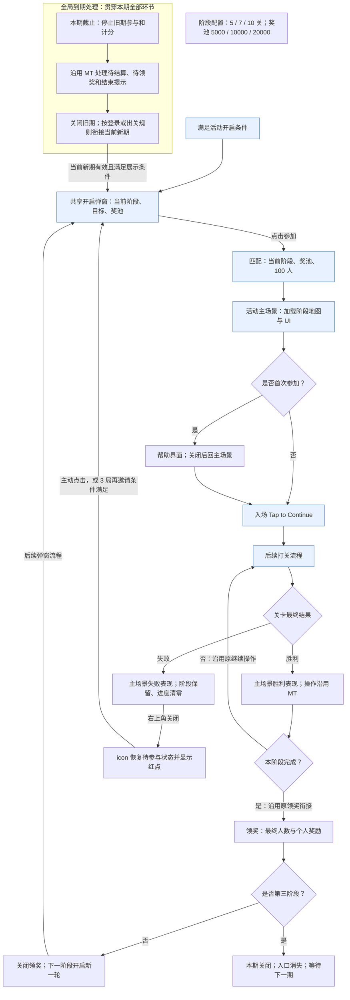

# 水上夺宝 Splash Quest 活动需求

本文说明活动规则、玩家流程、界面表现、交付范围和验收要求。

## 活动概述

水上夺宝是随主线关卡推进的每日限时连胜活动。玩家从第一阶段开始参与一组 100 人的挑战，连续通过本阶段要求的关卡后，与剩余参与者瓜分钻石奖池，再向下一阶段晋升。阶段越靠后，连续通关目标越长，奖池越大。

活动共有三个阶段。完成第三阶段并领完奖励后，当天活动结束；下一期重新从第一阶段开始。玩家可以在失败后继续尝试当前阶段，已经完成的前序阶段不会丢失。

人数和淘汰表现由活动规则模拟，首版不做实时联网组队。所有玩家使用同一套活动参数，关卡沿用 TS 原有难度规则，不因为参加活动或领取奖池而增加专属难度。

## 阶段与奖励配置

| 阶段 | 初始人数 | 连续通关目标 | 钻石总奖池 | 完成后 |
|---|---:|---:|---:|---|
| 第一阶段 | 100 | **5 关** | **5000** | 领奖，晋升第二阶段 |
| 第二阶段 | 100 | **7 关** | **10000** | 领奖，晋升第三阶段 |
| 第三阶段 | 100 | **10 关** | **20000** | 领奖，结束本期活动 |

每个阶段独立计算连胜。进入新阶段或失败后重新参与，都会从 100 人、当前阶段第 1 关重新开始；上一阶段的剩余人数不带入下一阶段。

每阶段只完成领奖一次。“三个阶段”不代表最多只能挑战三次：只要本期还未结束，玩家失败后可以重新尝试，不额外限制三次参与。活动不包含中途宝箱、累计奖励或第三阶段循环奖励。

## 活动周期与开启

活动每天一期，每期固定 24 小时，期与期连续开启。切期时刻沿用现有配置：UTC 08:00，即北京时间 16:00。三个阶段共用同一个截止时间。

满足现有解锁与开启条件后展示活动。晚加入的玩家只能使用本期剩余时间；例如距离切期只剩 2 小时，此时参与也只有 2 小时，不会重新获得 24 小时。临近截止不额外设置首次参与禁入时段。

本期提前完成后，活动关闭、入口消失，等待下个切期再从第一阶段开启。未完成进度不带入新一期。首次参与、失败重试和阶段晋升都不会延长本期时间。

## 完整活动流程

主线为 **活动开启 → 点击参加 → 匹配 → 活动主场景 → 主线关卡挑战 → 活动结算**。首次、失败重试和进入下一阶段共用开启弹窗；只有点击参加才开始匹配。三个阶段共用本期截止时间。

首次及新一期显示 Stage 1；失败重开保持当前阶段，前两阶段领奖后显示下一阶段。提前完成本期后等待每日切点，不立即重开。

### 开启、匹配与首次帮助

1. 满足解锁、档期和展示条件后弹出开启弹窗；只打开或关闭不算参加，后续提醒遵循“弹窗规则”。
2. 点击参加进入匹配。每个阶段、每次重试均从 100 人开始；阶段、奖池及奖励图片读取对应配置。
3. 首次匹配后进入活动主场景，再自动展示帮助。关闭帮助后回到原主场景；重试、进入下一阶段及新一期不重复首次帮助。
4. 主场景底部显示 Tap to Continue，点击进入后续打关流程，不跳过已有结算或关前环节。

### 主场景区域与阶段配置

| 区域 | 配置与交互要求 |
|---|---|
| 阶段地图与台子 | 各阶段地图依据 5 / 7 / 10 关目标手工配置，运行时读取对应配置；正确对应起点、进度位置和终点，区分已通过、当前与未到达。程序不新增自动排布方案 |
| 奖励堆 | 按阶段配置切换资源和奖池信息；装饰宝箱或金币不引入中途奖励，也不改变钻石奖励类型 |
| 告示牌 | 按当前阶段配置显示资源与信息，与目标和奖励保持一致 |
| 主场景 UI | 阶段、进度/目标、剩余人数、共用倒计时及相关图片读取当前阶段配置 |
| 活动 icon | 挑战中显示当前阶段进度条；失败退出后恢复待参与状态及红点；本期完成后移除，新期有效时重新显示 |

匹配和主场景显示当前阶段数据；领奖使用完成时的阶段与奖励快照。正式资源可替换，阶段切换不得残留上一阶段资源或信息。

### 挑战与阶段推进

#### 连续通关

参加后，每次有效主线胜利推进当前阶段一关。在关卡结算流程中展示活动前进、其他参与者淘汰和剩余人数变化。胜利表现、已有点击/快进以及阶段达标后进入领奖的衔接沿用 MT，不另加统一的 Tap to Continue 确认步骤。

主线最终胜负、退出与复活沿用现有口径。出现复活机会或继续当前关卡不算活动失败；最终失败才清空本阶段进度。活动 icon 与主场景进度保持一致。

#### 失败与重试

最终失败后，在活动主场景展示失败过程，保留当前阶段和前序已领奖励，清空本阶段进度。玩家通过右上角关闭按钮退出；关闭后不立即弹开启窗，icon 恢复待参与状态并显示红点。

无失败 CD。玩家可立即点击 icon 打开当前阶段开启弹窗，再点击参加，重新匹配 100 人并从本阶段起点开始。未主动参加时沿用 3 局再次邀请。重试不重置本期截止时间。

#### 晋升与全部完成

完成阶段后进入领奖界面，展示最终人数、总奖池与个人所得。前两阶段领奖界面关闭后，更新阶段，在后续弹窗流程中安排下一阶段开启弹窗，重新走“参加 → 匹配 → 主场景”。不额外回旧主场景做晋升展示，不增加独立晋升或段位总览界面。

“开启下一轮”仍属于同一期，不增加活动时长。第三阶段领奖结束后关闭本期、移除入口、清除本期待弹邀请；不重复第三阶段。

### 弹窗规则

自动邀请只决定展示时机，玩家主动参加不受再次邀请次数限制。首次开启、登录检查、结果恢复沿用现有机制；再次邀请和每日切期按下表处理。

| 触发场景 | 展示规则 | 次数与重置 |
|---|---|---|
| 首次开启、登录检查 | 检查开启与登录提示资格，显示当前有效阶段；既有待结算、待领奖先处理 | 保留登录提示机制；登录提示不等于每次登录必弹 |
| 通用未参与或失败后再次邀请 | 活动外累计结束 3 局后可再次邀请 | 每期最多 2 次再次邀请，新期开启重置；不再因自然日变化额外重置 |
| 前两阶段领奖结束 | 后续弹窗流程中开启下一阶段新一轮，仍需手动参加 | 不占通用再次邀请额度 |
| 在线出关处理旧期结束 | 关闭旧期结果后刷新有效新期入口；可主动参加，再完整结束 1 局后自动展示新期 Stage 1 开启窗 | 新期首弹不占再次邀请额度；延迟展示不延迟开期或倒计时 |
| 跨期登录 | 先处理旧期结果，再安排当前新期开启窗，无需额外打一局 | 沿用旧期结果的待处理标记；不重复排入相同提示 |
| 第三阶段完成 | 关闭本期，不再安排本期邀请 | 下一期从第一阶段重新开始 |

3 局计数沿用现有最终结果口径：胜利、退出失败、放弃复活均计入；复活继续同一局不重复计数，导致本次活动失败的那局不算随后活动外的再次邀请局数。在线跨期后的 1 局首弹计数从旧期结果关闭后开始，展示旧期结果的那局不计入。

实际展示成功后记录再次邀请次数并重新开始对应间隔；未展示成功不消耗次数。玩家手动处理对应开启邀请或已参加后，取消对应待弹邀请，后续按通用规则判断。

领奖、旧期结果、新期首弹和下一阶段开启不占每期 2 次再次邀请额度。展示前检查活动期、阶段、参与状态、到期状态及是否已处理，同一原因不重复安排；旧期邀请不能进入新期执行。

**失败后再次邀请为 3 局；在线跨期后的新期自动首弹为 1 局。两者独立，不共用一个间隔值。**

## 人数与数值说明

首版先建立一个基础档位包，包含5/7/10关三个阶段，所有玩家共用。它是活动的一套完整数值，不是三个用户组；玩家仍按第一、二、三阶段顺序晋升。每次挑战从100人开始，逐关淘汰，完成时按实际剩余人数瓜分奖励。

以下为首版数值基线；期望人数不是固定结算人数，奖励示例不是承诺到账值。

| 阶段 | 初始期望剩余人数 | 人数下限～上限 | 按期望人数瓜分的个人奖励 |
|---|---:|---|---:|
| 第一阶段 | 30 | 20～40 | 167钻石 |
| 第二阶段 | 15 | 10～30 | 667钻石 |
| 第三阶段 | 10 | 5～20 | 2000钻石 |

三个阶段全部完成时，按基数计算合计2834钻石；实际金额会随本轮人数随机、失败重试及复活补偿变化。人数调整步长均为1，实际经济产出需结合完成率和重试数据验证。

三个阶段分别配置逐关复活补偿系数。钻石复活消费满足条件时，每关最多额外淘汰1名参与者，不能突破人数下限；玩家仍需完成阶段才能得到更高的瓜分奖励。它不直接返还消费，也不保证每次复活都增加奖励。

关卡类型权重负责分配其他参与者的淘汰节奏；基础期望与重试调整决定本轮人数基准；复活补偿可能进一步减少人数。三者都不修改棋盘难度。人数下限只是边界，不代表每次挑战都能达到最高奖励。

### 后续用户分组

首版不按余额、复活意愿、连胜表现或主线进度区分活动参数。先观察基础档位的完成率、重试、复活和钻石产出，再根据明确的人群差异增加档位，并配置用户组到档位的对应关系。不同用户组可以继续共用基础档位，不提前复制多套相同参数。

后续分组按活动期开启时确定，本期重试和晋升不因实时行为变化而换档；已有待领奖励按完成时结果结算。当前尚未定义用户组名称、指标阈值和第二套档位数值，不能视为首版已经启用分群。

## 奖励结算

5000、10000、20000 都是总奖池，个人奖励按完成阶段时的剩余人数瓜分：

**个人奖励 = 总奖池 ÷ 最终剩余人数，向上取整。**

例如第二阶段结束时剩余14人，玩家获得 `10000 ÷ 14` 向上取整，即 **715钻石**。界面必须区分“总奖池”和“本次个人所得”，展示数量与实际到账一致。沿用向上取整方式，不额外分配尾差。

只有完成阶段才取得本阶段领奖资格；失败和未完成阶段不发通关奖励。每阶段奖励只能领取一次，重复点击、关闭再打开或重启不能重复发放。奖励按完成时的结果结算，不随晋升后的新奖池变化。

截止前已经获得、尚未领取的奖励会保留；活动到期不能使它消失。

## 界面与交互需求

| 界面或入口 | 必须表达的信息 | 操作与后续行为 |
|---|---|---|
| 活动入口 | 当前阶段、挑战进度条、待参与红点 | 失败退出恢复待参与；本期完成移除，当前新期有效时刷新入口 |
| 共享开启弹窗 | 阶段、目标、总奖池与参与按钮 | 首次、重试和下一阶段新一轮共用；点击参加才匹配 |
| 匹配界面 | 当前阶段、奖池、奖励图片、100 人匹配过程 | 完成后进入当前阶段主场景 |
| 首次帮助 | 连胜、淘汰、瓜分、失败重试及三阶段规则 | 首次匹配后进入主场景时自动展示；关闭回原场景 |
| 活动主场景 | 手工配置的阶段地图、台子、奖励堆、告示牌、进度、人数、倒计时 | 入场通过 Tap to Continue 进入打关流程；胜利表现及后续操作沿用 MT |
| 普通失败表现 | 本次挑战失败、阶段保留、进度清零 | 右上角关闭退出，不立即再弹开启窗；恢复 icon 与红点 |
| 阶段领奖界面 | 完成阶段、最终人数、总奖池与个人所得 | 前两阶段关闭后开启下一阶段新一轮，第三阶段关闭本期 |
| 活动结束提示 | 本期已结束、旧期不可继续 | 到期处理机制沿用 MT；关闭后按在线出关/跨期登录规则衔接新期 |

不增加独立晋升或段位总览界面。关闭界面本身不会降阶段、清空有效进度或重新匹配；正式资源按阶段配置读取。

## 到期与中断处理

到期逻辑沿用 MT 的超时状态、待处理结果和结束提示机制，保留迁移版已有的奖励保护。到期后停止旧期参加、重试和计分，不打断主线关卡，不改变主线自身胜负与奖励。

| 场景 | 处理规则 |
|---|---|
| 活动界面中到期 | 按原有到期流程处理待结算、待领奖与结束提示；结束界面表现随正式资源落实 |
| 打关中到期 | 不打断关卡，出关后处理活动结束；到期后的胜利不计入旧期，也不补记到尚未参加的新期 |
| 截止前已取得待领奖励 | 保留领取资格及完成快照，沿用已有待领奖恢复和发奖保护，不因换期丢失或重复发放 |
| 第三阶段已经完成并发奖 | 保持完成结果，领奖表现结束后关闭本期 |
| 在线处理旧期结束，新期已有效 | 旧期结束后刷新新期入口，可主动参加；再完整结束 1 局后自动弹新期开启窗 |
| 跨期登录 | 先处理旧期已有结果，再安排当前新期开启窗；不补开错过的历史各期 |
| 关闭、重启或中断恢复 | 沿用待处理结果标记恢复；不重置活动时间，不重复发奖或重复执行已处理结果 |
| 旧期回调晚于新期开启 | 旧期关闭仅清理旧期，不误关新期入口、阶段或待弹流程 |

不新增“未参加旧期则跳过结束提示”等过滤条件，不另建一套到期判定。普通失败仍可重试当前阶段；到期结束不能重试旧期。新一期始终按固定排期开放，等待自动邀请不增加剩余时间。

## 活动名称

中文正式名称为 **水上夺宝**，英文为 **Splash Quest**。玩家可见的入口、标题、规则和宣传内容统一使用正式名称。

## 美术与表现方向

活动以水上乐园为主题，参考 RM Ancient 的体验方向。主界面草图使用水面踏垫组成关卡路径，顶部城堡和奖励陈列作为终点视觉。

![[02-PROJECTS/TileScape/游戏逻辑/任务-钻石联盟每日三阶段改造.assets/主界面草图-2026-10-30.png|360]]

现有迁移资源是联调资源，正式界面可以重做或调整。地图按 5、7、10 三个目标手工配置，运行时读取阶段对应配置，并明确表达已通过、当前和未到达的位置。草图中的金币或宝箱只是视觉构想，不改变钻石奖励，也不恢复中途宝箱功能。

待细化：地图排布与滚动；阶段/进度/人数/倒计时布局；玩家与淘汰表现；共享开启弹窗及下一阶段开启表现；匹配、领奖、结束界面的正式构图；按钮文案、多语言和屏幕适配。现有临时动画不作为最终美术要求。

## 本次改造范围

本节以迁入 TS 时的原版为起点，与本文新需求逐项对照。迁移后本地已经完成哪些修改，不改变本次产品改造范围；实施进度另见文末。

## 改造前后对比

| 编号 / 调整项 | 迁移原版 | 新需求 |
|---|---|---|
| T01 名称与主题 | 钻石联盟，沿用 MT 界面与资源 | 正式名称水上夺宝 / Splash Quest，水上乐园主题；内部活动标识不必重命名 |
| T02 活动排期 | 约 4 天开放、3 天间隔，固定周期 | 每日固定 24h、无间隔；沿用 UTC 08:00 切期；晚加入仅余时，重试和晋升不补时 |
| T03 阶段结构 | 前两档晋升，第三档循环挑战 | 三阶段各完成、领奖一次；第三阶段领奖表现结束关闭本期并移除入口 |
| T04 通关目标 | 3 / 7 / 15 关 | 5 / 7 / 10 关；各阶段失败只清当前进度 |
| T05 阶段奖励 | 第一档固定道具；第二档 10000、第三档 30000 钻石奖池 | 全部改为钻石总奖池 5000 / 10000 / 20000；按最终人数向上取整分配，每阶段一次 |
| T06 参数与分层 | 六组 Main / 十八组 Stage，按旧规则分层 | 首版全体映射一个基础档位 B1；期望 30/15/10，范围 20～40 / 10～30 / 5～20；保留以后分组能力 |
| T07 附加奖励 | 第三档中途宝箱及循环累计奖励 | 移除中途宝箱、累计进度和累计奖励及相应提示 |
| T08 参加入口 | 存在独立段位总览及对应路由 | 首次、失败重试、下一阶段共用开启弹窗；点击参加才匹配，再进入主场景 |
| T09 阶段衔接 | 领奖后回段位展示/总览，再进入后续挑战 | 前两阶段领奖关闭后将下一阶段开启窗加入后续弹窗流程，按新阶段再开启一轮；无独立晋升页或旧主场景中转 |
| T10 失败冷却 | 失败 CD 为 1800 秒；冷却跨截止可提前判超时 | 初版 CD=0，可立即重新参与当前阶段；取消该冷却导致的提前结束 |
| T11 失败退出与入口 | 失败关闭后进入段位相关路由 | 右上角关闭只退出；icon 恢复待参与并显示红点；主动点击进入同阶段开启窗 |
| T12 再次邀请 | 通用 3 局提醒、每日最多 2 次；开窗检查时计次 | 保留 3 局，改为每期最多 2 次；实际展示成功后计次，手动处理或已参加后取消对应邀请 |
| T13 跨期衔接 | 沿用固定周期的超时、待处理结果和登录提示流程 | 在线先处理旧期，新期入口立即可用，后续完整结束 1 局再自动首弹；登录先旧期后当前新期，无额外 1 局 |
| T14 地图与区域资源 | 按目标动态拼接旧地图段，主要使用旧固定资源 | 每阶段手工配置地图；按配置切换台子数量、奖励堆、告示牌、匹配奖励图及 UI |
| T15 入场与操作 | 主场景入场显示 Play；首次帮助在首次进入主场景后展示；胜利有既有操作/快进/领奖衔接 | 入场改为 Tap to Continue；首次帮助时机和胜利操作沿用原版，不增加胜利统一强制确认 |
| T16 配套验证 | 原版参数、循环、冷却和资源对应的用例/文案 | 围绕新周期、三阶段、奖励、弹窗、跨期和阶段资源更新配置校验、用例与验收 |

### 原版沿用与实施边界

- 每次匹配均为 100 人；人数淘汰算法继续复用，参数按 B1 调整。
- 首次帮助沿用原版“首次匹配进入主场景后展示”，关闭后回到该场景；不是本次新增的时机变更。重试、晋升、新一期不重复首次帮助。
- 普通胜利表现、点击/快进及阶段完成进入领奖的操作沿用 MT；不新增统一胜利确认。
- 失败保留阶段、当前进度清零；变更的是冷却、退出去向和再次邀请规则。
- 晚加入沿用统一截止时间；到期沿用 MT 超时、待处理结果与结束提示机制，并保留迁移版待领奖保护，不新增未参加旧期的过滤逻辑。
- TS 保留自身主线难度；不接 MT 活动专属难度，不做旧 MT / 迁移测试存档兼容；新活动自身仍须支持重启恢复与奖励防重。

## 实现顺序建议

1. **Step1：确认比较基线。** 固定迁移原版与新需求的完整差异，逐项核对对应配置、流程和资源；实施时另查工作区进度，避免重复覆盖已有改动。
2. **Step2：周期与基础配置。** 落实每日 24h、全体共用 B1、5/7/10 关与 5000/10000/20000 奖池，以及人数/补偿参数；关闭 CD、循环与宝箱配置。
3. **Step3：三阶段与奖励闭环。** 完成三阶段单次领奖、下一阶段重新开启一轮、第三阶段关闭和入口消失，保留待领奖与恢复机制。
4. **Step4：参与、失败和弹窗。** 移除独立段位总览，统一开启窗及手动参与；保留首次帮助与胜利操作，调整入场提示和失败退出；实现 3 局/每期 2 次邀请、展示计次及去重。
5. **Step5：到期和跨期衔接。** 沿用到期处理，接通在线新期入口/1 局首弹、登录先旧期后新期，并核验旧期回调隔离。
6. **Step6：地图、资源和文案。** 按配置加载手工地图，接入各阶段区域资源及水上夺宝 / Splash Quest 名称，核对动画和适配。
7. **Step7：完整验收。** 按下列标准检查配置、奖励及完整流程；正式资源、功能与经济效果分别记录验证结果。

## 策划验收标准

以下为目标验收标准；勾选框仅用于后续验收记录，当前实现与验证状态单列在文末。

- [ ] **周期**：固定24小时，切期时间正确；晚加入、重试和下一阶段开启均不补时；提前完成不立即重开。
- [ ] **统一配置**：全体共用B1，5/7/10关、5000/10000/20000奖池、100人、人数上下限及补偿系数正确，配置与实际读取一致。
- [ ] **首次帮助**：点击参加才匹配，首次匹配进入主场景后自动帮助；关闭返回原场景，重试/晋升/新一期不重复。
- [ ] **入场与胜利**：入场Tap to Continue正确衔接打关；胜利表现、点击/快进及阶段完成进入领奖沿用MT，无额外强制确认。
- [ ] **失败退出**：最终失败保留阶段、清进度、无CD；右上角关闭只退出，不立即弹开启窗；icon恢复红点，主动重试重新100人。
- [ ] **阶段转换**：前两阶段领奖关闭后按新阶段开启一轮；不回旧主场景展示晋升，不出现独立晋升页；第三阶段结束移除入口。
- [ ] **3局提醒**：失败后与通用未参与均按活动外3局计数；胜利、退出失败、放弃复活各计一次，复活继续不重复计数。
- [ ] **按期额度**：每期最多2次再次邀请；同一期跨自然日不额外恢复额度，新期开启重置；不限制手动参加。
- [ ] **展示与去重**：成功展示才计次，未展示不扣次数；手动处理、已参加、阶段变化或跨期后不再执行过时邀请。
- [ ] **独立提示**：下一阶段开启、新期首弹、领奖与旧期结果不消耗通用再次邀请额度。
- [ ] **在线跨期**：旧期结果处理后有效新期入口可用，可主动参加；再完整结束1局才自动首弹，处理旧期结果的那局不计入。
- [ ] **跨期登录**：按MT既有待处理状态处理旧期，再安排当前新期；不重复执行已处理结果，不补开错过各期，不新增未参加过滤。
- [ ] **到期与奖励**：截止后旧期不可参加或计分；不打断主线；已有待领奖不丢不重，领奖快照不被下一阶段或新期覆盖。
- [ ] **奖励与人数**：个人奖励向上取整且显示/到账一致；每阶段一次，人数单调且不越界/除零，复活消费补偿不误计道具或广告。
- [ ] **中断恢复**：匹配、失败、待领、已领、阶段转换及到期时关闭/重启可恢复；旧期回调不误关新期，补偿结余按期重置。
- [ ] **地图资源**：按阶段加载手工配置地图，台子与进度位置一致；奖励堆、告示牌、匹配图片与UI无串阶段；多语言、安全区、滚动及动画正常。
- [ ] **名称与移除项**：玩家可见名称统一水上夺宝/Splash Quest；无独立段位总览、中途宝箱、累计奖励、末档循环及活动专属难度。

## 来源与修订说明

- 对比基线为 TS 迁移提交 `4905ae46c93dd605b3ddb005fb409a5a9476118a`，不包含其后暂存/工作区改造；来源与进度记录独立于产品正文。
- 需求正文来自 [[02-PROJECTS/TileScape/游戏逻辑/任务-钻石联盟每日三阶段改造|实施主档]]；代码定位、配置操作、历史记录及验证证据在主档维护。正文描述目标，不代表已实现或验收。
- 2026-11-02 最终流程修订：胜利操作沿用MT；失败后的1局再邀请方案撤回，统一3局；再次邀请按期计数；阶段完成按下一阶段开启新一轮；地图手工配置。在线跨期后的新期首弹仍保留1局间隔，与失败再邀请不同。
- 此前讨论的未参与旧期跳过结束提示等过滤条件未纳入需求；到期机制沿用MT，保留迁移版奖励保护。
- 数值基线为5/7/10和5000/10000/20000；人数与补偿参考MT原第1层后调整。早期对话、PDF或旧图中的其他数值不作为执行口径。
- 正式界面仍需美术细化，经济效果待验证；本次仅维护文档，不修改代码、配置、在线表或原PDF。

## 当前实现进度（独立记录）

本节是工作区快照，不参与上文“迁移原版 → 新需求”的产品差异定义。

- 已有本地改造包含 24h 排期、CD=0、三阶段单次领奖及移除循环/宝箱等；不代表这些属于迁移原版原有能力。
- 本地仍为六套 3/7/10 关、2000/5000/10000 奖池；最新 B1、5/7/10 与 5000/10000/20000 及后续流程差异仍需落实。
- 原版首次帮助已在主场景入场后展示；中途实现改为匹配前，需恢复目标时机。这属于工作区修正，不是原版到新需求新增的产品改动。
- 最新完整目标尚未验收，正式资源与经济效果亦未验证。具体已有修改、剩余动作和验证证据见 [[02-PROJECTS/TileScape/游戏逻辑/任务-钻石联盟每日三阶段改造#当前实现进度（独立记录）|实施主档文末进度]]。
- 本次仅重整文档口径，未修改游戏代码、配置、资源或在线表，未运行 Unity 或测试。

## 关联

- 唯一来源：[[02-PROJECTS/TileScape/游戏逻辑/任务-钻石联盟每日三阶段改造|AI迁移与实施主档]]。
- [[02-PROJECTS/TileScape/_MOC|TileScape MOC]]。
