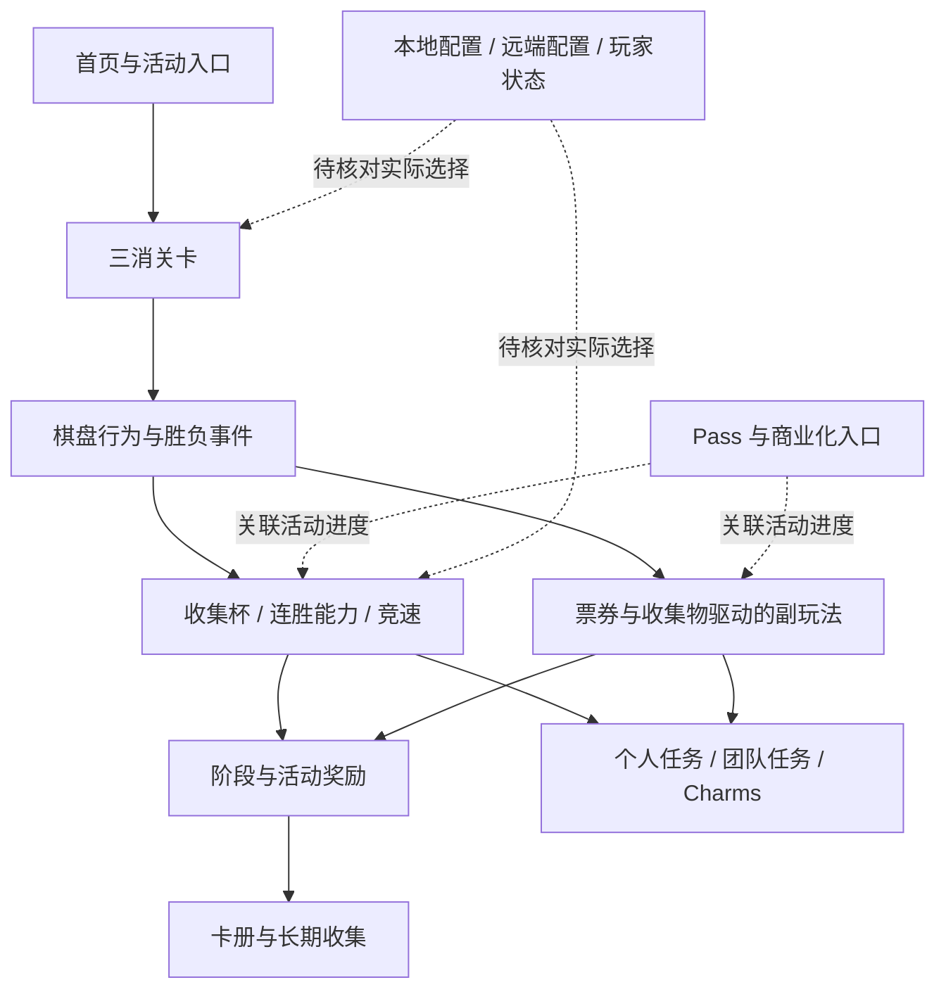
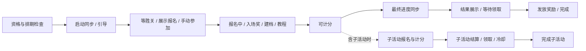

# Match Villains 7315 整体框架初扫

## 核心认识与范围

产品可先按“三消关卡核心＋活动群＋长期收集与社交＋商业化＋配置调控”理解。7315 新包再次定位到 49 个具体活动管理器，活动能力覆盖七个家族；主线关卡、连胜和活动资源是理解这些系统关系的主要入口。

本报告覆盖 **7315 包内结构、配置初扫及主流程关键调用核验**。首次只有类型/签名，后续已补 REA/JADX 主包解析与 Cpp2IL ISIL，并用 Capstone 按 ELF 地址映射核对下文关键原生调用。未逐个恢复所有活动控制流，不能断言全部旧规则在新版不变。无设备运行、账号缓存、联网响应或实机界面证据；没有将包内存在写成当前线上启用。

2026-11-04 用户明确本阶段以**系统活动与完整流程**为重点。以下新增活动生命周期、参加条件、主线胜负分发、奖励队列与系统联动；关内棋子规则和 DDA 不作为当前下钻目标。

## 样本与工具验收

| 项目 | 本次结果 |
|---|---|
| 用户提供样本 | Windows `D:\Downloads\Match+Villains_7315_APKPure.xapk`，原件未移动 |
| 大小 / SHA-256 | 499,856,941 bytes；`5dced490f19bb189bb1ff09da376cb527ce065d036242346fa603cd1cb963abb` |
| 身份 | 外层 manifest 与 REA/JADX 主 APK 解析一致：`com.goodjobgames.matchvillains`，versionName/versionCode 均为 `7315`，minSdk 29 / targetSdk 36；主包 Manifest 完整，30,697 类、1,489 资源；未核验签名 |
| 分包 | 主 APK 78,798,911 bytes；UnityDataAssetPack 290,156,115 bytes；ARM64 分包 130,897,796 bytes |
| 引擎 | 主包 globalgamemanagers / BuildSettings：Unity `2022.3.57f1`；资源还含 `2022.3.54f1` 序列化版本，不据此判断有两个运行引擎 |
| 运行代码 | 同一 XAPK 的 metadata 与 ARM64 libil2cpp.so 配对；`SpookyMatch` 业务程序集 |
| 工具 | .NET ZIP、Python 3.12.14、UnityPy 1.25.4、Cpp2IL 2022.1.0-pre-release.21（58fc404）；后续接入 REA 6.8.0、JADX 0.7.1，并使用 Capstone/pyelftools 核对原生调用 |
| 验收 | Unity 对象清单、全部 TextAsset 导出及选定类型名称解析成功，记录错误 0；Cpp2IL 映射 126,908 个方法定义，成功输出 Diffable C# |
| 限制 | Diffable C# 的 `{ }` 仍仅是索引；后续 ISIL 提供控制流线索，存在 NotImplemented 与间接调用。该 Cpp2IL 版本文本 Disassembly 在本样本发生地址/文件偏移错位，下文使用 ELF 映射重读的 Capstone 指令核验；不能直接引用错位的原始文本 |

采样：2026-11-04，Unity 清单生成时间 14:28:15（Asia/Shanghai）。历史 7307 原始材料在本机标准目录缺失，比较对象为已有报告，不是双包完整差分。

## 整体模块地图

下表保留初扫定位口径；已补证的主流程调用见下一节“首页、关卡与活动回调”，未展开模块仍止于存在性。

| 层 | 玩家侧职责 | 7315 已定位证据 | 尚未证明 |
|---|---|---|---|
| 启动与加载 | 启动、进入主体内容、加载阶段资源 | BuildSettings 包含 Splash / Main；LoadingManager、JourneyManager，后者有 WaitForAssetBundle / TryGetAssetContainer 签名 | 场景切换时机、资源下载与恢复的实际分支 |
| 三消关卡核心 | 棋盘行为、道具、胜负与关卡推进 | Board、LevelManager；Board.OnLevelWin / OnLevelLose、PowerCards_OnLevelStart；5617 条编号关卡资源 | 各棋子规则、失败续关价格、完整结算顺序 |
| 首页与内容承接 | 进入关卡、活动入口、弹窗与旅程 | PlayButtonPanelManager、GameEventIconManager、JourneyManager；PopUpManager.ActivePopUps 为 Stack，含 availablePopUps | 不由 Journey 名称推断装修/建造；首页布局、弹窗优先级及互斥待追 |
| 活动与奖励 | 收集、竞速、连胜、限时副玩法、阶段奖励 | 49 个具体 EventManager；已核验统一状态机、胜负回调、收集杯阶段奖励与玩家奖励队列 | 各活动的具体分支、服务器资格、跨期防重和实机到账仍待验证 |
| 长期收集与社交 | 卡册、额外套装、团队、合作关系 | Collection / CollectionBonusSet / TeamsManager / TeamMission / CoopHeist | 卡池概率、交易限制、匹配算法与账号当前状态 |
| 商业化 | 活动 Pass、展示位与购买 | 7 个 Pass 管理器；MonetizationManager.GetMonetizationEntriesForPlacement、InitiatePurchase、TryShowInterstitialAfterLevel | 签名只证明入口，不能证明实际展示插屏、展示频率或当前付费价格 |
| 配置与难度 | 默认规则、活动配置、动态关卡相关入口 | DefaultTetrisLevelConfig、两份 MoveOverrides；Board.RequestDynamicTetris、SpooqModule.GetDdaTargetMovesRemaining / GetDdaTargetWr | 最终选中配置、服务端输出、分层算法及活动是否直接影响 DDA |
| 表现与基础服务 | 图片、动效、音频、分析与远端配置能力 | Sprite/Texture、动画对象、AudioManager；分包中 Firebase RemoteConfig / Analytics 原生库 | SDK 随包不等于运行启用；资源未逐项关联到实际页面 |

### 用于后续拆解的产品关系图

以下是结合历史行为档案与新版模块存在性形成的框架示意，**不是本轮已验证的新版本调用图**。

## 首页、关卡与活动回调：7315 原生调用核验

这部分证据来自本次 7315 原生代码，不依赖 7307 行为结论。地址均为 `libil2cpp.so` 虚拟地址；字段名与方法名来自同构建 Cpp2IL 索引。直接调用已核对，未完成所有条件与虚表分派的还原。

| 路径 | 已确认的调用/条件 | 地址与证据边界 |
|---|---|---|
| 棋盘胜利 → 全局胜关 | Board.OnLevelWin 调用 SendLevelEndDataEvents、IsHeistLevel、Main.WinLevel | Board.OnLevelWin=`0x404e120`；调用 WinLevel 位于 `0x404e1c8` |
| 全局胜关处理 | Main.WinLevel 含金币奖励构造/QueueReward、LifeModule.OnLevelWin、SpooqModule.OnLevelWin、GameEventModule.OnLevelWin、任务进度、IncreaseLevel、Sync、资源期望状态更新 | WinLevel 主体 `0x45db2b8`（以 native-verified-calls.json 为地址核对源）；关键调用点 QueueReward=`0x45db540`，活动回调=`0x45db644`，IncreaseLevel=`0x45db91c`。列出静态调用顺序，不表示所有条件分支每次都执行 |
| 全局失败处理 | Main.LoseLevel 含音乐淡出、结束数据上报、LifeModule.OnLevelLose、SpooqModule.OnLevelLose、GameEventModule.OnLevelLost 与 streak 写入 | LoseLevel=`0x45daea0`；活动失败回调=`0x45db0ac`。streak 的具体对象和护盾覆盖另查，不能笼统写所有连胜必清零 |
| 活动统一分发 | GameEventModule.OnLevelWin 依次调用 OnBeforeLevelWin → 对 gameEventsByEventType 字典执行 ForEach → OnAfterLevelWin；失败亦有 Before/ForEach/After 结构。胜利委托分派 OnLevelWinInternal，失败委托进入 OnLevelLostInternal | 胜回调=`0x46704f0`，失败=`0x46707a4`；字典字段偏移 `0x40`。资格由活动内部包装层继续判断；胜利、失败的门槛有区别，见下文 |
| 收集杯胜关处理 | 读取 GetProgress → ServerBasedGameEvent.OnLevelWin → 再读 GetProgress；连接 TaskStationMission、TeamMission 的 ReportProgress、QueueStageRewards、TryTriggerPostCompletionMultiplierOffer、TryJoinEventIfEligible | LevelWinCupEventManager.OnLevelWin=`0x421ac90`；QueueStageRewards 调用=`0x421ae6c`；分支参数、奖励到账及礼包是否曝光未完全验证 |
| 收集杯失败处理 | 调用 ServerBasedGameEvent.OnLevelLost，再转至 TryJoinEventIfEligible | `0x421ac54`；仅据这两个调用不能断言失败得分保留/丢弃，需继续查基类 |
| 返回首页 | Main.EnterHome 包含普通 Board / MiniGame 重置分支、CloseAll、HomeHUD、ChangeGameState、相机方向准备、音乐淡出、加载屏、Sync、OnEnteredHome、Save、StartStream | EnterHome 的直接调用已保存到 native-Main-EnterHome.txt；加载屏分支和异步完成顺序仍需进一步展开 |
| 首页进入完成 | 播放首页音乐；PreviousGameState==MATCH 时执行 HomeHUD.PlayOpenAnimation，否则 SetOpen(true)。enteredHomeFromMiniGame=true 时返回；否则进入 TryShowInterstitialAfterLevel | OnEnteredHome=`0x45da75c`；PreviousGameState 字段 `0xD4`，MATCH=2；MiniGame 标记 `0x11C`。证明存在受条件控制的插屏检查入口，不证明实际展示广告或频率 |
| 进入对局完成 | OnEnteredMatch 有 IsHeistIntro、条件弹窗、相机进入动效与 PlayMatchMusic | 本轮定位到调用，弹窗泛型具体类型及资源对应仍待证实；EnterMatch 为异步状态机入口，不能仅看入口壳推断加载顺序 |

重要区别：Board.OnLevelLose 本体只见关卡记录写入，并不直接调用 Main.LoseLevel。已在 OutOfMovesPopUp.OnGiveUp（调用点 `0x4724300`）及 QuitLevelPopUp.OnQuitButtonPressed（`0x4734898`）找到全局失败入口。后者若 TryAddLoseBubbles 返回 true 就提前返回；前者与 OnGiveUpButtonPressed 也是不同方法。因此不能把“点击放弃/退出”直接等同于“失败已结算”，仍需核对提示与动画回调绑定。此处仅覆盖已扫描到的命名直接调用者。

### 产品结构上的含义

- 主线胜负先经过全局处理，再连接活动分发；生命、难度状态、活动共享同一胜负事件，并不证明活动直接修改 DDA。
- 收集杯不只推进自己的阶梯，还连接个人/团队任务和完成后 Offer 检查，体现“核心活动 → 聚合任务/商业化”的结构。
- 首页回流包含界面、音乐、资源、保存、网络流与条件商业化检查，是后续弹窗和曝光顺序研究的优先位置。

### 证据与解析纠错

`verify_native.py` 按 ELF PT_LOAD 将 VA 转为文件偏移，以 Capstone 重读同一 libil2cpp。例：Board.OnLevelWin VA=`0x404e120`，文件偏移=`0x404a120`，差 `0x4000`；重读后确认 `0x404e1c8 → Main.WinLevel`。不把 Cpp2IL 错位 Disassembly 视为原生证据，ISIL 未支持的指令以重读结果为准。

产物：`04-ReverseEngineering/native-verified-calls.json`、`native-*.txt`、`verify_native.py`、`cpp2il-isil.log`、`cpp2il-isil/`。本轮未安装通用 Ghidra 原生反编译器；这里只对上述指定方法做了同构建原生调用核验。

## 活动能力分布

7315 Unity MonoScript 按 namespace＋class_name 去重，并剔除 RaceEventManager、LeaderboardEventManager、LevelWinCupEventManager 三个通用类型及 IOfferEventManager 接口后，得到 49 个具体管理器；另由 Cpp2IL 类型文件提供下钻入口。**以下七类是分析归类，不是七个源码目录，也不表示同时开放 49 个活动。**

| 家族 | 数量 | 本次核对到的模块 |
|---|---:|---|
| 关卡收集杯 | 4 | Bomb Hill、Rocket Rescue、Snitch Chase、Thunder Fun |
| 连胜与能力 | 5 | Sky Drop、Super Snitch、Super Thunder、Streak Shield、Power Cards |
| 竞速、榜单与对抗 | 14 | Masters Arena、个人/团队国家与全球榜（4）、Weekly Tournament、Bank Rob Race、Snitch Chase Race、Route Race Race、Sword Quest Race、Lucky Shot Race、Team Duel、Villains Cup、Villain City |
| 收集与长期进度 | 6 | Villain Royale、Banner Road、Collection、Collection Bonus Set、Pinata、Grand Heist |
| 限时挑战与副玩法 | 10 | Mini Game、Safe Crackers、Big Mine、Big Catch、Bingo Disco、Block Blast、Brick Crushers、Museum Break、High Rise、Coop Heist |
| 任务聚合 | 3 | Task Station Mission、Team Mission、Event Charms |
| Pass | 7 | Season、Icy Blocks、Route Race、Banner Road、Pinata、Coop Heist、Brick Crushers Pass |

显示名采用既有档案及类型名称的可读展开，尚未逐项与 7315 实机本地化文本对齐。7307 的详细行为说明仍见旧版活动总览，不直接升级为 7315 已验证规则。

## 系统活动：生命周期与玩家流程

### 先区分四种产品状态

活动采用共同框架，但“看得到、能参加、在活动中、能计分”分别判断。下表是 **GameEvent 基类实现**，数值来自原生比较指令与同构建 GameEventState；具体活动可覆盖访问器，不能直接套用为全部 49 个活动的最终规则。

| 判断 | 基类条件 | 产品含义 |
|---|---|---|
| IsVisible | `4 ≤ State < 37` | 引导/报名/计分/待领奖可处在可见范围，入口出现不证明已经报名 |
| IsJoinable | `State=5 或 6` | WAIT_WIN_FOR_JOIN 或 SHOW_JOIN；不能按英文直觉把所有手动参加状态都归进这个属性 |
| IsScorable | `State=15 或 23` | 主活动 SCORABLE 或子活动 SCORABLE_SUB_SCORABLE；可见范围远大于计分范围 |
| IsInEvent | `15 ≤ State < 40` | 包含计分后的同步、结算和完成阶段，不等于仍可计分 |
| IsInSubEvent | `17 ≤ State < 32` | 子活动有独立报名、计分、领取、冷却和结束范围 |
| State 的资源门槛 | GetAssetContainer 为空或 IsLoaded=false 时返回 BUSY=-2；否则读取 EventDataCommon.State（字段 `0x48`） | 保存的状态和当前对外报告的可用状态可能不同；资源未就绪会影响入口/流程判断 |

原生入口：get_IsJoinable=`0x44727b8`、get_IsVisible=`0x4472804`、get_IsScorable=`0x44728c0`、get_IsInEvent=`0x447290c`、get_IsInSubEvent=`0x4472958`、get_State=`0x4472bb4`。IsEventIconVisible 基类转调 IsVisible；已确认 LevelWinCupEventManager 存在 IsVisible 覆盖，尚未逐项恢复其附加条件。

### 共用状态机如何形成不同活动流程

以下是状态职责图，来自 7315 状态定义和已核验的推进逻辑；**不是每个活动必经页面的实拍流程**。主状态和子状态并存，具体 States 配置会省略部分节点。

`ProgressState(expectedState, targetState)`（`0x446e9bc`）不是盲目跳下一页：

- 先核对存储状态是否等于 expectedState，不匹配则退出（`0x446ea60–0x446ea68`）。targetState=-1 时选择下一状态；走到 MAX=39 时转回 TRY_TO_ACTIVATE=1。
- 调用 OnBeforeStateProgress；通过后写入新 State，再查配置 `States`。没有对应配置条目时递归继续前进；已有状态次数达到配置 Count（非 -1）时也继续跳过（`0x446edcc–0x446ee28`）。因此教程/报名/提示等是否停留，需要看当前活动配置与保存次数。
- SHOW_CREATE_PROFILE=10、子活动建档=20、教程后建档=14：HasProfileData=true 时继续跳过。GIVE_JOIN_REWARDS=9、子活动入场奖=19：EventStartRewards 为空时继续跳过。
- 状态已写入不代表页面已经曝光；页面调度、回调完成及重开恢复需继续对位。

### 开放资格与排期的分界

`CanBeActivatedFor`（`0x446fc08`）已核验消费者，而非仅看配置字段名：

| 检查 | 客户端分支 | 边界 |
|---|---|---|
| 总开关 | ConfigDataCommon.IsEnabled=false 即失败 | 包内 true 仍不证明账号当前生效值为 true |
| 起始等级 | 默认 levelWindow=-1 要求 PlayerData.Level ≥ Activation_Level；指定窗口时改为 `Activation_Level − Level ≤ levelWindow` | 参数可允许提前进入候选检查；不能把所有调用都当作正式解锁 |
| 终止等级 | `Level ≥ DeactivationLevel` 即失败 | 需读取该活动选中配置才能给具体开放区间 |
| 活动自定义门槛 | IsCustomActivationConditionsMet=false 即失败 | 团队、前置玩法等应追各活动覆盖，不由通用方法猜测 |
| 服务端控制 | 上述条件通过后，IsServerControlled=true 直接返回 true；绕过本方法后面的本地时间窗/历史期检查 | 只表示通过客户端这一层，不证明服务端报名成功或当前档期开放 |
| 本地排期 | 非服务端分支检查历史启动时间与 WeeklyScheduleConfigs，并读取 newEventSchedule 的 StartDate / EndDate 比较 | 本次未解析日期比较函数的严格边界、未取得实际排期，不给线上时间表 |

### 主线胜负怎样驱动活动

1. **统一分发不等于统一计分。** 胜利委托调用虚方法 OnLevelWinInternal；GameEvent 基类先 MaybeEndOrActivate，再尝试推进 WAIT_WIN_FOR_JOIN=5；推进前状态为5，或随后 IsScorable=true，均可调用 OnLevelWin（`0x44706f4`）。失败包装层先 MaybeEndOrActivate，仅 IsScorable=true 才调用 OnLevelLost（`0x4470824`）。
2. **服务端活动存在报名过渡期分支。** ServerBasedGameEvent.OnLevelWinInternal（`0x447a9b8`）除 IsScorable 外，还允许旧状态=5、推进后状态=7，或旧状态=8 且 HasState(5) 的情况进入 OnLevelWin。因而不能用“尚未正式计分”简单判断胜关回调一定被丢弃；服务器最终接受情况仍未知。
3. **待提交进度有阈值门槛。** ServerBasedGameEvent.OnLevelWin（`0x447675c`）在 MaxOfflineProgress≠-1 时比较差值：UseScoreForMaxOfflineProgress=true 用 `ScoreCurrent−ScoreLastSubmitted`；否则用 `PlayerData.LevelProgress−ScoreSubmittedLevel`。差值达到阈值则跳过本次加分路径；未达到则调用 GetLevelWinScore(true) → SubmitProgress → 将返回值加到 ScoreCurrent。检查在增量之前，不能写成最终总分始终被硬截断到阈值。参数来源及实际联网同步仍待验证。
4. **收集杯连接聚合任务。** LevelWinCupEventManager 比较胜关前后阶段，调用 QueueStageRewards，后者读取 GetRewards(stageIndex)，生成活动 RewardId，再交给 PlayerData.QueueRewards；同时存在个人/团队任务推进和倍率 Offer 检查。其失败路径调用的 ServerBasedGameEvent.OnLevelLost 在本样本是单条 ret，再尝试参加；这不等于已证明整个失败链无任何状态变化。
5. **报名可在胜负回调后继续。** TryJoinEventIfEligible（`0x4222ba8`）仅在 HasProfileData=true 时调用 ProgressState(7,-1)。结合 expectedState 校验，它只推进当前恰为 MANUAL_JOIN 的活动；方法名不能理解为每次回调都会向服务器报名成功。

这些结论只涉及关卡的开始/结束接口、参加和进度转换，不需要展开棋盘消除规则。

### 奖励从产生到发放

| 环节 | 已确认行为 | 未证明的部分 |
|---|---|---|
| 阶段奖励产生 | 收集杯 QueueStageRewards=`0x422307c` → GetRewards → GetRewardId → PlayerData.QueueRewards | 阶梯实际选档、全部奖励内容与实际到账量 |
| 待领奖记录 | PlayerData.QueueReward=`0x40a3220` 构造 RewardEntry → RewardQueue.Queue → SendInventoryQueueEvent；Entry 含 RewardId、IsSilent、Rewards、CustomSourceId、CustomState 等 | 入队是待处理记录，不等于已发进库存；Queue 自身未见按 RewardId 去重，不能推断整个产品没有防重 |
| 领取定位 | EarnedQueuedReward(long)=`0x40a28b8` 从队列末尾反查 RewardId，交给对象重载 | 未找到 ID 时的异常/恢复行为尚未完整确认 |
| 发放与移除 | EarnedQueuedReward(RewardEntry)=`0x40a3888` 遍历 Rewards 调 EarnReward，再按对象引用移除队列项，最后 SendInventoryEarnEvent | 证明本地调用顺序，不证明断电事务、跨设备一致性或服务器防重 |
| 静默奖励 | EarnSilentRewardsFromQueue=`0x40a2f6c` 只处理 IsSilent=true 条目，先清理不可领取奖励数据，再按 RewardId 领取 | 清理规则、触发时机与跨期补发尚需追调用者 |
| 奖励分派 | EarnReward=`0x40a3bc4` 可分派金币、生命、卡包/卡牌、Villain City 骰子和 Coop Heist 收集物等 | 客户端消费者已定位，无账号库存前后差分；跨活动奖励是否当期可收需另查 |

因此活动分析应拆成“产生资格 → 奖励入队 → 展示/静默领取 → 发放分派 → 移除记录”五步；当前没有把 ShowRewardScreen、入队或统计上报当成真实领取完成的替代证据。

### 当前覆盖与后续流程缺口

已核验统一生命周期、资格消费者、胜负分发、收集杯阶段奖励、奖励队列领取。下一层重点是首页活动图标/弹窗调度（含多活动同时触发的顺序与关闭后补排）、服务端报名的成功/失败和恢复、超时结算及跨期遗留奖励；具体活动先用收集杯闭环，再扩展任务聚合、竞速/榜单、独立副玩法、卡册与 Pass。

虚调用的语义采用同构建 metadata 方法 slot 与原生偏移交叉对应：State slot=75 ↔ `0x5e8`，IsScorable slot=70 ↔ `0x598`，OnLevelWinInternal slot=16 ↔ `0x238`，ConfigDataCommon slot=66 ↔ `0x558`。元数据原值见 `activity-method-slots.json`；`0x138` 为本样本静态交叉对应的虚表起点，未作运行时对象检查，也未核对全部活动的最终覆盖实现。

## 已直接读取的新版配置

| 配置 | 7315 包内原值/结构 | 框架意义与边界 |
|---|---|---|
| superthunder_config | IsEnabled=true；ActivationLevel=302；IsServerControlled=false | 有随包开启与等级配置；当前玩家是否开放仍未知 |
| museum_break_config | MuseumDayStages 三段 DurationSeconds=600/900/1200，TargetProgress=5/8/12；各段 LostRoundGrants 含 2 次→300 秒、3 次→600 秒 | 有阶段计时、目标及失败补时配置；未追新版补时消费者，不断言实际累计方式 |
| museum_break_config | 第一段含 banner_road_collectable=25、ch_collectable=25、toolbox_1=1、vc_dice=10、卡包 21010003×1 等独立奖励字段 | 明确有跨系统奖励配置接口；这些字段是否互斥、如何选奖未确定，不能全部相加 |
| DefaultTetrisLevelConfig | LevelThresholds=[301,501,1001]；首档 LevelTryCountThreshold=5；按 NoStreak / FullStreak 等分列权重与 Stress/Relief 阈值 | 有按等级、重试、连胜状态区分参数的配置结构；不由字段名推断服务端操控或当前生效 |
| power_cards_config / pinata_config | 已定位、完整导出 | 本轮止于模块配置存在，概率与卡牌效果留到专题追消费者 |
| TetrisDefaultMoveOverrides / TetrisMastersMoveOverrides | 已定位、导出 | 尚未解码或核对覆盖优先级 |

## 内容与表现规模

| 指标 | 7315 本次实读 | 7307 历史报告 | 比较边界 |
|---|---:|---:|---|
| TextAsset | 6050 | 5966 | 新版多 84 个条目，不代表新增 84 关 |
| `N - Level` 命名条目 | 5617 | 5587 | 多 30 条；可有同号不同集合/变体 |
| 编号范围 | 1–5300 | 1–5200 | 新版去重编号 5297 个，编号不连续；最大编号不等于已投放关数 |
| Sprite / Texture2D | 79 / 88 | 79 / 88 | 数量相同不证明内容相同 |
| AnimationClip / Animator / AnimatorController | 5 / 2 / 2 | 5 / 2 / 2 | 不包含所有程序驱动、Spine 或远端动效 |
| AudioClip | 6 | 6 | 本轮未导出试听、未验证声音触发；不能据此判定只有六种声音 |

## 下一步下钻顺序

1. **活动公共流程**：首页入口/弹窗优先级 → 资格与报名 → 胜负分发 → 结果与领取 → 超时/跨期恢复；先补调度与报名异步回调，不展开关内玩法。
2. **代表活动闭环与联动**：沿已核验的收集杯，继续核对阶段、领奖入口、Task Station / Team Mission，再扩展竞速/榜单、Museum Break 等副玩法及 Pass。
3. **配置权威与实际生效**：在专用“产品分析”MuMu 实例1核对实际端点、安装版本与账号，采集活动入口、报名、进度和领奖前后状态；本报告尚未操作设备。
4. **低优先级保留**：关内棋子、Power Cards 战斗效果与 DDA 仅留定位，待用户另行要求。

## 可复核证据位置

本机根目录：`D:\LibraryG\06-PRODUCT-ASSETS\MatchVillains\7315\`。

- `00-Package/manifest.json`、`00-Package/Splits/`：外层清单与三分包。
- `01-Decoded/<分包名>/`：本次提取的 Unity 数据和 libil2cpp；未声称完整解码 Android 包。
- `01-Decoded/UnityTextAssets/`：6050 个 TextAsset 原文，以分包＋源文件哈希前缀＋path ID 命名避免同名覆盖。
- `04-ReverseEngineering/unity-inventory.json`：每个对象的分包、序列化源文件、path ID、名称；TextAsset 带导出文件名与 SHA-256。
- `04-ReverseEngineering/scan-summary.json`、`framework-counts.json`：工具版本、采样时间、类型统计、错误与活动/关卡口径。
- `04-ReverseEngineering/*-members.json`：三分包成员清单。
- `04-ReverseEngineering/cpp2il/DiffableCs/SpookyMatch/SpookyMatch/`：本文类与方法定位；仅签名和字段。
- `04-ReverseEngineering/cpp2il.log`、`scan_framework.py`：解析日志与可复现资源扫描步骤。
- `04-ReverseEngineering/rea-archive-summary.json`：REA XAPK 容器验收，父 Evidence `ev_8fe02eb6b886497bb4f305fde269b68ad9045740c33970dacacdec37d1c35b64`；完整性矛盾 0。归档没有 concrete provider analysis profile，未生成 analysis snapshot；摘要已独立保存并正常关闭目标。
- `04-ReverseEngineering/rea-apk-complete.json`、`rea-apk-summary.json`、`AndroidManifest-decoded.xml`：新 MCP 进程的主包解析原始结果与完整 Manifest。完整 Evidence `ev_92656186a11de6d48ca4f002c7a3b2c3028ef37ebbd3b795bf58fc705e29771e`；主 APK SHA-256 `27a6fc2aa3600d680e224b441d2e8b3f7ef86e1837473f4e482900ee18a9319f`。
- `04-ReverseEngineering/il2cpp-input-hashes.json`：同构建 metadata / libil2cpp 输入哈希；`native-verified-calls.json` 与 `native-*.txt` 保存原生调用核验结果。
- `04-ReverseEngineering/rea-apk-after-restart.json`：用户重启 Codex 后，当前聊天原生 REA 调用主 APK 解析成功；summary Evidence `ev_0f477e672a89731ff66edbc67e3c427a73139dc838229282eccaf8adcaf0d4be`，parent `ev_de13574ac826ce14dd290301bea039ec5e8f1af6f2515a2336cda0bbd01ad80c`；旧连接环境阻塞已解除。
- `04-ReverseEngineering/activity-method-slots.json`、`read_activity_slots.py`：同构建 metadata 31（Cpp2IL 识别为31.1）的活动方法 slot，36-byte method / 88-byte type 记录；与上述原生方法联合核对条件和分派，不单凭签名下业务结论。

配置定位可用 inventory 的 name 精确查找。示例：museum_break_config → `UnityDataAssetPack_5fe1508f6ca7a184_1.txt`；superthunder_config → `UnityDataAssetPack_402b464596d3a126_1.txt`；DefaultTetrisLevelConfig → `UnityDataAssetPack_f43f0b5c18eca565_1.txt`。完整源文件名和 path ID 保存在 inventory 中。

## 关联

- [[02-PROJECTS/产品分析/_MOC|产品分析 MOC]]
- [[02-PROJECTS/产品分析/Match Villains/资源路径索引|跨版本资源路径索引]]
- [[02-PROJECTS/产品分析/Match Villains/资源与逻辑分析总览-7307|7307 历史静态基线]]
- [[02-PROJECTS/产品分析/Match Villains/活动系统总览-7307|7307 活动行为档案]]
- [[02-PROJECTS/产品分析/技能/analyze-android-product/SKILL|本次使用的拆解 Skill]]
