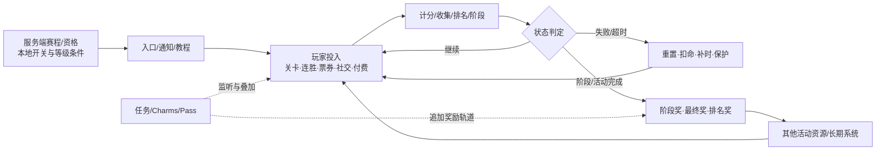

# Match Villains 7307 活动系统总览

> [!summary] 静态盘点
> `SpookyMatch` 程序集中有 49 个具体活动管理器，可归为 7 个逻辑家族。`GameEventType` 另保留 `BANK_ROB`、`ROUTE_RACE`、`TASK_STATION`、`SWORD_QUEST`、`LUCKY_SHOT` 五个没有同名具体管理器的旧标识；当前实现分别以 Race 或 Mission 版本为主。代码存在不等于活动在当前账号、地区或时间窗上线。

> [!info] 阅读方式
> 本文先给系统框架，再列活动家族和具体模块。具体数值统一进入 [[02-PROJECTS/产品分析/Match Villains/活动数值与策略配置-7307|活动数值与策略配置]]；后续深挖某一系统时，按 [[#统一下钻模板|统一下钻模板]] 补证据，不重复铺一套分析口径。

## 系统框架

### 七层活动链路

| 层级 | 核心问题 | 7307 可见实现 |
|---|---|---|
| 1. 生命周期与资格 | 活动何时存在、谁能参加？ | 活动类型、Enabled/Active 状态、开始结束时间、等级/团队条件、服务端赛程和玩家资格 |
| 2. 入口与引导 | 玩家从哪里看到并进入？ | Home 入口、Join/Start/Reminder/Finish 通知、教程、活动弹窗、关前提示 |
| 3. 投入 | 玩家消耗什么或完成什么？ | 主线关卡、连胜、指定棋盘行为、Ticket、Dice、Toolbox、Collectable、IAP、社交协作 |
| 4. 核心转换 | 行为如何变成活动进度？ | 行为计分、胜关结算、streak、阶段进度、房间排名、武器/建筑/套装升级 |
| 5. 状态与失败 | 进度如何保存、重置或补偿？ | 失败清 streak、扣命、超时、检查点、失败补时、离线进度、剩余资源转换 |
| 6. 结算与奖励 | 何时发什么？ | 阶段奖、回合奖、排名奖、最终大奖、免费/付费轨道、补领与奖励队列 |
| 7. 联动与运营 | 活动如何连接其他系统？ | Task Station、Team Mission、Event Charms、Pass、跨活动资源、倍率 Offer、多个 reward preset |

### 三类系统角色

| 角色 | 包含家族 | 在整体框架中的位置 |
|---|---|---|
| 核心活动 | 关卡内收集杯、连胜与能力、竞速/榜单/对抗、收集与长期进度、限时挑战/副玩法 | 产生独立目标、进度、失败和结算闭环 |
| 聚合层 | Task Station Mission、Team Mission、Event Charms | 监听核心活动行为，把多个玩法再次聚合为任务或徽章进度 |
| 商业化附加层 | Season Pass 及各活动 Pass、倍率 Offer、活动购买入口 | 依附核心活动进度，增加付费轨道、补领和资源加速，不单独构成基础玩法 |

### 配置与权威来源

| 来源 | 控制内容 | 当前结论 |
|---|---|---|
| IL2CPP 代码常量 | 计分、上限、窗口、固定状态转换 | 可确认客户端实现基线 |
| Unity TextAsset | 阶段、概率、奖励阶梯、卡牌、DDA、通知配置 | 可确认 7307 随包默认值 |
| 服务端响应 / Remote Config | 活动档期、资格、房间、榜单、实际 preset、实验覆盖 | 客户端有接口痕迹，但本轮无实际响应 |
| 玩家本地状态 | 已加入、当前进度、已领阶段、streak、库存 | 需要真机账号数据验证 |

有效运行配置应理解为：`客户端能力与默认值 + 服务端档期/覆盖 + 玩家状态`。静态包只能完整覆盖第一部分，并部分暴露后两部分的数据结构。

## 活动家族层

| 家族 | 数量 | 共用逻辑 |
|---|---:|---|
| 关卡内收集杯 | 4 | 关卡内特定棋子/PowerUp 行为计分 → 胜关结算 → 分段奖励阶梯；支持外部进度和 ×2 倍率 |
| 连胜与能力 | 5 | 连续胜关积累/激活能力，失败清除或保护连胜 |
| 竞速、榜单与对抗 | 14 | 服务端报名/分房 → 提交分数或阶段 → 排名/回合结算 → 阶段及最终奖励 |
| 收集与长期进度 | 6 | 主线胜利或外部奖励产出收集物 → 阶段/套装/货车进度 → 奖励与大奖 |
| 限时挑战与副玩法 | 10 | 门票/工具/骰子等资源驱动独立玩法，带阶段、时限、失败或奖励逻辑 |
| 任务聚合 | 3 | 监听多个玩法事件，按任务类型累计进度并发放个人、团队或徽章奖励 |
| Pass / 付费轨道 | 7 | 与主活动或胜关进度绑定，按阶段领取奖励；部分具有免费/付费双轨和 IAP 解锁 |

## 家族关系与联动

| 上游事件/资源 | 核心消费者 | 二次消费或聚合 |
|---|---|---|
| 主线胜关与关内棋盘行为 | 收集杯、Race、连胜能力、Museum Break、High Rise、Coop Heist 等 | Task Station、Team Mission、Event Charms |
| streak | Sky Drop、Super Snitch、Super Thunder、Route Race、Pinata | Streak Shield 保护；部分 Pass/任务继续读取 |
| 活动货币 | Ticket、Dice、Toolbox、Paint、Train/Coop Collectable | 独立副玩法、阶段奖励、跨活动循环 |
| 核心活动阶段 | Banner Road、Pinata、Coop Heist、Route Race、Brick Crushers 等 | 同名 Pass 免费/付费轨道 |
| 排名与房间成绩 | Race、Leaderboard、Team Duel、Villains Cup、Villain City | 回合奖、排名奖、最终奖及团队奖励 |

这张关系表描述的是客户端数据流和监听关系，不代表所有上游与下游活动会在同一线上档期同时开放。

## 一、关卡内收集杯

四个活动都继承 `LevelWinCupEventManager`：进入活动后监听棋盘事件，胜关时将当局分数提交到奖励阶梯；跨阶段自动排队奖励，完成后可触发最终奖励或倍率 Offer。失败不会提交当局胜利进度。

| 活动 | 对应逻辑 |
|---|---|
| Snitch Chase | 追踪 Snitch 相关棋盘行为并在胜关后推进奖励阶梯；存在独立教程、收集物气泡和 ×2 倍率入口 |
| Bomb Hill | Bomb 触发计 10；Rocket+Bomb、Bomb+Bomb 组合计 50；Thunder 相关触发计 10；胜关后累计到分段奖励 |
| Rocket Rescue | 监听 Rocket 相关棋盘指示器，胜关后把当局累计分数提交到阶梯；支持 ×2 奖励倍率 |
| Thunder Fun | Thunder 触发计 5，Thunder Combo 计 10，Thunder+Thunder 计 5；胜关后累计到阶梯 |

## 二、连胜与能力

| 活动 | 对应逻辑 |
|---|---|
| Sky Drop | 胜关累积 streak，到阈值后发放/激活 Sky Drop 效果；失败或统一清 streak 时重置，带关前提示与失败气泡 |
| Super Snitch | 胜关累积并授予 Super Snitch streak；失败清除，关前展示当前能力状态 |
| Super Thunder | 胜关累积 Super Thunder streak；本地默认配置为 302 级开放、分数阈值 10；失败清除 |
| Streak Shield | 依赖其他连胜活动；满足阈值后激活护盾，在失败结算前后保护相关 streak，并处理护盾消耗/失效 |
| Power Cards | 服务端下发卡牌配置；玩家解锁并选择卡牌，胜关积累 streak，卡牌效果在关卡前/关内生效；配置含加步、Hammer、预置 Rocket/Bomb/Thunder、四向 Rocket、Double Booster、Ghost Snitch、Shuriken、Mjolnir、UFO 等 |

## 三、竞速、榜单与对抗

### 通用榜单与赛事

| 活动 | 对应逻辑 |
|---|---|
| Masters Arena | 服务端报名、拉取赛程/榜单、按胜关提交分数，结束时按排名结算 |
| Players Country Leaderboard | 玩家国家榜；作为通用服务端榜单模块读取排名并结算榜单奖励 |
| Players Global Leaderboard | 玩家全球榜；逻辑同上，排名范围为全球玩家 |
| Teams Country Leaderboard | 团队国家榜；按团队成绩排序与结算 |
| Teams Global Leaderboard | 团队全球榜；按团队成绩排序与结算 |
| Weekly Tournament | 周赛榜单；胜关计分、获取排序名次，活动结束排队最终奖励 |

### Race 家族

Race 共用流程为：报名进入房间 → 获取竞争者榜单 → 胜关或活动行为提交进度 → 达到 winning level / stage → 按最终排名结算。

| 活动 | 特有逻辑 |
|---|---|
| Bank Rob Race | 胜关推进竞速；附带 Piggy Bank，按进度换算金币并提供购买/领取入口 |
| Snitch Chase Race | Snitch 主题竞速；胜关计算活动分数、推进阶段并按名次结算 |
| Route Race Race | 胜关与连胜推进路线，存在 Gear 倍率、阶段奖励；失败会清 streak，阶段可独立提交 |
| Sword Quest Race | 监听黄色棋子（内部 item ID 11）并计算胜关分数，按竞速名次结算 |
| Lucky Shot Race | 普通命中计 1，Rocket/Bomb 命中计 10；当局结果计入竞速排名 |

### 强对抗活动

| 活动 | 对应逻辑 |
|---|---|
| Team Duel | 团队分回合对抗；胜回合 10 分、平局 5 分。成员胜关提交成绩，可向队友赠送倍率、给对手施加 Chain，并有 Booster 阶梯、团队礼物、回合奖和总榜奖励 |
| Villains Cup | 实时房间回合对抗；关内 Bomb、Rocket、Thunder、Snitch 及组合技按不同权重即时计分，约每 0.5 秒同步；回合结束判胜负并发放加入、回合和最终奖励 |
| Villain City | Monopoly 式城市棋盘 + 房间竞速。胜关产骰子，掷骰获得金钱/棋盘奖励并推进建筑与阶段；同时维护房间实时排名、阶段奖励、大奖房和剩余奖励 |

## 四、收集与长期进度

| 活动 | 对应逻辑 |
|---|---|
| Villain Royale | 收集 `train_collectable` 推进列车/货车阶段；逐段开货车与领奖，支持剩余进度转移、定时免费奖励和最终大奖。代码中的 `Rail Riches` 任务名应属于该火车玩法的历史/内部别名，但运行时映射未验证 |
| Banner Road | 收集 Banner Road 物品推进阶段；每个子阶段有 3 面 Banner，进度可转化为 Paint 行为，解锁 Banner 外观并领取阶段/大奖 |
| Collection | 卡牌赛季系统；开卡包、按稀有度抽卡、识别新卡与重复卡、集齐 Set 领奖，重复卡可进入交换/星值逻辑 |
| Collection Bonus Set | 与当前 Collection 绑定的额外套装；收集限定 Bonus Cards，集齐后领取套装奖励；结束时剩余 Bonus Cards 转为 Sparks |
| Pinata | 连胜推进 Pinata 阶段，达到目标后开启 Pinata 奖励；本地配置含 5 类 Pinata、3/8/15 阶段阈值，并可产出 Collection 卡牌 |
| Grand Heist | 主线胜利产生 Grand Heist 进度/票券；代码保留 50 级窗口和 ×10 常量，并与 Super Token 可见状态联动。独立 Heist 玩法的完整运行界面未在本轮静态资源中闭环 |

## 五、限时挑战与副玩法

| 活动 | 对应逻辑 |
|---|---|
| Mini Game | 独立关卡链与奖励阶梯；支持普通 Board、Amaze、Spawning Board、Snake Board、Police Chase 等舞台。完成当前目标后切换阶段，失败保留/重置对应关卡状态 |
| Safe Crackers | 胜关获得 Toolbox，开箱随机得到 Tools；工具满足某个 Safe 的要求后开保险箱。还包含工具互换、付费保险箱、最终奖励与库存上限逻辑 |
| Big Mine | 胜关推进宝石奖励阶段；存在购买入口，购买后排队对应 Gem 奖励并合并处理 |
| Big Catch | 胜关推进阶段奖励；购买后解锁额外奖励，按已达阶段补发/领取 |
| Bingo Disco | 3×3 Bingo 棋盘；购买/验证后获得票券或 Roll，依据抽中格子和已完成 Bingo 数计算倍率与奖励 |
| Block Blast | 消耗 Ticket 进入计时舞台；按目标倍率和舞台时长计算成绩，提交服务端榜单，同时推进奖励阶梯 |
| Brick Crushers | 消耗 Ticket 进入指定 Board 的计时舞台；依据目标倍率和胜负生成成绩，提交榜单并推进阶梯 |
| Museum Break | 连续限时阶段；本地配置可见 600/900/1200 秒与 5/8/12 目标。阶段内胜关累计目标，超时可重开，完成阶段领奖，全部完成后发最终奖励 |
| High Rise | 连胜爬楼/检查点活动；最多 3 条命，胜关向上推进，失败进入扣命与 streak 清理路径，检查点可领取奖励，顶层为大奖 |
| Coop Heist | 最多建立 4 个合作 Matching，可邀请好友或队友；胜关获得 Collectible，投入轮盘转化为双方分数并升级武器，武器最高逻辑等级 4，完成配对后结算升级奖和大奖 |

## 六、任务聚合

| 活动 | 对应逻辑 |
|---|---|
| Task Station Mission | 日/周任务系统。按天解锁任务并累计周奖励；任务覆盖胜关、Heist、Safe Crackers、收集杯、Rail Riches、Bank Rob、Icy Blocks、Route Race、Banner Road、Collection、Team Duel、Pinata、Brick Crushers、Museum Break、Villains Cup、High Rise、Villain City 等 |
| Team Mission | 团队选择任务并共同累计分数；任务含胜关、连胜、收集、活动阶段等。完成个人任务获得奖励，同时推进团队奖励条与榜单；部分任务有定时倍率 |
| Event Charms | 跨活动徽章/Charm 系统；监听 Route Race、Snitch Chase Race、Bomb Hill、Rocket Rescue、Thunder Fun、Bank Rob Race、Rail Riches、Icy Blocks、Brick Crushers、Sword Quest Race、Lucky Shot Race、High Rise、Villains Cup 的胜利，完成任务后解锁 Charm 奖励 |

## 七、Pass 与付费轨道

| 活动 | 对应逻辑 |
|---|---|
| Season Pass | 通用赛季阶梯；胜关推进，免费轨道与 Premium 付费轨道分别排队奖励，购买后补领已达到阶段的付费奖励 |
| Icy Blocks Pass | 与 Block Blast/Icy Blocks Ticket 进度联动；免费/付费双轨，获得 Ticket 或完成相关阶段时推进 |
| Route Race Pass | 与 Route Race Race 状态和进度联动；按阶段领奖并处理购买状态 |
| Banner Road Pass | 与 Banner Road 进度联动；免费/付费双轨，达到阶段或购买后补发奖励 |
| Pinata Pass | 与 Pinata 联动；免费/付费双轨，部分阶段奖励直接进入 Pinata Mini Game，再生成实际奖励 |
| Coop Heist Pass | 与 Coop Heist Matching 进度同步；免费/付费双轨，购买后补发已达阶段奖励 |
| Brick Crushers Pass | 与 Brick Crushers Ticket/阶段进度联动；免费/付费双轨，购买时可检查并补领已达奖励 |

## 统一下钻模板

后续选择任一活动时，按以下顺序补全；某一项没有证据就明确保留为空，不由命名推断：

| 顺序 | 要回答的问题 | 优先证据 |
|---:|---|---|
| 1 | 活动类型、管理器和继承关系是什么？ | `GameEventType`、`*EventManager`、基类 |
| 2 | 开启、结束、资格和加入条件是什么？ | Config、状态字段、服务端请求/响应模型 |
| 3 | 入口、教程和自动弹窗如何触发？ | Popup/Notification/Controller 调用方、Prefab |
| 4 | 玩家行为如何转化为分数或进度？ | 棋盘监听、胜负回调、计分常量、提交方法 |
| 5 | 失败、超时、离线和重入如何处理？ | 状态机、持久化字段、Reset/Expire/Recover 路径 |
| 6 | 阶段、回合、排名和最终奖励如何结算？ | RewardLadder、奖励队列、Claim/Finish 调用链 |
| 7 | 与任务、Pass、经济和其他活动如何联动？ | RewardType、任务监听、Pass Manager、资源消费者 |
| 8 | 图片、动画、音效和埋点如何绑定？ | Bundle 资源、Prefab/组件、SoundKey、Analytics 调用 |
| 9 | 哪些结论仍需运行时验证？ | 联网响应、账号状态、页面录屏、事件日志 |

### 可继续深入的切入点

| 方向 | 适合回答的问题 | 当前基础 |
|---|---|---|
| 单活动完整链路 | 例如 Pinata、Museum Break、Villains Cup 到底如何从入口走到领奖 | 已有管理器、配置和部分数值 |
| 活动运营配置体系 | 服务端如何选档期、preset、玩家资格和实验组 | 已看到接口/模型，缺真实响应 |
| 跨活动经济图 | 各 Ticket、Collectable、Dice、Toolbox 从哪里产出、在哪里消耗 | 已确认多条奖励联动，尚未汇总全量 Source/Sink |
| DDA 与活动耦合 | 连胜、失败次数、Power Cards、活动奖励是否影响关卡难度 | 已有本地 Tetris/DDA 与卡牌配置，缺运行时选择结果 |
| UI/资源表现链 | 某活动的入口图标、Prefab、动画、音效如何绑定 | 已有 Unity 导出资产和代码根，可按活动定向追踪 |
| 埋点与效果评估 | 活动曝光、参与、进度、付费和完成分别上报什么 | 需继续检索 Analytics 调用和参数模型 |

## 旧标识与命名边界

`GameEventType` 中以下五个标识没有同名 `EventManager`：

| 旧标识 | 当前可见实现 |
|---|---|
| `BANK_ROB` | `BankRobRaceEventManager` / `BANK_ROB_RACE` |
| `ROUTE_RACE` | `RouteRaceRaceEventManager` / `ROUTE_RACE_RACE` |
| `TASK_STATION` | `TaskStationMissionEventManager` / `TASK_STATION_MISSION` |
| `SWORD_QUEST` | `SwordQuestRaceEventManager` / `SWORD_QUEST_RACE` |
| `LUCKY_SHOT` | `LuckyShotRaceEventManager` / `LUCKY_SHOT_RACE` |

这说明包内保留了兼容枚举或历史命名，但不能仅凭枚举断言旧版活动仍可独立开启。

## 证据与验证边界

主要静态证据位于：

- `.../SpookyMatch/GameEventType.cs`：活动类型清单。
- `.../SpookyMatch/*EventManager.cs`：每个活动的状态、计分、奖励和服务端请求入口。
- `.../SpookyMatch/RewardType.cs`、`RewardData.cs`：收集物、票券、倍率、工具和活动货币。
- `.../UnityTextAssets/`：活动配置、奖励阶梯与关卡数据。

其中 `...` 对应 `/Users/dean/LibraryG/06-PRODUCT-ASSETS/MatchVillains/7307/04-ReverseEngineering/IL2CPP_Static/cpp2il-diffable-cs/DiffableCs/SpookyMatch/SpookyMatch`。

> [!warning] 当前不能确认
> 49 个管理器代表“客户端包含这些活动能力”，不代表 49 个活动都在 7307 的当前线上档期开放。活动是否可见还受服务端赛程、Remote Config、玩家等级、地区、资源下载状态、团队状态和实验分组控制；这些需要真机联网验证。

## 关联

- [[02-PROJECTS/产品分析/Match Villains/活动数值与策略配置-7307|Match Villains 7307 活动数值与策略配置]]
- [[02-PROJECTS/产品分析/Match Villains/资源与逻辑分析总览-7307|Match Villains 7307 资源与逻辑分析总览]]
- [[02-PROJECTS/产品分析/Match Villains/资源路径索引|Match Villains 资源路径索引]]
- [[02-PROJECTS/产品分析/_MOC|产品分析 MOC]]

