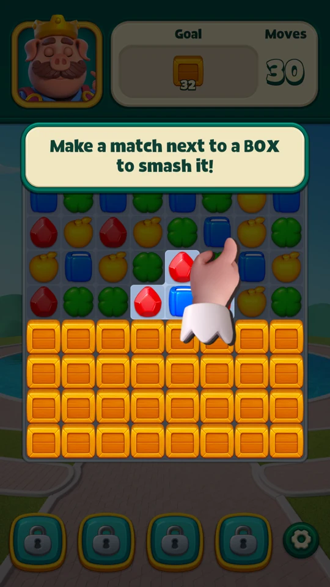
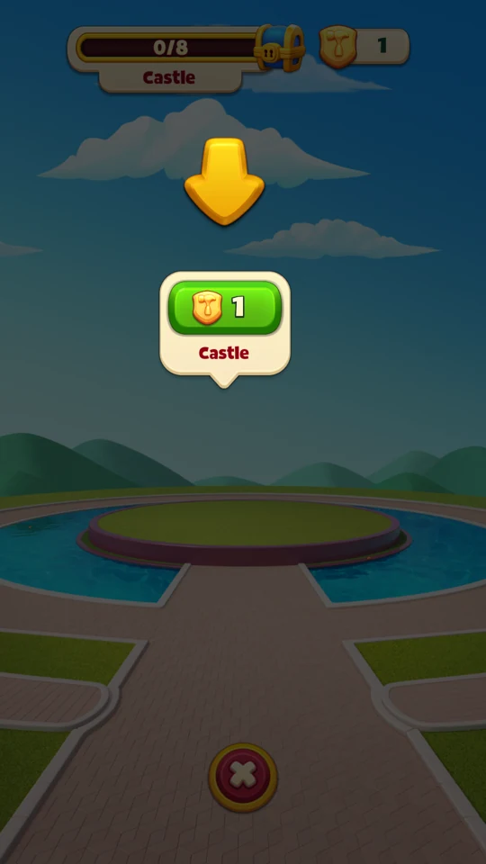
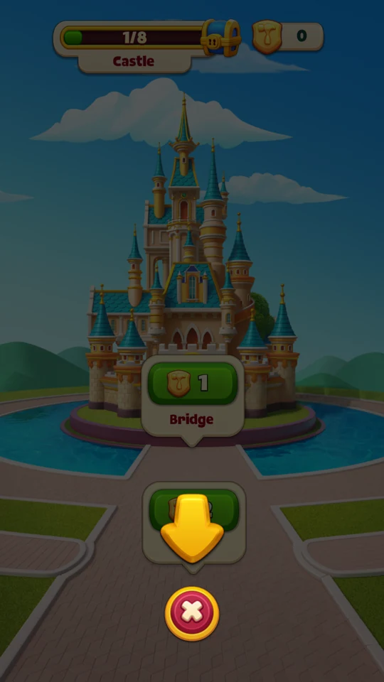
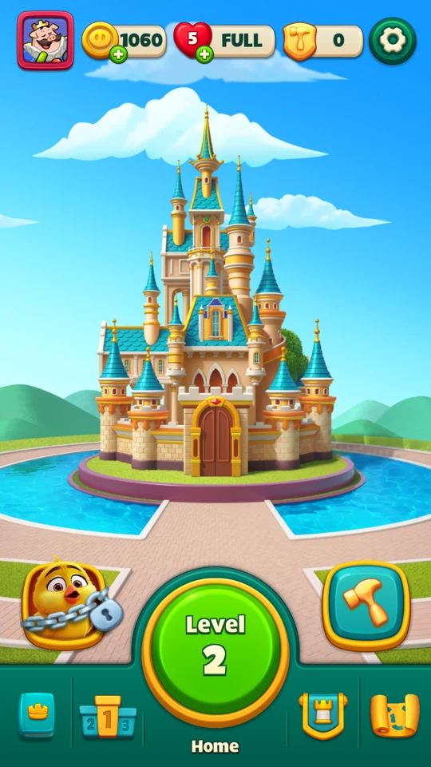
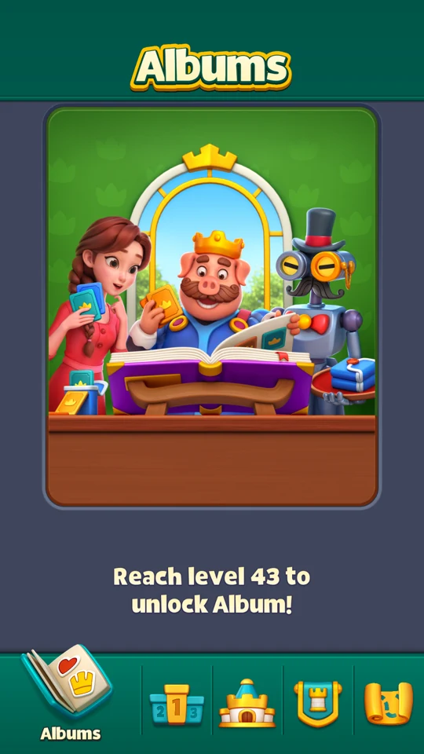
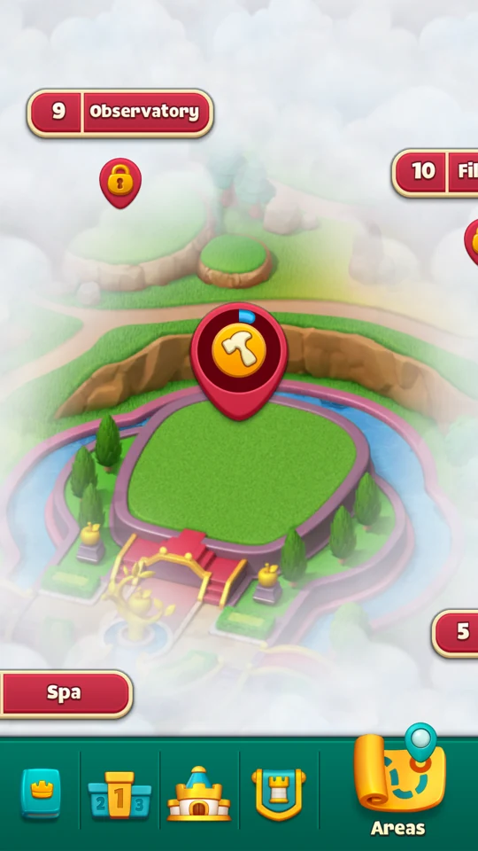
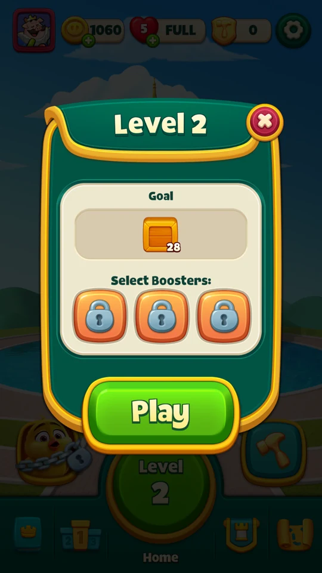

# Piggy Kingdom 产品框架 · 2.7.3

## 01 · 产品定位与框架

Piggy Kingdom 以有限步数交换三消为核心，以“过关获得建造锤徽章、完成区域建造”承接长期目标，同时配置卡册、团队、排行榜，以及多类活动和旁线玩法。本轮走通首次启动至首关通关、首个建造任务和五个底部页签；中后期系统主要依据包内资源与类型结构盘点。

| 层级 | 玩家目标／职责 | 本轮确认程度 |
| --- | --- | --- |
| 核心关卡 | 交换棋子、制造／激活特殊棋子，在步数内完成障碍目标 | 实机：首关通关；首关30步、32木箱 |
| 区域建造 | 把过关获得的建造锤徽章换成可见建筑与区域进度 | 实机：Castle首任务消耗1，0/8→1/8 |
| 长线收集 | Albums 卡册；包内另有 memory、decoration、month_medal | 实机：Albums预告43关；其余仅静态定位 |
| 社交与竞争 | 常驻排行榜、Teams，以及活动竞争入口 | 实机：排行榜页框架；Teams预告36关 |
| 活动与旁线 | 收集／连胜／赛季／竞赛／合成／其他主题玩法 | 包内存在：53个非none标识、47个首页入口Prefab |
| 经济与商业化 | 金币、生命、局前增益、局内道具、组合礼包与广告相关系统 | 实机：资源栏与Shop；广告触发仅包内定位 |

计数口径：53个枚举包含常驻功能、商业化和活动；47个首页入口Prefab是资源清单。它们都不等于53或47个当期开放活动。分类为本次分析归纳，中文说明不代表游戏内正式名称。

## 02 · 已走通的核心循环

本次实际链路：首启年龄页 → 可跳过的开场剧情 → 首关三消教学 → 障碍清零 → 剩余步数奖励结算 → Good Job 建造徽章 → Home → Areas引导 → 建造任务 → 城堡出现 → 返回Home，下一目标为Level 2。

| 环节 | 实机事实 | 设计含义／边界 |
| --- | --- | --- |
| 首启承接 | 先年龄页；剧情含流浪猫、食物与魔法场景，右上可Skip；本次观看部分后跳过 | 有独立情绪铺垫；未录制完整剧情，不评定完整时长或所有叙事因果 |
| 基础玩法 | 首关8×8，4种普通棋子，30步，目标32木箱；邻接消除破坏木箱 | 核心为交换三消；本次样本不是Tile收纳三消 |
| 爽感与策略 | 首关自然出现火箭、炸弹、彩球与其他特殊棋子；实操火箭、炸弹、彩球 | 火箭可点击激活；复杂组合、全部生成公式与范围仍未逐项核验 |
| 局内资源层 | 底部4个道具位在首关均锁定；第二关战前3个Booster位也均锁定 | 局前增益和局内道具是两层；道具正式名称与开放顺序待查 |
| 通关收益 | 首关结算最终Reward 60金币；领取1枚带锤图案的建造徽章 | 60仅是本局结算结果，不能当固定基础金币；未核收益公式 |
| 建造反馈 | 1枚徽章建Castle；稳定进度1/8；后续Bridge需1、Pools需2 | 章节进度条是任务数；成本不全为1，8项任务不等于8关 |
| 再次开局 | Level 2战前弹窗目标28木箱；可关闭返回Home | 下一关目标清晰；本轮未开始第二关 |

## 03 · 首页与五个常驻页签

| 位置／页面 | 结构与职责 | 当前样本可见状态 |
| --- | --- | --- |
| Home顶部 | 头像、金币、生命、建造徽章、设置 | 1060金币、生命5 FULL、徽章0；为本轮结束状态 |
| Home中心 | 当前区域建筑，承载建造成果 | Castle完整出现；首个任务就给较大的视觉变化 |
| Home下部 | 左小鸟形象锁定入口、中Level按钮、右建造锤入口 | 小鸟入口点击提示57关；尚未核对其正式模块名 |
| Albums | 卡册／收集的独立底部页签 | Reach level 43 to unlock Album；未进入卡册实际玩法 |
| Leaderboard | Friends／Players／Teams三级对象；Players下有Singapore／World | 页框架可访问；榜单列表采样时仍加载，未确认排名计算 |
| Home | 主循环的中心页签 | 开关卡、查看建筑、开任务；商城由金币加号进入 |
| Teams | 团队社交；锁定页宣传免费奖励和免费生命 | Unlock at Level 36；未加入团队 |
| Areas | 区域地图、地点节点、锁、云雾与建造入口 | 已看到区域标记和预告；未完整遍历地图或确认区域总数 |

本样本在下一关为Level 2时，首页两侧尚未密集展示运营入口；这只说明该样本该时刻的曝光。不能推出后期也很简洁，更不能把包内47个入口全部拼到当前首页。区域地图与Home建筑展示为不同页面，不把地图占位造型当作Home建造状态回退。

## 04 · 系统与活动库存

下表来自同构建ActivityType、资源路径和首页入口Prefab；用于建立后续调研目录。除上一节明确标为实机的常驻入口外，未验证当前账号资格、活动中文正式名、排期、奖励或计分规则。内部名保留原样，避免同名产品经验套用。

| 分析分组 | 内部标识 | 可得结论与限制 |
| --- | --- | --- |
| 主线／长线 | build、level、infinite_level、home_card、home_rankpage、memory、decoration、month_medal | 建造、常规／无限关卡、卡册／回忆／装饰等线索；home_card与Albums的精确消费者映射待查 |
| 收集／局内增益 | apple_collect、lighting_collect、first_try_win、win7、super_color、superbooster、level_buff、discoparty、ice_breaker | 关卡收集、首胜／连胜及强化效果候选；win7不单凭名字断言七连胜规则 |
| 个人竞争／赛季 | activity_rank、pv1、pv4、daily_pv1、treasure_clash、multi_rank、season | 排行、对抗与赛季结构；pv1/pv4不按字符串推断人数 |
| 团队协作／对抗 | gve_treasure、gvg | 另有团队创建、搜索、编辑、退出、领取生命页面；活动资格与真实匹配待查 |
| 旁线／主题玩法 | dice_madness、raise、rescue、fish、pokertrain、merge2、mergedig、mergedig2、mergemini、mergeani、mergefeed、flydog、coinfrenzy、luckymachine | 多种合成变体和主题玩法候选；不代表全部独立玩法，也不代表本期同时开放 |
| 商业化 | endless_sale、gem_mine、week_sale、no_ad、ad_reward、growth_package、home_card_iap、level_gift、mergepass | 销售、去广告、激励广告及通行证等实现线索；展示规则、实际广告请求与支付均待核验 |
| 回访／轻运营 | vote、free_reward、dailycheckin、buffwheel | 投票、免费领取、签到、转盘相关结构；频次与资格待验证 |

架构定位：构建场景为Login、Main、Game、Transition、JointGame、StoryGame。类型结构有ActivityMngr、BaseActivity、ActivityTemplateConfig、ActivityPlanConfig；可作为后续查活动管理、模板、排期的入口。ConfigLoader含远端／包内读取与UTF8/AES相关接口，但当前C#输出只有签名，不能解释实际加载优先级。

## 05 · 经济与商业化

| 层 | 观察结果 | 需继续确认 |
| --- | --- | --- |
| 金币 | 顶部常驻，有加号通向Shop；首关结算展示60金币 | 固定奖励、剩余步数换算、局内购买与复活价格 |
| 生命 | 顶部5 FULL，带加号；团队页宣传免费生命 | 失败扣除时机、恢复周期、无限生命与请求限制 |
| 建造锤徽章 | 过关获得，建造扣除；首任务1、后续成本1与2 | 每关产量、区域总成本、是否有其他来源 |
| 开局增益 | 第二关战前3个位；Shop展示炸弹、火箭、彩球3类限时增益 | 与战前3锁定位的正式映射及限时道具消耗语义 |
| 局内道具 | 首关4锁定位；Shop展示锤、拳套、火箭形道具、骰子形道具4类 | 每项功能、解锁关卡、直购价格与不足路由 |
| 礼包／广告 | Shop已显示Special Bundle、Pro Bundle和纯金币商品；包内有no_ad、ad_reward | 不能仅凭no_ad断言插屏频率，也未实测激励广告或支付 |

| 当前Shop展示 | 金币 | 限时增益与单件道具 | 画面标价 |
| --- | --- | --- | --- |
| Special Bundle | 2000 | 炸弹／火箭／彩球各1h；右侧4类道具各×1 | €2.39 |
| Pro Bundle | 8000 | 炸弹／火箭／彩球各1h；右侧4类道具各×1 | €10.99 |
| 纯金币 | 1000 | 无其他可见奖励 | €2.19 |
| 纯金币 | 5000 | 无其他可见奖励 | €8.99 |

这些是2026-11-18本机画面展示值，不代表支付页最终价、所有地区价格或所有档位；底部尚有内容未完整滚动盘点。当前未点击任何购买按钮。排行榜出现Singapore，而Shop展示欧元，两种UI事实分别记录，不据此推断账号实际商店地区。

## 06 · 初步判断与下钻顺序

框架判断：已经验证的是“三消→资源→区域建造”的双循环。卡册与团队有独立常驻页签和明确关卡门槛，可形成中期目标预告；多种活动与旁线属于包内可用结构，尚不能判断其当期贡献或实际优先级。主场景不是仅作选关背景：一次建造直接改变大面积画面，并留下新的任务成本。

| 优先级 | 下一个问题 | 最小补证路径 |
| --- | --- | --- |
| 1 | 功能何时逐步开放？首页如何从简到繁？ | 以现有首启为基线，自然推进并保存解锁提示；重点36/43/57关，另查模板条件 |
| 2 | 哪些活动把同一局的消除和胜利转成进度？ | 先取得当前实际开放活动，再对位关卡回调、任务条件与结算入口 |
| 3 | 区域任务如何安排节奏？ | 读取建造配置并核任务数量、徽章总成本、区域奖励；首区8任务不能直接换算关数 |
| 4 | 旁线小游戏怎样承接剧情和关卡？ | 确认小鸟入口正式模块名；分别验证JointGame/StoryGame触发，不把场景存在视为实际曝光 |
| 5 | 付费压力点与广告怎样配合？ | 待道具开放后核不足路由、复活和广告触发；配置需明文与消费者双向核对 |

本轮先停在框架层，未引入TS移植方案。可优先研究“关卡收益如何同时推动建造、卡册与活动”，使后续功能拆解围绕同一主循环展开。

## 07 · 样本、证据与验证边界

| 项目 | 值 |
| --- | --- |
| 源包 | D:\Downloads\Piggy+Kingdom_2.7.3_APKPure.xapk |
| 产品／版本 | com.olleyo.piggy.king.free · 2.7.3 / 203；设备安装版本一致 |
| XAPK SHA-256 | 9169eff5ace1eb76b201889480bee52addf7edadd65dcf9741e74dfdedd15a13 |
| 分包 | 主APK 85,785,866 B；UnityDataAssetPack 383,707,532 B；armeabi_v7a 55,147,015 B |
| 引擎 | Unity 2022.3.62f2 / IL2CPP / armeabi-v7a / metadata 31.1 |
| 设备 | MuMu实例1“产品分析”，rpc实时核验；127.0.0.1:16416，Android用户0，1080×1920 |
| 采样 | 2026-11-18（Asia/Shanghai）；终点设备时间 2026-11-18T17:53:37+08:00 |
| 调研状态 | 首启填写测试年龄37（非用户年龄），自然首关通关与一次建造，停留Home／下一关2 |
| 工具覆盖 | UnityPy 1.25.4；Cpp2IL成功映射188,124方法；签名输出不含方法体 |
| 静态覆盖 | 24,547资源索引条目、24,346唯一资源路径、607唯一Prefab路径、47首页入口Prefab；141个TextAsset中138个有Base64块密文特征，未解密 |

| 证据号 | 材料 | 可支持范围 |
| --- | --- | --- |
| E01 | 00-Package/manifest.json；三个APK及完整归档成员清单 | 包身份、分包和版本 |
| E02 | 04-ReverseEngineering/BuildSettings.json、ResourceManager.json、prefab_paths.txt | 场景、资源路径与Prefab存在 |
| E03 | 04-ReverseEngineering/Cpp2IL/DiffableCs/Game.Scripts/ActivityType.cs | 53个非none标识；不等于开放活动数 |
| E04 | 同目录M3Client/ActivityMngr.cs、BaseActivity.cs，以及ActivityTemplateConfig.cs、ActivityPlanConfig.cs、ConfigLoader.cs | 类型、字段与签名定位；不证明控制流 |
| E05 | 05-Runtime/20261118-framework/07-after-opening-skip.png、08-match-tutorial.png | 首关教学、步数与障碍 |
| E06 | 同批次16-victory-reward.png、20-task-list.png、22-build-stable.png | 本局奖励、建造扣除、任务与成本 |
| E07 | 同批次25-left-tab.png、26-leaderboard.png、27-teams.png、28-areas.png、30-rescue-lock.png | 页签、锁定门槛及预告；小鸟入口正式命名待查 |
| E08 | 同批次24-level2-entry.png、31-shop.png、32-final-home.png | 战前锁定位、当前商店曝光和结束状态 |
| E09 | static_framework_summary.json、runtime_observations.json、报告assets/source_manifest.json | 静态摘要、设备采样和配图来源哈希 |

验证限制：没有修改等级、时钟或存档，没有真实支付，没有进行活动概率／DDA／排期分析，也未证明远端配置选中。首启剧情仅部分观察后跳过；截图不是连续录屏，不能复原精确动画时序。配置导出成功不等于解密成功；目前不从密文、类名或方法名推断奖励数值与消费者分支。

## 关联

- [[02-PROJECTS/产品分析/PiggyKingdom/_MOC|Piggy Kingdom 产品分析入口]]
- [[02-PROJECTS/产品分析/PiggyKingdom/资源路径索引|本地证据与资源路径]]
- [[02-PROJECTS/产品分析/_MOC|产品分析总入口]]
