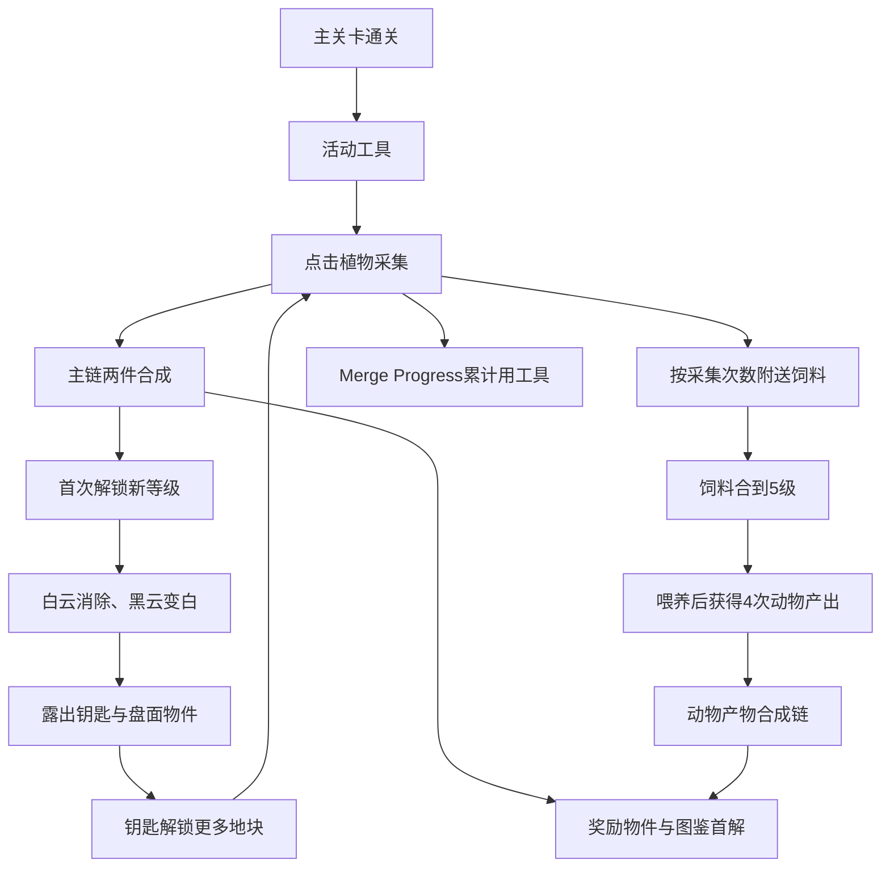

# Merge Fantasy 活动拆解 · 2.7.3 / 203

## 1. 活动定位与本次结论

Merge Fantasy 是一套“主关卡供给工具、活动内点击产物、两件合成升级、首次发现解云、钥匙解锁产能、支线喂养产物”的限时合成玩法。它以首次合出更高等级为主目标，同时用图鉴、盘面奖励链和 Merge Progress 任务轨承接收益。

**名称已确认：Merge Fantasy 对应 mergeani（ActivityType=45），不是 merge2。merge2 对应的是 Merge Wonders。** 名称依据同版本英语本地化，而非按用户描述猜配。

本轮取得同版本配置明文、热更程序集与关键规则消费者。但当前专用模拟器样本仍是下一关 Level 2，缓存中 mergeani_on=false、活动 isOn=false、期号与起止时间均为0；没有该活动实际开放画面。因此本文是“同版本规则与配置拆解＋当前未开放样本核对”，**不能用它确认本期主题、线上截止时间或该账号参加后采用的数值档**。

| 层 | 已确认内容 | 证据边界 |
| --- | --- | --- |
| 玩法规则 | 2合1、采集耗工具、地块效率、喂养、云目标、首次发现、防重复 | 同构建CIL控制流＋包内默认 |
| 奖励与商业化 | 物件奖励、首解奖励、图鉴补领、道具箱概率、Merge Progress累计任务 | 配置与消费者对位；未真实领奖或支付 |
| 当前账号 | 开关关闭、空棋盘、未参加、无有效期号 | 只读缓存，不宣称全量玩家都关闭 |
| 表现与主题 | 主题表、图鉴分类、本地化、UI／动效类存在 | 未实拍活动画面，未做视觉还原 |

## 2. 玩家流程与两条生产链

核心循环由工具供给、主链升级、产能解锁、动物支线和奖励领取共同构成。下图是代码与配置关系示意，不是当前账号已经走通的实机流程。

| 动作 | 规则 | 与主循环的关系 |
| --- | --- | --- |
| 主关卡获工具 | 模板将活动奖励类型指向67；接收num后累加工具余额和累计获得量 | 普通／困难每关num尚未恢复，不能填固定发放量 |
| 点击植物 | 成功产出消耗1工具；按已开地块总数选产出档 | 不是每生成一个物件就消耗1工具 |
| 两件合成 | 相同可合物件拖拽到一起，删除源物件，目标替换为chain指向的一件新物件 | 没有从名称推断3合或5合 |
| 首次发现 | 首次进入unlockedItems才触发首解记录；主链进度采用最高已解等级 | 重复合出旧等级不重复触发首解奖励 |
| 解云 | 仅当首次解锁ID匹配当前云目标时推进；云目标本身不提交消耗合出的主链物件 | 目标感与空间开放绑定 |
| 钥匙开地 | ability13对应钥匙130000；成功消费盘面钥匙后openedFarmLandCount+1 | 提高后续每工具产量，并缩短附送饲料周期 |
| 奖励物件 | 高阶合成按itemRewards数组生成奖励物件；不足空格的剩余奖励放入shelvedItems | 数组是固定内容，随机的是空格落点，不是随机掉落池 |

术语：活动存档中的 coins 是工具余额；主游戏金币奖励另以 rt=2 表示。两者必须区分。

## 3. 工具、产能与动物喂养

| 已解锁地块数 | 每次成功采集成本 | 主链产物10101 | 饲料30101附赠周期 |
| --- | --- | --- | --- |
| 1 | 1工具 | 1 | 每5次采集1件 |
| 2 | 1工具 | 2 | 每4次采集1件 |
| 3 | 1工具 | 3 | 每3次采集1件 |
| 4 | 1工具 | 4 | 每1次采集1件 |

选档使用 openedFarmLandCount，而不是玩家点了第几个地块。饲料命中以全局 farmLandClickCount 递增后对 interval 取余判定；5/4/3/1是采集次数周期，既不是秒数，也不是5次抽1次的概率。附赠饲料的consume=0，不额外扣工具。换档前后计数不以本表推断重置，需沿具体换档状态处理。

| 生产链 | ID／长度 | 终点用途 |
| --- | --- | --- |
| 主链 | 10101～10112，共12级 | 首次解锁5～11级解云；8～12级对应额外阶段奖励组 |
| 饲料链 | 30101～30105，共5级 | 最高级30105满足喂养条件，消费一件后给动物4次产出预算 |
| 动物产物链 | 20101～20109，共9级 | 每次动物产出20101一件；9级生成奖励物件 |
| 金币奖励物件链 | 60001～60005，共5级 | 最高级60005组配置50金币 |
| 道具奖励物件链 | 70001～70005，共5级 | 最高级70005从7个等权条目抽一项 |
| 钥匙／覆盖物 | 130000；白云110000；黑云120000 | 钥匙扩展产能；云分层控制可见与开放空间 |

纯配方计算：2合1时，16件1级饲料可合成一件5级饲料，喂养后可产4件动物链1级物件。这个算例不计棋盘预置、奖励和其他补给，不能直接当实际工具成本。

经济设计判断（推论）：从1地块到4地块，同一工具的主链产量从1到4，饲料附赠周期从5次缩至每次；钥匙同时提高主链和支线效率，因此开地是活动中的产能升级目标。实际开地时点受云目标和棋盘预置控制。

## 4. 棋盘、云目标与配置变体

包内基础棋盘包含12个行定义、最多7列、77个显式配置格；第1行未定义column字段。不能仅凭表认定实机同时显示12×7格，视窗尺寸和叠层视觉需实机或Prefab核对。每格是物件堆叠数组，白云／黑云是其中的覆盖物。当前存档棋盘为空，不能作为参与后棋盘验证。

| 云目标 | 首次解锁物件 | 主链等级 | 白云清除格数 | 黑云转白格数 | 段末移动配置 |
| --- | --- | --- | --- | --- | --- |
| 1 | 10105 | 5 | 6 | 6 | 不结束本段 |
| 2 | 10106 | 6 | 6 | 6 | 不结束本段 |
| 3 | 10107 | 7 | 6 | 8 | 不结束本段 |
| 4 | 10108 | 8 | 8 | 6 | 不结束本段 |
| 5 | 10109 | 9 | 6 | 8 | 2行 |
| 6 | 10110 | 10 | 8 | 7 | 2行 |
| 7 | 10111 | 11 | 7 | 0 | 1行 |

目标按 cloulGoalProgressId 串行推进，完成ID记入 cloudGoalDoneIds 防重。主链5～11级依次对应7个目标；后3段配置移动2／2／1行，代码按剩余棋盘行数限制实际移动量。

MergeAniConfig 与 MergeAniConfig_1 只有board部分不同，9行24格改变；生产档、合成链、云目标和奖励相同。差异包括钥匙位置、预置主链／动物链／饲料等级。当前mergeani_config缓存为字符串“null”，没有证明账号选中了任一变体，也不能把两份棋盘直接命名为A／B难度组。完整24格差异随附件保留。

## 5. 奖励：分清四条来源

| 来源 | 触发／内容 | 防混淆 |
| --- | --- | --- |
| 合成附加物件 | 升级物件的itemRewards数组产生金币／道具奖励物件 | 可以是多个固定物件；不与随机道具箱混为一池 |
| 主链首次解锁 | 包内10108～10112各自有首解奖励组 | 首次发现触发，重复合出不重复拿首解奖励 |
| 图鉴单项奖励 | 每个已解锁且未领取的链条物件ID，对应collectRewardItem：5金币 | 按物件种类ID防重，不按棋盘件数；退出可补领 |
| Merge Progress | 使用工具累计达到各档门槛，免费工具返还及付费奖励 | 是否开放受独立开关限制；本账号mergepass_on=false |

**合成时生成的固定奖励物件**（ID是棋盘物件，不是直接入账金币数量）：

| 新合出物件 | 固定追加物件数组 |
| --- | --- |
| 10107 | 60001×1、70001×1 |
| 10108 | 60001×1、70001×2 |
| 10109 | 60001×2、70001×1、70002×1 |
| 10110 | 60001×1、60002×1、70001×2、70002×1 |
| 10111 | 60001×3、60002×1、70001×2、70002×2 |
| 10112 | 60001×3、60002×2、70001×4、70002×2 |
| 20109 | 60001×1、60002×1、60003×1、70001×1、70003×1 |

**主链首次解锁奖励组**（包内默认）：

| 首次达到 | 奖励配置 |
| --- | --- |
| 10108 | 卡牌奖励项×2［rReplace=99999］；限时彩球 15分钟；限时炸弹 15分钟；限时开局火箭 15分钟 |
| 10109 | 卡牌奖励项×3［rReplace=99999］；限时生命 60分钟；彩球×1；炸弹×1；开局火箭×1 |
| 10110 | 卡牌奖励项×4［rReplace=99999］；金币×200；锤子×1；拳套×1；局内火箭×1；骰子×1 |
| 10111 | 卡牌奖励项×6［rReplace=99999］；金币×500；限时彩球 30分钟；限时炸弹 30分钟；限时开局火箭 30分钟 |
| 10112 | 卡牌奖励项×9［rReplace=99999］；金币×1000；锤子×1；拳套×1；局内火箭×1；骰子×1 |

限时单位已核对：rnType=1时rn按小时消费，道具AddProps与体力SetInfinite均乘3600，因此0.25／0.5／1分别为15／30／60分钟。卡牌项保留rReplace，未核对其具体选包或替代语义，不写成固定星级卡包。最终奖励消费者还支持：avatarFrameId非空且该头像框未解锁时追加头像框奖励；当前初始化值为空，不能写成每次固定送某头像框。

**金币与道具奖励物件的终点**：60005组配置50金币。70005组包含下列7项，每项权重100；Rand1ItemRewards只选1条，当前包内池下每项概率100/700=1/7≈14.286%。该概率不是全局活动掉落率，也不代表远端永不改池。

| 70005候选 | 权重 | 单次概率 |
| --- | --- | --- |
| 锤子×1 | 100 | 1/7 |
| 拳套×1 | 100 | 1/7 |
| 局内火箭×1 | 100 | 1/7 |
| 骰子×1 | 100 | 1/7 |
| 限时彩球 15分钟 | 100 | 1/7 |
| 限时炸弹 15分钟 | 100 | 1/7 |
| 限时开局火箭 15分钟 | 100 | 1/7 |

图鉴补领：GiveAllUnclaimedChainRewards按链条中的已解锁ID、collectedChainRewardItemIds未包含的ID组装奖励；退出检查会调用补领。**不是“退出把每个剩余棋子换成5金币”**。喂养链、产物链和主链哪些ID进入可展示链集合，仍以GetChains的实际提供器为准，不把41个对象都计入5金币。

**另一张15档积分表暂不列入可达收益**：包内progress阈值40～4000，但41个items均未配置score。通用点击计分要求chain==0且score>0，当前默认数据不满足该条件。附表仅作配置库存；若远端日后增加score，再重新判断可达性。

| 备用积分阈值 | 配置奖励（未证明此轨可达） |
| --- | --- |
| 40 | 炸弹×1 |
| 100 | 金币×100 |
| 200 | 限时生命 15分钟 |
| 300 | 限时开局火箭 15分钟 |
| 450 | 卡牌奖励项×2［rReplace=10］ |
| 600 | 拳套×1 |
| 800 | 金币×500 |
| 1000 | 卡牌奖励项×3［rReplace=8］ |
| 1300 | 限时彩球 30分钟 |
| 1600 | 局内火箭×1 |
| 2000 | 卡牌奖励项×4［rReplace=7］ |
| 2400 | 骰子×1 |
| 2900 | 锤子×2 |
| 3400 | 卡牌奖励项×6［rReplace=5］ |
| 4000 | 金币×1000 |

## 6. Merge Progress：累计任务与付费轨

玩家名为Merge Progress，文案Use Tools!。activityType=45关联该活动，任务type0由OnTokenConsumed消费事件推进。代码遍历所有匹配任务并分别累加、封顶至requireNum，所以门槛是**并行的累计工具消耗量**：末档300工具，而不是把15档需求加总。当前任务集合及活动资格仍由MergePass状态限制。

| 累计用工具 | 免费档 | 付费档 |
| --- | --- | --- |
| 5 | 工具×1 | 金币×500 |
| 10 | 工具×1 | 骰子×1 |
| 15 | 工具×1 | 金币×200 |
| 20 | 工具×1 | 限时开局火箭 30分钟；限时炸弹 30分钟；限时彩球 30分钟 |
| 25 | 工具×1 | 卡牌奖励项×3［rReplace=8］ |
| 30 | 工具×1 | 锤子×1 |
| 40 | 工具×2 | 金币×300 |
| 60 | 工具×2 | 限时生命 60分钟；彩球×1；炸弹×1；开局火箭×1 |
| 80 | 工具×2 | 局内火箭×1 |
| 110 | 工具×3 | 金币×1000 |
| 150 | 工具×4 | 卡牌奖励项×4［rReplace=5］ |
| 180 | 工具×5 | 拳套×1 |
| 220 | 工具×6 | 彩球×2 |
| 260 | 工具×7 | 卡牌奖励项×6［rReplace=7］ |
| 300 | 工具×8 | 金币×1000；锤子×1；拳套×1；局内火箭×1；骰子×1 |

免费档合计返45工具。付费商品映射：activityType45 → shopId93 → piggymatch.game.mergepass_3.99；包内price字符串为“3.99”。没有取得当前活动付费页，故不指定币种、最终商店价或当前是否可购买；freeBoxType／paidBoxType仅为表现字段，不额外算一份箱内奖励。

## 7. 主题变化与“本期”确认边界

同一套mergeani机制可换主题。scenes_new有9个候选，旧scenes有7个；新表的openRounds为34～42。下表是包内映射，不代表本账号处于对应轮次，也不按这些锚点直接推算2026年当前主题。

| 表ID | scene | openRounds | 主链分类 | 饲料链分类 | 产物链分类 |
| --- | --- | --- | --- | --- | --- |
| 1 | 1 | 34 | Lavender | Forage Grass | Wool Products |
| 4 | 4 | 35 | Orange Juice | Bird Nest | Bird |
| 5 | 5 | 36 | Circus | Lollipop | Balloon |
| 6 | 6 | 37 | Fish | Shrimp | Feather Products |
| 7 | 7 | 38 | Coral | Fish | Treasure |
| 1008 | 8 | 39 | May Lily Tableware | Dew | Divination tools |
| 1009 | 9 | 40 | Corn Food | Straw Heart | Scarecrow Doll |
| 10 | 10 | 41 | Pumpkin Treats | Candles | Ghosts |
| 11 | 11 | 42 | Grape Wine | Wooden Tableware | Pie |

新旧表存在1008／8、1009／9的资源ID差异；本表逐项保留scenes_new数据，不把新旧表混装。GetRoundSceneConfig会优先恢复已开启当前轮的锁定主题；回退选景依赖通用提供器，scenes_new实际启用及轮转公式尚未完整核定。当前初始化scene=1只证明默认状态，不证明当前为Lavender／Wool主题。

包内排期锚点为2023-09-25T08:00:00Z～2023-10-02T07:29:59Z，interval=1816201、repeat=true。它是模板锚点，**不是2026-11-18的活动开始／截止**。未核完重复周期消费者前，也不从原始interval推导固定周期开启。

## 8. 当前样本、资格与关卡联动

| 缓存／状态 | 本次读到的值 | 能说明什么 |
| --- | --- | --- |
| mergeani_on / mergepass_on | false / false | 当前缓存开关为false；不代表全量账号或全平台 |
| mergeani_config / mergeani_start | null / {} | 没有取得有效选表和参加门槛对象 |
| eventplan_config | ActivityPlanConfig | 缓存指定配置名；本次config_remote目录为空 |
| eventtemplate_config | ActivityTemplateConfig_1 | 该包内mergeani行与基础ActivityTemplateConfig一致 |
| 活动运行状态 | isOn=false、roundStatus=0、curRound=0、board.cells=[] | 未参加；不是已进入某期的盘面 |
| 活动排期状态 | round=0、st=0、et=0、oft=0 | 没有本次有效期号与起止时刻 |
| 初始化状态 | scene=1、openedFarmLandCount=1、coins=0 | 初始化值，不能当当前主题或参与后的实际产能 |

参与门槛消费者：IsApOn经AutoPMergeBase.IsOn读取mergeani_on，UnlockBaseCheck先拦截关闭开关，再查关卡／活跃天数／Bundle；空门槛不能绕过false。GetUnlockLevel／GetUnlockActivityDay读取StartCondition的start_level／active_day，未取得对象时取默认值；不应把缺失对象返回0解释为产品对所有玩家都是0关、0天开放。config字面“null”回退GetDefaultConfig，本包MergeAni没有另配default_config，回到基名MergeAniConfig；但Reload未开启时也能写初始化configName，IsOpen还要求roundStatus>0，因此初始化字段不证明活动本期生效。本次未改等级、未强开开关，未通过测试接口制造活动体验。

关卡奖励模板：collectItemType=67、collectPrefabs=[collect_nearby_mergeani]、multiByDifficulty=true、multiByDouble=false、multiByWheel=false。接收端TryReceiveLevelReward(num)只负责累加num并记录match3Levels；普通／困难关每关工具数和难度倍率值仍未完成上游核对，因此这里不给猜测数。

页面入口模板：Home_Item_Mergeani，homePosition=1、group=11，hasStartUI／hasPreview／hasFinishState均为true，checkBundleAtHome=true；netTimeOpen=true、netTimeClose=false，preserveSec=1800。字段存在不等于本账号已展示，也不据此承诺结束后可领取30分钟。

## 9. 表现资源、设计拆解与未决项

| 表现单元 | 已定位 | 尚未取得 |
| --- | --- | --- |
| 活动入口／关卡收集 | Home_Item_Mergeani、collect_nearby_mergeani；工具奖励type67 | 活动开放实拍、入口动画和出关飞行对应 |
| 游戏与图鉴 | MergeaniGameView_Asm；Fantasy Logbook与三条分类文案 | 当前主题原图、最终布局、遮罩和图鉴领奖实拍 |
| 关键动效 | 代码消费itemFlyLandMove、云转换与移屏等设置；Drag／Feed／Area事件 | 精确时序、音效调用和同状态画面对照 |
| 通行证 | Merge Progress / Use Tools!、ui_mergepass_v1缓存 | 与当前mergeani主题匹配的付费页与支付回调实测 |

设计拆解（分析推论）：主关卡提供稀缺工具，2合1产生明确升级预期；首次发现控制开云目标，钥匙提高工具效率，空间和产能交替增长；饲料支线把同一轮采集转成另一条较长生产链；奖励物件可继续合成，形成“立即领奖或继续升级”的库存决策；Merge Progress把实际工具消费转化为免费返还与付费轨进度。上述解释用于理解系统职责，不是对留存或收入效果的已验证结论。

| 未决问题 | 为什么仍未知 | 后续最小补证 |
| --- | --- | --- |
| 本期实际主题／期限 | 当前样本关卡低、开关关闭且无有效期号 | 取得实际开放样本，同页记录名称、期号、主题与倒计时 |
| 普通／困难关工具数 | 模板有倍率开关，num上游尚未对位 | 取得发放计算消费者，或同等级普通／困难胜利前后只读差分 |
| 远端选中棋盘及热更版本 | 无有效mergeani_config；本轮热更来自安装包 | 活动开放后记录选表与下载代码摘要，再逐项对应 |
| 卡牌奖励替代与选包 | sticker项的rReplace具体消费者未核完 | 补卡包选择／替代消费者，不按数字猜星级或品质 |
| 实际视觉／声音 | 未进入活动，不用包内库存冒充曝光 | 自然进入后采主界面、帮助、图鉴、付费轨及关键反馈 |

## 10. 来源、方法与维护入口

样本：Piggy Kingdom 2.7.3 / 203，包名com.olleyo.piggy.king.free；XAPK SHA256=9169eff5ace1eb76b201889480bee52addf7edadd65dcf9741e74dfdedd15a13。MuMu实例1“产品分析”经rpc核验，serial=127.0.0.1:16416、用户0。运行采集为逐文件非原子只读副本，不用于跨文件并发一致性／事件因果证明。未核对独立稳定账号标识，不做跨账号比较。

包内配置由同构建AES消费者及常量核对后解密，33份相关JSON完整解析成功。热更包静态恢复后为Hot.Scripts.dll，SHA256=11366a21e7c2fbdcdf5e301a9ff153dfd125b90736b64724371f2d6ed5f06954；关键规则读取CIL，混淆常数通过同构建算术VM受限模拟恢复，8项验证哨兵通过；没有加载执行目标程序集。密钥仅保留在本机原始证据目录，不进入正文或报告附件。

| 证据 | 位置与用途 |
| --- | --- |
| 静态数据总表 | 06-PRODUCT-ASSETS/PiggyKingdom/2.7.3/04-ReverseEngineering/merge-fantasy/merge_fantasy_static_summary.json |
| 规则消费者索引 | 同目录merge_fantasy_logic_findings.json、critical-methods/，含方法token／RVA／IL位置及摘要 |
| 解密与代码身份 | 同目录crypto_provenance.json、native_evidence_index.json、hotdll_decryption_provenance.json、obfuz_constants.json |
| 开关／回退／限时单位 | 同目录minimal_consumer_checks.json；AddProps @0x2F56BF4、SetInfinite @0x2F38B68按小时×3600 |
| 钥匙开地核对 | 同目录farmland_unlock_evidence.json；TryHandleUnlockFarmLandFlag @0x120094、TryUnlockFarmLandFromFarmItem @0x120720 |
| 当前运行采样 | 06-PRODUCT-ASSETS/PiggyKingdom/2.7.3/05-Runtime/20261118-merge/runtime_merge_observations.json；originals/、decoded/保留原件和解析结果 |
| 正文附件 | assets/package-defaults.json、runtime-whitelist.json、code-evidence-index.json；只含必要业务配置与证据摘要 |

后续发现修订本文对应主题，不按“第几轮深挖”另起并列当前稿。当前文档以规则确认与来源边界为主，无HTML阅读版。

随附数据：[包内默认配置](assets/package-defaults.json) · [当前状态白名单](assets/runtime-whitelist.json) · [代码证据索引](assets/code-evidence-index.json)。

## 关联

- [[02-PROJECTS/产品分析/PiggyKingdom/活动/MergeFantasy/README|Merge Fantasy 功能档案]]
- [[02-PROJECTS/产品分析/PiggyKingdom/活动/MergeFantasy/证据与验证-2.7.3|样本证据与后续验证]]
- [[02-PROJECTS/产品分析/PiggyKingdom/_MOC|Piggy Kingdom 产品入口]]
- [[02-PROJECTS/产品分析/PiggyKingdom/资源路径索引|资源路径与证据索引]]
- [[02-PROJECTS/产品分析/方法-竞品模块分析与持续维护|竞品分析方法]]
