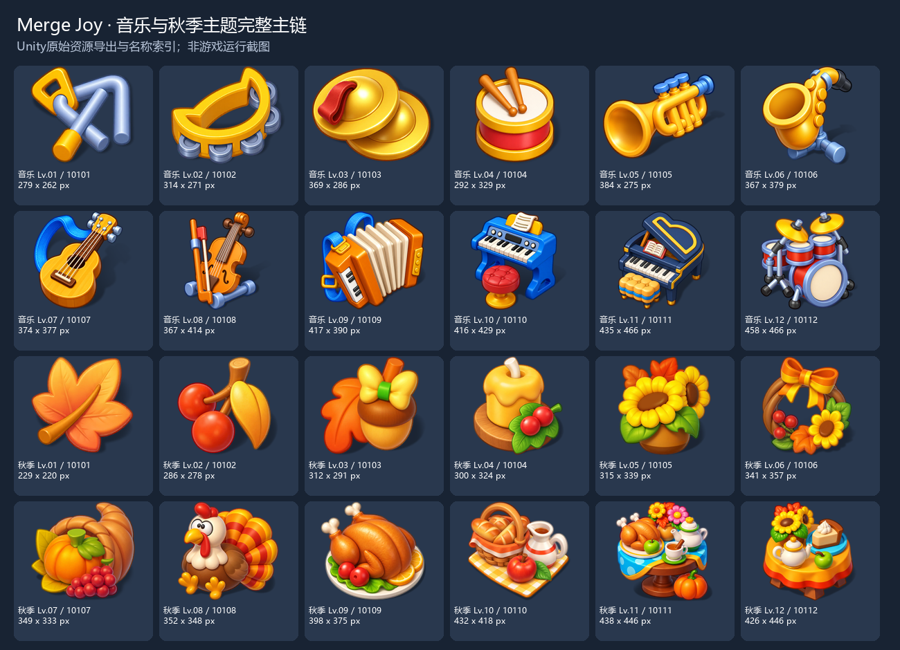
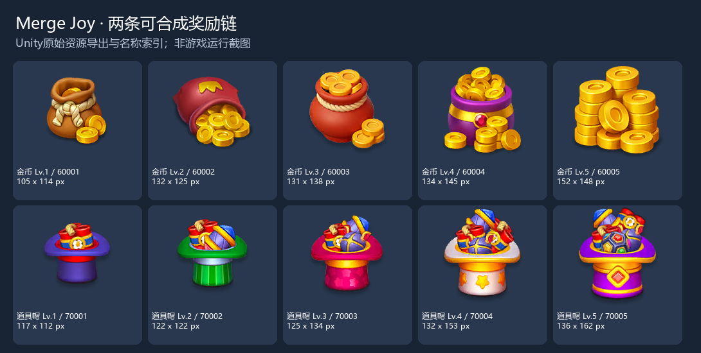
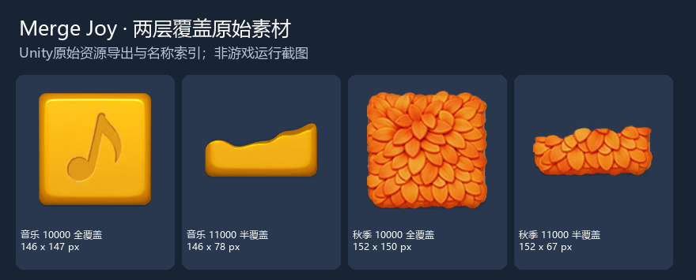
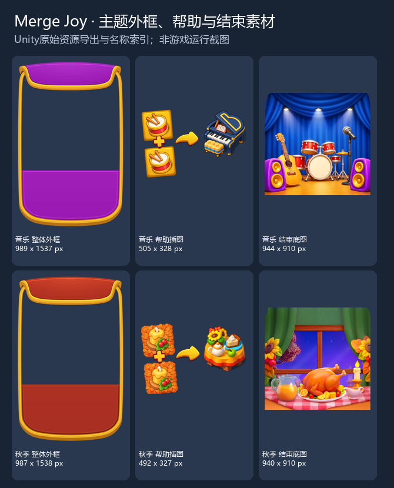

# Merge Joy 规则、资源与完整操作链

**Merge Joy是`mergemini`／活动类型37：打关获得可投放资源，优先从底部投放暂存物，否则每次花1资源生成主链Lv.1；在同一6×8盘面二合，解除两层覆盖，解锁12级主链、两条奖励链及10档BP。** 下文将包内配置、方法体可证行为、缓存与用户画面分开；TS采用范围仍由其需求对话确定。

另一对话从 [[02-PROJECTS/产品分析/PiggyKingdom/活动/MergeJoy/README|专题入口]] 阅读；[资源图册](资源图册-2.7.3.html)可直接浏览，[273张透明Sprite](assets/package-reference/reference-sprites.zip)可供逐张查看。图册是原始资源导出整理，不是游戏实拍或完整UI渲染。

## 1 样本、证据与适用范围

| 来源 | 本次取得内容 | 边界 |
|---|---|---|
| 原始XAPK 2.7.3／203、armeabi-v7a | 包内默认配置；Hot.Scripts.dll方法体；IL2CPP原生指令及类型索引 | 代码与默认值来自同一包；不等于本期账号选表 |
| 11/24实例1「产品分析」缓存 | 同为2.7.3／203，安装分包为arm64-v8a；只读取外部`MergeMiniConfig.txt` | 与原包ABI不同，未将ARMv7地址写成设备地址；缓存不证明正在使用 |
| 官方静态CDN，11/24下载 | 音乐28、秋季29各5个主题Bundle，通用主面板、奖励链与占位依赖 | 与配置资源名对位；当前可下载资产不冒充全部随APK发布或历史时刻相同内容 |
| 11/19已存下载包 | `ui_mergepass_v1`、`merge_common_ui_v1` | 来源与哈希沿既有记录；只证明缓存存在 |
| 11/23收到的六张用户实拍 | 秋季主界面、帮助、BP、奖励预览和投放提示 | 拍摄时间、客户端版本和轮次未知；未作连续操作差分 |

REA MCP两次返回`Transport closed`，本轮没有新增REA Evidence ID。降级工具实际解析成功：PEReader静态读取热更CIL，既有受限Obfuz算法恢复常数／字符串，Capstone核对原包ARM指令，UnityPy 1.25.4读取资源。没有加载执行目标程序集。关键token、IL偏移和文件哈希见[代码索引](assets/package-reference/code-evidence-index.json)。

11/24仅启动原已登记的模拟器并读取资源缓存，未发游戏启动、导航、改库、跳关或购买指令；不能保证模拟器自身启动不发生后台行为。配置来源及读取边界见[采样记录](assets/package-reference/sampling-provenance.json)。

## 2 玩家流程、解锁和参加

```text
首页资格／排期与同组选择 → 活动入口 → 首次建盘／恢复旧盘
  → Play打关 → 胜利资源入账 → 底部点击投放
  → 移动／交换／同级二合 → 四邻解全覆盖 → 同级拖入解半覆盖
  → 首次主链解锁奖＋BP任务；每次高阶合成另产奖励物
  → 主链终奖后留盘处理 → 确认退出／到期结束分支
  → BP补领 → 盘上可兑现奖励物补领 → 符合条件的余资源转换
```

默认模板`activityType=37`、`index=mergemini`，与Fantasy／Wonders等同属`group=11`，同组不等于同时开放。**原包默认解锁等级43、活动日curActivityDay≥1**：`GetUnlockLevel/ActivityDay 0x060011BC/11BD`读取旧`StartInfo.level/day`，父构造ARM `0x2CB0ABC`设为43／1。并存的新`StartCondition.start_level=200`不是这两个Joy消费者的读值，不能混写为200关门槛。字段允许下发覆盖，当前账号门槛未实采。

`mergemini_on`缺键或false均阻止开启，解锁还查资源就绪，之后需命中排期与可开放场景。已核解锁方法未见独立前置引导检查；活动内`guideStep`和`isViewed`分开保存，开期／换场方法未重置guideStep，不外推全框架不存在引导互斥。包内模板`preserveSec=1800`，不据该字段单独推导所有到期留场时长。有效开关、服务器窗口与同组选取仍需当期样本。

`MergeminiActivity.ShowMergeminiGame`（`0x06001F39`）隐藏／暂停首页UI后打开`MergeminiGameView_Asm`。`MergeGame.EnterGame`（`0x06001DF8 IL000C–0030`）仅在`isViewed=false`时初始化盘；重进复用存盘并重建空格缓存。普通返回和确认退出整场的区别见第8节。

开期重置轮次与统计、锁定配置；进入不同的有效场景时重建盘面并赠2个coins。普通重进不会重复赠送，底行预置的两个受半覆盖限制的Lv.1物品也不等于这2个coins。主链完成记录`passTime>0`、确认退出`isFinishComfirmed`、`hasLastRewardClaimed`与`roundStatus`分别管理状态，不能用一个Finished标签替代这些判断。

## 3 界面、原始图片与资源装配

新版[资源图册](资源图册-2.7.3.html#autumn-replica)增加秋日主题静态界面复刻与5区域说明，可对照S01、切换底部状态、显示布局尺寸。原图像素、Sprite Rect和Prefab UI单位分别记录；详见 [[02-PROJECTS/产品分析/PiggyKingdom/活动/MergeJoy/尺寸与界面说明-2.7.3|界面与尺寸对照]]，复刻不代表运行截图。

| 资源范围 | 已导出内容 | 调用／配置对应 |
|---|---|---|
| 主界面、帮助、结束 | `MergeminiGamePanel`、`GuidePanel`、`EndPanel`的结构；通用投放气泡、按钮、奖励链 | `ui_mergemini_v1`；主题UI插图由`LoadUISprite`替换 |
| 音乐／秋季主链 | 各12级彩色物、剪影、目标栏图；10000、11000覆盖 | `mergemini_item_28 / 29`，主链物品10101～10112 |
| 场景与棋盘 | 前／后／中景Prefab、外框、场景图、底格与盘面素材 | `mergemini_scene_28 / 29`、`mergemini_board_28 / 29` |
| 帮助和结束主题 | 外框、帮助插图`ui_mergemini_shuoming`、结束底图等 | `mergemini_ui_28 / 29` |
| 活动入口 | 入口图与动画资源清单 | `mergemini_entrance_28 / 29` |
| Progress／BP | Panel_9音乐紫色、Panel_3秋季样式及其他公用样式；入口图 | `ui_mergepass_v1`、`merge_common_ui_v1` |









以上图使用原始Sprite缩略排布并加标签；ZIP中逐张PNG保留导出尺寸与透明度。主链同名资源有棋盘／目标／剪影等变体，不能仅靠文件名去重；逐张导出以`Bundle＋path ID`标识。15个输入Bundle含占位依赖共316个Sprite、125个Texture2D，全部解析成功；选入图册／ZIP的是14个专题Bundle的273个Sprite，未把额外43个默认占位主题物混入两主题交付。

主面板Prefab并不内嵌当前所有主题。`GetBundlePrefix`（`0x060011F2`）读取模板index；`GetScene/Element/Map/Entrance/UIBundleName`（`0x0600121D–1221`）分别格式化`{prefix}_scene/item/board/entrance/ui_{配置字段}`。场景28与29的五个字段分别都是28和29。`ResolveBundleName`（ARM `0x31EB904`）再考虑Bundle表与patch版本，大于0才追加`_vN`，不能给所有主题名强加`_v1`。

下载路径由`ABUpdataMgr.<DownLoadFile>.MoveNext`（ARM `0x2CFEF6C`）核出：`资源根/android/Bundle名/清单指定文件名`。本次13个下载输入包括10个主题、主面板、公用奖励物、占位依赖，另2个BP输入来自既有缓存。清单的hash字段实为31个十六进制字符；本次校验文件尺寸与该MD5前缀，并另存完整本地MD5和SHA-256，**没有声称清单提供了完整32位MD5**。来源、HTTP时间、Bundle和Sprite路径、哈希见[source-manifest](assets/package-reference/source-manifest.json)。

资源与实际节点引用见[Prefab摘要](assets/package-reference/prefab-reference.json)，包含15个根、247个GameObject节点；骨骼TextAsset与动画、4个音频对象的名称见[动画音频索引](assets/package-reference/animation-audio-index.json)。未执行Spine动画或导出完整Unity工程。

### 3.1 既有秋季实拍与资源对位

本组截图补充了此前音乐主题结束态之外的进行中表现。以下为画面事实，尚未验证截图之间每次操作的调用与资源变化。

| 画面 | 新增可见信息 | 边界 |
|---|---|---|
| 主界面S01／S03／S05 | 秋季餐桌主题、剩余6d22h或6d23h、6列×8行棋盘、覆盖格与开放区、彩色／剪影成长条、礼物节点、Play入口 | 剩余时间不是完整活动时长；不同进度截图不能直接证明覆盖消除条件或拍摄顺序 |
| 帮助S02 | Beat Levels、Obtain Items、Collect the target element、Unlock Rewards四组文字及配图，底部Tap to Continue | 四组展示不等于四步强引导；不由文案推断每关产量和资源消耗 |
| BP S04 | 指定物品目标0/1与1/1；免费轨已领打勾、付费轨上锁；可见三档叶片奖励为免费6／8／10、付费25／30／40；购买按钮$3.99 | 与既有资源奖励版对应档吻合，仅支持可见档位；不确认整轨总量、货币地区、实际支付或全部选表 |
| 奖励预览S06 | 浮层列出头像框样式、卡包样式、1000金币及四种各1道具，成长条有礼物节点 | 展示不等于到账，不确认各奖励的领取条件及与终局奖的关系 |
| 投放提示S02／S06 | 底部圆形气泡内为叶片，数字分别可见1／2，S06带手指提示 | 不将数字当作体力余额、单次发射成本或暂存上限；是否每点减少一个须操作验证 |
| 棋盘物品S01／S03 | 主链主题物、金币外观物与帽子外观物同时存在 | 证实盘内存在对应外观，不能仅凭画面还原掉落来源、频率与兑换规则 |

原图保存在本文同级`assets/20261123-user-screenshots/`，S01～S06对应本轮附件顺序；[原图清单](assets/20261123-user-screenshots/provenance.json)记录原附件名、保存路径、SHA-256及未提供的版本信息。原图未修改。

旧音乐主题的BP展开和帮助排版缺口仍按原主题保留；秋季主题的对应页面已由本组补充，不再笼统称为“Joy没有进行中／BP／帮助实拍”。


本次目视对位：秋季29的叶片→浆果→橡果→蜡烛→向日葵→花环→南瓜→火鸡→烤鸡→餐篮→餐桌链，以及两层橙叶覆盖，与该组截图外观相符。只证明主题视觉对应，不由此给未知版本截图补造期号。

## 4 打关资源、投放与暂存

| 状态／动作 | 静态规则 | 证据 |
|---|---|---|
| 底部数量 | `coins + shelvedItems.Count`；是复合待投放数量，不能按截图直接叫体力余额或纯暂存数 | `UpdateShelveInfo 0x0600156A IL02D5–02F1` |
| 有暂存时点击 | 通过空位检查后取末项、移出暂存，再放到随机空位并保存；一次一件，不扣coins | `UnShelveItem 0x06001E17 IL0084–0151` |
| 无暂存、有coins | 每点随机空位生成主链Lv.1；成功后`coins--`、累计消耗++、发OnTokenConsumed(1)并保存 | `ConvertCoinToDefaultItem 0x06001E18 IL0060–016B` |
| 无空格 | 失败返回，不先扣资源或移除暂存 | 同上两方法的空位检查 |
| 两来源均空 | 只有活动剩时>0且终奖未领才显示Play；终奖后隐藏打关按钮 | `UpdateShelveInfo IL017D–01E5`及`0x06001573` |
| 图标 | 暂存非空显示末项图；否则显示主链首项图 | `UpdateShelveInfo IL022F–025E / 00F5–0137` |
| 发奖物满盘 | 先把前N件放随机互异空位，剩余件按顺序压入暂存；之后从末件开始取 | `MergeItems 0x06001E0B IL0271–0438` |

暂存为**LIFO后进先出**。例如coins=3、暂存为[A,B]，角标5、图标B；点击先B再A，随后三次生成Lv.1。这个例子是代码推演，没有模拟点击实测。该投放路径没有倍率切换；既有专题的全程序集资源写入与33份相关默认表扫描，也未发现Joy自然恢复、兑换或独立资源商店，商品93是BP。此为有界静态检索，不覆盖所有远端商品。详见 [[02-PROJECTS/产品分析/PiggyKingdom/活动/MergeJoy/详细内容与配置参考-2.7.3|详细配置参考]]第1节及其supply-audit.json。

打关入账链：`ActivityLevelStateHandler.OnChangeLevelState`（ARM `0x31484EC`）只在`Pass=1`调用`LevelHelper.GetLevelRewardScale(mask,-1,false,1)`，再把数量传入`TryReceiveLevelReward`。该入口不接收局内采集件数；模板的`NearbyFlying`是表现类型，不能写成关内收集几个就发几个。

Joy默认倍率掩码为`Difficulty|Buff_Add=17`，不含Double／Wheel／Win5；难度分支起点普通1、theme1为3、theme2为5，但`LevelTypeNameHelper.GetLvMultipleReward`可由关卡奖励表覆盖，有效Buff_Add还可增加。因此**不能把1／3／5写成线上每关固定产量**。`TryReceiveLevelReward 0x060011BA`将实际数量加入coins、总得资源与阶段得资源，并累计胜利关数后保存。各环节ARM地址来自原包armeabi-v7a，未与本次设备ARM64逐函数交叉核验。

## 5 棋盘、拖动与覆盖解除

默认`board`8条为**8行**，每行最多6列；不是8阶段。每格数组按自底向顶入栈，如`[10102,11000,10000]`。`InitBoard`仅在`id<=0`等特殊记录出现时建阶段分隔；此表无分隔记录，`moveLines=0/checkLines=0`，不会按Fantasy方式纵向移盘。

`isRandom=true`按每一行的整格做Shuffle，保留格内堆栈和该行总物品；不是按物品池重新抽棋子。只有首行不随机。`MergeMiniConfig_1`只把第7行column1底物由10109改10107，其余配置相同；不证明当前账号分层依据。

| 对象 | 可拖 | 受邻接伤害 | 阻止向下匹配 | 去除方式 |
|---|---|---|---|---|
| 10000全覆盖／ability7 | 否 | 是 | 是 | 成功合成落点的上下左右相邻格，一次移除顶层 |
| 11000半覆盖／ability8 | 否 | 否 | 否 | 把自由的同ID棋子拖到该格，与底下棋子二合 |
| 主链或奖励链底物 | 自由状态可拖 | 否 | 是 | 同ID且有chain才能二合；在半覆盖下不能直接拿走 |

`MergeItems 0x06001E0B IL04A0–04C2`安排一次延迟DigDamage；`DigDamage 0x06001E0F IL00E7–0244`只枚举四邻并检查边界，仅对顶物`receiveDigDamage=true`调用DestroyTopItem。**不含对角、无全行扩散、没有给此10000扣多次血的配置，也不会同一事件连破11000。**

`DragItemEnd 0x06001E08 IL019A–0226`对半覆盖格先移除11000，再合成底物。`GetFirstMergeableItem 0x06001E1B`从顶往底找相同ID，遇`blockMerge=true`停止；因此10000不能直接透层合成。合成会删除来源顶物、清目标旧堆栈并放升级物，释放格成为可操作空间。

空格可移动；不同ID且目标可拖则交换；同ID且存在下一chain才升级，同ID但已到末级走交换。奖励链遵守同样的同类同级规则。

## 6 主链、首次奖励、重复产物与终点

主链`10101→10112`共12级；金币链`60001→60005`、帽子链`70001→70005`各5级。三个发奖入口必须分开：

| 奖励机制 | 触发与次数 | 落点／是否消费物品 |
|---|---|---|
| 高阶主链`itemRewards` | **每次合成形成Lv.7～12**都执行，无首次解锁门禁 | 可放空格就落盘，否则进暂存；主链新物保留 |
| 主链直接`rewards` | 首次解锁Lv.8～12；`unlockedItems.Contains`阻止重复，progress取历史最大 | 发普通游戏奖励；不为领奖消耗主链物；Lv.12走终奖 |
| 奖励链兑现 | 点击无法继续合成且有直接奖励表的非主链末物 | 先DestroyTopItem，再抽配置奖并发送；消耗该棋子 |

首次解锁入口`CheckAndRecordUnlockedChainItem 0x06001E11 IL0035–0068 / 008E–01CC`会写unlockedItems、触发BP解锁回调、更新成长条。继续合成不会使已解锁进度回退。

| 新形成等级 | 每次合成附带的可合成奖励物 |
|---|---|
| Lv.7 | 60001×1、70001×1 |
| Lv.8 | 60001×1、70001×2 |
| Lv.9 | 60001×2、70001×1、70002×1 |
| Lv.10 | 60001×1、60002×1、70001×2、70002×1 |
| Lv.11 | 60001×3、60002×1、70001×2、70002×2 |
| Lv.12 | 60001×3、60002×2、70001×4、70002×2 |

`MergeItems 0x06001E0B IL0217–043D`读取的是**新生成物**的itemRewards。普通移动／交换不属于这一发奖触发。

| 首次主链等级 | 包内直接奖励组 |
|---|---|
| Lv.8／10108 | sticker 2；colorbomb、bomb、rocketbefore各15分钟 |
| Lv.9／10109 | sticker 3；lives 1小时；colorbomb、bomb、rocketbefore各1件 |
| Lv.10／10110 | sticker 4；金币200；hammer／fist／rocket／dice各1件 |
| Lv.11／10111 | sticker 6；金币500；colorbomb、bomb、rocketbefore各30分钟 |
| Lv.12／10112 | sticker 9；金币1000；hammer／fist／rocket／dice各1件；条件头像框 |

sticker保留原配置名与数量；`rReplace=99999`存在后续替代机制，不把配置数字直接解释成保证收到几张指定卡。时长按`rnType=1`的小时换算；具体卡牌替代和库存到账沿通用发奖系统，未实机验证。

金币链末级60005点击兑现100金币；帽子链末级70005有7条各权重100候选：hammer、fist、rocket、dice各1件，或colorbomb／bomb／rocketbefore各15分钟。`Rand1ItemRewards 0x06001E1D IL0036–008C`在候选多于1时传权重给`NextIdxByWeights`，选一条。本分支未见库存／历史过滤，表意为等权7选1；最底层选择器未单独还原，不写成线上实测概率1/7。

### 6.1 Lv.12后发生什么

`SendFinalReward 0x06001E2C`发送最终配置奖；仅当本期avatarFrameId非空且未解锁该框时追加`rt=29`头像框，随后`hasLastRewardClaimed=true`并触发显示。奖励展示关闭后的回调仅显示last chance提示、隐藏Play，**不会立即关棋盘或固定切下一条主链**。

另有值得保留的静态路径：`ClickCell 0x06001E07 IL01AA–0374`对`chain=0 && itemRewards非空`的顶物，按该格`rewardedCounts`索引，每点在空位排一件，排够itemRewards长度便销毁原物。默认Lv.12长度11；形成时`MergeItems`已经批量产生上述11件，且未写该点击计数，所以静态代码支持末级另逐点排出11件后消失。视图回调会恢复输入，未发现终奖标记阻止该点击的门禁。**这是方法体结论，未做Lv.12连续点击和到账差分；不可直接用它给TS预算双倍产出。**

通用框架确有`CheckAndOpenNextScene 0x060011D4`，但必须有不同且可开放的下一场景。`GetCurOpenableScene 0x060011D8`先找本轮指定且未完成场景，再找`duration>0`的限时候选；默认每轮Joy只明确指定一个主题、duration均0，不能把28个跨期主题或8行棋盘解释成同一期28关／8次换盘。

## 7 BP目标、双轨及补领

Joy任务`taskType=2`，要求依次解锁10102～10111／Lv.2～11，每项`requireNum=1`，共10档。`OnMergeItemUnlocked 0x060015BD`触发任务进度；**不要求再提交或消耗目标棋子**。`SyncUnlockedItems 0x060015C2`可从既有解锁记录补任务，打开BP或恢复不需重新合成。

| 档位 | 主链目标 | 免费Joy资源 | `_1`付费Joy资源 |
|---|---|---:|---:|
| 1 | Lv.2 | 1 | 2 |
| 2 | Lv.3 | 1 | 3 |
| 3 | Lv.4 | 2 | 5 |
| 4 | Lv.5 | 2 | 10 |
| 5 | Lv.6 | 4 | 15 |
| 6 | Lv.7 | 4 | 20 |
| 7 | Lv.8 | 6 | 25 |
| 8 | Lv.9 | 8 | 30 |
| 9 | Lv.10 | 10 | 40 |
| 10 | Lv.11 | 12 | 50 |
| 合计 | — | 50 | 200 |

Joy资源是`rt=42`；不能直接改称TS体力601。默认表付费轨是金币合计3000的混合奖励；`_1`是上表资源奖励版。都指商品`shopId=93`，不是一次购买叠领两套。用户秋季图仅支持可见6/8/10和25/30/40档及$3.99报价，不能由此确认全部表或地区。

`ClaimReward 0x060015CC`核对档位、状态与购买资格，发选定轨奖励，写`collected`：免费1、付费2、两轨3，并保存。已完成目标后购买可领对应付费档。`CollectAllUnclaimedRewards 0x060015CD`只补满足条件的免费档和已购付费档，先写领取位并保存再统一发奖；结束补领会从奖励清单移除当前活动`collectItemType=42`，被过滤档位仍记已领，避免把已无用途的活动币发回结束活动。

购买成功有pending兜底（`0x060015D2/15D4`），但未验证商店回执、跨期迟到支付及崩溃恢复事务，不将客户端分支当成完整支付保证。

## 8 普通关闭、终奖留场、真正退出与到期

| 场景 | 行为／状态变化 |
|---|---|
| 活动剩时>0、终奖未领、当前场景仍有效时按关闭 | 关闭视图并ExitGame保存；不确认退出整场、不清盘 |
| 首次主链终奖 | 置`hasLastRewardClaimed=true`；奖励显示后留盘、隐藏Play |
| 进入结束退出分支 | 先检查BP提醒，接着有coins时弹Quit／Stay挽留，无coins则继续退出 |
| 真正OnCloseQuit | 关闭盘面，可能显示BP补领奖励列表，再ExitMatches、显示盘上奖励物补领，最后按条件显示资源转换 |
| ExitMatches结束本场 | 补领→记录已展示结束→scene加入completedScenes并保存；无下一场或已超时则确认完成、尝试关闭轮次 |

`TryShowMergePassOnEnd 0x06001DA0`按每个视图实例标记仅拦一次；BP属于当前活动且有未领奖励**或尚未购买**便可显示，不是仅检查免费奖红点。`WaitCloseQuit.MoveNext 0x06001DEA`先快照coins和终奖状态，再依次处理BP、盘上奖励及转换表现。各页按条件省略，不保证每次都会连弹全部页面。

### 8.1 退出补什么，不补什么

`CheckAndSendUnclaimedReward 0x060011D5 IL0006–0130`仅扫描现有棋盘可视区格子的**顶物**，跳过主链，只有该物具有直接奖励配置才抽／补领。默认表中就是末级金币／帽子等奖励物：

- 不扫描暂存，不自动把低级金币／帽子合到末级，不把所有物品折金币。
- 不把主链首次解锁奖励再次补一遍。
- 若`hasLastRewardClaimed && coins>0`，额外发送**固定1个fist／拳头**并将coins置0；任意正余额均触发一次，不是每余额换1个。Joy的`GetSettlementItemType 0x06001504`返回6；奖励数量按同构建float解密算法复算为1.0，详见代码索引。
- 没领终奖便真正退出整场，`SetFinishConfirmed 0x060011CE`仍将coins清0，不符合拳头转换条件。

转换的发奖结果不并入该方法返回的盘上补领列表，而由后续转换页表现。`MergeminiEndView_Asm.OnOpen/OnClose 0x06001536/1537`又是一条结束页入口；其Play与关闭都绑定Close，关闭后调ExitMatches，不据按钮外观误写为再开一关。

BP有collected位，首次主链奖有unlockedItems，终奖有标记；但退出补领方法本身**未逐格删除已补棋子或写逐格领取位**，依赖外层completedScenes及关轮次控制。不能声称结算过程中杀进程或重复直接调用具备事务级防重，相关实验未做。

## 9 主题排期、恢复与当前未知

定稿补证见 [[02-PROJECTS/产品分析/PiggyKingdom/活动/MergeJoy/完成到期与结算-2.7.3|完成、到期与结算专题]]：`HasUnclaimedRewards`专指主链已满而终奖未领；单独的暂存物或普通奖励物不触发`IsLastChance`。全资源BP自动补领过滤后为空时不弹奖励列表；暂存物最终退出后不可继续使用且不跨期，并非已证明当场逐项物理删除。`preserveSec=1800`消费者按结束时间减去该值判定可开启资格，不是30分钟到期延长期。已有收尾棋盘的投放／合成／点击路径没有时间或终奖硬门禁，重入仍需满足活动入口条件。

包内`scenes_new`28条、默认音乐28对应第51轮；11/24读取的缓存共30条，新增场景29／ID1029→第52轮、30／ID1030→第53轮。缓存与原包的abilities、items、board、rewards、misc逐项完全相同，只有scenes_new变化；完整对比见[配置附件](assets/package-reference/configuration-reference.json)。缓存里存在明确映射，补上了旧报告“52/53无映射”的历史缺口，但不证明当前账号实际进入这两轮。

包内Joy默认14天一轮、单轮窗口近7天；Joy→Fantasy→Joy→空周的四周循环与服务器覆盖记录仍见 [[02-PROJECTS/产品分析/PiggyKingdom/活动/MergeJoy与MergeFantasy-活动排期|排期专题]]。主题资产按上述场景字段成套替换，不代表同一期切30条主链。

恢复的核心保存项已见coins、board.cells／shelvedItems／rewardedCounts、unlockedItems、progress、hasLastRewardClaimed、completedScenes及BP领取位；重入复用已看过的棋盘。切换可开放场景会重新建盘、赠coins=2并清本场进度；场景是否应切换必须先符合实际选中场景配置。尚未验证异常退出中的每项写入原子性。

仍待现场补证：本期真正选表与开关；关卡表／Buff后的实际每关产量；Lv.12逐次产物和终奖后连续操作；支付晚买和跨期回调；到期各状态连续实拍、余资源拳头到账及中断防重。倍率、自然恢复、兑换和独立资源商店在既有资源写入扫描与相关默认表中未发现；该包默认Joy未开放的判断有静态依据，但不扩大为全产品或所有远端投放绝无此能力。

## 10 复核入口与另一对话使用边界

本机原始目录相对LG：`06-PRODUCT-ASSETS/PiggyKingdom/2.7.3/`。包与密钥、批量反编译、下载Bundle和全部原始纹理留该目录；正文、选用资源与必要证据索引随专题。未commit／push；本机存在不等于跨设备已同步。

| 材料 | 相对原始目录路径 |
|---|---|
| 原始3分包身份 | `00-Package/`；原始XAPK SHA-256 `9169eff5ace1eb76b201889480bee52addf7edadd65dcf9741e74dfdedd15a13` |
| 热更程序集与默认配置 | `04-ReverseEngineering/merge-fantasy/hot.scripts.dll`、`decrypted-package-defaults/`；DLL SHA-256 `11366a21e7c2fbdcdf5e301a9ff153dfd125b90736b64724371f2d6ed5f06954` |
| 棋盘与通关原始证据 | `04-ReverseEngineering/merge-joy/logic/`；51类型IL、31份摘录、关卡原生链及哈希 |
| BP／生命期与资源装配证据 | `04-ReverseEngineering/merge-joy/lifecycle/`；45选定方法、CDN拼接与版本解析指令 |
| 下载与导出脚本／清单 | `04-ReverseEngineering/merge-joy/resources/`；13下载Bundle及MD5前缀／SHA256 |
| 原始艺术导出 | `02-Art/merge-joy/`；316 Sprite、125 Texture2D、骨骼TextAsset |
| 11/24配置缓存 | `05-Runtime/20261124-mergejoy-resources/`，原件与JSON分开 |

既有REA身份摘要仍保留作历史证据：MVID=`66876522-48c6-4f06-8c1e-6e86515a2add`；父ID `ev_d453ef6c9fdca6a292fac7ce9dba915ec509a8b86f69bf9bebb5558a488254bd`，摘要 `ev_cad107f4052c525f3f9f7dc7147839c35d00bf0981c1967c2346d679df1aa0c8`。摘要只证明当时类型覆盖，不替代本轮方法体证据。

另一对话优先用第4～8节收敛发射资源、覆盖规则、单盘成长、重复产物、BP与结束要求。TS采用范围按需求主档当前确认执行；本次没有把竞品数值、疑似末级双产出或拳头转换直接写成TS需求，也未修改TS／MT代码和配置。

## 关联

- [[02-PROJECTS/产品分析/PiggyKingdom/_MOC|Piggy Kingdom入口]]
- [[02-PROJECTS/产品分析/PiggyKingdom/资源路径索引|资源与证据索引]]
- [[02-PROJECTS/产品分析/PiggyKingdom/活动/MergeJoy与MergeFantasy-界面对照|Joy／Fantasy界面对照]]
- [[02-PROJECTS/TileScape/游戏逻辑/需求-MergeJoy参考下的二合功能修改|TS Joy修改需求]]
