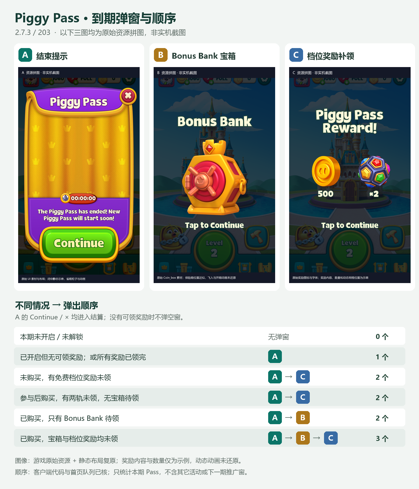

# Piggy Pass 到期结算与弹窗

**2.7.3 / 203 的客户端结束流程是：统一结束提示 → 按资格补领奖励。是否购买、是否有未领奖励，不决定另一种结束提示，而决定后面的奖励窗。** 两类奖励都有时，首页反馈队列安排 **Bonus Bank → 档位奖励列表**。

证据状态：同构建 ARM 原生分支、元数据字段与回调已核；2026-11-23 只读取得同版本设备缓存 `ui_season_v6`，核对结束页 Prefab 和英文文案。**没有自然到期、真实支付或各状态连续弹窗实拍**。以下是代码与资源所支持的流程，不把缓存存在视为本次曝光。

## 1. 按玩家情况看弹窗

表中的“结束提示”指进入首页的结束弹窗检查、且本期状态已经转为待结算时；不表示倒计时到零的同一帧必然弹出。

| 玩家情况 | 结束提示 | 按 Continue 或 × 之后 | 说明 |
|---|---|---|---|
| 真正没有开启本期，例如尚未解锁／本期没有建立，`end=0` | 不命中本活动结束窗条件 | 不走本期补领 | 结束窗检查要求 `end==2`。不能仅凭“没点入口”判断属于此行。 |
| 本期已经开启，但从未点进 Pass、没推进，也没购买 | 仍可出现同一结束提示 | 如果没有可领奖励，直接结束，不弹空奖励窗 | 结束判断没有 `clickNum>0`、进度大于零或购买门槛。 |
| 参加了，未购买，有已解锁免费奖励未领 | 同一结束提示 | `Piggy Pass Reward!` 档位奖励列表 | 汇总免费轨未领部分；不补未购买的付费轨。 |
| 参加了，未购买，能领的免费奖励已领完 | 同一结束提示 | 无奖励窗 | 不因为付费轨还有锁定奖励而弹购买／补购窗。 |
| 参加后购买，仍有免费／付费奖励未领 | 同一结束提示 | 档位奖励列表，合并符合资格的两轨未领奖励 | 先领过免费、后来购买，也能补对应档位未领付费奖励；免费部分不会重发。 |
| 已购买，档位奖励已领完，Bonus Bank 有待结算金币 | 同一结束提示 | `Bonus Bank` 宝箱窗 | 要求走完奖励档位、宝箱未领、已有累计金币；不要求金币存满。 |
| 已购买，同时有档位奖励和 Bonus Bank 未领 | 同一结束提示 | **先 Bonus Bank，再档位奖励列表** | 临时列表虽先加入档位奖励，但逐项插入首页队列头部，实际队列次序反转。 |
| 已购买，所有可领内容都领完／没有宝箱余额 | 同一结束提示 | 无奖励窗 | 已购买不意味着一定多弹一个奖励窗。 |

这里的“参加后购买”指本期进行过程中购买。**已核的到期结束链没有补购入口或独立的限时挽回购买弹窗**；结束 Prefab 只有 Continue 与关闭按钮。到期边界上的支付处理中、订单延迟回调、恢复购买与服务器补偿，不在本次已验证范围，不能据此保证迟到交易的处理。

## 2. 三种具体窗口

| 窗口 | 实际英文文案／结构 | 出现条件与按钮效果 |
|---|---|---|
| 结束提示 | 标题 `Piggy Pass`；正文 **The Piggy Pass has ended! New Piggy Pass will start soon!**；按钮 `Continue` 和 × | `seasonInfo.end==2`；两个按钮均绑定 `End()`，调用 `CollectEndReward()` 后关闭本窗。点 × 也进入结算，并非放弃未领奖励。 |
| 档位补领列表 | 通用奖励网格；标题 `Piggy Pass\nReward!` | 免费或已购付费轨存在可领未领奖励。主题 ID 为 `1` 时标题改用 `Winter Pass\nReward!`；不能把这个换标题视为另一种购买状态分支。 |
| 末尾宝箱 | 通用奖励宝箱；标题 `Bonus Bank`，调用宝箱居中飞行动画 | 已购、完成全部档位、未领过宝箱且 `giftGoldNum>0`。兑现实际累计金额。 |

结束提示的资源路径：`assets/m3res/bundleres/ui/ui_season/activityseasonendpanel_m2.prefab`。该缓存 Bundle 只有一个结束 Prefab；另含主页面、购买页、引导页和自定义奖励项。资源里独立存在购买页，不代表结束流程会打开购买页。

结束页的时间区默认文本为 `00:00:00`，Text 及祖先节点的序列化状态均启用；本次未验证现场时间区的最终可见性。节点、坐标、文案与资源身份见 [结束页节点摘要](assets/end-panel-node-summary.json)、[文案摘录](assets/resource-localization-subset.json)、[缓存来源](assets/resource-provenance.json)。这些是资源解析，**不是实机截图**。

### 资源拼图与分情况顺序

2026-11-23 用户要求找三种窗口的截图，并明确允许缺截图时用资源拼。已有 11/18–11/20 截图批次未取得这些到期窗口，因此以下三图均为 **游戏原始资源拼图，不是实机截图**。A 按结束页 Prefab 静态布局复原；B/C 取实际通用面板、保险箱与奖励图标，但运行时动态位置、标题材质和动画仅近似。C 的 500 金币、2 个彩球是展示示例，不代表固定奖励或账号实得。

| 图号与单图 | 出现阶段 | 素材与近似边界 |
|---|---|---|
| [A：结束提示](assets/popup-A-ended.png) | 所有命中本期结束检查的情况先出现 | `ui_season_v6` 原始 UI、原字体、静态布局；真实金帘 atlas 拼闭帘姿态，未运行 Spine／粒子。 |
| [B：Bonus Bank](assets/popup-B-bank.png) | 只有宝箱时为第 2 窗；宝箱和档位都未领时仍为第 2 窗 | `RewardBoxPanel` + `Coin_box` 金红保险箱原图；取关闭静态外观，飞入、开箱和金币显示过程未还原。 |
| [C：档位补领](assets/popup-C-rewards.png) | 没宝箱时为第 2 窗；有宝箱时为第 3 窗 | `RewardGridPanel`、原始金币／彩球图标及字体；奖励条目由运行时生成，此图布局和数量为示例。 |

两奖励面板的原始提示均为 `Tap to Continue`。B 使用 `BoxType.Coin_box=20`，不是通用木／蓝宝箱；C 使用普通 `RewardGridPanel`，不是提示 `Tap to Claim` 的 `RewardGridPassPanel`。源包映射为：coin_box → asset `577ee1e2781ac464fafa285d5d6086d9` / path ID 19，rewardboxpanel → `57448cb1ba1e64b9d9ae0e50292bd57e` / 9，rewardgridpanel → `6172cb440b694449794e0836af9e5515` / 13。

背景统一借用 11/18 Level 2 首页实拍暗化，**不表示该账号已解锁 Pass 或发生了本次结算**。来源和近似项见 [A 拼图证据](assets/ended-render-evidence.json)、[B/C 拼图证据](assets/reward-composite-provenance.json)；复现脚本在原始 `piggy-pass/` 的 `render_ended.py`、`render_reward_popups.py`、`build_popup_board.py`，资源导出来源在 `ended-resources/`、`reward-visuals/`。图片已目视检查，未把资源复原升级为实机验证。

## 3. 为什么“没参加”要拆两种

状态字段 `ActivitySeasonUserInfo.end` 的已核转移：

| 状态 | 如何进入 | 结束处理 |
|---|---|---|
| `0`：没有待处理本期 | `Clear()` 清理状态 | 不命中 `CheckSeasonEnd()` |
| `1`：本期已开启 | `OpenRound()` 清旧进度并写 `end=1` | 倒计时结束或关期检查进入 `EndActivity()` |
| `2`：到期待结算 | `EndActivity()` 写入；要求已有网络时间与网络数据 | 首页 `IsPopUpEndPanel()` 返回 true；弹结束提示 |
| 回到 `0` | 用户关闭／继续结束提示，触发清算；`EndSeasonView()` 调 `Clear()` | 旧期进度、领取状态与结束标记清理，不继续重复结算本期 |

入口点击次数 `clickNum` 单独记录。`OpenRound()` 建立本期与点击入口是不同的动作；`CheckSeasonEnd()` 只判断 `end==2`，不读点击次数、进度和购买状态。因此策划口径需要区分“本期没开启”和“开启了但玩家没点／没玩”。

`EndActivity()` 若缺网络时间或网络数据会直接返回；`OnCountDownCompleted()` 只在 `end==1` 时尝试结束，并不直接打开面板。已核的是本活动结束资格与首页队列，不包含所有其它活动对自动弹窗时机的竞争。

## 4. 奖励结算与防重

清算先调用 `ChangeStatues(true)`，用已有 `completeNum` 推进满足条件的档位、写入可领状态，再读取奖励；不会只按旧展示档位截断。

- 免费轨：档位状态为 `Claim` 才补 `rinfo`。
- 付费轨：到期保留的 `seasonInfo.vip==1`，且该轨可领未领，才补 `rinfo2`。对应免费档位状态只需不是 `None`，已经领过免费奖励仍能解锁付费轨。
- `collected[index]` 的编码：`1` 免费已领、`2` 付费已领、`3` 两轨均已领。已领部分不重复加入列表。
- 末尾宝箱：`displayIndex>=reward.Count && !collectLast && (IsPurchased() || seasonInfo.vip==1) && giftGoldNum>0`。到期金币取实际 `giftGoldNum`，没有要求达到满额 `rewardLastNum`。
- 清算用 `GetAllReward_CanCollect(false)` 明确排除末尾宝箱；宝箱单独读取和发放，故可有两个奖励窗。

`EndActivity()` 在取消当前 VIP 权益前保存本期购买标记；`CollectEndReward()` 也处理尚存的当前购买标记。**权益结束不等于丢失已购奖励补领资格。**

清算内部先取得两份奖励，再清理本期，然后调用发奖并安排展示。两个展示函数遇到空结果均直接返回 false，不生成空窗。它们是发奖结果展示，不是关闭结束页后再让用户逐档重领。崩溃、强杀、写盘失败或服务器纠错的事务保证，本次未做故障实验。

## 5. 可复核证据

原始材料根目录（Windows 本机，Git 忽略）：`D:/LibraryG/06-PRODUCT-ASSETS/PiggyKingdom/2.7.3/`。

代码输入身份见 [原生库与元数据 SHA-256](assets/code-input-hashes.json)，与原始 XAPK 身份一起保留；不混用其它版本方法地址。

| 结论 | 同构建方法／地址或材料 |
|---|---|
| 本期开启与结束状态 | `ActivitySeasonDM.OpenRound 0x2CDC100`；`EndActivity 0x2CDB5EC`；`TryCloseRoundInternal 0x2CDC678` |
| 结束窗资格 | `SeasonActivity.IsPopUpEndPanel 0x31739C8` → `CheckSeasonEnd 0x31739CC`；`PopUpEndPanel 0x3173A14` |
| 倒计时与入口 | `OnCountDownCompleted 0x3173AF8`；`OnBtnPressed 0x3172FF8` |
| 两按钮同回调 | `ActivitySeasonEndView_Asm.OnOpen 0x2F87260`；两处委托元数据槽均为 `0x89274C0`，原始编码 `0x60006237`，指向 `End 0x2F873D4` |
| 清算和清期 | `CollectEndReward 0x2CDE910`；`EndSeasonView 0x2CDB950`；`ActivitySeasonUserInfo.Clear 0x2D35D18` |
| 两轨与宝箱条件 | `GetAllReward_CanCollect 0x2CDE070`；`GetItemState 0x2CDCBE8`；`_GetItemState 0x2CDCC54`；`ChangeStatues 0x2CDD5F8`；`IsCanCollectLast 0x2CDD200`；`GetEndReward_CanCollect 0x2CDDEF4` |
| 奖励窗和回调 | `ShowEndRewardList 0x2CDF160`，回调 `0x2CDFC98`；`ShowEndRewardBox 0x2CDEEF8`，回调 `0x2CDFCC0` |
| 展示次序反转 | `ADD_HOME_WAIT_FUNC_TOP 0x2E4A7E4` → `AddHomeWaitingQueueFunc 0x2E4A8AC`，正序逐项 AddFirst `0x4B01000`；`CheckWaitingActionQueue 0x2E4A290` 从头消费，展示成功暂停 |
| 资源与文案 | 11/23 设备缓存 `files/bundle/ui_season_v6`；包内解密 `configs__local__language_english.json`；解析附件记录哈希和取样时刻 |

ARM 汇编、回调、解析脚本与 `literal-references.json` 在 `04-ReverseEngineering/piggy-pass/`；导出脚本在相邻 `merge-fantasy/dump_season.py`、`dump_callbacks.py`、`dump_pass_queue.py`、`dump_pass_linkedlist.py`。反汇编采用既有 Cpp2IL 方法地址、Capstone ARM 指令与 pyelftools ELF 段映射，未执行目标程序集。当前 REA Ghidra provider 未配置，本次使用已有本机解析能力，未声称取得 Ghidra 反编译或运行确认。

## 6. 验证边界与下一步

1. 已确认：本版本客户端分支、两个按钮回调、免费／付费补领条件、宝箱未满结算、首页奖励队列顺序；同版本缓存结束页的默认结构与文字。
2. 未确认：每一行情况的实机连续曝光、当前账号实际选中的主题／配置、其它弹窗插入后的最终完整顺序、离线和跨期异常恢复、迟到支付回调。资源缓存不是当前曝光证据。
3. 后续若需要画面验收，最小样本是：本期已开但零参与、免费未领、已购两轨未领、已购且宝箱和档位都未领。分别记录到期前状态、结束页、Continue／× 后连续画面及库存差分。人工改时或改存档应单列为受控实验；本次未执行。

## 关联

- [[02-PROJECTS/产品分析/PiggyKingdom/_MOC|Piggy Kingdom MOC]]
- [[02-PROJECTS/产品分析/PiggyKingdom/资源路径索引|资源与证据索引]]
- [[02-PROJECTS/产品分析/任务-竞品调研体系建设与持续维护|竞品调研长期任务]]
