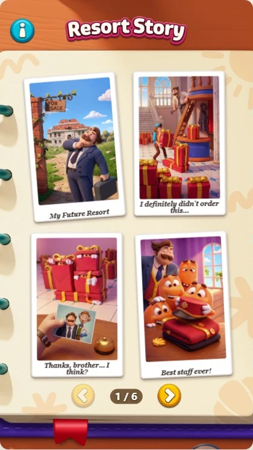
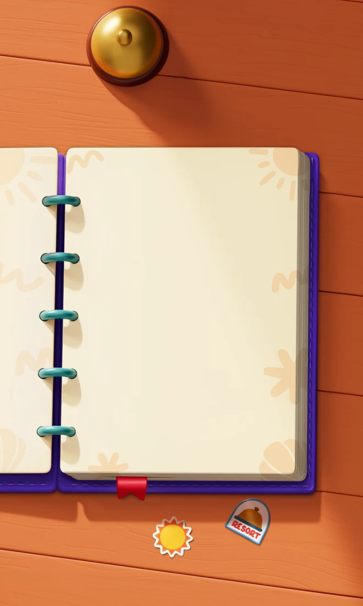
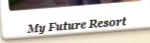
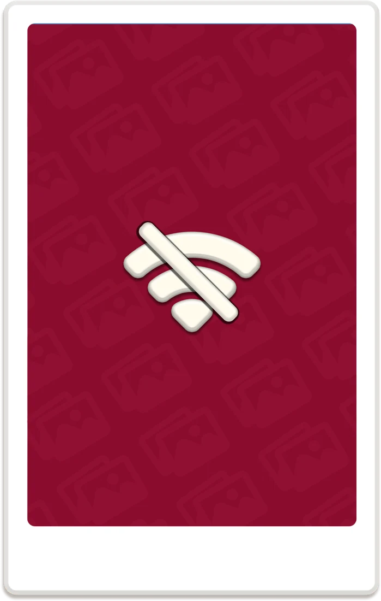
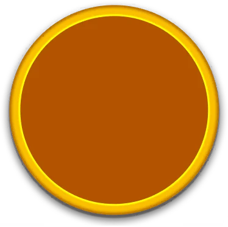
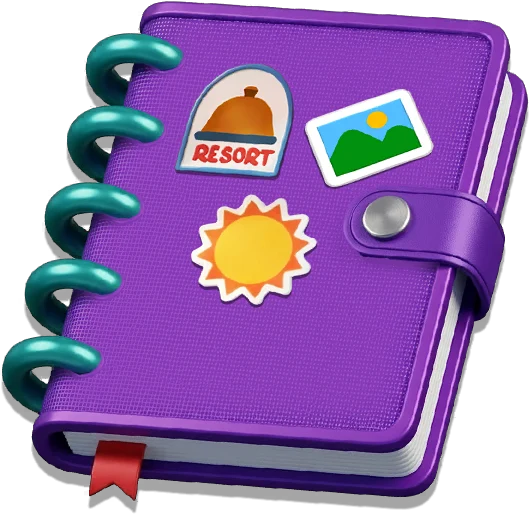
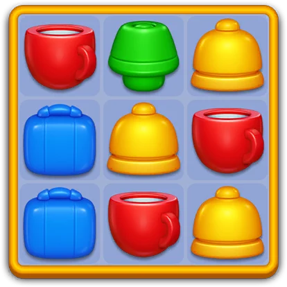

# Resort Match 剧情相册 UI 美术需求

**按组件拆件，一行一个UI细节。** 原素材用于辨认外观，复原截图用于位置参考；组合示意和文字排版示意均有标注，不作为原客户端实拍。范围仍为Resort Match，不引入参考截图中TS的代币、页签或灰度原画规则。

**重点状态：未解锁采用米黄色照片占位＋关卡条件；已解锁显示彩色照片与常显标题；网络资源不可用另用酒红色断网占位参考。** 三者不得混为同一个锁定状态。完整点击与显隐行为尚未实机核验，待确认项写在对应功能格。

## 1. 相册主界面

| 图示 | 描述 | 功能 |
|---|---|---|
| <figure class="reference tall"><figcaption>整页复原参考</figcaption></figure>C01 | <strong>整体版式</strong><ul><li>单页四图，2列×2行；顺序为左上、右上、左下、右下。</li><li>顶部标题与信息/关闭，底部左右翻页与页码。</li><li>六页复用一套版式；研究网页的右侧说明栏不属于游戏UI。</li></ul> | 
展示当前页的4张照片及解锁条件。

已获图可回看；未来页的可进入范围由产品规则控制。
 |
| <figure class="reference "><figcaption>原背景 1228×2048</figcaption></figure>C02 | <strong>桌面、书脊与纸页底板</strong><ul><li>暖橙木桌、奶油色纸页、活页圈与页边厚度。</li><li>原导出是合成背景；重新制作时拆桌面、封皮/书脊、纸页、装饰和阴影。</li><li>适配优先延展外部留白，不拉伸照片。</li></ul> | 
为页头、四图和页脚提供稳定承载区。

书脊、装饰不承担点击功能。
 |
| <figure class="reference "><figcaption>原Logo 1038×259</figcaption></figure>C03 | <strong>界面标题</strong><ul><li>顶部“Resort Story”共用标题。</li><li>白色文字配酒红描边及阴影，与照片标题区分。</li><li>新制作时文字与底层可编辑；本地化方案单独确认。</li></ul> | 
标识当前功能，无点击功能。
 |
| <figure class="reference "><figcaption>原素材 169×170</figcaption></figure>C04 | <strong>关闭按钮</strong><ul><li>独立按钮，有清晰叉号、体积感和描边。</li><li>可见图标与点击热区分开标注，避开标题与安全区。</li><li>交正常/按下状态；动态反馈优先复用公共按钮规范。</li></ul> | 
主界面：返回进入前的界面。

说明层：关闭当前层；具体返回层级需产品确认。原关闭节点与素材已定位。
 |
| <figure class="reference "><figcaption>原素材 169×170</figcaption></figure>C05 | <strong>玩法说明按钮</strong><ul><li>圆形信息按钮，i符号高对比。</li><li>顶部位置与关闭按钮形成导航层级。</li><li>正常/按下样式共用公共按钮反馈。</li></ul> | 
打开相册玩法说明，内容见C29—C31。
 |
| <figure class="reference "><figcaption>原照片成品 915×1440</figcaption></figure>C06 | <strong>照片画面与相纸</strong><ul><li>白相纸、圆角与轻阴影；照片呈轻微倾角。</li><li>原成品已带相纸边；新制作建议插画、相纸、阴影分别交付。</li><li>24张沿用同一框体比例，禁止逐图改变尺寸或拉伸人物。</li></ul> | 
承载已解锁剧情图。

点击可回看；是否独立全屏详情层需产品确认，不直接照搬研究网页弹层。
 |
| <figure class="reference "><figcaption>复原截图局部</figcaption></figure>C07 | <strong>照片短标题</strong><ul><li>位于相纸底部原有白边内，深色短句、常显。</li><li>长标题允许换行；不增加额外白色标题卡块。</li><li>文字独立，不烘焙进插画；不得因悬停、选中或动画才出现。</li></ul> | 
快速辨认照片内容。

所有已获图在初次打开、翻页、返回、大图关闭后均应显示；标题本身无独立点击功能。
 |
| <figure class="reference "><figcaption>原箭头 122×122</figcaption></figure>C08 | <strong>上一页／下一页按钮</strong><ul><li>金黄色圆按钮与浅色箭头，立体高光明显。</li><li>左右可镜像复用；交正常、按下、不可用样式。</li><li>首尾不可用态采用统一变暗规则，具体透明度联调确定。</li></ul> | 
上一页/下一页切换整组4图，不是逐张切换。

首尾页无对应方向时禁用，避免连续点击重复触发。
 |
| <figure class="reference "><figcaption>页脚复原参考</figcaption></figure>C09 | <strong>页码</strong><ul><li>位于左右翻页按钮之间，数字与底板分层。</li><li>显示当前页/总页数，六页共用。</li><li>不与箭头或照片短标题重叠。</li></ul> | 
展示页序，例如2/6；无独立点击功能。
 |

## 2. 图片解锁前后与资源状态

| 图示 | 描述 | 功能 |
|---|---|---|
| <figure class="reference "><figcaption>原场景占位 526×829</figcaption></figure>C10 | <strong>未解锁照片底图</strong><ul><li>米黄色空照片位，浅色框，中央叠放照片图标。</li><li>不展示待解锁剧情原画；不是把原画置灰。</li><li>包内这张素材没有锁头符号，不新增“必须画锁”的原版要求。</li></ul> | 
用于未达到关卡条件的照片位参考。

原场景四槽均有PlaceHolder；精准显隐和点击行为尚未实机核对。
 |
| <figure class="reference">
Reach Level 40
<figcaption>组合示意：原占位图＋原文案键 文字位置与字号待客户端核对</figcaption></figure>C11 | <strong>解锁条件文字</strong><ul><li>原文案键为Reach Level {0}；示意使用第40关。</li><li>与占位分层，数字动态填充，窄屏保持两行可读。</li><li>对比色、描边与位置需要接入校对；这里是组合示意。</li></ul> | 
说明达到指定关卡才能获得照片。

建议点击锁定格仅提示条件、不打开剧情图；该点击反馈属于待确认设计。
 |
| <figure class="reference "><figcaption>已解锁视觉参考</figcaption></figure>C12 | <strong>已解锁照片</strong><ul><li>彩色原画替换米黄色占位；保持原来的四格位置、比例和倾角。</li><li>关卡条件层移除，短标题常显。</li><li>不因为解锁改变相纸尺寸。</li></ul> | 
点击回看已获得内容。

解锁拥有状态与图片是否下载成功分开记录。
 |
| <figure class="reference "><figcaption>原资源占位 915×1440</figcaption></figure>C13 | <strong>已获得但资源不可用</strong><ul><li>酒红底、白相纸、断网符号；不与C10米黄占位混用。</li><li>这张原图显示网络不可用语义；何时由消费者选中仍需接入核验。</li><li>已有照片标题可继续显示；加载中与失败的补充提示需公共规范。</li></ul> | 
提示资源当前不可用，不能把已获得改回未解锁。

点击重试是建议交互，不是已核实的原版行为。
 |
| 

<figure class="reference "><figcaption>已解锁</figcaption></figure>

<figure class="reference">
Reach Level 40
<figcaption>组合示意：原占位图＋原文案键 文字位置与字号待客户端核对</figcaption></figure>

C14 | <strong>同页混合状态</strong><ul><li>同页允许彩色已获图与米黄未解锁格并存。</li><li>框体尺寸、位置一致；条件文字不占用邻格空间。</li><li>未解锁是否显示剧情短标题需确认，避免提前剧透。</li></ul> | 
玩家能同时判断已收内容和下一张目标。

验收至少覆盖0/4、1/4、2/4、3/4、4/4。这五种状态共用一套资源。
 |

## 3. 首页与菜单入口

| 图示 | 描述 | 功能 |
|---|---|---|
| <figure class="reference "><figcaption>原素材</figcaption></figure><figure class="reference "><figcaption>原素材</figcaption></figure><figure class="reference "><figcaption>图标151×126；圆框374×372、底294×294</figcaption></figure>C15 | <strong>首页入口底与图标</strong><ul><li>圆框、紫色底与故事图标分层。</li><li>位于首页右侧，点击区不要与开玩按钮相撞。</li><li>状态与特效复用同一个图标，不为各进度重画入口。</li></ul> | 
进入相册。

最后一张达到条件后常驻入口隐藏；完成后回看入口由菜单承接的流程需联调。
 |
| <figure class="reference "><figcaption>框256×96</figcaption></figure><figure class="reference "><figcaption>填充197×66</figcaption></figure>C16 | <strong>分段进度条</strong><ul><li>框、底、填充分件，四等分表示一页四张。</li><li>0/25/50/75/100%共用一张填充，通过裁切实现。</li><li>分隔线原素材7×27，按比例放置。</li></ul> | 
每获得一张图增加25%，普通通关不增加。

普通页集齐后进入下一页0格；满格停留时长未实测。
 |
| <figure class="reference "><figcaption>原素材</figcaption></figure><figure class="reference "><figcaption>红底与叹号各79×79</figcaption></figure>C17 | <strong>提示角标</strong><ul><li>红底与浅色叹号分层，覆盖在入口边缘。</li><li>开启/关闭共用资源，避免遮住故事图标主体。</li><li>仅列提示样式，不扩展成照片上的常驻“新”角标。</li></ul> | 
提示入口有待关注内容；具体开启/清除条件需消费者核对。
 |
| <figure class="reference "><figcaption>菜单图标93×79</figcaption></figure>C18 | <strong>菜单中的相册项</strong><ul><li>图标、通用菜单底板与Resort Story文字独立。</li><li>沿用菜单项的边距、字号和点击态，不另起一套按钮。</li></ul> | 
从菜单进入相册，提供再次浏览入口。
 |

## 4. 获得照片与完成反馈

| 图示 | 描述 | 功能 |
|---|---|---|
| <figure class="reference "><figcaption>复用正式照片</figcaption></figure>C19 | <strong>新照片展示主体</strong><ul><li>单张照片放大，保留完整画面与相纸。</li><li>照片、说明条、徽章和遮罩分别交付。</li><li>全屏或弹窗形态需先做流程灰模确认。</li></ul> | 
在新照片获得阶段集中展示剧情。

已有NewPhoto及TapToContinue节点，具体时序待核。
 |
| <figure class="reference "><figcaption>原素材282×274</figcaption></figure>C20 | <strong>新图徽章</strong><ul><li>独立透明徽章；与照片保持固定对齐关系。</li><li>可配缩放/出现动画，文字不可被相框遮挡。</li></ul> | 
强化“刚获得”的反馈。

不等于相册里所有照片永久带新图角标。
 |
| <figure class="reference "><figcaption>原扫光256×123</figcaption></figure>C21 | <strong>照片扫光与入口命中光效</strong><ul><li>扫光、粒子、照片分层；控制亮度不吞掉短标题。</li><li>附遮罩、排序与循环/一次性说明。</li><li>同一套光效服务获得流程，避免逐图制作。</li></ul> | 
用于照片出现或飞入入口的反馈。

首次入册、普通获得、完成页之间的播放次序需联调。
 |
| 
My Future Resort <small>剧情说明……</small>  Tap to continue

文字排版示意，非原版截图
C22 | <strong>剧情说明与点击继续</strong><ul><li>短标题、说明、继续提示各为文字层；底条可拉伸。</li><li>原说明底条为5×344窄条，不作为整幅底图放大。</li><li>最长说明与多语言样例必须验收。</li></ul> | 
让玩家阅读获得照片的内容，然后推进流程。

提示出现时机、可跳过时机需产品确认。
 |
| 
Page Completed!

文字排版示意，非原版截图
C23 | <strong>单页完成标题</strong><ul><li>完成标题与照片/奖励分层。</li><li>沿用故事标题的颜色层级，避免盖住奖励数量。</li><li>原文案已取得；图示仅用于文字内容，不是已恢复的原版样式。</li></ul> | 
第4张集齐时提示单页完成。

前五页配2项奖励，见下方奖励表。
 |
| 
100 金币　＋　锤子 ×1

文字排版示意，非原版截图
C24 | <strong>单页奖励区</strong><ul><li>需要2个奖励位置，物品图标、数量、时长分层。</li><li>金币/道具图标优先复用产品已有资产，当前未导出完整奖励图标。</li><li>数量和分钟不能烘焙到图标里。</li></ul> | 
展示本页所获奖励，完成反馈后继续。

此行是容量与接入要求，原奖励区具体排版未取得。
 |
| <figure class="reference "><figcaption>原完成图标530×514</figcaption></figure>
Resort Story Complete!

文字排版示意，非原版截图
C25 | <strong>整本完成图标与标题</strong><ul><li>完成图标、标题、照片收束、奖励区独立。</li><li>与单页完成在视觉级别上有区别，但沿用同一设计语言。</li></ul> | 
最后一页收齐时进入整本完成阶段。

这次奖励就是第6页奖励，不再重复弹另一份大奖。
 |
| 
金币100　锤子1　手套1　壶铃1 破坏球1　火箭30m　TNT30m　彩球30m

文字排版示意，非原版截图
C26 | <strong>整本八项奖励区</strong><ul><li>必须容纳8项，限时图标与单次道具清楚区分。</li><li>建议4×2用于压力稿；最终排法待确认。</li><li>继续/关闭区域始终可见，不被末行奖品挤出屏幕。</li></ul> | 
完整展示整本奖励。

所示4×2是需求示意，不是原客户端截图。
 |
| <figure class="reference "><figcaption>复用已完成相册</figcaption></figure>C27 | <strong>完成后回看</strong><ul><li>保持四张照片和短标题可读，不额外加厚框或新增白色标题区。</li><li>完成标识如需常驻，要先确认；原有完成图标不能直接推定会常驻页内。</li></ul> | 
保留照片回看能力；重新进入不重复发奖。
 |

## 5. 引导与玩法说明

| 图示 | 描述 | 功能 |
|---|---|---|
| <figure class="reference "><figcaption>原箭头216×203</figcaption></figure>C28 | <strong>入口引导箭头</strong><ul><li>箭头图层与入口分开，不遮挡进度。</li><li>呼吸/位移动画复用教程规范；需交起止状态。</li></ul> | 
引导点击相册入口。

是否使用这份具体箭头资源，需与教程节点对应。
 |
| <figure class="reference "><figcaption>原插图414×414</figcaption></figure>C29 | <strong>教学图1：收集照片</strong><ul><li>教学图与说明文案分开。</li><li>保持原比例，不把不同教学图拉成统一方块。</li></ul> | 
说明通过关卡收集照片。
 |
| <figure class="reference "><figcaption>原插图445×356</figcaption></figure>C30 | <strong>教学图2：集齐页面</strong><ul><li>与教学1共用容器与字号；图片按各自比例适配。</li><li>三条教学采取轮播还是同屏，需确定后再出状态稿。</li></ul> | 
说明完成相册页以揭开故事。
 |
| <figure class="reference "><figcaption>原插图1024×374</figcaption></figure>C31 | <strong>教学图3：整本大奖</strong><ul><li>横向插图单独留宽度；不要强制裁成方图。</li><li>说明、导航、关闭优先复用前述共用组件。</li></ul> | 
说明完成整段故事可领取最终大奖。
 |

## 6. 24张插画内容

每页四张按故事顺序制作，统一角色比例、制服和关键道具；正式图片与短标题分层。
| 页 | 第1图 | 第2图 | 第3图 | 第4图 | 连续性重点 |
|---|---|---|---|---|---|
| 1 建立度假村 | Albert买下海边旧屋 | 工地收到神秘箱子 | 得知兄弟送来Cubbies | 小帮手穿上酒店制服 | 旧屋状态、箱子、小帮手身份和制服保持连续 |
| 2 开业与服务 | 大家合力施工 | 度假村开业 | 接待客人 | 未煮的龙虾闹出笑话 | 由施工过渡到营业；笑点在小图中也可识别 |
| 3 相遇与婚礼 | Regina到来 | 递送晚餐邀请 | 浪漫晚餐与猫Coco | 婚礼 | Albert/Regina服装与表情递进，Coco保持同一造型 |
| 4 冲突升级 | Regina苛待员工 | Coco欺负小帮手 | 员工躲藏 | 员工向Albert诉苦 | 冲突清楚，仍保持轻喜剧卡通的统一质感 |
| 5 遗嘱转折 | Albert病重 | Albert去世 | Regina接管 | 律师带来遗嘱 | 病床、纪念与遗嘱作为叙事道具；避免依赖小字传达情节 |
| 6 新的主人 | Regina发现继承人 | 汉堡店找到Billy | Billy阅读遗嘱 | Billy抵达度假村 | Billy形象统一，结尾呼应开篇度假村 |

角色一致性清单：Albert、Regina、Coco、Billy、Cubbies；送货员、律师与客人为配角。需随插画源文件提供角色配色/比例参考，避免24图中主角脸型、发型和制服漂移。原画白边里的英文短标题是界面文本，不能在新插画中重复画一遍。场景内招牌如有文字，需另确认是否本地化。

## 7. 奖励清单

| 完成页 | 奖励内容 | 排版验收 |
|---|---|---|
| 1 | 100金币＋锤子1 | 2项，数量独立文字层 |
| 2 | 100金币＋手套1 | 2项，沿用同一模板 |
| 3 | 100金币＋壶铃1 | 2项，沿用同一模板 |
| 4 | 100金币＋无限火箭30分钟 | 2项，数量与时长样式可区分 |
| 5 | 100金币＋无限TNT30分钟 | 2项，限时标记清楚 |
| 6／整本 | 100金币；锤子、手套、壶铃、破坏球各1；无限火箭、无限TNT、无限彩球各30分钟 | **8项压力稿**，不遮挡继续/关闭；建议4×2，但这是待确认排法 |

整本奖励等同第6页奖励。两套首图关卡为5或30关，之后每5关一张；这些数字由规则填入，无需为不同存档制作两套图。

## 8. 美术交付与验收

| 交付项 | 要求 |
|---|---|
| 页面状态稿 | 主相册、首中末页、未解锁/已解锁混排、资源不可用、新图获得、单页完成、整本八奖、教学 |
| 分层源文件 | 背景、相纸、插画、阴影、图标、特效、文字可独立编辑；稳定编号与导出切图一致 |
| 24张插画 | 原参考成品915×1440；工作母稿可更大，目标屏幕和内存规格确认后定输出 |
| 通用UI切图 | 标九宫格边距、锚点、可镜像/平铺、透明边缘；共用组件不按页重复交付 |
| 文案状态稿 | 24个短标题全部常显；长文本、关卡数字、奖励数量与时长均不烘焙 |
| 动效 | 新图入场/飞入、进度跳格、换页、单页完成、整本完成；给源文件、层级、开始结束状态、可中断点 |
| 待确认设计 | 完成全屏或弹窗；八奖排法；锁定格是否露标题及点击反馈；下载失败重试；公共资产与字体；动画时序 |
| 分享预览 | HTML内嵌全部图示，单文件可独立查看；文末外链仅作为可选证据附件 |

| 检查项 | 通过条件 |
|---|---|
| 照片完整 | 6页×4图共24图，页号/槽号/文案一一对应，无重复、缺图或顺序错位 |
| 标题常显 | 24个短标题在打开、翻页、返回、关闭大图后均可见；无透明、裁切或相框遮挡 |
| 比例与布局 | 四格同模板；画面不被拉伸；不因标题长短追加白块或改变照片尺寸 |
| 状态分离 | 锁定、已获得、下载中可辨；资源失败不把已得图改成锁定 |
| 进度正确 | 一图25%；页切换与全书完成时入口表现符合规则 |
| 奖励完整 | 前五页两项，第六页八项；数量和分钟清楚；不重复表现成两次大奖 |
| 本地化与安全区 | 顶部按钮、底部翻页可触达；长标题和多语言不会溢出 |
| 复用与分层 | 背景/按钮/相框/进度共用；文案数字可编辑；交付源文件与切图对应 |
| 交付可独立查看 | 分享用HTML内嵌图片，复制单个文件仍显示所有参考图 |

## 9. 来源与附件

- [[02-PROJECTS/产品分析/Resort Match/_MOC|Resort Match 产品分析入口]]。
- [原始拆解与规则依据](右下角照片剧情拆解-1.18.0.md)。
- [24张剧情相册单文件](Resort%20Match剧情相册-24张原画与关卡奖励.html)。
- 包内素材：StoryUI/source.json；远端相册场景：Album/SceneUI；原画：Album/Photos。原始根目录为06-PRODUCT-ASSETS/Resort Match/1.18.0。
- 本文所用图示保存在UI美术需求.assets，来源及裁剪信息见同目录sources-components.json。所有像素尺寸为原导出尺寸，非屏幕显示尺寸。
