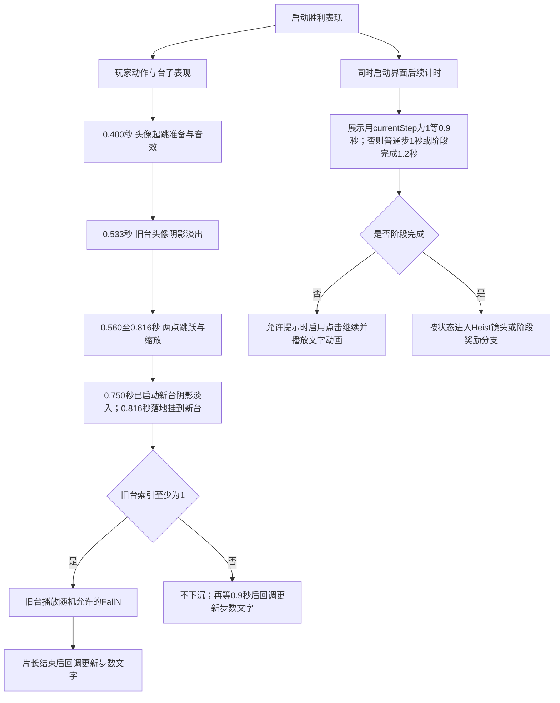
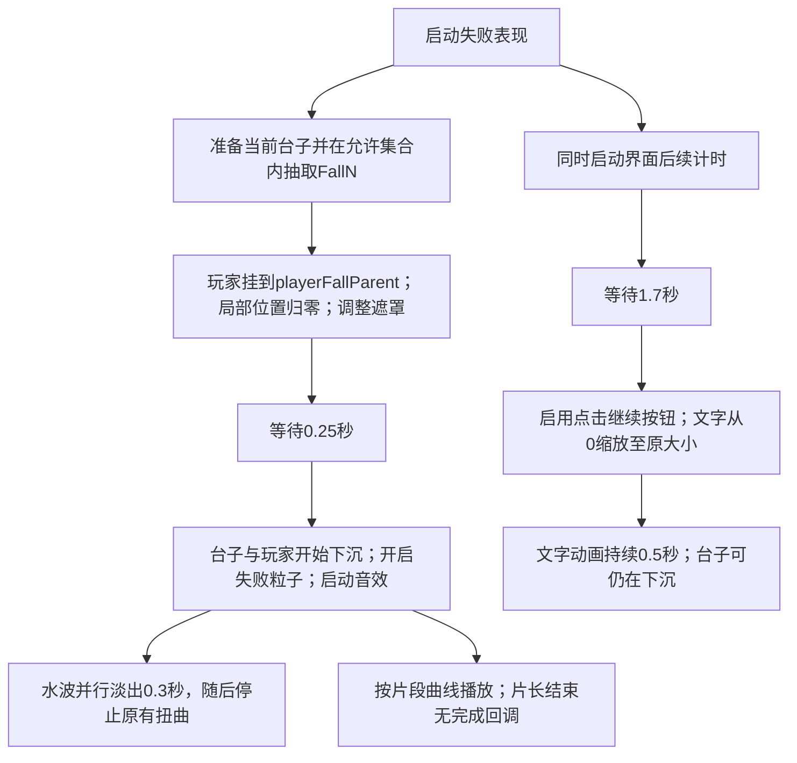

# Ancient Adventure 跳跃与台子下沉复刻参数

[资料空间页面](https://chatgpt.com/space/page_0f8bc53c1958819180467c117333a73c) · [下载参数附件](../../../../06-PRODUCT-ASSETS/RoyalMatch/39781/04-ReverseEngineering/Motion-Parameters/replication-20261109/Ancient-跳跃与下沉复刻参数附件.zip)

这份参数说明用于复刻 Royal Match Ancient Adventure 的两点跳跃、五种台子下沉，以及胜利和失败时的表现衔接。**五种下沉先按当前台子排除禁用项，再从剩余项中等概率选一种；胜负共用同一套选择和动画，失败增加玩家随台下落、遮罩、粒子及条件震动。全部可以通过代码实现。**

流程参数依据 39781 客户端静态代码；台子限制、片长与曲线依据 38911 保存资源。时间以对应表现流程启动为零点，使用游戏内计时，不是从玩家输赢或弹窗出现的墙钟时刻起算。本文区分原作已核参数与复刻实现建议，不把两个版本的对位当作新版实机逐帧验证。

## 动画如何选择

候选固定为 Fall1～Fall5。每次调用时读取当前台子的 `unavailableFallAnimationNumbers`，取差集后调用 `RandomFromList<int>`，最终用整数 `UnityEngine.Random.Range(0, count)` 选列表索引。抽样发生在下沉协程启动后、等待延迟之前；胜利分支不会等落地后才抽样。胜负标记不参与这次抽签；已核路径没有权重、连续不重复、按连胜数偏置或“失败必碎裂”的规则。

因此某台子剩下 N 个样式时，每个样式的设计概率为 1/N，允许连续选到同一个样式。例如第一阶段 Step1 仅剩 Fall1、Fall5，各 50%；全可用时各 20%。这是外观抽样，与活动胜率、奖励概率无关。使用共享随机器，其他调用也可能推进其状态；不能把某个阶段、台子编号当作固定种子。

## 台子和阶段限制

下表的 Step 是场景台子列表的序列化索引，已通过组件引用与对象逐一对位。Stage 表示资源场景，不应直接等同所有运营版本的逻辑阶段；终点对象有候选表也不表示正常流程一定会让它下沉。

| 资源阶段 | 台子 | 可选样式 | 每个可选样式概率 |
|---|---|---|---|
| 全部阶段 | Step0 起始台 | 无 Animator，不播放下沉 | 不适用 |
| 阶段1 | Step1 | 1、5 | 50% |
| 阶段1 | Step2、3、5 | 1、2、3、4、5 | 20% |
| 阶段1 | Step4 | 1、3、4、5 | 25% |
| 阶段2 | Step1 | 1、3、5 | 约33.33% |
| 阶段2 | Step2～7 | 1、2、3、4、5 | 20% |
| 阶段3 | Step1 | 1、3、5 | 约33.33% |
| 阶段3 | Step2、4、7、10 | 1、2、3、4、5 | 20% |
| 阶段3 | Step3、8、9 | 1、2、4、5 | 25% |
| 阶段3 | Step5、6 | 1、3、4、5 | 25% |

三阶段都具备五种片段；限制落在具体台子组件上，同编号的动作曲线和长度也会随资源阶段变化。Step0 的禁用列表虽为空，但 Animator 也为空，不能解释成五种都能播。

单阶段七步布局的 `PrepareStepCountForAb` 保留前八个对象，即 Step0～7，裁掉尾部并按专用数据重排位置、缩放；该方法不改禁用表。若加载阶段3资源，就取上表阶段3的 Step0～7限制，不保留 Step8～10。复刻应在布局裁剪后按实际台子引用取限制，避免用显示数字重新猜索引。

## 胜利与失败的区别

| 项目 | 胜利后旧台子下沉 | 失败时当前台子下沉 |
|---|---|---|
| 被下沉对象 | 目标台子的前一台，旧索引至少为1 | 失败动画保存的玩家所在台子 |
| 抽样和片段 | 当前旧台允许的 FallN | 当前失败台允许的同套 FallN |
| 玩家移动 | 先从旧台跳到新台 | 无跳向新台的动作 |
| 玩家父节点 | 落地后挂到新台子 | 下沉前挂到当前台的 `playerFallParent`，局部位置清零 |
| 开始下沉 | 等跳跃序列长度，约0.816秒 | 等0.25秒 |
| 玩家轨迹 | 留在新台，不随旧台沉 | 跟随专用玩家下落节点的曲线；不一定与台柱刚性同幅运动 |
| 失败粒子父节点 | 关闭 | 开启 |
| 头像遮罩 | 不进入此次失败遮罩设置 | 设置头像及默认头像的 MaskInteraction 为1 |
| 震动 | 普通台子事件按参数执行 | 另允许 `CallFrameHaptic`，仍要求事件参数非0 |
| 下沉协程末尾 | 此调用链最终更新步数文字 | 传入完成回调为空 |
| 点击继续或阶段奖励 | 另一条界面时钟处理 | 另一条界面时钟处理 |

**下沉结束不等于页面才允许继续。** 此前示意中“下沉结束后继续后续流程”过于宽泛；实际下沉协程、提示按钮和阶段结算分别调度。

## 胜利的时间顺序



0.816秒是跳跃序列的名义总长度：0.4＋0.133＋0.027＋0.256。控制器让旧台下沉协程等待同一长度，实际逐帧执行可能有一帧调度差。0.750秒的新台阴影提前于落地开始，不是另一段等待。

界面后续计时由 `ShowSceneView` 在启动表现后立即开启，约与表现同起点；currentStep=1 的0.9秒判断优先于普通步/阶段完成分支。普通步只有 `canAnimateTapToContinue` 成立才显示提示。阶段完成的1.2秒表示进入后续判断，不代表奖励已经到账或完整发奖动画完成；金币宝箱路径还有资源准备及0.75秒延时。

旧索引0时，跳跃后追加的0.9秒用于步数文字回调，名义回调时点为1.716秒；不要把它与独立界面时钟的0.9秒混成同一个等待。

## 失败的时间顺序



以阶段1 Fall1 为例：下沉名义区间为0.25～3.75秒；点击继续在约1.7秒开放，提示文字约2.2秒完成弹出。复刻不能把按钮锁到3.75秒。按钮启用不代表页面已关闭，仍需用户操作及对应关闭条件；离开页面应取消该页面拥有的未完成表现任务。

## 跳跃复刻参数

| 参数或动作 | 值与单位 | 实现含义 |
|---|---|---|
| 起点 | 玩家当前局部位置 | 先放在旧台的站立点 |
| 终点 | 新台 `playerPositionReference.position` 转为场景 root 局部坐标 | 两个端点必须在同一坐标系 |
| 第一阶段位置修正 | 当前逻辑阶段为1，CurrentStep和animationStep均非0时，终点局部Y减0.1 | 这是该分支修正，不是全场景固定偏移 |
| 准备等待 | 0.400秒 | 到点启动头像左/右起跳动作并播放声音 |
| 起跳前额外等待 | 0.133＋0.027秒 | 中间0.533秒触发旧台阴影淡出 |
| 空中时长 | 0.256秒 | `DOLocalJump` 的duration |
| 跳高参数 | 1.2个局部单位 | jumpPower；不是速度或像素高 |
| 次数与取整 | numJumps=1；snapping=false | 一次跳跃，位置不取整 |
| 同步缩放 | 0.256秒至目标台 `playerScaleReference.localScale.x` | 和位移并行，不能在落地后才缩放 |
| 落地处理 | 约0.816秒 | 挂到新台子，保留视觉位置；触发到达台阶逻辑 |
| 左右头像动作 | 各约1.066667秒，38911资源 | 与0.256秒位移叠加，不能用头像片长代替空中时长 |
| 旧台阴影 | 0.533秒启动；0.07秒内alpha到0，缩放1到0.7，结束隐藏 | 约0.603秒结束，与起跳初段有重叠 |
| 新台阴影 | 0.750秒启动；0.06秒内alpha到0.8，缩放0.8到1；InSine | 约0.810秒结束，略早于位移结束 |
| 头像起跳震动事件 | 头像片段内0.416667秒，参数39 | 若片段在0.400秒开始，则约对应总时刻0.816667秒 |

Unity复刻优先沿用 `DOLocalJump(targetLocal, 1.2f, 1, 0.256f, false)`，缩放用同长度并行 Tween。已核内部X/Z子移动为Linear，竖向跳动为OutQuad且往返循环；整体跳跃序列还读取全局 `DOTween.defaultEaseType`。本次未核定所有运行时全局赋值，因此不能把最终屏幕轨迹写死成匀速抛物线。复刻项目应显式保存并调校 JumpEase，防止项目全局设置改变手感。

如果不用Tween库，可用“端点插值＋竖向弧线＋独立缩放”实现基础版本，但自行设定的抛物线是近似方案。高一致性版本应重放对应曲线、缓动和父子变换。

## 五种下沉动作与时长

中文名称用于说明，原片段名为 Fall1～Fall5。编号相同不表示三个阶段完全同曲线。

| 样式 | 动作重点 | 阶段1秒 | 阶段2秒 | 阶段3秒 |
|---|---|---:|---:|---:|
| Fall1 轻侧倾下沉 | 整体下移，伴随轻微侧倾及前后翻转 | 3.500 | 3.500 | 2.900 |
| Fall2 右侧倾倒 | 明显向右倾倒后沉入水中 | 2.950 | 2.933333 | 2.950 |
| Fall3 左侧倾倒 | 与Fall2相反方向倾倒 | 3.150 | 3.150 | 3.050 |
| Fall4 纵向翻转 | 主要前后翻转；阶段1后段反向翻回 | 3.400 | 3.400 | 2.833333 |
| Fall5 分块破裂 | 切换完整柱体与碎块，各块独立位移和旋转 | 3.583333 | 3.583333 | 3.333333 |

对应 Animator 状态为 `AncientAdventureStepFallN`，各阶段再映射至自己的片段。保存资源的状态Speed=1、SpeedParamID=0；片长是资源参数，不能代替当前39781实机耗时。

以下是阶段1主控制节点 `Root/ColumnView/STEP_1_MASTER/STEP_1_CTRL` 的代表值，用于校验姿态，不能单独当成完整动作脚本：

| 样式 | 代表参数 |
|---|---|
| Fall1 | 局部Y总变化约−3.320；最终Z角+11.903°，X角−14.530° |
| Fall2 | 局部X总变化约+0.514，Y约−2.500；最终Z角−36.813° |
| Fall3 | 局部X总变化约−0.258，Y约−2.908；最终Z角+17.057° |
| Fall4 | X角先到约−31.283°，阶段1末段反转至+17.960°，Z角到+25.632° |
| Fall5 | 逐块读取自己的位置、旋转和显隐曲线；不要给所有碎块相同速度和方向 |

旋转是局部Euler角，位移是节点父坐标系单位，不能直接当作屏幕倾角和像素距离。第一阶段Fall4约2秒时仍向负X方向翻，约2.3秒已反转；只对起点和终点做一次Lerp会丢掉这一动作。阶段2/3的Fall4也不能照抄阶段1的反转。

## 下沉中的联动参数

| 项目 | 参数或规则 | 复刻处理 |
|---|---|---|
| 下沉开始 | Animator.Play后Update(0)，再读状态长度供协程等待 | 代码播放器用所选曲线时长；不要统一写死3秒 |
| 下沉声音 | 开始下沉时按Fall编号选择声音，播放音量参数1 | 不等待角色入水或片段结束再播；独立管理停止句柄 |
| 原有台子水波 | 下沉开始即并行alpha到0，持续0.3秒，完成后StopDistortion | 不是下沉结束后再追加0.3秒 |
| 待机水波随机等待 | PrepareStep时0.5～3秒 | 与下沉启动延迟无关 |
| 失败玩家挂点 | `playerFallParent` | 单独曲线驱动；尤其破裂时不要简单挂在任意碎块上 |
| 失败粒子 | `frameFallParticleParent` 按isFail开关 | 使用同套台子片段，切换附加表现 |
| Fall5台阶数字 | 改挂到指定数字碎块节点 | 阶段1/2在片段0.083333秒；阶段3在0.033333秒触发 |
| 台子普通震动 | CallHaptic事件，参数非0才执行 | 保留事件时点；不把事件数量理解成下沉次数 |
| 失败头像震动 | CallFrameHaptic要求isFail且参数非0 | 阶段3这类事件参数全0，不额外震动；阶段2Fall2只有后3次为40，前12次为0 |
| 点击继续文字 | 从0缩放到初始大小，0.5秒，OutBack，overshoot=1.25 | 按钮在这段文字动画开始时即启用 |
| 消失与回收 | 已核下沉方法没有直接Destroy台子 | 视觉沉没、隐藏、页面关闭回收分别处理 |

## 如何通过代码复刻

可以全部用代码控制。原作分工是“代码控制跳跃和调度，Animator资源控制下沉姿态”；把下沉曲线交给代码采样，同样能得到确定性动作。代码化不意味着只用一个重力值或一个位置Tween。

建议结构为：场景root提供统一坐标；每台保留站立点、缩放参考、整体控制节点、碎块节点、数字挂点、玩家下落挂点、阴影及水面遮罩。至少把以下三条时间线分开：

1. **玩家跳跃线**：准备、旧阴影、位移与缩放、新阴影、落地挂父。
2. **台子表现线**：按台子筛选和抽样、启动延迟、曲线、声音、水波、粒子、动画事件、片长回调。
3. **界面后续线**：独立等待0.9/1.0/1.2或1.7秒，再判断提示、阶段完成和奖励。不要把这条线挂到台子片长末尾。

下面是调度伪代码，不是可直接编译的游戏源码：

```text
播放本次表现：
  并行启动 界面后续计时(胜负、展示步数、是否阶段完成、是否允许提示)

  若胜利：
    玩家位于旧台
    播放跳跃序列，名义时长0.816秒
    落地后玩家挂到新台
    若旧台索引 >= 1：
      播放此前已选样式(旧台, isFail=false)
      片长结束回调 更新步数文字
    否则：
      再等待0.9秒，然后 更新步数文字

  若失败：
    从当前台允许集合抽取FallN
    玩家挂到当前台.playerFallParent，局部位置归零，设置遮罩
    等待0.25秒
    播放已选下沉样式(isFail=true)，不绑定页面继续回调

每次开始台子下沉：
  复位必要节点并按所选片段驱动局部位置、旋转、缩放及显隐
  启动对应声音和失败粒子开关
  并行淡出台子原有水波0.3秒，完成后停止原有扭曲
  在事件时点执行数字换父与条件震动
```

较高一致性的方案使用原有层级、SpriteSkin骨骼和采样曲线；代码逐帧写入各节点的绝对局部值，保留水面遮罩和材质表现。只修改柱子root的位置和旋转无法重现蒙皮形变与分块破裂。

如果采用新美术或不保留蒙皮，可按五种动作的节奏做近似复刻：四种整体倾倒/翻转加一种预切碎块下落，仍复用原时长、事件和调度。碎块用预设曲线比无约束物理模拟更容易保持相同落水节奏。该方案的视觉一致性需要按画面对齐。

## 参数数据的读取方式

参数附件包含15个下沉片段的922条已匹配轨道、完整台子限制和17个片段的原始事件，另有整体控制节点及玩家下落挂点的CSV采样。曲线与清单保存在 LG 的 Motion-Parameters/replication-20261109 目录。

| 文件 | 用法 |
|---|---|
| transform-samples-38911.json | 60 Hz局部变换采样，按stage、clip、相对节点path定位 |
| main-and-player-tracks-38911.csv | 主控制节点与playerFallParent逐采样值，便于美术和程序查时间点 |
| resource-restrictions-events-38911.json | 每个序列化台子、禁用/允许集合、引用ID、位置缩放及完整事件 |
| curve-audit.json | 曲线测量及未匹配绑定列表 |
| original-clips | 15个下沉及2个头像起跳片段的原始序列化数据；不是可直接导入的.anim |
| native-evidence | 新增随机、失败及界面时序方法摘录与二进制绑定清单 |

JSON属性p/e/q/s分别表示位置、Euler角、四元数xyzw、缩放；值是绝对局部值，不是相对上一帧位移。采样时刻为min(index/60, duration)。数值轨道在相邻采样间插值，active按阶跃处理；跨事件时点只触发一次，不能因拖动或跳帧重复发声音、震动。复用对象前恢复父子层级、初始姿态、显隐、颜色和遮罩，取消旧Tween/协程。

采样基于每阶段一个代表性台子：阶段1 Step5、阶段2 Step4、阶段3 Step7。Fall1～4的相关变换绑定均匹配；Fall5在三阶段仍分别有9、3、3条未匹配绑定，不能把采样子集称为原动画全量还原。附件保留原片段供后续补齐；贴图、蒙皮网格、粒子、材质和音频需使用已有Bundle或替换美术，参数包本身不是完整Unity工程。

## 最小验收点

- 第一阶段Step1反复抽取只得到1或5，其他被禁编号不会出现；连续相同结果允许。
- 首次从Step0跳到Step1不播放旧台下沉；普通旧索引至少为1时先落地再开始旧台动作。
- 失败玩家跟随playerFallParent，胜利玩家留在新台；Fall5数字能跟随指定碎块。
- 阶段1Fall4保留后段反向翻转；三阶段时长按各自片段取值。
- 阴影的0.533、0.750秒时点与位移0.560～0.816秒对齐；水波在下沉开始时淡出。
- 失败点击继续约1.7秒开放，不被3秒左右的下沉片长阻塞；普通胜利提示按独立计时和条件判断。
- 关闭页面或再次播放后，无遗留声音、重复事件、旧父节点和残余位移。

## 来源与对照

静态流程依据39781的libil2cpp.so，SHA-256为 `ea4eaf596b64ff255cc042d52d32e44078ed773d70be6c3368db9459a12b3a22`。资源来自2026年10月29日保存的38911三个stage Bundle及头像动作Bundle；逐文件哈希和对象ID在附件清单中。

| 结论 | 原生方法或资源 |
|---|---|
| 候选集合与筛选 | SceneView构造0x38D7AF8；下沉协程MoveNext 0x38D7E3C |
| 无权重随机索引 | RandomFromList<int> 0x23D0E84；Next 0x2700CF8 |
| 两点跳跃及阴影时点 | AnimatePlayerToStep 0x38D6F60；目标坐标0x38D6EB4 |
| 胜利下沉调度 | PlayStepUpAnimations 0x35FF1E4；最终SetStepText回调0x35FF6CC |
| 失败0.25秒 | PlayFailAnimations 0x35FF528 |
| 共享片段及水波并行淡出 | SceneStep.PlayStepFallAnimation 0x36008F4 |
| 独立界面时钟 | ShowSceneView 0x35EF3E8；PlaySceneAnimationEndActions.MoveNext 0x35F1B78 |
| 后续条件和提示 | OnStepUpAnimationsCompleted 0x35F07D8；OnFailAnimationsCompleted 0x35F0A4C；提示MoveNext 0x35FF758 |
| 单阶段布局裁剪 | PrepareStepCountForAb 0x38D6B7C |
| 各台限制及动作事件 | AncientAdventureSceneView.steps组件引用；17份AnimationClip原文 |

[Ancient Adventure 倒计时结束与新期弹窗流程](https://chatgpt.com/space/page_3bc17d3c39ac8191a493bf01babb0cbe)说明活动状态流程；本页集中于跳跃和下沉表现。当前结论为静态核查及资源曲线重放，尚未在目标复刻工程进行运行验收。

## 关联

- [[02-PROJECTS/产品分析/Royal Match/_MOC|Royal Match 产品入口]]
- [[02-PROJECTS/产品分析/Royal Match/活动定位-Lava Quest与Ancient Adventure-38911#台阶下沉、破裂与对象处理参数（39781代码／38911资源）|持续证据章节]]
- [交互动作对比](../可视化/Ancient-跳跃与台子下沉对比.html)

