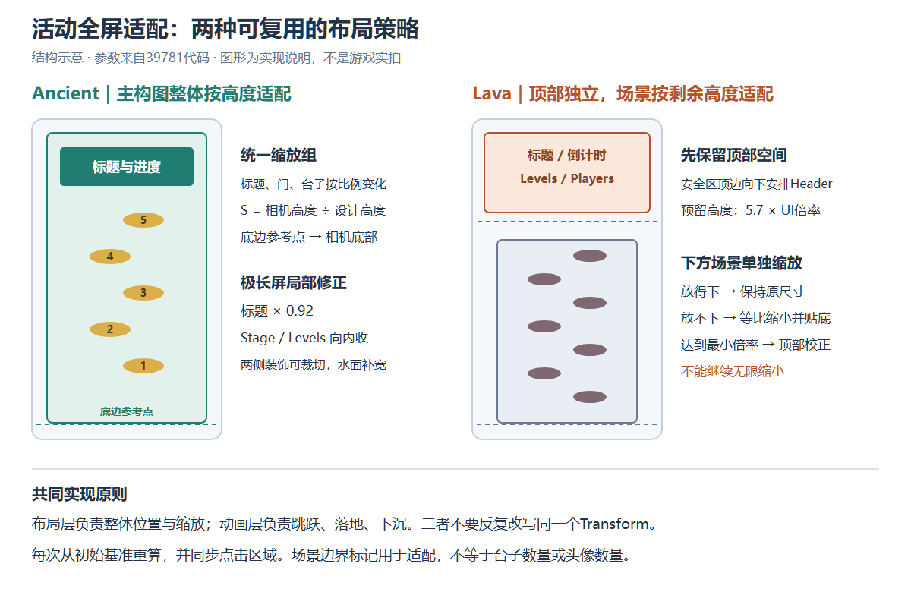
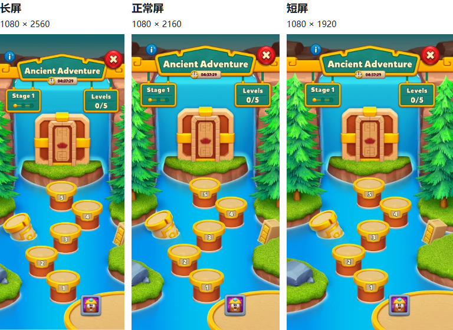
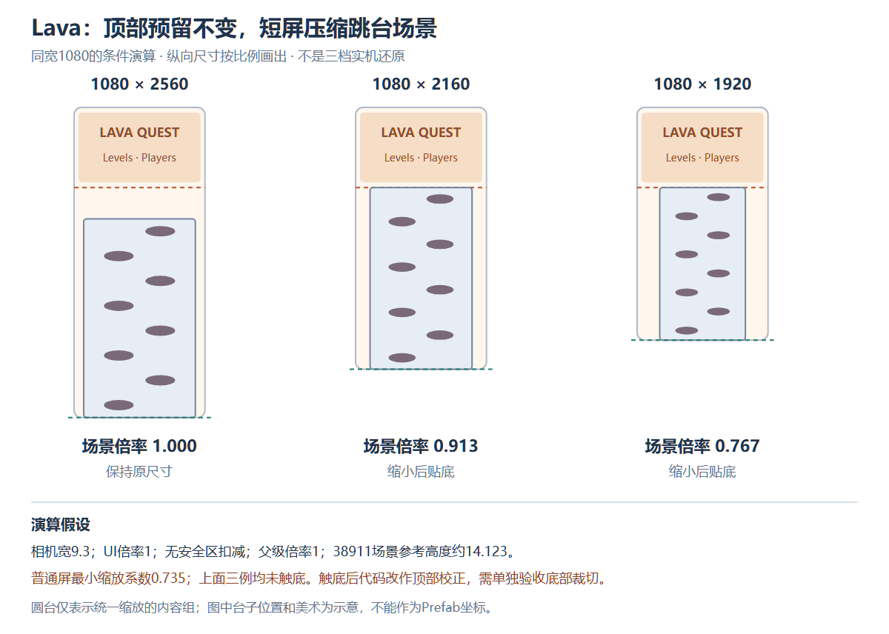

# 活动全屏界面适配实现参考：Ancient与Lava

目标：在不同纵向画幅下保留活动核心流程，保持美术比例、按钮可读可点，并让跳跃、下沉与领奖动画在适配后继续使用同一组台子坐标。

本方案提供两种布局模式：**Ancient式“整组按高度缩放”**与**Lava式“顶部独立、场景按剩余高度缩放”**。根据页面构图选择模式，共享屏幕信息、边界对齐、触摸区更新与验收工具。本文是开发参考，未接入TS/MT代码，也不是已验证的RM源码复刻。

事实来源为39781原生代码、38911历史资源和用户Ancient对照图。文中“原作确认”与“实现建议”分开；坐标均需放到同一世界/设计空间后计算，不能把Unity单位直接当像素。

**六项核验口径（2026-11-19）**：01缩放输入、02底边与节点、03安全区写入已有静态证据；04初始化链已确认，但未证实运行中改尺寸会自动重排，也没有证据支持“动画期间方向锁保护”；05确认ExtraTall缺少反向恢复分支；06已对位点击区、失败及普通宝箱领奖链。以下整合到对应章节。代码39781与资源38911并非同版运行快照；不把跨版本对位当成实时Transform采样。



## 1. 两种模式如何选择

| 设计诉求 | Ancient模式 | Lava模式 |
|---|---|---|
| 核心构图 | 顶部标题、门、路径与玩家共同构成完整纵向画面 | 顶部信息区独立，下方台子场景使用剩余高度 |
| 缩放对象 | 主LayoutRoot；特定UI再局部修正 | Header保持独立；场景LayoutRoot按空间需要缩小 |
| 空间足够时 | 仍按目标高度比例计算，可能放大 | 场景保持初始尺寸，不因空间多就继续放大 |
| 空间不足时 | 整组按高度缩放，窄屏收拢顶部信息 | 场景缩小到可用高度，存在最小倍率 |
| 对齐 | 场景底部标记对齐相机底边 | 常规分支贴底；达到最小倍率后改作顶部校正 |
| 横向装饰 | 可裁切两侧装饰，水面和标题横条另补宽 | 预留宽背景，台子区整体缩放；宽度覆盖单独检查 |
| 适用例子 | 门在上、玩家在下、完整纵向路径需要一起呈现 | Levels/Players等顶栏需稳定，玩法场景可独立缩放 |

这里的“背景/场景”包含相应父节点下的台子，不只是底图。Lava历史资源的Step0～7位于`Background/Animations/Rocks`；头像运行时绑定需沿既有台子/头像逻辑处理，不能仅缩背景贴图而遗漏角色。

## 2. 节点结构与职责

### Ancient实际绑定：底边、起点、落点与头像（核验02）

38911资源引用与39781挂接代码对位后，普通跳台页的关系如下。`PlayerSlot`是本方案的称呼；原资源落点节点名为`PlayerPositioner`。

```text
AncientAdventureDialog                         外层弹窗，含dialogCollider
└─ Root                                       H/D缩放与整体定位
   ├─ TopUI                                   标题、Stage、Levels、帮助、关闭
   └─ SceneParent
      └─ SceneView                            场景控制器；资源y=-0.71，scale≈0.925008
         ├─ TapToContinue                     独立的全屏继续点击区
         └─ AncientAdventureSceneView1         按阶段实例化
            └─ Root                           SceneView.root
               ├─ BottomBorder                阶段1局部(0,-10.071,0)
               ├─ Steps/Step0                 起点图S01_main_platform就在该节点
               │  └─ PlayerPositioner         头像落点、缩放参考
               ├─ Steps/Step1…                后续台子及各自落点/点击区
               └─ PlayerToken                 Init后重挂到这里；不是一直挂在Step0
```

`GetBottomBorderPosition 0x35F1520`读取的是当前阶段`bottomBorder.position.y`，即**世界坐标**；普通场景取SceneView的标记，存在Heist视图时改取Heist的标记。它不是起点图最底像素，也不是头像底边。阶段1/2的BottomBorder局部y均约-10.071，阶段3约-10.104；不能把某一阶段的局部值直接当相机空间值。

阶段1起点Step0局部位置约`(4.70,-8.69)`，PlayerPositioner在Step0下为`(-2.59,0.37)`，局部倍率1.22。起点图、落点和头像**共享上层布局根，但不保证共享即时父节点**：

- `SceneView.Init 0x38D67F4`先将头像重挂到SceneView.root；`SetPlayerPositionOnStep 0x38D6D8C`读取落点世界位置、用root.InverseTransformPoint转为头像局部位置，并设置缩放。
- `AnimatePlayerToStep 0x38D6F60`预先读取目标；跳跃序列中的回调`0x38D7DE4`再将头像挂到目标Step。
- 本次适配回调**未发现窄屏单独移动Step0的分支**。如果复刻时自行移动Step0，图和子落点会一起移动；仍挂在场景根下的头像不会自动跟随，须重新定位。若只移动图的独立子节点，落点也不会因此移动。

资源和引用见[节点绑定](../附件/Ancient布局六项核验-20261119/node-bindings.json)、[起点图与点击区绑定](../附件/Ancient布局六项核验-20261119/input-and-start-bindings.json)。

### 推荐结构（实现建议）

```text
ActivityPage
├─ InputRoot                  全屏阻挡、点击继续
├─ LayoutRoot                 适配器唯一负责位置/缩放
│  └─ MotionRoot              入场/退场动画，避免与适配争写
│     ├─ Header               Ancient时属于整体构图
│     └─ Scene
│        ├─ TopBound / BottomBound
│        ├─ DecorativeBackground
│        └─ Platforms
│           └─ PlayerSlot → Avatar
├─ IndependentHeader          Lava时使用，与场景缩放分离
└─ OverlayRoot                提示、领奖；按各自策略布局
```

- 首次载入保存各节点的基准位置、基准缩放、背景尺寸、边界标记；复算使用基准，不在上次结果上继续乘缩放或累加偏移。
- Root下台子保持设计坐标。跳跃目标仍读取目标台的PlayerSlot并转换到MotionRoot局部坐标；布局不重新推算动画终点。
- 顶栏与场景分别声明“完整保留内容”和“允许裁切装饰”。背景补宽只修改背景尺寸，不把人物、台子、标题文字横向拉伸。
- 若项目使用Canvas，把所有测量量转换成同一个Canvas设计空间；若使用正交相机与SpriteRenderer，统一使用相机世界空间。不能混用Screen.height与Transform高度。

## 3. 统一输入与刷新顺序（实现建议）

| 输入 | 定义 |
|---|---|
| `W,H` | 当前有效视口的世界/设计宽高，包含实际Camera.rect影响 |
| `aspect` | 纵向宽高比；横屏取倒数，仅用于分档，不能直接当横屏布局公式 |
| `safeTopY` | 安全区顶部在布局空间的坐标 |
| `bottomY` | 所选布局底边；贴原作时取相机底部，项目若改用安全底部须明确差异 |
| `U` | 上层统一UI倍率；只应用一次 |
| `designTop,designBottom` | 恢复基准状态后的参考点，转换到相同空间 |
| `mode` | Ancient或Lava；页面创建时确定 |

建议刷新顺序：`取得视口/安全区 → 恢复布局基准 → 定位Header → 算场景倍率 → 设置缩放 → 重新测量参考点 → 平移对齐 → 修正局部UI/背景 → 更新点击区`。

### Ancient实际刷新入口与动画边界（核验04）

| 情况 | 已确认的原作入口与边界 |
|---|---|
| 首次打开 | Dialog.Init → Flow.Init → ShowSceneView → PrepareSceneViewForSceneAnimation → 创建阶段SceneView、绑定头像/台子；随后Dialog.Init保存currentRootPos、注册方向通知并直接执行OnOrientationChange。直接调用点为0x38678A8 |
| 阶段推进 | 普通阶段领奖时，ShowSceneView先按动画阶段创建场景，再ClaimStageRewardsWithoutHeist / ProceedNextStage更新模型；没有在这两次模型调用后立刻替换成下一阶段场景。后续重新创建活动页时按当时状态创建阶段资源。Heist另走ShowHeistView，不等于普通跳台重排 |
| 方向事件 | Ancient注册回调，CameraManager.ArrangeOrientation自身有“UpdateSizeParameters → 通知监听者”代码；注册存在不证明该Android构建会自动触发事件 |
| 窗口尺寸／安全区变化 | 已确认SetSceneCamera会更新相机尺寸；未发现本次活动回调内独立的尺寸或safeArea监听。39781的CameraManager.ManualUpdate没有尺寸检查，OnAppResumed直接返回；不能承诺MuMu运行中改尺寸会自动重排 |
| 跳跃中 | AnimatePlayerToStep在构建序列时取得落点，之后交给DOLocalJump；本段未见逐帧重读目标，也未见布局请求暂存／动画结束补刷 |
| 下沉中 | 本次布局回调未见“下沉中则延迟”分支；下沉与绑定的既有动画链继续执行。不能将其表述为已实现动画和布局冲突保护 |

**修正方向锁结论**：39781 Android的`IsDeviceSupportLandscape 0x33883B8`、`GetIsLandscape 0x3388344`返回false；`SetOrientationActive 0x3388480`仅保留一次性元数据初始化，没有原因列表增删或有效锁状态更新。Lava.Init虽调用DisableOrientation，但不能据此说动画期间被有效锁住。Ancient本轮Init/Flow.Init/OnClose中也未见该锁调用。扫描ELF全部可执行节的直接B/BL引用，未找到ArrangeOrientation调用者；间接调用、外部强制尺寸变化和其他构建不在这个结论内。**没有可报告的“该动画入口锁住布局”证据。**

### 项目采用的刷新策略

首次打开、阶段资源替换、有效视口或安全区变化后执行。跳跃/下沉/发奖期间的请求合并为一次，延后到稳定帧；若必须立即适配，则整体变换布局根，并保证动画起终点在同一随动坐标系内，不能只改台子位置。这是复刻建议，不作为RM已实现行为。不要依赖上述Android空实现来提供保护。

## 4. Ancient模式

### 原作确认

设`D = aspect < 0.50 ? 20.08 : 19.58`：

```text
Home主场景：Root统一缩放 S = H / D
Game场景：Root局部缩放 S = H / D / U
```

原作按底边标记、相机半高及旧/新缩放校正位置。首次从零位移初始化、居中Home且外层单位缩放时，可解释为场景底边对齐相机底部；跨倍率重复调用的边界见核验05。39781的U在这次三种手机比例下为1；方屏分支另处理。

### 缩放输入与宽度保护（核验01）

**H是CameraManager.cameraHeight，相机当前可视世界高度，没有先扣安全区。** `UpdateSizeParameters 0x3389B6C`先由相机宽度/aspect计算高度并写入cameraHeight，再设正交相机半高，之后才调用SetSafeAreaOffset。普通纵屏可写成`H=W/aspect`；它不是直接读取Screen.height像素，也不是safeArea.height。

`OnOrientationChange 0x3867B60`中H/D的结果没有再与“宽度可容纳倍率”取min，也没有测量城门、最外侧台子或布局根包围盒。**本段没有宽度上限，因而不存在“触发宽度上限后由另一层补齐剩余高度”的分支。** 水面、标题横条、标题暗底及点击区另按W计算宽度，这些是横向填充，不是为门/台子提供限宽保护。方屏全局相机视口修正也不能写成Ancient活动自己的宽度保护。

### 安全区写入与局部避让（核验03）

| 对象 | 实际归属与改写 | 是否读安全区 |
|---|---|---|
| 标题文字／中央标题牌 | Root/TopUI内；ExtraTall直接写localScale=0.92 | 本回调未读safeTop；是比例分档修正 |
| Stage／Levels牌 | 同在TopUI内；ExtraTall直接写各自local x=±2.65，保留y | 未读安全区 |
| 帮助按钮Info | TopUI/TopButtons/Info，随主组；资源局部位置约(-3.58,0.64) | 本次ArrangeTopButtons没有单独修改Info |
| 关闭按钮Close | 同在TopUI/TopButtons；ArrangeTopButtons单独写预设坐标，值见下表 | 依据Short／其他比例档，未读安全区 |
| 底边 | 以相机半高与BottomBorder世界y计算整体平移 | 采用相机底边，不是安全区底边 |

在已核验的资源祖先和布局调用中，**没有发现统一SafeArea父容器负责这组控件的避让**；UiDialog.Show使用GetCenterPosition，非GetSafeCenterPosition。这里不能将“按钮内收”称作“根据刘海逐项避让”。这与Lava的PrepareHeader明确读取safeTop不同。

| 条件/对象 | 原作值 | 使用说明 |
|---|---:|---|
| Tall判定 | `aspect < 0.50` | 等于0.50不算Tall |
| ExtraTall判定 | `aspect < 0.43` | 极长屏处理的开关 |
| 标题文字与中央标题牌 | 局部倍率0.92 | 仅ExtraTall，叠加在Root倍率上 |
| Stage / Levels横坐标 | -2.65 / +2.65 | ExtraTall，保留原y |
| 竖屏Short关闭按钮 | (4.009,0.254,0) | Short为0.50≤aspect<0.57 |
| 其他竖屏关闭按钮 | (3.489,0.44,0) | 本表不替代横屏布局 |
| 水面单块宽度 | `screenWidth×1.25/(块数×rootScale)` | 修改SpriteRenderer宽度；1.25是计算留量 |

### ExtraTall恢复与重复刷新（核验05）

| 项目 | 进入ExtraTall／重复同档 | 离开ExtraTall |
|---|---|---|
| 标题文字、中央标题牌 | 每次写Vector3.one×0.92，不是对当前值继续乘0.92 | **没有else恢复1**；单独再调本回调会保留0.92 |
| Stage／Levels | 每次写绝对x=±2.65、保留当前y；资源初始x约±3.119 | **没有else恢复资源x** |
| 失败文字背景／文字框 | 每次写宽7.61／6.72 | **没有else恢复初始宽度** |
| 标题横条、暗底、水面宽度 | 每次用本次W、倍率及参考节点重新算；不是继续乘旧宽度 | 会重算；不是所有“背景宽度”都跟随ExtraTall残留 |
| Root位置 | 使用上次currentRootPos、旧倍率和旧BottomBorder世界y计算，并写回currentRootPos | 不是恢复不可变基准后重算；不能宣称任意尺寸序列都幂等 |

普通居中Home、单位外层、无动画位移时，令旧位置P、旧倍率S₀、标记在Root内的坐标b，新倍率S=H/D，可将原指令化简为`P′=P−H/2−S×(P+S₀b)/S₀`。同倍率反复调用可得到稳定位置；换倍率时多出`P×(1−S/S₀)`项，不能当成“只由当前屏幕和美术基准决定”的纯函数。该演算说明实现约束，不等同于实机已复现抖动；Android自动重排入口本身尚未证实可达。

新实例重新从Prefab取得初值，与同实例从ExtraTall切回普通屏是两种情况。复刻方案应显式保存并恢复标题、牌子、失败框的基准，并在最终缩放后重新测量BottomBound对齐；不要照搬缺少恢复的分支。

### 三画幅原资源布局模拟

固定第1阶段、0/5、城门开启的普通跳台页，分别按1080×2560（长屏）、1080×2160（正常屏）、1080×1920（短屏）执行首次布局。相机宽9.3、U=1、外层单位倍率、不加入安全区边距；三档独立初始化，不用来证明同实例热切分辨率能够恢复。



上图按等高观看，便于对照原三画幅拼图；[等宽版本](附件/活动屏幕适配/Ancient三画幅-等宽模拟.png)可看相同像素宽度下的内容大小。对比排列采用屏幕底边对齐。须区分两个层次：各画面内部已将BottomBorder标记对齐相机底边；预览中的三张屏幕也统一底边排列。头像和起点图的最低像素不是该锚点，头像离屏幕底部的像素距离可随缩放改变。三档实际Root倍率约为1.098／0.926／0.844，2560档触发ExtraTall标题0.92和牌子内收，1920档触发Short关闭按钮位置。

**模拟边界**：采用38911原Sprite、层级、字体及39781已核验的缩放/定位规则；头像、倒计时固定为示例。台子用原`column_mask/Write`位置与图片作静态透明裁切，隐藏水下副本；没有执行Unity材质、折射、水面焦散和粒子，不可用于验收水下效果或像素级还原。界面中的台子数字、Stage及Levels为当前演示状态填入。

三档单图：[2560](附件/活动屏幕适配/Ancient-1080x2560.webp) · [2160](附件/活动屏幕适配/Ancient-1080x2160.webp) · [1920](附件/活动屏幕适配/Ancient-1080x1920.webp)。[演算输入](附件/活动屏幕适配/Ancient三画幅-演算输入.json) · [来源及哈希](附件/活动屏幕适配/Ancient三画幅-来源清单.json) · [交互预览验收](附件/活动屏幕适配/Ancient三画幅-预览验收.json)。会话内对比支持三档/单档、等宽/等高；可执行渲染依据位于`06-PRODUCT-ASSETS/RoyalMatch/39781/04-ReverseEngineering/Ancient-Resolution-Simulation-20261119/`。

### 项目实现

1. 用实际美术标出整幅设计高度和底边标记，按相同单位配置D；只有沿用RM坐标基准时才照抄20.08/19.58。
2. 设置LayoutRoot等比缩放，测量BottomBound的新位置，将Root整体平移`bottomY - BottomBound.y`。
3. ExtraTall时应用标题/信息牌修正；离开该档时从基准恢复，防止窄屏状态残留。
4. 在最终缩放之后补水面、标题横条和点击区宽度。两侧装饰可被视口裁切，门、台子、玩家和必要按钮不得误归为装饰。

## 5. Lava模式

### 原作确认

`PrepareHeader`独立设置Header位置。令U为UI倍率，原生代码写入的Header世界y为：

```text
headerY = (safeTopY - 1.2 × U) / U
```

U=1的普通纵屏即安全顶边下移1.2单位。`ArrangeScene(true)`用于首次创建比赛弹窗内场景，先恢复sceneBackground局部缩放为1并贴底，再计算：

```text
contentTopY = safeTopY - 5.7 × U
A = contentTopY - cameraBottomY           // 可用高度
L = topPoint.worldY - bottomPoint.worldY  // 当前基准内容高度

若 A >= L：保持sceneBackground倍率1和贴底结果
若 A < L：k = max(A/L, kMin)，等比缩放sceneBackground

kMin = 0.735（普通屏）或0.78（Squarish）
```

缩放后分两路定位：

- **未触及最小倍率**：重新测量bottomPoint并对齐相机底部。
- **触及最小倍率且无法按比例装下**：重新测量topPoint，把它对齐到`contentTopY + 0.7×U`。这是顶部校正，底部不再保证继续贴底；必须检查下方内容是否超出。

`5.7`为场景预算预留高度，`1.2`为Header位置偏移；两者用途不同，不是两个要相加的预留区。`topPoint`用于本次fit高度，不能误用资源里的`maxTopPoint`或整张贴图外沿。参考点也不是最上/最下头像的即时动画包围盒。

| 额外行为 | 已确认口径 |
|---|---|
| 点击继续文案 | 非Tall时局部y增加1.5，Tall保留初始位置；项目实现应使用基准+偏移 |
| 全屏点击区 | 按相机有效宽度与`cameraHeight/U`设置 |
| Levels / Players | 位于独立顶栏体系，不能随着sceneBackground再缩一遍 |
| ExtraTall场景根倍率1.1 | 位于`ArrangeScene(false)`分支；首次弹窗的true分支跳过它，不能作为所有Lava弹窗的默认倍率 |
| 已有场景复用 | `isSceneArranged`为真时可能沿用局内背景布局；滚动关卡另有位置恢复路径 |

因此，本方案中的基础演算只覆盖**首次按比赛弹窗布置、普通纵屏、非滚动关卡复用**。出关卡后复用、横屏和方屏需要分别验收。

### 三画幅条件演算



假设宽1080、相机世界宽9.3、U=1、父级倍率1、无安全区扣减。38911历史资源中TopBound与BottomBound在资源根坐标的y约为3.946和-10.177，间距L≈14.123。将这个历史高度代入39781公式，仅说明计算机制：

| 假设分辨率 | 相机高度H | 剩余高度A=H−5.7 | 场景倍率k | 最小倍率是否生效 |
|---|---:|---:|---:|---|
| 1080×2560 | 22.044 | 16.344 | 1.000 | 否 |
| 1080×2160 | 18.600 | 12.900 | 0.913 | 否 |
| 1080×1920 | 16.533 | 10.833 | 0.767 | 否 |

图中三幅按相同像素宽度示意，不能与按等高缩放的拼图直接比较元素尺寸。以上不是设备采样值，不证明当前版本场景最终倍率相同。

## 6. 布局算法参考（实现建议，非反编译源码）

下列步骤统一在世界/设计坐标执行；所有缩放均作用到独立LayoutRoot，动画在MotionRoot或台子内部运行。

```text
RebuildLayout(input, baseline, config):
    RestoreLayoutBaseline()             // 包括标题、进度牌、背景尺寸
    if mode == Ancient:
        D = IsTall(input.aspect) ? config.tallHeight : config.normalHeight
        SetEffectiveUniformScale(layoutRoot, input.H / D)
        TranslateRootY(input.bottomY - Measure(bottomBound).y)
        ApplyExtraTallUiOrRestoreBaseline()
        ResizeDecorativeFills()

    if mode == Lava:
        PlaceIndependentHeader()
        ResetSceneScaleToBaseline()
        TranslateSceneY(input.bottomY - Measure(bottomBound).y)
        limitY = input.safeTopY - config.headerReserve * input.U
        L = Measure(topBound).y - Measure(bottomBound).y
        A = limitY - input.bottomY
        if L <= 0 or A <= 0: return LayoutFailure
        if A < L:
            ratio = A / L
            k = Max(ratio, config.minScale)
            SetSceneScale(baseline.sceneScale * k)
            if ratio >= config.minScale:
                TranslateSceneY(input.bottomY - Measure(bottomBound).y)
            else:
                TranslateSceneY(limitY + config.topAllowance * input.U
                                - Measure(topBound).y)
        ApplyContinueTextOffsetFromBaseline()

    UpdateHitAreasInTheirLocalSpace()
    CheckCriticalContentBounds()
```

`SetEffectiveUniformScale`需要抵消已有父级倍率，不能一边用已经缩放的L计算、一边又额外乘U。父级存在旋转/非等比缩放时，应先改为独立的纯布局父节点或使用完整矩阵转换；不要直接取一个localScale.x推算所有世界尺寸。

达到最小倍率后的产品策略需明确：贴近RM时采用顶部校正并逐项检查下方裁切；若项目要求全部内容始终可见，应另设计更紧凑布局或允许更小倍率。这属于项目设计变化，不是“原作保证所有屏幕都完整”。

## 7. 参数交付与验收

### Ancient点击区与结束态（核验06）

| 对象／状态 | 原作已确认行为 |
|---|---|
| 全屏继续 | TapToContinue位于Root/SceneParent/SceneView下。SceneController.OnOrientationChange 0x35F1A88取得该控制器transform.lossyScale，写点击区size=`(W/lossyScale.x,H/lossyScale.y)`，补偿祖先缩放 |
| 外层弹窗阻挡 | dialogCollider在AncientAdventureDialog外层，不在Root。Dialog回调写size=`(W/(S×0.9),H/(S×0.9))`，S为本次Root局部倍率；不能与TapToContinue混为同一个点击区。跨版本资源绑定下，其最终屏幕覆盖范围仍需运行采样 |
| 关闭／帮助 | BoxCollider2D就在Close／Info节点，随TopUI及各自节点移动缩放；Close资源碰撞框1.4×1.4 |
| 台子点击 | Step1等的TooltipButton在`Steps/StepN/Root/ColumnView/TooltipButton`下，随台子及ColumnView变换；Step0没有对应tooltip引用。按钮是否启用另由流程控制，不等于碰撞框跟随就始终可点 |
| 失败演出结束 | OnFailAnimationsCompleted激活继续提示并启动后续协程，没有重新创建阶段场景或再次调用整页适配 |
| 普通阶段完成／宝箱领奖 | 保留当前已创建的阶段场景；PlayStageCompleteAnimationForChest实例化AncientAdventureRewardClaimPanel，父级为FlowController所在弹窗的transform。它不是重建同一套跳台场景；传入关闭弹窗的回调 |
| 下一次打开 | 创建阶段SceneView并重新绑定头像、台子；按新的模型状态初始化和执行整页适配。Heist完成由OnHeistCompleted推进模型，不能据此推断立刻重建下一阶段画面 |

以上覆盖普通跳台、失败及宝箱领奖；卡牌领奖、Heist内部布局和所有运行时复用组合没有逐一实机验收。

建议由程序建立活动布局配置，由美术提供设计边界和可裁切区域。这是项目的数据驱动建议，不推断RM存在同名配置表；本次多数数值为客户端常量。

| 交付方 | 必要内容 |
|---|---|
| 美术/UI | 标准画幅、顶部/底部参考点、完整保留范围、可裁切装饰、背景可扩展方向、标题与进度牌窄屏位置 |
| 客户端 | 两种布局模式、坐标转换、基准恢复、安全区输入、点击区适配、与动画的刷新时序 |
| 策划/QA | 支持比例范围、最小可读尺寸、达到最小缩放后是否允许裁切、失败/领奖/帮助界面是否使用独立策略 |

验收矩阵：

| 场景 | 检查点 |
|---|---|
| 1080×2560／2160／1920 | 首次打开、同一阶段；主内容完整、顶部不遮挡、文字可读、点击区域一致 |
| 相同比例不同像素密度 | 构图相同，避免用绝对像素作世界单位 |
| 0.43／0.50阈值两侧 | 标题、按钮、牌子变化正确；往返切换能恢复 |
| 安全区顶部/底部变化 | Header避让；底部究竟按相机边还是安全边按方案核对 |
| Lava恰好放下／需要缩小／小于最小倍率 | 分别命中保持、缩放贴底、顶部校正；触底时检查下方裁切 |
| Ancient各阶段；Lava不同进度 | 使用当前场景边界，不把第一阶段或Step0样本硬编码到所有状态 |
| 胜利跳跃、失败下沉、发奖 | 目标点跟随台子；无二次缩放、位置突跳、点击区漂移 |
| 重复打开、反复改尺寸、出关卡复用 | 无累计缩放/累计偏移；复用场景与首次创建分开验证 |
| 横屏/方屏（若产品支持） | 单独验收侧边装饰、U和0.78分支，不套用三档纵屏结论 |

每次验收建议保存分辨率、有效视口、安全区、U、父级倍率、布局模式、最终倍率、参考点坐标与截图；通过这些值区分公式问题、素材边界问题和旧状态残留。

## 8. 来源与验证状态

| 来源 | 本文支持的结论 |
|---|---|
| 39781原生`AncientAdventureDialog.OnOrientationChange 0x3867B60` | H/D、极长屏标题/进度牌等处理 |
| 39781原生`LavaQuestCompetitionSceneView.ArrangeScene 0x382C0C0` | 顶栏预留5.7、缩放下限、底部/顶部定位分支 |
| `AlignSceneBackgroundToBottom 0x382DD3C` | 重置Background倍率1并先贴底 |
| `PrepareHeader 0x3828E50` | 安全顶部、1.2偏移、U处理 |
| `PrepareForDialog 0x3829E0C` | 首次弹窗ArrangeScene(true)及已有场景复用区别 |
| `ArrangeTapToContinueTextPosition 0x3829C18` | 非Tall文案上移1.5 |
| 38911历史Bundle/层级 | Background包含台子；TopBound、BottomBound及演算参考高度 |

ELF SHA-256：`ea4eaf596b64ff255cc042d52d32e44078ed773d70be6c3368db9459a12b3a22`。本机Capstone/pyelftools提取、Dumper元数据对齐，完整指令与源哈希见[Lava证据清单](../附件/Lava屏幕适配-20261119/manifest.json)、[资源和演算输入](../附件/Lava屏幕适配-20261119/resource-and-model.json)、[Ancient证据清单](../附件/Ancient屏幕适配-20261119/manifest.json)。两张图为自绘结构/条件演算图，保留同名SVG可编辑源。

六项复核增补证据见[129 份原生方法指令 ZIP](../附件/Ancient布局六项核验-20261119/native-methods.zip)、[文件名与 SHA-256 清单](../附件/Ancient布局六项核验-20261119/manifest.json)、[全部可执行节直接调用扫描](../附件/Ancient布局六项核验-20261119/direct-call-sites.json)、[资源绑定](../附件/Ancient布局六项核验-20261119/node-bindings.json)、[点击区与起点图](../附件/Ancient布局六项核验-20261119/input-and-start-bindings.json)。清单中每项 file 对应 ZIP 内的同名文件。原生提取工具与执行位置为`06-PRODUCT-ASSETS/RoyalMatch/39781/04-ReverseEngineering/Ancient-Layout-Review-20261119/audit.py`。方法末界使用下一个已命名方法近似；直接调用扫描不覆盖间接调用。节点JSON来自历史Bundle实际引用解析，非依据节点名称猜测。

已完成静态公式与分支核验、历史资源对位、文档与图示整理；未进行Lava三档实机采样，未在项目中实现或验收以上伪代码。完整原作分析回到[[02-PROJECTS/产品分析/Royal Match/系统拆解-设备分辨率与横竖屏适配-38911|适配机制]]；活动表现回到[[02-PROJECTS/产品分析/Royal Match/活动/Lava Quest/资源与表现-38911|Lava资源与表现]]。
