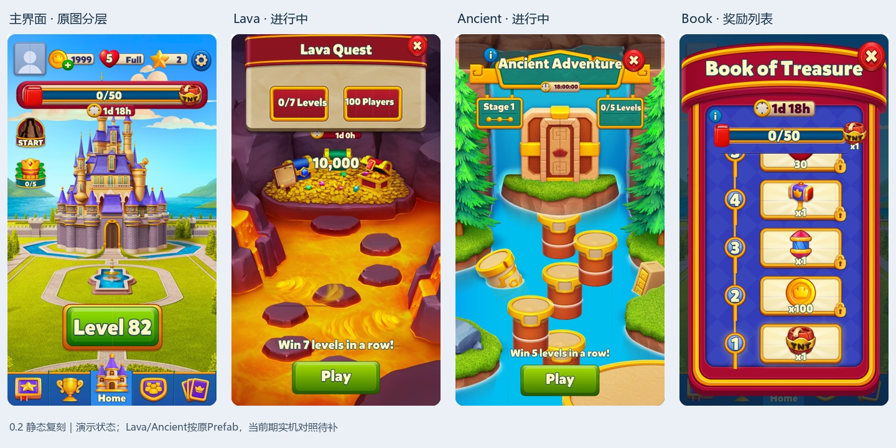

# Royal Match 本地系统框架与表现复刻

## 目标与当前交付

将已取得的原始美术、客户端规则和配置转成可操作的本地系统，用真实设备持续补证据。用户已明确：首版不做主城建造，优先活动流程、弹窗、基础系统，表现尽可能接近原作；复杂部分分阶段，最基础要求是静态美术复用与还原。

**长期任务确立（2026-10-29）**：本页为Royal Match本地复刻的唯一任务主档，承接[[02-PROJECTS/产品分析/任务-竞品调研体系建设与持续维护|竞品调研长期总任务]]。研究结论回原模块文档，排期回运营总表，过程回Windows Daily；不另建同名任务或按对话续篇。长期目标是逐模块积累“可追溯分析＋可运行复刻＋实机对照”的闭环，范围以已取得且核验过的客户端/实际运行证据为界。长期任务建档不代表启动后台自动执行、定时采样或云端部署。

**第一轮交付边界**：主界面含当前活动/礼包入口与狗狗区域；Lava、Ancient、Book核心页面和流程；以Spooky作为第一个新增完整活动。无建造、完整三消棋盘或复杂动效。未知服务器算法、未下发配置和概率分布继续留证据缺口，不作为“全部源码复原”的承诺。

**当前为0.3开发中版本，整体任务持续中，静态表现尚未验收。** 0.2已完成原图分层和三活动基础页面；用户反馈布局与层级问题后，0.3已接入部分运行时缩放、排序、头像及Lava原插画修正，但字体、状态专屏和实机对照仍有缺口。使用HTML/CSS/JavaScript，打开本地文件即可运行。复杂骨骼、粒子和原引擎随机尚未完整重放。完全复刻仍需逐屏、逐状态验收，客户端材料不能保证恢复未知服务器实现。

Windows本地入口：[打开复刻页面](<D:/LibraryG/06-PRODUCT-ASSETS/RoyalMatch/LocalReplica/dist/index.html>)；也可双击 `D:\LibraryG\06-PRODUCT-ASSETS\RoyalMatch\LocalReplica\打开复刻.cmd`。完整使用说明在同目录README。

| 首版内容 | 实际实现 | 目前限制 |
|---|---|---|
| 静态美术 | 原精灵、半图镜像和九宫格；原Mikado Black SDF的238个字符；0.3接入部分运行时布局 | 字体大小、弧形文字、遮罩与切片细缝待校正；导出资源不等于页面已验收 |
| 主界面 | 原天空、海面、城堡、喷泉分层；独立计数栏、当前六入口、Book条、狗狗占位、关前与底栏；矿工头像、旗帜静态姿态及场景缩放修正 | 头像为外观匹配，未核实当前账号头像ID；水花未重放，部分入口为临时图形；本地进度不等于实机进度；无建造 |
| Lava Quest | 主动参加、七连胜、失败结算、重试冷却、个人24小时、样本分奖 | 历史单次人数样本，不生成真实服务器选组与概率 |
| Ancient Adventure | 自动入场及教程门槛、5/7/10或单7路线、检查点、Heist与阶段领奖 | 路线可从研究台选择；Heist为固定演示牌序，未重放Unity随机/教程种子 |
| Book of Treasure | 两套2203配置、25阶段收集/领奖、锁档重选；红金奖励列表与独立说明页，代码核对奖励类型后显示原图 | 奖励覆盖、收集溢出和限时道具效果未完成；设备当前的x2覆盖不能等同基础奖励表 |
| 基础系统 | 关卡进入/最终胜负回调、弹窗队列、浏览器存档、库存、领奖凭据、演示时钟 | 没有三消棋盘；完整经济规则、活动互斥及弹窗候选优先级未重建 |
| 排期 | 历史排期字段表、真实采样导入、三活动期限回放 | 不是周日历全量；缺失开始/下期/周期时保持未知；不创建推算档期 |
| 当前首页活动与礼包占位 | 按10-29 18:41设备-1实拍补齐左4/右2入口，狗狗三槽＋×2区域，保留Book顶条；点击占位页显示期限、来源和排期推测 | 奖杯、Spooky、Ancient复用已有原图；权杖/闪电/帽子/狗狗使用临时图形。礼包内容、购买/领取未实现；狗狗正式名称及期限关联未核验 |

## 试用和验收路径

1. 默认按**最新实际采样＋现实时间**展示有效期限内的活动；起始关82、进度与库存仍为本地演示，并非账号当前进度。10-29 18:44采样含Ancient317、Book717及扩展活动/礼包期限，Lava无记录，因此首页隐藏Lava。公共截止过后等待新采样，不自动生成下一期。
2. 研究台选择Lava并“重置并进入独立演示”，再点Lava → Start；模拟7次胜利可领取历史样本计算的1120金币。失败可观察结算与30分钟冷却。此模式关闭Ancient公共档期；人工时钟只改变浏览器，期限不参与实际排期推测。
3. 研究台选择Ancient并重置独立演示（关闭Lava公共档期） → Ancient → Continue → 模拟5次胜利。Book领奖可能先进入队列，关闭后继续，或手动打开Ancient。翻牌形成首个三张同档后领取，进入第二阶段；失败只归零当前阶段连胜。
4. Book按右侧红块输入收集，阶段达标后领奖。本地等级改到201时，当前阶段仍用原档，下一阶段重选；该演示固定SLB组8、两个教程状态均未看。
5. “回放最新采样时刻”会重建活动进度并冻结于采样时刻，保留本地库存及领奖凭据；“按最新记录展示当前活动”用现实时间判断截止。缺失Lava期限时不能参加。要重复同一期完整领奖，选择独立演示重置。左侧研究目录允许查看非当期页面，不代表同时开放。

本地领奖凭据、暂停时钟、固定牌序和测试按钮属于复刻工具实现，不能倒过来作为原游戏机制证据。活动规则的依据仍见下文主分析文档。

## 静态资源与表现拆解

### 实机首页入口与占位期限

用户在2026-10-29明确先补“当前六个icon、关卡按钮上方一个区域，包括礼包、当前时间、推测排期”，内容后续再做。本批以用户截图及设备-1 **18:41:53**主页实拍为布局依据；**18:44:18**只读采样补公共期限和礼包期限。其他缓存活动没有在这张主页出现，保留排期表条目，不冒充额外首页入口。

| 实机位置 | 占位对象 | 本期截止（北京时间） | 显示与判断 |
|---|---|---|---|
| 左1 | King’s Cup | 10-30约16:00 | 18:41:53实拍显示21:18:07，换算而得，秒级误差；不使用语义未明的复合存档时间槽 |
| 左2 | Spooky Rise / BalloonRise337 | 10-30约16:00 | 使用明确EndDate，倒计时；完整周期未知 |
| 左3 | Lightning Rush524 | 公共期限10-30约16:00 | 首页保留START；占位页显示公共剩余时间，个人倒计时不混用；523→524支持近期每日一期推测 |
| 左4 | Ancient Adventure317 | 10-30约16:00 | 原活动界面保留，首页改为期限倒计时；约24小时截止节奏已有连续记录 |
| 右1 | Royal Pass214 | 11-01约16:00 | 显示2d21h一类剩余时间；完整周期/复开未知 |
| 右2 | Trick or Treasure / LadderOffer452 | 11-02约16:00 | 已打开实机礼包确认名称，显示3d21h一类剩余时间；不购买、不领取 |
| 关卡上方 | 狗狗三槽＋×2 | 未确认 | 仅占位，不虚构倒计时；没有把DukesTreats缓存期限直接绑定此区域 |

当前时间由页面现实时间模式驱动；入口倒计时每秒更新，公共截止后隐藏并等待新采样。旧快照缺少扩展目录时不继承新目录；独立机制演示隐藏这些实机占位。图标和时间是占位配置，进度仍为本地演示；Book当前设备722/1200及x2覆盖尚未同步到本地玩法状态。

选图：[六入口与狗狗占位](附件/0.3-home-placeholders.png)、[实机首页](附件/0.3-device-home-six.png)、[实机Trick or Treasure](附件/0.3-device-trick-or-treasure.png)、[礼包占位页](附件/0.3-offer-placeholder.png)。完整期限字段与推测统一见[[02-PROJECTS/产品分析/Royal Match/运营配置/排期与配置总览|排期总览]]。

原始资源来自38911用户XAPK、既有Lava运行提取，以及设备-1下载目录。主城按`area01.ab`的背景、城堡、喷泉层级拼接；只选设备当前对应的场景组，没有加载全部已建装饰。当前可打开页面已不依赖实拍截图作背景，截图留作校正证据。

`evidence/static-pack-manifest.json`记录1401条输出精灵条目的来源、对象ID与SHA-256；包含同一原图的不同来源引用，**不是1401张独立原创图的统计，也不代表全部都在当前屏幕显示**。`static-ui`保存核心UI/主城Prefab、原字体与奖励码证据；`activity-layouts`保存活动Prefab坐标、精灵边界、镜像、切片、排序及原始骨骼资料。30项常用奖励/图标另见`used-assets.json`。

| 层次 | 当前采用方式 | 下一步验收要求 |
|---|---|---|
| 主城背景与装饰 | 原图分层；0.3按原生代码修正场景缩放，接入矿工头像和旗帜静态姿态；计数、入口和导航独立 | 重新与同状态实拍对照；当前喷泉无粒子水花 |
| 字体与通用框体 | 从包内Mikado Black SDF解码字形、按字宽与基线绘制；原半图镜像、九宫格和贴片 | 标题弧形、描边厚度、字偶距与切片细缝待细调；不是替代字体，但尚非原TMP完整材质效果 |
| Book奖励列表 | 红金弧形框、蓝色菱形底、逆序纵向奖励路线、锁、编号、阶段领取；主城条和弹窗进度联动 | 基础配置奖励与设备当前x2奖励覆盖不同；当前阶段高亮/已完成编号着色、礼盒合并样式未齐 |
| Book说明页 | 独立原框体、进度条、27层原国王插画、大奖牌、倒计时和Play | 使用Prefab静态姿态，未应用运行时Animator；说明页关闭返回奖励列表 |
| Ancient入场/主场景 | 原绿色入场弹窗、阶段箱、三个阶段场景与顶部木牌；0.3接入运行时缩放、顶部按钮位置、当前台阶头像卡和平台显隐 | 18:41实拍已见首页入口，尚未取得本轮对应阶段内容页对照；单7/各阶段与临界状态待逐屏检查，过桥与开门动画暂缺 |
| Ancient Heist | 原3列×4行圆孔布局、三档奖励板、按档原币/钱袋/皇冠揭示图 | 固定演示牌序；完整教程、计数高亮和原领奖过渡尚未复原 |
| Lava入场/主场景 | 原红金入场框、七胜场景、岩浆/平台/奖池与徽章；0.3已接回原Spine 3.8.99插画静态姿态，并修正顶部布局和排序 | 已按原TMP字号和字距修正标题与按钮文字、按原代码修正初始场景缩放；人物/组员位置、结算/冷却专屏未齐，尚未通过当前期实机对照 |
| 关前 | 原蓝金框、绿色按钮、Mikado标题与原道具图 | 仅核心区域；设备当前Butler’s Gift、SLB锁和Lightning Rush附属区未接入，道具不能选择/消耗 |
| 动态表现 | 保留普通页面交互，不做建造或复杂动效 | 原Spine、Unity Animator、材质、粒子与音效进入后续依赖清单 |

0.3校正选图：[按实际期限的首页](附件/0.3-home.png)、[Lava入场](附件/0.3-lava.png)、[Lava进行](附件/0.3-lava-active.png)、[Ancient进行](附件/0.3-ancient-active.png)。这些是浏览器结果，Lava图来自独立演示，不是当前设备活动实拍。

原字号依据：[字体换算与曲线证据](附件/0.3-font-sizing-rules.json)。38911 `TextMeshPro.GenerateTextMesh`确认Mikado在这些TMP节点的字形单位为`fontSize/1000`；按原字号限制尺寸并接入字符间距，避免把文本框当最大字号填满。两种Lava标题曲线参数已核验但尚未接入，材质描边/精确基线仍有差异。

0.2画面总览（演示状态，不等同设备当前活动）：

设备-1对照保存为：[主页](附件/0.2-compare-home.jpg)、[Book奖励列表](附件/0.2-compare-book.jpg)、[Book说明](附件/0.2-compare-book-info.jpg)。实拍1080×1920，浏览器保持9∶16，对照表统一显示尺寸；未宣称逐像素通过。原始截图与观察日志留在`evidence/static-v02-device1/`，0.1四张历史图原位保留。

上述0.2对照期间只在设备-1打开Book主弹窗、说明和关前弹窗，关闭后回到主页。后续0.3采集另打开Spooky Rise，读取到关卡画面后暂停导航；该画面变更来源未判定，不将其记作活动稳定截图。用户已允许接管并表示会返回主页，继续操作前先核实当前画面。未主动开始真实关卡、领取奖励、购买、修改数据库或设置时间。Lava/Ancient采集时没有可见入口，没有为了对图强制改期或改配置。

## 分阶段计划与验收

2026-10-29按用户的长期任务要求，将原P0—P5工作包重排为以下连续里程碑。旧编号仅用于追溯Daily：M0对应P0和P5占位；M1对应P1；M2对应P2；M3对应P5内容；S为原P3持续采样；M4对应原P4。**执行主线为M0 → M1 → M2 → M3；S全程穿插，M4暂缓。** 不以版本号或导出资源数判定阶段完成，也不承诺未经拆解的总工期。

| 里程碑 | 阶段目标与交付物 | 进入下一阶段的完成标准 | 当前状态/依赖 |
|---|---|---|---|
| M0 可用底座与实际首页 | 离线可开；六个实机入口＋狗狗＋Book顶条；占位页、剩余时间、来源和研究演示分离 | 当前快照下六入口位置齐全、倒计时走动、缺失/到期不误开；点击均有页面；旧快照不混入新期限；保留本地存档/测试结果 | **占位范围已完成**；含临时图标，不算美术或内容完成。后续随实机变化维护 |
| M1 核心静态还原 | 首页和Lava/Ancient/Book各状态的页面清单、原资源对位、可运行页面、同尺寸对照图和差异表 | 原美术主层替换到位；标题无遮挡/溢出，字体/比例/排序/遮罩/按钮一致；下方状态清单逐项检查；有实拍的状态完成同状态对照，无实拍明确挂起；390窄屏无溢出 | **当前主阶段**；原字号/布局部分修好，弧形字、细缝、专屏和原占位图仍待补；Ancient现已有入口可优先采集 |
| M2 三活动流程闭环 | 配置→参与→胜负进度→结算/领奖→失败恢复→结束/新期的状态表及实现；基础弹窗、存档/库存和本地测试 | 三活动各走通一轮；失败/重载/重复点击/截止/期ID变化各有检查；配置覆盖和演示随机明确；发现与原代码不符的分支修正后再标通过 | 部分实现；依赖对应规则和状态页。不得以固定牌序验证真实概率，也不伪造真实支付/组队 |
| M3 当前入口逐项补内容 | 以Spooky为首个新增完整模块；之后逐个替换King’s Cup、Lightning、Pass、Trick or Treasure及狗狗占位 | **每个模块单独验收**：主分析章节、配置/分层/资源清单、主/说明/奖励页、关键流程、期限来源与差异均齐；随后再展开下一个模块 | Spooky研究/原资源最充分，优先；其余顺序见队列。一个模块未完成时不同时铺开多个完整实现 |
| S 现实采样与配置维护 | 连续快照、配置版本差异、表格式排期、实测/推测/未知分列 | 每个样本有时间/设备/版本/期ID/字段来源；正常时钟；公共/个人/预告时间分开；每次有变化更新原表；推测不能自动变成开启规则 | **持续执行线，无一次性“全量完成”**；当前是任务执行期间采样，无后台调度 |
| M4 表现深化 | 后续按模块补简单过渡，再评估骨骼、粒子、声音、时间轴 | 原资源与触发对应且可对照；为每个动效单列范围，不影响已通过静态页与流程 | **暂缓**。静态骨骼姿态归M1/M3；建造与完整三消不自动纳入 |

### M1页面状态清单与退出标准

| 工作包 | 本阶段必须检查的状态 | 明确验收点 |
|---|---|---|
| 共用渲染 | 标题/正文/按钮文字，镜像半图，九宫格，嵌套排序和裁切 | 原字号/字距已接；接入已核验标题曲线；定位黑细线与接缝原因后修复，不靠随意删层遮掉问题 |
| 首页 | 最新实际采样、活动到期、未知期限、独立演示、390窄屏 | 左4右2位置与实拍对应；Book和狗狗区域不遮按钮；临时权杖/帽子/闪电/狗狗图逐步换原资源；狗狗名称/期限先核实 |
| Ancient | 入场；阶段1的0/5和4/5；阶段2/3；单7；Heist翻牌及领奖 | 头像台阶、平台显隐、顶部牌、计时、3×4孔位正确；优先取得当前317期内容页实拍，不能继续写“设备无入口”作为默认阻塞 |
| Lava | 入场；0/7和6/7；胜利待领；失败；冷却/超时 | 原插画/场景/头像、人数与七胜信息不遮挡；专屏状态分开；未开期先做代码校正，正常开期后补实拍 |
| Book | 主列表、说明页、当前阶段/可领/已领、x2覆盖展示 | 奖励布局、滚动范围、高亮和Book条关联正确；静态覆盖展示与数值生效分开，后者归M2 |
| 通用弹窗 | 关前、普通领奖、关闭返回和按钮命中 | 同屏不重叠/溢出，关闭返回正确；测试控制台信息不混进游戏弹窗体验 |

阶段结果分为“已完成”“部分完成”“待证据”。若缺当前实拍，相关项只能标“代码校正通过、待实拍”，不能把整个M1标完成；其他独立工作可继续。实机/浏览器截图必须同分辨率、同活动阶段/进度、稳定画面，非自动滚动中间帧。用户无须逐条回复验收；已授权的低风险实现和验证自主推进。

### M3逐模块内容队列

| 顺序 | 模块 | 首个具体目标 | 扩展前需补的关键证据 |
|---|---|---|---|
| 1 | Spooky Rise | 从入口占位替换为原主题主界面＋说明＋阶段目标/奖励；再接胜负与领奖 | 形成稳定活动主文档，接入已取得10段目标/AB表；确认本局积分输入来源；保留三气球失败规则和未知边界 |
| 2 | King’s Cup | 确认当前期ID、截止字段、主界面/排名/奖励页，再接本地展示 | 不用未定时间槽；排名/对手样本与真实服务器分组分开 |
| 3 | Lightning Rush | START→个人计时→进度/结算，与公共开放窗分开 | 参加触发、个人期限、各阶段/倍率消费者；不能把公共剩余当个人赛程 |
| 4 | Royal Pass | 主奖励轨道、免费/付费分支、进度与期末状态 | 32段配置及AB目标、主题资源；购买仅本地模拟标识，不真实付费 |
| 5 | Trick or Treasure | 免费/付费阶梯、锁定/解锁、礼包奖励与期末状态 | LadderOffer452/配置341对应关系、当前步骤、购买后推进；不以入口图标推测礼包内容 |
| 6 | 狗狗连胜区域 | 先确认正式名称、解锁、三槽与×2的含义，再实现增益展示 | 与DukesTreats/关前增益的真实关联；实拍没有计时不强套期限。身份确认可随M1提前做 |

顺序可因用户关注点或活动现实开放窗口调整，并同步更新本表；占位无需等待完整研究，新内容实现则必须有证据。当前首批保持M1收敛，Spooky作为M3的首个完整扩展，不因原图齐全自动跳过规则/界面核验。

### 下一次接续的最小工作包

1. 读取本页当前状态、最新Daily、设备-1最新截图与快照；核实Ancient入口是否仍可见，按稳定页面采集入场/主/说明，不操作真实关卡或奖励。
2. 接入已核验的Lava标题曲线，定位两条黑细线/切片接缝；复查首页临时图标资源来源，保留缺图占位标识。
3. 交付首页、Ancient与Lava代表状态的修正图和差异清单，更新上述状态表；Book剩余项接着处理。期间遇正常切期优先采样，不用改设备时间制造档期。
4. 本批完成后推进M2待补流程；Spooky研究材料先归位主文档，再进入M3实现。每次汇报注明完成了哪个工作包、剩余哪项，不只报“继续完善”。

### 逐页验收与持续维护方式

1. **证据分层**：记录“资源已提取 → 代码/Prefab已核对 → 页面已接入 → 浏览器已检查 → 同状态实机已对照”。前一项不自动代表后一项完成。
2. **画面比较**：同分辨率、同活动阶段与进度对照，先看整体比例/前后层级，再看字体/按钮/间距；自动滚动途中截图不可当稳定布局标准。设备无入口时先按代码处理，待入口出现或用户提供实拍补验。
3. **采集范围**：只用设备-1；导航前确认主页/弹窗状态，读到关卡先避免干扰当前对局。已有操作授权继续有效，不反复请求接管。
4. **交付粒度**：每完成一个工作包给出可检查结果和剩余差异；原始证据留工程，选用对照图归LG附件，更新本任务、活动主文档、MOC和Daily。
5. **新模块结构**：资源/代码证据 → 配置及分层/AB → 状态与流程 → 隐藏策略/概率证据与未知项 → 表现 → 可运行检查。分析先于接入，不复制其他活动的规则作事实。

当前计划依据：用户的范围与布局反馈；0.3工程`dist/runtime-views.js`、`runtime-data.js`；`evidence/layout-audit-v03/`内Ancient/Lava/Home规则、原静态姿态与Balloon研究；`evidence/browser/report.json`。上述研究中38911静态分析与当前实拍分开，未据此升级为39781全量复核。计划不承诺取得服务器全部源码或未下发配置。

## 真实时间采样与排期维护

`tools/capture_snapshot.py`固定设备-1/16416，校验已知测试账号，使用只读SQLite查询；自动时间未开或设备与主机偏差超过15秒则拒绝生成可导入排期。没有设置时间、修改游戏数据、强制刷请求或连接原设备的步骤。按表顺序读取，**不是跨数据库原子快照**。

2026-10-29 18:44:18 +08最新采样，38911，自动时间与主机时差校验通过；核心三项如下，其他期限见上方占位表：

| 活动 | 期ID | 客户端保存的截止（北京时间） | 开始/下一期/复开 |
|---|---|---|---|
| Lava Quest | 未取得 | 未取得；导入后保持不可参加 | 未取得 |
| Ancient Adventure | 317 | 2026-10-30 15:59:59.470 | 未取得 |
| Book of Treasure | 717 | 2026-10-30 15:59:59.468 | 未取得 |

文件：`LocalReplica/snapshots/20261029-184418.json`；换期比较保留18:16与13:35旧采样。Ancient316→317，两期截止相隔23:59:57.546，支持近期约24小时一期的推测；两次采样不能证明准确开始、零复开间隔或完整周循环。Book仍717期，秒级截止变化不当成换期。按用户要求用连续真实记录推测排期，推测与实测分列；周一至周四Ancient/周五至周日Lava仍为候选观察。完整记录与附件已归[[02-PROJECTS/产品分析/Royal Match/运营配置/排期与配置总览#现实时间连续记录与周期推测|排期主表]]。

后续正常现实时间下重采，成功后自动生成`dist/observations.js`，页面重新打开后可应用最新记录，或导入JSON回放；每份保留采样时间、设备/游戏版本及原字段出处。适配器保留三活动玩法期限，并扩展明确活动/礼包时间字段供占位和排期表使用，完整配置正文更新另列P3。用户提出后续定期采集，本轮先建入口，未创建自动调度、后台常驻服务或云端发布。

**近期观察窗口（计划，非已创建提醒/自动任务）**：10-30约16:00关注Ancient/Spooky/King’s Cup/Book等当前期限及Lava是否自然出现；10-30 16:01为已读团队锦标赛预告开始，不能套到其他活动；11-01约16:00关注Royal Pass，11-02约16:00关注Trick or Treasure。执行时设备可用则争取截止前后各一次采样并记录实际时间；没有采到就保留缺口，不能事后把当前数据当作当时采样。单次“还剩N天”不推导总周期；连续换期先形成候选，再按后续样本修订。

## 注意事项与操作边界

| 事项 | 后续必须遵守的方式 | 已遇问题/理由 |
|---|---|---|
| 设备与账号 | 只连接设备-1 `127.0.0.1:16416`，先验证测试号；不连接、停止或修改原设备。版本、账号或时间校验不符先停止相关采集 | Root和相同包名不能证明实例隔离；当前资源/配置是38911，39781仅既有定向复核 |
| 界面接管 | 每次导航后查看截图再决定下一步；用户可能同时操作。画面意外变为关卡/设置等时不继续按旧坐标连点 | 本轮出现关卡和设置画面，变更来源未判定；不能将这些图命名为活动内容证据，也不据此推断狗狗系统名称 |
| 数据采集 | 只读必要字段/资源，记录采样时间、版本、来源；自动时间开启且主机偏差≤15秒。保存选定原件，跨表读取标非原子 | 不把SQLite缓存当网络响应，不把公共配置拷贝为用户配置误认服务器补发 |
| 实际排期 | 实拍入口＋明确期限优先；未见入口的缓存项只进排期表。公共/个人/预告时间分开，明确标实测/实拍换算/推测/未知 | Ancient/Lava不能默认双开；Lava个人尾期又不能被“绝对互斥”硬清理。King’s Cup先用带时间截图换算，未定槽不充当事实 |
| 时间实验 | 本任务使用现实时间自然采样，不为补排期再改设备时间/等级/配置；历史改时样本不混入正常排期推断 | 先前实验出现截止随本地时间平移、配置/状态清理，恢复时钟不等于恢复全部账号状态 |
| 交互与账户 | 当前复刻只写浏览器；模拟胜负、翻牌、领奖、礼包状态不得写回真实账号。查看礼包不点击购买/免费领取，不启动真实对局来验本地代码 | 静态采集与改变真实进度是不同工作范围；以前实验授权不代表本任务需自动重做这些实验 |
| 原图与运行布局 | 原资源、Prefab、运行时代码共同对位，处理父节点、相机、安全区、排序组、裁切和实际字号；已烘焙静态姿态的缩放/偏移只应用一次 | “已提取原图”仍可能层级/比例错误；文字按框填满曾导致字体过大；未定位黑细线不盲删图层 |
| 占位与完整模块 | 临时图标、固定牌序、历史人数、本地关卡结果必须有明确状态；非当期研究页面不等于首页开放 | 六入口占位已完成，不等于六个活动内容或服务器逻辑完成；狗狗名称/期限未验证 |
| 快照与本地存档 | 导入/应用新采样会重建本地活动进度；旧快照缺扩展目录时清空相关展示，不混用较新期限；独立演示与现实展示分开 | 浏览器金币/库存/领奖凭据与实际账号不同，不能把本地“领奖成功”当原游戏到账证据 |
| 再生脚本 | 日常采样用`capture_snapshot.py`，原图构建用`build_static_pack.py`；先阅读脚本再运行。一次性`integrate_*`/归档脚本不作为日常构建反复执行 | 部分脚本通过字符串替换集成，会重复插入或因旧锚点失效；截图/manifest可被后续检查覆盖，选定版本先归档 |
| 验证与交付 | 本地测试、浏览器截图、实机对照分层记录；只运行与变化相关的必要检查；每批更新主档、原模块正文、MOC/路径索引、Daily和选用附件 | 无报错不证明画面正确，15规则/11浏览器检查不证明原游戏全模块行为 |
| 长期维护 | 当前页维护阶段/依赖/队列，原活动页维护机制；纠正旧结论并整合章节，不新增“第N轮”尾章；不自动commit/push或发布 | LG是唯一长期知识源；`06-PRODUCT-ASSETS`被Git忽略，文档同步不等于工程与原素材已跨设备同步 |

本次新增稳定计划和注意事项**已直接入库**；没有启用WorkBuddy任务包或新的后台采集调度。下次恢复任务按“目标与当前交付 → 分阶段计划 → 注意事项 → 最新证据”读取，不必重走全部历史调查。

## 验证、来源与维护位置

- **自动规则检查**：15项通过；包括扩展目录校验及旧快照清空新期限；新增独立演示隔离、现实时间到期不造新期、Lava个人尾期/待领奖入口保留检查。原检查覆盖Lava七胜与1120样本奖、个人跨公共截止及重载、严格大于45分钟的重试条件、Ancient门槛/教程/检查点/单阶段/Heist分支、Book两表与锁档、快照原子校验及弹窗去重。这里只验证复刻行为与所编码边界，不是原游戏运行验证。
- **浏览器检查**：本机Edge，1440×1050及390×844；11项交互检查通过，含六入口/狗狗占位打开、倒计时递减与START/未知计时保留，新增默认实际采样/隐藏Lava及独立演示入口检查，含胜负/翻牌/领奖/存档重载/文件导入/附带采样，无页面异常或资源请求失败，窄屏未发现横向溢出。保存16个状态的全页及手机区域截图，主要画面人工查看；未完成原游戏逐像素对照。
- **设备范围**：只操作设备-1/16416，38911。读取资源/截图/选定缓存，并打开Book、关前及Spooky活动界面；没有主动改等级、时钟、数据库或奖励，没有主动开始关卡或购买。0.3采集中后续读到关卡画面，已暂停导航，变更来源未判定。原实例0没有连接、停止或修改；正常App运行可能自行更新UI状态，不声称导航完全不产生游戏内部写入。
- **版本**：原图及当前设备配置38911；Lava/Ancient相关周期规则引用既有39781定向复核。不是所有规则都重验39781。
- **执行工程**：`D:\LibraryG\06-PRODUCT-ASSETS\RoyalMatch\LocalReplica`。该区Git忽略，本机可运行不等于已跨设备同步；不自动提交或推送。换机可复制整个dist作为可运行包，开发证据需另行同步。
- **报告附件**：0.2选用10张手机区域图、三张实拍/复刻对照和总览，归本专题附件目录；原始证据原位保留。文档与附件本机落盘、未提交。Book奖励码新证据整合回原数值章节，另保存带原生地址和哈希的JSON。
- **稳定知识归档**：已直接入库；未启用WorkBuddy交接。规则新证据继续归原活动章节，框架实现与验收状态维护本页。

分析依据与上级导航：

- [[02-PROJECTS/产品分析/Royal Match/_MOC|Royal Match MOC]] / [[02-PROJECTS/产品分析/任务-竞品调研体系建设与持续维护|长期任务]]
- [[02-PROJECTS/产品分析/Royal Match/活动/Lava Quest/逻辑与配置-38911|Lava机制与周期]]
- [[02-PROJECTS/产品分析/Royal Match/活动定位-Lava Quest与Ancient Adventure-38911#三、Ancient Adventure|Ancient机制与周期]]
- [[02-PROJECTS/产品分析/Royal Match/活动/Book of Treasure/逻辑与配置-38911|Book数值与分层]]
- [[02-PROJECTS/产品分析/Royal Match/系统拆解-弹窗框架-38911|弹窗框架]] / [[02-PROJECTS/产品分析/Royal Match/运营配置/排期与配置总览|运营配置]] / [[02-PROJECTS/产品分析/Royal Match/资源路径索引|资源与证据路径]]
