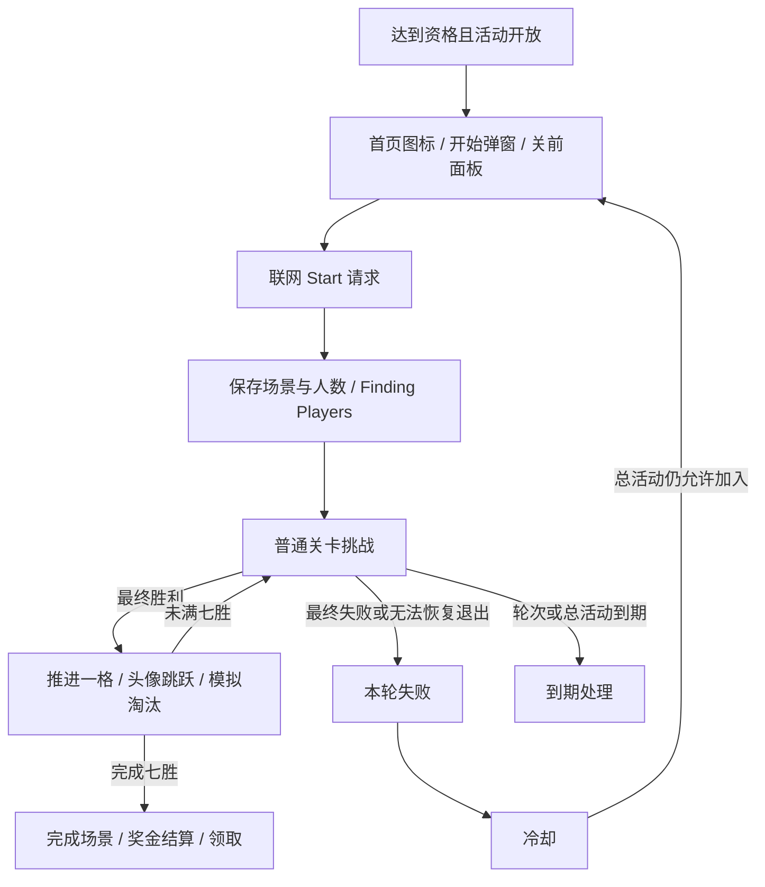

# Lava Quest：规则、逻辑、配置与资源

> 机制/资源基线38911；周期、入场和结束链已于10-27用39781实际安装代码重验。既有文件名保留以维护链接，最新结论按章节标明版本。

近期引用入口：[[02-PROJECTS/产品分析/Royal Match/活动/Lava Quest/逻辑与配置-38911#5. 配置、期限与失败重试|双期限、跨期条件与下一期流程]]。当前代码结论：入组成功后个人计时24小时；服务器截止用于准入等判断，正常本地路径不直接截断旧个人挑战；恢复分组为空/后台禁用会清理。旧轮结算后需有效新ID等条件才可再次入组，同一期失败重试另走冷却。星期开放窗口及线上跨期保留仍未验证。

## 核心判断

Lava Quest 是叠加在普通关卡上的“七连胜挑战＋历史模拟淘汰＋共享奖池”系统。玩家自身过关决定挑战成败；其他参赛者按服务端给定场景显示人数变化。它不是实时百人对战，也不是独立三消棋盘。

本轮将三层证据接起来：

- **配置**：SQLite 保存奖池 10,000 金币、冷却 1,800 秒、单轮 86,400 秒；版本号单独保存为 15。
- **已保存轮次**：事件 ID 1124，其他参赛者人数为 `99,68,52,40,21,18,16,8`，其他胜者数 8，场景 2。
- **表现**：六个 Bundle 中包含入口、开始、寻找玩家、比赛、完成、冷却、关前面板、退出警告、音频；比赛场景有 Step0～Step7 八组显示节点。

**重要边界**：保存的总活动结束时间为北京时间 2026-10-26 15:59:58.453，设备核验时间为 16:38:18，因此这是已保存/已过期的轮次证据，不能当作当前仍有效的活动。后续位域解码确认本地保存 Step=8、IsClaimed=true，即成功终态与已领取标记；尚无金币余额前后对照，实际到账未核验。

## 玩家规则卡

| 维度 | 内容 | 依据 |
|---|---|---|
| 解锁 | 等级 66 及以上 | 官方规则、历史静态分析 |
| 参与 | 联网点击 Start，请求分组 | 官方、历史协议/代码 |
| 目标 | 连续首过 7 关 | 官方、历史状态机、Prefab 说明文本 |
| 对手 | 自己＋99 名模拟参赛者 | 官方；本轮 QualifiedUsers 初值 99 |
| 模拟来源 | 曾游玩相同七关的玩家历史数据 | 官方说明；选择算法不在本地 |
| 失败 | 普通关卡最终失败结束本轮；无法恢复的中途退出按历史代码亦判失败 | 官方＋历史静态 |
| 续步 | 活动管理器接收最终 Win/Fail，历史证据未见“购买续步即判负”分支 | 历史静态，未现场完整验证 |
| 时间 | 单轮 24 小时，亦受总活动结束约束 | 缓存 d=86400＋官方/历史代码 |
| 重试 | 冷却 30 分钟；失败结算时总活动剩余须大于 45 分钟才走重试重置分支 | 缓存＋本次 ARM64 核验 |
| 奖励 | 胜者分配 10,000 金币奖池，客户端按 10 金币粒度向上取整 | 缓存奖池＋官方＋历史奖励算法 |
| 支线关卡 | 历史代码中 Side Progression 不增加 Lava Step | 历史静态，勿等同所有未来关卡类型 |

## 活动的完整体验链

图示依据历史代码与本次资源对应关系，不代表现场完成过所有路径。

## 数值例子：这一份轮次能推导什么

保存的其他胜者数为 8。若玩家完成七连胜、使用本次缓存奖池且没有额外覆盖，按历史 38911 算法：

`floor(10000 / (8 + 1)) = 1111`，向上取到 10 的倍数为 **1120 金币**。

这是按保存配置与胜者数的计算结果；本地已有成功及已领取标记，但**不是实测到账 1120 的证据**。此外，七步人数曲线只代表这个历史模拟场景，不可作为全体玩家真实通关率、DDA 曲线或当前实时在线人数。

## 产品设计理解（分析推断）

- 七连胜把每一局的失败成本延伸到活动层；越接近终点，保住既有进度的动机越强。
- “其他人逐步掉落”提供可视化竞争和幸存反馈；实际无需百人同时在线。
- 共享奖池让最终幸存人数成为奖励预期的一部分，但单个账号的历史场景如何分配仍未知。
- 关前面板与退出警告把活动目标带入局内决策；这支持体验上的联动，不能据此声称存在直接调难。
- 冷却保留失败后的回访理由；该用途是设计解释，未验证运营指标效果。

## 阅读顺序

本档案为“包体＋运行后存储＋代码/资源对位”方法的首个范例。分析其他模块时参考 [[02-PROJECTS/产品分析/方法-竞品模块分析与持续维护|通用分析方法]]；长期规划见 [[02-PROJECTS/产品分析/任务-竞品调研体系建设与持续维护|竞品调研长期任务]]，具体机制结论不跨模块直接套用。

1. [[02-PROJECTS/产品分析/Royal Match/活动/Lava Quest/逻辑与配置-38911|逻辑与配置]]：持续维护主文档：入组关卡、七胜状态机、模拟对手、重试与奖励、通用连胜收益、棋盘概率、续步和服务端边界。
2. [[02-PROJECTS/产品分析/Royal Match/活动/Lava Quest/资源与表现-38911|资源与表现]]：六包职责、Prefab 组件、图片、动画、粒子、音效和引用证据。
3. [[02-PROJECTS/产品分析/Royal Match/活动/Lava Quest/证据与验证-2026-10-26|证据与验证]]：本次实测、原始文件、验证范围与后续缺口。

官方规则于 2026-10-26 复核：[Royal Match Help Center — Lava Quest](https://dreamgames.helpshift.com/hc/en/3-royal-match/faq/187-lava-quest/)。

## 关联

- [[02-PROJECTS/产品分析/Royal Match/活动/_MOC|活动逐项拆解 MOC]]
- [[02-PROJECTS/产品分析/Royal Match/活动清单与简述-38911|活动清单]]
- [[02-PROJECTS/产品分析/Royal Match/活动定位-Lava Quest与Ancient Adventure-38911|历史联合分析]]
