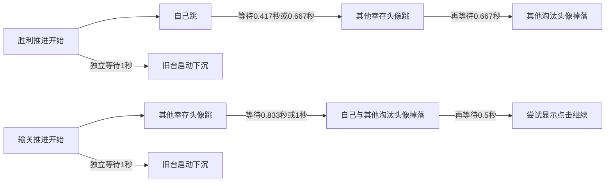
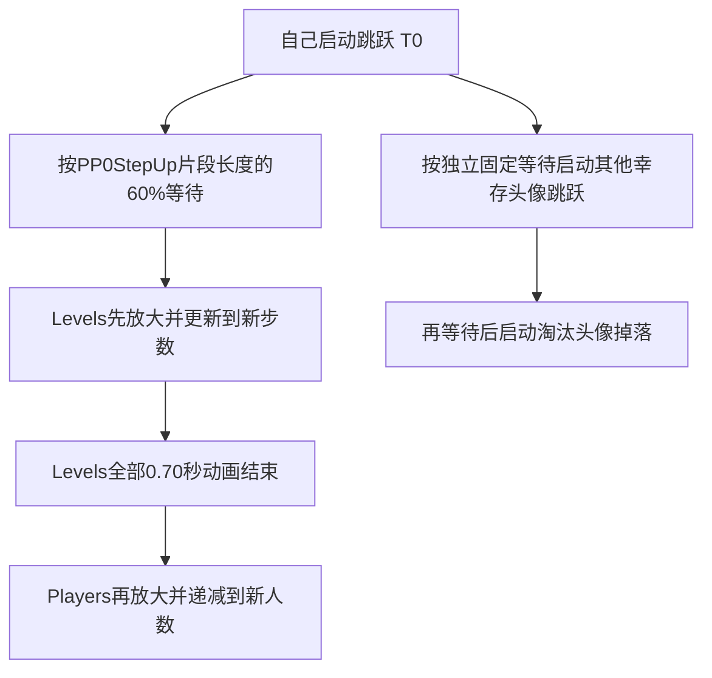

# Lava Quest 资源与表现

## 1. 采集和解析范围

2026-10-26 从模拟器外部专属目录 `files/AssetBundles/Features/` 定向拉取六个 `lavaquest*` 文件，共 **12,145,967 字节，约 11.58 MiB**。用隔离环境 UnityPy 1.25.4 读取容器、对象、序列化字段和资源引用，六包未发生对象读取、Sprite 或音频导出错误。

以下统计是**对象数量**，不是去重后的独立原画、动效或玩法数量。同名文件/对象允许重复，定位必须包含 Bundle 与 path ID。

| Bundle | 字节 | Sprite | AnimationClip | ParticleSystem | AudioClip | 主要职责 |
|---|---:|---:|---:|---:|---:|---|
| lavaquestaudio_v2 | 223,023 | 0 | 0 | 0 | 13 | 活动音效 |
| lavaquestcompetition | 6,882,942 | 115 | 132 | 37 | 0 | 比赛场景、淘汰、说明、完成奖励 |
| lavaquestgameplay | 158,492 | 4 | 0 | 0 | 0 | 退出/失败警告界面 |
| lavaquesticon_v3 | 735,140 | 37 | 9 | 17 | 0 | 首页图标、进度、冷却结束表现 |
| lavaquestprelevel | 696,001 | 45 | 9 | 29 | 0 | 关前面板的开始、列表、冷却和领奖布局 |
| lavaqueststart_v4 | 3,450,369 | 37 | 5 | 141 | 0 | 开始、查找玩家、冷却弹窗与 Spine |
| 合计 | 12,145,967 | 238 | 155 | 224 | 13 | 全部均有本机 inventory 与对象 JSON |

资源根：`D:\LibraryG\06-PRODUCT-ASSETS\RoyalMatch\38911\05-Runtime\20261026-lavaquest\`。

## 2. 从玩家动作到 Prefab 和组件

以下容器完整前缀为 `assets/royal/scenes/home/ui/dialogs/lavaquest/bundle/`。表中的触发情境结合历史逻辑；具体字段、Prefab、组件对应关系来自本次资源解析。

| 情境 | 容器路径（相对前缀） | 组件 | 序列化绑定 |
|---|---|---|---|
| 首页查看活动 | `icon/default/lavaquesticonbundledprefab.prefab` | LavaQuestIconBundledView | remainingText、openText、notificationSign、iconProgressBar、normalState、openState、normalRibbon、startRibbon |
| 冷却结束提示 | 同上 | LavaQuestIconCooldownEndAnimation | icon、particleSystem |
| 展示活动开始 | `start/default/resources/lavaqueststartdialog.prefab` | LavaQuestStartDialog | spinner、button、root、infoText |
| 请求分组后的查找表现 | `start/default/resources/lavaquestfindingplayerscene.prefab` | LavaQuestFindingPlayersScene | grandPrizeText、playerCountText、pictureTransforms、cardsParent、chestParticle |
| 冷却提示 | `start/default/resources/lavaquestcooldowndialog.prefab` | LavaQuestCooldownDialog | remainingTextPositioner、root |
| 比赛总界面 | `competition/default/lavaquestcompetitiondialog.prefab` | LavaQuestCompetitionDialog | timeCounter、levelsText、playersText、sceneHolder、tutorial、tooltipConfigs、sceneState |
| 比赛空间与台阶 | `competition/default/lavaquestcompetitionscene.prefab` | LavaQuestCompetitionSceneView | stepRolls、profilePictureHolder、rewardChest、left/rightLavaFountainParticleHolder、distortionAnimations |
| 活动规则说明 | `competition/default/lavaquestinfoscene.prefab` | LavaQuestInfoScene | cards、beatLevels、reward、bottomInfo、tapToContinue |
| 完成与奖励 | `competition/default/lavaquestcompletedscene.prefab` | LavaQuestCompletedScene | rewardContainer、my/otherProfilePictureHolders、chest、rewardParticles、coinCounterParticles |
| 关前状态展示 | `prelevel/default/resources/lavaquestprelevelpanel.prefab` | LavaQuestPrelevelPanel | cooldownContent、startContent、listContent、claimContent、startButton、levelsInfoText、playersInfoText |
| 放弃风险提示 | `gameplay/default/lavaquestwarndialog.prefab` | LavaQuestWarningView | volcanoRoot、stepText、infoText、otherEventImage、secondCrossSign |

**不能按包名猜功能**：`gameplay` 在这里就是一个警告 Prefab，没有找到活动专属棋盘容器。`prelevel` 同时包含四类内容容器，说明它可根据活动状态切换表现；但某一时刻启用哪组还需要控制代码或画面确认。

### 失败前挽留样式（39781代码，38911素材）

步数用完后的续步页`EgoDialog.OnExitButton 0x141567C`会尝试`TryShowEventWarning 0x1413EC4`；命中时由页内`ExtraWarn`承载活动损失提示。主动退出确认`LevelQuitDialog.TryShowEventWarning 0x140FD74`复用同一警告选择器。此处仍是放弃前挽留，区别于最终失败后的比赛淘汰页。续步页的退出入口传入disableEgoPackage=true，命中警告后隐藏packagesContainer并显示警告内容；不是额外打开Lava完整比赛场景。

| 项目 | 已确认表现 |
|---|---|
| 基础构图 | 火山主题volcanoRoot、stepText进度、infoText损失文案；38911绑定的lq_goal_cross为红色叉号 |
| 进度 | `SetLavaStepText 0x15DB854`以`{0}/{1}`显示当前Step／7；CurrentStep直接读持久化Step，不能不经换算把它解释为已胜利关数 |
| 单活动 | `SetForSingleEvent 0x15DB918`隐藏第二叉号，火山根x=0；使用LavaQuestEgoText；位置及文字区域按主动退出／续步退出来源调整 |
| 双损失 | Cloche计数非0，或超级光球／SuperDuke／MagicDuke状态命中时，Show转SetForDoubleEvent；配另一增益图与组合文案 |
| 文案键 | 单活动LavaQuestEgoText；组合LavaQuestEgoButlerText、LavaQuestEgoSuperLightballText、LavaQuestEgoSuperDukeText、LavaQuestEgoMagicDukeText；当前只核对键及消费者，未取得正式中英文正文 |
| 触发资格 | ShouldWarnOnLevelQuit要求活动资源可用、ShouldProgress成立，且图标有效或关前展示有效；此处没有Ancient式CurrentStep>0判断 |

`ExtraWarn.Warn`另有Lava＋ClashOfChampions、Lava＋倍率选择的组合消费者；不应把单活动火山图当所有状态下的唯一版式，也不将同组缓存视为两活动必同时展示。

2026-11-09原始证据在`06-PRODUCT-ASSETS/RoyalMatch/39781/04-ReverseEngineering/Retention-Audit/`：138段定向方法及manifest，代码SHA256与Period-Audit绑定一致。关键链：ExtraWarn.ShowLavaQuestWarn→LavaQuestWarningView.Show→单／双版式。图片证据仍为38911旧Bundle，不冒充39781实拍；未核定当前线上中文文案、按钮布局、动效或全部组合选择优先级。对照[[02-PROJECTS/产品分析/Royal Match/活动定位-Lava Quest与Ancient Adventure-38911#失败前挽留样式（39781）|Ancient挽留]]。

2026-11-09补充：已从2026-10-28的39781存储备份取得`lavaquestgameplay`（SHA256 `cc83116fb6ce12cf35554df187a74c60745ac2c71d1d3c396526b3a7a3c3ec53`，与既有样本一致），按Prefab活动图层还原火山、红叉及蓝边浅黄进度牌。下图数字为示例、字体近似、白底为资料底板；不含完整宿主弹窗、按钮与动态文案，不是实拍。原始归档定位、资源哈希和图层清单见`Retention-Audit/visuals/`。

![[02-PROJECTS/产品分析/Royal Match/可视化/失败挽留/Lava与Ancient挽留内容区.png]]

## 3. 比赛表现的结构

`LavaQuestCompetitionSceneView.stepRolls` 引用了八个 `LavaQuestStepRoll`，GameObject 名为 Step0～Step7。

每个 StepRoll 绑定：

- `animator`：台阶内人物卡片与石头动画。
- `profilePictureSingleData`、`profilePictureSingleExtraData`、`profilePictureDoubleData`：头像卡片的本地坐标、旋转、缩放和排序参数。
- `ppCardFallParticleHolder`、`rockFallParticleHolder`：卡片掉落、石块下沉相关粒子挂点。
- `ppCardMasks`、`tooltipCollider`：裁剪与交互区。
- `stepParticles`、`particlesPositions`：步骤粒子及位置。

这解释了“人数变化”如何有空间表现：业务层提供人数/展示对象，StepRoll 提供卡片槽位、台阶动画和特效。39781已核对本人、幸存头像、淘汰头像的分批启动与数字刷新，见第五章；展示槽位数仍不能当作参赛人数，也没有“掉一个头像就减一个人数”的逐项绑定。

关键对象定位（Bundle 内 path ID）：

| 组件/对象 | Bundle | path ID |
|---|---|---:|
| LavaQuestCompetitionDialog | competition | 8593863384425444018 |
| LavaQuestCompetitionSceneView | competition | 2522130008609806917 |
| LavaQuestCompletedScene | competition | -6979126496432042605 |
| LavaQuestStepRoll / Step7 | competition | -6023149792249098260 |
| LavaQuestPrelevelPanel | prelevel | 5730751024983164611 |
| LavaQuestWarningView | gameplay | -8525048404917612891 |
| LavaQuestStartDialog | start_v4 | -1794824347251154743 |
| LavaQuestFindingPlayersScene | start_v4 | 637051543004572277 |
| LavaQuestIconBundledView | icon_v3 | -3803500889606192729 |

对应原始 JSON 位于 `decoded/<完整Bundle名>/objects/<path_id>_MonoBehaviour_.json`。带引用目标名的汇总为 `resource-links.json`。引用解析目前展开同一 serialized file 的 fileID=0 对象；未解析的跨文件/跨包引用保留原值，不视为丢失或已恢复。

## 4. 图片与视觉层

已导出 238 个 Sprite PNG，保留 path ID。可见主要资产包括：

| 层 | 示例名称 | 用途判定 |
|---|---|---|
| 比赛背景 | `00050_lava_under_middle`、`00080_background_middle`、左右 extra 背景、`02400_lava_waterfall_left` | 图片内容与比赛 Prefab 空间结构相符；侧边 extra 资产存在，但是否针对特定分辨率启用需查代码 |
| 活动图标 | `lq_icon_mountain`、`lq_icon_lava_diffuse`、`lq_icon_lava_specular`、`lq_progress_bar` | 山体、岩浆、亮面、进度圈分层，非一张完整图标 |
| 关前面板 | `lq_pl_chest`、`lq_pl_platform`、`lq_pl_popup_clock`、`lq_pl_header_bg` | 宝箱、平台、计时、面板背景 |
| 开始/找人 | `lq_finding_scene_chest`、`lq_finding_players_container`、`lq_start_popup_banner` | 宝箱/卡片、人数容器和标题条 |
| 风险警告 | `lq_volcano`、`lq_goal_cross`、`lq_tooltip_without_shadow` | 活动标识、叉号和提示背景 |

以下为从原始 Sprite 制作的浏览拼图，**不是游戏运行截图，也不是重建后的完整 UI**：

![[06-PRODUCT-ASSETS/RoyalMatch/38911/05-Runtime/20261026-lavaquest/resource-contact-sheet.jpg]]

原始 PNG 见各 `decoded/<bundle>/sprites/`。大文件区不随 Git 同步，另一台机器需同步资源才可看到图片。

## 5. 动效、Spine 与粒子

### 界面进入与领奖表现参数（39781）

2026-11-05核对。以下为39781客户端代码参数，不是服务器配置表，也不是实机计时。时间从对应动画方法／序列开始计算，不含加载、首页排队和关卡退场。长度为Unity坐标单位，缩放相对所属Transform，不能直接换成屏幕像素。

| 项目／动作名称 | 具体表现参数 | 适用范围与来源方法 |
|---|---|---|
| 通用弹窗轻微弹性进入 | 初始缩放1.01；依次到1.02／0.99／1.00，分别0.05／0.12／0.065秒，总0.235秒；三段均OutQuad（逐渐减速） | `UiDialog.OnShow 0x2AB5688`基类实现；具体弹窗覆盖OnShow时优先用覆盖实现，不代表RM所有弹窗统一速度 |
| Lava活动页滑入 | 初始位置增加`Vector3.up × 6`；等待`0.03 + d`秒后移动0.32秒；OutBack（到位前略越过目标再回弹）；目标位置结合UI缩放系数 | `ShowDialogWithUiAnimation 0x38295BC`；`originType==SideProgressionLevelWin(3)`时d=0.4秒，否则d=0，因此移动完成是0.75／0.35秒；不是全页流程结束时间。该方法用于非Home来源；2026-11-09更正旧版把来源字段误写为sceneState的解读 |
| Lava活动页头像和后续提示调度 | 序列`0.6+d`秒开始头像淡入；`0.9+d`秒调用头像推进入口；非LevelFail来源在同一时点另排点击继续回调，最终仍受DidWin等条件限制 | 同上及`b__75_0 0x382BC18`／`b__75_1 0x382BCE4`。普通胜负返回的头像推进约从入场调度后0.9秒开始；这是调用时点，不是提示完整出现或已可操作 |
| 领奖背景遮罩 | 淡入0.4秒，目标alpha=0.94；淡出在`willShowLoading=true`时0.2秒，否则0秒 | `LavaQuestCompletedScene.GetConfig 0x3632B40`＋`DialogConfig`字段偏移；0.94是透明度，非缩放 |
| 领奖宝箱出现 | 主领奖序列先延迟0.1秒；宝箱在局部t=0开始，从0缩放至预存目标缩放，用时0.5秒 | `CreateAnimationTween 0x3630ED0`、`AnimateChest 0x36313E8`、`CreateDoScaleFromInitialScale 0x3631A24` |
| 领奖胜利文字出现 | 相对宝箱子序列延迟0.1秒，缩放动画0.5秒 | `AnimateChest`中的`winText`；相对整个序列启动约0.2秒，不是等宝箱播完才播 |
| 奖励容器出现 | 插入主领奖序列局部t=0.3秒，缩放0.5秒；奖励粒子同时启动 | `AnimateRewards 0x36314FC`；局部t不含主序列0.1秒延迟 |
| 自己头像／下方说明出现 | 自己头像子序列插入局部t=0.6秒；其中头像缩放0.5秒，说明文字再错开0.1秒、缩放0.5秒；头像最终布局缩放常量1.3 | `AnimateMyProfilePictureView 0x36315E8`及类常量；1.3是头像布局尺寸，不是弹性系数 |
| 其他获奖者头像逐个出现 | 子序列插入局部t=0.9秒；第i项从`i×0.125`秒开始，单项缩放0.25秒，目标缩放0.8 | `AnimateBottomProfilePictures 0x3631700`；i从0开始，按实际展示列表计算，不把总获奖人数直接代入 |
| 点击继续文字出现 | 追加在以上主序列已有内容之后；缩放0.5秒，随后完成回调 | `AnimateTapText 0x3631924`；前序长度随实际头像列表变化，因此不能统一写成固定第几秒可点击 |
| 宝箱／文字／头像的弹性曲线 | 上述使用公共缩放函数的项目为OutBack，overshoot=1.25；其他获奖头像也显式使用此系数 | `CreateDoScaleFromInitialScale`及`AnimateBottomProfilePictures`；**1.25是缓动曲线系数，不是“放大到125%”** |
| 奖励金币数字滚动 | 从调用开始延迟0.35秒，数字Tween持续0.95秒，OutQuad；该数字过程合计1.30秒 | `AnimateRewardTextCounter 0x36310A8`；不等于整场发奖耗时 |
| 奖励容器数字变化时的弹跳 | 以调用瞬间的缩放为基准，依次到110%→90%→100%，每段0.1秒，共0.3秒 | `AnimateCoinArrangement 0x3632898`；此处未显式SetEase，不将它擅自写成OutBack |

领奖时间线中的Insert项目会重叠播放。`SetDelay(0.1)`属于主序列，读取局部时间时只加一次；不能把宝箱、奖励、头像时长全部相加。缩放与数字滚动也可能并行。

证据目录：`06-PRODUCT-ASSETS/RoyalMatch/39781/04-ReverseEngineering/Motion-Parameters/`。`audit.py`读取已配对的Period-Audit二进制与方法索引，使用Capstone/ELF重定位核对调用、常量和委托；`manifest.json`记录方法摘录及SHA-256。二进制SHA-256为`ea4eaf596b64ff255cc042d52d32e44078ed773d70be6c3368db9459a12b3a22`。下方资源片段仍为38911，两类证据不混用；未新增实机逐帧录屏。

### 台阶和淘汰

比赛包的 132 个 AnimationClip 包括多份 `PP*StepUp`、`PP*SingleStepUp`、`PP*SingleExtraStepUp`、`PP*Fail1`、`BuryRock`，以及左右岩浆喷泉 Idle。它们是不同位置或对象的序列化动画，不能因同名而合并删除。

#### 胜利失败与倒计时结束的动作顺序

2026-11-09以39781代码重验。Lava使用Animator片段播放头像跳跃与跌落，不能套用Ancient的两点跳跃参数。下表的“先后”指代码启动先后；同一批头像在循环内启动，各片段内部的起跳、落地时间仍可不同。

| 情况 | 谁先动作 | 后续动作与界面 |
|---|---|---|
| 普通胜利且有待播放推进 | **自己先跳** | 其他幸存头像跳 → 其他淘汰头像掉落；Levels动画先、Players动画后，与头像动作并行计时 |
| 第七胜且有待播放推进 | **自己先跳**，复用胜利分批顺序 | 主界面另有完成计时，尝试关闭后衔接已安排的领奖场景；不是等待最后一个头像动画结束才开始计时 |
| 普通关卡最终失败且有待播放推进 | **其他幸存头像先跳** | 自己与其他淘汰头像同批掉落 → 尝试显示点击继续；仍受场景加载状态限制。Levels与Players均隐藏 |
| 个人挑战倒计时归零 | **超时本身不触发自己掉落** | 已消费推进动画时，下次打开静态超时页；Levels与Players隐藏。若仍有未消费推进，仍可播放该推进，不能将其误认作超时专属跳台 |
| 仅服务器报名期限结束，个人尚有时间 | 不由这个截止触发跳台或跌落 | 正常本地路径继续个人挑战，另受旧组恢复和后台禁用等条件影响 |
| 手动重开、没有新推进 | 不重播跳台与淘汰 | 进行中页直接显示当前步数／人数；已胜利待领奖可走完成页，已结算状态不等同再次赢第七关 |

判断拆成两层：`PrepareCompetitionDialogData 0x363E1A8`读取动画消费标记，且只用`DidFailByLosingLevel`决定本人是否属于跌落者；`PrepareForDialog 0x3829E0C`以`beforeStep < afterStep`决定是否启动推进。因此**超时失败不等于输关跌落**。打开比赛页会在生成展示数据后消费动画标记；不是每次打开都重播。

以**头像推进开始为T0**，不含界面加载、滑入和关卡退场。等待使用`FramesToSeconds`的帧数÷60，与设备帧率不是一回事。

| 相对T0 | 胜利，本人存活 | 输关，本人淘汰 |
|---|---|---|
| 0 | 本人启动StepUp | 其他幸存头像同批启动StepUp |
| 0.417秒；特殊步为0.667秒 | 其他幸存头像同批启动StepUp | — |
| 0.833秒；特殊步为1.000秒 | — | 本人＋其他淘汰头像同批启动Fall1 |
| 1.083秒；特殊步为1.333秒 | 其他淘汰头像同批启动Fall1 | — |
| 1.333秒；特殊步为1.500秒 | — | 尝试显示点击继续，非保证此刻已经可点击 |
| 1.000秒，独立时钟 | 当前旧台Animator启动BuryRock | 同样启动BuryRock，不以头像落水完成为前提 |
| 1.500秒，独立时钟 | 存在淘汰头像时播放落水相关音效 | 本人跌落满足音效条件 |
| 1.700秒，独立时钟 | 尝试启用头像提示交互 | 同一调用仍受状态判断；不是点击继续的统一时点 |

“特殊步”精确条件是`animationData.beforeStep == 3或6`，不是afterStep；旧台选`clamp(beforeStep-1,0,7)`，对应Step2／Step5。正常逐关推进时是第三／第六次胜利。失败时也按失败前的beforeStep判断。没有某批头像时，该批自然没有可见动作。

七胜自动收尾另以`PrepareForDialog`启动完成计时为起点：有推进时默认5.0秒；映射列表至少2项、且除本人外没有淘汰者时改为4.3秒；无推进时为0.8秒。仅`Completed=3`使用这条计时，`CompletedLastSession=5`不等同。到点调用关闭，来源、场景加载和已安排动作仍影响后续，不能写成“T0后5秒必已弹出奖励”。

#### Levels与Players数字如何配合跳跃

**先更新Levels，再更新Players；两者没有逐头像结算绑定。** 初始展示在`StepUp=0`／`Completed=3`保留推进前数字，随后动画到推进后数字；普通静态页直接显示推进后值；`Fail=1`与`TimeOut=4`隐藏两组数字。

本人存活分支启动StepUp后，从当前台AnimatorController查找名为`PP0StepUp`的片段，令`D = 片段长度 × 0.6`，在T0＋D调用`AnimateLevelsAndPlayersTexts`。这表示按片段长度安排时点，**不是收到本人实际落地事件后更新**。代码在取得空Unity引用时有0.5秒替代值，但前面的`First`查找未匹配并不保证能走到这个替代值，不能称为通用缺资源补偿。

| 相对T0的时间 | Levels | Players |
|---|---|---|
| 初始 | 显示`beforeStep-1`／7 | 显示beforeStepPlayerCount |
| D | 开始放大／回弹序列 | 保持原值 |
| D＋0.19～D＋0.49秒 | 整数Tween由`beforeStep-1`到`afterStep-1`，持续0.30秒，OutQuad | 保持原值 |
| D＋0.63秒 | 文字撞击粒子／音效回调 | 保持原值 |
| D＋0.70秒 | Levels整段缩放结束 | 由Levels的OnComplete启动人数缩放 |
| D＋0.95～D＋1.55秒 | 保持新值 | 人数整数Tween由before到after，持续0.60秒，OutQuad |
| D＋1.75秒 | — | 人数文字撞击粒子／音效回调 |
| D＋1.85秒 | — | 人数整段缩放结束 |

以上是Tween调度区间，不是“整数第一次肉眼变动”的精确时刻。整数插值取整会使新值在区间内才出现、也可能在区间结束前已显示目标值；缺少逐帧实拍时不把Tween开始等同文本已变。Players动画过程中每次显示整数改变可触发人数变化音效／触觉；不要求每一位都在屏幕出现，也不依赖淘汰头像的数量或落水事件。人数来自业务快照，包含存活的本人，不能直接用画面头像数反推。

数字的缩放是**原localScale按分量加减**，不是固定乘140%：依次到原值＋0.4 → 原值＋0.3 → 数字Tween → 原值＋0.4 → 原值－0.2 → 回原值。Levels各段为0.12／0.07／0.30／0.07／0.07／0.07秒，总0.70秒；Players为0.15／0.10／0.60／0.10／0.10／0.10秒，总1.15秒。仅整数Tween明确设OutQuad，不能给其余缩放擅自补同一缓动。

代表性原资源示例：38911的Step1控制器（LavaRock1，path ID `-2640322142197473853`）中，PP0StepUp长0.733333秒，D≈0.44秒；代入39781已核验时序，Levels整数Tween为0.63～0.93秒、Players为1.39～1.99秒，完整数字动效2.29秒结束。示例为Step1→Step2（beforeStep=2），不是特殊步，不代表39781所有台片长。

[胜利失败并排与数字时间线](../../可视化/Lava-胜利失败与数字时间线.html)：同一时钟支持0.1×／0.25×／0.5×／1×、暂停和拖动；原台子、头像框与原曲线，人数69→53来自已保存轮次示例，画面仅用少量代表头像。

#### 代码证据与资源边界

[TS资料空间说明](https://chatgpt.com/space/page_bc06b2daa1788191bfe7ff487a7f2f0d)已保存本节胜负／超时和数字时序，并内嵌胜败对比慢放，附约251 KB代码证据包；TS主页有入口，归属与附件访问已回读确认。本页仍为长期维护正文。

新增定向证据：`Motion-Parameters/lava-flow-20261109/`，`motion-audit/manifest.json`记录74段SceneView等方法，`branch-audit/`记录状态、数据和页头方法。两者复用同一39781二进制与脚本索引，哈希见上文。关键定位：`InstantiateProfileCards 0x382C46C`识别本人并置首；`PlaceProfileCards 0x382CABC`将本人先加入动画映射；`MoveCardsRoutine.MoveNext 0x362F458`分批动作；`StartPictureAnimationsIfNecessary 0x38298D8`独立下沉时钟；`PrepareTopPanel 0x3829168`决定数字可见与初值；`AnimateLevelsAndPlayersTexts 0x382A770`／`AnimateAText 0x382A824`／回调`0x382BC10`决定先Levels后Players。`MoveCardsRoutine`跳表与字符串重定位均已核对。代码结论为静态核验，非新版实机逐帧计时。

资源曲线长度与代码等待分开看：

38911已保存比赛包中，82份跳台片段的序列化长度如下。统计保留不同path ID，不将同名片段去重；长度取`m_MuscleClip.m_StopTime-m_StartTime`，采样率均为60。它们是资源制作时间，不是设备实际帧率，也不是39781播放速度实测。

| 动作片段名称 | 对象数 | 片段长度范围（秒） | 其他涉及的表现参数 |
|---|---:|---:|---|
| `PP*StepUp` | 40 | 0.667～1.133 | 位移／缩放曲线、头像遮挡层调整事件、触觉事件 |
| `PP*SingleStepUp` | 28 | 0.733～1.100 | 同上；具体曲线与当前位置使用的片段绑定 |
| `PP*SingleExtraStepUp` | 14 | 0.783～1.033 | 同上；不是固定统一的额外延迟 |

逐对象的名称、长度、采样率、事件和原始JSON路径见`Motion-Parameters/lava-clips-38911.json`。本次已对位38911的LavaRock1代表控制器，解码本人跳／跌、Single0／Single1幸存头像、PP3／PP4跌落与BuryRock；其余台和新版控制器尚未逐状态对位，不能推广为所有台的固定片长。

如果实现目标是“给定起终点，由代码跳跃”，已确认的Ancient实现更直接对应此需求，见[[02-PROJECTS/产品分析/Royal Match/活动定位-Lava Quest与Ancient Adventure-38911#活动页进入与胜利跳台的表现参数（39781）|Ancient两点跳跃参数与坐标换算]]。Lava这条已定位路径仍为Animator片段，不把实现意图反写成RM原代码事实。

**台子下沉／销毁表现**：

| 项目／动作名称 | 具体参数与行为 | 来源 |
|---|---|---|
| 台子下沉启动点 | 头像推进序列局部t=1.0秒触发台阶Animator的`BuryRock`；推进开始时已准备头像及岩石粒子 | `StartPictureAnimationsIfNecessary 0x38298D8`及`b__2 0x362F1B0`；不是跳跃动画长度＋1秒 |
| 下沉音效与后续交互 | 下沉回调中按step条件播放BuryRock音效；t=1.5秒有条件播放另一音效；t=1.7秒尝试恢复提示交互 | `b__2`、`b__3 0x362F264`、`b__1 0x362F18C`；1.7秒是调度节点，不是所有下沉资源播放结束 |
| 岩石粒子实例 | 在有效中间台阶的粒子父节点实例化`LavaQuestRockParticlesPrefab`，初始SetActive(false) | `InstantiateRockFailParticles 0x382E528`；不能将实例化时点当成粒子实际发射时点 |
| 已经过台阶隐藏 | 对已走过的一段stepRoll对象调用SetActive(false) | `HidePassedStepRocks 0x382C3E8`；是隐藏，不是Destroy |
| 下沉片段长度（38911） | 8份同名`BuryRock`：6份长6.0秒，另2份长1.0／2.183秒 | 已保存比赛Bundle；同名不同path ID保留。6秒是整段资源长度，不保证台子全程移动6秒，且不是新版统一时长 |
| 对象销毁时间 | 本次已确认动画、粒子准备和隐藏；尚未确认统一“下沉后N秒Destroy台子”规则 | 不把视觉消失、SetActive(false)和对象销毁混为一谈 |

原始资源与哈希见`Motion-Parameters/lava-clips-38911.json`，含82份跳台及8份BuryRock；`resource_audit.py`可复建。已对代表台Step1逐通道重放：BuryRock中主图alpha在片内1.516667～1.666667秒由1到0，under子图在1.566667～1.716667秒淡出；2.05秒位置复位时已不可见。这些时点需加T0后1秒的启动等待；不将整段6秒写成石头持续可见6秒。其他台不据此类推。

头像PP0／PP3／PP4的Fail1均在片内0.25秒开启各自矩形遮罩，2.633333秒关闭遮罩并停用头像。`InstantiateProfileCards`的Init参数为`VisibleOutsideMask=2`，只剔除对应矩形内像素；PP3／PP4上冲后缓降是原曲线，不能再人为加向下位移或淡出替代。遮罩与排序证据、精灵／Bundle哈希、曲线绑定、播放器与核验记录见`Motion-Parameters/lava-visual-20261109/`。

**遮罩是否预先放好**：38911原Prefab的Step0～Step6，各在`ppCardMasks`中引用5个已存在的SpriteMask，共35个；Step7该数组为空。Step1五个遮罩尺寸一致、位置不同；其他台存在尺寸差异，不能推广为全活动等尺寸。各台绑定控制器中，33个遮罩没有自身Transform动画绑定，另两个有预制位移动画：

| 所在台／槽位 | 动画 | 片内0～0.45秒局部坐标变化 |
|---|---|---|
| Step4／PP2Mask (1) | PP2Fail1 | (-4.25,-2.81) → (-2.65,-2.21) |
| Step6／PP3Mask | PP3Fail1 | (1.7181,0.30) → (1.70,-0.15) |

因此准确表述是“按展示槽位预制遮罩及必要的遮罩动画”，而非“所有遮罩固定不动”。39781 `SetSortingGroup 0x363FA58`仅在片段名包含`Fail`时，从头像名末位解析编号，访问`ppCardMasks[index]`，设置前后排序为头像排序±1，并将对应跌落粒子排序设为头像排序+10；普通StepUp跳过这段联动。该方法不创建遮罩、不改遮罩位置或尺寸。`PlaceProfileCards`中位置／缩放／旋转赋值针对头像对象，不能误认成运行时重建遮罩。完整资源、绑定与例外曲线见`Motion-Parameters/lava-visual-20261109/mask-placement-audit.json`，复现入口`audit_masks.py`。本次覆盖既有38911原资源与39781已定位代码路径，未采集新版实机对象层级。

可视化边界：38911素材＋39781调用时序，非实机录像；30Hz重采样后插值，头像角色标识与相机裁切供讲解；按原几何近似矩形遮罩，未复现水面Shader、波浪蒙皮、粒子、音效。文字分段缩放采用线性插值示意，未把未确认的运行时缩放缓动写成原值。

可确认的动画事件共有两类：

- `SetPictureSortingOrder`：57个事件条目，其中22个跳台、35个失败。事件的`intParameter`是Animator层索引，用来找到头像；`floatParameter`转int后才是目标排序。例如Step2的`PP0StepUp`在0.25秒传入layer=1、order=9400；`PP4SingleStepUp`约0.333秒传入layer=10、order=8700。参数1／10不是排序值，也不是Unity Sorting Layer ID。
- `CallHaptic`：246 个事件条目。表明部分动作与触觉事件绑定；硬件支持和运行设置决定是否实际振动，不能仅由事件数推断振动次数。

完整事件含 clip、对象文件、时间、函数与参数，保存为 `animation-events.json`。扫描本次 AnimationClip 未发现音频播放事件；这不排除声音由 C# 控制或其他机制触发。

#### 头像跳跃的层级切换与穿帮排查

2026-11-10对位39781原生方法与38911各台实际绑定的控制器。Lava采用“槽位初始排序＋部分跳跃片段在指定帧切换整张头像排序”。每段轨迹分别配置时点与目标值；不能概括成所有头像起跳置顶、落地恢复，也不能把同名PP0StepUp的事件套到其他台。

| 环节 | 已核定处理 | 对复刻的意义 |
|---|---|---|
| 摆放头像 | `PlaceProfileCards 0x382CABC`把头像挂到对应StepRoll，按PictureTransform设置本地位置、旋转、缩放、sortingOrder，并建立头像与animationLayerIdx映射 | 位置、大小和初始层级是一套槽位配置；不能只复刻跳跃轨迹 |
| 排序单位 | `ProfilePictureBaseView.SetSortingGroup 0x1DC5CF4`写头像根SortingGroup的order；指定layer非负时也设置Sorting Layer ID | 修改整张头像的组排序，保持头像内部绘制关系 |
| 动画事件定位 | `SetPictureSortingOrder 0x363F9B8`读取当前Clip名、int参数作为Animator层索引、float参数转int作为目标order；`SetSortingGroup`按映射找到头像 | 层索引是找对象的键，真正的前后顺序来自目标order |
| 普通跳台 | 事件直接写头像根SortingGroup.sortingOrder；本方法不改父节点、Sorting Layer ID、Z坐标或遮罩范围 | 切层由事件明确驱动；已核MoveCardsRoutine路径中没有逐跳落地SetParent操作，不能套用Ancient落地挂父节点链路 |
| 失败跌落 | Clip名包含Fail时才额外设置mask.front=order+1、mask.back=order−1、对应粒子order=order+10，再写头像组order | 遮罩范围和粒子要跟上跌落头像的层级；这不是普通StepUp的必经操作 |

具体跳台例子（Step为Prefab内部编号，时间从该头像片段开始算；本人为PP0）：

| 所属台／片段 | 初始order | 切换时间 | 事件目标order |
|---|---:|---:|---:|
| Step2／PP0StepUp | 10000 | 0.250秒 | 9400 |
| Step2／PP1StepUp | 9900 | 0.616667秒 | 9300 |
| Step5／PP0StepUp | 10000 | 0.333333秒 | 9550 |
| Step5／PP1StepUp | 9900 | 0.466667秒 | 9350 |

这些例子把头像调到较低排序，说明前后关系会在跳跃过程中改变。就本次38911实际绑定控制器而言，跳台排序事件仅出现在Step0（1个）、Step2（12个）、Step5（9个）；Step1／3／4／6的StepUp未找到该事件，Step7无StepUp。35个Fail事件分布于Step0～6各五个槽位，片内0秒依次设10500／10400／10300／10200／10100。事件缺失不等于物体没有遮挡关系，而是不能统一加一套切层动作。

**n→n+1时，留在n台的失败头像**：失败者在幸存者开始跳台时仍用原槽位排序，已核调用链未提前统一抬高失败者。等自身Fall1开始，所绑定PP*Fail1片段在0秒触发事件，将失败头像整组提至独立的前景排序区：PP0～PP4依次10500／10400／10300／10200／10100。槽位初始排序范围为9500～10000，跳台事件目标为8500～9890，因此同一头像排序层内，失败组此时排在幸存头像前面；这不是失败者排到n+1头像后面的方案。失败者内部仍保留每槽100的间隔，不把所有失败头像设成同一个order。

| 相对“其他幸存头像开始跳”的时间 | 失败者处理 |
|---|---|
| 幸存者起跳时 | 失败头像保持原槽位层级，尚未启动自己的Fall1 |
| 本人胜利：再过0.666667秒 | 其他失败头像同批开始Fall1，并切到10100～10400对应槽位（PP0本人存活） |
| 本人失败：再过0.833333秒；beforeStep=3或6时1秒 | 本人与其他失败头像开始Fall1，并按槽位切到10100～10500 |
| 每个Fail片段0秒切层时 | 同步该头像遮罩front=order+1、back=order−1，对应跌落粒子order=order+10 |
| Step1已核示例：Fail片段0.25秒 | 启用对应局部遮罩，以VisibleOutsideMask裁去进入矩形内的像素；不是把头像逐渐往后降层 |
| Step1已核示例：Fail片段2.633333秒 | 关闭遮罩并停用头像；不能据此推广成所有台统一结束时刻 |

这里的错开是固定等待，**不保证所有幸存头像已落地**。相对整段推进T0的完整时序见上方“胜利失败与倒计时结束的动作顺序”。失败头像继续由旧台StepRoll下的头像动画驱动，已核路径没有将失败者挂到n+1台；与Rock的BuryRock使用独立动画轨道。复刻时应同时对位“何时抬到前景、失败者内部顺序、窄范围遮罩、跳台与跌落轨迹”，不能只在切到n+1时给所有头像统一换层。该解释来自39781调用链与38911资源对位，未宣称实机逐帧已验证完全无交叠。

**针对复刻穿帮的检查建议**：先确认改的是头像整组排序，再检查所处Sorting Layer及祖先SortingGroup；然后逐条跳跃轨迹核对“切层前该挡住谁、切层后该被谁挡住”，将切换点与轨迹共同配置。使用代码两点跳跃时，可在相应时间点调用同样的切层逻辑；数值应按自己场景的层级表换算，不直接复制9400／9550。父节点切换、取消／重播和复用后的层级恢复需要在自身实现中明确处理；这是复刻建议，不宣称Lava有统一恢复事件。当前未读取用户项目的穿帮实现，尚不能确定其具体原因。

证据：`Motion-Parameters/lava-sorting-20261110/resource-sorting.json`逐台记录初始排序、控制器、Clip ID、事件和场景排序组件；`audit.py`可重建。`native-check.json`将ELF重定位槽`0x5552FE8`核定为字符串`Fail`（调用点`0x363FBC0`），`1dc5cf4.txt`核对头像组写入；复用既有`SetPictureSortingOrder`／`SetSortingGroup`／`SetParticleSorting`／`PlaceProfileCards`与`MoveCardsRoutine`原生摘录。代码SHA256见本节上文，资源哈希记录在JSON。静态证据可确认处理机制；未做39781实时逐帧录屏，38911资源时点不承诺与新版在线素材完全相同。

### 图标与关前面板

各有 9 个 AnimationClip，名称覆盖 Left/Right/TopLeft/BottomRight 等岩浆 Creation/Idle。入口图标含 `LavaQuestIconCooldownEndAnimation` 与粒子引用，提供冷却结束的动效能力。

### 开始弹窗

- `LavaQuestStartAnimationSpine` 绑定 `spineAnimations` 与 `rockParticles`。
- 两份 `LavaQuestStart.skel` 与两份 `.atlas` TextAsset 已导出；同名 skeleton 的字节数分别为 242,194 与 670,753，不能当作同一文件。
- `LavaQuestStartAnimationParticles.particlesToPrewarm` 记录预热对象。
- `LavaQuestShaderOffsetShiftAnimation` 持有 xSpeed/ySpeed/causticRenderer，证明岩浆/焦散表现包含 UV 偏移控制数据。
- 本轮尚未以 Spine runtime 重放 skeleton，不宣称已恢复其内部全部动作名和触发时间。

224 个 ParticleSystem 是本次对象计数，可能含重复实例、备用或未激活节点，不是同时播放 224 个特效。

## 6. 音效清单与调用边界

13 个 AudioClip 全部导出为 WAV，规范目录为 `decoded/lavaquestaudio_v2/audio-by-path-id/`，文件名前置 path ID 防止同名覆盖。早期 `audio/` 是首轮按名称导出的中间目录，不作为完整音频清单使用。

| AudioClip 名 | 时长（秒，约） | 语义用途判断 |
|---|---:|---|
| finding_players | 2.482 | 查找玩家表现，待调用点确认 |
| player_card_jump | 0.340 | 单卡跳跃，待调用点确认 |
| two_cards_jump | 0.522 | 两卡跳跃，待调用点确认 |
| three_cards_jump | 0.522 | 三卡跳跃，待调用点确认 |
| player_card_fall | 0.418 | 卡片跌落，待调用点确认 |
| player_count_drop | 0.048 | 人数变化提示，待调用点确认 |
| bury_rock（两对象） | 2.142 / 4.128 | 石块下沉，具体变体调用未知 |
| player_cards_sizzle（两对象） | 2.168 / 2.136 | 掉入岩浆的嘶声，具体变体调用未知 |
| text_hit | 0.800 | 文字落点/强调，待调用点确认 |
| coin_hit | 0.836 | 金币表现，待调用点确认 |
| lava_completed | 3.706 | 完成提示，待调用点确认 |

上表“用途”仍是文件名与画面语义对照，不等同找到音频调用方法。精确 path ID、原包容器路径、声道、采样率、时长保存在 `bundle-report.json`；下一步需从 UI 控制器的音效索引/加载器对位，尤其不能把同名不同长度的两个对象当作可互换素材。

## 7. 资源加载仍缺的一环

当前可实证：磁盘六文件 → UnityFS 容器 → Prefab → MonoScript/组件字段 → 图片、动画、粒子对象。还未实证：后台活动枚举/资源索引 → 完整 CDN URL → 具体版本选择与 CRC 校验 → 加载时机。

本次检查用户 XAPK 的四份 `assets/android/*bundle_config.json`，未检出包含 lava 的条目；已保存空命中结果 `apk-lava-bundle-config.json`。这不表示“包内没有 Lava Quest 配置”，仅表示该四份 JSON 不是本次找到的直接映射入口。也不能因为本地出现 `RemoteRoyalBundles` 就认定它是全部活动资源的唯一清单。

## 关联

- [[02-PROJECTS/产品分析/Royal Match/活动/Lava Quest/README|活动总览]]
- [[02-PROJECTS/产品分析/Royal Match/活动/Lava Quest/逻辑与配置-38911|逻辑与配置]]
- [[02-PROJECTS/产品分析/Royal Match/活动/Lava Quest/证据与验证-2026-10-26|证据与验证]]
