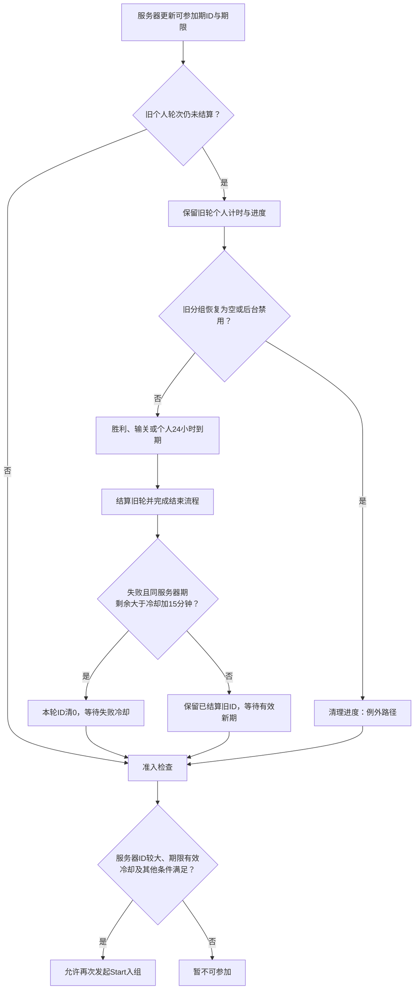

# Lava Quest 逻辑与配置

本文件是活动机制与配置的持续维护主文档。新发现按主题更新对应章节；过程、版本更正和调查轮次保留在 Daily 与证据记录，不以“第几轮深挖”扩展正文。资源对象详见资源与表现文档，原始采集和静态方法清单详见证据与验证文档。


## 1. 结论与验证范围

Lava Quest 是普通关卡之上的七胜挑战：玩家最终胜负推进本轮状态，其他参赛者人数按分组下发曲线展示，奖金取决于奖池和胜者数。已确认失败重试时间门槛、展示随机化，以及与通用连胜收益的共同胜负入口；尚未证实 Lava 阶段主动修改棋盘难度或服务端场景分配概率。

依据为 38911 XAPK、Windows Cpp2IL 类型/方法及关键 ARM64、MuMu 只读配置和保存轮次。38911包体SHA256与历史样本一致；39781已从设备提取代码/元数据分包并核对设备端与本地SHA256，周期链已重验，未比较全部资源分包或内存。保存事件已过期，静态代码存在不代表该账号当前启用。ISIL 有未支持指令，关键分支结合原始 ARM64 核验；具名调用索引不覆盖全部内联、虚调用和函数指针。

## 2. 模块职责与数据流

下表相对路径基于 Windows-Audit/diffable/DiffableCs/Assembly-CSharp/。

| 层 | 入口 | 职责 |
|---|---|---|
| 中央回调 | `Royal/Player/Context/Units/EventsHelper.cs` | 转发进入关卡、最终胜负、退出和恢复相关事件 |
| 活动管理 | `Royal/Player/Context/Units/LavaQuestManager.cs` | 资格、活动时限、加入、进度、分组展示、奖励与弹窗条件 |
| 进度 | `Royal/Player/Context/Data/Persistent/LavaQuestProgress.cs` | 持久化 Step、关卡中状态等；关键位域已恢复，见第 8 节 |
| 配置模型 | `Royal/Scenes/Home/Ui/Dialogs/LavaQuest/LavaQuestConfig.cs` | 奖励、单轮时长、失败冷却、版本 |
| 加入协议 | `Royal/Infrastructure/Services/Backend/Protocol/EnterLavaQuestRequest.cs` / `EnterLavaQuestResponse.cs` | 发送 Level/LeagueLevel，返回事件与分组 |
| 分组协议 | `Royal/Infrastructure/Services/Backend/Protocol/LavaQuestUserGroupInfo.cs` | Scenario、StepUserCounts、WinnerCount |
| UI | `Royal/Scenes/Home/Ui/Dialogs/LavaQuest/` | 开始、查找玩家、比赛展示、说明、完成和冷却；本轮 Bundle 内 MonoScript 亦可定位类名 |

```text
服务端活动信息 → 活动 ID / 结束时间 / 配置版本与 JSON
               → App.KeyValue 配置缓存
Start 请求     → Level / LeagueLevel
分组返回       → Scenario / 人数序列 / WinnerCount
               → 账号 LavaQuestTableItem + Progress
关卡最终结果   → EventsHelper → LavaQuestManager
               → 逻辑进度更新 → Home Flow / 关前 UI → 淘汰与奖励表现
```

这是静态链路与存储证据的合并模型；10-27 已取得定向 TLS 抓包，但未解密，不能把数据库字段声称为直接抓获的响应正文。

网络命令经 `HttpCommands.PrepareRequests` 合并成 FlatBuffer `RequestPackage`，响应经 `HttpCommands.Finish` 分发。加入为 `EnterLavaQuest`（类型50）；恢复分组为 `GetLavaQuestInfo`（51），请求包含保存的 StartLevel、IsLeagueLevel、Scenario、WinnerCount、EventId，完成后进入 `LavaQuestManager.UpdateInfo`。整期活动信息另由 Ping（1）/GetEventInfo（49）携带的 `LavaQuestInfo` 更新；分组请求不能替代整期排期查询。上述命令编号和调用链来自静态代码，不是已解密抓包。

## 3. 参与资格、入组关卡与恢复分组

**与Ancient的区别（39781核对）**：Lava由玩家主动发起Start，成功取得分组后EnteredEvent建立本轮并初始化个人24小时；Ancient由中央活动管理器在满足资格、选中且未锁定时自动写参与状态，不需要同类Start分组请求。Ancient的教程/界面交互与逻辑入场分开，普通关卡推进仍受教程门槛限制。两者不能共用“点击参加才开始倒计时”的产品描述。

历史代码要求等级资格、服务端活动有效且后台未关闭、没有阻塞的新旧轮次、冷却结束、剩余活动时间可接受、网络可用且仍有主线/联盟关卡。图标可见不等于所有加入条件已满足。

加入时请求体显式包含 `Level` 与 `LeagueLevel`。请求体未列出付费、胜率等画像，不等于服务端无法从登录上下文取得这些资料；服务端选取 Scenario 的算法不能从这两个字段推断。

首次提示与再次提醒分别有 `NotifiedServerEventId`、`IsSecondStartPopupShown`、`ReminderDialogClosedCount` 等存储/代码线索。历史弹窗分析确认 `ShouldShowSecondStartPopup` 与统一二次提醒许可参与判断。精确弹窗优先级和频率不得仅凭计数字段反推。

### 起始关卡的使用链路

```text
TryEnterEvent
  → EnterLavaQuestHttpCommand(startLevel, leagueLevel, requestedWithLeague, origin)
  → Build → CreateEnterLavaQuestRequest(Level, LeagueLevel)
服务器返回分组
  → Finish 使用命令保存的起始关卡参数
  → EnteredEvent → 保存 StartLevel 与 IsLeagueLevel
恢复/补取分组
  → TryGetEventInfo(StartLevel, IsLeagueLevel, Scenario, WinnerCount, EventId)
```

关键区别：StartLevel 不是每过一关都更新的“当前等级”。命令对象在发起入组时保存参数，`Finish` 将这些参数回传给 `EnteredEvent`。其 ARM64 在 `0x01CB3ED4` 以 requestedWithLeague 选择 leagueLevel 或 startLevel，再写入 Progress。

在本次已解析 Assembly-CSharp 具名调用检索中，`LavaQuestProgress.set_StartLevel` 仅见入组写入；`get_StartLevel` 见于 TryGetEventInfo 的有效性检查及请求参数。没有发现它在普通 WonLevel 中用于每步重新选组。

| 问题 | 判断 |
|---|---|
| 入组关卡会传给服务端吗？ | **会，已核对 Build 的实际序列化调用。** |
| 是否持续保存并用于恢复？ | **会，且区分主线与联盟编号。** |
| 是否影响匹配到的历史场景？ | 它作为入组输入，与该用途相容；服务器选择规则尚不可见，不能证明改一关必然换场景。 |
| 同一个起始关卡是否总得到相同人数？ | 未知；请求还有账号上下文，响应有 Scenario/WinnerCount，不能只靠关卡号推算。 |
| 是否直接进入奖金公式？ | 所查公式直接使用奖池及胜者数；起始关卡没有直接进入该公式。若服务端据关卡改变胜者数，才会间接影响奖金，但此因果尚待验证。 |
| 是否直接代表固定棋盘文件 ID？ | 不能。它是进度编号；具体关卡版本、联盟映射及加载覆盖还需要关卡加载证据。 |

保存样本：StartLevel=2692、IsLeagueLevel=false，ScenarioId=`l2692_8_2_v1` 的 2692 与之吻合。这支持“场景标识含起始关卡”这一观察，不足以恢复所有命名片段或服务器查表规则。若主线正常逐关推进，七胜通常覆盖从 2692 开始的七关；本次没有逐局记录，不将 2692～2698 当作已实测关卡清单。

## 4. 七连胜状态机与异常处理

| 常量 | 值 | 含义 |
|---|---:|---|
| InitialStep | 1 | 挑战起始逻辑值 |
| TotalStepCount | 7 | 需要七次有效胜利 |
| SuccessStep | 8 | 完成终态 |
| FailStep | 9 | 失败终态 |

注意：Prefab 里 `Step0`～`Step7` 是八组展示节点；逻辑 Step=1/8/9 是状态编码，两者不是可以直接互换的关卡编号。

| 事件 | 历史代码行为 | 关键边界 |
|---|---|---|
| `EnteredLevel()` | 记录进入有效关卡 | 用于异常退出/恢复处理 |
| `WonLevel()` | 清理关卡中标记，推进 Step | 满七胜进入成功 |
| `FailedLevel()` | 清理标记，写 FailStep | 是整轮失败，不是仅退一格 |
| `CheckIfQuitInGame()` / 无法恢复 | 检测残留关卡中状态，按失败处理 | 并非所有切后台都会失败；必须考虑关卡是否能够恢复 |
| 购买续步后继续 | 活动层未见单独判负；最终 Win 才推进 | 不把官方“first try”误读为禁止续步；现场尚未完成此验证 |
| Side Progression 胜利 | 不增加 Lava Step；相关回调仅有后续 UI 标志 | 不把所有活动内关卡都计入七连胜 |

历史调用链：`GameManager.StartGame → EventsHelper.EnteredLevel`；`UserManager.LevelEnd / UpdateEventsOnLevelWin → EventsHelper.WonLevel / FailedLevel`。

### 活动计数与入组前胜场的关系

`EnteredEvent` 无论入组前连续赢过多少关，都会将本轮 Step 写为 1。`get_ShouldProgress`（0x01CB1D7C）检查 IsInAnEvent 且尚未完成。

`WonLevel`（0x01CB5568）：先清理 IsInGame；满足 ShouldProgress 才执行 `Step=min(Step+1,8)`，随后更新动画标记。`FailedLevel`（0x01CB2A28）：满足推进条件时写入失败终态 9，不是扣一格。七胜之后不继续把该轮 Step 累积成八连胜、九连胜。

这意味着：

- 入组前赢六关，不会让新开的 Lava 只剩一关。
- Step 是活动状态编码，失败时的 9 不是“九连胜”。
- 第七次有效胜利使 Step 从 7 到 8，进入完成态；本次保存样本正是 Step=8。
- `EventsHelper.WonLevel/FailedLevel` 同时转发到 Lava 与 SuperBooster 等系统，但它们维护各自状态。
- 最终失败、异常退出处理和 Side Progression 有独立入口，不能将任何过关动画都计为 Lava 七胜；续步界面出现也不等同于已经调用最终 FailedLevel。

目前所查 Lava 胜利推进方法没有读取“全局连续赢了多少次”，也没有第 5/6/7 次胜利时改写棋盘参数的分支。它的主要七胜阈值用于完成判定与表现推进。

## 5. 配置、期限与失败重试

本节为10-27整理后的当前结论：**39781实际安装文件已重新提取、绑定并核对ARM64，Lava采用服务器准入期限与个人挑战期限两套计时。正常客户端路径支持个人挑战跨过服务器截止；服务端是否继续保留旧分组仍未实测。** 本文其他机制若未注明39781，仍属于38911分析范围，文件名保留以维护既有链接。

### 配置与两套期限

39781运行后的App.KeyValue再次只读采得配置版本15：

```json
{"r":{"a":10000,"t":"C"},"c":1800,"d":86400}
```

| 项目 | 值/规则 | 实际用途 |
|---|---|---|
| 奖池 | 10000金币 | 胜者分奖基础值 |
| d | 86400秒 | 成功入组后建立个人24小时挑战 |
| c | 1800秒 | 满足重试条件后的失败冷却，不是下一期复开间隔 |
| 服务器截止 | 接收时nowMs＋服务器RemainingTime | 当前服务器期的准入、同一期失败重试窗口等 |
| 个人截止QuestEndDate | 入组成功处理时的当前秒＋d | 比赛倒计时、个人超时失败；不是点击Start的瞬间，也不是下发的固定日切时间 |

`EnteredEvent`（39781：0x027C7D3C；核心写入0x027C7E90～0x027C7EEC）读取config.d并写个人截止，没有取与服务器截止的较小值。`RemainingQuestTimeInMs`（0x027C57C8）读个人截止×1000减当前毫秒；`RemainingTimeInMs`（0x027C567C）读服务器截止减当前毫秒。二者不能混用。

### 跨服务器截止：保留条件与清理例外

| 39781核对点 | 代码结果 | 对跨期的含义 |
|---|---|---|
| IsInAnEvent，0x027C58BC | 本轮EventId>0且未Claimed | 不要求本轮ID等于最新服务器ID，也不比较服务器截止 |
| DidFailByTimeFinished，0x027C5E94 | 个人时间耗尽，且不是已输关/已胜利 | 不因服务器期限单独耗尽而判超时失败 |
| IsEventCompleted / ShouldProgress，0x027C5E10 / 0x027C5DE0 | 已胜利、已输关或个人超时结束；仍在轮次且未结束才推进 | 正常推进链未追加服务器截止/新旧ID一致性条件 |
| UpdateServerEventInfo，0x027C7888 | 更新服务器ID、截止和配置 | 不重写个人QuestEndDate，不直接重置旧挑战 |
| LoadDataAndProgress，0x027C6858 | 从持久化读回Progress | 所查恢复入口没有按服务器截止直接截断个人时间 |
| TryGetEventInfo，0x027C8304 | 分组缓存与本轮状态不一致时，用本轮EventId/StartLevel等请求恢复 | 可请求旧轮分组；能否返回有效分组由服务器决定 |
| UpdateInfo，0x027C85E0 | 分组为空或已后台禁用时ResetProgress并清本地分组；有效分组恢复不重建个人截止 | 旧轮可能被恢复响应清掉，不能保证无条件跨期 |
| DisabledByBackend，0x027C9040 | 禁用时清缓存、本地数据并完整重置进度 | 服务器开关是明确例外，不能等同于普通到期 |

因此，**“服务器截止一到就自动抹掉个人剩余时间”与已核对的正常本地路径不符**；更准确的结论是“客户端设计容许跨截止继续，最终还取决于旧分组恢复、后台开关与正常胜负/超时”。目前没有跨截止连续游玩实测，也没有解密服务器恢复响应，不能将代码允许写成线上保证。

### 结束后下一期如何触发

1. **旧轮先结束并结算。** TryClaimEvent（0x027C6C24）只处理已参加且完成的轮次，设置Claimed和LastSession；胜利走发奖，失败/超时再判断同一期重试资格。个人时间耗尽本身不会创建新的服务器ID。
2. **同一期失败重试单独判断。** 必须失败/超时、服务器ID仍等于本轮ID，且服务器剩余时间严格大于c×1000＋15分钟；才写冷却、将本轮EventId清0、Claimed清false。当前c=30分钟，门槛为剩余>45分钟。不是首次入场统一门槛。
3. **结束流程清除LastSession过渡标志。** LastSessionCompleted（0x027C6F50）清该标志并刷新图标；OnStart/OnQuit的EventEndFlow及弹窗完成回调有对应路径。结算完成不等于同一指令立即开下一轮。
4. **跨到新一期重新检查准入。** CanJoinEvent（0x027C5C64）要求未在未结算轮次、服务器ID>本轮ID且>0、服务器剩余至少1毫秒、冷却已结束、LastSession已清、等级满足、未后台禁用，默认还检查可玩关卡。因此旧轮跨过一至多个日切后，只要服务器提供符合条件的较大ID，就有资格加入该期；并无“必须旧ID＋1”的限制。
5. **再由入口/流程实际发起入组。** 资格通过与图标/弹窗展示、点击Start、请求成功是不同节点。不能把“出现新ID”写成自动完成入组。



### 下发时机、观测与待验证排期

39781的PingHttpCommand、UpdateUserProgressHttpCommand、SyncManager仍有两活动的信息更新调用；服务器信息能随普通同步返回，不必等点击活动。Lava专用入组/恢复请求处理个人分组；收到新的服务器活动信息不等于清掉本轮。当前未确定固定刷新频率，也未取得完整运营日历。

| 证据层 | 今天取得的结果 |
|---|---|
| 39781当前缓存 | Lava配置15；服务器仍为旧1124期、截止10-26 15:59:58.453 +08，不能据此实测新的跨期轮次 |
| 网络实测 | 38911与39781定向TLS抓包分别29/24条有效记录，未解密；MuMu x86_64转译ARM64的执行域限制尚未解决 |
| 用户未验证观察 | 周五至周日开放、每日一期；作为检索假设保留，不作为已确认规则 |
| 38911设备-1时间对照 | 模拟周五切期附近、周六、下周一，离线/联网与配置补取后均未取得有效Lava期或配置；完整恢复快照也未出现Lava配置键。无法以改日期替代服务器新期信息 |
| 已支持的机制 | 入组成功后建立个人24小时、服务器ID/期限控制新入场、失败重试与跨期换期分离 |
| 仍未知 | 周内日历、完整开档时间、服务端是否按账号给期限、跨截止旧分组是否保留、实际复开间隔 |

时间实验的完整矩阵与副作用统一见 [[02-PROJECTS/产品分析/Royal Match/运营配置/排期与配置总览#改设备时间能否补出其他排期|排期对照]]。实验未在Lava已参加状态执行，不能据此验证或否定个人倒计时跨服务器截止的保留逻辑；原设备0未启动。38911已查活动信息/Upcoming请求没有目标日期查询参数，不能靠改前端日期任意索取未来日历。

设备-1的38911补充对照（10-28）：本机日期临时前移48小时至周五，正常启动30秒后，Lava仍无有效事件ID/配置/期限；没有因“本地到周五”取得下期。同期Ancient与Book事件ID保持316/717，客户端换算截止随本机时钟后移，剩余量基本只按实际经过时间减少。时间与自动校时均已恢复，原设备未操作。此结果支持单改本地日期不足以取得服务器未来档期，不证明Lava永远不受时钟影响，也未验证已入组个人倒计时；当前号根本未入组。原始证据位于38911设备-1 `book-treasure/time-probe-result.json`；完整周历和复开间隔仍未知。

新版证据：`06-PRODUCT-ASSETS/RoyalMatch/39781/04-ReverseEngineering/Period-Audit/`。installed-binding.json绑定设备与本地代码/元数据分包；runtime-configs.json为当前只读配置；methods与method-index.json为571段定向原生方法；lifecycle-callers.json扫描可执行节中相关直接B/BL调用。571为导出数量，并非全部逐段人工验证；直接调用扫描不覆盖间接/虚调用，方法终点按下一具名地址截取，关键方法已人工核对分支与RET。历史38911和抓包失败证据保留，不覆盖。

### 失败结算的重试窗口

`LavaQuestManager.TryClaimEvent`（38911：0x01CB2BC0；39781：0x027C6C24）原始 ARM64 均显示，活动完成后的失败/超时处理除了判断同一事件，还比较总活动剩余时间与冷却时间加 15 分钟。关键判断可归纳为：

```text
前提：正在处理已完成的轮次
先设置 IsLastSessionOfEvent=true、IsClaimed=true
若因时间或输关失败，且当前服务端事件 ID == 本轮事件 ID：
    cooldownMs = config.c * 1000
    若 RemainingTimeInMs > cooldownMs + ConvertMinToMs(15)：
        设置冷却结束时间和相关元数据
        本轮 EventId = 0
        IsClaimed = false
        清理已通知事件标记
```

原始分支使用 `B.LE` 跳过重置，即相等时也不重置。`TimeUtil.ConvertMinToMs` 的原始乘数为 60000。配置 c=1800 秒，所以阈值是 **45 分钟**。

这是**失败/超时结算时能否重置出可重试轮次**的门槛；还需其他资格条件满足。`CanJoinEvent`（0x01CB1C00）本身检查活动剩余时间为正、冷却结束、事件关系、等级与禁用状态等，不能把 45 分钟扩写成所有首次加入的限制。没有实测末尾 45 分钟内失败后的逐屏文案，因此不描述未经观察的 UI 提示。

配置类型位于 `Royal/Scenes/Home/Ui/Dialogs/LavaQuest/LavaQuestConfig`，字段 v/d/c/r 偏移分别 0x10/0x14/0x18/0x20。

## 6. 模拟对手、人数曲线与展示随机

核心链路：

```text
EnterLavaQuestHttpCommand → LavaQuestUserGroupInfo
  ├─ Scenario → Progress.Scenario
  ├─ WinnerCount → Progress.WinnerCount
  └─ StepUserCounts → LavaQuestData.SetQualifiedUsers → 本地人数序列
WonLevel → Step = min(Step + 1, 8)
GetPlayerCount(step) → 人数序列[step - 1]
```

`LavaQuestManager.EnteredEvent`（0x01CB3CD8）、`WonLevel`（0x01CB5568）及 `LavaQuestData.SetQualifiedUsers/GetPlayerCount` 支持上述结论。这里没有逐名对手实时打关或每过一关重新掷骰的普通回调。`TryGetEventInfo/UpdateInfo` 存在恢复和刷新分组数据的通道，因此不能进一步声称人数永远不可更新。

保存样本的其他参赛者人数为 `99 → 68 → 52 → 40 → 21 → 18 → 16 → 8`，Scenario=2，ScenarioId=`l2692_8_2_v1`。末端 8 与 WinnerCount=8 一致。这只能说明这一个分组的淘汰安排；把每段人数之比称为“服务器概率表”不成立。

代码存在 `SetQualifiedUsersByAdmin(List<int>)`，但本次 Assembly-CSharp 已解析具名调用索引没有找到其调用者。它是可覆盖人数的代码能力线索，**不是线上已启用人工调控的证据**；本次未调用或修改它。

服务端仍未知：候选场景全集、权重、是否按失败次数/付费/技能/活动阶段分配，是否有保底、是否跨轮改变胜者数。加入请求显式携带 Level/LeagueLevel，不代表后台只能知道这两个属性。

### 展示抽样与数值概率的区别

`LavaQuestData` 有随机姓名、头像、解锁头像与边框方法。`LavaQuestUiDataProvider` 从候选名单组织展示卡片，Finding 场景使用随机布尔值交错名单；Competition 名单随机种子与用户标识及活动 ID 有关。它们用于组织展示，未在这些方法中发现改写 Progress.WinnerCount 或过关结果。

| 展示位置 | 代码约束 | 解释 |
|---|---|---|
| Finding Players | MaxCardCountOnFindingScene=29 | 展示卡片不等于完整 100 人名单 |
| Completed | MaxCardCountOnCompletedScene=6，取胜者数与 6 的较小值 | 样本共 9 名胜者也不要求画出 9 张卡片 |
| Competition | GetCardCounts 按阶段限制卡片数量，GetLeaders 组织代表名单 | 可见掉落人数/头像不能直接反推全部参赛人数 |
| 金币收集、粒子 | Random.Range、粒子 randomSeed | 表现随机，不是奖池开奖概率 |

尚未发现 Lava 正常胜负回调中的本地“通关率参数”或“奖励抽奖权重”。这一结论不覆盖服务端 Scenario 分配、未解析的间接调用或所有全局棋盘算法。

## 7. 奖励计算与领取边界

静态方法 `LavaQuestManager.GetInventoryPackage()` 的包内定位为 `0x01CB6EF4`。地址只用于已确认的 38911 静态样本，不应直接拿来对另一二进制运行时定位。

```text
winners = WinnerCount + 1
base = floor(pool / winners)
coins = ceil(base / 10) * 10
```

| 其他胜者 | 加玩家后的胜者 | 奖池 10,000 时的个人金币 |
|---:|---:|---:|
| 0 | 1 | 10,000 |
| 2 | 3 | 3,340 |
| 5 | 6 | 1,670 |
| 8 | 9 | 1,120 |

该公式解释了为什么个人金额不一定是精确平均值。计算顺序先整数除法再向上取十；不能用这个单客户端公式推断服务端跨用户最终发放总额。

位域解码确认本地成功及已领取标记；1,120 仍是配置公式推导，尚无实际余额变化证据。领取幂等、断网重试和库存到账需要查最终领奖调用或运行证据，不能从完成 UI 推定。

## 8. 保存状态与位域解码

来源为账号库 `app_pFiles/U_<账号ID>` 的 `LavaQuestTableItem`。原始白名单保存于 `state-selected.json`。

| 字段 | 值 | 可确认的意义 |
|---|---|---|
| ServerEventId / EnteredEventId | 1124 / 1124 | 保存活动与参与事件 ID 相同 |
| EnteredEventScenario | 2 | 保存场景编号 |
| ScenarioId | l2692_8_2_v1 | 保存场景标识；不擅自将各片段解读为账号关卡或分群规则 |
| QualifiedUsers | 99,68,52,40,21,18,16,8 | 八个检查点的其他参赛者计数；对应历史分组人数语义 |
| EnteredEventWinnerCount | 8 | 保存其他胜者数，与序列尾值一致 |
| ServerEventEndDate | 1793001598453 | 按 Unix 毫秒转换为 2026-10-26 15:59:58.453 +08:00 |
| ShouldConsumeAnimation | False | 保存的待消费动画标记为假，不证明已经领奖 |
| StepForAnimation | 1 | 展示状态字段，不直接等于玩家当前已赢一关 |
| IsFinishAnalyticSent | True | 已保存的埋点发送标记，不能推断胜负结果或到账 |
| CooldownEnterEventId | 0 | 无该字段上的冷却事件 ID；单字段不能证明可重新参赛 |

若玩家一直存活，将其加回后的显示人数候选为 `100,69,53,41,22,19,17,9`；逐步淘汰其他人数为 `31,16,12,19,3,2,8`。这是依据人数语义的算术对照，尚未逐屏验证 UI 是否每次均显示该结果。

此数据不能用来推导真实玩家实时胜率、当前关卡难度或服务端分组概率。样本只有一个轮次，且已过期。

账号 KeyValue 的两个 64 位 Progress 值已在静态审计按代码位域解码：Step=8、IsClaimed=true、StartLevel=2692、IsInGame=false、IsLeagueLevel=false；事件 1124、Scenario=2、WinnerCount=8 与独立字段吻合。见[[02-PROJECTS/产品分析/Royal Match/活动/Lava Quest/隐藏策略与调控审计-38911|隐藏策略与调控审计]]及原始目录 progress-decoded.json。

### 位域对照

根据 `LavaQuestProgress` 位域及读取方法解码两个保存的 64 位数值：

| 存储值 | 位段（含两端） | 解码 |
|---|---|---|
| Progress1 | 32..44 / 45..51 / 52..56 | EventId=1124 / WinnerCount=8 / Scenario=2 |
| Progress1 | 57..60 / 61 | Step=8 / IsClaimed=true |
| Progress2 | 32..49 / 50 / 51 | StartLevel=2692 / IsInGame=false / IsLeagueLevel=false |

`get_DidWin` 比较 Step==8，故**本地保存的是成功终态与已领取标记**。缺少金币余额前后对照与完整库存链验证，不能把标记等同于实测到账 1120。StepForAnimation=1 是展示字段，不能替代逻辑 Step。

## 9. 通用连胜收益与叠加损失

本次定位到两个共同的结果入口：

- `UserActiveLevelData.Win`（0x032B8920）：包含 Cloche.UpdateProgress、SuperBooster.IncrementWinCount、SuperDuke.IncrementWinCount。
- `UserActiveLevelData.FailOrQuit`（0x032BA018）：包含 Cloche.ResetProgress、倍率失败处理，以及强化进度更新。调用前存在资格判断，不能说每局无条件修改全部系统。

**Cloche**：`AClocheStrategy.ShouldIncrementClocheProgress` 检查资格及 `current < maxStepCount`；重置条件包含资格及 current>0。默认管理器常量为 DefaultMaxCloche=3，但策略可选择不同上限，不能当作所有分组的固定值。它是连胜带来的开局收益链的一部分。

**SuperBooster/SuperDuke**：胜利路径增加独立进度；失败路径从 BeforeAfterData 的变化计算新值再交给 UpdateProgress。SuperDuke 有独立阈值常量 5，SuperBooster 激活检查还包含虚调用与进度比较。这里没有必要把这些阈值强行解释成 Lava 的七胜门槛。实际启用还受功能、资源、AB 等条件限制。

**MultiplierSelection**：存在明确的连续胜利策略分组。

- `IsConsecutiveStreakGroup`（0x02114D14）对 sessionAbV2Group=3/4 返回真。
- `OnStreakLevelWin`（0x02114ABC）处理组 3～5，检查选择功能与相关界面已见标记；将 streak 加一并限制到组别门槛，达标后解除倍率锁定。
- `OnStreakLevelFailOrQuit`（0x02114BE8）排除 Side Progression；组 3/4 与组 5 的已锁定状态处理不同，进入重置分支后将 streak=0、locked=true，并保存下降前的计数供表现使用。
- 门槛来自二进制表，本次未独立恢复表项，不补猜“需要几连胜”。

因此，一次失败可能同时失去 Lava 轮次、强化进度和倍率解锁进度。这是代码上可定位的叠加损失机制；不能仅凭这种体验断言系统主动安排玩家失败。

## 10. 关卡数值、概率与续步策略

### 当前关卡参与种子

`LevelRandomManager.GenerateTrySeeds`（0x01ED95BC）生成 0～999 的候选种子列表，读取 `UserActiveLevelData.number`，结合用户标识的低位及设备键构造用于洗牌的种子。`ResetDifficultySeed`（0x01ED92B4）随后按一个持久化整数对列表长度取余选种子。该整数的键名/所有写入者本次未闭环，不能只凭方法名将其认定为连续失败次数。

`GetDifficultyNext`（0x01ED98C8）增加随机调用计数，然后调用 difficultyRandom。其消费者包括 ItemCreator、LevelSet、棋盘洗牌和道具模式选择。因此“关卡号参与随机流”是实际棋盘链路，不只是 UI 效果；但种子改变不等于有方向地提高难度。

需要特别区分：这里使用的是**当前活动关卡数据中的 number**，不是直接读取 LavaQuestProgress.StartLevel。不同入组位置会改变随后经历的关卡序列，这是自然关联，不是已证实的 Lava 专属控制。

### LowMatch 权重

`LevelParser.PrepareGrid` 调用 `FTiledLevel.GetLowMatchArray`，传给 `ItemCreator.UpdateLowMatchRatios`。有效数组被存为 lowMatchRatios，并计算总权重。`GetLowMatchNeighborCount`（0x023F07DC）在总权重范围抽数，按前两个累加区间选择 0/1/2；`GetTunedItem` 消费这个结果。

对于有效三项非负权重 `[a,b,c]` 且总和为正，其区间对应概率为 `a/(a+b+c)`、`b/(a+b+c)`、`c/(a+b+c)`。这是由代码区间得出的条件公式，**不是当前 2692 关实际权重**。没有提取该关实际数组，也没有把三项直接映射为整体通关率。

WinFailManager.Win 也调用 UpdateLowMatchRatios，说明胜利后的填充表现可切换参数；该位置是在 Win 流程，不能误说成“连续赢几关前提前压低概率”。本次未恢复该调用的静态数组具体值。

目前未找到 Lava Step/Scenario → LowMatch 或 difficultySeed 的具名调用链；内联字段、虚调用、远程关卡覆盖仍是验证边界。

### 反复尝试与续步加赠

`EgoExtraMovesHelper.CalculateAdditionalMoves`（0x032616DC）原始 ARM64 对应：

```text
limit = IsPriceChange10MovesAbEnabled ? 9 : 10
additionalMoves = 5 × max(0, min(Ego1SeenCount, limit) - 4)
```

| Ego1SeenCount | 加赠步数（该方法计算值） |
|---:|---:|
| 0～4 | 0 |
| 5 | 5 |
| 6 | 10 |
| 9 | 25 |
| ≥10 | 普通上限 30；对应价格 AB 分支上限 25 |

EgoManager.EgoShown 调用 IncrementEgo1SeenCount，增加还受额外步数资源就绪条件限制；WinFailManager.Win 调用 ResetOnLevelWin 清零。**这个计数是续步展示相关计数，不可直接替换成“连续输关次数”，更不是每次赠送免费初始步数。** 实际续步基础数量、价格和购买资格需结合 EgoPackage/界面分支，本次公式仅指加赠部分。

`SemiDynamicDifficulty` 名字也容易造成误判：本版本 `OnLevelFail`（0x02500B5C）直接 RET；OnLevelSuccess 转到 IncrementTryCount，而该增量路径排除联盟/故事关并限制活动关卡编号≤100。因此它不能直接解释主线 2692 样本的“越赢越难”。这不覆盖其他难度策略实现。

### Lava 专属调难的证据边界

判断范围包括活动管理器、非 Lava 类对 Lava 的调用，以及步数、难度、随机数消费者。

- `LevelManager.get_IsLavaLevel`（0x01E192CC）读取的是管理器 `ShouldShowLavaLevel`。其已解析具名消费者集中于场景背景、加载、UI、横屏标识和棋盘滚动背景动画。名字含 LavaLevel 不足以认定它换了难度或棋盘。
- `MoveManager.GetMoveRemoveAmount` 连接 `SuperDukeManager.ShouldRemoveOneMove` 与 `SlbMoveConfigHelper.GetMoveAdjustment`。ShouldRemoveOneMove 在此包体虽然调用 AB 判断，但最终固定返回 false，不能作为生效减一步证据；SlbMove 是独立路径。
- `SlbMoveConfigHelper.TryGetEntry`（0x0221E66C）读取 SuperBooster AB 分组；本次检查的范围为 C:160～230、D:75～230、F/G:111～230、H:211～230。样本主线起始关卡 2692 不在这些范围，**这一个 helper 的分支不能解释该样本的步数调整**，不代表所有调整系统都已排除。
- `SemiDynamicDifficulty.GetUpdatedMoveCount`（0x02500C38）检查联盟关卡并读取 LeagueManager 的额外步数；`GetSkill` 读取 User.Skill。所查方法没有读取 Lava Step/Scenario。
- Lava 管理器中的已解析 AB 调用 `IsNotificationReductionEnabled` 位于图标通知路径，并非胜负数值分支。

仍需谨慎：IL2CPP 可能使用内联字段读取、虚调用、函数指针或工具未解析的调用；因此本次不能证明“全游戏没有根据活动进度调难”。可以确认的是：没有足够证据将已见到的通用调整归因于 Lava 阶段。

## 11. 统计上报与服务端未知

`UserStatsHelper.OnLavaQuestWin` 增加 Lava 胜利统计并标记待同步；统计发送链包括 PrepareChangedStats/PrepareAllStats、SetUserStatsHttpCommand、SendToStatsServer。后端可以拥有活动历史，但“收到统计”不等于“用于下轮分组”。

要继续验证服务器概率与人群策略，应保存多个自然产生的轮次：入组前关卡/活动状态、返回 Scenario/人数曲线/胜者数、实际关卡配置及结果。多轮只能估计样本内关联；验证因果还需对照实验或服务器规则。当前没有批量查询服务器、枚举其他账号或改写游戏状态。

## 12. 待验证问题与证据入口

| 待验证项 | 需要补充的证据 |
|---|---|
| 起始关卡如何影响 Scenario、胜者数与奖励 | 多轮自然分组/响应对照；服务器分配规则不可从单样本推定 |
| Lava 七关实际步数、LowMatch、种子及强化状态 | 逐局实际关卡版本和状态差分；区分主线自然差异与活动阶段影响 |
| 重试 45 分钟临界点、异常退出与续步 | 对应运行路径、时钟与状态对照 |
| 1120 金币实际到账、领奖幂等与覆盖 | 库存前后变化和完整领取/重试链 |
| 全部虚调用、AB 激活与概率表项 | 对应目标/表项恢复和当前账号启用状态 |
| 资源加载映射、音效调用与 UI 优先级 | 加载索引、控制器调用及运行验证 |

完整来源、工具版本、方法地址与验证记录统一维护于 [[02-PROJECTS/产品分析/Royal Match/活动/Lava Quest/证据与验证-2026-10-26|证据与验证]]。活动入口为 [[02-PROJECTS/产品分析/Royal Match/活动/Lava Quest/README|README]]；资源专题见 [[02-PROJECTS/产品分析/Royal Match/活动/Lava Quest/资源与表现-38911|资源与表现]]。
