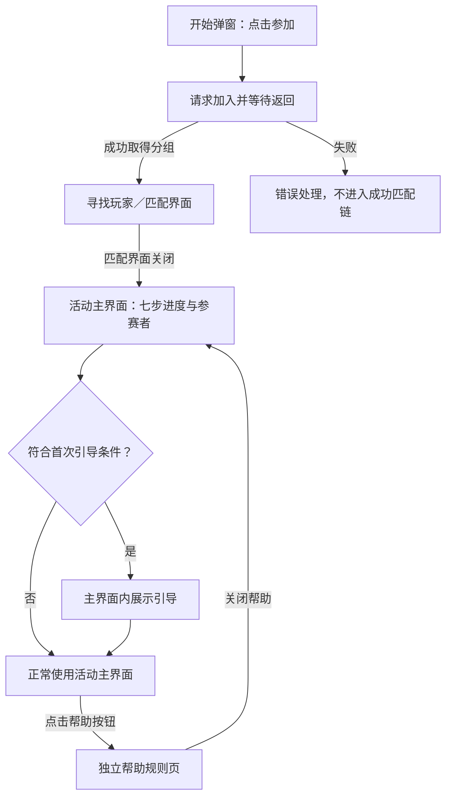
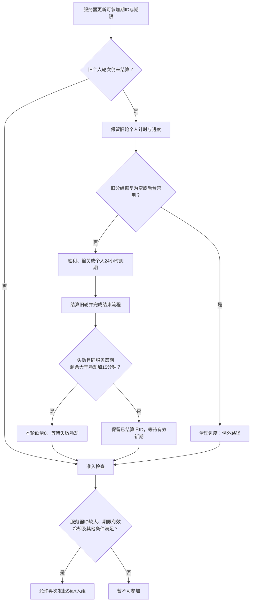

# Lava Quest 逻辑与配置

本文件是活动机制与配置的持续维护主文档。新发现按主题更新对应章节；过程、版本更正和调查轮次保留在 Daily 与证据记录，不以“第几轮深挖”扩展正文。资源对象详见资源与表现文档，原始采集和静态方法清单详见证据与验证文档。


## 1. 结论与验证范围

Lava Quest 是普通关卡之上的七胜挑战：玩家最终胜负推进本轮状态，其他参赛者人数按分组下发曲线展示，奖金取决于奖池和胜者数。已确认失败重试时间门槛、展示随机化，以及与通用连胜收益的共同胜负入口；尚未证实 Lava 阶段主动修改棋盘难度或服务端场景分配概率。

依据为 38911 XAPK、Windows Cpp2IL 类型/方法及关键 ARM64、MuMu 只读配置和保存轮次。38911包体SHA256与历史样本一致；39781已从设备提取代码/元数据分包并核对设备端与本地SHA256，周期链已重验，未比较全部资源分包或内存。保存事件已过期，静态代码存在不代表该账号当前启用。ISIL 有未支持指令，关键分支结合原始 ARM64 核验；具名调用索引不覆盖全部内联、虚调用和函数指针。

## 2. 模块职责与数据流

下表相对路径基于 Windows-Audit/diffable/DiffableCs/Assembly-CSharp/。

| 层 | 入口 | 职责 |
|---|---|---|
| 中央回调 | `Royal/Player/Context/Units/EventsHelper.cs` | 转发进入关卡、最终胜负、退出和恢复相关事件 |
| 活动管理 | `Royal/Player/Context/Units/LavaQuestManager.cs` | 资格、活动时限、加入、进度、分组展示、奖励与弹窗条件 |
| 进度 | `Royal/Player/Context/Data/Persistent/LavaQuestProgress.cs` | 持久化 Step、关卡中状态等；关键位域已恢复，见第 8 节 |
| 配置模型 | `Royal/Scenes/Home/Ui/Dialogs/LavaQuest/LavaQuestConfig.cs` | 奖励、单轮时长、失败冷却、版本 |
| 加入协议 | `Royal/Infrastructure/Services/Backend/Protocol/EnterLavaQuestRequest.cs` / `EnterLavaQuestResponse.cs` | 发送 Level/LeagueLevel，返回事件与分组 |
| 分组协议 | `Royal/Infrastructure/Services/Backend/Protocol/LavaQuestUserGroupInfo.cs` | Scenario、StepUserCounts、WinnerCount |
| UI | `Royal/Scenes/Home/Ui/Dialogs/LavaQuest/` | 开始、查找玩家、比赛展示、说明、完成和冷却；本轮 Bundle 内 MonoScript 亦可定位类名 |

```text
服务端活动信息 → 活动 ID / 结束时间 / 配置版本与 JSON
               → App.KeyValue 配置缓存
Start 请求     → Level / LeagueLevel
分组返回       → Scenario / 人数序列 / WinnerCount
               → 账号 LavaQuestTableItem + Progress
关卡最终结果   → EventsHelper → LavaQuestManager
               → 逻辑进度更新 → Home Flow / 关前 UI → 淘汰与奖励表现
```

这是静态链路与存储证据的合并模型；10-27 已取得定向 TLS 抓包，但未解密，不能把数据库字段声称为直接抓获的响应正文。

网络命令经 `HttpCommands.PrepareRequests` 合并成 FlatBuffer `RequestPackage`，响应经 `HttpCommands.Finish` 分发。加入为 `EnterLavaQuest`（类型50）；恢复分组为 `GetLavaQuestInfo`（51），请求包含保存的 StartLevel、IsLeagueLevel、Scenario、WinnerCount、EventId，完成后进入 `LavaQuestManager.UpdateInfo`。整期活动信息另由 Ping（1）/GetEventInfo（49）携带的 `LavaQuestInfo` 更新；分组请求不能替代整期排期查询。上述命令编号和调用链来自静态代码，不是已解密抓包。

## 3. 参与资格、入组关卡与恢复分组

**与Ancient的区别（39781核对）**：Lava由玩家主动发起Start，成功取得分组后EnteredEvent建立本轮并初始化个人24小时；Ancient由中央活动管理器在满足资格、选中且未锁定时自动写参与状态，不需要同类Start分组请求。Ancient的教程/界面交互与逻辑入场分开，普通关卡推进仍受教程门槛限制。两者不能共用“点击参加才开始倒计时”的产品描述。

历史代码要求等级资格、服务端活动有效且后台未关闭、没有阻塞的新旧轮次、冷却结束、剩余活动时间可接受、网络可用且仍有主线/联盟关卡。图标可见不等于所有加入条件已满足。

加入时请求体显式包含 `Level` 与 `LeagueLevel`。请求体未列出付费、胜率等画像，不等于服务端无法从登录上下文取得这些资料；服务端选取 Scenario 的算法不能从这两个字段推断。

首次提示与再次提醒分别有 `NotifiedServerEventId`、`IsSecondStartPopupShown`、`ReminderDialogClosedCount` 等存储/代码线索。历史弹窗分析确认 `ShouldShowSecondStartPopup` 与统一二次提醒许可参与判断。精确弹窗优先级和频率不得仅凭计数字段反推。

### 匹配、活动主界面与帮助的先后顺序（39781）

**首页入口红点与只看开始页（39781）**。默认分支在可以报名且服务器期号大于本地已通知期号时点亮红点。开始弹窗执行时调用 `StartDialogOpened`，把当前期号记为已通知。此后直接关闭、没有点击参加，入口下次刷新时本期报名红点熄灭。已入组且本轮已完成（含个人超时），在仍未结算且 `IsLastSessionOfEvent=false` 时另有结算红点，普通进行中不满足该条件。通知精简实验启用时跳过报名红点，只保留通过公共红点开关的结算分支。入口呈锁定态时视图直接隐藏红点。

证据：39781 `Period-Audit/entry-red-dot-39781.txt` 的 `PrepareIcon 0x3639B00`、`get_ShowIconNotification 0x27C5B98`、`ShowLavaQuestStartDialogAction.Execute`；同目录 methods 的 `StartDialogOpened 0x27CA26C`、`SetNotifiedServerEventId 0x27CA2C8`、`StartDialogClosed 0x27CA128`。仅安排弹窗尚未执行到打开回调时，不能按已通知处理。

**成功入组后先展示寻找玩家／匹配界面，再进入活动主界面；首次引导在主界面内判断展示。独立的帮助规则页由主界面的帮助按钮打开，不是这条入组链的必经前置页面。** 开始弹窗、比赛主界面、主界面内引导和独立帮助页需要分开描述。



这里的“匹配”是客户端 Finding Players 展示：代码在入组成功回调后才推入该界面，不能据动画反推服务器此时仍在实时寻找玩家。请求成功也不等于界面已实际显示，后续仍经过 Flow、场景和资源条件。

| 场景 | 顺序与条件 |
|---|---|
| 首次成功参加 | 开始弹窗 → 请求成功 → 匹配 → 主界面 → 满足条件时展示主界面内引导；独立 InfoScene 不在这条自动链上 |
| 已看过引导后再次成功入组 | 仍走匹配 → 主界面；引导已见位为真时不再准备首次引导 |
| 在主界面查规则 | 点击帮助 → 关闭主界面并展示帮助规则页 → 关闭帮助后返回主界面；此返回链不重新匹配 |
| 从胜利／失败展示入口打开主界面 | 首次引导还受来源限制，不能仅凭“未看过”推断必弹 |

引导资格分两层：`PrepareCompetitionDialogData` 在 `IsTutorialShowed=false` 且 `IsLastSessionOfEvent=false` 时准备 `shouldShowTutorial`；`TryShowTutorial` 还要求来源为 `Home=0`、场景不处于 `shouldAnimate` 状态。`LevelFail=1`、`LevelWin=2`、`SideProgressionLevelWin=3` 不满足这个 Home 条件。不要把名称 `IsLastSessionOfEvent` 自行解释为某个固定日历阶段。

`CompetitionDialogOpened` 先准备数据，再提前把持久化 `IsTutorialSeen` 写为 true；这是准备打开时的已见记录，不是玩家已经完整看完引导的证明。`ResetProgress(resetAll=false)` 会保存并恢复这个位，`resetAll=true` 则不恢复。因此常规保留标记的重置不会重复首次引导，但不能写成任何重置／换号都永远不再展示。

证据取自39781已绑定ARM64，目录为 `06-PRODUCT-ASSETS/RoyalMatch/39781/04-ReverseEngineering/Lava-Help-Matching-Audit/`；`audit.py` 可复现39个方法摘录，`manifest.json` 记录二进制及摘录SHA256。

| 关键方法／地址 | 支持的结论 |
|---|---|
| `LavaQuestStartDialog.OnStartButtonClicked` `0x363EEBC`；`EnterEventResponseReceived` `0x363F254`；`PushFindingPlayerScene` `0x363F4C0` | 参加发请求，成功后推入匹配动作；该处构造被内联，不能靠构造函数直接调用扫描判断不存在入口 |
| `ShowLavaQuestFindingPlayerSceneAction.Execute` `0x364344C`；`LavaQuestFindingPlayersScene.OnClose` `0x363920C` | 显示匹配，关闭时推入 Competition 主界面动作 |
| `PrepareCompetitionDialogData` `0x363E1A8`；`CompetitionDialogOpened` `0x27CA31C`；`CompetitionDialog.Init` `0x38289C4`；`TryShowTutorial` `0x3829568` | 先确定引导资格、提前写已见，主界面初始化时按来源及动画状态尝试展示 |
| `LavaQuestCompetitionDialog.OnInfoButtonClicked` `0x382B05C`；`ShowLavaQuestInfoSceneAction.Execute` `0x364375C`；`LavaQuestInfoScene.OnClose` `0x363C120` | 手动帮助入口、独立帮助页及返回主界面 |
| `LavaQuestManager.ResetProgress` `0x27C8164`；`LavaQuestProgress.ResetProgress` `0x2E2CF00` | 区分保留已见位的重置与全部重置 |

验证边界：本次仅做静态链路核对，未进行新账号首次参加、重试或实际曝光测试；直接 B/BL 扫描不覆盖全部委托、虚调用及Prefab绑定，函数边界取相邻命名地址近似。结论描述已确认成功链和帮助按钮入口，不声称枚举了所有异常恢复入口。

### 匹配与领奖界面的背景层级（39781）

| 界面／来源 | 界面承载与先后顺序 |
|---|---|
| 成功报名后的寻找玩家页 | 要求当前是 Home 场景，先隐藏首页 UI，再显示独立 FindingPlayersScene。开始弹窗关闭，匹配关闭后才安排比赛主界面。此时比赛主界面尚未打开。 |
| 第七胜后直接领奖 | 先显示比赛进度与胜出表现，再显示独立 CompletedScene。比赛主对话框关闭时，保留比赛场景视图，将它移出主对话框父节点并降到领奖页后面，作为背景。领奖完才继续关卡结束／返回首页流程。 |
| 已回首页，重新打开待领奖轮次 | 仍按比赛主界面→CompletedScene顺序安排，但 Home 来源不走上述保留比赛场景背景的分支，完成页承载于首页场景。 |

因此要区分领奖画面和金币飞向首页余额的收集动画。CompletedScene.Init 根据当前是否在 Home（并排除支线胜利来源）选择是否在首页播放金币收集，领奖页本身可在关卡结束期间展示。

来源为 `Period-Audit/activity-ui-layering-39781.txt`，重点是 CompetitionDialog.OnClose `0x382B65C` 起的 `sceneState=Win/3` 且 `originType!=Home/0` 分支、`BringBackOfCompletedDialog 0x382B880` 和 `SetParent(null)`。流程安排见 PushCompetitionDialog `0x27C9A48`；匹配见 `Lava-Help-Matching-Audit/ShowLavaQuestFindingPlayerSceneAction__Execute_364344c.txt`。静态核验，未逐帧录屏。

### 起始关卡的使用链路

```text
TryEnterEvent
  → EnterLavaQuestHttpCommand(startLevel, leagueLevel, requestedWithLeague, origin)
  → Build → CreateEnterLavaQuestRequest(Level, LeagueLevel)
服务器返回分组
  → Finish 使用命令保存的起始关卡参数
  → EnteredEvent → 保存 StartLevel 与 IsLeagueLevel
恢复/补取分组
  → TryGetEventInfo(StartLevel, IsLeagueLevel, Scenario, WinnerCount, EventId)
```

关键区别：StartLevel 不是每过一关都更新的“当前等级”。命令对象在发起入组时保存参数，`Finish` 将这些参数回传给 `EnteredEvent`。其 ARM64 在 `0x01CB3ED4` 以 requestedWithLeague 选择 leagueLevel 或 startLevel，再写入 Progress。

在本次已解析 Assembly-CSharp 具名调用检索中，`LavaQuestProgress.set_StartLevel` 仅见入组写入；`get_StartLevel` 见于 TryGetEventInfo 的有效性检查及请求参数。没有发现它在普通 WonLevel 中用于每步重新选组。

| 问题 | 判断 |
|---|---|
| 入组关卡会传给服务端吗？ | **会，已核对 Build 的实际序列化调用。** |
| 是否持续保存并用于恢复？ | **会，且区分主线与联盟编号。** |
| 是否影响匹配到的历史场景？ | 它作为入组输入，与该用途相容；服务器选择规则尚不可见，不能证明改一关必然换场景。 |
| 同一个起始关卡是否总得到相同人数？ | 未知；请求还有账号上下文，响应有 Scenario/WinnerCount，不能只靠关卡号推算。 |
| 是否直接进入奖金公式？ | 所查公式直接使用奖池及胜者数；起始关卡没有直接进入该公式。若服务端据关卡改变胜者数，才会间接影响奖金，但此因果尚待验证。 |
| 是否直接代表固定棋盘文件 ID？ | 不能。它是进度编号；具体关卡版本、联盟映射及加载覆盖还需要关卡加载证据。 |

保存样本：StartLevel=2692、IsLeagueLevel=false，ScenarioId=`l2692_8_2_v1` 的 2692 与之吻合。这支持“场景标识含起始关卡”这一观察，不足以恢复所有命名片段或服务器查表规则。若主线正常逐关推进，七胜通常覆盖从 2692 开始的七关；本次没有逐局记录，不将 2692～2698 当作已实测关卡清单。

## 4. 七连胜状态机与异常处理

| 常量 | 值 | 含义 |
|---|---:|---|
| InitialStep | 1 | 挑战起始逻辑值 |
| TotalStepCount | 7 | 需要七次有效胜利 |
| SuccessStep | 8 | 完成终态 |
| FailStep | 9 | 失败终态 |

注意：Prefab 里 `Step0`～`Step7` 是八组展示节点；逻辑 Step=1/8/9 是状态编码，两者不是可以直接互换的关卡编号。

| 事件 | 历史代码行为 | 关键边界 |
|---|---|---|
| `EnteredLevel()` | 记录进入有效关卡 | 用于异常退出/恢复处理 |
| `WonLevel()` | 清理关卡中标记，推进 Step | 满七胜进入成功 |
| `FailedLevel()` | 清理标记，写 FailStep | 是整轮失败，不是仅退一格 |
| `CheckIfQuitInGame()` / 无法恢复 | 检测残留关卡中状态，按失败处理 | 并非所有切后台都会失败；必须考虑关卡是否能够恢复 |
| 购买续步后继续 | 活动层未见单独判负；最终 Win 才推进 | 39933本轮末关连续5次付费续步后成功，仍推进第七胜并发奖 |
| Side Progression 胜利 | 旧结论修正：专用回调仅设UI标志，但中央胜利收尾仍有进入公共WonLevel的静态路径 | 不能据单个回调断言支线绝不推进；各具体支线模式未实测，本轮为普通关卡 |

历史调用链：`GameManager.StartGame → EventsHelper.EnteredLevel`；`UserManager.LevelEnd / UpdateEventsOnLevelWin → EventsHelper.WonLevel / FailedLevel`。

### 活动计数与入组前胜场的关系

`EnteredEvent` 无论入组前连续赢过多少关，都会将本轮 Step 写为 1。`get_ShouldProgress`（0x01CB1D7C）检查 IsInAnEvent 且尚未完成。

`WonLevel`（0x01CB5568）：先清理 IsInGame；满足 ShouldProgress 才执行 `Step=min(Step+1,8)`，随后更新动画标记。`FailedLevel`（0x01CB2A28）：满足推进条件时写入失败终态 9，不是扣一格。七胜之后不继续把该轮 Step 累积成八连胜、九连胜。

这意味着：

- 入组前赢六关，不会让新开的 Lava 只剩一关。
- Step 是活动状态编码，失败时的 9 不是“九连胜”。
- 第七次有效胜利使 Step 从 7 到 8，进入完成态；本次保存样本正是 Step=8。
- `EventsHelper.WonLevel/FailedLevel` 同时转发到 Lava 与 SuperBooster 等系统，但它们维护各自状态。
- 最终失败、异常退出处理和 Side Progression 有独立入口，不能将任何过关动画都计为 Lava 七胜；续步界面出现也不等同于已经调用最终 FailedLevel。

目前所查 Lava 胜利推进方法没有读取“全局连续赢了多少次”，也没有第 5/6/7 次胜利时改写棋盘参数的分支。它的主要七胜阈值用于完成判定与表现推进。

## 5. 配置、期限与失败重试

本节为10-27整理后的当前结论：**39781实际安装文件已重新提取、绑定并核对ARM64，Lava采用服务器准入期限与个人挑战期限两套计时。正常客户端路径支持个人挑战跨过服务器截止；服务端是否继续保留旧分组仍未实测。** 本文其他机制若未注明39781，仍属于38911分析范围，文件名保留以维护既有链接。

### 配置与两套期限

39781运行后的App.KeyValue再次只读采得配置版本15：

```json
{"r":{"a":10000,"t":"C"},"c":1800,"d":86400}
```

| 项目 | 值/规则 | 实际用途 |
|---|---|---|
| 奖池 | 10000金币 | 胜者分奖基础值 |
| d | 86400秒 | 成功入组后建立个人24小时挑战 |
| c | 1800秒 | 满足重试条件后的失败冷却，不是下一期复开间隔 |
| 服务器截止 | 接收时nowMs＋服务器RemainingTime | 当前服务器期的准入、同一期失败重试窗口等 |
| 个人截止QuestEndDate | 入组成功处理时的当前秒＋d | 比赛倒计时、个人超时失败；不是点击Start的瞬间，也不是下发的固定日切时间 |

`EnteredEvent`（39781：0x027C7D3C；核心写入0x027C7E90～0x027C7EEC）读取config.d并写个人截止，没有取与服务器截止的较小值。`RemainingQuestTimeInMs`（0x027C57C8）读个人截止×1000减当前毫秒；`RemainingTimeInMs`（0x027C567C）读服务器截止减当前毫秒。二者不能混用。

### 跨服务器截止：保留条件与清理例外

**倒计时归零时玩家看到什么（39781）**。若停在已打开的 Lava 比赛主界面，计时器只取得剩余时间，初始化传入的归零回调为空（`CompetitionDialog.Init 0x38289C4`，计时控件调用位于其内部）。个人24小时耗尽后，尚未分出胜负的本轮进入超时结算。下一次展示比赛主界面时，初始化按当时状态选 `TimeOut=4`，沿用同一比赛页，显示专用超时说明 `LavaQuestSceneLoseSceneTimeoutText`；普通输关另用 `Fail=1`。两者均隐藏Levels和Players数字，但**超时本身不把本人归入跌落名单**。旧推进已消费时不补跳台／跌落，仍有未消费推进时可播放那段推进。不能把结算页的状态选择画成计时器在零秒强制切页。动作和数字时序见[[02-PROJECTS/产品分析/Royal Match/活动/Lava Quest/资源与表现-38911#胜利失败与倒计时结束的动作顺序|胜负与超时表现]]。

回首页时，点击仍可用的活动入口可走到该比赛页；自动结算检查 `TryAddClaimDialog 0x27C9948` 还要求允许自动弹窗、旧轮仍有效且完成、资源就绪，并满足有新服务器期、依赖要求强制结算或特定关前展示等条件。仅个人超时不会自动产生关卡失败框。若只是服务器报名截止、个人尚有时间，正常本地路径继续当前挑战。依据见39781 `Period-Audit/countdown-ui-39781.txt`（`SetSceneState 0x38290A0`、`SetInfoText 0x382A0D0`）及 `Lava-Help-Matching-Audit` 的比赛页 Init；未实拍归零。

| 39781核对点 | 代码结果 | 对跨期的含义 |
|---|---|---|
| IsInAnEvent，0x027C58BC | 本轮EventId>0且未Claimed | 不要求本轮ID等于最新服务器ID，也不比较服务器截止 |
| DidFailByTimeFinished，0x027C5E94 | 个人时间耗尽，且不是已输关/已胜利 | 不因服务器期限单独耗尽而判超时失败 |
| IsEventCompleted / ShouldProgress，0x027C5E10 / 0x027C5DE0 | 已胜利、已输关或个人超时结束；仍在轮次且未结束才推进 | 正常推进链未追加服务器截止/新旧ID一致性条件 |
| UpdateServerEventInfo，0x027C7888 | 更新服务器ID、截止和配置 | 不重写个人QuestEndDate，不直接重置旧挑战 |
| LoadDataAndProgress，0x027C6858 | 从持久化读回Progress | 所查恢复入口没有按服务器截止直接截断个人时间 |
| TryGetEventInfo，0x027C8304 | 分组缓存与本轮状态不一致时，用本轮EventId/StartLevel等请求恢复 | 可请求旧轮分组；能否返回有效分组由服务器决定 |
| UpdateInfo，0x027C85E0 | 分组为空或已后台禁用时ResetProgress并清本地分组；有效分组恢复不重建个人截止 | 旧轮可能被恢复响应清掉，不能保证无条件跨期 |
| DisabledByBackend，0x027C9040 | 禁用时清缓存、本地数据并完整重置进度 | 服务器开关是明确例外，不能等同于普通到期 |

因此，**“服务器截止一到就自动抹掉个人剩余时间”与已核对的正常本地路径不符**；更准确的结论是“客户端设计容许跨截止继续，最终还取决于旧分组恢复、后台开关与正常胜负/超时”。目前没有跨截止连续游玩实测，也没有解密服务器恢复响应，不能将代码允许写成线上保证。

### 结束后下一期如何触发

1. **旧轮先结束并结算。** TryClaimEvent（0x027C6C24）只处理已参加且完成的轮次，设置Claimed和LastSession；胜利走发奖，失败/超时再判断同一期重试资格。个人时间耗尽本身不会创建新的服务器ID。
2. **同一期失败重试单独判断。** 必须失败/超时、服务器ID仍等于本轮ID，且服务器剩余时间严格大于c×1000＋15分钟；才写冷却、将本轮EventId清0、Claimed清false。当前c=30分钟，门槛为剩余>45分钟。不是首次入场统一门槛。
3. **结束流程清除LastSession过渡标志。** LastSessionCompleted（0x027C6F50）清该标志并刷新图标；OnStart/OnQuit的EventEndFlow及弹窗完成回调有对应路径。结算完成不等于同一指令立即开下一轮。
4. **跨到新一期重新检查准入。** CanJoinEvent（0x027C5C64）要求未在未结算轮次、服务器ID>本轮ID且>0、服务器剩余至少1毫秒、冷却已结束、LastSession已清、等级满足、未后台禁用，默认还检查可玩关卡。因此旧轮跨过一至多个日切后，只要服务器提供符合条件的较大ID，就有资格加入该期；并无“必须旧ID＋1”的限制。
5. **再由入口/流程实际发起入组。** 资格通过与图标/弹窗展示、点击Start、请求成功是不同节点。不能把“出现新ID”写成自动完成入组。



### 新期弹窗时机与场景边界

39781的“个人倒计时结束→旧轮收尾→新期介绍”不是零秒回调里的一条强制连续展示链。

| 到期时所在场景 | 后续表现与限制 |
|---|---|
| 停在比赛主界面 | 初始化未绑定计时归零回调；不能声称零秒立即切超时页。下一次初始化比赛页按状态选择TimeOut与超时说明。 |
| 关卡中个人时间耗尽 | WonLevel在ShouldProgress不成立时不再加步；不会靠截止后胜利完成第七胜。出关时已参与且ShouldShowLavaLevel成立，TryPushLavaLevelEndFlow可安排比赛页，由其显示当时终态；关卡胜负与活动超时分别处理。 |
| 首页或回首页 | 有效入口可手动打开比赛页；自动Claim另查自动弹窗资格、旧轮完成、资源及新服务器期/强制结算等条件，不保证计时零秒原地弹窗。 |
| 已胜利但尚未领奖 | 单纯个人时间耗尽不把已胜利改为超时失败；可领奖分支可安排比赛页→完成页，实际曝光受队列影响。 |
| 仅服务器报名期限结束 | 个人轮次仍有时间时，正常本地路径继续旧轮；恢复空分组或后台禁用仍是清理例外。 |

新期首弹`TryAddStartDialog 0x27C969C`先查CanShowAutoDialog（含CanJoinEvent和资源/公共资格），再查`ShouldNotifyServerEventId 0x27C5920`；新服务器ID需大于已通知ID，受阻断时还检查关前展示条件。`TryPushStartDialog 0x27C9898`拒绝旧轮仍参与的状态；真正打开时`StartDialogOpened 0x27CA26C`记录已通知ID。因此是“新期有效且未通知＋旧轮已收尾＋本次流程检查到它”才可能出现新期介绍，不是服务器换ID直接弹窗。

介绍后仍需点击Start并成功请求入组，才进入匹配/比赛流程。关闭介绍不会自动入组；后续提醒是单独的二弹和关闭次数逻辑。登录/失败回首页自动链有Lava，胜利的30项补开启介绍名单不含Lava，另有活动推进和提醒入口。`LastSessionCompleted 0x27C6F50`清过渡标志、重置图标并请求头像数据，未直接调用TryAddStartDialog；不能保证旧期结算关闭后同一时刻自动接新期首弹。

证据：2026-11-05回读`Period-Audit/methods/`的WonLevel、TryPushLavaLevelEndFlow、LastSessionCompleted，以及`Popup-Representative/methods/`的上述首弹/已通知方法；到期UI沿用countdown-ui证据。未新做实机跨期或排队曝光实验。自动链与队列见[[02-PROJECTS/产品分析/Royal Match/系统拆解-弹窗框架-38911#同一活动的旧期结算与下一期开启（39781）]]。

### 下发时机、观测与待验证排期

39781的PingHttpCommand、UpdateUserProgressHttpCommand、SyncManager仍有两活动的信息更新调用；服务器信息能随普通同步返回，不必等点击活动。Lava专用入组/恢复请求处理个人分组；收到新的服务器活动信息不等于清掉本轮。当前未确定固定刷新频率，也未取得完整运营日历。

| 证据层 | 今天取得的结果 |
|---|---|
| 39781当前缓存 | Lava配置15；服务器仍为旧1124期、截止10-26 15:59:58.453 +08，不能据此实测新的跨期轮次 |
| 网络实测 | 38911与39781定向TLS抓包分别29/24条有效记录，未解密；MuMu x86_64转译ARM64的执行域限制尚未解决 |
| 用户未验证观察 | 周五至周日开放、每日一期；作为检索假设保留，不作为已确认规则 |
| 38911设备-1时间对照 | 模拟周五切期附近、周六、下周一，离线/联网与配置补取后均未取得有效Lava期或配置；完整恢复快照也未出现Lava配置键。无法以改日期替代服务器新期信息 |
| 已支持的机制 | 入组成功后建立个人24小时、服务器ID/期限控制新入场、失败重试与跨期换期分离 |
| 仍未知 | 周内日历、完整开档时间、服务端是否按账号给期限、跨截止旧分组是否保留、实际复开间隔 |

时间实验的完整矩阵与副作用统一见 [[02-PROJECTS/产品分析/Royal Match/运营配置/排期与配置总览#改设备时间能否补出其他排期|排期对照]]。实验未在Lava已参加状态执行，不能据此验证或否定个人倒计时跨服务器截止的保留逻辑；原设备0未启动。38911已查活动信息/Upcoming请求没有目标日期查询参数，不能靠改前端日期任意索取未来日历。

设备-1的38911补充对照（10-28）：本机日期临时前移48小时至周五，正常启动30秒后，Lava仍无有效事件ID/配置/期限；没有因“本地到周五”取得下期。同期Ancient与Book事件ID保持316/717，客户端换算截止随本机时钟后移，剩余量基本只按实际经过时间减少。时间与自动校时均已恢复，原设备未操作。此结果支持单改本地日期不足以取得服务器未来档期，不证明Lava永远不受时钟影响，也未验证已入组个人倒计时；当前号根本未入组。原始证据位于38911设备-1 `book-treasure/time-probe-result.json`；完整周历和复开间隔仍未知。

新版证据：`06-PRODUCT-ASSETS/RoyalMatch/39781/04-ReverseEngineering/Period-Audit/`。installed-binding.json绑定设备与本地代码/元数据分包；runtime-configs.json为当前只读配置；methods与method-index.json为571段定向原生方法；lifecycle-callers.json扫描可执行节中相关直接B/BL调用。571为导出数量，并非全部逐段人工验证；直接调用扫描不覆盖间接/虚调用，方法终点按下一具名地址截取，关键方法已人工核对分支与RET。历史38911和抓包失败证据保留，不覆盖。

### 失败结算的重试窗口

**输关当场的界面顺序（39781）**。普通关卡确认最终失败后，`WinFailManager.StartFailFlow` 先尝试 Lava。在已入组且本关设置了 `ShouldShowLavaLevel` 时，`TryPushLavaLevelEndFlow` 以 `LevelFail` 来源安排 **Lava 比赛主界面的淘汰状态**。有效输关写 Step=9，标记要播放动画。主界面中先由其他幸存头像跳走，再由本人和其他淘汰头像同批跌落；Levels／Players隐藏。跌落启动再过0.5秒尝试显示“点击继续”，仍需场景加载门满足，不等待完整Fall1片段结束。点击继续后接关卡失败窗口。可重试时的冷却是后续状态，此处没有把冷却页排在淘汰页和关卡失败窗口之间。精确时序归入[[02-PROJECTS/产品分析/Royal Match/活动/Lava Quest/资源与表现-38911#胜利失败与倒计时结束的动作顺序|动作表现章节]]。

这个入口一次至多接一个活动。Lava 接管便结束本次活动检查，Lava 未接管才检查 Ancient。两者均未接管则直接走关卡失败窗口。两个活动入口收到同一完成回调：在 `StartFailFlow 0x27F811C` 的 `0x27F8290 / 0x27F82EC`，委托方法槽均取自指针 `0x55283D8`，绑定元数据 `0x5763990 = WinFailManager.ShowFailDialog`。该方法在 `0x27F84B4` 检查极高难关失败礼包，命中安排专属礼包，否则安排普通关卡失败框。以上为正常最终输关的客户端安排顺序，未实拍。

证据见39781 `Period-Audit/methods` 下的 `FailedLevel 0x27C6A8C`、`TryPushLavaLevelEndFlow 0x27C9E64` 与 `PushCompetitionDialog 0x27C9A48`，以及 `Ancient-Fail-Popup-Audit/WinFailManager__StartFailFlow_27f811c.txt`。主界面表现对应 `PrepareFailState 0x382A4C8`、`TryAnimateTapToContinueTextAfterFail 0x382AE90`。

`LavaQuestManager.TryClaimEvent`（38911：0x01CB2BC0；39781：0x027C6C24）原始 ARM64 均显示，活动完成后的失败/超时处理除了判断同一事件，还比较总活动剩余时间与冷却时间加 15 分钟。关键判断可归纳为：

```text
前提：正在处理已完成的轮次
先设置 IsLastSessionOfEvent=true、IsClaimed=true
若因时间或输关失败，且当前服务端事件 ID == 本轮事件 ID：
    cooldownMs = config.c * 1000
    若 RemainingTimeInMs > cooldownMs + ConvertMinToMs(15)：
        设置冷却结束时间和相关元数据
        本轮 EventId = 0
        IsClaimed = false
        清理已通知事件标记
```

原始分支使用 `B.LE` 跳过重置，即相等时也不重置。`TimeUtil.ConvertMinToMs` 的原始乘数为 60000。配置 c=1800 秒，所以阈值是 **45 分钟**。

这是**失败/超时结算时能否重置出可重试轮次**的门槛；还需其他资格条件满足。`CanJoinEvent`（0x01CB1C00）本身检查活动剩余时间为正、冷却结束、事件关系、等级与禁用状态等，不能把 45 分钟扩写成所有首次加入的限制。没有实测末尾 45 分钟内失败后的逐屏文案，因此不描述未经观察的 UI 提示。

配置类型位于 `Royal/Scenes/Home/Ui/Dialogs/LavaQuest/LavaQuestConfig`，字段 v/d/c/r 偏移分别 0x10/0x14/0x18/0x20。

## 6. 模拟对手、人数曲线与展示随机

核心链路：

```text
EnterLavaQuestHttpCommand → LavaQuestUserGroupInfo
  ├─ Scenario → Progress.Scenario
  ├─ WinnerCount → Progress.WinnerCount
  └─ StepUserCounts → LavaQuestData.SetQualifiedUsers → 本地人数序列
WonLevel → Step = min(Step + 1, 8)
GetPlayerCount(step) → 人数序列[step - 1]
```

`LavaQuestManager.EnteredEvent`（0x01CB3CD8）、`WonLevel`（0x01CB5568）及 `LavaQuestData.SetQualifiedUsers/GetPlayerCount` 支持上述结论。这里没有逐名对手实时打关或每过一关重新掷骰的普通回调。`TryGetEventInfo/UpdateInfo` 存在恢复和刷新分组数据的通道，因此不能进一步声称人数永远不可更新。

保存样本的其他参赛者人数为 `99 → 68 → 52 → 40 → 21 → 18 → 16 → 8`，Scenario=2，ScenarioId=`l2692_8_2_v1`。末端 8 与 WinnerCount=8 一致。这只能说明这一个分组的淘汰安排；把每段人数之比称为“服务器概率表”不成立。

代码存在 `SetQualifiedUsersByAdmin(List<int>)`，但本次 Assembly-CSharp 已解析具名调用索引没有找到其调用者。它是可覆盖人数的代码能力线索，**不是线上已启用人工调控的证据**；本次未调用或修改它。

服务端仍未知：候选场景全集、权重、是否按失败次数/付费/技能/活动阶段分配，是否有保底、是否跨轮改变胜者数。加入请求显式携带 Level/LeagueLevel，不代表后台只能知道这两个属性。

### 展示抽样与数值概率的区别

`LavaQuestData` 有随机姓名、头像、解锁头像与边框方法。`LavaQuestUiDataProvider` 从候选名单组织展示卡片，Finding 场景使用随机布尔值交错名单；Competition 名单随机种子与用户标识及活动 ID 有关。它们用于组织展示，未在这些方法中发现改写 Progress.WinnerCount 或过关结果。

| 展示位置 | 代码约束 | 解释 |
|---|---|---|
| Finding Players | MaxCardCountOnFindingScene=29 | 展示卡片不等于完整 100 人名单 |
| Completed | MaxCardCountOnCompletedScene=6，取胜者数与 6 的较小值 | 样本共 9 名胜者也不要求画出 9 张卡片 |
| Competition | GetCardCounts 按阶段限制卡片数量，GetLeaders 组织代表名单 | 可见掉落人数/头像不能直接反推全部参赛人数 |
| 金币收集、粒子 | Random.Range、粒子 randomSeed | 表现随机，不是奖池开奖概率 |

尚未发现 Lava 正常胜负回调中的本地“通关率参数”或“奖励抽奖权重”。这一结论不覆盖服务端 Scenario 分配、未解析的间接调用或所有全局棋盘算法。

## 7. 奖励计算与领取边界

静态方法 `LavaQuestManager.GetInventoryPackage()` 的包内定位为 `0x01CB6EF4`。地址只用于已确认的 38911 静态样本，不应直接拿来对另一二进制运行时定位。

```text
winners = WinnerCount + 1
base = floor(pool / winners)
coins = ceil(base / 10) * 10
```

| 其他胜者 | 加玩家后的胜者 | 奖池 10,000 时的个人金币 |
|---:|---:|---:|
| 0 | 1 | 10,000 |
| 2 | 3 | 3,340 |
| 5 | 6 | 1,670 |
| 8 | 9 | 1,120 |

该公式解释了为什么个人金额不一定是精确平均值。计算顺序先整数除法再向上取十；不能用这个单客户端公式推断服务端跨用户最终发放总额。

位域解码确认本地成功及已领取标记；1,120仍是配置公式推导，尚无实际余额变化证据。2026-11-16用39781重新核定：`GetInventoryPackage 0x27CAF58`保持上述整数除法后向上取十，`GetWinnerCount 0x27CAFE8`返回其他胜者数+1。`TryClaimEvent 0x27C6C24`在参与、完成且DidWin时调用`GiveRewards 0x27CAC60`→`UserManager.AddInventoryPackage`，之后标记已结算；`IsInAnEvent`排除IsClaimed，提供正常入口防重。失败／超时也写结算标记，因此IsClaimed不能单独证明领到金币。

完成页`ClaimReward 0x3630088`只更新AnimationData与金币视图，不再次调用加库存。逻辑发奖、领奖动画和余额表现必须分开。断电／崩溃窗口、断网重试及服务端账本幂等仍未实测，不宣称完整交易原子性。证据在39781 `Reward-Audit/`；数值成本与Ancient对照见[[02-PROJECTS/产品分析/Royal Match/数值与发奖策略-Lava Quest与Ancient Adventure]]。

2026-11-16补核39781影响条件：奖金公式未读本期消耗／当前余额／付费身份。`EnteredEvent`从服务器保存其他胜者数，常规恢复使用已保存值；账号进度同步仍能更新位域，不能称其绝对不可变。`UpdateConfig 0x27C75E0`接受非空且不同版本配置，接受分支无参与中保护，而最终分奖读当前config.r；存在配置更新影响奖池的通道，未实测中途改奖或服务器按画像分配。详见[[02-PROJECTS/产品分析/Royal Match/数值与发奖策略-Lava Quest与Ancient Adventure#6. 奖励还受什么条件影响（39781深挖）|两活动奖励影响条件]]；证据为`Reward-Conditions/lava/`216方法及调用索引。

## 8. 保存状态与位域解码

来源为账号库 `app_pFiles/U_<账号ID>` 的 `LavaQuestTableItem`。原始白名单保存于 `state-selected.json`。

| 字段 | 值 | 可确认的意义 |
|---|---|---|
| ServerEventId / EnteredEventId | 1124 / 1124 | 保存活动与参与事件 ID 相同 |
| EnteredEventScenario | 2 | 保存场景编号 |
| ScenarioId | l2692_8_2_v1 | 保存场景标识；不擅自将各片段解读为账号关卡或分群规则 |
| QualifiedUsers | 99,68,52,40,21,18,16,8 | 八个检查点的其他参赛者计数；对应历史分组人数语义 |
| EnteredEventWinnerCount | 8 | 保存其他胜者数，与序列尾值一致 |
| ServerEventEndDate | 1793001598453 | 按 Unix 毫秒转换为 2026-10-26 15:59:58.453 +08:00 |
| ShouldConsumeAnimation | False | 保存的待消费动画标记为假，不证明已经领奖 |
| StepForAnimation | 1 | 展示状态字段，不直接等于玩家当前已赢一关 |
| IsFinishAnalyticSent | True | 已保存的埋点发送标记，不能推断胜负结果或到账 |
| CooldownEnterEventId | 0 | 无该字段上的冷却事件 ID；单字段不能证明可重新参赛 |

若玩家一直存活，将其加回后的显示人数候选为 `100,69,53,41,22,19,17,9`；逐步淘汰其他人数为 `31,16,12,19,3,2,8`。这是依据人数语义的算术对照，尚未逐屏验证 UI 是否每次均显示该结果。

此数据不能用来推导真实玩家实时胜率、当前关卡难度或服务端分组概率。样本只有一个轮次，且已过期。

账号 KeyValue 的两个 64 位 Progress 值已在静态审计按代码位域解码：Step=8、IsClaimed=true、StartLevel=2692、IsInGame=false、IsLeagueLevel=false；事件 1124、Scenario=2、WinnerCount=8 与独立字段吻合。见[[02-PROJECTS/产品分析/Royal Match/活动/Lava Quest/隐藏策略与调控审计-38911|隐藏策略与调控审计]]及原始目录 progress-decoded.json。

### 位域对照

根据 `LavaQuestProgress` 位域及读取方法解码两个保存的 64 位数值：

| 存储值 | 位段（含两端） | 解码 |
|---|---|---|
| Progress1 | 32..44 / 45..51 / 52..56 | EventId=1124 / WinnerCount=8 / Scenario=2 |
| Progress1 | 57..60 / 61 | Step=8 / IsClaimed=true |
| Progress2 | 32..49 / 50 / 51 | StartLevel=2692 / IsInGame=false / IsLeagueLevel=false |

`get_DidWin` 比较 Step==8，故**本地保存的是成功终态与已领取标记**。缺少金币余额前后对照与完整库存链验证，不能把标记等同于实测到账 1120。StepForAnimation=1 是展示字段，不能替代逻辑 Step。

## 9. 通用连胜收益与叠加损失

本次定位到两个共同的结果入口：

- `UserActiveLevelData.Win`（0x032B8920）：包含 Cloche.UpdateProgress、SuperBooster.IncrementWinCount、SuperDuke.IncrementWinCount。
- `UserActiveLevelData.FailOrQuit`（0x032BA018）：包含 Cloche.ResetProgress、倍率失败处理，以及强化进度更新。调用前存在资格判断，不能说每局无条件修改全部系统。

**Cloche**：`AClocheStrategy.ShouldIncrementClocheProgress` 检查资格及 `current < maxStepCount`；重置条件包含资格及 current>0。默认管理器常量为 DefaultMaxCloche=3，但策略可选择不同上限，不能当作所有分组的固定值。它是连胜带来的开局收益链的一部分。

**SuperBooster/SuperDuke**：胜利路径增加独立进度；失败路径从 BeforeAfterData 的变化计算新值再交给 UpdateProgress。SuperDuke 有独立阈值常量 5，SuperBooster 激活检查还包含虚调用与进度比较。这里没有必要把这些阈值强行解释成 Lava 的七胜门槛。实际启用还受功能、资源、AB 等条件限制。

**MultiplierSelection**：存在明确的连续胜利策略分组。

- `IsConsecutiveStreakGroup`（0x02114D14）对 sessionAbV2Group=3/4 返回真。
- `OnStreakLevelWin`（0x02114ABC）处理组 3～5，检查选择功能与相关界面已见标记；将 streak 加一并限制到组别门槛，达标后解除倍率锁定。
- `OnStreakLevelFailOrQuit`（0x02114BE8）排除 Side Progression；组 3/4 与组 5 的已锁定状态处理不同，进入重置分支后将 streak=0、locked=true，并保存下降前的计数供表现使用。
- 门槛来自二进制表，本次未独立恢复表项，不补猜“需要几连胜”。

因此，一次失败可能同时失去 Lava 轮次、强化进度和倍率解锁进度。这是代码上可定位的叠加损失机制；不能仅凭这种体验断言系统主动安排玩家失败。

## 10. 关卡数值、概率与续步策略

### 当前关卡参与种子

`LevelRandomManager.GenerateTrySeeds`（0x01ED95BC）生成 0～999 的候选种子列表，读取 `UserActiveLevelData.number`，结合用户标识的低位及设备键构造用于洗牌的种子。`ResetDifficultySeed`（0x01ED92B4）随后按一个持久化整数对列表长度取余选种子。该整数的键名/所有写入者本次未闭环，不能只凭方法名将其认定为连续失败次数。

`GetDifficultyNext`（0x01ED98C8）增加随机调用计数，然后调用 difficultyRandom。其消费者包括 ItemCreator、LevelSet、棋盘洗牌和道具模式选择。因此“关卡号参与随机流”是实际棋盘链路，不只是 UI 效果；但种子改变不等于有方向地提高难度。

需要特别区分：这里使用的是**当前活动关卡数据中的 number**，不是直接读取 LavaQuestProgress.StartLevel。不同入组位置会改变随后经历的关卡序列，这是自然关联，不是已证实的 Lava 专属控制。

### LowMatch 权重

`LevelParser.PrepareGrid` 调用 `FTiledLevel.GetLowMatchArray`，传给 `ItemCreator.UpdateLowMatchRatios`。有效数组被存为 lowMatchRatios，并计算总权重。`GetLowMatchNeighborCount`（0x023F07DC）在总权重范围抽数，按前两个累加区间选择 0/1/2；`GetTunedItem` 消费这个结果。

对于有效三项非负权重 `[a,b,c]` 且总和为正，其区间对应概率为 `a/(a+b+c)`、`b/(a+b+c)`、`c/(a+b+c)`。这是由代码区间得出的条件公式，**不是当前 2692 关实际权重**。没有提取该关实际数组，也没有把三项直接映射为整体通关率。

WinFailManager.Win 也调用 UpdateLowMatchRatios，说明胜利后的填充表现可切换参数；该位置是在 Win 流程，不能误说成“连续赢几关前提前压低概率”。本次未恢复该调用的静态数组具体值。

目前未找到 Lava Step/Scenario → LowMatch 或 difficultySeed 的具名调用链；内联字段、虚调用、远程关卡覆盖仍是验证边界。

### 反复尝试与续步加赠

`EgoExtraMovesHelper.CalculateAdditionalMoves`（0x032616DC）原始 ARM64 对应：

```text
limit = IsPriceChange10MovesAbEnabled ? 9 : 10
additionalMoves = 5 × max(0, min(Ego1SeenCount, limit) - 4)
```

| Ego1SeenCount | 加赠步数（该方法计算值） |
|---:|---:|
| 0～4 | 0 |
| 5 | 5 |
| 6 | 10 |
| 9 | 25 |
| ≥10 | 普通上限 30；对应价格 AB 分支上限 25 |

EgoManager.EgoShown 调用 IncrementEgo1SeenCount，增加还受额外步数资源就绪条件限制；WinFailManager.Win 调用 ResetOnLevelWin 清零。**这个计数是续步展示相关计数，不可直接替换成“连续输关次数”，更不是每次赠送免费初始步数。** 实际续步基础数量、价格和购买资格需结合 EgoPackage/界面分支，本次公式仅指加赠部分。

`SemiDynamicDifficulty` 名字也容易造成误判：本版本 `OnLevelFail`（0x02500B5C）直接 RET；OnLevelSuccess 转到 IncrementTryCount，而该增量路径排除联盟/故事关并限制活动关卡编号≤100。因此它不能直接解释主线 2692 样本的“越赢越难”。这不覆盖其他难度策略实现。

### Lava 专属调难的证据边界

判断范围包括活动管理器、非 Lava 类对 Lava 的调用，以及步数、难度、随机数消费者。

- `LevelManager.get_IsLavaLevel`（0x01E192CC）读取的是管理器 `ShouldShowLavaLevel`。其已解析具名消费者集中于场景背景、加载、UI、横屏标识和棋盘滚动背景动画。名字含 LavaLevel 不足以认定它换了难度或棋盘。
- `MoveManager.GetMoveRemoveAmount` 连接 `SuperDukeManager.ShouldRemoveOneMove` 与 `SlbMoveConfigHelper.GetMoveAdjustment`。ShouldRemoveOneMove 在此包体虽然调用 AB 判断，但最终固定返回 false，不能作为生效减一步证据；SlbMove 是独立路径。
- `SlbMoveConfigHelper.TryGetEntry`（0x0221E66C）读取 SuperBooster AB 分组；本次检查的范围为 C:160～230、D:75～230、F/G:111～230、H:211～230。样本主线起始关卡 2692 不在这些范围，**这一个 helper 的分支不能解释该样本的步数调整**，不代表所有调整系统都已排除。
- `SemiDynamicDifficulty.GetUpdatedMoveCount`（0x02500C38）检查联盟关卡并读取 LeagueManager 的额外步数；`GetSkill` 读取 User.Skill。所查方法没有读取 Lava Step/Scenario。
- Lava 管理器中的已解析 AB 调用 `IsNotificationReductionEnabled` 位于图标通知路径，并非胜负数值分支。

仍需谨慎：IL2CPP 可能使用内联字段读取、虚调用、函数指针或工具未解析的调用；因此本次不能证明“全游戏没有根据活动进度调难”。可以确认的是：没有足够证据将已见到的通用调整归因于 Lava 阶段。

## 11. 统计上报与服务端未知

`UserStatsHelper.OnLavaQuestWin` 增加 Lava 胜利统计并标记待同步；统计发送链包括 PrepareChangedStats/PrepareAllStats、SetUserStatsHttpCommand、SendToStatsServer。后端可以拥有活动历史，但“收到统计”不等于“用于下轮分组”。

要继续验证服务器概率与人群策略，应保存多个自然产生的轮次：入组前关卡/活动状态、返回 Scenario/人数曲线/胜者数、实际关卡配置及结果。多轮只能估计样本内关联；验证因果还需对照实验或服务器规则。当前没有批量查询服务器、枚举其他账号或改写游戏状态。

### 2026-11-16：分配协议、画像通道与39933实测

**第一关前就已获得整条人数曲线和其他胜者数；尚未恢复后台为什么选择这些数的规则。** 39781进一步追查后，对当前产品分析实例39933做了安装APK→包内lib／metadata→分析输入的哈希绑定；原生二进制与元数据和39781完全相同，并在39933输入重提21个关键方法。因此以下字段解释适用于本次39933采样，不代表配置、全部资源或后台算法相同。

#### 分配结果与展示的关系

`LavaQuestUserGroupInfo`有四个核心字段：Scenario:int、WinnerCount:int、StepUserCounts:int[]、ScenarioId:string。`EnteredEvent 0x27C7D3C`接收服务器结果，保存Scenario／WinnerCount并置Step=1；`LavaQuestData.SetEnteredEvent 0x3634AC8`直接保存响应ScenarioId；`SetQualifiedUsers 0x3635268`逐项读取StepUserCounts并存为QualifiedUsers。客户端不是先按本地库存查Scenario表再生成淘汰人数。

`GetPlayerCount 0x3636DF8`按step-1取已保存曲线，分奖则读取独立的Progress.WinnerCount。两者需要同时核验，不能用曲线末项替代分奖字段。姓名头像随机与这条曲线分离，不据展示对象推定后台是真实实时比赛还是历史样本。

普通恢复`TryGetEventInfo 0x27C8304`会比较localData与progress的EventId／WinnerCount／Scenario，三项一致时不发分组恢复请求；不支持“每赢一关按消费重新分配”的说法。整块账号进度同步仍可改WinnerCount位域，恢复响应也可更新曲线，公共配置更新可影响奖池，因此需要过程快照才能判断某轮有没有中途变化。

#### 服务器分配与本地执行的边界（2026-11-16补核）

“曲线来自服务器”仅指已核正常入组链的分配结果来源，不能解释为相关逻辑全在服务器。客户端包含完整的接收、落盘、恢复、关卡推进、人数显示及成功分奖计算；缺失的是选择／生成本轮曲线和WinnerCount的后台策略。

| 问题 | 已核责任与证据 |
|---|---|
| 为什么本轮选99,89,63,28,21,17,14,3及其他胜者3 | 正常入组从响应StepUserCounts／WinnerCount／Scenario／ScenarioId读取。本地未发现按付费、库存或胜率生成／选择这条曲线的普通分支；不能由此恢复后台规则。 |
| 每赢一关怎么显示剩余人数 | 本地WonLevel推进Step，GetPlayerCount按step-1取保存数组，成功展示再加本人；动画使用单独进度标志。不是每关必须重新请求一个人数。 |
| 为什么最后发2500 | 本地GetInventoryPackage读取当前奖池10000，除保存的其他胜者3＋本人1，整数除后向上取十；不是已核分组响应直接下发个人2500金额。成功门禁、加库存和领取标志也有本地实现；后台账本校验范围未恢复。 |
| 断开后恢复／数据不一致 | LoadData恢复保存曲线；TryGetEventInfo比较期号、胜者数与Scenario，不一致时才进入恢复请求。存在同步和恢复更新通道，不据此承诺全部玩法可离线。 |
| 曲线缺失是否本地随机补一条 | SetQualifiedUsers发现响应数组长度0会记录异常，未见生成默认曲线；GetPlayerCount遇空数组／越界记录异常并返回0。这是错误处理，不能解释为正常0人分组或随机兜底表。 |
| 本地是否完全不能改曲线 | 有SetQualifiedUsersByAdmin入口，可接收给定列表并覆盖保存，但不是生成／分群算法。全ELF直接B/BL扫描未找到调用者；不排除未覆盖的间接／内联路径，也没有线上自动触发证据。 |

2026-11-16再次复核原生摘录：SetQualifiedUsers `0x3635268`循环复制响应数组，GetPlayerCount `0x3636DF8`按索引取数，GetInventoryPackage `0x27CAF58`执行本地分奖，SetQualifiedUsersByAdmin `0x3635D50`接收列表覆盖。assignment-direct-xrefs.json中WinnerCount／Scenario setter仅有EnteredEvent普通直接调用；协议CreateLavaQuestUserGroupInfo生成器无直接调用者，其存在不代表客户端自行分配。地址来自与39933安装代码同哈希的39781证据，未新做函数挂接，不声称穷尽所有隐藏路径。

#### 付费、消耗、库存与历史胜负：分别知道什么

| 维度 | 已确认客户端数据通道 | 对胜者分配的证据边界 |
|---|---|---|
| 付费 | GetAllTimePurchase响应提供PurchaseAmount；购买成功事件、LastPurchaseTime及MonetizationCommonUse1保存购买相关状态 | 未找到Lava直接调用本地高付费判定或购买量生成WinnerCount；后台是否使用未知。LastPurchaseTime=0不能单独证明从未付费 |
| 金币消耗 | SpendCoins成功后记录Spending，含coin_amount、spending_type、level_name等 | 后台有按时间聚合消耗的可能；未见Lava本期消费补偿公式 |
| 库存 | 库存同步含Coins、InGameInventory、PreLevelInventory等；LQ事件共同参数有coin、inventory1／2、level | 后台可能掌握此前库存；入组请求未见先强制同步最新库存，不能认为此刻余额一定已到后台 |
| 关卡表现 | LevelEnd记录level_state、ego_count、道具使用、skill、difficulty_seed等 | 是画像输入能力，不是这些信号进入Lava分配的证明 |
| Lava历史 | UserStats的18=LQWins累计成功数；LQEnter／Finish／Claim事件可记录各次参加和结果 | 没有在已核StatType中找到Lava总尝试／总失败独立计数；后台仍可由历史事件计算 |

两个容易误判的时序点：

- `LQEnter`在`EnteredEvent`保存分组后才生成。这个事件附带的余额，不能反过来解释同一次入组已经返回的胜者数；若后台按画像分组，必须依赖先前信息或其他请求上下文。
- `BaseHttpCommand.Build`只检查账号所属关系；通用组包追加KeyValue同步有RequestType=3等门禁，不是每次Lava入组都携带完整库存。业务入组字段仍为Level／LeagueLevel，外层有账号身份与版本等上下文。

本地`IsHighPayerUser`比较某购买相关值是否>1000，但已核消费者主要是购买状态维护／客服资格标签，未发现Lava直接消费者；该数值累加含产品numberId，不将1000标成美元／人民币，更不能说“超过1000就配某人数”。

`SyncBlocked=1`也不是禁止上传开关。它用于防止请求期间的新写入被旧回包误标为已同步；待同步查询主要看Synced=0，某些库存同步只改Synced、不清SyncBlocked。是否有人工修改必须依据操作记录，不从这些标志推定。UserStats的1=LastTriedLevel、2=FirstTryWins、18=LQWins；LastTriedLevel不是失败次数，FirstTryWins不是当前连胜数。

#### 当前样本：先入组，再消费通关

产品分析实例1，39933，账号以别名记录。2026-11-16 +08：15:04:42仍在Start；15:06:23停在Finding Players的100/100、Tap to Continue，尚未第一关；15:10:14用户报告第一关成功并返回。用户补充该关复活1次并使用多个道具。

| 字段 | Start前 | 入组后、第一关前 | 第一关成功后 |
|---|---:|---:|---:|
| 当前关卡 | 553 | 553 | 554 |
| Coins | 15982 | 15982 | 15106 |
| Hammer库存 | 5 | 5 | 4 |
| Arrow库存 | 3 | 3 | 1 |
| Cannon／JesterHat库存 | 3／3 | 3／3 | 3／3 |
| Rocket／Tnt／LightBall库存 | 16／16／13 | 16／16／13 | 16／16／13 |
| 配置版本／奖池 | 33／10000 | 33／10000 | 33／10000 |
| 本轮EventId | 未参与 | 1133 | 1133 |
| 其他WinnerCount | 无本轮值 | 3 | 3 |
| Scenario | 无本轮值 | 2 | 2 |
| 逻辑Step／IsClaimed | 无本轮值 | 1／false | 2／false |

入组与第一胜后的ScenarioId均为`l553_3_2_v1`，完整其他人数曲线均为`99,89,63,28,21,17,14,3`。胜者位域、本地副本及曲线尾值在本样本一致。第一胜进度走到89名其他玩家；加自己是90人。入组时预测金币为`10000/(3+1)=2500`；随后已完成七胜，并于15:44:53观察到**实际到账2500**，完整过程见下表。

Coins净变化-876不等于消耗876；缺少当次Spending明细，不根据差额硬推复活价格。道具为库存净变化，用户使用反馈与Hammer少1、Arrow少2相容；如同时存在其他资源收入，则净变化也不代表所有毛使用量。PreLevelInventory整个整数有变化，但普通开局道具数量未变，变化来自高位状态，不应把整个整数差当道具消耗。

**本次支持：从入组到七胜结算，已采样记录中的其他胜者数／Scenario／人数曲线／奖池保持不变，消费后没有观察到追加Lava奖励。** 不能外推所有用户、消费量或期次，也不能排除入组前余额、历史付费／消费／胜负参与服务器分组。账号有历史人工改等级和时间记录；本轮前六胜正常操作，末关按用户明确要求补入5000测试金币，未改Lava分组、胜负或续步价格。因此本轮不是全程无干预的自然样本，测试加币单独记账。

对应UserStats在两次快照间为LastTriedLevel 83→553、FirstTryWins 4→5、LQWins 0→0。结合用户本关复活／使用道具，可确认本样本FirstTryWins增加不代表无资源消耗的通关；LQWins要到整轮成功结算才增加，不能用它代替七关中逐关胜数。

#### 七胜完整记录与2500实际到账

以下时间均为主机Asia/Shanghai；各库有独立读取起止时间，不宣称跨库原子一致。人数列为保存曲线加本人所得的稳定显示值，并非每一步都有独立屏幕取证。

| 完成胜数 | 当前关卡／逻辑Step | 其他人数＋本人 | 出关后Coins | 证据说明 |
|---|---|---:|---:|---|
| 入组 | 553／1 | 99＋1＝100 | 15982 | 第一关前即保存全部曲线、其他胜者3 |
| 1 | 554／2 | 89＋1＝90 | 15106→15156 | 后续同关又增加50；第一关完整奖励／支出事件缺失，不强拆净差 |
| 2 | 555／3 | 63＋1＝64 | 14279 | 之前观察到15156→14256；出关净增23，未取得完整事件 |
| 3 | 556／4 | 28＋1＝29 | 14333 | LevelEndReward记录54 |
| 4 | 557／5 | 21＋1＝22 | 14369 | LevelEndReward记录36，用户报22 |
| 5 | 558／6 | 17＋1＝18 | 14401 | LevelEndReward记录32；用户报19，随后截图为18，缺视频无法解释差异 |
| 6 | 559／7 | 14＋1＝15 | 14436 | 快照净增35；本关LevelEndReward未捕获 |
| 7，Lava发奖前 | 560／8 | 3＋1＝4 | 5057 | 末关5次续步；关卡奖励121已到账，与Lava分开 |
| Lava领取后 | 560／8，IsClaimed=true | 4 | 7557 | Coins独立增加2500，LQWins由0变1；用户确认最终2500 |

末关逐笔Spending为`Ego-1:900、Ego-2:1900、Ego-3:2900、Ego-4:3900、Ego-5:4900`，合计**14500金币**。第四次后4836不足第五次4900，按用户要求补5000至运行余额9836；第五次正常扣费后本地库存持久化为4936。SQLite直接写入曾因锁失败，并未成功改库；实际补币只修改已核验的当前库存金币字段，游戏未重启。标为after-test-coin-topup的早期失败快照仍为4836，不能当作成功补币证据，审计记录已明确纠正。

末关账本闭合：`14436＋测试加币5000－续步14500＋关卡奖121＋Lava奖2500＝7557`。这是末关和活动结算账本，不是整轮毛支出统计；前两关采集不完整，道具消耗也不直接折算金币。

15:44:29已Step8、4936；15:44:40关卡奖到账后5057、未领取；15:44:53余额7557且IsClaimed=true。实际记录LQFinish的coin=5057、player_count=3、stage=7、finish_state=2；**未捕获LQClaim事件**，不以LQFinish代替发奖事件。到账判断来自连续余额差、成功终态、领取标志、LQWins增加及用户反馈交叉核对，不等于后台账本回执。最终截图确认7/7和4/100，并非2500数字领奖面板。

[第五胜18人截图](附件/20261116-第五胜18人.png) · [七胜4人截图](附件/20261116-七胜4人.png)。临时变化与事件观察器已停止。

#### 本轮实际现象与本地条件链

下表将现场记录与静态代码解释分开；本次没有对每个函数挂接运行跟踪。

| 条件／读取 | 本地实际作用 | 本轮验证情况 |
|---|---|---|
| Coins与当前续步价格 | CanPlayOn→HasEnoughCoins；SpendCoins成功才恢复Play并加步 | 末关五次扣款与最终ego_count=5已记录；余额不足影响能否续步，未观察到改变份额 |
| EventId、IsClaimed、Step、个人截止 | ShouldProgress要求参与且未完成；最终Win才将Step加1，最大8 | 本轮Step1→8，续步未变成失败Step9；未测试到期／最终失败 |
| QualifiedUsers与StepForAnimation | GetPlayerCount按已保存曲线取数，显示本人再加1；动画消费状态与逻辑进度分离 | 整条曲线99,89,63,28,21,17,14,3未变，逐关采样按它推进 |
| 保存的WinnerCount与当前config.r | GetInventoryPackage按其他胜者＋本人分奖，整数除法后向上取10 | 始终3＋1、10000奖池，最终2500；分奖不直接以曲线尾值作分母 |
| 成功状态及IsClaimed | TryClaimEvent→GiveRewards→AddInventoryPackage，再OnLavaQuestWin，随后标记已领取 | 独立+2500、LQWins0→1、IsClaimed false→true；正常防重存在，崩溃原子性未测 |
| config.d=86400 | 入组生成个人QuestEndDate；后续读保存截止，不是每关重新计时 | 保存截止为2026-11-17 15:06:16 +08，当前轮未超时 |
| config.c=1800 | 失败后判断冷却／是否还可重新参加 | 本轮成功，未实际触发；不能拿30分钟解释本轮奖金 |
| 付费、消耗、道具、历史胜负 | 本地统计／分析／同步可提供这些数据；所核Lava推进及分奖函数不直接按它们调份额 | Spending、LevelEnd／Reward、LQFinish确有本地记录；后台是否收到并用于未来分组未知 |

静态普通胜利链为`WinFailManager.UpdateLevelWinData → UserActiveLevelData.Win → LevelManager.LevelEnd → UserManager.LevelEnd → UpdateEventsOnLevelWin → EventsHelper.WonLevel → LavaQuestManager.WonLevel`。所核Lava回调先清IsInGame，经ShouldProgress再写新Step和动画标记，没有在这里读取消费累计、道具数量、付费身份或重写胜者数。`StartEgoFlow`展示续步不等于`StartFailFlow`最终判负；本轮五次续步后仍能赢得最终奖，与这条链相容。

关卡出关奖励独立于Lava。LevelEndReward读取remainingMovesCoins并按IsStory分支加50；库存还可能通过目标余额补差，难度／削减实验也可影响关末币。不能假定每关统一50，更不能把出关币混入活动2500。第一关`-900＋24＋50`仅是相容算式，缺实际事件，不作为实测明细。

到期与异常退出属于静态已核、当前未触发条件：个人时间到且尚未成功时停止推进；已经Step8不会单因个人截止变为失败。CheckIfQuitInGame区分系统崩溃标记与其他残留IsInGame，不是所有退出都同样判负。旧“支线必不推进”的结论已在第4节限定，不能从专用回调只设标志推出公共胜利收尾也不推进。

本地条件详细指令证据：`39781/04-ReverseEngineering/Lava-Allocation/protocol/local-runtime-conditions.md`（runtime38＋runtime-extra6＋booster2方法），出关金币与事件格式见同级`profile/level-coin-grants.md`、`profile/events-format.md`。39933包内lib／metadata绑定支持方法解释，实际事件和快照支持本轮状态；两者均不替代服务器分组实现。

#### 本地还有其他人数曲线吗（2026-11-16补查）

**已确认两条不同的本地留存样本，但没有恢复完整候选曲线配置表。** 当前模拟器16:02只读核对，LavaQuestTableItem的QualifiedUsers仍是刚完成的一轮；历史归档另保存一条。以下含本人曲线按成功推进时每项加1换算，历史曲线不是逐关截图实测。

| 样本 | 含本人的人数序列 | Scenario／ScenarioId | 最终分奖 |
|---|---|---|---|
| 10月26日历史保存，Event1124 | 100→69→53→41→22→19→17→9 | 2／l2692_8_2_v1 | 当时10000奖池，9人按取十规则算1120，未验证实际到账 |
| 11月16日本轮，Event1133 | 100→90→64→29→22→18→15→4 | 2／l553_3_2_v1 | 4人分10000，2500已验证到账 |

两份Scenario均为2，曲线和其他胜者数却不同，因此不能把Scenario=2理解为唯一一套人数序列，也不能据ScenarioId末尾v1推断只有一张表。ScenarioId直接来自服务器，命名片段吻合不等于已知生成规则。

当前Lava表为Id主键／Value值的键值表，QualifiedUsers只占一个键；SetEnteredEvent清理旧分组后写入新值，LoadData从这个字符串恢复，不是按Scenario遍历候选表。公共LavaQuestConfig只见奖池／冷却／个人时长，元数据字段为v/d/c/r，没有人数数组。普通链从入组响应StepUserCounts直接复制完整曲线；当前证据更支持“每次入组收到一条并落盘”，不能判断后台是查预设表还是即时生成。

检查范围：当前账号App的Lava键、账号表名／Lava表结构／相关KeyValue键，RoyalMatch既有文本证据，已绑定原生字段及存取链；39933三APK中10个不超过2MB的JSON／CSV／TXT成员也未命中人数表关键词。没有穷尽所有二进制资源、内存残留、未下载文件或服务器配置，不能断言任何位置绝不存在候选表。

选定对照与源哈希见[本地人数曲线目录](附件/20261116-本地人数曲线目录.json)，原始补查为39933/05-Runtime/20261116-lava-allocation/curve-local-inventory.json与curve-package-text-inventory.json。以后每轮在匹配完成、第一关前保存曲线即可积累样本，无须七关全赢才能取得；完整通关用于验证发奖是否兑现。入组新轮会替换当前分组，应在此前留快照。

#### 具体字段如何获取，打一轮能推理什么

当前设备已确认路径为`/data/user/0/com.dreamgames.royalmatch/app_pFiles/`。以只读事务提取；账号库路径由App中当前UserId核验后选择，报告不公开真实ID。

| 数据层 | 本次读取位置 | 能取得的信息 |
|---|---|---|
| 公共数值 | `App.KeyValue`的LavaQuestConfig／LavaQuestConfigVersion | 当前完整JSON及独立版本；当前33版正文为`{"r":{"a":10000,"t":"C"},"c":1800,"d":86400}`。r为金币奖池，c冷却秒数，d个人挑战秒数 |
| 本轮分配结果 | 用户库`LavaQuestTableItem` | EnteredEventWinnerCount、EnteredEventScenario、ScenarioId、QualifiedUsers、参与／服务器期ID及时间 |
| 实际逻辑状态 | 用户库`KeyValue`的LavaQuestProgress1／2 | WinnerCount／Scenario／Step／领取标志／起始关卡等位域；用于与展示副本交叉核验 |
| 用户状态 | 用户库`KeyValue`、`AbTestTableItem`、`UserStatsKeyValue` | 金币／道具、实验字典、累计LQWins等；不是后台已采纳的最新值证明 |
| 逐笔消费／胜负过程 | 分析事件或现场操作记录 | Events普通JSON会快速轮转／上传；本次白名单捕获末关完整5次Spending和部分LevelEnd／Reward、LQFinish，未捕获LQClaim或全轮完整明细。不能期待打完后所有历史仍在本地 |

**配置正文与分配结果不是同一份数据，分配结果也不是服务器分层规则表。** 当前配置只有奖池／冷却／时长，WinnerCount／曲线另存；成功取得它们不能推出已拿到所有候选Scenario、概率、付费分层阈值或服务器代码。

一轮应至少保存参加前、入组后第一关前、各关结果后、领奖前后。能验证本轮选中结果、是否中途改值、既定参数是否兑现；不能凭一轮识别“为什么配3人”。之后才发生的消费不能作为最初已保存结果的原因，只能检验是否触发后续调整。研究入组前画像需要多轮／多账号控制版本、期次、起始关卡、实验组等混杂；不为取样故意充值或改存档。

选定观测数据见[20261116分组观测](附件/20261116-分组观测.json)。原始快照／只读采集与解码脚本在`39933/05-Runtime/20261116-lava-allocation/`；本次保留两库各自读取时段，不声称跨库原子快照或已抓到响应明文。协议184方法、另补本地运行条件46方法，画像累计396方法及扫描证据在`39781/04-ReverseEngineering/Lava-Allocation/`，当前版本绑定及21方法在`39933/04-ReverseEngineering/Lava-Allocation/protocol/`。

## 12. 待验证问题与证据入口

| 待验证项 | 需要补充的证据 |
|---|---|
| 起始关卡／付费／消耗／库存／历史胜负如何影响分配 | 已取39933入组至七胜领取快照和部分逐笔事件，末关含测试加币，见11节；后台选组规则仍需多轮控制观察或服务端证据，不能由本次3人反推阈值 |
| Lava 七关实际步数、LowMatch、种子及强化状态 | 逐局实际关卡版本和状态差分；区分主线自然差异与活动阶段影响 |
| 重试 45 分钟临界点、异常退出与续步 | 对应运行路径、时钟与状态对照 |
| 实际到账、领奖幂等与覆盖 | 历史1120仍未实测；当前轮2500已由独立余额增量／成功领取／LQWins及用户反馈核验。LQClaim事件、后台回执、重复领奖及崩溃原子性仍未验证 |
| 全部虚调用、AB 激活与概率表项 | 对应目标/表项恢复和当前账号启用状态 |
| 资源加载映射、音效调用与 UI 优先级 | 加载索引、控制器调用及运行验证 |

完整来源、工具版本、方法地址与验证记录统一维护于 [[02-PROJECTS/产品分析/Royal Match/活动/Lava Quest/证据与验证-2026-10-26|证据与验证]]。活动入口为 [[02-PROJECTS/产品分析/Royal Match/活动/Lava Quest/README|README]]；资源专题见 [[02-PROJECTS/产品分析/Royal Match/活动/Lava Quest/资源与表现-38911|资源与表现]]。
