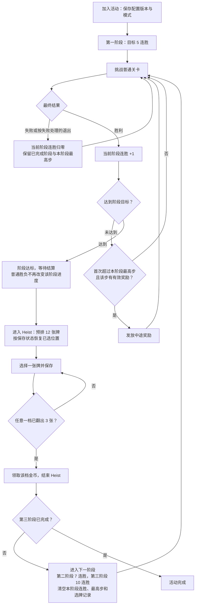

# Royal Match 38911 Lava Quest 与 Ancient Adventure 活动规则

> 2026-10-26 后续：Lava Quest 已建立 [[02-PROJECTS/产品分析/Royal Match/活动/Lava Quest/README|独立详细档案]]，补实际缓存配置、已保存轮次与六包资源证据。本页保留 Lava 的 10-21 静态历史及跨活动对照；Ancient 第三章已于 10-27 整合运行缓存和代码复核，不再沿用旧的“当前值未知”结论。

> [!summary] 核心结论
> - **Lava Quest**：玩家主动开始一轮挑战，与 99 名历史数据模拟玩家组成 100 人局；连续首过 7 关即获胜，任何一关最终失败都会结束本轮。获胜者均分 10,000 金币奖池，客户端按 10 金币粒度向上取整；失败后当前公开规则为等待 30 分钟再试。
> - **Ancient Adventure**：由关卡结果推进的个人连胜路线。38911 同时保留单阶段和三阶段实现：单阶段为 7 步；三阶段依次为 5、7、10 步。失败把**当前阶段**进度归零，已完成阶段不回退；阶段结束可直接领取阶段奖，也可进入 12 张牌的 Heist 奖励玩法。
>
> 近期引用：周期/入场/结束链已用39781实际安装代码重验，见3.2；Lava支持双期限但有服务器清理例外，Ancient跟随服务器期限。10-27 Ancient配置319→321正文一致、事件314→315截止约差24小时。阶段结构、奖励计算及Heist概率主体仍基于38911，不能把理想概率当线上实测中奖率。

## 一、规则证据口径

| 证据层 | 本文用途 |
|---|---|
| Royal Match 官方帮助页 | 当前玩家可见的时长、解锁、进入方式、人数、重试与基础奖励规则 |
| 38911 IL2CPP 静态代码 | 状态机、步数、失败归零、阶段切换、奖励计算、Heist 处理 |
| 服务端模型与本地持久化结构 | 能够下发和保存的数据范围；不等于当前账号实际配置 |
| 用户运行观察 | Lava Quest / Ancient Adventure 在周中、周末档位轮换；本文不据此推断固定星期 |

官方页面：

- [Lava Quest - Royal Match Help Center](https://dreamgames.helpshift.com/hc/en/3-royal-match/faq/187-lava-quest/)
- [Ancient Adventure - Royal Match Help Center](https://dreamgames.helpshift.com/hc/en/3-royal-match/faq/560-ancient-adventure/)

以下代码路径均相对于：

`06-PRODUCT-ASSETS/RoyalMatch/38911/04-ReverseEngineering/IL2CPP_Static/cpp2il-diffable-cs/DiffableCs/Assembly-CSharp/`

## 二、Lava Quest

### 2.1 玩家规则卡

| 项目 | 规则 |
|---|---|
| 解锁条件 | 等级 66 及以上 |
| 进入方式 | 在活动入口点击 **Start**；需要联网 |
| 每轮目标 | 连续首过 7 个关卡 |
| 参赛规模 | 玩家本人 + 99 名模拟玩家，共 100 人 |
| 对手性质 | 不是实时对战；使用曾挑战相同 7 关玩家的历史数据构造比赛过程 |
| 胜利条件 | 完成第 7 次连续胜利；内部从 Step 1 推进到 `SuccessStep = 8` |
| 失败条件 | 任一关最终失败或活动记录到关卡中途退出；内部写入 `FailStep = 9` |
| 单轮时限 | 24小时；38911入组成功后写个人截止，先前“总活动截止必然截断本轮”缺乏充分代码证明，跨期清理待验证，详见Lava主文档 |
| 奖励 | 所有完成 7 关的胜者均分 10,000 金币奖池 |
| 失败后重试 | 当前公开规则为等待 30 分钟后可开始新一轮 |
| 成功后 | 当前轮完成并领取奖励；客户端将该服务端活动标记为已领取，不再重复加入同一轮 |

### 2.2 一轮挑战的状态流

```text
入口点击 Start
  → 请求加入并取得模拟分组
  → Finding Players
  → Step 1
      ├─ 过关：Step + 1，并播放本步淘汰表现
      ├─ 最终失败/中途退出：Step 9，本轮失败
      └─ 到 Step 8：本轮成功
  → 成功领取金币 / 失败进入冷却
```

客户端固定常量为：

```text
InitialStep = 1
TotalStepCount = 7
SuccessStep = 8
FailStep = 9
```

- `EnteredLevel()` 在进入有效关卡时写入“正在关卡中”。
- `WonLevel()` 清除该标记并推进一步。
- `FailedLevel()` 清除该标记并直接写入失败终态。
- `CheckIfQuitInGame()` 和无法恢复关卡的处理，会把仍处于关卡中的异常退出视为失败。
- 活动管理器只接收关卡最终的 Win / Fail 结果，没有“使用关卡内续步即单独判负”的规则；因此购买续步后最终过关，活动侧仍收到胜利，真正放弃或结算失败才会断连胜。

### 2.3 模拟分组与淘汰表现

加入请求会发送玩家当前 `Level` 和 `LeagueLevel`，服务端返回：

| 字段 | 作用 |
|---|---|
| `Scenario` / `ScenarioId` | 选择本轮历史模拟场景 |
| `StepUserCounts[]` | 每一步仍留在比赛中的人数，用于人数下降和卡片跌落表现 |
| `WinnerCount` | 不含玩家本人的其他胜者数 |
| Leader/Profile 数据 | 显示模拟参赛者姓名、头像、头像框及游客/Facebook 资料 |

因此界面上的“多人同时推进、逐步落入岩浆”是按服务端历史场景播放，并不代表 100 人正在实时同步游玩。

### 2.4 奖金结算

公开规则为 10,000 金币由完成挑战的玩家均分。38911 的实际发奖方法为：

```text
总胜者数 = 服务端 WinnerCount + 玩家本人
基础份额 = 10000 / 总胜者数（整数除法）
个人金币 = 基础份额向上取整到 10 的倍数
```

示例：

| 总胜者数 | 个人金币 |
|---:|---:|
| 1 | 10,000 |
| 2 | 5,000 |
| 3 | 3,340 |
| 6 | 1,670 |

所以玩家看到的是“均分奖池”，客户端发放时还做了一次 10 金币粒度的向上取整。

### 2.5 时限、冷却与可加入条件

可加入不仅取决于图标是否出现，还要求：

- 账号达到等级 66；
- 服务端活动已开启且未被后台关闭；
- 当前没有未结束、未领取的 Lava Quest；
- 冷却已经结束；
- 活动剩余时间足够开始下一轮；
- 网络可用，并能取得分组信息；
- 当前仍有可游玩的主线或联盟关卡。

失败或超时后会保存 Cooldown End Date。当前官方值是 30 分钟；包内存在一份旧的本地兜底配置，但持续时间参数与当前公开规则不一致，应视为被服务端覆盖或不再直接使用，不能当作线上生效值。

### 2.6 规则定位

| 模块 | 路径/方法 |
|---|---|
| 核心管理器 | `Royal/Player/Context/Units/LavaQuestManager.cs` |
| 持久化进度 | `Royal/Player/Context/Data/Persistent/LavaQuestProgress.cs` |
| 配置 | `Royal/Player/Context/Data/LavaQuest/LavaQuestConfig.cs` |
| 分组返回 | `Royal/Infrastructure/Services/Backend/Protocol/EnterLavaQuestResponse.cs`、`LavaQuestUserGroupInfo.cs` |
| 奖励计算 | `LavaQuestManager.GetInventoryPackage()`，原生地址 `0x01CB6EF4` |
| 关键埋点 | `LavaQuestEnter`、`LavaQuestFinish`、`LavaQuestClaim` |

## 三、Ancient Adventure

本章按主题持续整合：机制与概率主体基于38911；周期、入场与结束条件已在39781实际安装代码重验。10:58样本为314期/319配置，16:21新版样本为315期/321配置，两者分别标注，不代表全部账号或未来档期。

### 3.1 玩家规则卡

| 项目 | 已确认规则与边界 |
|---|---|
| 开启关卡 | **到达第 66 关**，即完成第 65 关后满足等级门槛；仍受档期、后台开关、已有活动状态等限制 |
| 性质 | 个人分阶段连胜；本次相关模型、配置、状态中未发现 Lava 式分组、机器人存活人数或胜者分奖 |
| 进入与推进 | 39781由活动管理流程在条件满足后自动调用TryEnterEvent建立参与状态，不以点击参加为必要前置；普通关卡Win/Fail经EventsHelper推进，仍有教程等门槛 |
| 路线 | 单阶段 7 连胜；三阶段分别 5、7、10 连胜，由入场时保存的模式决定 |
| 失败 | 当前阶段 Step 归零，已完成阶段不回退；未发现 Ancient 自身的失败冷却 |
| 阶段结算 | 非 Heist 分支领取阶段奖；Heist 分支转入翻牌，按先凑齐三张的档位结算 |
| 时限 | 代码按服务端活动结束时间判断；不是读到一份“从账号入场起另计 24 小时”的个人截止时间 |

解锁证据：`AncientAdventureManager.GetUnlockLevel()`（`0x020EAA90`）返回 `0x42=66`；`get_HasEnoughLevel()`（`0x020E8710`）比较等级 `>65`。开启门槛不等于此账号真实入场关卡；本次进度结构没有 Lava 的 `StartLevel` 字段。

`get_HasEnoughTimeToJoinEvent()` 检查服务端活动 ID 有效且剩余毫秒数大于 0，未见阶段等待时间门槛。Lava 的45分钟判断属于失败/超时结算后是否能重置出重试轮次，不能称为所有首次加入的限制。历史官方页面的 24 小时是玩家规则描述，不能替代此构建实际采用的截止时间判断。样本保存的截止时间为 **2026-10-27 15:59:58.312 +08:00**，只代表 event 314 的本地缓存。

**参与方式与精确资格（39781，10-28复核）**：Ancient属于系统自动入场，不同于Lava主动Start请求分组。EventDependencyManager.ManualUpdate（0x01E8F914）仅在主界面、距上次检查至少1秒时调用CheckEvents；这是客户端检查节流，不是每秒向服务器请求。ProcessAllEvents（0x01E9163C）对已选中且ShouldLock为false的活动调用SetEventLocked(false)，再经IEventManagerWithIcon接口slot5调用UnblockAndTryEnterEvent；Ancient实现（0x034E5498）清阻塞并立即尝试入场。接口类型由ELF重定位与Dumper类型映射核对，slot5由接口定义确认，不只凭方法名猜测调用。

| 入场条件 | 39781具体判断 |
|---|---|
| 等级 | 当前等级>65，即到达66关 |
| 服务器活动 | ServerEventId>0，剩余时间>0，后台未禁用 |
| 用户旧期 | 不能仍处于有效已参加活动；不能已参加服务器同一期 |
| 配置 | TryEnterEvent额外要求ServerEventConfigVersion非0，再复制配置并保存本期ID/版本/模式 |
| 弹窗状态 | AncientAdventureDialogContext.IsDialogOpen为false；此前泛称“全局状态”在此明确为活动弹窗打开标志 |
| 外围选择 | 活动已被中央流程选中且未锁定，才能进入该自动入场调用分支；达到66关并不保证马上开启 |

“自动入场”指写入参与状态，并不表示无需操作即可完成教程或奖励流程。ShouldProgressFromLevel仍要求主教程已看、用户期时间有效、配置有效且未达到阶段目标，因此不能声称未打开/未看教程时过关也必然计连胜。点击图标/弹窗按钮属于展示或教程交互，所查入场链不以点击同意参加为必要条件；客户端不会等待点击后另计个人24小时。上述为新版静态链确认，尚未新增“不点击图标从零入场”的运行实测。

### 3.2 阶段、7 连胜与实验模式

**周期结论已用39781实际安装代码重验：Ancient跟随服务器事件ID与剩余时间，不是Lava那套客户端入组后另建24小时个人截止。** 服务器是否按账号生成期限仍不可见；不能仅凭客户端字段认定全服统一日切。

| 问题 | 39781核验结果 | 证据 |
|---|---|---|
| 截止时间如何建立 | UpdateInfo保存服务器ID及nowMs+RemainingTime；后续减当前时间 | UpdateInfo、RemainingTimeInMs（0x034E304C） |
| 入场是否重新加24小时 | 所查TryEnterEvent/Progress.EnterEvent只复制配置、记录ID/版本/模式并初始化进度，没有Lava式个人截止写入 | TryEnterEvent 0x034E4200 |
| 旧期何时被判时间结束 | 服务器ID与用户ID不一致/服务器ID无效，或同一期剩余时间≤0 | IsUserEventTimeFinished 0x034E2F18 |
| 到期后是否还能普通过关推进 | ShouldProgress检查用户期时间有效；ShouldProgressFromLevel再检查教程和阶段目标 | 0x034E2EE4、0x034E3358；到期停止普通推进不等于抹除待领奖状态 |
| 何时能入新期 | 原用户期不再有效、不同于服务器当前期、服务器ID/时间有效、等级/后台/全局状态等条件通过 | CanJoinEvent 0x034E30E0、HasEnoughTimeToJoinEvent 0x034E31C8 |
| 旧期结算如何影响新期 | 对话关闭时若仍有可领取奖励则保留；进入ProceedLastSession后InvalidateEvent，LastSessionCompleted再清缓存/过渡标志；最终由UnblockAndTryEnterEvent尝试入场 | 0x034E523C、0x034E3C94、0x034E3CBC、0x034E5498；具体过期奖励到账仍未实测 |
| 阶段何时开启 | 按完成/结算推进，三阶段共用活动期限；不是每天解锁一阶段 | 38911阶段推进已复核；39781导出含ProceedNextStage，周期结论不冒充全部奖励逻辑已重验 |

**与Lava的关键区别**：Lava当前轮是否有效不要求个人ID等于最新服务器ID；Ancient用户期的时间有效性明确检查ID一致性。因而“服务器已给新期，旧挑战还能靠自己的24小时继续”的Lava机制不能直接套到Ancient。Ancient存在旧期结算/奖励处理状态，不应把“时间结束”与“立即删掉所有旧数据”混为一谈。

**下发条件与时机**：39781的Ping、UpdateUserProgress响应和SyncManager处理UserProgress均能更新Ancient活动信息；专用GetAncientAdventureInfo主要补账号配置。普通同步可以携带新ID/剩余时间；资格满足后仍受活动依赖/展示流程安排，并非在某个固定时刻无条件自动参加。未取得服务端星期规则、复开算法或固定推送频率。

| 今天的账号采样 | 事件/配置 | 缓存截止（北京时间） |
|---|---|---|
| 38911，10-27 15:34 | 314 / 公共319、用户319 | 10-27 16:00:00.189 |
| 39781，10-27 16:21 | 315 / 公共321、用户321 | 10-28 15:59:59.532 |

相邻截止差86399.343秒，支持这次按日推进；319与321的公共/用户奖励JSON语义相同。更新与换期同时发生，不能认定升级导致换期。没有捕获315期真实开始瞬间，不能把截止间距当作已验证的总时长、零复开间隔或全服固定16点开期；当前重采样只有毫秒级换算差异。

**未验证观察仅作假设**：用户认为Ancient静态窗口至少周一至周四，Lava周五至周日、每天一期，并可能存在参与后动态计时。代码只证实Lava的本地个人计时；Ancient动态期限若存在，须由服务器RemainingTime体现，目前无法证实。未见两活动完整运营日历；此前所查Upcoming协议只提供团队锦标赛日期，不能查询Ancient/Lava未来排期。

**时钟修改对排期判断的边界（38911设备-1实测）**：10-28约20:54的首次+48小时实验中，Ancient仍316期、剩余约19.1小时自然递减，而落盘截止后移48小时。22:27后的扩展对照覆盖10-30周五切期附近、切期后、10-31周六和11-02周一，每点分别离线/联网；离线保留上次截止，联网按假时钟重算，但始终316期。随后在模拟11-02 16:10将公共版本置0，首个12秒采样恢复323，后续两次一致，没有获得未来期。恢复真实时间后截止回到10-29约16:00。

`UpdateInfo`使用`TimeUtil.CurrentLocalTimeInMs()+RemainingTime`，所以ServerEventEndDate是客户端换算值，不是未经换算的服务器绝对时间；不能用伪造时钟的截止值拼接日历。明确的团队锦标赛开始字段始终为10-30 16:01，没有同样平移。完整矩阵见 [[02-PROJECTS/产品分析/Royal Match/运营配置/排期与配置总览#改设备时间能否补出其他排期|时间对照与协议边界]]；原始证据见设备-1 `book-treasure/time-probe-result.json`、`schedule-probe-local/`、`schedule-refetch/`。

**时间实验会影响本地活动状态**：扩展实验中Ancient用户配置版本由323变0，公共配置仍323，恢复时钟后用户版本没有自动回到323；此为游戏到期/状态处理的实际副作用，不是本轮主动修改用户版本。没有手工恢复参与状态或发奖。本轮开始及结束均82关（首次+48小时实验为81关），原设备0保持关闭；没有解密响应，也不替代39781真实跨期及Lava个人计时跨截止验证。

**运行边界与证据**：39781已从本机安装分包提取binary/metadata、匹配设备和本地分包SHA256，Dumper与ARM64定向复核成功。39781抓包24条有效TLS记录仍未解密，Frida转译域限制未解决；本轮不是跨截止连续游玩实验。代码、绑定、当前配置和调用索引在 `06-PRODUCT-ASSETS/RoyalMatch/39781/04-ReverseEngineering/Period-Audit/`；跨版本时间对照在同版本 `05-Runtime/20261027-network-events/period-comparison.json`。阶段奖励、概率与隐藏策略主体仍以38911分析＋321缓存对照为准，未将局部周期复核升级为全模块重验。

| 模式 | 初始逻辑 Stage | 阶段目标 | 完成后的 Stage |
|---|---:|---|---:|
| 三阶段 | 1 | Stage 1：5；Stage 2：7；Stage 3：10 | 逐阶段递增，最终为 4 |
| 单阶段 | 2 | 仅 7 | 直接变为 4 |

因此三阶段的基础路线是累计 22 次胜利，**不是一次连续赢 22 关**。只有当前阶段需要连续胜利；每完成一阶段形成一个检查点。7 连胜在此是 Stage 2 / 单阶段的目标，没有在已核对的活动推进方法中发现“每逢全局第 7 连胜另换难度”的分支。

单阶段的 `GetUiStageForOneStageEvent()` 使用第三阶段主题表现，不能仅凭美术判断逻辑 Stage。`IsAncientAdventureOneStaged`、`IsAncientAdventureHeistEnabled` 涉及实验 ID 146/147、152/153；入场将结果固化到进度位域。当前样本 **oneStage=false、withHeist=true**，证明保存的是三阶段加 Heist 模式；不能由此推断全服实验比例。

阶段结束流程：达到目标 → 阶段奖励/Heist 结算 → `ProceedNextStage` → Step、MaxReachedStep、Heist 选择矩阵清零 → 下一阶段。单阶段或第三阶段完成后写 `FinishedStage=4`。

**参加后的主流程（当前样本：三阶段 + Heist）**。图中关卡推进以主教程已看、配置有效、活动未过期为前提；过期后停止普通关卡推进，跨期领奖细节仍待验证。



- **重试与防刷**：失败后可重新挑战当前阶段；重走已到达的中途奖励点不重复发奖。基础 `str` 为空时仍须检查奖励覆盖层，图中的中途奖励是条件分支。
- **Heist 排牌**：低／中／高档卡数为 3／5／4；种子选择分常规与教程路径，见 3.5。图中的选择不会每次重新抽取整副牌。
- **其他模式**：未启用 Heist 时，阶段达标后走直接阶段领奖，再判断是否进入下一阶段；单阶段模式只走 7 连胜，阶段结算后直接完成。
- **样本所在节点**：10-27 采集时保存为第一阶段 5/5、Heist 中且选牌矩阵为 0，对应已进入翻牌但尚无已保存选择；不是实时屏幕确认。

### 3.3 胜负推进、检查点保护与防重复领奖

`ShouldProgressFromLevel` 的门槛包括：活动未过期、仍处于活动中、用户配置版本有效、主教程已看、**Step 小于本阶段目标**。普通胜负路径都使用这道门槛。

- **未完成阶段**：最终胜利推进一步；最终失败 `FailStep → SetStep(0, save=true, sync=false)`。关卡退出、无法恢复等异常路径也会进入失败处理。购买续步本身不是活动独立判负条件。
- **已达目标、尚待结算**：例如 5/5，已经不满足普通关卡推进门槛。因此该路径不会让后续胜利继续累加，也不会让后续失败把已达标阶段重新清零。这是状态机的检查点保护，不是关卡变容易。
- **中途奖励防重复领取**：`ProceedNextStep` 在尚未到阶段终点时，比较旧 `MaxReachedStep` 与新 Step。只有超过历史最高步、且该步有奖励，才走该中途奖励领取分支。
- `SetStep(0)` **不会降低 MaxReachedStep**；因此失败后重走已达奖励点不会重复发奖。只有切换阶段等重置流程才清空该阶段最高步。

例：阶段目标 7，假设第 3 步配有奖励；玩家走到第 4 步后失败，Step 回 0、Max 保持 4。再次走到第 3 步不会重领；后续首次达到更高的有效奖励步才可能领取。此例说明代码规则，**不表示当前版本 319 确实配了第 3 步奖励**。

终点走阶段结算分支，不应把它与普通中途奖励分支混为一谈。进入关卡时还保存 `hasTimeWhenLevelEntered`，供回到主界面的结束/弹窗流程使用；仅凭该标志不能宣称“过期后仍然计胜”或“保证补发”。本次未实测跨截止时间的结算。

### 3.4 配置来源、覆盖顺序与实际数值

**独立测试账号的配置补回实测（10-28，设备-1，38911）**：MuMu实例1的ADB为127.0.0.1:16416，App.UserId及唯一注册记录均为2729950638，与原设备账号2571581433不同；原实例0未运行。此项确认游戏账号隔离，未读取到足够的直接证据确认第三方绑定/游客身份。不要把设备-1的38911结果标成39781实验。

测试账号收到Ancient公共配置323、事件316，尚无UserEventConfig/Version；Lava公共配置和事件表选定键均缺失。先停止测试应用并备份选定缓存：实验一仅将ServerEventConfigVersion从323置0，正常启动后10秒仍0、20秒恢复323；实验二将公共配置正文置空并同时版本置0，首个10秒采样已补回323及完整405字符JSON，40秒复核仍在，正文与备份语义相同。游戏自动覆盖测试标记，无需回滚；没有改等级、奖励数值或事件ID，未触碰原设备。

**离线/在线对照结果**：后续在同一设备和账号上停止游戏、将公共正文置空/版本置0，关闭Wi-Fi及移动数据并确认IPv4/IPv6只剩回环路由。正常启动后连续4次、每10秒采样都仍为0/空；恢复原网络状态和wlan0默认路由后，首个在线采样即恢复323及与备份一致的完整JSON，共4次在线采样均保留。该受控结果确认本次补回依赖联网，强烈支持服务器补发，排除了此启动流程中无需网络即可完成的本地恢复；未直接读取响应，仍不能严格排除“联网后才启用其他本地来源”的实现。

**明文观测边界**：设备-1系统x64 libssl的SSL_read已成功挂接，限定两个已知游戏后端SNI的入站数据，不采集请求认证头；本次观测未得到后端明文。业务传输存在UnityWebRequest路径，ARM转译环境与系统TLS观测点可能不一致，不能将未捕获解释为没有服务器请求。本次离线对照后的缓存仍为316期，截止10-29约16:00 +08（不同采样有亚秒级抖动）；未新增开始、下期开启、复开间隔字段。已知AncientAdventureInfo仍仅有ID/RemainingTime/版本/Config；下一期准入逻辑见3.1～3.2，不把客户端检查频率当作运营周期。

此实验与GetAncientAdventureInfo的UserConfigVersion补取不同，测试的是公共配置缓存版本。原始备份、设备内离线日志、8次采样、summary和TLS观测在38911/05-Runtime/20261028-device1。原实例0全程未启动、未连接或修改；设备-1网络已恢复、测试0/空标记已由游戏补回。完整服务器日历及响应正文仍未取得。

**79关门槛对照（同日后续）**：用户明确要求后，备份设备-1的App及用户数据库，仅将KeyValue.Level从2改为79，保留Synced=1/SyncBlocked=1，未修改其他进度字段。重启后10～40秒四次采样均为79，主界面截图明确显示Level 79。首个采样新增Ancient的UserEventConfig及UserEventConfigVersion=323，正文与公共配置相同；这支持关卡变化触发客户端配置绑定/入场准备，但没有响应明文，不能断言该正文是新请求下发，亦不能证明服务器已认可79关。Lava仅新增头像列表索引/版本键，公共配置仍缺失，不代表活动入组。未新增下一期开始或复开间隔。证据与修改前数据库在同一运行目录的level79/；测试设备按用户要求保留79关。

**配置与时间的职责分离**：公共活动信息决定服务器ID/剩余时间，专用请求携带UserConfigVersion补用户配置。38911命令类型107/94的定位保留为历史协议证据；39781重新核对的周期链及采集限制统一见3.2，不将旧地址直接用于新版。当前321配置与此前319正文语义相同；版本升级本身不证明阶段奖励或概率发生变化。


配置模型：`v` 为版本，`s[]` 为三阶段，`os` 为单阶段；Stage 中 `sgr` 为阶段奖、`str[]` 为步数奖励、`hd[]` 为 Heist 档位。`hd.oc` 是卡数，`hd.cr` 是金币。

读取链：公共活动信息写入 server config；`TryEnterEvent` 把公共配置及版本复制到 user config，并记录入场模式；账号信息响应还具备更新用户配置的通道。实际 `GetHeistData`、`GetRewardsOfSteps` 使用 **userConfig**，不是每次直接读取公共配置。保存的用户版本与配置版本比较决定有效性。

10-27早先读取的AncientAdventureTableItem公共/用户配置均为319；更新39781后均为321，公共与用户正文彼此相同，且与319语义相同。下表数值适用于这两份已采样配置；JSON本身没有v，版本来自独立缓存键，不能因缺少JSON字段就判断为版本0。

| 配置路线 | 基础阶段奖 `sgr` | 低档卡数／金币 | 中档卡数／金币 | 高档卡数／金币 | 基础 `str` |
|---|---:|---:|---:|---:|---|
| 三阶段 1 | 100 金币 | 3／100 | 5／150 | 4／200 | 空 |
| 三阶段 2 | 200 金币 | 3／100 | 5／200 | 4／500 | 空 |
| 三阶段 3 | 500 金币 | 3／200 | 5／500 | 4／1000 | 空 |
| 单阶段 `os` | 200 金币 | 3／100 | 5／200 | 4／500 | 空 |

这些是已保存配置，不是本次实测到账记录。基础阶段奖和 Heist 档位应按结算分支理解，不能直接把两列相加当作总奖励。

**隐藏的奖励覆盖层**：`EventRewardOverrider.GetOverriddenAncientAdventureStepReward` 按 eventId、活动类型 **36** 和步数键查覆盖项。单阶段键为 `step`，三阶段键为 `stage×1000+step`；存在覆盖时替换奖励，否则返回原奖励。`GetRewardsOfSteps` 对未配基础奖励的位置也会以空原奖励查询覆盖，故 **`str=[]` 不等于最终没有中途奖励**。后续 15:17:34 +08:00 定向采样已读取集卡 CollectionConfig 版本325：两套 eventRewardOverrideConfigs 各34项；以及 TrainJourney 公共/用户配置版本46：覆盖表各22项。以上四表均未出现 Ancient 的 eventType=36，因此这些缓存表没有提供 Ancient 覆盖项。DragonNest 当前保存表未见配置键，ShortExpedition 仅有版本键；仍不能扩大成所有来源、所有时刻均无覆盖，也未实测实际领奖。证据见 CommonTools-Audit/config-snapshot/ancient-overrides.json。

### 3.5 Heist 牌局、种子与教程策略

`PrepareHeistView` 先取当前阶段 `hd`，按金币额构造有序字典；本样本对应低、中、高三档。把各档按 `oc` 展开为 12 张，再调用 `ShuffleWithSeed`，最后恢复已选位置。翻牌前牌面已经排定，选择矩阵保存到进度中。

`RevealHeistCard` 增加对应档的已翻数、保存位置；某档数量恰好到 3 时，领取该档金币并结束 Heist。该方法中未发现“点击后按输赢/付费再次抽奖”的 RNG 调用。它说明本地结算方式，不等于已证明所有外围系统都不存在干预。

**种子有两条路径**（`GetEventRandomSeed`，`0x01BAE624`）：

| 条件 | 路径 | 判断 |
|---|---|---|
| Stage 3；或此前已看 Heist 教程且本活动未标记为本轮教程 | 常规路径，种子派生自活动 ID、账号 ID、Stage | 相同输入可重复生成牌面；没有看到失败次数、关卡 ID、付费额进入该方法 |
| Stage 非 3，且不满足上述教程状态 | 从静态初始化的 **10 个候选种子**中，经 `RandomFromArrayWithSeed` 选择 | 确有教程专用种子池，不是与普通局完全相同的随机入口 |

候选种子池的 10 个具体值尚未提取，不能据此宣称教程必出最高奖、保底或精确概率。样本保存的 `heistTutorialSeen=true`、`heistTutorialSeenThisEvent=false`，按本构建判断落在常规路径；未读取内存中的实际 12 张牌。

方法归属补正：新工具 Dumper 的完整名称确认 `GetEventRandomSeed` 属于 `AncientAdventureDialogHeistModel`；HeistController 负责准备与翻牌流程，不能把种子方法误记成 Controller 自身方法。地址与先前 ARM64 一致。

**洗牌实现细节**：`ShuffleWithSeed`（`0x02687388`）在每次交换时调用 `NextWithSeed(seed, i, count)`，循环内 seed 不变；`NextWithSeed`（`0x02D70BAC`）每次都保存 Unity 随机状态、`InitState(seed)`、取一次 `Range`、恢复原状态。因此不能把它直接视作连续取独立随机数的标准均匀洗牌，也不能认定 27,720 种牌面等概率。该保存/恢复机制也不支持“这次洗牌会推进全局 RNG 状态，从而改变下一关掉落”的简单推断。

### 3.6 概率调控：确定事实、理论基线与未知

确定事实是 **3／5／4 的卡数分配**、先凑齐三张即结算、预先按种子排牌，以及教程专用种子池。卡数是可配置的数值调控手段；中档卡最多，不能把三个奖励档当作各 1/3。

以下仅作为比较基线：假设 3／5／4 牌面均匀随机且玩家按无信息固定顺序翻牌，或者固定牌面上逐次均匀随机选剩余位置，首次集齐三张的概率为：

| 档位 | 第一张命中比例 | 最终先集齐三张的理论概率 |
|---|---:|---:|
| 低 | 25% | 107/924 ≈ **11.5801%** |
| 中 | 41.6667% | 527/924 ≈ **57.0346%** |
| 高 | 33.3333% | 145/462 ≈ **31.3853%** |

采用精确分数递推，并独立枚举 **27,720** 个不同牌面复核一致。第一张命中比例不是最终中奖率；上表最终概率也**不是此账号实际中奖率或运营概率表**。真实结果还受具体种子、教程池、位置选择和 Unity RNG 实现影响，尤其不能跳过上一节的重复初始化行为。

调控结论分层：

- **已确认**：配置控制牌数/金额；教程条件控制种子来源；阶段和模式控制连续胜利目标；最高进度控制重复领奖。
- **已检查未见直接证据**：本次 Ancient 管理器、CommonModel、Heist 的具名调用与状态读写中，未发现按连胜/失败数直接改关卡步数、棋盘掉落权重或机器人结果的路径。
- **未排除**：独立全局 DDA、服务器账号分流、奖励覆盖、未解析间接调用。不能把活动层未发现扩展成“游戏完全没有难度调控”。

### 3.7 实际保存状态与存储复现

来源：Root MuMu、`com.dreamgames.royalmatch`，只读查询私有 `app_pFiles` 下 App / 用户数据库的指定活动键；未修改存档、领奖或代玩。原始查询保存在证据目录，完整账号路径不在正文重复展开。

| 读取项 | 保存值 | 含义 |
|---|---|---|
| EventId / UserConfigVersion | 314 / 319 | 位域与独立配置键一致 |
| Stage / Step / MaxReachedStep | 1 / 5 / 5 | 第一阶段已达 5 步，最高记录也是 5 |
| oneStage / withHeist | false / true | 三阶段、带 Heist |
| isInHeist / matrix | true / 0 | 保存为 Heist 中，尚无已选位置位 |
| 主教程 / Heist 教程 / 本活动 Heist 教程 | true / true / false | 教程状态影响推进资格及种子路径 |

进度位于 `KeyValue` 的 **`ByteArrayKeyValue10`**，是 9 个有符号字节序列。按 `BitArrayOperations` 和 getter 解码有效位：eventId 0–11、configVersion 12–24、valid 25、主教程 26、开始弹窗 27、inHeist 29、stage 30–32、step 33–36、max 37–40、withHeist 41、oneStage 42、matrix 43–62、Heist 教程 63、本活动教程 64、阶段动画 65、失败动画 66。不能当作 JSON 或仅凭可见文本猜进度。

采样时 event 314 截止时间尚未到；这只能证明缓存彼此一致，不能代替现场画面或内存验证。

### 3.8 代码定位、证据与后续缺口

本章代码根：`06-PRODUCT-ASSETS/RoyalMatch/38911/04-ReverseEngineering/Windows-Audit/isil/IsilDump/Assembly-CSharp/`。以下路径修正了历史文档中 CommonModel、Config 和 HeistController 的目录误记。

| 模块 | 相对路径／关键方法 |
|---|---|
| 管理器 | `Royal/Player/Context/Units/AncientAdventureManager.txt`；资格、配置、胜负和截止时间 |
| 持久化 | `Royal/Player/Context/Data/Persistent/AncientAdventureProgress.txt`；位域、SetStep、EnterEvent |
| 模型、配置、Heist | `Royal/Scenes/Home/Ui/Dialogs/AncientAdventure/Scripts/` 下 `AncientAdventureCommonModel`、`AncientAdventureConfigHelper`、`AncientAdventureConfig`、`AncientAdventureStage`、`AncientAdventureHeistController` |
| 推进关键地址 | `FailStep 0x01BA7224`；`ProceedNextStep 0x01BA7290`；`ProceedNextStage 0x01BA78E8`；`SetStep 0x032C1980` |
| 翻牌结算 | `RevealHeistCard 0x01BAF3F4`；种子及洗牌地址见 3.5 |
| 奖励覆盖 | `Royal/Player/Context/Units/EventRewardOverrider.txt`；`GetOverriddenAncientAdventureStepReward 0x0326B71C` |

原始证据与复核：

- `06-PRODUCT-ASSETS/RoyalMatch/38911/05-Runtime/20261027-ancient-adventure/selected-state-config.json`：指定配置、进度及采集时间。
- 同目录 `decoded-and-probability.json`：位域解码、配置一致性、条件概率与枚举结果。
- `Windows-Audit/ancient-adventure-evidence.txt`、`ancient-adventure-manifest.json`：732 段方法摘录、原文件行号，以及二进制、元数据、运行采样与结果的 SHA256。
- 复现脚本位于同一 Windows-Audit：`collect_ancient.py`、`analyze_ancient_state.py`、`save_ancient_evidence.py`。

验证边界：静态使用提供的 38911 包，运行安装版本也是 38911，但未逐 APK 哈希比对；Cpp2IL ISIL 存在缺失/错误条件，关键条件、常量及洗牌使用 ARM64 原始反汇编复核；具名调用不是完整间接调用图。本次没有 Hook、网络全量抓包或实际领奖实验。

后续应优先补：教程池 10 个值与 Unity RNG 精确复现；账号实际 Reward Override；不同阶段/失败重走/跨截止时间的状态与库存对照。资源包到具体动画音效的完整对位不在本次已完成范围。新结果继续归入以上主题，不新增“第 N 次深挖”章节。

## 四、配置、数值、分组与关卡调控

### 4.1 可分析深度

| 范围 | 38911 静态包可确认 | 仍需运行时/服务端 |
|---|---|---|
| 配置结构 | 字段、层级、读取与覆盖链 | 当前档期实际下发内容 |
| 固定数值 | 解锁等级、目标步数、成功/失败状态、奖励计算公式 | 活动时长、冷却、分步人数、Ancient 奖励数字等动态值 |
| 分组 | Lava 请求字段、分组返回字段、客户端如何生成展示身份 | 服务端如何选历史样本、是否使用请求体外的账号画像 |
| 关卡关联 | 进入、胜利、失败、退出和恢复失败的完整回调链 | 运行时异常路径是否被服务端二次修正 |
| 难度调控 | 可检查两活动是否直接调用棋盘、步数、生成权重或 DDA | 服务端或全局关卡系统独立存在的调控策略 |

结论口径：**活动规则和客户端执行逻辑可以高置信还原；服务端分组算法与当前账号实际配置不能仅靠 APK 定案。**

### 4.2 Lava Quest 配置与分组协议

客户端配置模型 `LavaQuestConfig` 只有四个字段：

| 字段 | 含义 | 来源/边界 |
|---|---|---|
| `v` | 配置版本 | 服务端下发 |
| `d` | 单轮持续时间，秒 | 服务端可覆盖 |
| `c` | 失败后的冷却时间，秒 | 服务端可覆盖 |
| `r` | 奖励物品 | 当前公开规则对应 10,000 金币奖池 |

`LavaQuestInfo` / `GetLavaQuestInfoResponse` 会下发 `ServerEventId`、剩余时间、配置版本和 JSON 配置；客户端据此更新本轮结束时间和本地配置。包内虽有一份 `d=300000`、`c=50000` 的兜底 JSON，但与当前公开的 24 小时/30 分钟不一致，不能作为当前线上值。

玩家点击 Start 时，`EnterLavaQuestRequest` 请求体明确只有：

```text
Level
LeagueLevel
```

`EnterLavaQuestResponse` 返回服务端活动 ID 和 `LavaQuestUserGroupInfo`：

| 返回字段 | 客户端用途 |
|---|---|
| `Scenario` / `ScenarioId` | 选择和持久化本轮历史模拟场景 |
| `StepUserCounts[]` | 驱动每一步剩余人数和淘汰动画 |
| `WinnerCount` | 计算玩家最终分到的金币 |

所以能确定的是：

- 请求体没有显式发送胜率、连胜、付费、失败次数或棋盘难度，只发送当前 `Level` 和 `LeagueLevel`；
- 这不排除服务端在认证上下文中读取其他账号资料，但 APK 无法证明它具体用了哪些指标；
- 服务端返回的是“场景 + 每步人数 + 最终胜者数”，客户端负责保存并播放；
- Facebook 玩家资料返回后，客户端会为展示对象组合 Facebook ID、本地随机用户名、头像和头像框；不足部分由 Guest 资料补齐，因此展示身份不等同于实时对手。

### 4.3 Ancient Adventure 配置层级

Ancient 使用公共配置和账号配置两层：

- `AncientAdventureInfo` 下发服务端活动 ID、剩余时间、公共配置版本和 JSON；
- `GetAncientAdventureInfoResponse.AncientAdventureUserConfig` 下发账号实际命中的用户配置；
- 客户端再根据单阶段/多阶段、Heist 和 Reward Overrider 实验决定最终表现。

配置结构为：

```text
AncientAdventureConfig
  v    配置版本
  s[]  三阶段配置
  os   单阶段配置

AncientAdventureStage
  sgr  阶段结算奖励
  str[] 中途步数奖励
  hd[] Heist 奖励档
```

其中 `StepRewardData = (st, r)`，表示触发步数与奖励；`HeistData = (oc, cr)`，表示某档卡片数量与金币值。阶段目标 5/7/10、单阶段 7、失败归零和三张同档牌结算属于客户端规则；当前样本的基础数值已通过只读缓存确认，见 3.4；奖励覆盖层仍待补证。

### 4.4 与关卡结算的回调链

两项活动都通过中央 `EventsHelper` 接收普通关卡结果：

```text
GameManager.StartGame
  → EventsHelper.EnteredLevel()
  → Lava / Ancient 记录进入关卡

UserManager.LevelEnd / UpdateEventsOnLevelWin
  ├─ 最终胜利 → EventsHelper.WonLevel()
  └─ 最终失败 → EventsHelper.FailedLevel()

关卡无法恢复或检测到中途退出
  → EventsHelper.WontRestoreLevel() / CheckIfQuitInGame()
  → 按失败处理，断开当前连胜
```

细节边界：

- Lava 胜利时 Step +1，失败写入 Step 9；Ancient 胜利推进当前阶段，失败执行 `Step = 0`；
- 使用金币续步不会直接触发活动失败，活动只接收最终 Win / Fail；
- Side Progression 关卡不会走两项活动的通用推进回调；Lava 的 `OnSideProgressionLevelWin()` 只记录一个后续 UI 展示标志，不增加 Step，Ancient 也没有对应的进度增加入口；
- 因而当前静态证据支持：主线/联盟的普通关卡结算计入连胜，支线关卡不计入。

### 4.5 是否直接调控关卡难度

对两个活动管理器的静态引用边界检查中，能找到的是 Prelevel 面板、关卡进入/结算、失败警告、活动弹窗、奖励、存档、通知和埋点；没有找到它们直接写入以下系统的调用边：

- 棋盘布局或关卡数据；
- 初始步数、剩余步数或续步价格；
- Tile/障碍生成权重和随机种子；
- 关卡难度标签或 DDA 参数。

因此更准确的结论是：**Lava Quest 和 Ancient Adventure 在客户端属于“观察关卡最终结果并推进活动”的上层系统，未发现它们直接改变局内难度。** 这不等于 Royal Match 没有全局 DDA，也不能排除服务端依据账号数据决定活动资格或历史场景；只能说明 38911 中没有找到“这两个活动 → 棋盘/步数/生成参数”的直接链路。

### 4.6 进一步抓取的最小字段集

若要把动态数值补齐，优先记录：

| 活动 | 响应/数据 | 可补齐内容 |
|---|---|---|
| Lava | `LavaQuestInfo.Config` | 实际 `d`、`c`、`r` |
| Lava | `EnterLavaQuestResponse.LavaQuestUserGroupInfo` | 本轮 Scenario、7 步人数曲线、WinnerCount |
| Ancient | `AncientAdventureInfo.Config` | 公共活动版本和时限配置 |
| Ancient | `AncientAdventureUserConfig` | 单/三阶段实际配置、Step/Stage 奖励、Heist 三档数值 |
| Ancient | 本地实验与进度 | 是否启用 One Staged、Heist、Reward Override |

## 五、动态信息覆盖与剩余验证

| 信息 | 当前证据状态 | 仍需补充 |
|---|---|---|
| Ancient 模式、Heist | 10-27 样本已确认三阶段 + Heist | 不同账号/档期覆盖 |
| Ancient 配置、基础奖励、牌数 | 319与321样本正文一致，详见3.4 | 实际Reward Override和库存到账 |
| Ancient 翻牌概率 | 已确认种子分支与条件数学模型 | 教程池具体值、Unity RNG、实际牌面及点击样本 |
| Ancient 期限 | event 314 缓存截止时间已读取 | 跨截止时间结算与连续档期 |
| Lava 场景与分步人数 | 已归入 Lava 独立主文档 | 服务端选择算法、多轮样本 |

## 六、验证边界

- 10-21 原始分析只使用提供的 38911 XAPK；10-27 Ancient 已增加用户运行中 MuMu 的只读存储采样，未修改样本或存档。详见第三章证据边界。
- REA MCP 已确认目标 `libil2cpp.so` 的身份；本机未配置 Ghidra/IDA 深度提供器，所以方法级规则来自同一二进制已生成的 Cpp2IL ARM64 反汇编与差分 C#，不是运行时 Hook 结果。
- 官方帮助页保留为早期公开规则来源，本次未重新联网核验；服务端仍可按活动批次、账号和实验覆盖客户端兜底配置。
- “周中/周末轮换”保留为用户运行观察，本文不把它扩展为固定星期或永久排期结论。
- `NotificationTags` 中 Lava 21、Ancient 38 是通知标签编号，不是活动枚举 ID。

## 关联

- [[02-PROJECTS/产品分析/Royal Match/活动清单与简述-38911|活动清单与简述]]
- [[02-PROJECTS/产品分析/Royal Match/系统活动关卡与主场景框架-38911|系统活动、关卡与主场景框架]]
- [[02-PROJECTS/产品分析/Royal Match/资源与逻辑分析总览-38911|资源与逻辑分析总览]]
- [[02-PROJECTS/产品分析/_MOC|产品分析 MOC]]
