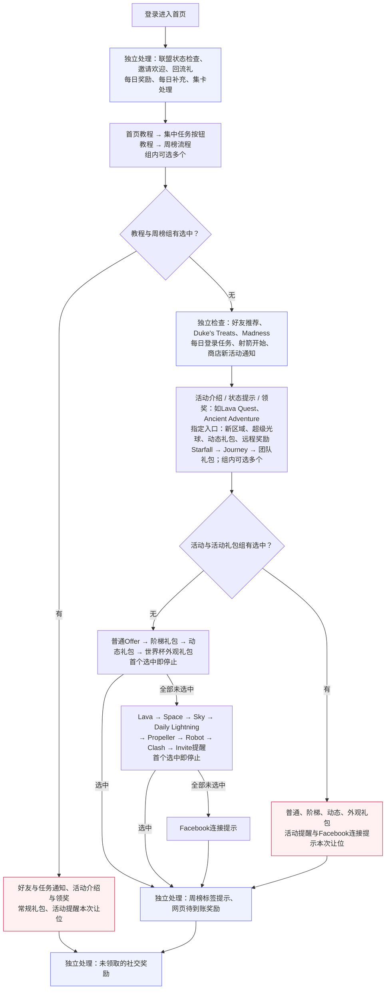
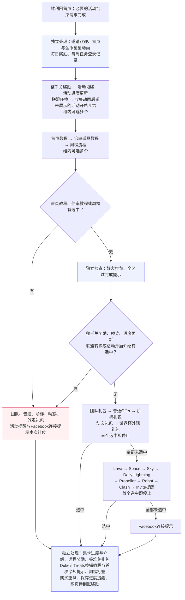
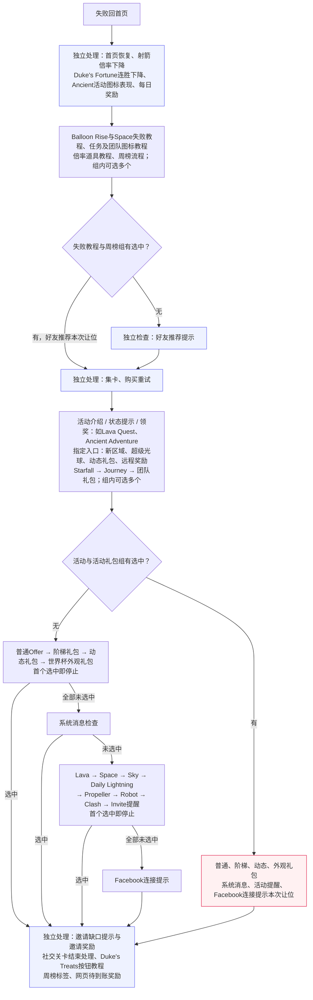
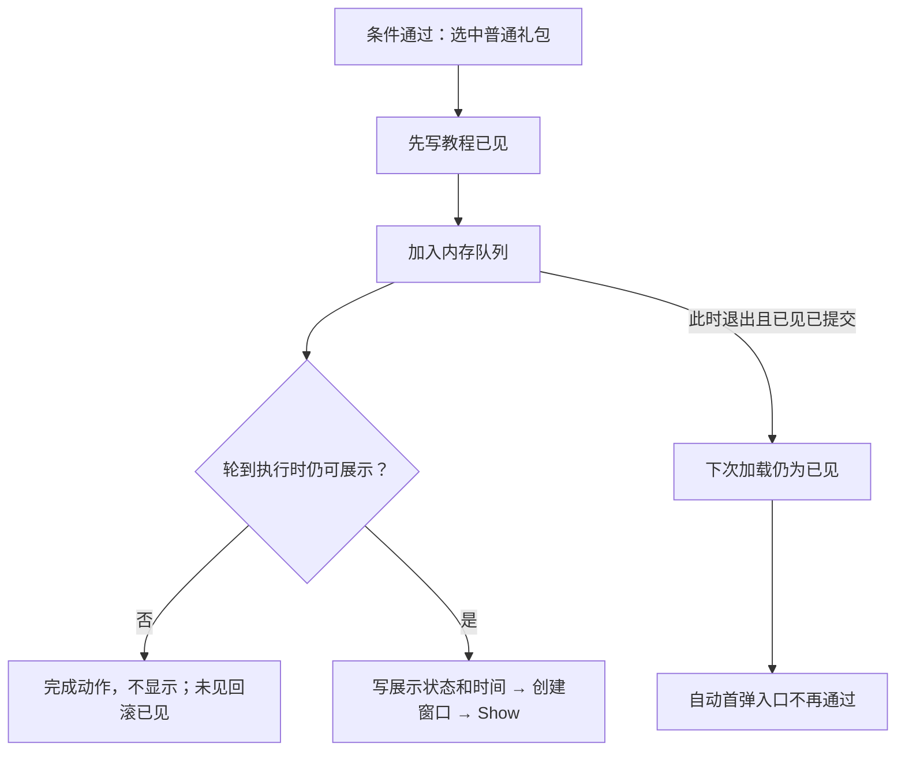
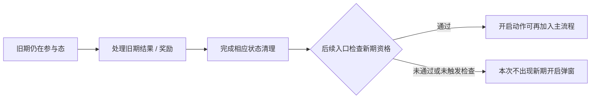

# Royal Match 38911 弹窗框架与展示规则

本文为持续主文档，按触发场景、调度、活动状态、礼包频控和界面叠层维护。10-27 在原框架上补充 Windows 原生代码复核与模拟器只读状态，保留尚未验证的边界。

> [!summary] 核心结论
> **不存在一张覆盖所有弹窗的全局优先级表。** 冷启动/恢复/失败返回走固定自动候选链，胜利返回先处理奖励和活动推进，再尝试礼包；活动互斥、关前图标排序、自动提醒与 Dialog 显示层级是不同机制。常规活动候选可以累计多个入队；礼包兜底链和提醒链则命中一个后停止。是否真正出现，还要通过当前状态、已见标记、资源、上下文和执行时检查。

## 证据与边界

- 静态样本38911，XAPK SHA256 `31cdc1f3150ecbf912d9d02fdaefc18bbf2682f0eb7b35c7fe74a61e601a3899`；旧版安装代码曾与静态输入核对一致。模拟器已于10-27 16:17:36升级39781，本次16:27缓存属于升级后环境，可能保留旧状态；**全文基线及292类清单仍是38911；第1章“39781代表性速览”另有新版定向代码证据，未做39781全弹窗对位**。
- 本次来源：Windows Cpp2IL 类型及方法、Il2CppDumper 虚方法槽/枚举/字符串、直接读取ELF并以Capstone复核的ARM64、10-27 **16:27:02 +08** MuMu Root只读缓存。没有为本任务代玩、购买、改存档或制造多个待领奖实例。
- 覆盖：**292个直接继承UiDialog的类**完整列入 `dialog-inventory.json`；**68个相关类、773段候选方法**列入 `method-index.json`；51个核心/活动/礼包类另有原生指令摘录。归集数量不等于每个分支均已人工证明，更不等于292种弹窗都在线触发过。
- 原始证据根：`06-PRODUCT-ASSETS/RoyalMatch/38911/04-ReverseEngineering/Windows-Audit/popup-audit/`。本文提到的精确顺序/数字来自对应方法；活动矩阵中的“检查项”表示已定位消费者，不自动表示所有项均为AND条件。
- Cpp2IL ISIL有条件跳转缺失/反向和间接调用遗漏。关键顺序按ARM64分支、字段偏移及虚方法槽核对；原生摘录也存在跳出原方法范围的代码块，未恢复的部分不强行写成完整伪源码。字符串注释为辅助定位，不替代控制流复核。

## 1. 总体处理链与不同场景

### 39781代表性速览

以下为39781已绑定安装代码的**展示检查优先级**，按登录、胜利、失败分别表示先检查谁、选中后哪些组让位；不是屏幕上实际弹出的时间线。10-30据已有证据重整，不新增运行实验，不将39781称为当前最新安装版本。其他章节的38911全量清单仍保留原版本范围。

#### 图例与共同规则

- **可选多个**：同组按顺序继续检查，可以有多个内容被选中；仍可能被模块条件和动作去重过滤。
- **首个选中即停止**：按节点内箭头顺序逐个检查，一个返回成功就停止检查本组余项，并沿“选中”分支继续。
- **独立处理**：按图示位置检查，但其结果不参与所标注的让位判断；不是并行执行，也不是无条件显示。
- **选中不等于实际弹出**：条件通过后安排动作，仍须经过排队、执行检查、创建窗口和Show。普通Offer在入队前写已见，不能用此标记当实际曝光凭证，详见5.4。
- **跳过不等于延后补弹**：该次未调用入口、未加入队列；下次相关入口再次到达它才重查，关闭当前窗口不会自动补齐跳过项。

#### 登录：首页教程可以跳过整段自动检查



备注：

1. 教程与周榜组的准确消费者是首页教程、集中任务按钮教程、WeeklyLeaderboard活动流程；并非回流礼或每日奖励被选中就触发整段让位。该组命中时，周榜标签和网页待到账奖励调用也一起跳过，仍检查未领社交奖励。
2. 活动节点列Lava/Ancient作为代表，不表示只检查这两个。指定入口来自深链消费，Starfall/Journey是活动礼包；Team在该组的总判断之前尝试，不能归为“只有活动全空才检查”的普通礼包。
3. 独立通知组结果不直接并入下方活动组的OR判断，但具体模块仍可能受当前界面状态影响。图省略League通知动画及不改变主让位结构的独立调用，不把方法被调用等同于窗口必弹。
4. 普通礼包组选中会跳过其后活动提醒和Facebook连接候选；提醒组选中也会跳过Facebook连接候选。周榜标签/网页奖励与未领社交奖励仍按上图分支继续。

#### 胜利回首页：内容被选中才让位，胜利本身不挡礼包



备注：

1. **胜利本身不直接导致礼包跳过。** 必须是图中的整千关奖励、领奖/推进/开启介绍或指定教程/周榜被选中，才让常规礼包和提醒组让位。金币星星动画、每日奖励的存在不是这个开关。
2. “收集动画后尚未展示的活动开启介绍”是胜利专用的补检查名单，不是把全部活动重新扫描一次；Lava/Ancient不在该名单，不代表它们没有其他胜利入口。具体候选见4.4。
3. 首页教程/倍率教程/周榜任一命中，还跳过好友推荐和全区域完成提示；若只在较早的领奖/推进组命中，仍会走到好友推荐和全区域完成检查，再让常规礼包组让位。
4. 独立内容按业务让位关系归组：整千关奖励在原调用序中位于金币表现后、每日奖励前。组图不用于推断它与独立动画/通知的逐帧先后。后段仍被检查，不保证全部入队；如极难关礼包还有自己的资格。
5. 本图没有使用登录的整条自动链；Team在胜利时位于常规礼包择一组首位，与登录的归组不同。

#### 失败回首页：失败教程不直接挡住活动自动检查



备注：

1. 失败教程组仍会继续检查后面的活动候选；该组的累计标记主要影响好友推荐与周榜提示参数，**没有像登录教程组那样直接跳过整条自动链**。具体活动仍可因自身资格或当前界面状态拒绝展示。
2. 任务/团队图标教程包括Mission Pursuit、Mission Control、Weekly Mission、Team Tournament、Team Battle、Team Treasure。独立内容为归组展示，图省略部分商店/外部支付通知及不改变主让位关系的调用。
3. 失败专有的系统消息检查位于常规礼包均未选中之后、活动提醒之前；系统消息选中就不再检查提醒和Facebook连接候选。礼包先选中，则系统消息也让位。

#### 检查、选中与实际显示的边界

**未轮到检查**与**检查未通过**均不会自动获得一张“稍后必弹”的排队票。相关登录/返回/前台恢复入口下一次走到该模块时，重新使用当时的资格、已见、档期、资源和会话状态判断；可以继续被跳过，也可以因已过期或手动处理而失去资格。有效前台恢复还要求HomeFlow已完成，强制回首页另有入口；不是统一等N秒或下一局保证补弹。

**选中**表示入口返回成功、准备安排内容；**实际显示**还需要队列消费、执行时条件通过、创建窗口并调用Show。普通Offer会在Push前写“教程已见”，若随后退出或执行失败可能没有窗口，却已消耗该自动入口的资格；标记是否提交、后端是否改写和已查补偿边界统一见5.4，不能把它推广到所有活动。

#### 来源与验证范围

39781 `StartFlowAfterLaunch` 0x03DBD4E8（跳转0x03DBD6C8）、`StartFlowAfterLevelWin` 0x03DBDC08、`AddLevelWinFlowActions` 0x03DBF80C（0x03DC0018/0x03DC002C）、`StartFlowAfterLevelFail` 0x03DBDEC4、`TryAddAutoDialogs` 0x03DBEC84（0x03DBF690）。证据位于`06-PRODUCT-ASSETS/RoyalMatch/39781/04-ReverseEngineering/Popup-Representative/`；`home-orchestration-review.json`记录让位判断的输入、非输入、地址和范围，`method-index.json`及`manifest.json`记录100段累计导出与哈希。归集数量不是每段完整人工审核数；图为已确认主干和代表内容，不是所有活动的完整运行曝光记录。

### 38911入口对照

下表保留38911入口定位。登录、胜利、失败的展示检查与让位关系优先阅读上方39781三张图；不同版本的方法地址及覆盖范围不混用。

| 情况 | 主入口与代码调用顺序 | 需要区分的限制 |
|---|---|---|
| 冷启动 | `StartFlowAfterLaunch`：联盟检查、邀请欢迎、回流礼、每日奖励/登录任务、No Ads、首页教程、联盟/任务/射箭/商店提示，再 `TryAddAutoDialogs(Launch)`，最后社交奖励 | 是条件候选调用序，不是每次都显示完整列表；首次冷启动未进过游戏场景时，许多活动会被统一自动门槛挡住 |
| 回到前台 | `StartFlowAfterFocusIn`：联盟检查、图标时间刷新、`TryAddAutoDialogs(FocusIn)` | 自动权限可能因暂停被清除；不是每次回前台都重弹。集卡在FocusIn会收到不同origin参数 |
| 强制回首页 | `StartFlowAfterForceHomeScene`：登录结果、时间/作弊提示、库存对齐、回流/每日奖励、任务提示，再自动链 | 异常与恢复有独立前段，优先于本轮常规活动候选 |
| 失败返回 | `StartFlowAfterLevelFail`：首页恢复、失败/断连胜相关动画、每日奖励、活动图标教程、No Ads、购买重试，再自动链和邀请缺口提示 | 包含Ancient图标面板、射箭倍率下降、Duke连胜下降等；不应解释成所有活动都弹失败结算窗 |
| 胜利返回 | `StartFlowAfterLevelWin` 先处理必要的联盟/团战/杯赛请求；回调或无请求后 `AddLevelWinFlowActions` | 有网络等待分支；不能把CPU调用先后直接当成画面出现时刻 |
| 胜利编排 | 首页/奖励动画 → 每日奖励 → `AddClaimFlowActions` → `AddEventFlowActions` → 联盟转换 → `TryAddMissingStartDialogsAfterCollectables` → 教程 → 条件礼包/提醒 → 集卡及独立商业化/提示后段 | **胜利不是再简单调用一次通用TryAddAutoDialogs**；“领取优先”只描述该编排前段，不能推广到全部场景 |
| 手动图标/深链 | 模块自己的TryPush / TryAddDeeplink / 子Flow | 是否绕过自动门槛由具体方法决定；有些仍要求Home Section、无活动Dialog、图标有效，不能统一称为无限制强开 |
| 关卡内 | Prelevel、OutOfMoves、Fail、Quit、购买/奖励等专用入口 | 与Home自动队列不同；292类清单包含这些窗口，本文不把首页优先级套到它们 |

`AutoDialogFlowType`枚举为Launch=0、FocusIn=1、ForceHomeScene=2、LevelFail=3。`TryAddAutoDialogs`首先阻断LevelWinBot和`waitToForceLoadHomeScene`；构造候选时调用`DisableNextActionOnPush`，结束后恢复，使队列批量构造与立即执行分离。

## 2. 展示载体：全屏与非全屏不是两套系统

| 载体 | 静态特征 | 常见内容 | 生命周期处理 |
|---|---|---|---|
| 全屏式活动页 | 常命名为 `InfoScene`、`ScenePopup` 或活动主 `Dialog`，Prefab 覆盖大部分视口 | 活动规则、地图、排行榜、对战进度、通行证 | 通常仍继承 `UiDialog`，进入同一 Dialog 栈 |
| 普通模态弹窗 | 常命名为 `Dialog`、`Popup`、`StartDialog` | 解锁、开启、确认、结束、领奖、礼包、退出 | 进入 Dialog 栈，有独立遮罩与关闭配置 |
| 弹窗内浮层 | 常由 `UiPanel`、局部组件或活动自己的子 Flow 管理 | 奖励明细、概率说明、用户资料、队伍信息 | 可能是新 Dialog，也可能只是父弹窗内 Panel |
| Tooltip / 气泡提示 | 由 `ToolTipManager` 等控制 | 图标引导、短提醒、说明 | 显示 Dialog 时通常会关闭现有 Tooltip；不一定进入 Dialog 栈 |
| 真正场景/Section | 由 Scene 或 Home `SectionManager` 管理 | Home、Game、社交、卡牌等独立页面 | 不属于 Dialog 生命周期；进入场景前会清理 Dialog |

可作为“全屏式活动页”线索的类包括 `SpaceMissionScenePopup`、`SkyRaceScenePopup`，以及 Robot Rivals、Lava Quest、Team Tournament、Weekly Mission 等 30 个 `*InfoScene`。但代码没有一个统一的“全屏”布尔值或基类；是否铺满屏幕最终取决于 Prefab 布局、Canvas 和运行时资源。

## 3. 内容类型与典型触发

| 内容类型 | 典型目的 | 常见动作/类名 | 主要触发时机 |
|---|---|---|---|
| 系统与异常 | 登录、网络、支付、版本、作弊或服务端消息 | System Message、Connection、Purchase Result | 启动、恢复、请求返回、强制回 Home |
| 解锁与首次开启 | 告知功能可用、解释玩法、引导入口 | `StartDialog`、Tutorial、Info | 达到资格且首次未展示；常记录已见状态 |
| 活动主界面 | 查看进度、地图、榜单、对手和奖励 | 活动主 `Dialog`、`InfoScene`、`ScenePopup` | 点击图标、深链、活动流程要求 |
| 进行中信息 | 被攻击、阶段变化、里程碑、排名变化 | `InfoDialog`、阶段/对战弹窗 | 参与中且特定状态变化后 |
| 二次提醒 | 活动已开放但尚未参加，或有关键进度 | Reminder / Second Start Popup | 首弹已展示、仍可加入，并通过二次提醒限制 |
| 领奖与结束 | 奖励揭示、最终排名、活动完成或强制结算 | `ClaimDialog`、Reward Reveal、End/Result | ReadyToClaim、活动结束或返回 Home |
| 礼包与商业化 | 展示 Offer、限时礼包、续关、通行证购买 | Offer / Dynamic Offer / Team Offer / Pass Purchase | 资格、冷却、入口和 Flow 条件满足 |
| 关卡结果相关 | 失败、续关、额外步数、退出确认 | Fail、OutOfMoves、Quit、Retry Purchase | Game 内或从 Game 返回 Home |

同一个活动可能复用同一个主界面承载多种内容。以 Robot Rivals 为例，Start、Info、Reminder、Claim 最终都可推入同一 `ShowRobotRivalsDialogAction`，再通过参数和当前活动状态决定落到首次介绍、对手攻击、进行中或结算内容。因此，不能仅凭 Prefab 名称判断弹窗只服务一个阶段。

## 4. 活动状态、优先级和频率限制

### 4.1 状态不是单一枚举

| 层 | 状态/记录 | 对弹窗的影响 |
|---|---|---|
| 账号资格 | 等级、团队、实验、回流教学资格 | 活动存在但不能参与/弹出 |
| 服务器档期 | 活动ID、剩余时间、后台关闭 | 新档期、有效期和已结束走不同分支 |
| 分组依赖 | BlockEvent、ForceClaimEvent、锁态 | 同组活动不保证同时获得入口；旧事件可能先处理待领 |
| 本人进度 | ReadyToJoin、Entered、ShouldProgress、ReadyToClaim、LastChance | 决定Start、进度页、Claim或结束补领；这些布尔条件未必互斥 |
| 展示记忆 | 教程已见、通知过的事件ID、首/二弹标记、关闭计数 | 决定是否首次提示或再次提醒；不等同于玩法进度 |
| 当前会话 | 是否进过游戏场景、进入次数、Flow暂停、当前Dialog、Home Section | 决定此刻能否入队，不代表活动被服务器关闭 |
| 表现资源 | Bundle已下载、图标存在/可显示 | 资格合格但资源未就绪时仍可能跳过 |

### 4.2 统一自动许可与模块内顺序

`AEventManager.get_CanShowAutoPopup`（0x020E7D0C）实际为：当前用户 `SessionData.IsGameSceneLoadedOnce` 成立，并且LevelWinBot未启用。它自身**不检查**全部网络、Bundle、Dialog和礼包冷却；这些由模块补充。原稿“共同门槛”需按此分层理解。

`CanShowSecondAutoStartPopup`（0x020E7D74）检查 `GameSceneLoadCount == 5`。`UserSessionData.ResetOnSceneChange`仅在指定游戏场景且排除一个关卡类型时增加计数，**最大停在5**；因此是达到门槛后持续满足，不是只在第5次、不是关卡ID=5、也不是赢5次。`ResetOnPause`在非游戏场景暂停会清除`IsGameSceneLoadedOnce`，本方法没有清掉次数；不能用“重新打开App”推断同一种重置。持久化的二弹标记仍会阻止重复提示。

基类 `TryAddAutoDialog`（0x020E7FA4）在通过首页流程/origin条件后，处理目标深链，再依次尝试：

```text
TryAddInfoDialog(origin,isWin)
TryAddStartDialog(origin)
TryAddClaimDialog(origin)
若深链被消费且以上都未加入内容 → TryAddDeeplinkDialog
```

前三者以OR汇总结果，**不是Info成功就必然跳过Start/Claim**。`hasAutoDialogBefore=true`时，基类按`ShouldAddAutoDialogIfHasAutoDialogBefore`决定是否仍尝试；默认true，Offer/Ladder/Dynamic覆写为false。Team未覆写此方法，因此前段已有活动时它仍可能尝试并追加，最后是否入队看Team自身条件。深链消费是另一个放行条件。

Royal/Weekly Pass覆写Auto入口：先尝试RewardReveal，再调用基类并把hasAutoDialogBefore传为false，结果OR汇总。集卡则走自己的Auto流程：旧卡册CashOut → 活动结束标记 → 条件FinishedDialog → Start → 普通教程 → DiamondSet教程 → 收到赠卡提示；FocusIn且不在Home Section会拒绝。这三者不能用基类伪代码完全替代。`ShouldAutoDialogLockHomeSection`还读取首页触摸锁AB的反值，它是交互锁策略，不能当成活动互斥开关。

### 4.3 启动、恢复、失败返回的固定自动候选顺序

下列是 `HomeSceneFlow.TryAddAutoDialogs` 的调用顺序。前35个常规活动候选大多传`isWin=false, hasAutoDialogBefore=false`，不会因为前一个返回true就自动停止；实际入队项取决于模块状态。

| 顺序 | 候选 | 顺序 | 候选 | 顺序 | 候选 |
|---:|---|---:|---|---:|---|
| 1 | League | 13 | Ocean Odyssey | 25 | Archery Arena |
| 2 | Madness | 14 | Puzzle Break | 26 | Team Tournament |
| 3 | Duke's Treats | 15 | Merge Smith | 27 | Seasonal Card Collection |
| 4 | Dragon Nest | 16 | Pinata Party | 28 | Mission Pursuit |
| 5 | Royal Pass | 17 | Team Treasure | 29 | Mission Control |
| 6 | Weekly Pass | 18 | Balloon Rise | 30 | Weekly Mission |
| 7 | Team Battle | 19 | Daily Lightning Rush | 31 | Train Journey |
| 8 | Kings Cup | 20 | Propeller Rush | 32 | Short Expedition |
| 9 | Sky Race | 21 | Space Mission | 33 | Robot Rivals |
| 10 | Hidden Temple | 22 | Weekly Leaderboard | 34 | Clash of Champions |
| 11 | Magic Cauldron | 23 | Lava Quest | 35 | Royal World Cup |
| 12 | Duke's Fortune | 24 | Ancient Adventure | | |

然后依次处理新区域、SuperBooster、Dynamic Offer、Remote Rewards深链入口，再尝试 **Starfall Offer → Journey Offer**。这些是前段的一部分，不应误排进普通Offer之后。

接着 **Team Offer**收到前段结果`hasAutoDialogBefore`。若前段或Team已加入内容，跳过后面的常规礼包和提醒兜底；否则依次尝试：

```text
Offer → Ladder Offer → Dynamic Offer → Royal World Cup Cosmetic Offer
 →（LevelFail情景额外尝试SystemMessage）
 → 提醒链
 → FacebookConnect兜底
```

这段命中即停止。前段有活动内容时还会关闭Ladder图标通知状态，但不代表永久禁用Ladder。没有发现“每次回首页统一最多弹N个”的全局限制；不能把后述关前3图标上限拿来解释弹窗数。

### 4.4 胜利返回的活动处理顺序与基础优先级

`AddLevelWinFlowActions`先调用 `AddClaimFlowActions`，再 `AddEventFlowActions`。Claim遍历是独立固定次序；Lava和Ancient还有队列/当前动作去重检查，避免已经安排的同类动作再次加入。前段收集、结算、教程有结果时，普通礼包兜底被让位。

Claim候选的完整调用序如下；部分项外层另有收集/动画条件，表中顺序不代表34项全部执行或显示：

| 顺序段 | 候选顺序 |
|---|---|
| 1–8 | League → Royal Pass → Weekly Pass → Train Journey → Short Expedition → Dragon Nest → Pinata Party → Team Treasure |
| 9–16 | Balloon Rise → Team Battle → Kings Cup → Sky Race → Space Mission → Duke's Fortune → Hidden Temple → Magic Cauldron |
| 17–24 | Ocean Odyssey → Puzzle Break → Merge Smith → Archery Arena → Team Tournament → Lava Quest → Ancient Adventure → Mission Pursuit |
| 25–34 | Mission Control → Weekly Mission → Daily Lightning Rush → Propeller Rush → Starfall → Journey → Robot Rivals → Clash of Champions → Royal World Cup → Invite Friends |

收集完成后的补首弹候选另有29项顺序：Team Battle → Dragon Nest → Kings Cup → Madness → Royal Pass → Weekly Pass → Sky Race → Space Mission → Balloon Rise → Archery Arena → Duke's Fortune → Ocean Odyssey → Puzzle Break → Merge Smith → Team Tournament → Seasonal Card Collection → Mission Pursuit → Mission Control → Train Journey → Short Expedition → Daily Lightning Rush → Propeller Rush → Robot Rivals → Clash of Champions → Royal World Cup → Starfall → Journey → Weekly Mission → Invite Friends。Lava/Ancient不在这条补首弹列表，不能据此认为它们没有别的胜利/自动入口。

`AddEventFlowActions`先处理Madness、Propeller收集、集中任务教程、SuperBooster、WorldCup、Pass等明确前置，再遍历 `GetEventPriorityList()`，之后处理Mission系列、系统消息及Starfall/Journey等后段。它并非只包含排序列表。

**关键更正**：`GetEventPriorityList()`把`eventPriorityDic`的基础值反转成`SortedDictionary<int,manager>`，按键升序遍历；它**没有调用**`GetSituationalPriority()`。后者用于依赖选择/展示排序，不能把其+10000/+20000误加到自动弹窗链上。

| 基础值（小先） | 活动 | 基础值（小先） | 活动 |
|---:|---|---:|---|
| 9 | RoyalWorldCup | 62 | MergeSmith |
| 15 | DragonNest | 65 | MagicCauldron |
| 16 | TrainJourney | 67 | PuzzleBreak |
| 17 | ShortExpeditionEvent | 69 | OceanOdyssey |
| 20 | KingsCup | 70 | DukesFortune |
| 25 | ArcheryArena | 76 | DailyLightningRush |
| 28 | RobotRivals | 77 | PropellerRush |
| 30 | SkyRace | 78 | ClashOfChampions |
| 35 | SpaceMission | 80 | LavaQuest |
| 50 | PinataParty | 81 | AncientAdventure |
| 55 | BalloonRise | 82 | InviteFriends |
| 60 | HiddenTemple |  |  |

这23项是本构建的基础表，不是全部活动排名。Lava80、Ancient81只能解释该表内遍历先后；自动首弹链另有23/24位置，胜利Claim也有自己的序列。

### 4.5 活动互斥分组、锁态与关前选择

16:27:02只读取得 `LocalKeyValueTable.EventDependencyConfigVersion=313`，配置为14组：

| 组 | eventIdList | 按本包GameEventType解码 |
|---:|---|---|
| 1 | 27 | Royal World Cup |
| 2 | 14,18 | Dragon Nest / Train Journey |
| 3 | 0 | Kings Cup |
| 4 | 32 | **本包枚举未定义，保留未知** |
| 5 | 15 | Archery Arena |
| 6 | 3,7 | Sky Race / Space Mission |
| 7 | 17,1 | Team Tournament / Team Battle |
| 8 | 5 | Team Treasure |
| 9 | 21,25 | Puzzle Break / Merge Smith |
| 10 | 12,13,19,8 | Hidden Temple / Magic Cauldron / Ocean Odyssey / Balloon Rise |
| 11 | 20,22,24 | Daily Lightning Rush / Propeller Rush / Robot Rivals |
| 12 | 26 | Clash of Champions |
| 13 | 11,23,4 | **Lava Quest / Ancient Adventure / Pinata Party** |
| 14 | 29 | Invite Friends |

这里是网络协议`GameEventType`，Ancient=23；不能与其他模块中的活动类型36混用。配置组内次序、当前参加/待领/可加入状态共同参与选择。`SelectSingleEventFromGroup`检查有效映射和基础值：待领可直接选中，已参与候选优先于可加入候选，其次才考虑锁态候选；不能单凭“Lava排在组前面”就断言它永远压过Ancient。

| 用途 | 计算/限制 | 应如何解读 |
|---|---|---|
| Home情景排序 | 待领=基础值；已参与=基础值+10000；可加入=基础值+20000；锁态=解锁等级+30000 | comparer比较x与y的整数值，升序；作用是活动选择/展示排序 |
| Prelevel基础 | `1000 - 基础值` | 基础顺序在关前语境被反转，不能照抄Home顺序 |
| Prelevel偏移 | 可加入+10000、待领+20000、列表态降权+30000、冷却+40000 | 分支分类，不意味着所有偏移同时累加；精确选择还受组、团队活动和资源条件影响 |
| Prelevel显示上限 | 3 | **活动图标/入口数量上限，不是自动弹窗上限** |
| 组内加入时间 | 首项必要时间0，非首项1800000ms（30分钟） | `GetNecessaryTimeToJoinEvent`返回的门槛；不等于活动自身时长或再次开档周期 |

服务端缓存可改变组关系；基础表在所查初始化方法中为客户端常量。未知ID32及未映射活动不可擅自补成新活动名称，也不代表本机缓存损坏。

### 4.6 提醒链：一次只命中一个

`TryAddReminderDialogs`（0x039E9290）按下表短路；前面返回true，后面不再尝试。

| 序号 | 模块 | 已定位的提醒条件/限制 |
|---:|---|---|
| 1 | Lava Quest | CanShowAutoDialog、必要的Prelevel展示资格、ShouldShowSecondStartPopup、统一次数门槛；`ReminderDialogClosedCount == 5`时该分支拒绝，不把精确等于号泛化为未证实的任意次数策略 |
| 2 | Space Mission | CanShowAutoStartDialog、统一二弹次数门槛、首次触摸锁记录参与Action参数 |
| 3 | Sky Race | CanShowAutoDialog；首次教程与二次提醒有分支，后者使用统一次数门槛 |
| 4 | Daily Lightning Rush | 可自动开始、SecondAutoPopupNotShown、统一次数门槛 |
| 5 | Propeller Rush | 同类首/二弹记录与统一次数门槛 |
| 6 | Robot Rivals | CanAddAutoPopup、CanJoinEvent、SecondAutoPopupNotShown、统一次数门槛 |
| 7 | Clash of Champions | FirstAutoPopupShown、CanShowAutoStartPopup、SecondAutoPopupShown及统一次数门槛 |
| 8 | Invite Friends | 独立规则：CanShowAutoPopup、可见邀请活动、当前关卡至少250、已记录提醒等级分段比较、服务器时间冷却；`GetAutoDialogCooldownInMs`返回**7天** |

Ancient没有出现在这条统一提醒链，也未在该类发现对应`TryAddReminderDialog`实现；这不等于它没有阶段信息、领奖或手动入口。

Lava缓存样本：NotifiedServerEventId=1124，IsSecondStartPopupShown=false，ReminderDialogClosedCount=0。仅表示持久化记录，旧活动有效期、会话计数、当前入组资格仍需分别检查，不能据此保证下次回首页会提醒。

## 5. 礼包与活动商业化：优先级、限制与状态

### 5.1 礼包之间的相对优先级

| 语境 | 顺序/处理 |
|---|---|
| 启动/恢复/失败自动候选 | Starfall、Journey先随活动处理；Team检查前段是否已加入内容；为空才进入Offer→Ladder→Dynamic→WorldCup Cosmetic短路链 |
| 胜利返回常规兜底 | 活动结算/收集/教程等前段未占用时：Team→Offer→Ladder→Dynamic→WorldCup Cosmetic→提醒；这里调用礼包Start方法，不能与其他语境的完整Auto方法混写 |
| Dynamic内部 | `priorityDict`为SortedDictionary，按其键序寻找未见Offer；键来源及线上全量产品顺序尚未恢复。首个未见对象随后若图标/资格检查失败，可直接返回false，并非总会继续找下一个 |
| 活动内礼包、续关、商店入口 | 自身控制器、origin及子Flow决定；不受上述全局兜底排名直接约束 |

“低优先级没弹”可能是前面的内容已占用，也可能是自身不合格；不是“服务器没有该礼包”。

### 5.2 逐类限制

| 模块 | 已核对的自动入口限制 | 频率、状态和例外 |
|---|---|---|
| 普通Offer | 隐藏Offer图标AB阻断；非deeplink要CanShowAutoPopup；教程已见直接退出；ShouldShowIcon、无Dialog、回流新教程许可；主Flow暂停且origin=icon时阻断 | `OfferAutoDialogState==0`可过时间检查；否则要求当前本地毫秒减LastSeenTime至少**24小时**；随后写教程已见。**不是“每24小时必弹”**，本路径没有证明教程记录何时重新变为未见 |
| Team Offer | 隐藏图标AB、自动许可、教程未见、图标有效、无Dialog、回流教程许可、暂停与origin检查 | state=0或差值达到**12小时阈值**；成功后写state=1和LastSeenTime。时间格式疑点见5.3，不能当作已实测12小时循环 |
| Ladder Offer | 隐藏图标AB另有“除Ladder外隐藏”例外；非deeplink要自动许可；图标、配置、回流许可；origin和教程状态分支 | 已见教程的普通flow分支：若状态非0且LastSeenTime不早于`Today.ToFileTimeUtc()`则退出；当天尚未提示时检查当前档位，付费档不提示，免费档只亮通知并返回false。真正弹窗路径写state=1和当天记录，清通知。**每日通知检查不等于每日强弹礼包** |
| Dynamic Offer | 隐藏图标AB、自动许可；按内部优先表选未见对象，再检查ShouldShowIcon、图标对象/可见、未见、无Dialog、回流教学、暂停/origin | 主要是每个Offer的IsSeen及一次触摸锁，不应套普通Offer24小时常量；统一Auto层对已有自动弹窗采取让位 |
| Journey Offer | 自动许可、活动ReadyToPlay；Start还看ShouldProgress和ShouldShowNewEventDialog；Info看图标和接近最后一步条件 | Claim看活动时间结束、仍在活动中、ShouldShowDialogLastTime；事件/阶段驱动，非固定全局每天次数 |
| Starfall Offer | 自动许可、图标有效、新事件或教程条件；Info检查BonusTargetReached | Claim看OfferTimeFinished、参与状态、最后一次展示标志；另有配置CooldownDurationInMin，不能与自动弹窗冷却混为一谈 |
| Royal World Cup Cosmetic | 自动许可及ShouldPushDialogAuto | 检查世界杯当前/淘汰/服务器阶段、已展示记录、图标有效；不是所有世界杯阶段都弹，具体线上阶段组合待样本验证 |
| Royal Pass / Weekly Pass | 活动有效、教程/新周期已见状态，Info检查进度/最后阶段；Claim走独立EndActions | IconTutorial、StartedInfo、Pass主页面、购买页、奖励揭示是不同节点，不能统计为一个“Pass首弹” |
| No Ads | 独立`AdManager.TryAddNoAdsAutoDialog`，启动、失败和胜利后段有调用 | **本包该方法0x03EA17E8直接返回false**，此自动入口实际不安排弹窗；不能仅凭调用位置把No Ads排成必弹。其他广告/手动购买入口不因此被证明关闭 |
| Extremely Hard Level Offer | 胜利后段独立入口，先消费BiLevelSkip再检查ShouldShowAtHomeScene；后台关闭、Bundle、AB和等级条件参与资格 | 当前关卡须被识别为ExtremelyHard，且`ExtremelyHardLevelOfferShownForLevel`和`ExtremelyHardLevelOfferBiLevelSkippedForLevel`均不同于当前关卡；是按关卡去重，非每天一次。完整投放/付费策略仍未取得 |
| 活动内Offer / 卡包 / 续关 / 商店 | HiddenTempleOffer、SeasonalCardPackOffer、MergeSmithOffer、MagicCauldron EEO、OutOfMoves等各有入口 | 本轮收录相关界面及定位链；未逐一验证全部购买/失败/取消/断网后的重入路径，见覆盖边界 |

### 5.3 时间单位与计数不可混读

在TeamOffer的同一`TryAddStartDialog`中，读取后使用 `CurrentLocalTimeInMs()`（Unix毫秒）与12小时毫秒值比较，而写回调用 `DateTime.Today.ToFileTimeUtc()`（Windows文件时间单位/纪元）。已用独立Dumper符号及原生地址核对这两条调用，尚未发现/确认该路径外是否有迁移或统一归一化。**这是待验证的格式不一致，不是已确认线上Bug，也不能据此宣称它会每12小时重弹。**

Ladder的读取比较与写入均围绕Today的FileTime，表达日界线；普通Offer的24小时表达毫秒差值。字段都叫LastSeenTime不代表格式相同。当前账号只读得到三种AutoDialogState均为0，未读到对应LastSeenTime键；缺键不是“从未弹过”的充分证据。

### 5.4 打开、关闭、购买与回流

`OfferOpenTrigger`区分Auto=0、Click=1、Reminder=2、Reopened=3、DeepLink=4、Shop=5。Action构造中的购买按钮延迟、是否用户动作和是否锁Home交互，是展示参数，不是服务端资格。

购买后常见 `支付结果 → 奖励揭示 → 库存动画 → 按origin返回来源页/继续Flow`。`IsSeen`、教程已见、自动展示state、购买进度分别记录；不能把“关掉礼包”当成“本档已购买”，也不能把`LastChance`当作统一的概率提高策略。失败支付与重试由PurchaseManager另行入队，未证明它们服从普通Offer首弹次数限制。

#### 普通Offer：选中、实际展示与退出补偿（39781）

**结论：存在“尚未弹出，但自动首弹资格已被消耗”的窗口。** 如果入队前写入的教程已见已提交保存，且下次加载/服务端同步没有改变它，`TryAddStartDialog`下次会因已见直接返回false。已查到状态重置、迁移和服务端覆盖入口，但没有在所查执行失败、取消、清队列、登录恢复路径发现专门针对“选中却没展示”的清位补弹机制。此结论限定普通Offer的这条自动入口，不推导手动入口、其他礼包或所有未来版本永远不弹。

“选中”和“弹出”是分析时区分的阶段，不是一个统一二态枚举：

| 阶段 | 39781实际行为 | 记录能证明什么 |
|---|---|---|
| 通过资格，准备安排（选中） | `OfferManager.TryAddStartDialog`检查已见等条件，0x022C3538先`SetOfferTutorialSeen(true)`，随后创建动作、0x022C358C调用Push | 表示本次展示机会已被接受；此刻尚没有创建OfferDialog，不是曝光证明 |
| 等待执行 | `ShowOfferDialogAction`进入Flow；进程结束不会把内存动作本身当持久化待展示票恢复 | 如果此时退出，已见可能已保存，而画面尚未产生 |
| 开始执行并再次核对 | `Execute`0x016F1B84检查ShouldShowIcon、资源Bundle状态、背景图和可展示档位 | 任一已核对失败分支到0x016F1E30调用Complete；没有SetOfferTutorialSeen(false)或重排自身 |
| 准备窗口 | 0x016F1D78写`OfferAutoDialogState=1`，0x016F1DB0写`OfferAutoDialogLastSeenTime`，然后Instantiate和Init | 连这两个“展示状态/时间”也早于Show调用，不应直接当用户看见的日志 |
| 请求展示（弹出阶段） | 0x016F1E08调用`UiDialog.Show`，随后`SendAnalyticsEvent`→`AnalyticsManager.OfferOpen` | 已进入显示流程并调用打开埋点；未做逐帧观测，不能保证用户注意到或动画已完成 |



**持久化边界**：教程标记是`LiveOpsCommonUse1`长整数的bit31。setter同时修改内存值，并经`UserKeyValue.SetLong`→`KeyValueTable.SetLong`→`DatabaseService.InsertOrReplace`写入用户数据库事务；不是仅存于本次会话的bool。`DatabaseService.ManualUpdate`周期性Save；Save执行Commit并开始新事务，`OnApplicationPause`0x02ABC3F0和`OnApplicationQuit`0x02ABC558也调用Commit。`FillFromLocal`0x0257E2F0从用户键值表恢复该整值。因此正常暂停/退出回调执行且提交成功时，可推导下次保留标记；若直接强杀/崩溃发生在提交前，是否保存不能仅凭Setter调用断言。未做强杀实测，未修改账号数据。

| 找到的重置或恢复机制 | 是否能补偿本问题 |
|---|---|
| `ResetAutoDialogState`0x022C3840 | 只写`OfferAutoDialogState=0`，没有清bit31；不能靠它绕过前面的教程已见检查 |
| `ClearOfferInfo`0x022C28C4 | 清配置/本地事件信息、删LastSeenTime并把自动state清零；没有清教程bit31；因此换活动或清信息本身不能直接等同于恢复首弹 |
| `ShowOfferDialogAction.Cancel`0x016F2458 | 关闭现有Dialog；未见清已见或安排补弹 |
| `FlowExecuter.Clear`及Action默认Clear/Complete | 清队列、调用清理/完成回调；ShowOffer无自己的Clear覆盖，继承默认Clear为空；未见Offer已见补偿 |
| `OfferManager.FillFromLocal`、OnLoginChange | 读取已有本地礼包数据，未见按“未曝光”清bit31的分支 |
| `MigrateTutorial`0x022C4C00 | 把旧教程状态迁入新bit，可写true或false；来自版本迁移，不是每次登录补弹 |
| `UpdateCommonUseDataFromBackend`0x0257E37C | 服务端下发整值不同时替换`LiveOpsCommonUse1`，理论上能改变bit31；客户端未按未曝光原因做此决定，未证明服务器实际有补偿策略 |

全ELF可执行节B/BL交叉引用扫描，对`SetOfferTutorialSeen`仅发现`TryAddStartDialog`和`MigrateTutorial`两个直接调用点；未发现独立“取消后设false”的具名调用。扫描不覆盖内联写位、间接调用或服务端逻辑，所以结论为**所查客户端路径无专门补偿，存在条件性漏弹风险**，不是宣称整个系统绝无任何重置。

证据：`06-PRODUCT-ASSETS/RoyalMatch/39781/04-ReverseEngineering/Offer-Exposure-Audit/`的原生方法、`reset-callers.json`、`findings.json`及`manifest.json`；输入沿用已绑定39781安装代码。本专项归集160段（含存储与回流相关方法，不等于160段逐分支审完）。

## 6. 动作执行与同一个界面的多级弹窗

### 动作队列、插队与去重

**39781定向复核补充**：新版`FlowExecuter.Push`0x03690D5C、`AddActionToList`0x03690DD8、`NextAction`0x036909DC、`ActionCompleted`0x036917C0及`FinishNextActionMode`0x03691C50已核对。所查主队列入队/执行链没有发现“本次最多展示N个，达到就清空/截断”的统一计数门槛；这是限定范围内的否定结果，不等于所有模块、实验与子流程都无限制。

需要区别三种“数量”：主执行器同一时刻只有一个`runningAction`；同一轮可以累计多个动作；业务模块有已见、冷却、资格、短路和同类去重。这些会减少弹出数量，但不是统一最大弹窗数。一个动作也可能管理多个画面/子流程，动作数不直接等于曝光次数。

新版执行顺序依次受以下层次影响：业务入口先决定有哪些候选及调用次序 → 每个具体Action的Type决定普通或自动队列与头/尾插入 → 去重替换 → 当前动作完成后取下一个。普通list优先autoList；Type=1/2加头部，Type=2还请求当前动作Cancel；Type=0通常加普通队尾；Type=3通常加自动队尾。next模式结束时将nextList从尾部取出、逐个加到普通list头部，保留该批内部次序。它不是按一个“活动ID优先值”对所有已入队弹窗统一排序。

### 同一活动的旧期结算与下一期开启（39781）

**同一主流程可以承载两者，但不保证同一次扫描把两者同时放进队列，也没有通用“结算Action永远高于StartAction”的规则。** 新版基类`TryAddAutoDialog`0x034E2A00仍按Info→Start→Claim非短路尝试；胜利入口则先调用Claim处理再推进活动。必须结合入口、当前状态和Action类型，不能仅凭“结算/开启”名称排序。

Lava提供了两个能明确区分的例子：

| 情况 | 新版代码行为 | 结论 |
|---|---|---|
| 旧活动还在，试图加入开启介绍 | `TryPushStartDialog`0x027C9898先检查`IsInAnEvent`，true直接返回false；StartAction执行时也再检查参与状态 | 旧期尚未退出时，不会靠“新一期ID已下发”就把Start无条件排在结算后 |
| 旧活动可领奖 | `PushCompetitionDialog`0x027C9A48在`CanClaimReward`分支先Push竞赛页动作，再Push完成页动作，均调用同一FlowManager.Push进入主执行器 | 同一活动可以连续占用两个队列位置；不是“每个活动最多一个弹窗” |
| 自动结算路径 | `userAction=false, originType=0`时竞赛页和完成页的构造器均设Type=3 | 两者可进入同一autoList按先竞赛、后完成安排；中间仍可能被普通动作影响 |
| 手动与自动入口 | Lava Start/Competition会根据userAction等参数选择Type=2或3；Completed按userAction选择Type=1或3 | 同一活动同类界面的优先行为也可能随来源变化，不是固定活动级排名 |

因此对于“结算后马上开下一期”，可支持的流程表达是：



图中后续检查可能由回调或后续场景入口触发，**本轮没有证明所有结算关闭路径都立即自动重跑新期检查**。可确认的是同一执行器支持接续，以及Lava尚在旧期时的Start拒绝条件；不能把能力表述成“每次必定结算后紧接新期”。原始证据归入39781/Popup-Representative，当前索引数量见manifest（导出数量，非全部人工审阅）。

### 38911调度细节对照

候选管理器调用顺序不是最终屏幕顺序。`FlowExecuter.AddActionToList`（0x035A09B0）、`Push`（0x035A0934）及`NextAction`（0x035A05B4）还执行以下规则：

| 动作类型/状态 | 实际处理 | 对优先级的影响 |
|---|---|---|
| Last=0 | 通常加入普通队列尾部 | 同一队列、无替换等干预时保持入队顺序 |
| First=1 | 加入选中队列头部 | 后加入也可以先执行；不能按名字或候选序推断曝光序 |
| Interrupt=2 | 加入头部，并调用当前动作的`Cancel(newAction)` | 是否立即结束旧界面还取决于旧动作Cancel实现 |
| Auto=3 | 非nextActionMode时进入独立autoList | `NextAction`先消费普通list，普通list为空才取autoList |
| nextActionMode | 新动作先进入nextList，后续接续由完成逻辑处理 | 是另一层流程编排，不直接套普通/自动FIFO |
| 暂停或已有runningAction | `NextAction`直接返回 | 已接受的候选需要等待，未显示不等于未入队 |
| 自动动作离开主页分区 | `HomeContext.ShouldDelayAutoActions`检查`!AtSection(Home)`，转交`DelayAutoAction` | 当前在其他分区可延后自动展示；被识别为延迟动作的重新加入采用队头 |

同类动作还受`SupportsMultiple`、`SupportsOneExceptRunning`控制。非多实例、非next模式的路径会检查正在执行的类型及队列同类项；普通动作可调用`RemoveAutoEquivalent`清理自动队列等价项，队列中重复项走`ReplaceActionInList`。因此**两个管理器入口都返回成功，并不保证最后出现两次同类弹窗**；去重依据具体Action类型及其覆盖实现，不是所有活动通用的“每天一次”。

自动候选链批量构造时还会临时关闭`NextActionOnPush`，避免每次Push都立即执行，批量结束再恢复。真正执行动作时绑定`OnComplete`推进后继，Dialog关闭和业务完成如何关联仍由具体Action负责。下文Dialog栈解决的是显示、遮挡与输入，不负责替代这层业务排队。

### 6.1 通用 Dialog 栈

`DialogManager` 使用 `SortedDictionary<int, UiDialog>` 保存当前 Dialog，而不是单一 `activeDialog`：

1. 新 Dialog 分配递增 ID 和 SortingOrder，加入栈顶。
2. 每层可拥有自己的背景遮罩与排序偏移。
3. 返回键、背景点击只路由给最上层 Dialog。
4. 新 Dialog 出现时关闭 Tooltip，并根据层级更新触摸排序。
5. 只有合适的 Dialog 关闭后才恢复游戏触摸。
6. Home/Game 场景切换前会统一关闭并 HardReset，避免跨场景残留。

因此框架原生支持同一界面叠多层，但“支持叠层”不等于所有业务都可任意插队；自动业务弹窗通常仍由 Flow 串行。

### 6.2 哪些界面明确允许上层弹窗

静态代码中有 27 个 `UiDialog` 实现 `ICanOpenPopupOnTop`。代表包括 Robot Rivals、Dragon Nest、Team Tournament、Archery Arena、Train Journey、Sky Race、Royal World Cup、Propeller Rush 等活动主界面，以及用户资料、队伍信息、设置和列表类弹窗。

这意味着这些页面可以作为“底层界面”保持打开，再叠加用户资料、队伍信息、奖励说明等二级弹窗，不需要先销毁活动主页面。

### 6.3 专门的递归子弹窗

`UserProfileFlowController` 维护 `ActiveRecursivePopupCount`、`OpenTeamPopups` 和独立子 Flow：

```text
活动/排行榜主页面
  └─ 玩家资料弹窗
      └─ 队伍信息弹窗
          └─ 另一名成员资料（可继续递归）
```

每个子层由 `ARecursivePopupAction` 持有父级 `ICanOpenPopupOnTop`，独立关闭并回退上一层。Royal Pass / Weekly Pass、Short Expedition、Merge Smith、概率说明等模块还使用各自的子 Flow，处理“主活动页 → 领奖/购买/说明 → 回到主活动页”。

### 6.4 串行与叠层的边界

| 情况 | 默认处理 |
|---|---|
| 两个无关活动都想自动弹 | 进入主 Flow 排队，前一个关闭后再执行下一个 |
| 活动主页面打开用户/队伍详情 | 允许通过 `ICanOpenPopupOnTop` 叠第二层或更多层 |
| 礼包购买后展示奖励 | 可走子 Flow：礼包页之上/关闭后展示 Reward Reveal，再按来源返回 |
| Tooltip 与新 Dialog 冲突 | 新 Dialog 显示时通常关闭 Tooltip |
| 切换 Home / Game | 清空 Dialog 栈，不让旧弹窗跨场景保留 |

### 6.5 子弹窗出现时，父弹窗是否隐藏

结论是：**没有全局统一的“子弹窗打开就隐藏父弹窗”规则**。当前静态代码能确认三种不同处理模式：

| 模式 | 父级状态 | 代表链路 | 用户看到的效果 |
|---|---|---|---|
| 直接叠层 | 父 Dialog 仍存在、仍渲染；子 Dialog 获得更高 SortingOrder 和自己的遮罩 | Magic Cauldron 主界面 → Quit Popup；Short Expedition 主界面 → Quit Dialog | 父页面留在下面，被暗色遮罩和子窗覆盖 |
| 保留父级但冻结交互 | 父 Dialog 不关闭；额外禁用父级 Collider、输入框或按钮，子流程结束后恢复 | Seasonal Card Send Dialog → 玩家资料/队伍资料递归弹窗 | 父页面通常仍可见，但不能操作 |
| 关闭后替换 | 父 Dialog 先 `Close / ForceClose`，再由 Flow 打开全屏式 InfoScene；InfoScene 关闭时重新 Push 主 Dialog | Robot Rivals、Magic Cauldron、Short Expedition、Mission Pursuit 的主界面 → InfoScene | 视觉上完全离开父页面；返回时是重新创建父 Dialog，不是简单取消隐藏 |

通用 `DialogManager.ShowDialog` 只处理：加入 `SortedDictionary`、更新 Sorting/Touch Sorting、创建子层背景、关闭 Tooltip 和禁用游戏层触摸；调用链中没有统一对旧 Dialog 执行 `SetActive(false)`。因此普通二级弹窗不能描述为“父级被隐藏”，更准确是“父级保留在栈内、被上层遮挡并失去输入焦点”。

#### 两条具体证据链

**叠层型：Magic Cauldron 退出确认**

```text
MagicCauldronDialog.OpenQuitPopup
  → FlowManager.PushSub
  → ShowMagicCauldronQuitPopupAction.Execute
  → Instantiate MagicCauldronQuitPopup
  → UiDialog.Show
```

Action 持有原 `MagicCauldronDialog` 引用，子 Popup 关闭时回调 `parent.OnQuitPopupClose(...)`。打开子 Popup 前没有关闭或隐藏父 Dialog；只有玩家确认退出时，父 Dialog 才可能 `ForceClose`。

**替换型：Robot Rivals 玩法说明**

```text
RobotRivalsDialog.InfoButtonClicked
  → Push ShowRobotRivalsInfoSceneAction
  → RobotRivalsDialog.Close
  → 显示 RobotRivalsInfoScene
  → InfoScene.OnClose
  → Push ShowRobotRivalsDialogAction
  → 重新创建活动主 Dialog
```

这不是父子 Dialog 同时存在，而是通过 Flow 做“主界面 → 说明页 → 重建主界面”的导航。

> [!note] 静态验证边界
> 上述能确认对象生命周期、Flow 与输入处理。子窗遮罩是否完全盖住父级、父级在透明区域是否仍能看到，以及切换动画是否制造“隐藏”观感，仍需对应 Prefab 或真机画面验证。

## 7. 全活动状态与弹窗入口矩阵

以下覆盖首页自动链涉及的活动与已有外围模块。Start/Info/Claim是**实际方法角色**，不代表三者在所有活动都实现；“检查”用于说明消费者，复杂OR/否定组合以原始方法为准。除了另有明确公式的条目，其余不据方法名声称已完成全部隐藏资格还原。

| 活动/模块 | 首次/新一期 | 进行中与提醒 | 结束、补领或特殊限制 |
|---|---|---|---|
| League | 自动候选首位；联盟通知/转换另有动作 | 转换/皇冠收集与榜单 | Claim检查剩余时间、自动状态完成和联网 |
| Madness | 教程未见、图标有效、通知记录 | 活动收集前置；不是常规提醒链成员 | 沿其TryAddFlowActions处理，不能用Lava轮次规则代替 |
| Duke's Treats | 自动链第3；首轮相关提示 | 胜利后PlayButtonFrame教程、首次冷却对话 | 独立Cooldown提示不等于活动复开周期 |
| Dragon Nest | ShouldProgress、StartDialogSeen、教程/触摸锁 | 合作进度/主页面 | 已参与、已结束、最终列表、无搭档、可领；无搭档分支可失效旧事件 |
| Royal Pass | 首次IconTutorial与新周期StartedInfo分开 | Info检查跨阶段/保险箱等进度数据，消费BeforeAfter | ShouldForceClaim→EndActions |
| Weekly Pass | IconTutorial与新周期Start分开 | 最后一步提示、进度动画 | ShouldForceClaim→EndActions，保留事件ID |
| Team Battle | 图标、通知事件ID、教程，NotificationReduction实验 | Info另看剩余时间、通知记录，可安排介绍后榜单 | ShouldForceClaim→榜单/结算 |
| Kings Cup | 图标有效、通知记录、一次触摸锁；写入通知记录 | 通知/榜单/图标教程 | ShouldForceClaim→杯赛Popup |
| Sky Race | 可自动展示；NotificationReduction可改为图标通知；新事件/首次教程 | 提醒链第3 | 联网、Prelevel资格、强制领、新旧事件、比赛胜负与剩余时间组合 |
| Hidden Temple | ShouldShowTutorial、图标有效 | 主页面与玩法内Offer另走流程 | ReadyToPlay、事件结束、用户配置有效后进入结束处理 |
| Magic Cauldron | 教程、一次触摸锁 | 主页面/玩法说明/退出确认；内部EEO另行 | LastChance→主Dialog，不能统一称为纯领奖窗 |
| Duke's Fortune | ReadyToPlay、ShouldProgress、教程需求 | 连胜下降、主页面 | LastChance→主Dialog |
| Ocean Odyssey | ReadyToPlay、ShouldProgress、教程未见 | 主页面/进度 | LastChance→主Dialog |
| Puzzle Break | 同类教程门槛，额外检查远端Bundle下载 | 主页面/进度 | ReadyToPlay、Bundle、LastChance |
| Merge Smith | ReadyToPlay、ShouldProgress、教程未见 | 合成主页面/内嵌Offer教程独立 | LastChance→主Dialog |
| Pinata Party | IsEventPlayable、Progress | 状态Dialog/进度收集 | ShouldShowClaimDialog→状态Dialog |
| Team Treasure | 首次介绍主要在Info：DidShowTutorial与IsEventPlayable | 团队/图标教程 | ShouldForceClaim→Popup |
| Balloon Rise | 用户配置版本、服务器活动、是否同事件、有效性、教程记录 | 失败/胜利的LevelEnd表现、首败教程 | ShouldForceClaim→StatusDialog |
| Daily Lightning Rush | 首弹未见、CanShowAutoStartDialog、触摸锁 | 提醒链第4 | ShouldForceClaim→Popup |
| Propeller Rush | 首弹未见、CanShowAutoStartDialog、触摸锁 | 提醒链第5；胜利收集独立前置 | ShouldForceClaim→Popup |
| Space Mission | CanShowAutoStartDialog和首次锁触摸 | 提醒链第2；首败另有ScenePopup | 联网、Prelevel资格、强制领/胜利/失败待领条件 |
| Weekly Leaderboard | 自动链有独立位置 | 排行榜Tab提示、胜利FlowActions | 完整榜单领取频控尚未逐分支恢复 |
| Lava Quest | CanShowAutoDialog、应通知新事件ID、必要的Prelevel展示资格 | 提醒链第1，首/二弹和关闭计数；手动可打开比赛/冷却页面 | Claim检查已入组、完成/新服务器事件、活动有效性；胜利编排防同类重复动作 |
| Ancient Adventure | CanShowAutoPopup、未被依赖阻断、ReadyToPlay、ShouldProgress、主教程未见 | 不在统一提醒链；关卡结束/阶段奖励另走本模块流程 | 自动Claim要求仍在活动、有可领奖励、用户活动时间已结束，并排除hasTimeWhenLevelEntered保护；不能将这个Claim函数代表所有正常阶段领奖 |
| Archery Arena | 图标、可见新事件、参加次数、StartDialogSeen | Info检查ShouldShowAutoInfoDialog；按首弹已见选择主Dialog/StartDialog | 可领、是否获胜、参加次数参与结算 |
| Team Tournament | 图标、可加入、参加次数、首次提示、团队/人数、触摸锁 | 骑士模式里程碑、教程、已领箱和Step触发Info | 可领、有奖励、参加次数；团队资格与个人状态同时影响 |
| Seasonal Card Collection | 在自动链及胜利后段都有入口，另有FocusIn参数 | 自定义Auto处理旧卡册CashOut、Finished、Start、普通/DiamondSet教程、收到赠卡；资料和赠送还有子窗 | 不可仅看TryAddStartDialog判断整体；FocusIn且非Home Section会阻断自动链，复杂开包/赠送异常仍待专项 |
| Mission Pursuit | 图标、IconTutorialSeen、StartDialogSeen | 首阶段Info记录与当前可用阶段 | ShouldForceClaim |
| Mission Control | 图标、IconTutorialSeen、StartDialogSeen | 首阶段Info及该阶段全部行可领 | ShouldForceClaim |
| Weekly Mission | 图标、IconTutorialSeen、StartDialogSeen | 首阶段全部可领、每日登录任务提示 | ShouldForceClaim |
| Train Journey | ShouldProgress、首弹/触摸锁 | 合作进度/主页面 | 已结束、最终列表、无搭档、ForceClaim；无搭档可使旧事件失效 |
| Short Expedition | ReadyToPlay、ShouldProgress、教程未见 | 活动主页面、说明页和退出确认 | LastChance；阶段/玩法流程不等于统一提醒 |
| Robot Rivals | CanAddAutoPopup、可加入、首弹未见、触摸锁 | 第一次对手攻击未展示→Info；提醒链第6 | 当前弹药、小游戏分数、对手生命、可领状态共同分支，不能只看结束日期 |
| Clash of Champions | 首弹记录、CanShowAutoStartPopup、触摸锁 | 提醒链第7 | Prelevel展示资格、CanClaimEvent |
| Royal World Cup | 图标、状态解析器、淘汰、服务器阶段、国家选择 | 不同阶段可进入Qualifier/Standings/Start等不同Dialog | 服务器/本人阶段、事件ID、可领步骤、EventDay及Win/Lose/Results状态解析 |
| Invite Friends | 缓存资格关卡、可见邀请、用户是否打开、是否已自动提示 | 独立250关/7天/等级分段提醒；欢迎和缺口提示另有入口 | 被邀请人动画奖励与邀请人可领奖励分别判断 |
| Journey / Starfall Offer | 详见5.2，随活动前段自动处理 | 最后一步/额外目标的信息弹窗 | 周期结束与“最后展示一次”标志 |
| Daily Rewards / Welcome Back | 启动及部分返回流程独立前置 | 登录/回流资格，不在23项基础优先表 | 有时间异常检测和独立领取逻辑；未证明统一每天最多几个Dialog |
| SuperBooster | 进度/教程和深链入口 | 连胜增减相关UI | 作为胜利活动前置，不与Lava的7胜状态共用一个计数 |

### 7.1 同时满足条件时如何判断

| 同时发生的情况 | 代码支持的判断 |
|---|---|
| Lava与Ancient都存在缓存 | 先看分组313中同组选择与当前状态，再看各自候选门槛；缓存存在不能推出两者都会首弹 |
| 两个不同组的新活动都合格 | 通用自动链可以两个都入队，没有全局“只能弹一个活动”的证据；按候选调用序及实际Push行为判断 |
| 活动首弹与普通Offer都合格 | 自动链前段有内容则普通Offer兜底被跳过；不代表手动商店入口关闭 |
| Team和普通Offer均合格且前段空 | Team先尝试；成功则Offer及后续兜底不再试 |
| 多个活动都要二次提醒 | Lava→Space→Sky→DailyLightning→Propeller→Robot→Clash→Invite逐个短路，前者成功会挡住本次后者 |
| 活动完成且还有新一期首弹 | 胜利编排先Claim再推进/补首弹；具体模块还检查新旧事件、已领和已安排动作，不能只比较事件ID大小 |
| 阶梯礼包有免费奖励但已看过教程 | 常规flow分支可能只亮图标通知并返回false，后面的礼包/提醒仍有机会；亮红点不是一次Dialog曝光 |
| 前台恢复却没有弹窗 | 自动许可、教程/已见、Flow状态、当前Dialog、资源任一条件都可能阻断；不能仅据无弹窗认定活动没开 |
| 活动页面上开资料/说明/确认 | 看第6章叠层或替换；它不等同于另一个活动在主Flow插队 |

## 8. 覆盖、缺口与后续验证

### 8.1 已形成的可复核结论

- 四种自动来源、胜利专用编排、35个常规活动候选的固定调用序、商业化兜底和8项提醒短路链。
- 基类Info→Start→Claim的非短路聚合、已有弹窗参数、统一自动资格和封顶5次的二弹门槛。
- 23项基础优先值及其与情景偏移/关前排序的区别；本账号14组依赖配置313。
- 普通/团队/阶梯/Dynamic及Journey/Starfall等主要礼包的不同展示记忆与频控来源；时间单位疑点未被掩盖。
- 292个直接UiDialog类型、68类773段候选方法及51类原生摘录，能继续按具体界面追入，不需重新全盘定位。

### 8.2 不能宣称已经“还原全部线上弹窗”

| 缺口 | 当前证据能到哪里 | 需要什么才能进一步确认 |
|---|---|---|
| 39781版本一致性 | 代码结论为38911；缓存为升级后39781环境 | 对新版调度、各礼包与活动入口逐项比对，不能仅复用旧地址或两活动周期专项的验证结果 |
| 实际可见顺序与频次 | 已还原主要调度和条件；缓存是单账号单时点 | 对启动/胜负/跨期/恢复记录Action入队、执行、关闭与存储变化 |
| 所有292界面的完整分支 | 全量类型清单，核心入口覆盖；未逐一审完每个按钮/取消/支付异常 | 按功能主题展开对应Action.Execute、OnClose和子Flow，持续回填本文而非按轮次续尾 |
| 动态礼包内部全产品优先表 | 看到SortedDictionary消费及未见筛选 | 取得构造表的完整配置/包资源与账号下发样本，核对高位失败是否拦住后位 |
| 12小时团队礼包线上效果 | 读阈值和写回时间格式已对位 | 追踪字段全部读写/迁移及自然曝光差分，不能单看常量算下次弹出时刻 |
| 广告、极难关礼包、活动内Offer | No Ads本包自动函数恒false；极难关首页条件与按关卡去重已定位；其他相关类已列出 | 其他入口、AB取值、次数及付费/取消回流专项复核 |
| 原生分离代码块与间接调用 | 关键槽位由Dumper确认；未解析边保留 | 继续恢复跳出方法体的块、泛型接口、运行时虚派发 |
| 远端AB/运营策略 | 缓存依赖313及部分展示状态 | 客户端实际解码响应；当前MuMu转译观测限制见网络证据，不由代码推造服务端策略 |

## 9. 证据入口与复现

相对 `Windows-Audit/popup-audit/`：

| 文件 | 用途 |
|---|---|
| `dialog-inventory.json` | 292个UiDialog直接子类、路径、继承接口、方法签名；不是292次线上曝光 |
| `method-index.json`、`source-hashes.json` | 773段候选方法地址、具名调用、源路径及源文件哈希 |
| `HomeSceneFlow-native.txt`及其余`*-native.txt` | 直接ELF反汇编与辅助符号；查关键分支使用地址，不只看ISIL |
| `base-event-priority.json` | 23项基础值、管理器及初始化地址 |
| `runtime-popup-state.json` | 16:27:02只读样本，依赖313、三类Offer状态0及Lava提示记录；无关账号数据未采集 |
| `manifest.json` | 证据范围、文件哈希、复核限制 |

读取活动方法时先分清当前来源：自动链、胜利Claim、活动推进、手动、深链或子Flow；再对照状态、已见记录和资源条件。`TryAdd...`返回true表示该入口接受/安排了内容，不直接证明画面已经完整曝光，也不证明完成领奖或购买。

## 关键代码入口

早期Mac使用IL2CPP_Static；本轮Windows类型入口位于 `06-PRODUCT-ASSETS/RoyalMatch/38911/04-ReverseEngineering/Windows-Audit/diffable/DiffableCs/Assembly-CSharp/Royal/`，方法体与原生证据见第9章：

- `Infrastructure/UiComponents/Dialog/DialogManager.cs`
- `Infrastructure/UiComponents/Dialog/UiDialog.cs`
- `Infrastructure/UiComponents/Dialog/DialogConfig.cs`
- `Infrastructure/UiComponents/Dialog/EventDialogTimeTracker.cs`
- `Scenes/Start/Context/Units/Flow/FlowManager.cs`
- `Scenes/Start/Context/Units/Flow/FlowExecuter.cs`
- `Scenes/Start/Context/Units/Flow/FlowAction.cs`
- `Scenes/Home/Context/Units/HomeSceneFlow.cs`
- `Player/Context/Units/AEventManager.cs`
- `Player/Context/Units/EventDependencyManager.cs`
- `Player/Context/Units/IEventManagerWithIcon.cs`
- `Player/Context/Units/RobotRivalsManager.cs`
- `Player/Context/Units/LavaQuestManager.cs`
- `Player/Context/Units/KingsCupManager.cs`
- `Scenes/Home/Ui/Sections/Home/UserProfile/UserProfileFlowController.cs`
- `Scenes/Home/Ui/Sections/Home/UserProfile/ARecursivePopupAction.cs`
- `Scenes/Home/SeasonalCardCollection/Scripts/SeasonalCardCollectionSendCardDialogWithTabs.cs`
- `Scenes/Home/Ui/Dialogs/MagicCauldron/Actions/ShowMagicCauldronQuitPopupAction.cs`
- `Scenes/Home/Ui/Dialogs/MagicCauldron/MagicCauldronQuitPopup.cs`
- `Scenes/Home/Ui/Dialogs/ExpeditionEvent/Scripts/Actions/ShowShortExpeditionEventQuitDialogAction.cs`
- `Scenes/Home/Ui/Dialogs/RobotRivals/Scripts/RobotRivalsInfoScene.cs`

## 关联

- [[02-PROJECTS/产品分析/Royal Match/系统活动关卡与主场景框架-38911|Royal Match 38911 系统活动、关卡与主场景框架]]
- [[02-PROJECTS/产品分析/Royal Match/活动清单与简述-38911|Royal Match 38911 活动清单与简述]]
- [[02-PROJECTS/产品分析/Royal Match/资源与逻辑分析总览-38911|Royal Match 38911 资源与逻辑分析总览]]
- [[02-PROJECTS/产品分析/_MOC|产品分析 MOC]]
