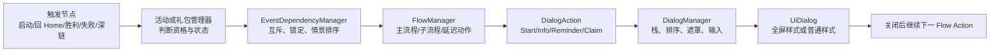

# Royal Match 38911 弹窗框架与展示规则

> [!summary] 核心结论
> Royal Match 的弹窗由两层共同决定：`FlowManager / HomeSceneFlow` 决定“何时轮到谁”，`DialogManager` 决定“如何显示、叠几层、谁接收输入”。全屏活动页、普通弹窗和礼包页多数共用 `UiDialog` 底座，没有独立的 `FullScreenDialog` 类型。活动也不是只在“解锁时”弹一次，而是按 `可加入 → 已参与/进行中 → 二次提醒 → 待领奖/结束` 分别插入 Start、Info、Reminder、Claim 等动作。

## 证据与边界

- 样本：`Royal+Match_38911_APKPure.xapk`，SHA-256 `31cdc1f3150ecbf912d9d02fdaefc18bbf2682f0eb7b35c7fe74a61e601a3899`。
- 证据：REA MCP、Cpp2IL 生成的 `Assembly-CSharp` 静态代码；本轮没有安装或启动游戏。
- 静态计数得到 292 个直接继承 `UiDialog` 的类；其中名称以 `Dialog` 结尾 200 个、`Popup` 结尾 20 个、`InfoScene` 结尾 30 个、`StartDialog` 结尾 14 个。名称只是功能提示，不等同于实际屏幕尺寸。
- 线上活动顺序、账号解锁等级、AB 分组、远端配置、弹出频控和最终视觉尺寸仍需运行时验证。

## 1. 总体处理链



这条链把两个容易混淆的问题分开：

1. **业务编排**：活动、礼包、教程和奖励谁先出现，由 Home Flow、活动依赖和各管理器的状态判断决定。
2. **界面层级**：当前能否叠第二层、返回键关谁、遮罩和触摸怎么处理，由 DialogManager 决定。

## 2. 展示载体：全屏与非全屏不是两套系统

| 载体 | 静态特征 | 常见内容 | 生命周期处理 |
|---|---|---|---|
| 全屏式活动页 | 常命名为 `InfoScene`、`ScenePopup` 或活动主 `Dialog`，Prefab 覆盖大部分视口 | 活动规则、地图、排行榜、对战进度、通行证 | 通常仍继承 `UiDialog`，进入同一 Dialog 栈 |
| 普通模态弹窗 | 常命名为 `Dialog`、`Popup`、`StartDialog` | 解锁、开启、确认、结束、领奖、礼包、退出 | 进入 Dialog 栈，有独立遮罩与关闭配置 |
| 弹窗内浮层 | 常由 `UiPanel`、局部组件或活动自己的子 Flow 管理 | 奖励明细、概率说明、用户资料、队伍信息 | 可能是新 Dialog，也可能只是父弹窗内 Panel |
| Tooltip / 气泡提示 | 由 `ToolTipManager` 等控制 | 图标引导、短提醒、说明 | 显示 Dialog 时通常会关闭现有 Tooltip；不一定进入 Dialog 栈 |
| 真正场景/Section | 由 Scene 或 Home `SectionManager` 管理 | Home、Game、社交、卡牌等独立页面 | 不属于 Dialog 生命周期；进入场景前会清理 Dialog |

可作为“全屏式活动页”线索的类包括 `SpaceMissionScenePopup`、`SkyRaceScenePopup`，以及 Robot Rivals、Lava Quest、Team Tournament、Weekly Mission 等 30 个 `*InfoScene`。但代码没有一个统一的“全屏”布尔值或基类；是否铺满屏幕最终取决于 Prefab 布局、Canvas 和运行时资源。

## 3. 内容类型与典型触发

| 内容类型 | 典型目的 | 常见动作/类名 | 主要触发时机 |
|---|---|---|---|
| 系统与异常 | 登录、网络、支付、版本、作弊或服务端消息 | System Message、Connection、Purchase Result | 启动、恢复、请求返回、强制回 Home |
| 解锁与首次开启 | 告知功能可用、解释玩法、引导入口 | `StartDialog`、Tutorial、Info | 达到资格且首次未展示；常记录已见状态 |
| 活动主界面 | 查看进度、地图、榜单、对手和奖励 | 活动主 `Dialog`、`InfoScene`、`ScenePopup` | 点击图标、深链、活动流程要求 |
| 进行中信息 | 被攻击、阶段变化、里程碑、排名变化 | `InfoDialog`、阶段/对战弹窗 | 参与中且特定状态变化后 |
| 二次提醒 | 活动已开放但尚未参加，或有关键进度 | Reminder / Second Start Popup | 首弹已展示、仍可加入，并通过二次提醒限制 |
| 领奖与结束 | 奖励揭示、最终排名、活动完成或强制结算 | `ClaimDialog`、Reward Reveal、End/Result | ReadyToClaim、活动结束或返回 Home |
| 礼包与商业化 | 展示 Offer、限时礼包、续关、通行证购买 | Offer / Dynamic Offer / Team Offer / Pass Purchase | 资格、冷却、入口和 Flow 条件满足 |
| 关卡结果相关 | 失败、续关、额外步数、退出确认 | Fail、OutOfMoves、Quit、Retry Purchase | Game 内或从 Game 返回 Home |

同一个活动可能复用同一个主界面承载多种内容。以 Robot Rivals 为例，Start、Info、Reminder、Claim 最终都可推入同一 `ShowRobotRivalsDialogAction`，再通过参数和当前活动状态决定落到首次介绍、对手攻击、进行中或结算内容。因此，不能仅凭 Prefab 名称判断弹窗只服务一个阶段。

## 4. 活动状态与“什么时候弹”

`IEventManagerWithIcon` 和 `AEventManager` 暴露了几类关键状态/入口：`IsEventReadyToJoin`、`IsThereEnteredEvent`、`IsEventReadyToClaim`、`BlockEvent`、`ForceClaimEvent`，以及 `TryAddStartDialog`、`TryAddInfoDialog`、`TryAddClaimDialog`、`TryAddAutoDialog`、`TryAddDeeplinkDialog`、`TryAddFlowActions`。

| 状态 | 产品含义 | 常见展示策略 |
|---|---|---|
| Locked / Blocked | 等级、依赖、同组互斥或资源条件未满足 | 通常不自动打开主界面；可保留锁态入口或完全隐藏，由依赖管理器排序/阻断 |
| ReadyToJoin / 新活动未见 | 已解锁且可加入，但玩家还没进入 | 优先候选是 Start / Tutorial；展示后写入已通知、已见或一次触摸锁状态，避免重复首弹 |
| Entered / Progressing | 已参加且正在推进 | 以手动点击主图标为主；阶段变化、被攻击、关键进度时可追加 Info 弹窗 |
| 未参与的二次提醒 | 首次开启弹过，但玩家仍未加入 | 走 Reminder / Second Auto Start Popup；受“是否已有自动弹窗”、活动频控和统一二次提醒资格限制 |
| ReadyToClaim / Finished | 已完成、活动结束或有奖励未领 | Claim / Result / Final List 优先进入返回 Home 的 Flow；部分活动支持强制领奖 |
| Deeplink | 从运营入口直达活动或礼包 | 通常要求 Home Section、图标有效且当前无活动中的 Dialog，避免在错误上下文强开 |

### 开启与解锁需要区分

- **解锁**是资格状态变化，例如达到等级或依赖满足；不必然立刻弹窗。
- **开启**是某次 Server Event 进入有效时间窗；同一已解锁功能可以多次开启新一轮活动。
- **首次开启弹窗**通常还要求：能自动弹、当前不是 LevelWinBot、资源/图标可用、首次提示未记录、主流程没有被暂停或占用。
- **进行中与领奖弹窗**不依赖“第一次解锁”；它们由当前活动实例的进度、攻击、结束和奖励状态驱动。

### 活动优先级不是固定清单

`EventDependencyManager` 为不同情景附加排序偏移，并由 `HomeSceneFlow.AddEventFlowActions` 取回活动优先列表后逐个调用 `TryAddFlowActions`：

| 情景 | 静态偏移 |
|---|---:|
| Prelevel：冷却态 | +40000 |
| Prelevel：降权活动 | +30000 |
| Prelevel：待领奖 | +20000 |
| Prelevel：待加入 | +10000 |
| Home：锁定 | +30000 |
| Home：待加入 | +20000 |
| Home：已参与 | +10000 |

Prelevel 同时限制最多展示 3 个活动；第二个活动的加入时间门槛常量为 1,800,000 毫秒（30 分钟）。这些数字确认了“情景排序维度”，但 Cpp2IL 输出没有完整方法体，不能只凭偏移正负断言最终是大数先展示还是小数先展示。

## 5. 礼包与活动商业化弹窗

礼包不是一个全局弹窗类，而是一组 Manager + DialogAction：普通 Offer、Dynamic Offer、Team Offer、Ladder Offer、Journey/Starfall Offer、Royal/Weekly Pass 购买和续关礼包等都可接入 Home Flow。

### 自动弹出的共同门槛

以 `OfferManager.TryAddStartDialog` 为代表，自动展示通常会组合检查：

- 当前玩家/活动是否符合 Offer 资格，礼包是否仍有效；
- 冷却时间、上次展示时间、首次教程或入口提示是否已完成；
- 主 Flow 是否暂停，是否已有 Dialog，图标/资源是否可用；
- AB 或远端开关是否允许自动弹；
- `CanShowAutoPopup` 是否成立，LevelWinBot 启用时通常抑制自动弹窗。

手动点击或 Deeplink 一般绕过“首弹次数”语义，但仍会检查入口有效、Home 上下文和当前 Dialog 冲突。

### 购买后的回流

购买成功并不只是关闭礼包：常见链路是 `支付结果 → 奖励揭示 → 库存/进度动画 → 可选回到原 Offer 或 Pass 页面 → Flow 继续`。`DialogOriginType` 会记录入口来源，例如 Shop、RoyalPass、PrelevelDialog、LevelFailDialog、OutOfMovesBanner、DynamicOfferDialog、TeamOfferDialog、SeasonalCardPackOfferDialog 等，用来决定返回位置和后续展示。

## 6. 同一个界面的多级弹窗

### 6.1 通用 Dialog 栈

`DialogManager` 使用 `SortedDictionary<int, UiDialog>` 保存当前 Dialog，而不是单一 `activeDialog`：

1. 新 Dialog 分配递增 ID 和 SortingOrder，加入栈顶。
2. 每层可拥有自己的背景遮罩与排序偏移。
3. 返回键、背景点击只路由给最上层 Dialog。
4. 新 Dialog 出现时关闭 Tooltip，并根据层级更新触摸排序。
5. 只有合适的 Dialog 关闭后才恢复游戏触摸。
6. Home/Game 场景切换前会统一关闭并 HardReset，避免跨场景残留。

因此框架原生支持同一界面叠多层，但“支持叠层”不等于所有业务都可任意插队；自动业务弹窗通常仍由 Flow 串行。

### 6.2 哪些界面明确允许上层弹窗

静态代码中有 27 个 `UiDialog` 实现 `ICanOpenPopupOnTop`。代表包括 Robot Rivals、Dragon Nest、Team Tournament、Archery Arena、Train Journey、Sky Race、Royal World Cup、Propeller Rush 等活动主界面，以及用户资料、队伍信息、设置和列表类弹窗。

这意味着这些页面可以作为“底层界面”保持打开，再叠加用户资料、队伍信息、奖励说明等二级弹窗，不需要先销毁活动主页面。

### 6.3 专门的递归子弹窗

`UserProfileFlowController` 维护 `ActiveRecursivePopupCount`、`OpenTeamPopups` 和独立子 Flow：

```text
活动/排行榜主页面
  └─ 玩家资料弹窗
      └─ 队伍信息弹窗
          └─ 另一名成员资料（可继续递归）
```

每个子层由 `ARecursivePopupAction` 持有父级 `ICanOpenPopupOnTop`，独立关闭并回退上一层。Royal Pass / Weekly Pass、Short Expedition、Merge Smith、概率说明等模块还使用各自的子 Flow，处理“主活动页 → 领奖/购买/说明 → 回到主活动页”。

### 6.4 串行与叠层的边界

| 情况 | 默认处理 |
|---|---|
| 两个无关活动都想自动弹 | 进入主 Flow 排队，前一个关闭后再执行下一个 |
| 活动主页面打开用户/队伍详情 | 允许通过 `ICanOpenPopupOnTop` 叠第二层或更多层 |
| 礼包购买后展示奖励 | 可走子 Flow：礼包页之上/关闭后展示 Reward Reveal，再按来源返回 |
| Tooltip 与新 Dialog 冲突 | 新 Dialog 显示时通常关闭 Tooltip |
| 切换 Home / Game | 清空 Dialog 栈，不让旧弹窗跨场景保留 |

### 6.5 子弹窗出现时，父弹窗是否隐藏

结论是：**没有全局统一的“子弹窗打开就隐藏父弹窗”规则**。当前静态代码能确认三种不同处理模式：

| 模式 | 父级状态 | 代表链路 | 用户看到的效果 |
|---|---|---|---|
| 直接叠层 | 父 Dialog 仍存在、仍渲染；子 Dialog 获得更高 SortingOrder 和自己的遮罩 | Magic Cauldron 主界面 → Quit Popup；Short Expedition 主界面 → Quit Dialog | 父页面留在下面，被暗色遮罩和子窗覆盖 |
| 保留父级但冻结交互 | 父 Dialog 不关闭；额外禁用父级 Collider、输入框或按钮，子流程结束后恢复 | Seasonal Card Send Dialog → 玩家资料/队伍资料递归弹窗 | 父页面通常仍可见，但不能操作 |
| 关闭后替换 | 父 Dialog 先 `Close / ForceClose`，再由 Flow 打开全屏式 InfoScene；InfoScene 关闭时重新 Push 主 Dialog | Robot Rivals、Magic Cauldron、Short Expedition、Mission Pursuit 的主界面 → InfoScene | 视觉上完全离开父页面；返回时是重新创建父 Dialog，不是简单取消隐藏 |

通用 `DialogManager.ShowDialog` 只处理：加入 `SortedDictionary`、更新 Sorting/Touch Sorting、创建子层背景、关闭 Tooltip 和禁用游戏层触摸；调用链中没有统一对旧 Dialog 执行 `SetActive(false)`。因此普通二级弹窗不能描述为“父级被隐藏”，更准确是“父级保留在栈内、被上层遮挡并失去输入焦点”。

#### 两条具体证据链

**叠层型：Magic Cauldron 退出确认**

```text
MagicCauldronDialog.OpenQuitPopup
  → FlowManager.PushSub
  → ShowMagicCauldronQuitPopupAction.Execute
  → Instantiate MagicCauldronQuitPopup
  → UiDialog.Show
```

Action 持有原 `MagicCauldronDialog` 引用，子 Popup 关闭时回调 `parent.OnQuitPopupClose(...)`。打开子 Popup 前没有关闭或隐藏父 Dialog；只有玩家确认退出时，父 Dialog 才可能 `ForceClose`。

**替换型：Robot Rivals 玩法说明**

```text
RobotRivalsDialog.InfoButtonClicked
  → Push ShowRobotRivalsInfoSceneAction
  → RobotRivalsDialog.Close
  → 显示 RobotRivalsInfoScene
  → InfoScene.OnClose
  → Push ShowRobotRivalsDialogAction
  → 重新创建活动主 Dialog
```

这不是父子 Dialog 同时存在，而是通过 Flow 做“主界面 → 说明页 → 重建主界面”的导航。

> [!note] 静态验证边界
> 上述能确认对象生命周期、Flow 与输入处理。子窗遮罩是否完全盖住父级、父级在透明区域是否仍能看到，以及切换动画是否制造“隐藏”观感，仍需对应 Prefab 或真机画面验证。

## 7. 典型活动的状态差异

| 模块 | Start / 开启 | Info / 进行中 | Reminder | Claim / 结束 |
|---|---|---|---|---|
| Robot Rivals | 可加入、首弹未见、允许自动弹 | 对手攻击等状态未展示 | 首弹已过但仍可加入，且二次提醒许可 | 可领奖、分数/生命/弹药状态满足时进入同一主 Dialog |
| Lava Quest | 新 Server Event、允许提示、Prelevel/Home 条件满足 | 主要通过比赛主界面查看 | `ShouldShowSecondStartPopup` 且统一二次提醒许可 | 已参赛、完成或新一轮切换时推入 Competition Dialog |
| Kings Cup | 图标可见、首次通知未记录、一次触摸锁 | 可通过图标/深链打开榜单 | 有单独 Start Tooltip 状态 | `ShouldForceClaim`、网络与结束数据有效时显示结算 |
| Royal / Weekly Pass | 新周期开始与图标教程 | 进度、最后阶段、购买页 | 由 Home Flow / 自动弹条件控制 | Claim、Reward Reveal；购买后可重新打开 Pass 主页面 |

这组例子说明“同一种活动弹窗”往往同时承担进入、进度和结算；判断时应以 Manager 状态和 DialogAction 参数为准，而不是只看 UI 类名。

## 8. 当前能确认与不能确认的边界

### 已确认

- DialogManager 支持多实例、栈顶输入、独立遮罩、SortingOrder 与场景切换清理。
- 自动业务弹窗通过 Flow 串行；活动先经过依赖/锁定/情景排序，再决定是否加入 Flow。
- 活动有 Start、Info、Reminder、Claim、Deeplink 等不同入口，且与 ReadyToJoin、Entered、ReadyToClaim 等状态对应。
- 全屏式活动页与普通弹窗多数复用 `UiDialog`；多级弹窗有通用栈和递归子 Flow 两种机制。
- Offer 会检查资格、冷却、教程/展示记录、当前 Flow/Dialog 和自动弹权限；购买后可继续奖励揭示并返回来源页。

### 尚未确认

- 38911 线上当前活动和礼包的精确先后顺序、频控次数与 AB 参数。
- 每个 Dialog 的实际像素尺寸、遮罩透明度、关闭手势和动画；这些需要逐个 Prefab 或真机验证。
- 服务端是否对特定活动强制插队、覆盖优先级或返回不同 Offer。
- 多个待领奖活动同时存在时的最终用户可见排序。

## 关键代码入口

以下路径均位于 `06-PRODUCT-ASSETS/RoyalMatch/38911/04-ReverseEngineering/IL2CPP_Static/cpp2il-diffable-cs/DiffableCs/Assembly-CSharp/Royal/`：

- `Infrastructure/UiComponents/Dialog/DialogManager.cs`
- `Infrastructure/UiComponents/Dialog/UiDialog.cs`
- `Infrastructure/UiComponents/Dialog/DialogConfig.cs`
- `Infrastructure/UiComponents/Dialog/EventDialogTimeTracker.cs`
- `Scenes/Start/Context/Units/Flow/FlowManager.cs`
- `Scenes/Start/Context/Units/Flow/FlowExecuter.cs`
- `Scenes/Start/Context/Units/Flow/FlowAction.cs`
- `Scenes/Home/Context/Units/HomeSceneFlow.cs`
- `Player/Context/Units/AEventManager.cs`
- `Player/Context/Units/EventDependencyManager.cs`
- `Player/Context/Units/IEventManagerWithIcon.cs`
- `Player/Context/Units/RobotRivalsManager.cs`
- `Player/Context/Units/LavaQuestManager.cs`
- `Player/Context/Units/KingsCupManager.cs`
- `Scenes/Home/Ui/Sections/Home/UserProfile/UserProfileFlowController.cs`
- `Scenes/Home/Ui/Sections/Home/UserProfile/ARecursivePopupAction.cs`
- `Scenes/Home/SeasonalCardCollection/Scripts/SeasonalCardCollectionSendCardDialogWithTabs.cs`
- `Scenes/Home/Ui/Dialogs/MagicCauldron/Actions/ShowMagicCauldronQuitPopupAction.cs`
- `Scenes/Home/Ui/Dialogs/MagicCauldron/MagicCauldronQuitPopup.cs`
- `Scenes/Home/Ui/Dialogs/ExpeditionEvent/Scripts/Actions/ShowShortExpeditionEventQuitDialogAction.cs`
- `Scenes/Home/Ui/Dialogs/RobotRivals/Scripts/RobotRivalsInfoScene.cs`

## 关联

- [[02-PROJECTS/产品分析/Royal Match/系统活动关卡与主场景框架-38911|Royal Match 38911 系统活动、关卡与主场景框架]]
- [[02-PROJECTS/产品分析/Royal Match/活动清单与简述-38911|Royal Match 38911 活动清单与简述]]
- [[02-PROJECTS/产品分析/Royal Match/资源与逻辑分析总览-38911|Royal Match 38911 资源与逻辑分析总览]]
- [[02-PROJECTS/产品分析/_MOC|产品分析 MOC]]
