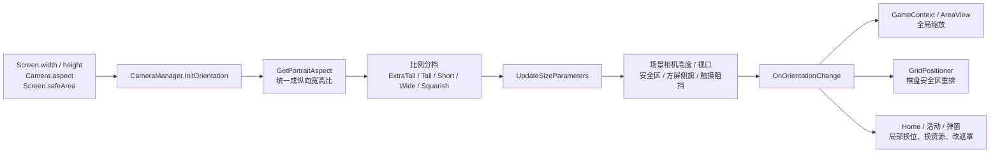

# Royal Match 38911 设备分辨率与横竖屏适配

> [!summary] 当前结论
> Royal Match 不是以“具体分辨率对应一套界面”作为主适配方式。客户端以 `CameraManager` 为中心，把相机宽高比统一成纵向比例，完成设备分档、场景相机尺寸、方屏视口、安全区与横竖屏广播；Game、Home、活动页和弹窗再分别做缩放、换位、换背景资源或局部重排。关卡棋盘还会单独按安全可玩区域重新计算位置，不能把它理解成只套了一层 Canvas 缩放。

## 证据与边界

- 样本：`Royal+Match_38911_APKPure.xapk`，SHA-256 `31cdc1f3150ecbf912d9d02fdaefc18bbf2682f0eb7b35c7fe74a61e601a3899`。
- REA MCP 已重新打开并核对实际 XAPK；本轮继续读取同一包内 ARM64 `libil2cpp.so` 和 Cpp2IL 静态产物。
- 以下“已确认”来自常量、ARM64 分支、调用关系和类职责；没有真机旋转、刘海屏录屏或 Unity 层级快照。
- 服务端活动资格不会改变中央屏幕适配框架，但远端 Bundle 可以带来活动自己的适配资源与参数；本文没有下载和核对这些远端内容。

## 一张主链图

## 1. 输入不是只有“分辨率”

中央适配会同时读取以下信息：

| 输入 | 主要用途 |
|---|---|
| `Camera.aspect` | 归一化成纵向宽高比，作为设备比例分档的主依据 |
| `Screen.width / height` | 校验相机像素尺寸、计算安全区和 RenderTexture 宽度 |
| `Screen.safeArea` | 避开刘海、挖孔和系统安全边缘 |
| `Screen.orientation`、`Input.deviceOrientation` | 交叉判断当前横竖屏，避免只信单一 orientation 值 |
| 平台与设备型号 | iOS / Android 刘海兼容、旧设备兜底、少量异常分辨率和双屏特判 |
| 当前场景/关卡类型 | Home、普通 Game、Table Game 使用不同相机高度和横屏资源 |

`GetPortraitAspect()` 的 ARM64 分支等价于：相机比例大于 1 时取倒数，否则保留原值。因此后续阈值统一按 `宽 / 高 ≤ 1` 理解，横竖屏切换不会让设备类别本身颠倒。

### 比例档位

| 判定 | 静态阈值 | 含义 |
|---|---:|---|
| `IsDeviceExtraTall()` | `< 0.43` | 极长屏；也是 Tall 的子集 |
| `IsDeviceTall()` | `< 0.50` | 长屏 |
| `IsDeviceShort()` | `≥ 0.50 且 < 0.57` | 相对不长的常规纵屏 |
| `IsDeviceWide()` | `≥ 0.57` | 纵屏画面相对更宽/更短 |
| `IsDeviceSquarish()` | `≥ 0.80` | 接近方屏；也是 Wide 的子集 |

> [!important] 档位不是互斥枚举
> `ExtraTall` 会同时满足 `Tall`，`Squarish` 会同时满足 `Wide`。业务组件经常先判断更特殊的子集，再回落到较宽的父档。名称中的 Wide 指纵向画幅相对更宽，并不是当前一定处于横屏。

此外还存在：

- `SquareDeviceTargetAspect = 0.7`：用于方屏相机/视口修正链，不等同于 `Squarish = 0.8` 的业务分类阈值。
- `LegacyWideAspectRatio = 0.6`：旧版宽屏兼容阈值。
- `IsShortWideResolution()`：给 Sky Race、Home 背景、弹窗等更细的中间比例特判；其两个间接浮点常量没有在当前 Cpp2IL 输出中恢复为字段名，暂不写死范围。
- `IsUnsupportedResolution()`：把特定设备型号与比例近似判定组合起来，目前只看到调用链，未可靠恢复型号清单。

## 2. 中央相机、视口与 UI 缩放

`CameraManager.SetSceneCamera()` 在场景相机就绪后执行 `InitOrientation()` 和 `UpdateSizeParameters(scene)`。核心基线为：

| 参数 | 值 | 用途 |
|---|---:|---|
| `DefaultCameraWidth` | `9.3` | 纵屏世界宽度基线 |
| `LandscapeHomeCameraHeight` | `17.5` | Home 横屏相机高度 |
| `LandscapeGameCameraHeight` | `12.7` | 普通关卡横屏相机高度 |
| `LandscapeTableGameCameraHeight` | `18.2` | Table Game 横屏相机高度 |
| `PixelPerUnit` | `140` | 像素与世界单位换算基线 |

`UpdateSizeParameters()` 会读取相机像素宽高和 aspect，重设 `Camera.rect`、`orthographicSize`，再计算安全区，并创建方屏侧边装饰与触摸阻挡。

### 方屏并不是直接把内容横向拉满

当相机需要按方屏修正时，客户端会：

1. 收窄或重设有效相机视口；
2. 用 `LandscapeFlagsView`/方屏侧旗填充两侧；
3. 创建 `SquareDeviceSideTouchBlocker`，阻止玩家点击不可玩侧区；
4. `GetRenderTextureWidth()` 按修正后的 `Camera.rect.width` 计算遮罩和特效 RenderTexture 宽度。

因此方屏策略更接近“保持中央可玩构图 + 两侧装饰/阻挡”，而不是把棋盘和 UI 全部非等比拉伸。

### `GetUiScaleFactor()` 的作用

`GetUiScaleFactor()` 有 102 个静态调用点，默认返回 1，在满足特定场景与较高纵向比例时返回修正因子。它被 Game 根节点、AreaView、Loading、活动 UI、粒子修正和部分弹窗共同消费。

当前静态输出能确认分支和调用范围，但两个最终缩放值仍是间接常量，未可靠恢复成可命名数值；因此本文只确认“何时存在统一缩放链”，不伪造具体倍数。

框架还提供两类补偿：

- `ApplyGameUiScaleParentingFix()`：重挂父节点时保持可见缩放，避免教程/提示随父级二次缩放。
- `ApplyGameUiScaleParticleFix()`：按 UI scale 修正粒子起始尺寸，避免 transform 缩放后粒子大小失真。

## 3. Safe Area 与刘海处理

`CameraManager` 构造时读取 `Screen.safeArea`，之后通过 `CalculateReliableSafeArea()` 再校验：

1. 对比 `Screen.safeArea` 与 `Camera.pixelWidth / pixelHeight`；
2. 若方屏相机已裁切，按实际相机视口修正 safe area；
3. 把可靠矩形转换成世界坐标安全中心、顶部和底部；
4. iOS/Android 分支再处理旧设备刘海与顶部 cutout；Android 顶部 cutout 设有 `165` 像素上限常量；旧设备可回退到 `DeviceHelper.GetLegacyNotchHeight()`。

对外主要提供：

| 接口 | 静态调用量 | 典型用途 |
|---|---:|---|
| `GetSafeTopCenterOfCamera()` | 118 | 顶栏、关闭按钮、教程、活动头部、奖励飞行终点 |
| `GetSafeBottomCenterOfCamera()` | 74 | Bottom UI、Out of Moves、页脚与底部活动元素 |
| `GetSafeCenterPosition()` | 4 | Ego/奖励类弹窗整体居中 |
| `GetTopSafeHeightDiff()` | 7 | 用户信息栏、金币飞行、King 房间等顶部补偿 |
| `GetSafePortraitAspect()` | 2 | 判断安全区后的真实可用画幅是否异常 |

这说明刘海适配不是只作用于一层根 Canvas；不少交互和动画终点会直接读取安全世界坐标。

## 4. 横竖屏切换与“切换锁”

`GetReliableScreenOrientation()` 会综合 `Screen.orientation`、`Input.deviceOrientation`、平台、编辑器状态和上一次横屏状态。切换成立后，`ArrangeOrientation()` 会重新执行 `UpdateSizeParameters()`，再广播 `CameraManager.OnOrientationChange`。

静态元数据中：

- `IsLandscape` 有 565 个调用点；
- orientation 监听委托构造有 452 个调用点；
- 注册/注销分别有 219 / 233 个调用点。

这表明横竖屏不是少数页面的补丁，而是覆盖 Home、关卡、活动、弹窗和动画的基础事件。

为了避免旋转发生在动画或交互中段，框架用 `DisableOrientation(reason)` / `EnableOrientation(reason)` 维护原因列表。`OrientationDisabler` 包含 `Purchase`、`SceneChange`、`BoardScroll`、`OutOfMovesDialog`、各种特殊块动画、活动领奖和教程等 214 个命名原因。只有所有占用原因都释放，旋转才会恢复；场景切换和异常收尾还有 `ResetOrientationLock()`。

Unity 自动旋转只打开 Portrait、LandscapeLeft、LandscapeRight，明确关闭倒置纵屏。

## 5. 关卡内不是只缩放：还会重排棋盘和上下 UI

### Game 根级缩放

`GameContext.Activate()` 首次调用 `SetSizeForScaledGame()`，并订阅横竖屏变化；旋转时重新计算。该方法同时使用：

- `WideDeviceCameraWidth`
- `GetUiScaleFactor()`
- `IsDeviceSquarish()`

计算结果会写入 Game 根节点，并同步给 `AreaView.SetSizeForScaledGame()` 与 `LoadingManager.SetSizeForScaledGame()`，使关卡、被保留的 Home 区域和加载表现保持一致。

### 棋盘位置单独计算

`GridPositioner` 不是简单跟随根节点：

- `CalculateOffset()` 同时读取普通相机顶/底边、安全区顶/底边、UI scale，以及 Clash of Champions 等局内活动条是否占位；
- `GetOffsetByAspectRatio()` 分别处理横屏、Tall 和 Squarish；
- `GetGridTransformPosition()` 继续考虑异常分辨率、Wall Level、最终 Board 与多 Board 状态；
- `OnOrientationChange()` 会重算网格中心差、外部等待位置、offset 与最终 transform 位置。

因此它的目标是把棋盘放进“扣除安全区和上下 UI 后的可玩区域”，不是单纯按屏幕比例整体缩小。

Water、Story、Table Game、Portal 等玩法还有各自的 Positioner 或二次布局。

### Top / Bottom UI 与横屏资源

TopUi、BottomUi 和 Settings 等模块会在横屏时：

- 重新计算 inside/outside 位置；
- 读取相机左右边界和安全上下边界；
- 替换横屏背景、阴影、Booster 按钮等 Sprite；
- Table Game / Portal 等类型再叠加专用偏移和背景。

`LoadGameLandscapeAssets()` 和 `LoadHomeLandscapeAssets()` 证明横屏并非只旋转坐标，还会加载结构对应的资源集。

## 6. Home、活动页和弹窗的局部策略

中央框架只提供可用边界和分档，复杂页面仍会自定义布局：

| 页面/模块 | 已确认的适配方式 |
|---|---|
| Sky Race / Space Mission | 定义 `Tall / Other / Wide / Landscape` 的 `ScreenType`，重排行、飞机、场景图、云层、文字和 collider |
| Ancient Adventure | `AncientAdventureWideScreenUI` 调整左右父节点、侧边 UI 尺寸与入场位置，并消费 `GetUiScaleFactor()` |
| Ocean Odyssey | 横竖屏回调中重设左右装饰位置及 SpriteRenderer 尺寸 |
| Royal World Cup | 根据 Wide / Landscape 判断是否显示 curtain，重算左右 curtain、mask 与 SpriteMaskInteraction |
| Home Area 背景 | 按 `IsShortWideResolution()` 等比例结果调整背景宽度和滚动区域 |
| 普通/活动弹窗 | 常见做法是改 root position、localScale、字体/背景尺寸、遮罩与关闭按钮安全位置 |

因此同为全屏活动，也可能采用不同策略：有的以中央内容缩放为主，有的新增两侧装饰，有的切换 `ScreenType` 后整组重排。不能只看 `UiDialog` 是否全屏来推断适配行为。

## 7. 特殊设备与性能分档要分开看

- `DeviceHelper.IsUnsupportedResolutionDevice`：按设备型号做异常分辨率兜底，当前反编译未可靠恢复具体型号字符串。
- `DeviceHelper.IsDualScreen()`：存在双屏设备型号判断，并被 SuperDuke / MagicDuke 等资格与布局消费；具体折叠状态与铰链区域仍需真机验证。
- 低/中/高端机还会根据 RAM、GPU 等做性能分段，影响粒子、资源密度或效果；这与 aspect/safe area 的布局适配是两条不同链路，不应混为“分辨率适配”。
- Android 启动视频在 1170×2532 与 888×1920 之间选择，是 AVC 解码能力分支，只属于启动页，不代表 Unity 主界面的通用分辨率档位。

## 8. 当前可用于复刻的框架规则

若要在别的 Unity 项目复刻这套思路，可抽成五层：

1. **标准化输入**：用 `min(aspect, 1/aspect)` 得到不受朝向影响的设备比例。
2. **中央视口层**：按场景设置 orthographic size / rect，方屏保留中央构图并阻断侧区触摸。
3. **安全区层**：把像素 safe area 转成世界坐标，向业务提供 safe top/bottom/center。
4. **根级缩放层**：只对需要统一比例的 Game/Home 保留区、Loading 和粒子做一致缩放。
5. **页面策略层**：复杂活动用明确 `ScreenType` 或专用适配组件，分别处理位置、资源、遮罩、字体和 collider。

## 9. 尚未验证

- 各真实设备上 `GetUiScaleFactor()` 最终返回的精确数值。
- `IsShortWideResolution()` 的两个间接阈值，以及异常型号/双屏型号完整名单。
- Android 挖孔高度被 165 像素上限裁剪后的实际世界坐标效果。
- 折叠屏展开/折叠、系统手势栏动态变化、分屏模式和运行时窗口缩放。
- 远端活动 Bundle 是否覆盖本地布局参数、Sprite 或 prefab。

建议运行时优先验证五档比例：`<0.43`、`0.43–0.50`、`0.50–0.57`、`0.57–0.80`、`≥0.80`，每档再测普通屏/刘海屏与旋转中断动画。

## 关键代码入口

- `Royal/Infrastructure/Contexts/Units/CameraManager.cs`
- `Royal/Infrastructure/Contexts/Units/OrientationDisabler.cs`
- `Royal/Infrastructure/Utils/Native/DeviceHelper.cs`
- `Royal/Scenes/Game/Context/GameContext.cs`
- `Royal/Scenes/Game/Levels/Units/CellGridPositioner/GridPositioner.cs`
- `Royal/Scenes/Game/Ui/Top/TopUi.cs`
- `Royal/Scenes/Game/Ui/Bottom/BottomUi.cs`
- `Royal/Scenes/Home/Areas/Scripts/AreaBackgroundView.cs`
- `Royal/Scenes/Home/Ui/Dialogs/SkyRace/SkyRaceScenePopup.cs`
- `Royal/Scenes/Home/Ui/Dialogs/AncientAdventure/Scripts/AncientAdventureWideScreenUI.cs`
- `Royal/Scenes/Home/Ui/Dialogs/OceanOdyssey/Scripts/OceanOdysseyDialogWideScreenUI.cs`
- `Royal/Scenes/Home/Ui/Dialogs/RoyalWorldCup/Scripts/RoyalWorldCupDeviceCompatibilityHelper.cs`

以上路径均位于：`06-PRODUCT-ASSETS/RoyalMatch/38911/04-ReverseEngineering/IL2CPP_Static/cpp2il-diffable-cs/DiffableCs/Assembly-CSharp/Royal/`。

用于补全 ARM64 分支的 ISIL 位于：`06-PRODUCT-ASSETS/RoyalMatch/38911/04-ReverseEngineering/IL2CPP_Static/cpp2il-isil/IsilDump/Assembly-CSharp/Royal/`。

## 关联

- [[02-PROJECTS/产品分析/Royal Match/系统活动关卡与主场景框架-38911|Royal Match 38911 系统活动、关卡与主场景框架]]
- [[02-PROJECTS/产品分析/Royal Match/系统拆解-弹窗框架-38911|Royal Match 38911 弹窗框架与展示规则]]
- [[02-PROJECTS/产品分析/Royal Match/资源与逻辑分析总览-38911|Royal Match 38911 资源与逻辑分析总览]]
- [[02-PROJECTS/产品分析/Royal Match/资源路径索引|Royal Match 38911 资源路径索引]]
- [[02-PROJECTS/产品分析/_MOC|产品分析 MOC]]
