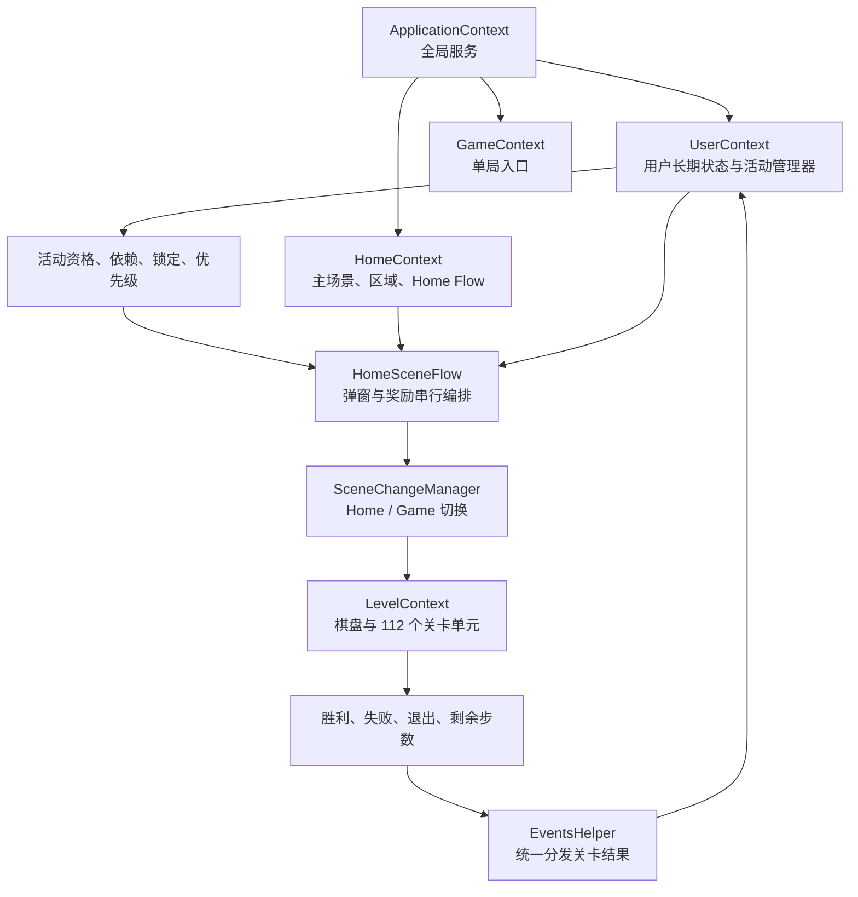
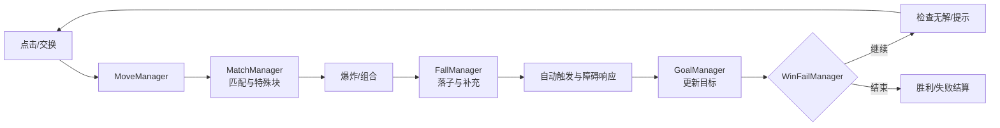

# Royal Match 38911 系统活动、关卡与主场景框架

> [!summary] 当前结论
> Royal Match 的客户端可以先理解为四层：全局应用服务、长期用户系统、Home 主场景编排、单局关卡上下文。活动不是各自直接抢占 UI，而是先经过资格/依赖/优先级处理，再由 Home Flow 串行展示；关卡结果则通过统一事件入口回流给活动。本文只建立大体框架，暂不展开单活动数值、全部障碍和逐帧表现。

## 证据与边界

- 样本：`Royal+Match_38911_APKPure.xapk`，SHA-256 `31cdc1f3150ecbf912d9d02fdaefc18bbf2682f0eb7b35c7fe74a61e601a3899`。
- 来源：REA MCP 解包结果、Unity 本地资源、Cpp2IL 生成的 `Assembly-CSharp` 静态代码。
- 本文已确认的是客户端结构与本地默认配置；线上档期、账号资格、服务端覆盖、AB 分组、远端 Bundle 和实际弹窗顺序尚未运行验证。
- 下文“产品分层”是依据职责做的分析归纳，不是客户端中存在的同名官方层级。

## 一张总图

核心闭环是：`Home 选定要展示/进入的活动 → 进入关卡 → 关卡结算 → 活动更新进度 → 回到 Home 串行播放奖励、活动弹窗和教程`。

## 1. 活动系统大体框架

中央活动及外围活动相关系统的逐项名称见 [[02-PROJECTS/产品分析/Royal Match/活动清单与简述-38911|活动清单与简述]]。

### 1.1 结构分层

| 层 | 主要职责 | 已定位的代表模块 |
|---|---|---|
| 活动实例层 | 保存单个活动状态、入口、奖励、教程和结算逻辑 | `AEventManager` 及 37 个活动管理器 |
| 资格与互斥层 | 判断能否进入、活动锁定、同组活动互斥、图标与 Prelevel 排序 | `EventDependencyManager`、`EventLockManager` |
| 生命周期层 | 启动、重进、胜负、失败、剩余步数结束等统一回调 | `EventsHelper` |
| 恢复与预告层 | 老活动恢复、教程优先级、未来活动信息和提示 | `EventsReactivationManager`、`UpcomingEventsManager` |
| 展示编排层 | 将活动弹窗、奖励、教程插入 Home 串行流程 | `HomeSceneFlow`、`FlowManager`、`DialogManager` |
| 资源分发层 | 按活动下载或挂载本地/远端 Bundle | Feature / Gameplay / Multiplayer / Singleplayer Bundle 配置 |

### 1.2 活动周期的通用链路

当前静态代码能确认的通用周期为：

1. 服务端时间、活动信息、本地进度和实验开关共同决定资格。
2. 依赖管理器处理同组互斥、锁定、图标和 Prelevel 排序。
3. 必要 Bundle 就绪后，活动进入可展示或可加入状态。
4. Home Flow 在启动、回到主场景、胜利或失败等节点插入活动动作。
5. 进入关卡后，`EventsHelper` 把 Enter、ReEnter、Win、Fail、RemainingMovesEnd 等结果分发给相关活动。
6. 活动管理器更新进度、奖励待领状态或结束状态，再回到 Home Flow 展示。

> [!note] 周期边界
> 代码中普遍使用开始/结束时间、剩余时间和服务端活动信息，但目前没有运行时日历。因此不能仅凭客户端静态代码给出“每周几开始、持续几天”的线上档期表。

### 1.3 产品层级归纳

| 分层 | 主要作用 | 代表系统 |
|---|---|---|
| 长期 Meta | 长周期成长与身份 | Area、League、Leaderboard、卡牌收集 |
| 赛季/通行证 | 跨多局累计与阶段奖励 | Royal Pass、Weekly Pass、Royal World Cup |
| 竞技活动 | 排名、对抗或团队竞争 | Kings Cup、Team Battle、Sky Race、Robot Rivals、Clash of Champions |
| 支线冒险 | 独立地图、关卡或阶段推进 | Ancient Adventure、Ocean Odyssey、Hidden Temple、Train Journey、Merge Smith |
| 短周期促活 | 日常回访、短冲刺与连续挑战 | Daily Rewards、Weekly Mission、Pinata Party、Balloon Rise、Rush 类活动 |
| 商业化覆盖 | Offer、续关、礼包和付费入口 | Ladder / Team / Journey / Starfall Offer、Coin Shop |

这张表用于理解产品结构；具体活动可能同时承担留存、竞争和商业化多个目标。

### 1.4 “机器人”需要拆成三类

| 名称 | 实际含义 | 当前确认 |
|---|---|---|
| Robot Rivals | 面向玩家的对抗活动 | 解锁等级 51；三阶段；匹配超时后可请求 `addBotPartner=true`，说明存在机器人对手兜底入口 |
| LevelWinBot | 内部自动化/测试机器人 | 可自动进入并赢得关卡，Home 和活动弹窗会在它启用时调整或抑制流程 |
| RoyalBotItem | 关卡内障碍/目标物 | 参与棋盘下落、底部收集和目标计数，与对手机器人无关 |

Robot Rivals 的机器人画像、分数曲线和是否由服务端动态生成尚未从静态客户端中确认，不能与内部自动化 Bot 混为一谈。

## 2. 关卡内大体框架

`LevelContext` 注册 112 个单局单元。它们可先归为以下几组：

| 模块组 | 主要职责 | 代表单元 |
|---|---|---|
| 棋盘与物件 | 创建格子、生成 Item、多 Board 管理 | `CellGridManager`、`ItemFactory`、`BoardManager` |
| 输入与移动 | 点击、交换、步数、移动完成 | `LevelTouchManager`、`MoveManager` |
| 匹配与特殊块 | 搜索匹配、生成火箭/螺旋桨/Lightball、组合 | `MatchManager`、`ComboManager`、`ExplodeTargetFinder` |
| 消除与落子 | 爆炸、自动触发、直落/斜落/补充 | `AutoExplodeManager`、`FallManager` |
| 目标与结算 | 目标计数、胜负、无步数、额外步数 | `GoalManager`、`WinFailManager`、`RemainingMovesManager` |
| 无解处理 | 可用移动检查、洗牌、提示 | `ShuffleManager`、`HintManager` |
| 障碍辅助器 | 各类障碍的状态推进与棋盘响应 | RoyalBot、Drill、Frog、Furnace、Conveyor、Water 等 Helper |
| 表现与教学 | 粒子、音效、教程、King 动画 | `ParticlesManager`、`GameSfxManager`、`LevelTutorialManager` |
| 保存与复现 | 局内保存、恢复、随机种子、回放 | `LevelSaveManager`、`ReplayManager`、`LevelRandomManager` |

### 单步处理主链

关卡状态包括 `Play / Win / Ego / Fail / Quit / NoPossibleMove`。结算前会等待下落、爆炸、组合、障碍动画等操作结束，因此“目标已完成”不一定立刻切出关卡。

当前只建立了关卡骨架；1295 个 Items 相关类、109 个 Item 子目录和各特殊玩法变体尚未逐项拆分。

### 服务端下发的关卡步数配置

2026-10-27 增补：结合 common_tools 新 Dumper 结果、既有 ARM64 及 MuMu 只读配置快照，确认 `App.KeyValue.SLBMoveConfig` 存在 c/d/f/g/h 五组，每组是关卡版本字符串和调整值交替排列。已拆出 306 个组内条目（可能跨组重复关卡），例如 c 组 `162v02 → 2`。`JSlbMoveConfigData`、`SlbLevelEntry(Version, MoveAdjustment)` 和 `SlbMoveConfigHelper` 对应此结构。

具名读取链：`MoveManager.GetMoveRemoveAmount`（`0x01EDA6D8`）→ `SlbMoveConfigHelper.GetMoveAdjustment` → 按 SuperBooster 实验组和关卡取条目；`UserActiveLevelData.GetFixedLevelName` 另调用 `TryGetLevelNameOverride`。因此这份配置既关联关卡版本选择，也参与步数调整，并非纯展示字段。

已核对 `GetMoveRemoveAmount` 原始 ARM64：输入步数小于 21 时返回 0；否则合并 SuperDuke 的一格扣减条件与 SLB 调整值，返回值受 `20 - 原步数` 下界约束。它说明本方法的调整规则，未实测当前账号命中哪个组、某关最终步数或所有调用场景。`ThreeColorMoveConfig` 此次为版本2、`b=[]`，不能据空表认定整个游戏无难度调控。

这是一条全局关卡配置链，尚未发现由 Ancient 的阶段或特定连胜次数直接触发；不能把它写成“参加 Ancient 必然减步”。原始配置和代码证据入口为 [[02-PROJECTS/产品分析/Royal Match/资源路径索引#common_tools 实跑与配置快照（2026-10-27）|common_tools 配置快照]]。只还原账号已下发内容，不覆盖服务器全量配置或分组算法。

## 3. 框架与主场景大体框架

### 3.1 四个主要上下文

| 上下文 | 生命周期 | 作用 |
|---|---|---|
| `ApplicationContext` | 应用级 | 日志、时间、下载、场景切换、Flow、Dialog 等全局服务 |
| `UserContext` | 登录用户级 | 关卡进度、生命、社交、League、Leaderboard 和各活动管理器 |
| `HomeContext` | Home 场景级 | Area、Home UI、章节/区域、Home 教程和主场景流程 |
| `GameContext` / `LevelContext` | 单局级 | 游戏场景入口，以及一次关卡的棋盘、目标、障碍和结算 |

### 3.2 主场景不是单一页面，而是编排中枢

- `SectionManager` 管理 Home、Episodes、Leaderboard、Seasonal Card Collection、Social 等横向 Section。
- `AreaManager` 创建区域视图、任务与宝箱，计算区域剩余任务/花费，并处理下一区域解锁。
- `HomeSceneFlow` 根据“启动、强制回 Home、胜利返回、失败返回、管理员入口”等来源构造不同动作队列。
- `FlowManager` 负责动作串行、子流程、延迟、暂停和恢复。
- `DialogManager` 负责弹窗层级、遮罩、触摸禁用、返回键及 Home/Game 模式切换。
- `SceneChangeManager` 负责 Start、Home、Game 之间的加载和前后场景状态。

弹窗的业务排序与界面叠层是两套职责：Home Flow 决定活动、礼包、教程和奖励何时执行，DialogManager 管理全屏式活动页、普通弹窗、遮罩、栈顶输入与多级弹窗。详见 [[02-PROJECTS/产品分析/Royal Match/系统拆解-弹窗框架-38911|弹窗框架与展示规则]]。

### 3.3 回到 Home 时的大体处理

| 来源 | 主要处理 |
|---|---|
| 冷启动/登录 | 登录结果、每日奖励、欢迎流程、教程、社交奖励、活动自动弹窗 |
| 胜利返回 | 星星/金币/League 动画、活动胜利进度与领奖、教程、Offer、评价请求、保存进度 |
| 失败返回 | 失败相关教程、活动图标教程、重试/无广告入口、提醒弹窗 |
| 强制返回/恢复 | 时间异常检查、登录状态、活动弹窗、League 和支付/作弊提示 |

活动展示不能统一描述为“先由EventDependencyManager排全部弹窗”：启动/恢复/失败返回使用35项固定自动候选链；胜利返回的Claim有独立次序，活动推进的部分管理器才按23项基础优先值升序遍历。`GetEventPriorityList`没有调用情景优先值方法；分组选择、关前图标与提醒短路另有规则。入队后，普通/自动队列、First/Interrupt、替换去重和首页分区延迟还会改变最终显示顺序。完整候选表、活动状态矩阵和礼包限制见[[02-PROJECTS/产品分析/Royal Match/系统拆解-弹窗框架-38911|弹窗持续主文档]]。以上为38911代码，不能据39781缓存直接升级为新版全链验证。

### 3.4 场景切换中的特殊处理

从 Home 进入关卡前，框架会清理弹窗、隐藏或调整 Area，并根据普通关、Story、Table Game、Lava 等类型选择不同背景处理。返回 Home 时再恢复 Area、Home UI 和后续 Flow。说明主场景与关卡并非完全独立加载，而是对背景、区域视图和 UI 层做了按玩法类型的保留/切换。

### 3.5 设备比例与横竖屏适配

`CameraManager` 统一处理纵向宽高比分类、场景相机高度、方屏视口、安全区与横竖屏广播；`GameContext` 再同步缩放关卡根节点、保留的 Area 和 Loading，`GridPositioner` 按安全可玩区域单独重算棋盘位置。Home、活动页和弹窗仍会在中央结果上做各自的换位、换资源、遮罩或 collider 调整。完整拆解见 [[02-PROJECTS/产品分析/Royal Match/系统拆解-设备分辨率与横竖屏适配-38911|设备分辨率与横竖屏适配]]。

## 下一步下钻入口

建议按以下顺序逐步细化，而不是同时铺开：

1. **活动层**：先拆 Robot Rivals，补齐资格、匹配、机器人兜底、三阶段、攻击/弹药和奖励链。
2. **关卡层**：先做“标准单步处理 + 特殊块组合 + 胜负”，再按障碍类别建目录。
3. **主场景层**：选一次“胜利返回 Home”，精确列出 Flow Action 的条件顺序。
4. 有授权运行环境后，用录屏/日志核对一条完整闭环，标记本地默认、服务端覆盖与最终可见结果。

## 关键代码入口

- `Royal/Player/Context/Units/EventsHelper.cs`
- `Royal/Player/Context/Units/EventDependencyManager.cs`
- `Royal/Player/Context/Units/EventsReactivationManager.cs`
- `Royal/Player/Context/Units/RobotRivalsManager.cs`
- `Royal/Scenes/Game/Levels/LevelContextId.cs`
- `Royal/Scenes/Game/Context/Units/GameManager.cs`
- `Royal/Scenes/Home/Context/Units/HomeSceneFlow.cs`
- `Royal/Scenes/Home/Context/Units/Area/AreaManager.cs`
- `Royal/Scenes/Start/Context/Units/Flow/FlowManager.cs`
- `Royal/Infrastructure/UiComponents/Dialog/DialogManager.cs`

以上路径均位于：`06-PRODUCT-ASSETS/RoyalMatch/38911/04-ReverseEngineering/IL2CPP_Static/cpp2il-diffable-cs/DiffableCs/Assembly-CSharp/Royal/`。

## 关联

- [[02-PROJECTS/产品分析/Royal Match/系统拆解-弹窗框架-38911|Royal Match 38911 弹窗框架与展示规则]]
- [[02-PROJECTS/产品分析/Royal Match/系统拆解-设备分辨率与横竖屏适配-38911|Royal Match 38911 设备分辨率与横竖屏适配]]
- [[02-PROJECTS/产品分析/Royal Match/活动清单与简述-38911|Royal Match 38911 活动清单与简述]]
- [[02-PROJECTS/产品分析/Royal Match/资源与逻辑分析总览-38911|Royal Match 38911 资源与逻辑分析总览]]
- [[02-PROJECTS/产品分析/Royal Match/资源路径索引|Royal Match 38911 资源路径索引]]
- [[02-PROJECTS/产品分析/_MOC|产品分析 MOC]]
