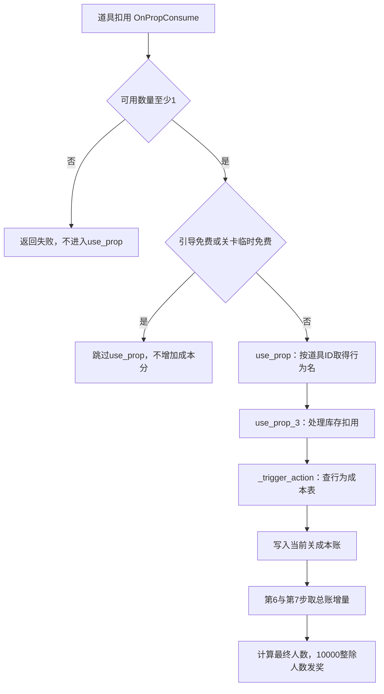

# Jungle Quest与Treasure Quest：关卡消耗口径与奖励影响

**这两个活动使用的“本轮累计关卡消耗”，是按行为表累计的成本分：常规库存道具使用计分，广告复活计600；明确标记为免费使用的道具跳过计分。金币扣款本身不会再叠加一次。成本分在第6、7步影响存活人数，进而影响最终分到的金币。**

版本与证据范围：TF Android **2.12.0 / 21200**，同构建ARM64方法体、REA metadata，以及**2026-11-04设备快照中已解密的初始配置**。2026-11-16完成静态补核和离线算例，未新增账号操作或实际领奖。表中数值是本批配置基线，不能替代当前线上账号最终覆盖值。两主题共用Lava Quest实现；完整人数公式、参赛分段和R组机制见[[02-PROJECTS/产品分析/Tile Family/游戏逻辑/Jungle Quest与Treasure Quest-奖励调控与分组-2.12.0|奖励调控与分组主文档]]。

## 1. 用户行为与计入口径

下表“影响奖励”指通过本轮成本分C的直接路径；只有本轮最终成功，才有成功分奖。计入C也不保证当次金额变化。

| 行为 | 本批计入方式 | 对最终奖励的直接影响 |
|---|---|---|
| 用库存撤回／抓钩／磁铁 | 每次600／900／1200 | 可提高C，跨过人数取整门槛才涨奖 |
| 用库存洗牌 | 旧版ID515为900；新版ID519为600 | 可提高C，不能将两版混作一个单价 |
| 免费领取、活动赠送或购买后放入库存的普通道具 | 使用时按同一行为表计分；不追溯取得来源 | 免费获得不等于免费使用，不因购入价为0而免计分 |
| 新手引导的明确免费使用 | `PropUseGuideHelper.IsFree`成立时跳过`use_prop` | 该次不增加C；本批引导开关F |
| 关卡临时免费道具 | `GamePlayerViewHelper.IsFree`成立时跳过`use_prop` | 该次不增加C；已找到重试帮助发放临时次数的路径 |
| 常规金币复活 | 使用对应复活ID时记900／1900／2900／3900／4900 | 可提高C；不再加一笔实际金币扣款 |
| 广告复活ID509 | `use_bag_spring_ad`每次600 | 可提高C；不是按广告收入、观看秒数或900金币折算 |
| 只观看广告、只获得金币／道具 | 所查成本写入链没有“看一次广告”或“获得资产”的统一加分项 | 不直接增加C；之后用所得普通库存道具可能计分 |
| 魔法帽／超级磁铁，包括其无限时版本 | 对应行为表Cost=0 | 该行为增加C为0，可能帮助通关，但不据此增加分奖 |
| 限时局内+1背包ID708 | 对应行为表Cost=0 | 该行为增加C为0；普通局内+1背包ID508为1200 |
| 失败扣普通体力 | `level_fail`触发`use_life`，记200 | 写入总账，但本轮失败不发成功奖；重报名会重设起点 |
| 无限体力下失败 | `use_life_when_unlimited`，记0 | 同样不能把失败当成提高成功奖励的手段 |
| 报名前已发生的上述消耗 | 进入全局总账，但在本轮起点差值中扣除 | 不直接进入本轮C |
| 第7步人数已计算后才发生的消耗 | 不在该轮已计算的N7中 | 已核领奖路径读取最终人数，不重新按新总账算奖 |

对商店、礼包、其他活动等所有金币用途，不能套用“金币减少多少，C就加多少”。本专题已核普通资产变更和复活扣款链未直接写入成本账；未宣称穷尽所有热更、反射或外部业务路径。

## 2. 从行为到本轮累计值

### 2.1 底账按关卡记录，活动取报名后的总账增量

实际记录为`RootAttr.level.per_level_cost`，键是`current_level`，值是该关累计的行为成本。不是关卡净金币损益，也不是消耗道具的总件数。

```text
触发行为action
  → 遍历config_server_action_cost.csv
  → 找到Action相等的行
  → per_level_cost[current_level] += Cost

Total = Σ per_level_cost.values
报名：RacingStartLevelCost = Total
第k步计算：Ck = 当前Total - RacingStartLevelCost
```

`ActionCollection._trigger_action`在该关没有记录时建项，有记录时累加；并上报`user_cost`。这里没有取金币余额差、道具商城价、广告收益或真实货币支出。它遍历匹配行；本批25行Action唯一，没有重复加分行。缺少匹配项不会补一个默认价格。

`Request.GetAllLevelCost`对字典值求和，并同时返回总值与均值；活动经`TilePigat → TileProvider → GetTotalLevelCost`使用总值。**“本轮”来自报名时保存的差值起点，而非只挑7个不同关卡ID。** 在起点之后、采样之前，凡写入这份总账的行为都进入差值；同一关多次使用会累加。关卡标签是归档键，不构成“每关只记一次”的限制。

### 2.2 计分触发点是道具扣用行为



`PropService.OnPropConsume`在两个免费判断前会更新自己的使用次数记录；这份记录与`per_level_cost`不同。因此“出现过道具动画／次数记录／资产使用上报”不自动证明C增加。

原生扣用发生在道具处理链中，不能将成本账描述为“等动画播完、效果成功后才记”。无库存而未进入扣用、只打开购买窗口，均不等于已触发该计分点；异常中断、回滚和重入是否重复记账未做实机验证。

## 3. 道具ID、行为名与成本表

ID到Action由`ActionCollection..cctor`建立，再与`config_server_action_cost.csv`对齐。下面覆盖本次从该静态映射恢复的全部25个ID；体力两项另列。

| 道具ID | 行为Action | 每次成本分 | 解释 |
|---|---|---:|---|
| 502 / 516 | `use_undo` / `use_new_undo` | 600 | 旧／新撤回 |
| 506 / 517 | `use_propeller` / `use_new_crane` | 900 | 旧／新抓钩 |
| 503 / 518 | `use_magnet` / `use_new_magnet` | 1200 | 旧／新磁铁 |
| 515 | `use_shuffle` | 900 | 旧洗牌 |
| 519 | `use_new_shuffle` | 600 | 新洗牌 |
| 505 | `use_spring` | 1200 | 手套 |
| 601 | `use_extraspace` | 1200 | +1背包 |
| 508 | `use_ingame_extraspace` | 1200 | 局内+1背包 |
| 708 | `use_ingame_extraspace_when_unlimited` | 0 | 限时局内+1背包 |
| 507 | `use_bag_spring` | 900 | 基础复活 |
| 511 | `use_bag_spring_1` | 1900 | 梯度复活1 |
| 512 | `use_bag_spring_2` | 2900 | 梯度复活2 |
| 513 | `use_bag_spring_3` | 3900 | 梯度复活3 |
| 514 | `use_bag_spring_4` | 4900 | 梯度复活4 |
| 509 | `use_bag_spring_ad` | 600 | 广告复活 |
| 510 | `use_bag_spring_iap` | 900 | IAP复活；值来自使用行为，不按支付价格换算 |
| 602 / 802 | `use_magic_hat` / `use_unlimited_magic_hat` | 0 | 魔法帽／无限魔法帽 |
| 603 / 803 | `use_super_magneto` / `use_unlimited_super_magneto` | 0 | 超级磁铁／无限超级磁铁 |
| 501 | `use_addskill` | 本表无匹配行 | 不在这份表中产生加分；不是已配置Cost=0 |
| 504 | `use_storm` | 本表无匹配行 | 同上；不据映射存在断言线上有入口 |

体力行为：`use_life=200`、`use_life_when_unlimited=0`，由`level_fail`触发。上述中文名称采用配置描述，未逐一实拍当前UI是否使用同一译名。旧新ID、IAP复活与特殊道具的代码／配置存在，不表示每个账号当前都会出现。

## 4. 金币、免费与广告的关键区别

### 4.1 金币复活：先购买复活道具，再由使用行为计分

已核调用链：

```text
GamePlayerView的复活入口
→ Pigat.DoAction("level_recover", ID)
→ _gain_level_recover_prop：GetRecoverPrice(ID)，扣金币ID100
→ _do_level_recover：补入复活道具
→ GamePlayerView.TryRevive → ReviveService.TryRevive
→ GameManager.OnPropClick(ID) → PropClickHandler
→ _propConsume → PropService.OnPropConsume
→ use_prop → use_prop_3 → _trigger_action
```

普通资产扣款`UserAsset.ChangeAssetByCount`负责资产变化和通知；复活购买还调用`IReporter.asset_use`作上报。**这两处不是额外写成本账的入口。** 后续复活ID使用时才按Action加分，所以正常一次基础复活是900分，不是“扣900＋使用900＝1800分”。

本批价格与行为成本分开配置，存在明确差异：

| 复活ID | `GetRecoverPrice`读取的金币价 | 使用行为成本分 |
|---|---:|---:|
| 507 | 900 | 900 |
| 511 | 1900 | 1900 |
| 512 | 2900 | 2900 |
| 513 | 3900 | 3900 |
| 514 | **3900** | **4900** |

价格来源：`prop_bagspring_coin_count=900`；`prop_bagspring_gradient_coin_count=1900|2900|3900|3900`。已读`GetRecoverPrice`的原生跳转表确认511～514对应数组第0～3项；不能凭常见产品的900→1900→2900→3900→4900习惯改写配置。最高档的差异支持“行为计价独立于实际扣款”，但**不能仅凭静态文件判定这是运营意图还是配置错误**，也未验证当前UI报价／实际扣款。

还有早期免费复活价格分支：`is_free_recover`成立且主线≤`free_bag_spring_level`时，GetRecoverPrice返回0。本批阈值20，客户端`free_bag_spring_level_switch=F`，两个Quest副本StartLevel=63。因此本批正常Quest进度不覆盖这段早期范围。价格为0本身不等于`OnPropConsume`免费标记成立；两种机制不要合并。

### 4.2 “免费取得库存”与“本次免扣使用”

普通`use_prop_3`不读取该件道具是充值、礼包、签到、活动奖励还是广告获得。只要走普通扣用并匹配Action，就记同样的成本分。例如免费礼包里的两枚普通磁铁，在本轮用掉两枚，C增加2400。

免计分的两个明确分支是：

| 判定 | 代码条件 | 本批证据与边界 |
|---|---|---|
| 引导免费 | `PropUseGuideHelper.IsFree(ID)`：引导开关开启且ID等于`GetNewUnlockProp()` | `booster_guide_unlock=F`；方法中跳转至`0x6e5d968`的短跳板已跟回，未将其当成缺失分支 |
| 关卡临时免费 | `GamePlayerViewHelper.IsFree(ID)`：其独立临时资产字典中该ID数量非0 | 与`UserAsset`持久库存不同；已核`SetAsset`修改该字典，重试帮助回调加1、PropView使用路径扣减 |

第二种已找到`LetHelpTryAgainPopupFlowAction`完成回调：给予重试帮助相关奖励，并将配置指定道具记入临时免费字典。使用时虽有`asset_use`上报，仍绕过`use_prop → _trigger_action`。这说明**有使用上报不等于计入Quest成本**；也说明“广告帮助”与“509广告复活”必须按实际业务路径区分。该帮助入口的当前曝光条件和账号是否触发，不在本次实机验证范围。

另有零成本行为（如魔法帽、超级磁铁），它们是表内Cost=0，和免费判断跳过整个`use_prop`路径不同。

### 4.3 广告复活：加600，不扣金币，不按广告次数额外叠加

广告复活ID509进入`level_recover`时走`reward_ad_buy_revive`计次分支，不走507／511～514的金币扣款分支。后续按509执行复活道具处理，映射到`use_bag_spring_ad`，在通常未命中免费覆盖的路径下加600。

因此准确触发语义是**进入509的复活扣用行为**。广告加载、开始播放、取消、失败或其他广告位发金币，不能仅因“看了广告”就加600；已经看完但尚未进入复活处理，也不能仅凭观看记录认定写账。广告奖励回调机制另见[[02-PROJECTS/产品分析/Tile Family/游戏逻辑/广告策略与分配配置-2.12.0|广告策略专题]]。

广告使用次数、关卡复活次数、行为成本账是三份不同统计；已核路径没有把600再乘观看次数、累计复活次数或广告收益，也没有额外加900的基础复活分。

## 5. 哪些计入最终会改变奖金

### 5.1 C只在第6、7步进入人数公式

前1～5步的人数由首步随机值及幂函数决定，不读取C来改变人数。前五步使用的道具仍写入底账，累计到第6、7步使用。

```text
A(C) = 10000 / (d × C)，C≥1；C<1时A=100
N6 = min(ceil((N5 + min(N5, A(C6))) / 2), 20)
N7 = min(N6, ceil(A(C7)))
最终金币 = 10000 整除 N7
```

在其他参数固定且本轮成功的情况下，计入更多非负成本分，会使最终人数不增、奖金不减；因为向上取整、人数上限及奖池封顶，存在大量“C增加而奖励不变”的区间。首次参赛d=0.35也不能解释为“每花1金币返还0.35金币”：这里的C含道具和广告虚拟计价，且公式不线性。

### 5.2 可复算示例

统一假设：首关人数N1=60，因而N5=20；模板累计首次参赛d=0.35；本批资产返还比修正关闭；最终成功。均为离线公式演算，不是账号实测。

| 本轮计分行为 | C6 | C7 | N6 | N7 | 奖金 |
|---|---:|---:|---:|---:|---:|
| 没有计分行为 | 0 | 0 | 20 | 20 | 500 |
| 第6步计算前一次广告复活，此后不再消耗 | 600 | 600 | 20 | 20 | 500 |
| 第6步计算前用一枚普通磁铁 | 1200 | 1200 | 20 | 20 | 500 |
| 第6步计算前用两枚普通磁铁 | 2400 | 2400 | 16 | 12 | 833 |
| 上一行基础上，第7关再一次广告复活 | 2400 | 3000 | 16 | 10 | 1000 |
| 两枚磁铁均走明确临时免费使用，无其他计分 | 0 | 0 | 20 | 20 | 500 |

“免费礼包库存中的两枚磁铁”对应2400一行；“临时免费标记下的两次磁铁使用”对应0一行。两者可能都没有实时金币扣款，却影响不同。

在C6=C7且N5=20、d=0.35的这组条件下，C必须达到`10000/(0.35×19)≈1503.76`，才可能让N7从20降到19或以下。实际C由离散行为成本组成，不能把该数学阈值理解为存在1504金币购买档位。其他首步人数、d和C6会改变边界。

### 5.3 失败、重报名与领奖时点

- 失败体力会写账，但失败终止该轮连胜，不会因多200分变成成功领奖。下一轮OnActive保存新的总账起点，上轮此前的成本不直接带入新轮C。
- 重报名仍会增加模板共享参赛次数，改变可能使用的基础系数；这是另一个影响奖金的输入，不是上轮成本结转。
- 第7步采样前的计分行为可影响N7；第7步已计算后，`ClaimReward`读取最终人数算`10000/N7`，不再次读取总消耗。仅有NextProgress=7不等于成功，仍须看胜负状态。
- 同样的C在不同参赛次数、首步随机数或修正乘数下可能得到不同金额。本批`asset_return_switch=F`，不将历史返还比过滤免费资产的规则混入本轮C。`AssetHelper.IsFreeUse`在已找到的直接调用中用于历史返还比入队；本轮成本免费门禁是上文两项。

## 6. 证据定位、复核与未决项

原始材料统一位于`06-PRODUCT-ASSETS/TileFamily/2.12.0/`。配置路径前缀为`05-Runtime/2026-11-04/decoded/initial-config/Config/`；原生证据路径前缀为`04-ReverseEngineering/`。

| 结论 | 精确证据 |
|---|---|
| 行为成本表实际被读取 | `_trigger_action 0x62a0434`；`quest-cost-table-binding.py/json`将泛型槽`0x72c59d0`绑定到`ServerConfig.GetRawMetas<ConfigServerActionCostRawMeta>` |
| 写入当前关成本 | `_trigger_action`在`0x62a0648`比较Action，`0x62a06ec`加Cost，`0x62a0700`写回；记录字段为level+0x18 |
| ID→Action | `.cctor 0x62a459c`；`use_prop 0x62a216c`；`use_prop_3 0x62a2224` |
| 两个免费门禁 | `PropService.OnPropConsume 0x639b1c8`；分支`0x639b2d8`、`0x639b300`跳到`0x639b408`，绕过`0x639b404`的DoAction |
| 免费判断／临时字典 | `PropUseGuideHelper.IsFree 0x636bffc`；`GamePlayerViewHelper.IsFree 0x6308004`、GetAssetCount `0x6307f64`、SetAsset `0x63042e8` |
| 临时免费发放者 | `LetHelpTryAgainPopupFlowAction`完成回调`0x6303ecc`，`0x6304164`调用SetAsset；PropView.OnClick `0x6331114`调用扣减；直接引用见`quest-cost-free-assets-xrefs.json` |
| 复活扣款与使用分离 | `level_recover 0x62a0b68`；`_gain_level_recover_prop 0x62a0b84`；`_do_level_recover 0x62a0d40`；GetRecoverPrice `0x6287094` |
| 复活进入普通扣用 | GamePlayerView复活入口`0x63022a0`／TryRevive `0x63023a4`；ReviveService.TryRevive `0x639ad9c`；GameManager.OnPropClick `0x638f6dc`；PropClickHandler.DoHandle `0x63a096c`／_propConsume `0x63a0c88` |
| 虚调用验证 | 原始metadata方法12306／12308／12309的slot=4／5／6；DoHandle的`0x198`虚表调用对应_propConsume；IPropDataService接口第0项为OnPropConsume |
| 广告复活计次、体力 | `reward_ad_buy_revive 0x62a0fd0`；`level_fail 0x62a0194`；均区别于资产Reporter |
| 金币变更／上报不等于写账 | `UserAsset.ChangeAssetByCount 0x626df38`；`GamePlayerViewHelper.asset_use 0x6307e40`；IReporter.asset_use与BiReporter实现 |
| 总账汇总与活动采样 | Request.GetAllLevelCost `0x6286dc0`；TilePigat.GetLevelCost `0x673f068`；TileProvider.GetLevelCost `0x67afe50`；GetTotalLevelCost `0x662b770`；OnActive `0x662a864`；CalculateNextStepInfo `0x662b5b8` |
| 人数与发奖 | GetNextPlayerCount `0x662bedc`；GetPlayerRewardCoin `0x662821c`；ClaimReward `0x662d3f8` |

复核产物：

- `quest-cost-extract.py`、`quest-cost-*.txt`、`quest-cost-calls.json`：按已绑定方法地址从ELF提取，保留已命名调用和字符串；方法边界取下一已知地址，不能视为全包完整反编译。
- `quest-cost-trigger-xrefs.py/json`：可执行节直接BL/B扫描，找到`level_fail`与`use_prop_3`两处对中心写入函数的直接调用。该扫描不穷尽间接调用、反射和内联写入。
- `quest-cost-audit.py/json`：从原生初始化指令恢复25组ID映射，对齐25行唯一Action配置；核3个虚表槽、4项复活价格跳转、7个数值算例及源文件SHA-256。算例检查通过，不代替Android运行。
- 核心输入SHA-256：libil2cpp.so=`c9a2163af064d82b4542ea73810470c4abb072a1477cd48e83395f382679a3af`；global-metadata.dat=`7653a00e56d988a83039652154ac7c2b7af380c62e46928c7920eacb5c3071a9`。配置哈希见cost-audit.json。

本次REA会话无已打开目标，原生provider未配置；沿用既有REA解析的metadata，用本机Capstone／pyelftools复核同构建原始指令、重定位、MethodSpec及方法槽。配置来自非原子历史快照；账号存储密文未在本次解码，不声称已经看到当前账号的per_level_cost实值。

**仍未确认**：当前线上账号覆盖配置及实际使用ID、514当前报价／扣款是否仍为3900、特殊免费入口的现场状态、异常中断和回滚的记账一致性，以及完整一轮的C6／C7／N7／实际到账差分。核心行为口径已有代码与配置支持；这些未知限制的是现场生效和边缘异常结论。

导航：[[02-PROJECTS/产品分析/Tile Family/_MOC]] · [[02-PROJECTS/产品分析/Tile Family/资源路径索引]]。
