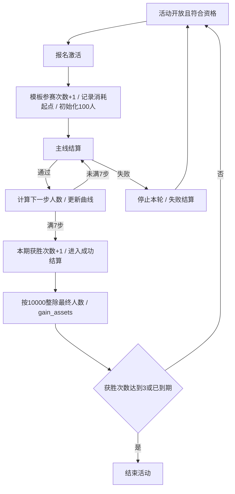

# Jungle Quest与Treasure Quest：奖励、调控与分组

**两者是同一套 Lava Quest 连胜活动的不同主题。客户端以100人作为人数曲线起点，要求连续通过7关，用10,000金币除以最终存活人数发奖；最终人数由本地公式计算，与本轮关卡消耗、模板级累计参赛次数有关。** 另有按R0～R4付费组及历史金币返还比压低收益的机制，但本批配置将其关闭。

本次核验：Android **2.12.0 / 21200** 的ARM64方法体、metadata及**2026-11-04**设备保存并已解密校验的初始配置。2026-11-16未新增实机入组或领奖。下文“基线”是已取得配置代入本构建代码的结果，不等于当前线上所有账号值。此前“配置加密导致奖励未知”的限制已解除；仍未确认的是当前账号覆盖配置、实际状态及运行结果。

## 1. 名称、入口与排期

| 玩家名称 | 活动副本 | UiType / 资源包 | 解锁配置 | 开放配置 |
|---|---|---|---:|---|
| Treasure Quest | `lava_quest_01` | `lava_quest` / `lava_quest_default` | StartLevel=63 | 28天循环位置1、8、15、22，0点，24小时 |
| Jungle Quest | `lava_quest_02` | `water_quest` / `lava_quest_water` | StartLevel=63 | 循环位置4、11、18、25，0点，24小时 |

两副本均引用模板`Lava Quest`，ActivityType=13。`GetLanguageKey(0x6627294)`按UiType选择报名／结束文案：lava对应153002／153010（Treasure Quest），water对应153021／153022（Jungle Quest），与英文CMS逐项对齐。因此这里的Treasure Quest不能与Golden Treasure、Treasure Path混用。

标题接口`GetLavaQuestUiTitle`本身仍固定读取153001／Treasure Quest；主题识别依据是副本、UiType和实际分支文案，不据这个共用标题接口推定每个页面最终显示。尚未补两主题实拍。

排期来自`config_server_activity_loop.csv`中Switch=T的8行；表内其他日期行是F。未核循环历元和时区转换，故保留1～28序号，不硬写当前星期与日历日期。解锁依据是副本表，非已标废弃的模板StartLevel。

## 2. 奖励数值在哪里

**不存在本专题已发现的“某组固定奖500／1000／2000”的独立奖励档位表。** 固定奖池在原生方法里，决定分母的参数在服务端游戏配置中。

| 位置 | 字段／常量 | 本批值 | 实际用途 |
|---|---|---|---|
| `GetPlayerRewardCoin`原生代码 | 奖池立即数`0x2710` | 10,000 | 整数除以`NextPlayerCount` |
| `InitializeRacingData`常量区 | 初始人数 | 100 | `CurPlayerCount`与`NextPlayerCount`初始值，历史曲线首项100 |
| `GetTargetProgress`及推进分支 | 目标进度 | 7 | 完成7次连胜 |
| `config_server_game.csv` | `lava_quest_level1_random_range` | `50\|80` | 第1关后人数随机范围 |
| 同表 | `lava_quest_level2_5_b` | -0.7 | 第2～5关幂函数指数 |
| 同表 | `lava_quest_difficulty_firstn` | `0.35\|0.3` | 模板累计第1、2次参赛系数 |
| 同表 | `lava_quest_difficulty_cycle` | `0.25\|0.2\|0.25\|0.2` | 此后按4项循环取系数 |
| 同表 | `lava_quest_level6_max` | 20 | 第6关存活人数上限；代码按GameIntValue读取 |
| 同表 | `lava_quest_reward_count` | 3 | 初始化为本期`LoopRaceWinCountLimit` |
| 同表 | `asset_return_switch` | F | 本批不启用历史返还比修正 |
| 同表 | `asset_return_lava_quest_multip` | 50 | 修正触发时返回0.5，进入人数计算的difficulty乘数 |

`LoadLavaQuestConfig(0x6625dcc)`直接读取以上键，并缓存到活动对象；它没有分别读取Jungle与Treasure的两套参数。`GetLavaQuestConfig`首次加载后复用缓存，不能假设远端更新一到就改变正在进行的这一轮。

**包内回退值与已取得CSV不同**：第1关40～80、指数-0.5、firstN为0.2／0.3、第6关上限19、获胜次数1，均能在加载器看到。正常基线使用表中50／80、-0.7、0.35／0.3、20、3；不要把回退值当线上值。cycle回退数组未在本专题逐项解码，不臆填。

获胜后金币为：

```text
Reward = 10000 整除 N7
```

正整数分母下向下截断，不补齐到十位。`ClaimReward(0x662d3f8)`将结果格式化为`100_{金额}`，附活动资产原因，交给`Pigat.DoAction("gain_assets", …)`。这已追到资产发放入口，未做实际余额差分或崩溃／重复领取测试。

| 最终人数（包含自己） | 玩家金币 |
|---:|---:|
| 20 | 500 |
| 15 | 666 |
| 10 | 1,000 |
| 8 | 1,250 |
| 5 | 2,000 |
| 3 | 3,333 |
| 1 | 10,000 |

正常正数配置与完整成功轮次下，N7≤N6≤20，故本基线单次成功奖励范围为500～10,000；这是公式推导范围，不是实测频率或期望成本。

## 3. 每一步如何调控人数

原生消费者：`GetNextPlayerCount(0x662bedc)`，调用者`CalculateNextStepInfo(0x662b5b8)`。定义：

- `Nk`：通过第k关后的人数，包含玩家本人；N0=100。
- `Ck`：计算第k步时的累计关卡行为成本分，减去本轮报名时保存的总值；由行为成本表计价，不等于实际金币支出。
- `d`：累计参赛次数对应的基础系数×资产回馈修正系数。
- `ceil`：向上取整。实际代码使用float运算，极端浮点边界应以原生执行为准。

```text
N1 = UnityEngine.Random.Range(50, 80)       // 整数重载，50～79
Nk = min(ceil(N1 * k^(-0.7)), N1)          // k=2、3、4、5

Ak = 10000 / (d * Ck)                     // Ck≥1
Ak = 100                                 // Ck<1

N6 = min(ceil((N5 + min(N5, A6)) / 2), 20)
N7 = min(N6, ceil(A7))
```

第1关配置注释写“左闭右闭”，但代码将两个端点直接传给Unity整数Random.Range，没有对上界+1。按该API语义应读为50～79；不要照抄注释写50～80。

前五关先让人数快速减少；第六关在N5与按消耗算出的目标人数之间取中点，并施加20人上限；第七关进一步收敛到消耗目标人数。**控制参数名虽叫difficulty，这段直接改变的是机器人存活数和玩家分奖金额，并非棋盘难度。**

当C增大时，A下降，最终人数趋少，奖励趋多；当d减小时，A增大，奖励趋少。在第6／7步人数上限、整数取整及10000奖池共同作用下，它不是无限线性返还，也不保证奖励精确等于`d×C`。

### 同一首关随机结果的算例

以下均令N1=60，前5步为100→60→37→28→23→20；为公式演算，非账号实测。

| 场景 | 基础系数 | 回馈乘数 | C6／C7 | N6／N7 | 最终金币 |
|---|---:|---:|---:|---:|---:|
| 首次参赛、零消耗 | 0.35 | 1 | 0／0 | 20／20 | 500 |
| 首次参赛 | 0.35 | 1 | 3000／4000 | 15／8 | 1,250 |
| 首次参赛、更高消耗 | 0.35 | 1 | 6000／7000 | 13／5 | 2,000 |
| 第4次参赛 | 0.20 | 1 | 3000／4000 | 19／13 | 769 |
| 假设开启回馈调控且触发 | 0.35 | 0.5 | 3000／4000 | 20／15 | 666 |

最后一行说明`asset_return_lava_quest_multip=50`并非最终金币直接乘50%；它通过分母人数间接削减，1250不一定正好变625。

### 消耗数据口径与刷新时点

`OnActive`报名时保存`RacingStartLevelCost`；后续`CalculateNextStepInfo`重新取总消耗并减去该起点。链路为：

```text
LavaQuest.GetTotalLevelCost
→ ToyActivity 的 TileProvider.GetLevelCost
→ ITilePigat.GetLevelCost
→ TilePigat.GetLevelCost
→ Request.GetAllLevelCost
```

末端对`RootAttr.level.per_level_cost`求和，返回总量及均值；该活动使用总量。2026-11-16补核中心写入者`ActionCollection._trigger_action`：按`config_server_action_cost.csv`将行为Cost累加到当前关。普通撤回600、抓钩900、磁铁1200，广告复活509为600；普通库存道具不区分免费取得或购买来源，而明确的引导／临时免费使用跳过计分。金币扣款本身不再加一份成本；复活514本批金币价3900、行为成本4900，尤其不能按余额差替代C。完整ID表、免费分支、复活链及奖励阶梯算例见[[02-PROJECTS/产品分析/Tile Family/游戏逻辑/Jungle Quest与Treasure Quest-关卡消耗口径与奖励影响-2.12.0|关卡消耗口径与奖励影响]]。结论为同构建静态链路及历史配置，尚未做账号总账差分。

不是报名时一次性生成完整7步曲线：逐关计算下一步，且有`CurProgress / NextProgress`防止同一步重复计算。初始化虽记录`CurDifficulty`，实际下一步仍重新读取基础系数与缓存修正值。失败结算也会调用下一步计算用于结算表现，然后标记Fail、停止Racing；不能仅因存档出现NextProgress=7就认定成功。

## 4. “分组”具体分成哪些层

### 4.1 参赛次数分段：两个主题共享模板计数

`GetCurDifficultyBeforeAdjust(0x662c5c4)`读取键`LifeRaceStartCount`。通过metadata原始MethodSpec绑定，确认调用的是 **BaseLiveEvent.GetEventTemplateData**；`OnActive`+1调用的是 **SetEventTemplateData**，并非本期runtime或单副本数据。

| 模板累计参赛次数 | 系数 |
|---:|---:|
| 1 | 0.35 |
| 2 | 0.30 |
| 3 | 0.25 |
| 4 | 0.20 |
| 5 | 0.25 |
| 6 | 0.20 |
| 7起 | 从0.25／0.20／0.25／0.20继续循环 |

通式为firstN[n-1]；超过firstN长度后取cycle[(n-firstN长度-1)%cycle长度]。计数在每次OnActive参赛时增加，不是仅成功才加。两种皮肤同属Lava Quest模板，因此读取同一模板层计数；不能把切到Jungle视作重新享有“首次”系数。历史迁移／账号恢复是否改写该键未做动态验证。

### 4.2 付费组R0～R4：历史返还比调控

`ReturnRatioHelper.GetGetCoinReturnRatioOfApplication("Lava_Quest")`读取当前IAPGroupTag，并按相同标签匹配`config_server_return_threshold.csv`。原始泛型绑定已确认表类型，非仅凭名称猜测。

| 付费组 | 常规分组收入区间 | 金币返还比阈值T | 触发时Lava修正 |
|---|---:|---:|---:|
| R0 | ≤0 | 1.10 | 0.5 |
| R1 | (0,5] | 0.90 | 0.5 |
| R2 | (5,35] | 0.70 | 0.5 |
| R3 | (35,100] | 0.50 | 0.5 |
| R4 | (100,1,000,000,000] | 0.50 | 0.5 |

收入阈值来自`config_server_iap_group.csv`的IAPRevenue，按表内价格数值口径，不直接称人民币。`CalculateIAPGroupTag`取`iap_group_interval=7`，通过`GetPreDayIAPRevenue`累计窗口内购买记录对应商品的价格，再由`Request.GetIAPGroupTag`按收入上限升序取第一个满足收入≤上限的组。原生比较是时间间隔<7；精确业务日边界尚未下钻TimeInterval。超过表最大收入时该方法回退R0，是代码兜底，不应外推正常人群规则。

`iap_group_predict_switch=F`是本批预测开关；常规收入分组与模型预测属于不同路径，不能将R组一概解释为随机实验。当前活动读的是已保存标签，本次未验证当前账号何时刷新及最终标签。

调控逻辑：

```text
asset_return_switch=F → 修正乘数m=1
asset_return_switch=T：
  取当前R组CoinReturnRatio数组末项 / 100，得到阈值T
  取金币返还比q
  q<T → m=1
  q≥T → m=asset_return_lava_quest_multip/100=0.5
  d=基础参赛系数×m
```

阈值表虽然字段为数组，本批每组只有一项；消费者取末项，比较包含等于。没有找到标签匹配时，当前循环的阈值初始0，不应擅自补成R0的1.10。

返还比服务对纳入统计的CoinParams累计获取与消耗：消耗>0时q=Σ获取/Σ消耗，消耗≤0时使用Σ获取；空参数返回-1。统计层配置为`asset_return_start_refer_level=90`、`asset_return_min_refer_level=10`、`asset_return_max_refer_level=100`；已核起始关检查、最少样本检查及获取／消耗筛选调用，最大窗口裁剪和完整免费资产枚举未逐项重验。不要简单替换为“所有金币获得÷所有金币消耗”。

该修正结果在活动配置首次加载时保存到`UseCoinReturnRatioResult`；每步读取缓存，不是每一关都重新按最新q和R组算一次。**本批总开关F，所以R组阈值不会实际改变这批基线的存活人数；基础参赛系数及本轮消耗调控仍然生效。**

### 4.3 U组、AB与棋盘DDA

本活动核心参数由`ServerConfig.Game*Value`读取，所获CSV为单Value列，没有U0／U1／U2各列，也没有对两个皮肤分别分奖的表。通用U组与AB配置基础设施存在，详见[[02-PROJECTS/产品分析/Tile Family/游戏逻辑/广告策略与分配配置-2.12.0#2. 先区分不同层级的“分配”|配置分配边界]]；本次没有拿到这两个活动的线上实验组合和覆盖比例，不能据此宣布完全没有AB。

棋盘DDA另有读取`level_dda_lavaquest_weight`和活动进度的接口。本批`config_client_game.csv`中默认及所有U组该权重均为0；进度接口只在活动处于Active状态时返回CurProgress，否则-1。这不足以宣称参加活动会主动把主线第6／7关变难，也不代表游戏整体DDA关闭——同表V4开关为T。本报告中的difficulty明确指人数／分奖调控。

## 5. 机器人与“100人同组”

已核路径是本地生成及淘汰展示机器人：

1. 初始化人数曲线为100；`CreateStartLavaQuestBots`从CMS名称池抽30个不重复名字，再给每个生成头像、头像框、勋章和HeadType。
2. 这30个机器人用于表现，不是保存99个真人资料。`CalculateNextStepInfo`先算数字上的下一步人数，再把前后人数各减1，交给机器人表现函数；减去的1是玩家自己。
3. `CalculateNextStepBots`复制现有列表；需要淘汰时，最多选3个表现对象，在列表前min(count,9)范围内随机挑选且去重，再移除并按下一步机器人数量截断。数字淘汰几十人，不等于播放几十个独立玩家事件。

因此“分到100人组”在本样本可落实为**100人的数值起点＋局部头像模拟**。本条人数计算链没有真人池、等待凑满100人、按服务器其他玩家通关状态更新的证据。结论仅限已核这套实现；不能拿TF公式替代Royal Match的服务端人数分配机制。

## 6. 本期上限、失败与领奖流程



失败后再报名仍须通过活动当前资格与时效检查；图不表示可无视到期无限重开。失败没有增加`LoopRaceWonCount`，下次参赛仍会增加模板累计次数，故会推进基础系数序列。

`InitDataFirst`将3写入本期胜利上限；第7次成功结算时先增加WonCount，而非点击领奖时才增加。奖励页Shown回调比较WonCount与Limit：达到上限或处于到期状态则Finish，否则回到Inactive。报名按钮显示Limit−WonCount。**更精确说法是每个活动周期最多成功3轮**；配置注释“每天3次”与本批每期24小时相符，但当前消费者没有另做自然日计数清零。

`GetPlayerRewardCoin`还有进行中Win结果及完成后的兼容读取分支，因此它本身不是完整领取资格判断；不能仅调用或看到该金额就推断已可领取。正常发放受结算流程约束。完整断线、补领奖、防重复发放原子性与实际余额不在本次验证范围。

## 7. 可复核证据与未决边界

资源根：`06-PRODUCT-ASSETS/TileFamily/2.12.0/`。配置根：`05-Runtime/2026-11-04/decoded/initial-config/`。

| 结论 | 主要证据 |
|---|---|
| 名称与皮肤 | Config/activity_dup、activity_loop、addressable_download；CMS/cms_language_en；GetLanguageKey `0x6627294` |
| 配置读取与缓存 | LoadLavaQuestConfig `0x6625dcc`；GetLavaQuestConfig `0x6625d84` |
| 奖池及整数发奖 | GetPlayerRewardCoin `0x662821c`；ClaimReward `0x662d3f8` |
| 人数公式 | GetNextPlayerCount `0x662bedc`；CalculateNextStepInfo `0x662b5b8`；常量地址`0x1568a2c` |
| 关卡行为成本口径 | `_trigger_action 0x62a0434`；`PropService.OnPropConsume 0x639b1c8`；action_cost表；`quest-cost-audit.py/json` |
| 模板累计参赛分段 | OnActive `0x662a864`；GetCurDifficultyBeforeAdjust `0x662c5c4`；`quest-bindings.json`的TemplateData MethodSpec |
| 资产回馈与R组 | ReturnRatioHelper `0x64fb120`、`0x64fb700`；Request.GetIAPGroupTag `0x6288734`；比较器`0x628e0f4`；配置iap_group、return_threshold |
| 返还比公式 | CalculateCoinControlRatio.MoveNext `0x67e5b78`；TileToyReturnRatioInterfaceConfig `0x64434ec`、`0x6443a24` |
| 机器人表现 | CreateStartLavaQuestBots `0x662b860`；CalculateNextStepBots `0x662c198` |
| 上限与状态 | OnLevelPassInRacing `0x662b33c`；ShowRewardPopup.Shown `0x662d708`；LavaQuestRuntimeData字段访问器 |

取证脚本、逐方法原生摘录与调用表：`04-ReverseEngineering/quest-extract.py`、`quest-*.txt`、`quest-calls.json`。泛型绑定与常量验证：`quest-bindings.py/json`。配置来源哈希及算例复核：`quest-audit.py/json`。基于既有REA metadata，使用本机Capstone／pyelftools读取同构建ELF；没有把方法名当作已执行证据。

核心输入SHA-256：libil2cpp.so=`c9a2163af064d82b4542ea73810470c4abb072a1477cd48e83395f382679a3af`；metadata=`7653a00e56d988a83039652154ac7c2b7af380c62e46928c7920eacb5c3071a9`。

未决项集中为：当前账号最终配置／R组／模板计数，成本账实值及异常回滚一致性，循环历元与日界，线上AB覆盖，以及完整成功／失败轮次和实际到账差分。普通金币复活、库存道具、明确免费使用与广告复活的静态成本口径已补核，不再整体列为未知；当前线上生效仍需运行样本。以上边界限制将本地公式和基线外推成当前线上人群分布。

导航：[[02-PROJECTS/产品分析/Tile Family/_MOC]] · [[02-PROJECTS/产品分析/Tile Family/资源路径索引]]。
