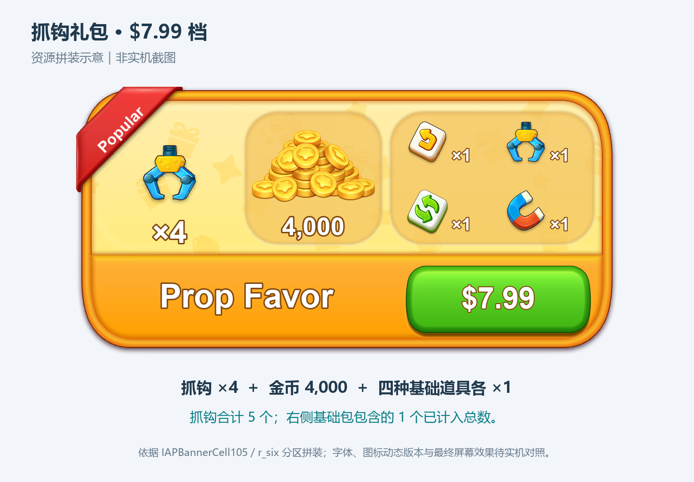
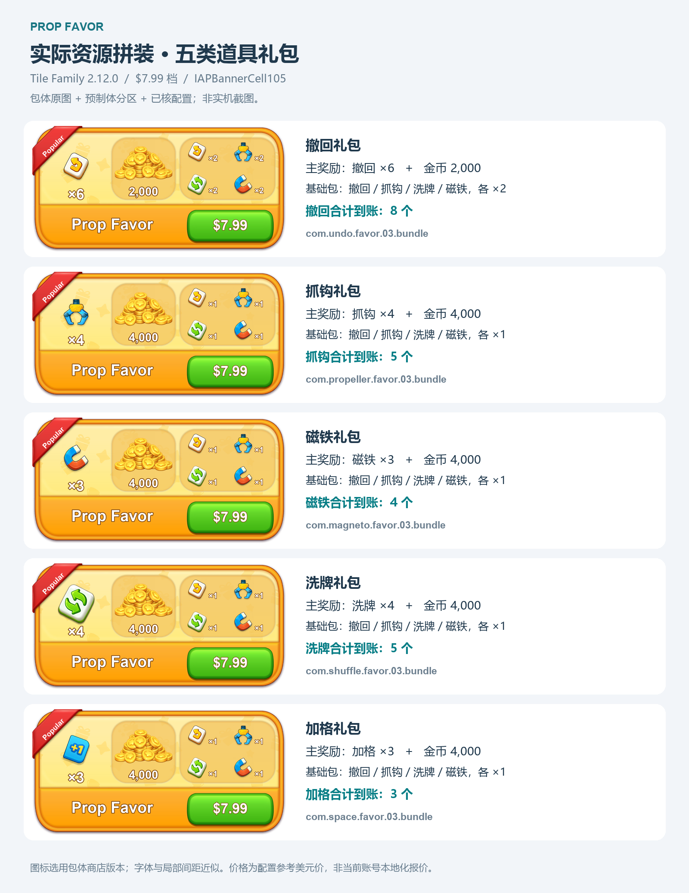

# Tile Family · Prop Favor 道具礼包详解

**本批 Prop Favor 是“局内道具不足时，按所需道具推荐、按近期付费单价选档”的现金礼包。** 撤回、抓钩、磁铁、洗牌、加格五类各有4个归组候选，配置美元价为7.99 / 12.99 / 19.99 / 39.99。它同时补目标道具、金币和其他常用道具；旧通用礼包、关闭的低价mini组与当前定向组必须分开看。

本报告整理于2026-11-18。主要依据Android **2.12.0 / 21200** 包体、同构建ARM64代码，以及**2026-11-04采集的初始配置包**；不将其称为11月18日最新线上配置。表内价格是配置表注明的美元参考价；地区实付价、当前远端覆盖、账号最终选档与到账余额未实测。阅读版：[[02-PROJECTS/产品分析/Tile Family/游戏逻辑/TileFamily_Prop_Favor_2.12.0.html|HTML完整阅读版]]。

## 1. 先看结论与礼包定位

| 问题 | 本批可确认结论 | 证据边界 |
|---|---|---|
| 卖什么 | 5种定向道具礼包，目标道具放在奖励首项，另加金币和混合道具 | 共20个关联在用组的SKU；不是20个同时展示的选项 |
| 什么时候出现 | 底部道具入口：解锁且没有可用普通库存/限时道具时，进入道具购买页，在页内请求IAP Banner | 不是达到某关立即强弹，也不是本专题中的失败N次触发 |
| 多少关开放 | 五组商店配置均StartLevel=30；道具自身还需解锁 | 资格起点与首次实际曝光分开 |
| 价格怎么定 | 最近时间窗口内全部商品组的单笔付费价格取中位数，再匹配最近档位 | 不是累计LTV、最近一次购买价或只看同道具礼包 |
| 无付费记录怎么办 | 此Lua选择器取最低候选7.99 | 不能推出所有零付费用户都能看到 |
| 金币为0是否被过滤 | 不会被本条金币规则排除：coin>0在消费者中表示金币≥0 | 不等于其他购买资格也通过 |
| 是否限时/限购 | 本批五组持续时间、重置、限购均为-1，未配置独立限时促销或购买次数上限 | 不代表全局IAP、订单或远端不存在限制 |
| 5秒是什么 | Banner自动轮播间隔 | 不是曝光冷却、促销期限或再次售卖间隔 |
| 买完是否自动用一个 | 已核底部PropView入口回调只刷新库存，没有自动消耗一个道具 | 未做真实支付；其他入口不外推 |
| 是否另送×3 | 本批Prop Favor Banner Reward=-1，已核回调跳过该Banner额外奖；不能把旧chance表×3机械叠加 | 商品表奖励与机会奖励分别审计，见第6节 |
| 旧1.99–99.99档位是否也在卖 | 旧通用SKU均标not_in_use；定向组另有25个不归组SKU | 配置留存不是实际投放证明 |

产品理解：玩家正需要某个道具，礼包先放大该道具的存在感，再用金币与通用道具补未来库存；推荐价围绕既有消费单价，而非给所有人同一固定礼包。这个定位由触发、奖励与选择器共同支持；转化率和收入效果没有数据支持，不能据此断言优于其他方案。[E1–E5]

## 2. 五种礼包与出现时机

| 玩家需求 | 资产ID | GroupId | Banner Chance | 商品ID格式 |
|---|---:|---|---|---|
| 撤回 | 502 | prop_favor_undo | coin_buy_prop1 | com.undo.favor.XX.bundle |
| 抓钩 | 506 | prop_favor_propeller | coin_buy_prop2 | com.propeller.favor.XX.bundle |
| 磁铁 | 503 | prop_favor_magneto | coin_buy_prop3 | com.magneto.favor.XX.bundle |
| 洗牌 | 515 | prop_favor_shuffle | coin_buy_prop4 | com.shuffle.favor.XX.bundle |
| 局内加格 | 508 | prop_favor_space | coin_buy_prop5 | com.space.favor.XX.bundle |

`propeller`是本批代码/商品中的抓钩标识；不要仅按英文单词翻译成另一种道具。`space`指资产508局内加格，不等同于失败页的移牌复活。普通金币购买与现金礼包在同一需求场景中衔接，但不是相同交易。[E1,E4]

**入口链路。** `PropView.OnClick`先经过道具解锁、免费引导、库存和限时道具等检查；普通库存不足且无可用限时道具时进入`ClickForBuy`。该方法再次检查道具剩余数，剩余数>0直接返回，否则构造`BuyPropPopupParam`，以`coin_buy_prop`加道具入口序号构成chance。`BuyPropPopup.OnInit`调用`TriggerShowIAPBanner`，由`IAPHelper.ShowIAPBanner`收集可购买商品、过滤并创建页内Banner。[E4]

| 所处状态 | 本次可确认的处理 |
|---|---|
| 道具未解锁 | 走解锁提示分支；不能只满足礼包30关门槛就绕过道具资格 |
| 免费教学可用 | 先进入免费使用逻辑，不据此认定会请求道具礼包 |
| 普通库存≥1 | 走已有道具的使用/可用性判断 |
| 普通库存<1，但有限时道具 | 转限时道具分支 |
| 库存不足且无可用限时道具 | 进入道具购买页；此时才有对应Prop Favor展示机会 |
| 礼包商店资格不通过、选品为空、商品不能买或规则过滤失败 | 候选被移除；出现购买页不保证有Prop Favor |
| 普通金币购买按钮被点击且金币不足 | `ContinueButtonPressed`可转IAP商店；与页内Prop Favor Banner是不同入口处理 |
| 关闭购买页 | 返回原场景；本次未发现该Prop Favor链路记录“拒绝次数后提价” |

资产表本批`UnlockLevel`分别为撤回5、抓钩7、磁铁9、洗牌11、加格14，因此在这些原始值不被覆盖的前提下，礼包组30关门槛更晚。洗牌的文字描述仍写“10000关，暂不生效”，与字段11不一致；本报告保留此差异，采用数值字段作为配置事实，不把旧描述当当前解锁结论。

## 3. 奖励配置：当前关联的20个商品

表内为**商品AssetList按相同资产ID相加后的完整配置数量**，不扣除任何假定的即时使用，不叠加chance表或其他活动奖励。SKU后缀补入第2节格式即可得到完整ProductId。金币列为金币数量，其余为道具个数。[E1]

| 组 | SKU后缀 | 配置美元 | 金币 | 撤回502 | 抓钩506 | 磁铁503 | 洗牌515 | 加格508 | 原表行 |
|---|---:|---:|---:|---:|---:|---:|---:|---:|---:|
| 撤回 | 03 | 7.99 | 2000 | 8 | 2 | 2 | 2 | 0 | 137 |
| 撤回 | 04 | 12.99 | 6000 | 10 | 2 | 2 | 2 | 0 | 138 |
| 撤回 | 05 | 19.99 | 10000 | 15 | 3 | 3 | 3 | 0 | 139 |
| 撤回 | 08 | 39.99 | 20000 | 31 | 6 | 6 | 6 | 0 | 142 |
| 磁铁 | 03 | 7.99 | 4000 | 1 | 1 | 4 | 1 | 0 | 146 |
| 磁铁 | 04 | 12.99 | 6000 | 2 | 2 | 6 | 2 | 0 | 147 |
| 磁铁 | 05 | 19.99 | 10000 | 3 | 3 | 9 | 3 | 0 | 148 |
| 磁铁 | 08 | 39.99 | 20000 | 6 | 6 | 18 | 6 | 0 | 151 |
| 抓钩 | 03 | 7.99 | 4000 | 1 | 5 | 1 | 1 | 0 | 155 |
| 抓钩 | 04 | 12.99 | 6000 | 2 | 8 | 2 | 2 | 0 | 156 |
| 抓钩 | 05 | 19.99 | 10000 | 3 | 11 | 3 | 3 | 0 | 157 |
| 抓钩 | 08 | 39.99 | 20000 | 6 | 22 | 6 | 6 | 0 | 160 |
| 洗牌 | 03 | 7.99 | 4000 | 1 | 1 | 1 | 5 | 0 | 164 |
| 洗牌 | 04 | 12.99 | 6000 | 2 | 2 | 2 | 8 | 0 | 165 |
| 洗牌 | 05 | 19.99 | 10000 | 3 | 3 | 3 | 11 | 0 | 166 |
| 洗牌 | 08 | 39.99 | 20000 | 6 | 6 | 6 | 22 | 0 | 169 |
| 局内加格 | 03 | 7.99 | 4000 | 1 | 1 | 1 | 1 | 3 | 173 |
| 局内加格 | 04 | 12.99 | 6000 | 2 | 2 | 2 | 2 | 4 | 174 |
| 局内加格 | 05 | 19.99 | 10000 | 3 | 3 | 3 | 3 | 6 | 175 |
| 局内加格 | 08 | 39.99 | 20000 | 6 | 6 | 6 | 6 | 12 | 178 |

**重复ID是最容易算错的地方。** 撤回03的原值为`502_6;100_2000;502_2;506_2;515_2;503_2`，所以配置中的撤回总数为8，不能只写首项6，也不能把末尾的撤回2当成另一次购买赠送。磁铁03为`503_3;100_4000;502_1;506_1;515_1;503_1`，磁铁合计4。加格03为`508_3;100_4000;502_1;506_1;515_1;503_1`，混合部分没有508，所以加格就是3。

同价奖励并非完全对称：7.99撤回包是2000金币，其他四种为4000金币；撤回以更多目标道具补偿。12.99、19.99、39.99各组的金币分别统一为6000、10000、20000，混合四类道具通常各2、3、6，再叠首项目标道具。资产508只在加格包的首项出现，其他四种当前候选没有508。

## 4. 定价与玩家分配：3|20|50|0的完整含义

五组统一使用`ProductIdPickRules=quantile_price`、参数`3|20|50|0`。Lua选品从`user.data.iap.records`取得购买记录，经时间过滤，提取每笔`buyPrice`求中位数，匹配该GroupId下的候选商品。候选按`BuyPrice`升序；**只取GroupId完全相同的行**，不会自动把not_in_use商品纳入。[E2]

| 参数位置 | 值 | 实际含义 |
|---|---:|---|
| 1 | 3 | closest_abs_max：与参考价绝对差最小；程序算出的差值严格相等时取更贵一档 |
| 2 | 20 | 时间过滤条件为floor((当前秒−记录秒)/86400)≤20，不是20笔记录 |
| 3 | 50 | 第50百分位，即单笔购买价格中位数；偶数笔用相邻两价插值 |
| 4 | 0 | 不启用该选择器的周级商品锁定缓存 |
| 6（未填） | 默认0 | 不按商品组过滤历史；全部商品组购买记录可参与 |

**时间边界。** 代码先把天差向下取整，再判断≤20，因此过去20天23小时的记录仍可纳入，到21整天才排除。记录时间由字符串解析后交给Lua`os.time`；本次没有运行验证宿主时间或时区替换。代码没有额外要求天差≥0，异常未来时间记录也可能被纳入。策划概括可称“近20天付费中位数”，实现对位应保留上述精确边界。

**中位数计算。** 对n个价格升序排列，位置为`i=(p/100)×(n−1)+1`，p=50；整数位置直接取值，否则线性插值。因此偶数笔取中间两项平均，不是挑某一次真实订单。没有有效记录时，选择器直接返回候选第一项，本批为7.99；没有候选则返回空串。

| 参考中位价q（数学区间） | 选中配置价 | SKU后缀 |
|---|---:|---:|
| q<10.49 | 7.99 | 03 |
| 10.49≤q<16.49 | 12.99 | 04 |
| 16.49≤q<29.99 | 19.99 | 05 |
| q≥29.99 | 39.99 | 08 |

区间由十进制配置价格的中点推导。实际代码用浮点绝对差，严格等距判断可能受表示误差影响；不要把显示为10.49的所有运行输入都承诺为精确相等。

| 符合时间条件的历史单笔价格 | 参考价 | 本批选档 |
|---|---:|---:|
| 没有记录 | 无，走默认 | 7.99 |
| 4.99 | 4.99 | 7.99 |
| 4.99、9.99、19.99 | 9.99 | 7.99 |
| 9.99、19.99 | 14.99 | 12.99 |
| 19.99、39.99、99.99 | 39.99 | 39.99 |

这些是算法算例，不是账号观测。由此可解释：付费次数多但单笔便宜的人，不一定被推荐高价档；偶尔一笔大额也不一定改变中位数。所有道具组共用历史口径，不代表每组在同一时刻必定刷新成同一档，实际取值时点、请求回退和远端覆盖仍有边界。

原生调用已对位`IAPManager.GetPurchaseProductFromGroupId → IAPHelper.GetProductIdFromGroupId → Request.GetProductIdFromGroupIdAsync → Router.Send`，路由实值为`pm://pm.tile.strategy/iap_pick_rules.lua`、参数键为`groupId`；`.lua`处理器经`IStrategyService.Exec`进入`StrategyLua.Exec`，TextAsset索引与本报告读取的Lua文件一致。因此这份Lua不只是名称相似的库存脚本。当前账号采用的脚本/配置版本、无效返回后的全部回退分支未做运行追踪，不能把静态选择结果包装成当前用户已经命中。[E2,E4]

## 5. 开放等级、周期、限购与Banner竞争

五组定向礼包的共同商店配置如下。这里是`config_server_shop.csv`，不是Banner表中已经废弃的同名字段。[E1,E4]

| 字段 | 本批值 | 应怎样理解 |
|---|---|---|
| Switch | 1 | 组展示总开关打开，仍需通过其他资格 |
| StartLevel | 30 | 主线等级至少30；原生LimitConfigAvailable有低于门槛即失败分支 |
| StartTime | 20221203 | 配置开放起点；不是本次礼包出现日期或用户倒计时起点 |
| Duration | -1 | 无限时截止配置，开启后常驻资格 |
| LtCount | -1 | 此组不设生涯购买次数上限 |
| DurationCount | -1 | 不设期间内购买次数上限 |
| ResetCD | -1 | 无周期重启配置 |
| IapUiType | prop_favor_general | 组UI类型，消费者转换到实际Banner类型105 |
| ProductIdPickRules | quantile_price | 选品策略，详见第4节 |

`PigatProductController.LimitConfigAvailable`检查配置存在、开关、主线等级、生涯限购、时间资格及期内次数；次数字段<1时不执行对应上限拦截。`IAPBannerManager.RegenerateMetas`先检查组可买，再取具体商品；`GetBannerMetasByChance`还有`PurchaseProduct.CanBuy`和规则过滤。因此“配置开着”不能替代完整曝光条件。

| 同一个coin_buy_propN机会内的候选 | BannerId | Priority | 本批组状态 |
|---|---:|---:|---|
| Weekend Deal | 1 | 1 | 商店组Switch=0，不能仅凭Banner行说它会展示 |
| 对应Prop Favor | 2 | 3 | 商店组Switch=1；仍受商品和购买资格过滤 |
| Tile Pass | 3 | 1 | 通行证自身资格另外检查 |

`SortedByBannerId`先按展示位去重，**同BannerId内保留较小Priority**；不同展示位可共存，不能把Priority=3解释为全局优先级压过1，也不能认为整个购买页只会留一个礼包。接着进入Banner页视图。自动轮播读取`iap_banner_interval`，本批所有配置列都是5；原生默认兜底是2。值传入`UiPageView.Init`，倒计时消费者使用`DateTime.AddSeconds`，支持以秒解释。这里描述的是轮播间隔，未在已检查路径发现Prop Favor专属“关闭后X小时再弹”的配置。

金币规则`coin>0`由`ParseRuleParam`把“>”转为操作符1，`IAPBannerCoinFilter`用`cset ge`执行≥比较，所以**0金币仍通过这一条**。Banner表的StartLevel、Switch、Interval在表头明确标废弃；不要把空值解读为0关全开、无任何资格或零冷却。

## 6. 购买、额外奖励与买后行为

必须区分三层：商品本体奖励、当前Banner明确配置的附加奖励、其他旧表中的机会奖励。只将已串起消费者的部分计入本报告。

| 层次 | 配置/代码 | Prop Favor结论 |
|---|---|---|
| 商品本体 | config_server_iap.AssetList | 第3节20行是商品配置奖励算术总量 |
| 当前Banner附加奖 | banner 36–40的Reward=-1 | `HidePopupAndNotifyToSendChanceBonus`比较字符串-1后跳过额外奖构造 |
| 父弹窗收奖回调 | BuyPropPopup.SendBonusThenClosePopup | 非空附加奖才提交gain_reward_and_report，然后成功关闭弹窗；不因方法名就假定存在赠送 |
| 旧chance奖励表 | coin_buy_prop的502/503/506/508各×3；没有515 | 全可执行区直接调用扫描未找到该表两个奖励getter的外部调用；不叠到Prop Favor总奖励，间接/反射路径仍未全覆盖 |
| 立即使用标记 | IAPBannerConst.IsChanceUseAssetInstantly | 只匹配no_more_space和time_out，coin_buy_prop不在此范围 |
| 底部道具入口返回 | PropView的ClickForBuy闭包 | 检查视图有效、启用和IsBuySuccess后只刷新数量；未见自动使用/扣一次 |

**因此在已核的底部入口链中，Prop Favor支付成功后的界面回调关闭购买页并刷新道具数量，不能写成“买完立即施放一次”。** 商品应发数量以第3节配置为准，也不应该先减1。这里没有真实购买余额差分，实际到账、奖励解析、防重处理和商店最终确认的全链验收仍与静态配置结论分开。[E5]

本批20个当前归组商品`EnableCheckOrders=T`，该字段说明为“是否参与CheckOrders订单检查”，不是礼包展示开关，更不是“奖励已经含全部bonus”的标记。字段存在不能单独证明异常订单、恢复购买和重复回调都正确处理；本次不对整套IAP事务作安全性结论。

购买后的奖励表现还有`GetInGamePayHappyRewardPageSwitch`控制分支，因此不能保证购买完成后总是出现同一奖励动画或展示页。这个表现开关与商品应该发多少奖励是两回事。

`IAPBannerView.ReportIapShow`能对位到`IAPReportHelper.LogIapShow`，媒介由`BuildMedia(chance)`生成。可据此确认有Banner曝光上报接入点；本次没有日志样本，未验证曝光定义、服务端事件接收或转化漏斗数据。

## 7. 与普通金币买道具的价值对照

以下普通金币购买来自同批`config_server_coin.csv`。礼包美元价、金币购买成本、DDA库存估值是三种不同口径，不应混用。[E1]

| 道具 | 普通金币购买配置 | 按3件包线性摊到每件 | DDAAssetValue |
|---|---|---:|---:|
| 撤回502 | 1900金币买3 | 633.33金币 | 300 |
| 抓钩506 | 2900金币买3 | 966.67金币 | 450 |
| 磁铁503 | 3900金币买3 | 1300金币 | 600 |
| 洗牌515 | 2900金币买3 | 966.67金币 | 450 |
| 局内加格508 | 3900金币买3 | 1300金币 | 600 |

另有重试加格`coreplay_retry_buy_extra_space`：1170金币买1，属于另一语境，不能代替普通三件包价格。上述单件摊价只用于分析，不代表游戏允许按此价格单买。

为便于看档位形状，下表用“金币＋各道具数量×普通三件包摊价”计算**线性金币等价/配置美元**。这是分析者统一换算，不是官方价值、实际购买花费、美元兑金币汇率或真实折扣；不处理按整包买3产生的余量。

| 定向礼包 | 7.99档 | 12.99档 | 19.99档 | 39.99档 |
|---|---:|---:|---:|---:|
| 撤回 | 1693.78 | 1447.27 | 1460.73 | 1476.20 |
| 抓钩 | 1468.50 | 1503.72 | 1467.40 | 1467.03 |
| 磁铁 | 1472.67 | 1457.53 | 1470.74 | 1470.37 |
| 洗牌 | 1468.50 | 1503.72 | 1467.40 | 1467.03 |
| 加格 | 1472.67 | 1457.53 | 1470.74 | 1470.37 |

例如撤回7.99档：2000＋8×1900/3＋2×2900/3＋2×3900/3＋2×2900/3＝13533.33金币等价，再除7.99＝1693.78。多数档位的比值集中在约1450–1500附近，**本批并非价格越高就持续提高单位资源价值**；更像按客单价承接相近价值密度的不同购买量。撤回低档相对突出，但这只是在选定折算口径下的比较。

## 8. 展示结构、文案与资源

| 对象 | 本批内容 | 注意事项 |
|---|---|---|
| 标题 | 301017：Prop Favor | 105型按TitleId取文案；缺译或无效ID时兜底Tile Favor，不正常覆盖已命中文案。301016也同名，但当前5条指定301017 |
| 描述 | 301015：Free {0}! | 由当前道具名填入；不等于整包免费或在商品表外再送一份 |
| Banner标签 | TagType=1：Popular | 不能直接用商品TagID推断当前页面展示折扣 |
| 商品标签 | 300205：50% OFF | 当前45个定向SKU均有此值；实际标签呈现需看消费者/实拍 |
| 原价 | OriginalPrice空 | 无法从这张表证明“确切半价”或完整划线原价 |
| Banner表样式 | UiType=31，注释PropFavor | 实际加载另由组IapUiType转换，不能仅取旧数字31作为当前Prefab |
| 当前类型选择 | prop_favor_general→105 | 原生ConvertStringBannerUITypeToInt返回0x69；Prefab模板含IAPBannerCell{类型}.prefab |
| 资源加载 | 支持包路径及通用Addressables路径模板 | 最终在线资源包/皮肤与当前实例未实拍 |

已核`GetBannerUiType`从组UI类型取值并转换，再经`GetBannerPrefabPath`构造路径。`IAPBannerCell105`包含两奖布局、金币首项布局、道具首项布局方法；本批定向礼包首项就是目标道具。追加导出包体Prefab后，确认其绑定`ArtIAPNormalNewCellPrefab`：首项道具且后续包含金币时，原生消费者将CellType设为1，对应`gameObjects[1] = r_six`。该分支左侧主道具，中间金币，右侧剩余奖励；标题在左下，购买按钮在右下。[E4,E8]

**实际资源拼装示意。** 下图使用包体原始底板、角标、按钮、金币与商店道具图标，按上述分区拼装，并填入7.99档的原始奖励分项。属于配置与布局说明图，非实机截图；字体、动态道具图版本、右侧网格间距、材质效果和动画未完成实机对照。美元价格为配置参考价。

抓钩档左侧×4、右侧基础包中另含抓钩×1，因此完整奖励是抓钩×5。撤回档同理为6＋2＝8；磁铁3＋1＝4；洗牌4＋1＝5；加格仅左侧3个。右侧基础包全部属于SKU的AssetList，不是另加一份Banner赠品。纯礼包透明PNG另存`prop-favor-claw-799.png`，拼装来源与坐标见`composite-layout-evidence.json`、`composite-parts/manifest.json`。

以下是包体直接导出的道具图标，供识别道具；**不是Prop Favor实机截图，也未证明它们全部是当前礼包Prefab最终引用的版本**。

| 撤回候选 | 抓钩候选 | 磁铁候选 | 洗牌候选 | 加格候选 |
|---|---|---|---|---|
|  |  |  |  |  |

同目录`source-manifest.json`保留Bundle、序列化文件、pathID、图像尺寸与SHA-256。另保存一个通用蓝色Banner背景候选，仅作资源索引，不据名称将它冒充最终礼包背景。未确认本礼包专属音效、粒子与动画时间轴。

## 9. 旧通用礼包与关闭的mini分支

本专题存在三种不同结构，不能混成一张“当前售价阶梯”。

| 家族 | 配置状态 | 解释 |
|---|---|---|
| 5种当前定向prop_favor_* | 各有03/04/05/08四个归组SKU，组Switch=1 | 第3节主体 |
| 5种prop_favor_*_mini | Switch=0，LtCount=1，固定指向各自02商品（2.99） | 存在生涯限购设计，但本批关闭；不是已证的新用户必出包 |
| 旧通用prop_favor | 组Switch=1、common_price；旧SKU均not_in_use | 仅开关不够，按组取候选时没有相应商品；不能声称当前仍卖 |
| 旧mini_prop_favor | 描述写废弃，但Switch=1且固定指向旧2.99商品 | 字段不完全一致，保留原状；缺当前Banner接入与运行证据，不能仅以描述判绝对不可买 |

旧`common_price`按生涯单笔价格众数取最近档，与当前的时间窗口中位数不同。众数同频时依赖Lua遍历，不能宣称固定偏高；最近价格等距时旧算法保留低档，当前closest_abs_max则严格等距偏高。

旧通用礼包原始奖励如下，**全部GroupId=not_in_use**。保留它们是为识别历史界面、商店条目和版本差异，不用于推断当前分配：

| 商品ID | 配置美元 | 金币 | 撤回/抓钩/磁铁/洗牌各几个 | 原表行 |
|---|---:|---:|---:|---:|
| com.mini.prop.favor.01.bundle | 1.99 | 1000 | 1 | 86 |
| com.mini.prop.favor.02.bundle | 2.99 | 2000 | 1 | 87 |
| com.prop.favor.01.bundle | 7.99 | 4000 | 2 | 88 |
| com.prop.favor.02.bundle | 12.99 | 2500 | 5 | 89 |
| com.prop.favor.03.bundle | 19.99 | 3500 | 8 | 90 |
| com.prop.favor.04.bundle | 22.99 | 4000 | 12 | 91 |
| com.prop.favor.05.bundle | 29.99 | 5500 | 14 | 92 |
| com.prop.favor.06.bundle | 39.99 | 7000 | 18 | 93 |
| com.prop.favor.07.bundle | 44.99 | 8000 | 25 | 94 |
| com.prop.favor.08.bundle | 59.99 | 10000 | 32 | 95 |
| com.prop.favor.09.bundle | 66.99 | 12000 | 36 | 96 |
| com.prop.favor.10.bundle | 79.99 | 14000 | 45 | 97 |
| com.prop.favor.11.bundle | 88.99 | 15000 | 50 | 98 |
| com.prop.favor.12.bundle | 99.99 | 18000 | 60 | 99 |

公开信息补证：本次搜索读取的[美国App Store产品页](https://apps.apple.com/us/app/tile-family-match-puzzle-game/id6444056676?platform=mac)列有“Prop Favor 02 $12.99”。这只能支持该名称/标价在iOS公开商品清单中出现，不能绑定成Android当前五种定向包中的某一个SKU，更不能证明其奖励、触发或当前Android实价。检索日期2026-11-18，搜索缓存显示约四周前抓取；不当作实时收银台报价。[E7]

## 10. 完整定向SKU目录：含25个未归组商品

每种道具共保留9个SKU，当前只选其中4个。本表完整保留45行便于后续对比；“归组”仅说明属于对应prop_favor_*候选池，**不等于现场可买/已曝光**。商品ID为`com.<family>.favor.<后缀>.bundle`，资产数量已将重复ID相加。[E1]

| family | 后缀 | 配置美元 | 金币 | 撤回502 | 抓钩506 | 磁铁503 | 洗牌515 | 加格508 | 候选 | 原表行 |
|---|---:|---:|---:|---:|---:|---:|---:|---:|---|---:|
| undo | 01 | 1.99 | 1000 | 4 | 1 | 1 | 1 | 0 | not_in_use | 135 |
| undo | 02 | 2.99 | 2000 | 4 | 1 | 1 | 1 | 0 | not_in_use | 136 |
| undo | 03 | 7.99 | 2000 | 8 | 2 | 2 | 2 | 0 | 归组 | 137 |
| undo | 04 | 12.99 | 6000 | 10 | 2 | 2 | 2 | 0 | 归组 | 138 |
| undo | 05 | 19.99 | 10000 | 15 | 3 | 3 | 3 | 0 | 归组 | 139 |
| undo | 06 | 24.99 | 4000 | 30 | 5 | 5 | 5 | 0 | not_in_use | 140 |
| undo | 07 | 29.99 | 5000 | 36 | 6 | 6 | 6 | 0 | not_in_use | 141 |
| undo | 08 | 39.99 | 20000 | 31 | 6 | 6 | 6 | 0 | 归组 | 142 |
| undo | 09 | 59.99 | 10000 | 96 | 8 | 8 | 8 | 0 | not_in_use | 143 |
| magneto | 01 | 1.99 | 1000 | 1 | 1 | 4 | 1 | 0 | not_in_use | 144 |
| magneto | 02 | 2.99 | 2000 | 1 | 1 | 4 | 1 | 0 | not_in_use | 145 |
| magneto | 03 | 7.99 | 4000 | 1 | 1 | 4 | 1 | 0 | 归组 | 146 |
| magneto | 04 | 12.99 | 6000 | 2 | 2 | 6 | 2 | 0 | 归组 | 147 |
| magneto | 05 | 19.99 | 10000 | 3 | 3 | 9 | 3 | 0 | 归组 | 148 |
| magneto | 06 | 24.99 | 4000 | 5 | 5 | 17 | 5 | 0 | not_in_use | 149 |
| magneto | 07 | 29.99 | 5000 | 6 | 6 | 21 | 6 | 0 | not_in_use | 150 |
| magneto | 08 | 39.99 | 20000 | 6 | 6 | 18 | 6 | 0 | 归组 | 151 |
| magneto | 09 | 59.99 | 10000 | 8 | 8 | 50 | 8 | 0 | not_in_use | 152 |
| propeller | 01 | 1.99 | 1000 | 1 | 4 | 1 | 1 | 0 | not_in_use | 153 |
| propeller | 02 | 2.99 | 2000 | 1 | 4 | 1 | 1 | 0 | not_in_use | 154 |
| propeller | 03 | 7.99 | 4000 | 1 | 5 | 1 | 1 | 0 | 归组 | 155 |
| propeller | 04 | 12.99 | 6000 | 2 | 8 | 2 | 2 | 0 | 归组 | 156 |
| propeller | 05 | 19.99 | 10000 | 3 | 11 | 3 | 3 | 0 | 归组 | 157 |
| propeller | 06 | 24.99 | 4000 | 5 | 23 | 5 | 5 | 0 | not_in_use | 158 |
| propeller | 07 | 29.99 | 5000 | 6 | 26 | 6 | 6 | 0 | not_in_use | 159 |
| propeller | 08 | 39.99 | 20000 | 6 | 22 | 6 | 6 | 0 | 归组 | 160 |
| propeller | 09 | 59.99 | 10000 | 8 | 64 | 8 | 8 | 0 | not_in_use | 161 |
| shuffle | 01 | 1.99 | 1000 | 1 | 1 | 1 | 4 | 0 | not_in_use | 162 |
| shuffle | 02 | 2.99 | 2000 | 1 | 1 | 1 | 4 | 0 | not_in_use | 163 |
| shuffle | 03 | 7.99 | 4000 | 1 | 1 | 1 | 5 | 0 | 归组 | 164 |
| shuffle | 04 | 12.99 | 6000 | 2 | 2 | 2 | 8 | 0 | 归组 | 165 |
| shuffle | 05 | 19.99 | 10000 | 3 | 3 | 3 | 11 | 0 | 归组 | 166 |
| shuffle | 06 | 24.99 | 4000 | 5 | 5 | 5 | 17 | 0 | not_in_use | 167 |
| shuffle | 07 | 29.99 | 5000 | 6 | 6 | 6 | 21 | 0 | not_in_use | 168 |
| shuffle | 08 | 39.99 | 20000 | 6 | 6 | 6 | 22 | 0 | 归组 | 169 |
| shuffle | 09 | 59.99 | 10000 | 8 | 8 | 8 | 64 | 0 | not_in_use | 170 |
| space | 01 | 1.99 | 1000 | 1 | 1 | 1 | 1 | 3 | not_in_use | 171 |
| space | 02 | 2.99 | 2000 | 1 | 1 | 1 | 1 | 3 | not_in_use | 172 |
| space | 03 | 7.99 | 4000 | 1 | 1 | 1 | 1 | 3 | 归组 | 173 |
| space | 04 | 12.99 | 6000 | 2 | 2 | 2 | 2 | 4 | 归组 | 174 |
| space | 05 | 19.99 | 10000 | 3 | 3 | 3 | 3 | 6 | 归组 | 175 |
| space | 06 | 24.99 | 4000 | 5 | 5 | 5 | 5 | 12 | not_in_use | 176 |
| space | 07 | 29.99 | 5000 | 6 | 6 | 6 | 6 | 15 | not_in_use | 177 |
| space | 08 | 39.99 | 20000 | 6 | 6 | 6 | 6 | 12 | 归组 | 178 |
| space | 09 | 59.99 | 10000 | 8 | 8 | 8 | 8 | 42 | not_in_use | 179 |

未归组商品中存在1.99、2.99、24.99、29.99、59.99价格；这解释了为什么只搜索“favor”会得到比当前四档多得多的结果。不同历史档位有明显奖励结构差异，不应将其按价格拼成统一的连续成长曲线。

## 11. 设计上值得参考的部分

以下是基于已核事实的产品解释，不是TF团队公开策略或TS已确认方案。

| 已核事实 | 可借鉴的设计含义 | 不宜直接照搬的部分 |
|---|---|---|
| 从缺道具的局内购买页进入 | 在明确需求出现时提供对应补给，目标道具成为第一信息 | 不等于需要增加强制弹窗；本批是页内Banner机会 |
| 目标道具＋金币＋混合道具 | 兼顾当前短缺与后续局数储备 | 不能只抄目标道具首项，忽略混合部分的重复数量 |
| 近期单笔中位数匹配 | 推荐客单价与玩家近期支付习惯关联，比累计付费额更直接描述单笔档位 | 时间窗口、候选价与兜底门槛要结合自有产品；TF本批最低7.99不是小额直购 |
| 多数档位线性金币等价接近 | 高档主要增加购买量，不必持续加深单位折扣 | 不能据标签50% OFF反推真实折扣或收入效果 |
| 买完只刷新库存 | 现金补货与施放操作在这条入口链中分开 | 与“无库存点击金币购买即用”的TS机制不同，不能作为相同交互的直接证明 |

## 12. 证据目录、核验结果与剩余问题

分析根：Windows `D:/LibraryG/06-PRODUCT-ASSETS/TileFamily/2.12.0/`。以下原始路径均相对该目录。正式正文与附件放在LG的Tile Family产品目录；原始批量证据仍在资源区。

| 编号 | 来源 | 支持内容 |
|---|---|---|
| E1 | `05-Runtime/2026-11-04/decoded/initial-config/Config/config_server_iap.csv`、`config_server_shop.csv`、`config_client_iap_banner.csv`、`config_client_iap_chance.csv`、`config_server_coin.csv`及资产配置 | 全部奖励、价格、归组、门槛、币价与字段注释；商品行86–99、135–179；shop行40–49 |
| E2 | `01-Decoded/TextAssets/382f1dbd4bcbaff7.txt`；`prop-favor-pricing-findings.md`及pricing-audit.json | 24–84候选/时间/等级，320–341分位数，407–449最近价及时间过滤，499–520周缓存，567–615当前quantile，957起分派；路由绑定及21组算例 |
| E3 | `05-Runtime/2026-11-04/capture.json`；既有资源路径索引 | 采集版本、专用设备与非原子快照边界；本次未新采设备 |
| E4 | `04-ReverseEngineering/prop-favor-native-*.txt`及trigger/entry/limit/ui/config-binding-calls.json | 入口、Banner规则、商店资格、UI类型与轮播读取的原生消费者 |
| E5 | `04-ReverseEngineering/prop-favor-delivery-findings.md`及相关原生/直接调用证据 | 附加奖励跳过、立即使用标记、购买成功父回调与覆盖限制 |
| E6 | 正式附件`assets/prop-favor-2.12.0/source-manifest.json`、`config-evidence.json`；原始`prop-favor-rewards-evidence.json` | 图标来源/哈希、奖励原值、源行号、重复ID汇总与数值复算；必要配置证据已随报告保留 |
| E7 | 上述美国App Store官方产品页 | 仅补证公开商品名称与12.99标价；不绑定Android奖励和当前曝光 |
| E8 | `prop-favor-layout-artaddressableimage_iapbanner*.json`、`prop-favor-layout-tree.txt`；正式附件`composite-layout-evidence.json`、`composite-parts/manifest.json` | 105型Prefab绑定、r_six分区、实际底板/按钮/角标资源及拼装坐标；不是实机运行证明 |

| 关键消费者 | 方法地址 | 已核重点 |
|---|---|---|
| PropView.OnClick / ClickForBuy | 0x6331114 / 0x63319cc | 免费/库存/限时分流及构造道具购买页 |
| BuyPropPopup.OnInit / TriggerShowIAPBanner | 0x634a0d0 / 0x634a0f4 | 页内Banner加载入口 |
| IAPHelper.ShowIAPBanner | 0x677674c | 取候选、加载Banner视图 |
| IAPBannerManager.RegenerateMetas / GetBannerMetasByChance | 0x6768c08 / 0x67687d0 | 组可买、选商品、具体商品可买、规则过滤 |
| IAPBannerManager.SortedByBannerId | 0x67693c0 | 同展示位保留较小Priority |
| IAPBannerRuleHandler.ParseRuleParam / IAPBannerCoinFilter.BannerMetaValid | 0x6773060 / 0x6772ac4 | “>”解析为≥，0金币边界 |
| PigatProductController.LimitConfigAvailable | 0x628ecb8 | 等级、开关、时间和次数门禁 |
| IAPBannerManager.GetBannerUiType / IAPHelper.ConvertStringBannerUITypeToInt | 0x676991c / 0x677623c | 组UI类型→105 |
| IAPBannerView.GetBannerInterval | 0x6770548 | iap_banner_interval配置，原生默认2 |
| IAPBannerView.HidePopupAndNotifyToSendChanceBonus | 0x6771088 | Reward=-1跳过额外奖励构造 |
| BuyPropPopup.SendBonusThenClosePopup | 0x634b514 | 非空附奖才提交；成功关闭 |
| IAPBannerConst.IsChanceUseAssetInstantly | 0x67683c0 | no_more_space/time_out条件 |
| PropView.ClickForBuy闭包 | 0x6332224 | 成功后刷新库存，没有自动用一个 |

本次重算ARM64 SHA-256为`c9a2163af064d82b4542ea73810470c4abb072a1477cd48e83395f382679a3af`，与既有同构建记录一致。REA会话未打开目标且原生深度分析器不可用；实际采用既有REA metadata、Capstone及pyelftools按ELF段映射重读指令。方法范围以次一已知方法为边界，可能含padding；泛型、间接调用与反射未全覆盖。相邻ADRP/LDR字符串槽解析用于核对已列键值，不把任意寄存器追踪结果当事实。

| 待确认问题 | 当前能回答到哪里 | 最小补证 |
|---|---|---|
| 当前线上是否仍是四档 | 能确认11月4日初始配置及2.12.0消费者 | 同版本账号当次有效配置和选中ProductId |
| 当前地区实际价格 | 内部配置美元价；iOS公开清单独立旁证 | Android商店商品元数据/购买确认页，记录地区与币种，无需完成支付 |
| 首次曝光与轮播全貌 | 入口与门禁已核，未现场曝光 | 30关以上、道具不足、无免费/限时道具的自然购买页录像 |
| 奖励是否全部到账 | 商品原值、附奖分支与父回调已核 | 授权真实购买前后余额、订单确认与异常重入记录 |
| 全部选价回退/远端覆盖 | Lua与原生请求、路由处理器已核 | 运行返回与实际脚本/配置版本关联及失败回退 |
| 特殊任务/新道具/其他入口 | 本报告只覆盖502/506/503/515/508常规底部入口 | 各自入口与独立chance/商品组，不套用本报告结论 |
| UI最终资源、动效、音效 | 已定位105型Prefab及r_six分区，导出引用底板/角标/按钮并拼装五类礼包 | 动态道具图最终版本、当前线上皮肤/资源包、材质/动效与同状态实拍 |

完成状态：已形成可复用的配置与静态规则文档；没有进行支付、改等级、改时间、改库或当前账号采样。本报告不代表当前线上策略全量恢复。

相关入口：[[02-PROJECTS/产品分析/Tile Family/_MOC|Tile Family产品MOC]] · [[02-PROJECTS/产品分析/Tile Family/资源路径索引|资源与证据索引]] · [[02-PROJECTS/产品分析/Tile Family/游戏逻辑/广告策略与分配配置-2.12.0|广告与付费分层专题]]。
