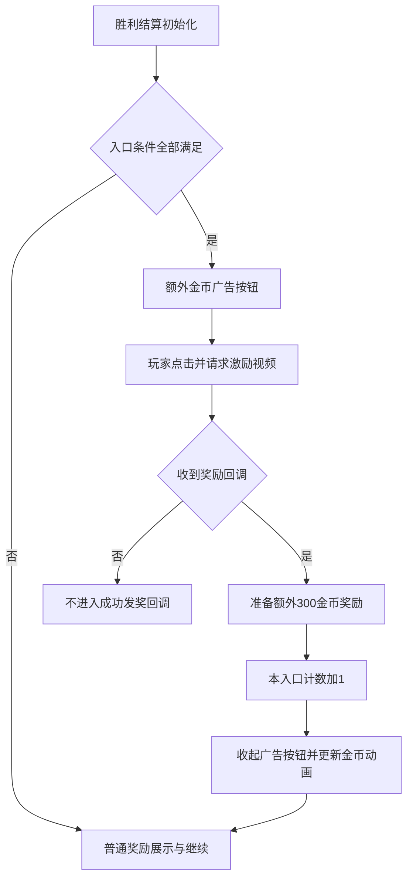

# TF 通关结算激励视频

**在本次取得的 21200 配置基线下，主线第30关起具备结算广告奖励，每次额外300金币。入口还要求广告已准备好、开关开启、关卡资格与两层次数额度均满足。通常入口额度为每日20次，U1及符合特定策略的U2为100次；同时受全部激励视频每日100次展示总额限制。**

本篇对象是胜利结算页 `LevelPassPopupV3` 的 `reward_more_level_coin`，失败复活广告是其他时机。证据为同版本 ARM64 消费逻辑与 2026-11-04 设备初始配置缓存的解密明文；没有现场观看广告，也未确认当前账号最终命中的配置覆盖层。配置值不能直接推广为所有线上玩家的固定值。

## 1. 入口出现条件

以下条件需同时满足：

| 条件 | 代码/配置依据 | 当前基线含义 |
|---|---|---|
| 当前结算允许显示金币奖励 | `PopupLevelPassParam.HideCoinReward == false` | 被流程显式隐藏金币奖励时，不进广告分支 |
| 本时机开关为1 | `GetCompleteBottomType()` 实际读取 `reward_more_level_coin` | 五列均为1；不是另有一份“底部布局类型”配置 |
| 广告奖励金额大于0 | `LevelAdCoin >= 1` | 循环前为0，循环期为300，见下节 |
| 达到本时机解锁门槛 | `reward_more_level_coin_start_level = 12` | 判断 `current_level - 1 >= 12`；此时机扣掉已推进的一关，按已完成关卡判断 |
| 激励视频总开关开启 | `reward = 1` | 关闭后全部激励时机受阻 |
| 没有命中渠道屏蔽 | `block_rv_campaign = u0_4` | 实现是忽略大小写的 campaign **后缀匹配**，不是仅完全相等 |
| 该入口尚有额度 | `NoChance(reward_more_level_coin_daily_count, 100)` | 这里参数100是计数字典的类型键，并非配置缺失时的默认上限 |
| 全部激励广告尚有展示额度 | `reward_daily_show_limit = 100` | 共用广告类型 Reward 的展示数 |
| 广告系统已初始化且可播 | `CanShowRewardAndReady` → `CanShowAd(Reward, placement)` 且 `IsReady(Reward)` | 符合等级与数值仍可能因无可播广告而不显示 |

`InitBottom` 的直接判断可以归纳为：

```text
允许金币奖励
  且 reward_more_level_coin == 1
  且 LevelAdCoin > 0
  且广告系统已初始化
  且 CanShowAd(Reward, reward_more_level_coin)
  且 IsReady(Reward)
→ ShowAdRewardUI
否则 → 普通结算奖励界面
```

`CanShowAd` 还经过 SDK 已注册的拦截器。本轮核对了业务时机、总开关、分组、总次数、等级、会话时间及去广告判断；设备/OS黑名单类另有实现，未逐条展开具体机型名单。上述表不是所有 SDK 或广告网络可播失败原因的穷举。

**“12关解锁”不等于“12关就有按钮”。** 本配置在30关前把 `LevelAdCoin` 配为0，因此奖励金额条件先把入口挡住。到了30关及以后，也不是每次结算保证出现，仍取决于可播与额度。

## 2. 奖励数值与计算

配置：`decoded/initial-config/Config/config_client_game.csv`。

| 配置键 | Value / U0_0 / U0_2 / U1_0 / U2_0 | 作用 |
|---|---|---|
| `level_coin_loop_start_level` | 全部30 | 含当前关，开始按数组循环取值 |
| `level_coin_rv_count_default` | 全部0 | 循环开始前的广告金币数 |
| `level_coin_loop_rv_count_range` | 全部 `300` | 循环期广告金币数组；只有一项，因此每关均取300 |
| `level_coin_default` | 全部0 | 循环开始前普通通关金币 |
| `level_coin_loop_range` | 全部 `50\|10\|10\|10\|10\|10\|30\|10\|10\|10` | 普通通关金币的10关循环，独立于广告金币 |

代码按 `i = GetCoinLoopIndex(30)` 计算：

```text
普通主线：i = main_level
轮回模式：i = round_level_index + 30

i < 30：广告金币 = level_coin_rv_count_default = 0
i >= 30：广告金币 = RV数组[(i - 30) % RV数组长度] = 300
```

奖励数在创建 `LevelInfo` 时取得；不是看到已推进后的关卡号再随意减一。第30关的普通金币数组首项为50、广告奖励300；第31关普通金币10、广告奖励仍300。轮回使用独立索引，不能把轮回第几关直接按主线关号解释。

成功回调使用 `CreateReward2Str(100, LevelAdCoin)` 准备奖励，之后展示的金币总数为 `LevelCoin + LevelAdCoin`。所以本配置是**额外加300金币**，不是固定“原奖励乘2”。旧字段 `level_coin_rv_default`、`level_coin_loop_rv_range` 已标废弃；后者含12/60/20和U2零数组，不能拿来计算本版本的当前广告奖励。

`AdjustLevelCoin` 在此消费者中只调整普通金币，广告金币不经过该调整；`coin_tile_switch` 分支也只把普通结算金币置0，保留广告金币。不能因为普通结算金币显示0，就直接判断广告奖励也为0。

## 3. 两层上限与分组选表

### 3.1 本入口成功领取额度

`reward_more_level_coin_daily_count` 的客户端表列：

| 配置分组 | 次数/日 | 按每次300折算的广告金币理论上限 |
|---|---:|---:|
| Value 默认列 | 20 | 6,000 |
| U0_0 | 20 | 6,000 |
| U0_2 | 20 | 6,000 |
| U1_0 | 100 | 30,000 |
| U2_0，未切换策略 | 20 | 6,000 |
| U2_0，符合服务端广告策略 | 100（服务端表） | 30,000 |

理论金币上限假设每次300、广告成功可播且无其他激励入口消耗总额度，并非每日保底。

服务端表不是对所有玩家无条件覆盖。`ShouldUseServerGameForAdStrategy` 要求：

1. 服务端 `u2_ad = T`；
2. 用户组枚举为U2（代码值2）；
3. 通过非付费策略标签资格：当 `iap_group_predict_switch = F` 时直接通过；若改为T，要求 `IAPPurchaseDealer.GetIAPGroupTag() == "R0"`；
4. `GetPopupSceneNoPaymentShowCount() >= u2_ad_check_times`，本配置为 **2次**。

相关配置还给出 `u2_ad_popup_scene = no_payment_check`。这里计数是该策略使用的弹窗展示计数，不能理解成通关两次、播放广告两次或全部购买弹窗累计两次。本轮核对选表函数的计数读取，没有逐条还原这个弹窗计数的所有写入入口。

满足以上条件，`NoChance` 才读取 `config_server_game.csv` 中的100；否则读取客户端分组列。达到上限时拦截，比较为 `used >= limit`。本入口额度取 **-1** 时跳过这层限制，取0则立即无额度；配置说明对0写“报错”，所核函数实际表现为数值比较拦截。

### 3.2 全部激励视频展示额度

`reward_daily_show_limit` 各客户端列均为 **100**。`MFAdTypeShowLimitCountInterceptor` 在请求和展示两处使用相同检查，计数达到100后拦截；`OnAdDisplayed` 才增加这一层的数。

此额度按广告类型 Reward 共用，不是通关入口独享。复活、生命等其他激励时机的实际广告展示，也会减少通关入口可用的总展示空间。

进一步核对入口计数字典：结算金币读取键100、购买生命读取键200、复活弹簧读取键509、重玩加格读取键508、Order Merge能量读取键15014。因此这些入口的业务额度分别计数，共享的是外层Reward展示总额。例如当日结算金币成功领取10次、复活广告成功领取5次，且每次各展示一次：结算金币计数为10，复活计数为5，全局激励展示计数为15。其他入口不会直接扣减结算金币20次的业务额度，但会消耗每日100次的全局展示额度。

```text
接下来还能成功领取的次数
≤ min(本入口剩余额度, 全部激励广告剩余展示额度)
```

本入口额度的 `-1=不限` 不应套用到全局展示额度：全局所核函数直接比较 `count >= limit`，未见-1特殊分支。

### 3.3 全局额度专项：配置、计数保存与换日

“全局”指本客户端内同一广告类型的所有时机共用，不是所有广告类型合计100，也不是所有玩家共用一个池。

| 广告类型 | 配置键 | Value / U0_0 / U0_2 / U1_0 / U2_0 | 是否扣激励100次 |
|---|---|---|---|
| Reward 激励视频 | `reward_daily_show_limit` | 全部100 | 是，各激励时机合计 |
| Interstitial 插屏 | `interstitial_daily_show_limit` | 全部30 | 否，独立累计 |
| Banner 横幅 | `banner_daily_show_limit` | 全部400 | 否，独立累计；按SDK展示回调计数，不按用户点击数 |

来源：客户端表139–141行，三项 `Abandoned=F`、`Realtime=F`。表中Realtime列的含义是“用户分组后是否实时刷新”，不能扩大解释成整局永久锁定或所有远程配置机制都无法更新。

`GetAdTypeLimitCount` 按广告类型小写名称拼接 `_daily_show_limit`，读取 `ClientConfig.GameIntValue(key, 400)`。因此400是缺配置时的代码回退值；本批激励配置存在且为100，不能把回退值当实际上限。此函数先检查实例内的类型上限字典，未命中才读配置；本轮没有发现这里使用U2的服务端策略选择器或eCPM判断。不能据此排除客户端配置读取层另有覆盖。

计数行为：

- `GetPrefsKey` 使用 `max_limit_{0}_count`，参数是广告类型枚举；不同placement没有进入这个键。
- `CheckLimitOnTotalCount` 优先读实例内计数缓存，否则从 `MFPreferences.GetInt(key, 0)` 恢复，再比较 `count >= limit`。
- `OnAdDisplayed` 按回调的广告类型调用 `AddAdTypeShowCount`，加1后同时更新缓存和 `MFPreferences`。只请求、加载成功但未展示、加载失败都不在这个加1方法的触发点。
- 若当前99次，第100次展示前仍放行；展示回调后变为100，并在恰好等于上限时记录 `ad_daily_show_limit` 事件。后续加载和展示均受阻。日志事件名本身不是新的第四层额度。
- 配置0会立即拦截；-1也没有不限特判。不要把各时机业务额度的“-1不限”约定套入这里。
- 同日重新初始化会从偏好存储恢复计数，不是关卡结束、重开应用就自动归零。计数键没有附加账号ID，但尚未核验偏好存储后端的账号隔离/同步，不能断言跨设备共用或切账号后会怎样。

换日链路进一步核对：

1. `MFSDKModule.InitMFAdSDK (0x6464f90)` 创建该拦截器；该初始化函数还设置广告加载与展示拦截器。
2. 构造函数调用 `MFFAppInfo.GetDaysAfterInstall (0x332926c)`，与偏好存储 `ad_show_limit_day_key` 比较；不同则清空内存计数，并把插屏、激励、横幅三个存储计数都置0，然后保存新日标记。
3. `GetDaysAfterInstall` 的实现不是距上次广告满24小时：它把首次登录时间戳转为日期，取该日期的00:00，与 `DateTimeUtils.GetGameTimeNow()` 相减后取 `TimeSpan.Days`，得到日序号。
4. 游戏时钟来自 `GrandTickTimer`；其初始化读取 `DateTime.Now`，并支持后续更新时间。能确认按游戏日序号变化判断换日，不能仅凭方法名把它定义成UTC零点或固定北京时间零点。
5. 扫描本构建全部可执行区的直接分支，`ResetOnDayChange` 只找到构造函数这一处直接调用；展示检查、加计数函数中均不再检查日标记。因此**已确认的刷新时机是跨日后的广告系统初始化检查**。持续在线跨日是否由其他流程重建SDK/拦截器，未实测，也未排除间接调用，不能承诺到零点立即恢复。

追加证据：`04-ReverseEngineering/adglobal-xrefs.json`、`adglobal-*.txt`、`adtime-*.txt`、`adclock-*.txt` 及对应调用表与脚本。以上仍是21200静态逻辑和本批缓存配置；本次没有采集当前设备剩余额度或人为改时验证。

## 4. 观看、到账与次数记录流程



- `MultipleCoinButtonPressed` 调用 `ShowReward`，成功委托由 `TileAdRewardShowListener.OnRewardedReceived` 执行。广告未准备好、领奖前关闭走失败提示路径。
- 成功委托准备广告金币奖励，并执行 `level_pass_premium_reward`；该 action 对 `RootAttr.asset.reward_ad_buy_times_dict[100]` 加1，键不存在时先初始化0。
- 因而**按钮曝光、点击本身不会增加本入口成功领取计数**。奖励回调才会触发该计数；全局展示额度则可能已在广告展示时消耗，两层计数可以不相等。
- 成功后当前结算页隐藏广告按钮，转为继续操作，因此这一页是一次成功领取机会；不是可连续点击直到把每日额度用完的刷取页。
- `asset.reward_ad_buy_times_dict_Reset_Logic` 包含把键100置0。全局展示计数的日序号与初始化重置机制详见3.3；**两层具体跨日时区、持续在线跨日触发时刻尚未完成实测/全链路核验，不能写成已确认北京时间0点刷新。**

## 5. 冷却、概率和常见误判

### 5.1 为什么12关解锁，30关才有奖励：请求与展示分层

这里存在三个独立参数，且两个参数恰好都是12，不能混为一谈：

| 参数 | 基线 | 实际消费者与含义 |
|---|---:|---|
| `reward_more_level_coin_start_level` | 12 | 本结算时机资格检查；同时被首次请求的最早时机计算读取 |
| `reward_request_advance_level` | 12 | 相对所有已开启RV时机中最早的解锁关，提前多少关进入首次请求分支 |
| `level_coin_loop_start_level` | 30 | 奖励算法的循环起点；此前广告金币为0，此后为300 |

`GetRewardMinLimitLevel (0x646f0e4)` 计算购买生命、结算金币、复活弹簧、重玩加格、重玩道具五类时机的最小等级；子函数只计入开关为1的时机，关闭的返回 `int.MaxValue`。本批配置中，结算金币12；生命、复活弹簧、重玩加格20；重玩道具开关0。因此最小值为12。

`OnLevelChangeReward (0x646ed08)` 在 `最早时机等级 - current_level <= reward_request_advance_level` 时进入 `MFAdManager.FirstRequestReward`。代入本批配置为 `12 - current_level <= 12`，所以这个等级条件本身无需等待第12关或第30关。此函数没有检查广告金币是否为0。

这只证明首次请求的等级条件已放行，不能宣称游戏第0关就发出网络请求：还要等SDK初始化、请求流程被调用及其他开关/拦截器通过。另查到延迟初始化分支 `CheckAndInitByLevel (0x646ca54)` 使用当前关卡≥10作为触发条件；`InitMFAdSDK` 有不同分支，不能把10关写成所有账号统一首次请求时刻。

**已证实：可以先请求广告，后在30关起开放有奖励的通关入口。未证实：12与30的差值是专门为了获取eCPM或按eCPM分层。** 本轮核对的首次请求等级计算、奖励金额算法及结算入口直接分支均未读取eCPM，也没有“eCPM达到阈值才把奖励从0改为300”的判断。广告加载/竞价是否把价格信息送入其他用户分层或配置覆盖链，需另追回调和消费者；不能用预加载机制推定其产品设计目的。

产品层面只能提出解释假设：广告基础资格和金币投放节奏被分开配置，30关前控制结算奖励入口，同时允许其他RV时机及广告准备流程独立运行。是否属于历史配置沿用或刻意的变现安排，现有静态证据无法区分。

### 5.2 其他常见误判

| 问题 | 本轮结果 |
|---|---|
| 每隔N关或随机出现？ | 已核 `InitBottom` 分支没有概率抽样、每N关判断；由资格、金额、额度和可播状态控制。未据此排除其他配置覆盖改变结果。 |
| 480秒是本入口冷却？ | `interstitial_reward_interval=480` 的说明为“插屏与上一reward最小间隔”，不能反向解释成两次RV至少间隔480秒。 |
| `reward_cold_start_interval=-1` 是玩家冷却？ | 配置用途是广告base重置，-1关闭该功能；`reward_interval_up_type=2` 也是base升级策略，不是入口成功后冷却。 |
| 请求延迟 | `reward_request_time=0` 为冷启动后请求激励广告的延迟配置；0代表不额外延迟请求，不代表广告立即加载成功。 |
| 购买去广告会挡住它？ | 已核 `MFAdIAPInterceptor` 只处理广告类型0/1，Reward=2直接放行；不能将去插屏广告购买等同于关闭这个自愿激励入口。 |
| 第39关结算截图没有按钮，为什么？ | 只能确认该次画面没有出现按钮；未采集当时Ready状态、账号分组、次数和隐藏参数，不能唯一归因为某一项。 |

## 6. 取证位置与验证边界

原始根：`06-PRODUCT-ASSETS/TileFamily/2.12.0/`，完整样本身份见 [[02-PROJECTS/产品分析/Tile Family/资源路径索引]]。

| 证据 | 地址或位置 |
|---|---|
| UI入口判定 | `LevelPassPopupV3.InitBottom 0x635d0ec`；`IsCoinReward 0x635d6b8` |
| 时机开关 | `LevelPassPopupHelp.GetCompleteBottomType 0x635cb0c` |
| 广告金币算法 | `LevelInfoProvider.GetLevelCoinAndRewardCoin 0x62edb3c`；`GetCoinLoopIndex 0x62ede7c`；币砖分支 `0x62ed2b4` |
| 关卡门槛与入口额度 | `MFAdAdChanceInterceptor.RewardBuyCoin 0x6473b08`；`IsLock 0x6473cd8` |
| 可播检查 | `TileAdMFSDKUtil.CanShowRewardAndReady 0x646d3e4` |
| 分组选表 | `TileAdMFSDKUtil.NoChance 0x646e0dc`；`UserGroupHelper.ShouldUseServerGameForAdStrategy 0x62b2b84` |
| 渠道屏蔽 | `MFAdTypeConfigInterceptor.IsBlockRvByCampaign 0x64746d0` |
| 奖励与计数 | 成功委托 `0x635f0bc`；`ActionCollection.level_pass_premium_reward 0x62a11e0`；`Request.GetRewardAdBuyTimes 0x6286314` |
| 全局展示上限 | `CheckLimitOnTotalCount 0x6474aa8`；`GetAdTypeLimitCount 0x6474c48`；`OnAdDisplayed 0x6474fec` |
| 原生复核产物 | `04-ReverseEngineering/ad*-*.txt`、`ad*-calls.json`、`ad-xrefs.json`、`ad-literal-slots.json`；附同目录取证脚本 |
| 客户端配置 | `05-Runtime/2026-11-04/decoded/initial-config/Config/config_client_game.csv`：141、191、209–211、368–374、489行等 |
| 服务端配置 | 同目录 `config_server_game.csv`：119–121、227、236行 |

该批配置已经离线解密并重加密一致性验证，不再受“配置加密不可读”限制；仍需区分“缓存表中有什么”与“当前账号最终使用什么”。本轮没有新增账号解码、网络请求抓取或真实广告观看。未确认当前用户分组、热更新覆盖、广告填充状态和精确跨日时区。

返回 [[02-PROJECTS/产品分析/Tile Family/_MOC]]。
