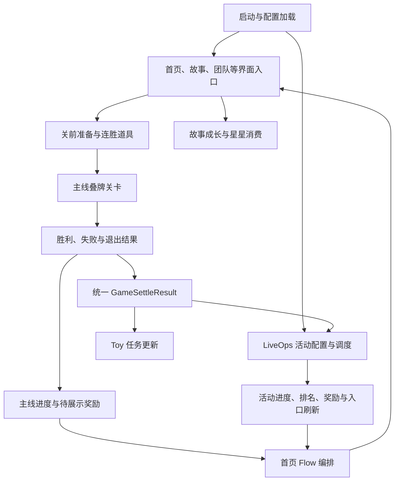
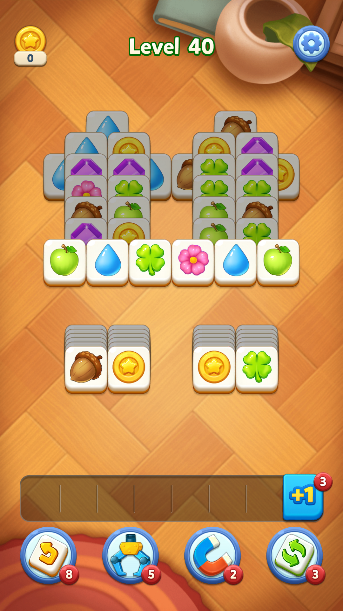

# TF 系统框架与关键流程

**TF 可归纳为“叠牌消除主线＋故事成长＋活动运营＋流程编排”四个产品层。** 技术上，主线将关卡结果统一回流给 LiveOps；活动的资格、资源、入口、结算与首页展示分开处理；首页流程兼有 C# 注册动作和 Lua 策略入口。这里的四层是分析归纳，并非游戏官方命名。

## 证据等级与阅读方式

| 标记 | 本报告的含义 |
|---|---|
| 代码已核 | 同版本 ARM64 直接调用或可读 Lua 函数；已记录地址/文件 |
| 结构已核 | 类型、字段、方法签名或资源存在；尚不能据此断言具体条件 |
| 现场已见 | 专用 MuMu 实例1，21200，2026-11-04 的画面/文件 |
| 待验证 | 配置覆盖层、完整条件、服务端选择及实际曝光 |

包名 `com.tile.match.blockpuzzle`，版本 2.12.0 / 21200。主逻辑程序集为 `TileMatch.dll`，不是拿 RM/MV 的类名替代 TF。原始证据及哈希见 [[02-PROJECTS/产品分析/Tile Family/资源路径索引]]。

通关结算激励视频已独立下钻：[[02-PROJECTS/产品分析/Tile Family/游戏逻辑/通关结算激励视频-2.12.0]]。本批配置12关解锁但30关起才有300广告金币，入口受可播状态、本时机20/100次分组额度和全部激励100次展示额度共同控制。

## 一、系统地图

图中主线→统一结算→活动刷新和首页→Flow 的关键边已核对原生调用。故事消费、团队与所有 UI 跳转仍以类型职责定位为主，不能把整图当作每条边均已实机走通。

| 层 | 职责与代表实现 | 当前边界 |
|---|---|---|
| 启动与基础设施 | `TileMatchLaunchManager`、`CommonManagerLaunchModule`、`LoadAssetsManager`、语言/存储/配置服务 | 已定位初始化模块；未还原所有启动依赖顺序 |
| 主线内容 | `LevelManager`、`TemplateFileManager`、`ValueTestManager`、`DdaLevelManager` | 主线与轮回关卡分支、奖励准备、胜负入口已定位；DDA 算法未还原 |
| 单局逻辑 | `GameManager`、`PartStatusManager`、点击/道具处理器、背包容器 | 点击与状态更新直接调用已核；未完整枚举所有障碍规则 |
| 长期成长 | MainStory、`StoryStarController`、故事信件、资产、生命、团队 | 故事/关卡/团队的代码入口已定位，消费数值待核 |
| 活动系统 | `LiveEventOpsController`、配置/存储/计时器/工厂，以及 Toy 活动接口 | 活动实例创建、状态落盘、关卡回流已核 |
| 展示编排 | `HomeView_HomeShow`、`FlowChanceManager`、`Infrastructure.Flow.FlowExecutor` | C# 与 Lua 动作入口、队列、暂停/恢复、优先队列已定位 |
| 商业化 | IAP、去广告、礼包、通行证、购买结果页及补发流程 | 已定位购买取消/失败/无网/成功页面；未执行支付 |

## 二、首页和弹窗如何组织

### 2.1 配置决定候选，执行器安排播放

已核原生调用：

`HomeView_HomeShow.DoPageShowFlow (0x6793064)` → `FlowChanceManager.GetFlowActionsByChance (0x6402a34)` → C# / Lua 动作收集 → `HomeView_HomeShow.ExecuteFlow (0x67931e0)` → `FlowExecutor.AppendFlow / Resume`。

执行器字段区分 `_pendingFlows`、`_priorityPendingFlows`、`_executingFlow` 和 `_isPaused`。首页另有 `WatchPopupForFlowPause`、`TryResumeFlow`、切换页签监听、热启动流程和空闲时启动优先流程。这说明“弹窗可出现”和“现在可以播放”属于不同层；具体抢占时机及中断恢复分支尚未完整还原。

包内 `flow_action` Lua 的可读规则：

1. 读取 `config_client_popup_controller`。
2. 跳过 `Chance` 不匹配、`Switch == false` 的行。
3. 同次候选列表按 `Action` 去重；前一行被成功加入后，后续同名 Action 跳过。
4. 调用 `popup_pick_rules(Action, PopupRule, PopupRuleParam, GroupPickRule)` 判断可否展示及返回参数。
5. 从 `config_client_flow_chance` 中找 `Chance + Action` 的第一条匹配记录，取 `Priority`；找不到时保留 0。
6. 生成 FlowItem：`popup_scene/action_name/rule/param/priority`。

**此 Lua 函数没有排序操作。** 不能仅看到 Priority 就宣称数值大者先弹，最终排序/合并顺序需继续核对 C# 消费者。脚本返回候选也不等于现场已经曝光。

### 2.2 已能解释的弹窗触发规则

以下均为包内 `popup_pick_rules` 函数规则，不代表本账号命中，参数现已解密，具体值与开关见 [[02-PROJECTS/产品分析/Tile Family/活动解锁排期与奖励配置-2.12.0#四、首页弹窗配置与代码合读]]：

| 规则 | 已读到的判断 |
|---|---|
| 通行证刷新 | 必须 active；`activity_refresh` 规则此前未展示 |
| 通行证临近结束营销 | 到期剩余量、任务完成数、未购买、未展示共同判断；另按 u2 用户组或历史通行证购买记录分支 |
| 去广告提示 | 去广告开关开启且未购买；按关卡阈值或首次插屏已展示触发，并检查对应展示记录 |
| 储蓄罐 | 分别检查已满、可购买状态 |
| 连败礼包 | 参数非0、ReplayTime 非0、ReplayTime 能被参数整除，且同 Action/规则/关卡/重试次数未展示 |
| 流失回归 | 离线天数达到参数，且上次该规则展示距今满足冷却 |

连败礼包的规则是**重试次数周期命中**，不能在未读取配置前写成“固定第3次失败弹”。也不能把它直接当成关内难度调节。

## 三、从点击开局到关卡结束

### 3.1 关前和关内

首页开局按钮 `OnLevelButtonClick` 已核对会进入关卡类型判断，存在轮回关结束处理与协程分支。`PreGamePopupManager`、`BoosterManager`、`WinningStreakManager` 提供关前与连胜入口；完整预选、扣费、失败取消条件仍待逐条核验。

单次点牌的直接调用链已核：

`GameManager.OnClickTile (0x638f3cc)` → `TowerRandomHandler.RandomizeTiles`、`TileClickPreHandler.PreTileClick`、`TileClickHandler.OnTileClick` → 障碍相关处理 → `PartStatusManager.UpdatePartStatus`。

`GameManager.IsBagFull` 委托 `PartStatusManager.IsBagFull`。这支持按“可点牌→容器→消除与状态判定”理解主玩法，而不是套用 RM/MV 的交换、落子、剩余步数框架。链上存在条件分支，不表示每次点击都随机重排全部牌；完整随机策略、容器容量、失败判定仍需下钻。

### 3.2 胜利与失败的不同出口

| 入口 | 已核调用 | 能确定什么 |
|---|---|---|
| `FinishCurrentLevel 0x62ef6e8` | ValueTestRecordFinish、PrepareReward、主线/轮回进度分支、重试计数记录与清理、事件通知、预下载、保存 | 通关同时影响进度、奖励与后续内容准备；两种进度增长是分支，不能理解为同时推进 |
| `PrepareReward 0x62ef860` | 连胜道具等级更新、获取星星/奖杯资产、构造 BonusInfo、PrepareBonusInPack | 奖励先进入准备结构；“已准备”不等于所有奖励已展示/落袋 |
| `FailedCurrentLevel 0x62efdb4` | Pigat.DoAction、OnPigatLevelFailed、EventBus.Trigger | 失败有独立系统通知，扣命和清连胜细节需追消费者 |

已定位 `OutOfSpacePopup`、`LevelFailedPopup/V2`、`QuitLevelPopup`、`LetHelpPopup`、`BuyPropPopup` 等节点；续关价格、广告续关次数、退出后恢复与奖励防重尚未核实，不能根据页面名补齐规则。

## 四、关卡如何带动活动

关键直接调用链：

`ToyActivityV2ControllerDependency.OnLevelEnd (0x674c720)`
→ `GetLevelEndGameSettleResult`
→ `LiveEventOpsController.UpdateLiveEvent`
→ `SendData`
→ `RescanSchedulerIntoPending`
→ 大师联赛过期实例交接检查
→ `RefreshLiveEvent`。

`SendData` 内可见 `ActMissionUpdateData` 构造与 Toy 服务调用，证明主线还向任务系统分发更新。其完整负载和各事件是否发出需看分支，不能由一次方法中出现三次构造就断言固定发三条任务消息。

`GameSettleResult` 包含胜负、游戏类型、关卡索引、重试计数、消除牌信息、金牌收集、金币收集、Progress、IsRemain 与扩展参数。因此活动可消费胜关、连胜、指定牌收集等不同输入，不必各自重新扫描棋盘。

| 活动消费者 | 本轮已核的分支/调用 | 未核部分 |
|---|---|---|
| LavaQuest | `OnGameSettle 0x662ac10` 分别调用 OnLevelFail / OnLevelPass，再刷新图标 | 连胜目标、模拟人数、奖金分摊、失败复开条件 |
| TilePass | `OnGameSettle 0x652fe40` 调用 UpdateByLevelPass | 分关卡计分、免费/付费轨道奖励、实际生效周期 |
| GoldenTreasure | `OnGameSettle 0x665a180` 进入收集数计算、任务奖励状态改变与图标绑定 | 计分倍率、牌种、任务阈值与领取防重 |
| SpaceRace | `OnGameSettle 0x6566a64` 包含玩家分数增量、机器人末次分数更新、机器人刷新 | 分支资格、人数/目标值、对手曲线 |
| Pinata | 原生分支有阶段阈值判断与 EnterCardReveal；结果位参与计数更新 | 字段偏移完整对位及配置阈值；暂不将计数逻辑写成完整规则 |

TF 也存在名为 LavaQuest 的模块；**同名不证明与 RM 相同**。本轮没有移植 RM 的7连胜、人数或奖金规则。

## 五、活动生命周期与资源门槛

状态枚举包含 `NOTENABLE / PREVIEWING / ACTIVE / INACTIVE / TIMEOUT / CLOSED`，分别可读作未启用、预览、活跃、非活跃、超时、关闭。枚举已确认；不能据此假设它们只能按固定顺序单向迁移。

| 环节 | 结构/调用证据 | 产品含义与待核边界 |
|---|---|---|
| 配置身份 | TemplateName/TemplateId、DupName、Guid、LoopId | 模板、实例、轮换可分离；UI皮肤不应直接算新玩法 |
| 资格与预告 | StartLevel、PreviewLevel、PreviewHoursAfterStartTime | 预告资格与参加资格分开；已解密副本门槛见配置专题，运行资格待核 |
| 时间 | StartTime、EndTime、计时器 | 有时间窗；不等于已知每周排期 |
| 实例创建 | 元配置→存储配置/状态→工厂→倒计时 | 已核关键调用，但工厂全量注册和互斥条件未还原 |
| 资源准备 | pendingLiveEventData、runningNoResLiveEvents、IsReady | 明确有等待与无资源分支；配置存在不等于入口可交互 |
| 状态改变 | SetLiveEventState→校验→存储→计时器/图标/刷新分支 | 关闭、图标清理与状态保存相互关联，具体状态触发哪些操作待核 |
| 表现/收益 | UiType、CollectTileIds、TileReplaceStrategy、RewardGroupId、IapGroupId、DoubleBuff、LevelTypeMultiple | 支持换皮、收集对象、奖励组与倍率；字段存在不代表当前启用 |

## 六、现场观察

仅记录自然现场及本次点击，不改等级、不清档、不进行支付。

1. 打开应用后画面处于胜利展示，文字为“Level Completed / You passed on your first try”。关卡号被遮挡，不作精确判断；此前对话误读为80已纠正。本次未观察其完整对局，不能将首次通关归因于本轮操作。
2. 点击空白处后，进入独立奖励展示：星星、金币 ×10、新牌面进度 3/4，并出现继续提示。
3. 点击继续后直接进入清晰标为 **Level 40** 的关卡，未观察到首页。本次没有继续点击棋盘。此分支与代码中的首页回流能力并存，不能将“每次胜利必回首页”写成固定规则；为什么本样本走直达分支尚待核对。

## 七、与已有 RM / MV 分析对照

| 维度 | RM 38911 已有档案 | MV 7307 已有档案 | TF 21200 本轮 |
|---|---|---|---|
| 主线 | 交换三消、剩余步数结算 | 交换三消、棋盘行为计分 | 点牌、容器与单局状态；有分段 Part |
| 活动回流 | EventsHelper 的关卡生命周期 | GameEventModule 与活动管理器 | GameSettleResult→LiveOps，并向 Toy 任务发更新 |
| 展示 | HomeSceneFlow 与 Dialog/Flow | Home 通知与奖励队列 | FlowChance＋C#/Lua 规则＋FlowExecutor |
| 活动身份 | 管理器、资格与依赖 | 管理器家族与事件类型 | Template/Dup/UiType/Guid/Loop 分层 |
| 数量口径 | 既有档案中央活动清单口径 | 49个具体管理器 | LiveEvents 命名空间37个具名实现，另有外围模块 |
| 当前不足 | 依既有档案注明运行边界 | 依既有档案注明运行边界 | 125份配置已解密；账号生效与完整流程仍需补证 |

三列是不同版本和统计口径，不能直接用数量比较产品活动规模。参照文档：[[02-PROJECTS/产品分析/Royal Match/系统活动关卡与主场景框架-38911]]、[[02-PROJECTS/产品分析/Match Villains/活动系统总览-7307]]。

## 八、接续顺序

优先补齐：①对位已解密配置的运行选择与覆盖层，确认当前副本及生效值；②首页冷启动、热启动、胜后、败后四条实际弹窗序列；③续关、退出、重试及奖励恢复；④选定活动逐一补齐资格—参加—进度—结算—复开。每项更新对应章节，并保留版本和采集时刻。

本报告是框架与关键流程基线，**不是所有活动规则及所有异常流程的完整验收**。
