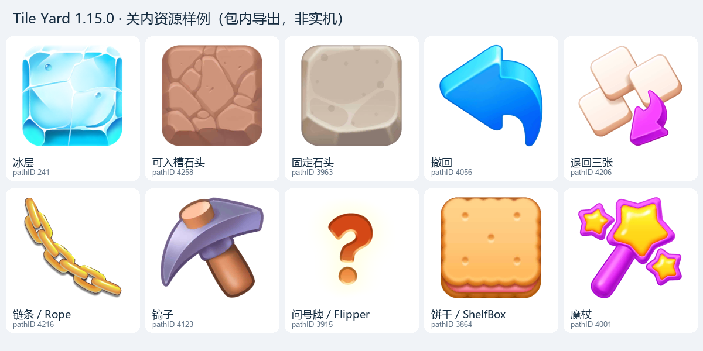
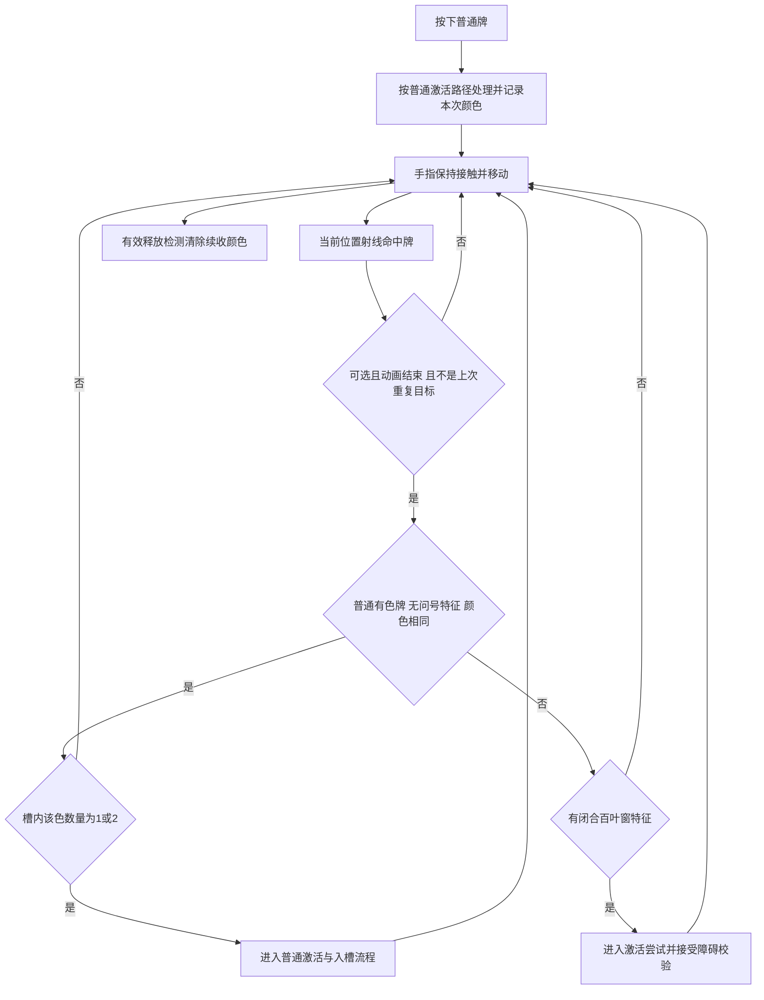

# Tile Yard：关内道具、障碍与滑动操作

**核心认识：道具围绕暂存槽压力提供不同救场方式；障碍分别控制可选时机、配对联动和槽内清理；连续滑动用同色与槽内计数限制辅助凑三张。** 本文依据 Android 1.15.0（9872）的包内教程、布局、字段与选定 ARM64 方法，不包含本版实机观测。正文分别标注文案、代码和推断，未核清项不补成确定规则。

## 1. 基础规则与资料边界

包内 `CoreTutorial_en/TUTORIAL_0、1` 说明三张同类牌消除、清空棋盘；`TUTORIAL_2` 说明暂存槽全满导致失败。下文将英文 shelf／collector 统一称“暂存槽”。槽内排列、动画未完成和特征优先级会影响可操作性，不能把规则简化为“所有能看见的牌都能点”。

| 证据级别 | 本文含义 |
|---|---|
| 文案确认 | 包内教程或说明明确表达的设计用途；不独立证明扣费、选牌算法和当前开放 |
| 代码确认 | 同包 metadata 对位原生方法，已核对所述分支／状态变化；不代表现场已执行 |
| 布局存在 | 已解析具体 JSON 中的 feature；文件编号不等于玩家关卡号 |
| 产品判断／待验证 | 根据上述证据解释体验价值，或需要后续运行样本的问题 |

图为本包定向导出的 Sprite，方便辨认冰、石头、链条、问号和饼干等素材。图标不等于完整 Prefab／实机表现；来源和对象 ID 见同目录 `资源来源.json`。`Rope` 的开发描述为链条，`Flycatcher` 为百叶窗，`ShelfBox` 为饼干，`Flipper` 为问号；不按内部英文名直译玩家外观。

随报告的 `assets/core-1.15.0/证据摘录.json` 保存教学默认值／原字节、道具文案及布局摘要；大体量反汇编留在本机原始材料区。

## 2. 玩家道具：作用位置与救场用途

| 道具 | 已确认效果 | 解决的问题（产品判断） | 证据与边界 |
|---|---|---|---|
| 撤回 Undo | 撤销上一步 | 刚刚取错牌，恢复上一决策 | `PowerupUndoComponent.Description`。另有“任选槽内一张退回”的独立入口和 `LastTilePrice / RandomTilePrice`，不能当作同一种免费撤回 |
| 洗牌 Dice | 重排棋盘上的牌 | 当前可选牌面／遮挡组合不利 | `PowerupRandComponent.Description`；`Field.ReshuffleField → ReshuffleAlgorithm.Activate`。尚未证明洗牌保证可解、必定形成一组或重算难度 |
| 魔杖 Magic Wand | 自动执行一个有效操作 | 缺少下一步目标或希望推进局面 | `PowerupHintComponent.Description`；`HintAlgorithm.GetPotentialTiles / Apply / ActivateHintedTiles`。会调用取牌，不只是高亮；具体取几张、选哪组及是否最优仍待核 |
| 退回三张 Tile Return | 将已收集的三张牌退回棋盘 | 已有多张占槽，需要释放容量 | `PowerupDrop3Component.Description`、`ShelfDrop3Algorithm.Apply`。三张的选择顺序、原位置恢复、少于三张时处理尚未完全恢复 |
| 加槽 Extra Slot | 开局／局中增加暂存槽位 | 接近槽满时增加容错 | `BOOSTER_EXTRA_SLOT_BUY / LEVELBUY`、`TUTORIAL_8`。价格、槽数上限、持续范围未取有效配置 |
| 超级魔杖 Super Magic Wand | 文案为从棋盘移除 `{0}` 张牌 | 提供更强的开局／局面整理 | `BOOSTER_REMOVE_COLOR_BUY`、`RemoveColorAlgorithm`。内部名 RemoveColor 不足以证明“清除全场某一种颜色”；数量需读有效配置 |

**需要分清三种来源**：玩家库存道具、布局上的黄色奖励牌、失败／槽满后的救场入口。它们可能复用同一算法，但消耗与触发入口不同。本轮尚未恢复实际购买价、广告兑换条件和库存扣除，不能从 SDK 或价格字段推定当前账号实价。

包内教程默认值：撤回 3、洗牌 5、魔杖 7、黄色奖励牌 8、退回三张 9、加槽 15、任意退牌 23。这些来自 `UICoreTutorial` 的序列化 `_levelNumber`，其中多数另有 `core_tutorial_*_level` 覆盖键；它们是**教程默认关卡，不等于当前解锁关卡**。精确对象与键保存在 `tutorial-serialized.json`。

## 3. 棋盘上的奖励牌

`TUTORIAL_7` 说明黄色牌一次点击即可使用。以下 type 已在布局中核对；它们不能与底栏库存次数混为一谈。

| 类型 | 效果及关键消费者 | 当前边界 |
|---|---|---|
| `hint` 魔杖牌 | 触发 Hint 算法；`ActivateAction 0x3893998` | 具体候选、受障碍影响及选牌优先级待继续追踪 |
| `resh` 洗牌牌 | `ReshuffleAlgorithm.ActivateAction 0x3896c24`，有开始、重排、结束流程 | 未证明保证通关 |
| `bm9` 3×3 方阵效果牌 | 开发描述为 3×3；`Boom9Algorithm.GetFieldPositions 0x388fe48` 构造九位置候选，另有去粘连处理 | 九个位置不等于必移除九张；跨层、边界及障碍交互尚未恢复完整 |
| `pick` 镐子 | 目标搜索同时有棋盘与槽内路径；普通石／固定石对 Pickax 原因有销毁分支 | 目标优先级、一次数量待核；不直接说可清所有障碍 |
| `gft` 礼物 | Gift 算法和主线布局引用已定位 | 奖励内容、数量及领取条件未恢复，不推断奖池 |

另有 `AutomoveAlgorithm.CanStartAutomove / ActivateOne` 自动收尾逻辑，教程提示可加快收取剩余牌。本轮布局统计未见显式 `automove` type，不能按普通预置奖励牌处理；自动启动条件仍待核。

## 4. 障碍：触发事件决定处理方法

### 4.1 已核到状态变化的机制

| 障碍／内部名 | 触发、变化与效果 | 玩家的处理方式（基于静态规则） | 精确边界 |
|---|---|---|---|
| 冰 `ice` | 回合结束时按条件减一层；普通点击锁定路径会给出错误点击反馈；认可的强制处理原因可直接清零 | 通过其他有效操作推进，等待当前可处理的冰解冻；不要反复点冰期待每点一下减层 | 上一采样 Active 和当前可用均为真，且本 feature 为 dominant listener 才减层；刚暴露／被其他障碍接管时不同 |
| 链条 `rop` | 收到邻牌激活回调时减层，归零移除锁定标签 | 先处理关联邻牌，解除锁定后再取目标 | 目标须当前可用；邻牌集合有独立构造和数量约束，未完整恢复几何定义，不泛称任意邻格三消 |
| 百叶窗 `fly`／Flycatcher | 用 opened 控制普通激活是否放行；满足活跃与优先级条件的回合末翻转开合 | 在开放时取牌，通过其他有效操作推进开合 | 埋层与刚暴露状态不能一律视为每步翻转；闭合普通激活抛 `TapOnLockException`，不证明手动点一下就打开 |
| 饼干 `shbx`／ShelfBox | 入槽后监听消除：若与本轮任一匹配牌的槽内索引距离为 1，则销毁饼干 | 安排在饼干旁边凑出三消，释放它占用的槽位 | 检查的是**暂存槽中的相邻**，不是棋盘邻格；动画及满槽边界未实测 |
| 可入槽石头 `rock` | 普通激活存在 Collect 入槽路径；Pickax 原因进入销毁 | 作为占槽压力处理；镐子有明确清石通路 | 另有 ResolveSoftlock 分支，尚未恢复完整，不把某一局面说成永久无解 |
| 固定石头 `rklk`／RockLocked | Pickax 原因进入销毁；普通点击抛锁定异常，不能像普通石头那样直接入槽 | 优先寻找镐子；与可入槽石头区分 | ResolveSoftlock 有单独恢复分支；不把常规路径限制说成任何情况下都不可销毁 |
| 黏连双牌 `glu`／Glued | 两牌配对，包含主从、已点击与移除状态；检查双方锁定并联动激活 | 同时考虑配对另一端的可用性和槽位 | 可与奖励牌配对；联动顺序、另一端有障碍、槽位不足时结果未核全，不能写“一次必收两张” |
| 问号牌 `flp`／Flipper | 真正颜色由底层普通牌保留；入槽后挂接翻转动画，越过中点回调移除问号 feature | 承担盲选入槽后才揭示的风险，不能预先按明牌规划 | 已查路径不是原地翻面再点一次；底层 style 的完整显示绑定和精确手感仍待实机 |

冰的代码细节：`SetActivity` 将 `ITileView.IsTileOrObstacleAvailable` 保存为 `IceMemento.Active`；`OnEndTurnAction` 同时检查旧 Active、当前 availability 和 `IsDominantFeatureListener<IIceFeature>()`，成立才 `counter - 1`，最后刷新 Active。因此“每点一次全场冰都扣一层”不成立。基类 `IsDestroyingReason` 接受 Hint、Pickax、ResolveSoftlock、RemoveColor；上游算法是否能选到该冰牌仍需逐项核对，不能据此把所有道具都说成无条件破冰。

链条与百叶窗同样要经过 availability；dominating feature 是同牌多个 feature 之间的响应优先级，不等于线上活动或账号分组。

问号牌证据链：`FlipperAlgorithm.ActivateAction 0x3891f74` 对普通输入禁用相关事件；`FlipperFeature.SetToDropTile 0x39648d8` 在入槽牌对象上添加 `FlipperBehaviour`；翻转动画跨过相位 0.5 后调用 `0x39649e0`，以 CollectedWith 原因再次处理、销毁问号 feature 并上报障碍销毁。`GetStyle` 禁用普通图案动画；本段未见随机重抽真实颜色。指令在 `flipper-rocklocked-disassembly.txt`，仍需实拍确认图案显示与动画的最终对齐。

### 4.2 已投放线索与样例机制分开

| 项目 | 本轮已确认 | 尚未确认 |
|---|---|---|
| 窗帘 `cur`／Curtain | 有 opened、toggledThisTurn 与匹配／回合监听 | 本次 2,990 个 `level-N` 布局零命中，仅样例有 24 实例；不能说正常主线已开放 |
| 气泡 `spdr`／Spider | 开发描述为气泡；存在回合末随机转移、计数及部分强制移除分支 | `level-N` 布局零命中，仅样例有 24 实例；正式开放、普通点击和耗尽条件未知 |
| BoxAlgorithm | 有计数及本回合使用标记 | 布局中无独立 box type，不能直接映射为饼干或另算一种已投放障碍 |

### 4.3 布局覆盖

对 3,215 份可解析布局逐节点统计；其中 2,990 份唯一 `level-N` 命名资源。下表统计含该 feature 的 `level-N` 文件数；这证明包内配置存在，不证明当前账号走到这些布局。默认普通牌可能不写 `reg`，不以显式 reg 数算总牌数。

| feature | 布局数 | feature | 布局数 | feature | 布局数 |
|---|---:|---|---:|---|---:|
| 问号 flp | 784 | 链条 rop | 577 | 冰 ice | 566 |
| 百叶窗 fly | 566 | 饼干 shbx | 450 | 双牌 glu | 201 |
| 石 rock | 290 | 固定石 rklk | 292 | 窗帘 cur／气泡 spdr | 各 0 |
| 魔杖 hint | 739 | 3×3 bm9 | 403 | 洗牌 resh | 317 |
| 镐 pick | 559 | 礼物 gft | 532 | — | — |

最小资源编号只用于定位，不作为解锁等级。完整计数、选项样例和逐文件明细见本机 `core-mechanics/level-feature-census.json`。

## 5. 连续滑动取牌：实际规则

### 5.1 玩家体验与教学

包内 `TUTORIAL_10` 明确说明手指划过相同图案牌可将其移除。`resources.assets/pathID 79347` 的 `UICoreTutorial` 所属对象为 `slide3tiles`，序列化 `_levelNumber = 4`、`_remCfgName` 为空，按对应 C# 字段顺序读取后完整消费对象 76 字节；因此**本包滑动教学默认安排在第 4 关**。这是包内默认，不冒充本次账号已看到该教程，也不等于滑动功能必须到第 4 关才启用。

`UICoreTutorials.FixedUpdate` 按 `slide3tiles` 分支生成手指轨迹；该教学的退出条件读取关内 `IsFirstMoveDone`，不等于必须完成一轮合格滑动才关闭教学。教学是否足以让玩家学会滑动，需要实际操作确认。

### 5.2 输入链和筛选

对应原生入口 `Field.Tap 0x3a6188c → CheckTap 0x3a640a0 → TapMoveTile 0x3a648b0 → TapToTile 0x3a64bc0`。其中：

1. `Tap` 读取第一个触点 `GetTouch(0)`，分别处理 Began／Moved／Ended；当前所查路径没有经过通用 `SwipeDetector` 的左右上下手势判定。不能把后者的 10 像素默认阈值套到关内滑动。
2. 移动检测用当前位置射线和牌的碰撞边界；先检查 `IsAvailable`、`IsAnimationDone`，与 `_lastTileTapMove` 不同才继续。会记录当前尝试对象，避免停在同一牌上反复尝试。
3. 普通牌续收要求：`IsColored`、无 Flipper、颜色等于 `_lastTileColor`，且 `CountTilesWithType` 为 1 或 2。汇编使用 `(count - 1) < 2` 的无符号判断，因此 0 和 3 以上不满足。
4. 普通牌前置条件不满足时，还有 `IFlycatcherFeature.IsClosed` 的例外尝试；它仍调用普通 `TapToTile`。百叶窗闭合时下游抛锁定异常并有 WrongTap 反馈，**不是绕过百叶窗或滑动开窗**。
5. `TapToTile` 仍检查洗牌、槽是否有空间、退牌是否静止，并走 `ActivateTileFromField`。滑动不直接删除目标，不绕过统一障碍／收集流程。奖励牌虽然在普通点选中可激活，但不能由此推定全部支持滑动激活。

### 5.3 可以判断的行为与不能夸大的效果

| 情况 | 已查代码支持的结果 |
|---|---|
| 点 A，接着划过可选的 A、A | 槽内 A 为 1／2 时可连续续收，走统一激活流程 |
| 途中划过普通 B | 不符合续收同色条件；这一分支不把颜色改为 B，不是沿路自动收集所有牌 |
| 一组三张已清完，还继续划 A | 该色槽内计数归零时不再续收；不能据此宣称长按可无限扫同色组 |
| 跨过空白、牌不相邻 | 所查续收入口没有格子邻接或连线长度检查，依据当前点命中；可推断不是相邻三连线规则 |
| 问号牌 | 普通续收分支显式排除；需另按普通点击／障碍规则处理 |
| 被遮挡、动画未完成的牌 | 移动检测前置检查不放行；锁定特征还会在后续激活中检查 |
| 手指快速扫过 | 检查的是采样位置，当前没有证据证明会对两个采样点之间整条路径补扫；漏选手感须实测 |

**产品判断**：它把“已决定取这组同类牌”后的重复点按合并为持续手势，同时用同色、槽计数和可选状态降低误扫。操作速度可能提高，规则复杂度与障碍选择仍保留。实际效率、容错率和玩家偏好没有采样数据，暂不量化。

## 6. 下一步最小验证

| 优先级 | 自然操作与需保留证据 | 要解决的问题 |
|---|---|---|
| P1 | 本版本从新档到第 4 关，录下教学与同色三张滑动；每次动作前后截图 | 默认教学是否曝光、按下即取牌与连续滑动的实际反馈 |
| P1 | 同一局对照点选／滑动：中途跨异色、跨空白、三消后不停手、快速扫过 | 颜色保持、计数归零停止、采样漏选与抬手重启 |
| P1 | 问号、百叶窗开／闭、链条和刚露出的冰各取一例 | 特殊牌是否阻断、WrongTap 动画、回合与障碍变化 |
| P1 | 饼干入槽，分别在相邻和不相邻处完成三消 | 槽内邻接销毁与满槽先后顺序 |
| P2 | 每种道具记录库存、动作前后棋盘、槽内顺序和资源变化 | 魔杖选牌、退三张顺序、洗牌候选、加槽持续和镐子优先级 |
| P2 | 双牌一端被遮挡／锁定、只剩一个空槽时分别操作 | 联动激活、失败防护和槽容量边界 |

尚未指定本轮 MuMu 实例，未接管设备、改档或制作人工运行样本。以上是后续补证方案，不是已执行测试。没有线上有效配置，教程覆盖、数值、价格和开放条件保留未知。

## 7. 证据定位

| 主题 | 方法／对象 | 本机原始产物 |
|---|---|---|
| 包身份 | REA APK 父证据 `ev_d65157566e738b4eae8c11c3c12c524f747c27eb6bb996c7ba8a781096e3ecce` | `04-ReverseEngineering/rea-apk-evidence.json` |
| 类型／ARM64地址 | REA IL2CPP 父证据 `ev_3d9137470b39df0f142dcb47e9455ecc9b4a945647ab5b4518e0ae8f3e41ee0c`；泛型版 `ev_95121da195b9ab8647b22db08a81aee27684610b0d9e9072de4f536292e442fa` | `metadata-decoded.json`、`rea-il2cpp-generic-evidence.json` |
| 教程默认 | resources.assets／79347 等；`UICoreTutorial.get_LevelNumber 0x3a75fa0` | `tutorial-serialized.json`、`tutorial-fixed-update.asm` |
| 滑动消费者 | Field 的 Tap、CheckTap、TapMoveTile、TapDownTile、TapToTile；CountTilesWithType `0x3a52c28` | `sliding-native.asm`；Cpp2IL `TYLib/Field.cs` 提供字段偏移，不提供真实方法体 |
| 冰／链条 | Ice.OnEndTurnAction `0x396ac64`、UnlockOnce `0x397b7dc`；Rope.OnNeighbourActivate `0x3898d0c` | `core-mechanics/mechanics-disassembly.annotated.txt` |
| 百叶窗／饼干 | Flycatcher.ActivateAction `0x3892a1c`、OnEndTurnAction `0x3893138`；ShelfBox.OnTilesMatched `0x39acd14` | 同上与 `mechanics-findings.md` |
| 问号／固定石 | Flipper.SetToDropTile `0x39648d8`、回调 `0x39649e0`；RockLocked.ActivateAction `0x39ac164` | `core-mechanics/flipper-rocklocked-disassembly.txt` |
| 布局／美术 | TextAsset JSON、原始 Sprite 的 serialized-file＋pathID | `level-feature-census.json`、报告 `assets/core-1.15.0/资源来源.json` |

上表本机路径均相对 `D:\LibraryG\06-PRODUCT-ASSETS\TileYard\1.15.0\`，报告 assets 除外。原生摘录按下一条 metadata 方法地址取边界，包含可能的冷异常段；不是全函数 CFG 或原始 C#。不把 Cpp2IL 空方法壳当作已反编译逻辑。

## 关联

- [[02-PROJECTS/产品分析/Tile Yard/游戏逻辑/局内道具动画参数-1.15.0|局内道具动画参数、曲线和命中时序]]
- [[02-PROJECTS/产品分析/Tile Yard/_MOC|Tile Yard 入口]]
- [[02-PROJECTS/产品分析/Tile Yard/产品概览-1.15.0|产品概览]]
- [[02-PROJECTS/产品分析/Tile Yard/资源路径索引|样本、工具与原始路径]]
