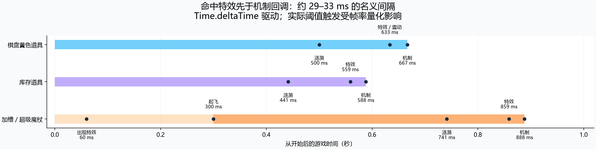
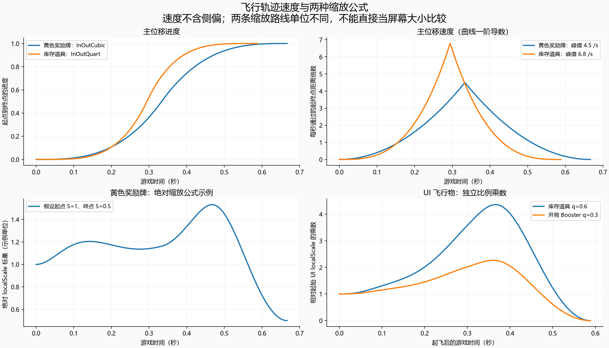
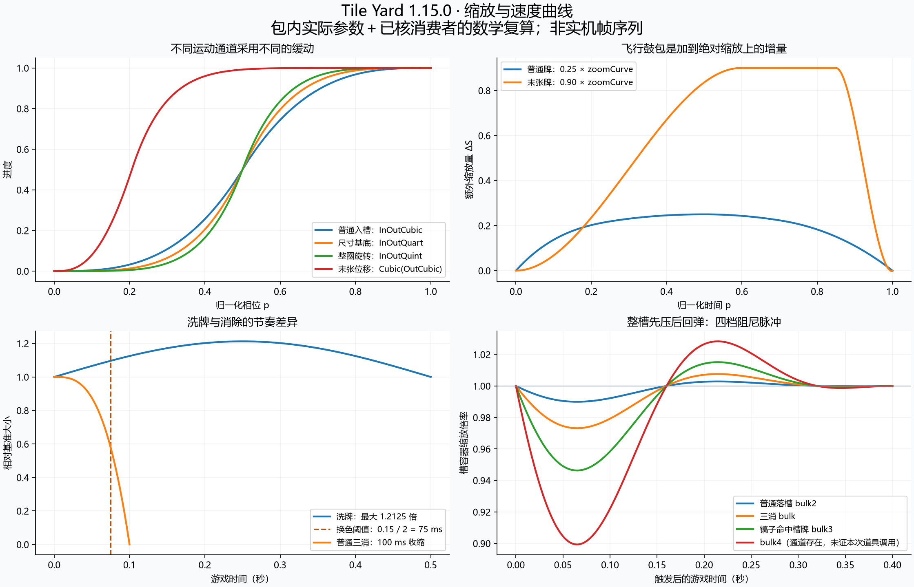
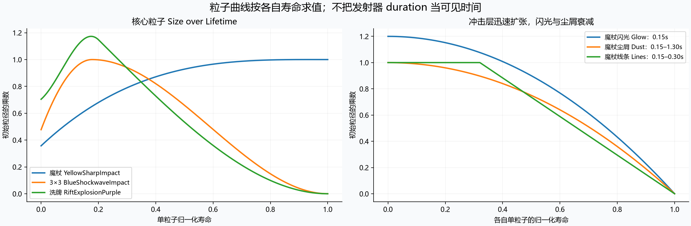
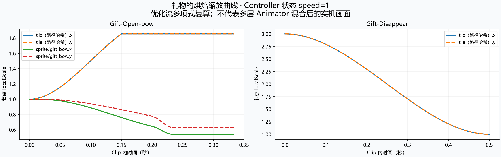

# Tile Yard：局内道具动画参数（1.15.0）

**打击感的可确认来源是多通道错开：飞行位移、缩放鼓包、旋转各用不同曲线；命中前先起波纹，随后粒子／震动，最后才执行机制；单牌之外还叠加整槽压弹、棋盘伸缩与分层粒子。** 以下把实际序列化值与原生消费者逐项对位，不把字段名、构造默认或导出图当成实际播放结果。

样本为用户提供的 Android 1.15.0（9872）XAPK，Unity 2022.3.62f3，研究日期 2026-11-24。已经覆盖库存撤回／洗牌／魔杖／退三张、加槽／超级魔杖、棋盘魔杖／镐子／3×3／洗牌／自动收尾，以及礼物牌与共享落槽反馈。**本轮是包内参数＋静态代码分析，尚未做实机逐帧采样。** 秒数指游戏时间，受 Time.deltaTime、timeScale、帧量化、前置等待和并发动画影响。

## 1. 阅读与交付入口

| 文件 | 内容 |
|---|---|
| 本文 | 逐道具参数、公式、关键帧、时序与表现解释 |
| [[02-PROJECTS/产品分析/Tile Yard/assets/animation-1.15.0/粒子拖尾音效附表\|粒子拖尾音效附表]] | 93 个相关粒子系统、11 个拖尾、41 个 AudioSource 的可读索引；是层级内存在量，不是同时播放量 |
| [核心动画参数 JSON](../assets/animation-1.15.0/核心动画参数.json) | 38 个相关组件，原始 float32 读值、字段、曲线、对象 ID、字节范围及序列化摘要 |
| [完整动画参数 ZIP](../assets/animation-1.15.0/完整动画参数.zip) | 完整粒子模块／曲线、Transform 与启用状态、音效、拖尾、绑定、13 个礼物 Clip、Controller 状态、复现脚本与曲线演算输入 |

ZIP 内 `particle-systems.json` 保留 Size/Velocity/Color/Emission/Noise/Trail 等完整模块，包括未启用模块；是否生效要结合 enabled、父节点、代码和实际播放路径。`curve-keyframes.json` 保留精确关键帧与切线，不以截图读数代替原值。

## 2. 先区分三条动画路线

| 路线 | 实际模板与主要参数 | 名义时长／生效时间 | 特征 |
|---|---|---|---|
| 底栏四种库存道具 | `DropPowerUp`，resources.assets/71127；speed=1.7，zoom=0.6，deflection=0.4 | 飞行 0.588235s；命中特效 0.558824s；完成后调用道具机制 | 位移 InOutQuart；大幅比例鼓包；不套用黄色牌的整圈旋转 |
| 加槽／超级魔杖 Booster | `DropBooster`，70606；speed=1.7，zoom=0.3，deflection=0.4 | 先展示 0.3s，再飞行 0.588235s；累计约0.888235s开始机制 | 登场 OutBack，飞行鼓包弱于库存道具 |
| 棋盘黄色奖励牌 | Hint/88588、Pickax/88587、Boom9/71596、Reshuffle/76213、Automove/67660；全为 speed=1.5、zoom=1、deflection=1 | 飞行0.666667s；0.5s波纹；0.633333s命中特效；0.666667s机制 | 位移 InOutCubic；两段缩放波峰；±360°旋转 |

这里的 `_flightSpeed` 是**每秒推进多少归一化相位**，不是“世界坐标单位／秒”；时长为1/speed。它与 DropTile 的 `_dropFlightTime`、`_undoFlightTime`、`_destroyTime` 三个直接时长字段不同。

这些实际模板覆盖了构造默认 speed=2.5、zoom=0.5、deflection=0.7。不可用构造值算成“所有道具400ms”。



库存路线的波纹只在 `IsFieldEffect` 条件下追加；槽内道具不能统一视为都会产生相机波纹。上图的波纹时间是该分支成立时的安排。黄色牌阈值跨越判定为 old≤阈值且new>阈值，实际曝光可能晚一帧；低帧率时多个阈值也可能同帧发生。

## 3. 缓动函数与速度曲线

统一记 p∈[0,1]，E2/E3/E4/E5分别为 InOutQuad/Cubic/Quart/Quint，O3为OutCubic：

```text
E2(p) = 2p²                 (p<0.5)，否则 1 - 2(1-p)²
E3(p) = 4p³                 (p<0.5)，否则 1 - 4(1-p)³
E4(p) = 8p⁴                 (p<0.5)，否则 1 - 8(1-p)⁴
E5(p) = 16p⁵                (p<0.5)，否则 1 - 16(1-p)⁵
O3(p) = 1 - (1-p)³
Exp(p)= 2^(10p-10)
```

本包对应函数会先 clamp 输入。`Exp(0)=1/1024`，代码没有额外的零点特殊分支。图中的速度是“主位移进度对游戏秒的一阶导数”，不含侧偏、父级移动或相机变化；乘以起终点距离后才得到该主通道的坐标速度。

| 动作 | 主位移缓动 | 主通道最大归一化速度 |
|---|---|---:|
| 普通入槽，0.42s | E3 | 3/0.42≈7.142857 个起终点距离／秒 |
| 棋盘黄色奖励牌，speed1.5 | E3 | 3×1.5=4.5 个起终点距离／秒 |
| 库存飞行，speed1.7 | E4 | 4×1.7=6.8 个起终点距离／秒 |
| 最后一张入槽 | E3(O3(p)) | 复合曲线；不是普通 E3，也不是只换一个duration |



上图缩放示例的单位刻意分开：黄色牌是绝对localScale相加，UI飞行物是起始UI尺度的倍率。不能把4.35的UI倍率解释成“比棋盘牌大4.35倍”。

## 4. 棋盘黄色道具：飞行、放大、旋转与命中

消费者：`SpecialTileBehaviour.Update 0x38785b0`；各Feature将机制回调交给它，在飞行完成后触发。

### 4.1 位移与缩放公式

F、D为起点与目标，n为forward与飞行方向叉乘得到的侧向单位向量，a从[-1,+1]抽取。s0来自当前牌的localScale.x，s1=s0/2；q=1。

```text
p += 1.5 * dt
P = Lerp(F,D,E3(p)) + n*a*sin(pi*E2(p))
    + (0,0,-4 - 0.3*sin(pi*p))
S = s0 + (s1-s0)*E4(p)
    + q*sin(pi*E2(p²))
    + (q/5)*sin(pi*O3(p))²
R = identity 后绕 forward 旋转 sign*360*E5(p) 度
```

Init另外将起点localPosition沿back偏移10；Z值和缩放都是该坐标系内的值，不按屏幕像素解释。随机a的正负决定旋转方向，不是随机改变飞行速度。

缩放由三层组成：基底向半尺寸收束；`p²`驱动的较晚主鼓包；`O3`驱动的前段小脉冲。以s0=1、s1=.5演算，主峰约1.532，位于p≈.70／起飞后约.467s。这是明确假设的公式示例，实际牌大小由父级和场景决定。

### 4.2 事件与差异

| 时间 | 动作 |
|---:|---|
| 起飞 | 随机选择 `_whooshSpecialSounds`，播放声效；振动枚举 Effect_6 |
| 0.500s | 在目标屏幕位置追加Ripple |
| 0.633333s | 实例化对应命中特效，振动 Effect_8 |
| 0.666667s | FieldReaction／DropFieldReaction，机制回调，销毁飞行代理 |

命中特效比机制提前约33.33ms，属于代码安排，不是实测音画延迟。SpawnEffect本段没有额外播放Sounds调用，Prefab自身AudioSource另计。

`SpawnEffect 0x38781bc`在**飞行代理当前世界位置**生成效果，不直接使用精确目标位置；随后改挂`Field.parent`，且worldPositionStays=true，没有另设localScale。因此换父时保留世界变换，新localScale可因父级逆补偿而改变，不能把Prefab的localScale原值直接当最终localScale。

| 道具 | 目标与反馈 | 命中Prefab |
|---|---|---|
| 魔杖 | 目标牌位置，默认bulk2 | YellowSharpImpact，go4629 |
| 镐子 | 棋盘目标固定位置，默认bulk2；槽内目标每帧追踪其Transform，反馈改为bulk3 | YellowSharpImpactSmall，go19645 |
| 3×3 | 由机制提供的棋盘坐标，默认bulk2 | BlueShockwaveImpact，go4634 |
| 洗牌 | 棋盘中心转到父级局部坐标；飞行结束后再启动牌面洗牌 | RiftExplosionPurple，go8445 |
| 自动收尾 | 共用模板存在，完整启动资格见关内逻辑专题 | AutoMatch，go4628 |

未使用奖励牌有独立销毁分支：相位初始为`-pausebefore`，随后每秒推进5；真正缩小阶段0.2s，`S=s0*(1-p³)`。前置等待为pausebefore/5、总时长为(pausebefore+1)/5，不能把参数名当成直接秒数。

## 5. 底栏库存道具与开局Booster

### 5.1 共用UI飞行

`UIPowerUp.UseAndAnimate 0x3a7967c → DropPowerUp.FlyTo 0x3a56e10`；四种库存道具绑定同一模板，图标、终点效果与最终机制不同。

```text
p += 1.7 * dt
Pxy = Lerp(Fxy,Dxy,E4(p)) + n.xy*a*sin(pi*E2(p))
worldZ = -10
M = 1-E4(p)
    + 7*q*sin(pi*E2(p^(3/2)))
    + (q/3)*sin(pi*O3(p))³
localScale = startScale2 * M
TrailMaterial.alpha = p - Exp(p)
```

库存q=.6，Booster q=.3；a从[-.4,+.4]抽取。UI飞行没有本段额外整圈旋转。q=.6时倍率峰值约4.357、相位约.62，明显大于基底1，但它乘的是UI来源尺度。这里是`p^(3/2)`与sin³，黄色道具则是p²与sin²，两套不能互抄。

0.75相位可能追加Ripple；0.95相位生成EffectPrefab并触发棋盘或槽反馈；1相位执行回调，再进入`Field.PowerUpGo`。起飞和完成都有Effect_8枚举调用，设备实际脉冲波形未恢复。

| 库存道具 | 终点效果 | 最终动作的后续时间 |
|---|---|---|
| 撤回 | `_effectUse`为空；撤回牌自身有EffectUseUndoNew | 飞行回调之后再执行退牌运动；不能把0.588s当成整个撤回完成时间 |
| 洗牌 | RiftExplosionPurple | 回调之后牌面洗牌，单牌相位从0起约0.5s；如有错开需另加 |
| 魔杖 | YellowSharpImpact | 回调之后激活选定牌，接共享收牌／消除 |
| 退回三张 | AutoMatch | 回调之后由ShelfDrop3逐目标安排返回；不承诺整段简单等于0.588+.53 |

四种底栏按钮另共用点击粒子EffectPushPowerUp。精确引用、对象、声音都保存在ZIP的effect-bindings。

库存的.95相位回调`0x3a577f4`与黄色牌不同：直接在`Field.parent`下Instantiate粒子，worldPositionStays=false，再将世界位置设为终点；没有另设localScale。因此本路保留Prefab局部尺度，最终世界尺度还乘父级。相同YellowSharpImpact由两条路线生成时，不能仅凭同一Prefab就断言屏幕尺寸一致。

### 5.2 加槽／超级魔杖登场

`BoosterApplier.Show 0x3a4f890`：

- 同时用0.3s将CanvasGroup.alpha从0到1、图标localScale从0.5到1。
- 缩放使用本包DOTween `Ease.OutBack=27`，不是线性放大；0.06s生成UIBoosterApplierAppear。
- 展示完成才开始DropBooster飞行，因此0.3s展示后，约0.858824s出现终点效果、0.888235s开始机制。
- `FadeOutAndDeactivate`本构建方法实际只返回空Sequence，不能凭名字附会成“背光必定0.2s淡出”。

加槽的UIExtraSlot配置`_speedOff=8`已与`Update 0x3a77444`核对：`p+=8dt`，按钮尺度为`startScale*(1-p³)`，从p=0起算约0.125s后生成EffectDestroyExtraSlot并隐藏入口按钮。`Activate 0x3a77648`先调用槽扩容，再按instant参数将p设0或1。因此125ms描述的是**扩容入口按钮的收缩消失**，不是整个加槽流程、槽位收回或容量生效延迟。

### 5.3 超级魔杖连发与目标牌弹出

RemoveColorBooster实际`_speed=.05`是逐牌启动间隔阈值（秒）：首张可立即触发；后续受帧量化、槽是否静止或仍有空位约束，一帧至多启动一次。**不是20世界单位／秒，也不是每张动画只有50ms。**

其目标使用场景`DropTileRemoveColor/426`：

| 阶段 | 实际区间 | 效果 |
|---|---|---|
| 弹出 | 0～0.07s | 对满足目标标记的牌，`S=fromSize*(1+.2*sin(pi*u))`，最大+20% |
| 原位停留 | 0.07～0.20s | 保留目标位置；`_pauseTime=.2`是第二阶段结束边界 |
| 飞往槽 | 0.20～1.00s | 将剩余区间映射为基类DropTile的0～1进度 |

弹出段u跨.3时只生成一次EffectTapTile，名义约在该牌启动21ms处。不是每张对象都必定弹出；还要命中所查目标集合标记。这里不能算成“0.07+.2秒等待”，也不能把1秒总体时长当作纯飞行1秒。

## 6. 单牌入槽、撤回和最后一张：实际参数

### 6.1 场景绑定，避免拿错模板

`level1/DropField 364`明确绑定：普通428、Booster目标426、最后一张436。`CreateDropTile`先检查Booster状态；否则有色且active的棋盘牌仅剩1张时选末牌模板。不是“只剩一张可点击牌”。

| 参数 | 普通DropTile 428 | 最后DropTileLast 436 | RemoveColor 426 | resources.assets/77401 |
|---|---:|---:|---:|---:|
| 入槽duration | .42s | .56s | 1s总体三段 | .42s |
| 撤回duration | .53s | .53s | .53s | .53s |
| 普通销毁duration | .10s | .10s | .10s | .10s |
| flightZoom | .25 | .9 | .25 | .3 |
| moveEasing | 6=InOutCubic | 覆写为E3(O3(p)) | 飞行段复用E3 | 9=InOutQuart |
| upForce | 0 | 0 | 0 | .75 |
| rotationProbability | 0 | 覆写必取±1方向 | 0 | 0 |
| dropFieldReaction | bulk2 | bulk | 空 | bulk2 |

77401是另一份资源，不是当前DropField的普通绑定；其upForce曲线与zoom初段切线不同。全文默认使用场景428，不把77401的上抛参数拼进实际普通飞行。

### 6.2 普通飞行／撤回公式

`DropTile.CalculateMoving 0x3a59494`，p=已过时间／对应duration：

```text
P = Lerp(F,D,E3(p))
    + up * upForce * UpForceCurve(p)
    + (0,0,-.3*sin(pi*p))
    + curveForce*sin(pi*E2(p))
S = Lerp(fromSize,toSize,E4(p)) + flightZoom*zoomCurve(p)
```

场景upForce=0。`curveForce`由起终点方向、横向距离和fromSize计算，幅值为`abs(dx/(7*fromSize))`，方向沿飞行方向旋转±90°；不是直接由`_deflectionForceInFlight=.6`当作偏移幅值。该字段在Init用来抽divpower，所查普通运动主要用其符号决定可选旋转；实际普通旋转概率为0。

起终朝向用线性p作Quaternion.Lerp；若启用整圈旋转，再叠加±360×E5(p)。普通拖尾alpha为`1-Exp(p)`；撤回入口关闭拖尾并可生成撤回粒子。

入槽到达时依次触发槽反馈、静止状态、结束声、震动枚举及收牌完成回调。撤回完成还会恢复真实棋盘牌、移除槽内代理和回填结构。单帧内的函数顺序不等于可测的独立音频延迟。

### 6.3 普通zoomCurve的完整关键帧

`level1/428/_zoomCurve`，weightedMode全部为0；下表切线是dy/dp，**不是像素／秒**。权重原字段虽然非零，但该mode不启用加权；精确float32与权重均保留在JSON。

| p | value | inSlope | outSlope |
|---:|---:|---:|---:|
| 0 | 0 | 7.372389 | 7.372389 |
| .276292682 | .901151776 | .937792838 | .937792838 |
| .5 | 1 | 0 | 0 |
| .701956928 | .891375899 | -1.06300855 | -1.06300855 |
| 1 | 0 | -5.20715284 | -5.20715284 |

位移E3起步慢，而缩放曲线初始切线7.37很陡，形成“牌先鼓起来、再迅速进入飞行”的通道差异。鼓包峰值额外+.25绝对scale，不是固定+25%；只有fromSize=1时两者数值才碰巧一致。

### 6.4 最后一张的强调

末牌duration=.56，主位移使用`E3(O3(p))`，不使用序列化moveEasing；朝向先identity，再必定±360×E5(p)。普通概率0不限制末牌。

| 末牌zoomCurve p | value | inSlope | outSlope |
|---:|---:|---:|---:|
| 0 | 0 | 0 | 0 |
| .600000024 | 1 | -.0387153141 | 0 |
| .850000024 | 1 | 0 | -.0351147279 |
| .998657227 | -.00235748291 | 0 | 0 |

乘flightZoom=.9后形成较大的额外尺度平台，后段快速回落。末点略负是包内原值，不能手工抹成0。完成状态会收束到最终位置／尺寸，图展示的仍是消费者中的曲线增量。



## 7. 洗牌、消除与局部受击

### 7.1 洗牌本体

场景Tile资源74551实际：`_reshuffleSpeed=2`、`_reshuffleZoom=.17`、`_reshuffleDivPower=.35`。`Tile.ReshuffleAnimation 0x395b69c`：

| 通道 | 公式／参数 |
|---|---|
| 相位 | p+=2dt，从0起算约.5s；负初相位可能增加错开等待 |
| 缩放 | `baseScale*(1+1.25*.17*sin(pi*p))`；峰值1.2125倍，在约.25s |
| 径向外推 | `normalize(currentXY)*.25*.35*sin(pi*E2(p))`；峰值.0875本地单位 |
| 摆旋 | 绕切向轴，角度`90°*sin(pi*O3(p))` |
| 明暗 | ±`.25*sin(pi*O3(p))`叠加到基底灰度，alpha1 |
| 换色 | 跨过p=.15时切换nexttype，speed2下名义75ms；不是在动画中点换色 |

每帧先恢复Tile的基底Transform再叠加各动画，避免将缩放误算成逐帧累积膨胀。

### 7.2 普通三消

场景`_destroyTime=.1`；`S=toSize*(1-p³)`。先慢缩、后迅速收紧，缩小完成才生成EffectDestroyMatchTile。

`StartDestroying`优先询问`IDropTileAnimator.StartDestroyAnimation(delay,callback)`，命中自定义动画则走其回调；障碍／道具不一定走上述100ms。普通fallback没有使用输入delay做统一倒计时，不能笼统写所有牌先等delay。

### 7.3 点击和错误操作的辅助反馈

| 动作 | 参数／公式 |
|---|---|
| 按住／松开 | 相位速度10/s；100ms压至0.96倍，同时本地Y约-.02、灰度乘0.96³≈.884736；松开约100ms恢复 |
| 错误点击 | speed=3，名义.333s；偏移=`wrongVector*localScale.x*.2*sin(pi*p)*sin(3*pi*p)` |
| 牌面受击 | 偏移=`reactVector*.1*(1-p)*sin(2*pi*p)`；时长由调用者speedReact决定 |
| 重定位／底牌抬升 | 约.5s；位移权重`OutQuart(p)²`；缩放`1+.8*sin(pi*OutQuart(p))²`，峰值1.8倍 |
| 槽内横向归位 | 相位2.5/s，名义.4s；每帧从当前目标X向shelfX做p³插值，离散轨迹受帧率影响，不等同固定起点的标准Cubic |

## 8. 打击反馈：整槽和棋盘是两套消费者

### 8.1 整槽压弹

DropFieldCollector每个通道p+=2.5dt，约.4s：

```text
K_i = 1 + A_i*sin(-2.5*pi*p_i)*(1-p_i)²
K_total = 各活跃通道K_i相乘
```

| 触发词 | A | 已核关联 |
|---|---:|---|
| bulk2／gurgle2 | .015 | 普通牌模板落槽、部分道具槽反馈 |
| bulk／bulk1／gurgle1 | .04 | 三消MatchAction；末牌模板 |
| bulk3 | .08 | 镐子以槽内牌为目标时 |
| bulk4 | .15 | 通道存在；本轮没有认定每种道具都调用此档 |

该波形同时作用于槽内牌容器和UICoreDropBar，先压后弹；同档重复触发重置相位，不同档可叠加。每帧恢复基底尺寸，不是永久累乘。

### 8.2 棋盘整体反馈

| FieldReaction | 名义时长 | 表现 |
|---|---:|---|
| boom／boom1 | .166667s | Z随机±1°、XY随机幅值.03，各乘sin(pi*p)包络 |
| boom2 | .333333s | Z随机±6°、XY幅值.2，各乘sin(pi*p) |
| bulk／bulk1／gurgle1 | .25s | `1+.005*sin(-2*pi*p)*(1-p²)` |
| bulk2／gurgle2 | .5s | `1-.03*power*sin(3*pi*p)*(1-p)²`；power默认1，库存FieldEffect回调传2 |

同一个bulk2字符串，在Field与DropFieldCollector中波形和强度不同。不能把“整槽压弹”“棋盘伸缩”“相机波纹”合成一个屏幕抖动参数。

## 9. 命中粒子：缩放曲线与速度层次

主效果实际绑定如下。Start Size／Start Speed是粒子系统坐标单位，不是屏幕像素；rootScale还要经过scalingMode、父级与相机。此表描述**根粒子系统**，完整子层级在附表和ZIP。

| 效果 | 根粒子ID | 单粒子寿命 | 初速 | 初始粒径 | Burst | 根Transform scale |
|---|---:|---|---|---|---:|---|
| YellowSharpImpact | 28328 | .2–.4s | 2–6 | 2–4 | 20 | 1,1,1 |
| YellowSharpImpactSmall | 28600 | .2–.4s | 1–3 | 2–4 | 20 | 1,1,1 |
| BlueShockwaveImpact | 28333 | .4s | 0 | 6 | 1 | 1,1,1 |
| RiftExplosionPurple | 28423 | .55s | 0 | 7 | 4 | .7,.7,.7 |
| AutoMatch | 28327 | .2–.4s | 2–6 | 2–4 | 20 | 1.2,1.2,1 |
| EffectUseUndoNew | 28329 | .2–.4s | 2–6 | 2–4 | 20 | 完整Transform见ZIP |

上述根粒子simulationSpeed均为1。Yellow系duration2s、Blue/Rift根发射器duration5s，**不等于粒子会可见2或5秒**：这里是t=0 burst与各自寿命。EffectPushPowerUp／UIBoosterApplierAppear根发射关闭，视觉由子粒子承担；不能只抄根的0.05s duration得出整个效果50ms。

### 9.1 三条代表性Size over Lifetime

曲线横轴是单粒子归一化寿命，而非道具飞行相位。

| 效果 | Curve multiplier | 关键帧(t,value,inSlope,outSlope) |
|---|---:|---|
| YellowSharpImpact／Small | 1 | (0,.357142866,2,2)；(1,1,0,0) |
| BlueShockwaveImpact | 1 | (0,.477419347,5.65519667,5.65519667)；(.177842587,1,0,0)；(1,0,0,0) |
| RiftExplosionPurple | 1.2 | (0,.586827338,1.55732083,1.55732083)；(.201144397,.954600453,-1.78092349,-1.78092349)；(1,0,0,0) |

Rift两关键点之间会按切线插值，峰值不必恰好落在关键点。Blue寿命.4s时，名义约71.1ms到t=.17784的峰值，后面逐渐收回。曲线样值须乘multiplier，再作用于Start Size；这又与牌的“加法鼓包”不同。



### 9.2 魔杖子层：短闪光、快速线条和长尾尘屑

| 子层 | 寿命 | 初速 | 初始粒径 | Burst | Size曲线 |
|---|---|---|---|---:|---|
| Glow/28323 | .15s | 0 | 4 | 1 | multiplier1.2；(0,1,0,0)→(1,0,-2,-2) |
| Lines/28331 | .15–.30s | 25–35 | .34 | 12 | (.320610702,1,-1.47191012,-1.47191012)→(1,0,同切线) |
| Dust/28509 | .15–1.30s | 12–37 | .35–.60 | 80 | (0,1,0,0)→(1,0,-2,-2) |

这支持“短促明亮冲击＋快速方向线条＋较长尘屑尾部”的表现分工。Burst的minMaxState=0时只用scalar；例如Dust原始minScalar=45不参与本项常量Burst，不能写成45–80颗。

## 10. 拖尾、音效与震动

### 拖尾

11个追到的TrailRenderer均`Time=.25s`、`MinVertexDistance=.1`。库存DropPowerUp与Booster拖尾widthMultiplier=1，widthCurve：

| 拖尾归一化位置 | widthCurve | inSlope / outSlope |
|---:|---:|---|
| 0 | .246261597 | 11.6362934 / 11.6362934 |
| .087857649 | .555546761 | -1.53151560 / -1.53151560 |
| 1 | 0 | 0 / 0 |

先快速变宽再收尖，主飞行还额外改材质alpha。Gradient另带自身透明度变化；最终透明度取决于材质／Shader，不把一条alpha公式当作全部显示透明度。普通牌的Trail widthCurve略有不同，完整11项已逐条附表。

### 声音与震动

- 普通落槽绑定item_fall，SoundRandomPitch配置.8～1、randomEveryShot=false。
- 5个特殊牌whoosh对象均有pitchRange=.5～.8、randomEveryShot=false；并非每帧随机。
- 41个相关AudioSource的Volume、Pitch、Loop、PlayOnAwake和Clip PPtr已留存；实际混音、设备输出与听感未测。
- 特殊牌起飞调用Effect_6，命中特效调用Effect_8；库存路线起飞／完成有Effect_8。它们是枚举标识，本轮不把它们翻成未经核对的振动毫秒数或强度。

## 11. 相机波纹：实际使用纹理，不能误用编辑曲线

关内`Main Camera/RippleEffect`为level1/363：speed1.3、power.03、radius.4、scale.5、reflectionStrength1；meta场景另一套值不混用。

- Droplet age+=speed×dt，age<2时保留；名义生命周期2/1.3≈1.53846s。
- 传Shader的phase=Clamp01(age)，约.76923s到1，后半存活期phase保持1。
- 本构建只向材质写首个有效`_Drop1`。后续波纹在列表里会推进年龄，前一项移除后再接替，不等同所有波纹同时叠画。
- `_Params1=(aspect,1,.03,.4)`；`_Params2=(1,1/aspect,2,1)`。
- Awake实际绑定`_gradTexture`和`_fadeTexture`，均为sharedassets1.assets内2048×1纹理；源码读取范围内未使用`_waveform/_fadeform`两条AnimationCurve。

因此JSON中的7帧waveform／3帧fadeform只能作为序列化作者参数保留，不能直接当作本次Shader运行曲线。两张实际纹理PNG及全部像素样本已随报告保留。Shader导出仅恢复属性／pass声明，未恢复完整GPU程序；radius／scale到屏幕波前的最终空间公式留待验证。

## 12. 礼物牌：单独的Animator曲线

GiftConfigSO/65701绑定GiftBehaviour/71990，后者绑定Animator/28202，走appear、disappear、available、skin、withBow五个参数；不是SpecialTile的飞行缩放。

消费者先等待传入delay，再触发appear或disappear。Controller实际状态speed=1、speed参数ID=0；所查消费者没有覆写Animator.speed。Availability层有.3s转场，其余已列基础动作转场为0。

| Clip | 包内时长 | 已解出的表现参数 |
|---|---:|---|
| Gift-Appear | .166667s | sprite尺度恒1；另有Euler流曲线；不能当成从0放大 |
| Gift-Idle | .516667s | 循环状态；完整通道随ZIP |
| Gift-Idle-bow | 2s | 蝴蝶结姿态循环，节点尺度恒1 |
| Gift-Open | .333333s | 独立于有蝴蝶结分支，牌相关尺度恒1 |
| Gift-Open-bow | .333333s | `sprite/gift_bow`X：1→.645213（.20s）→.541295（.233333s）；Y：1→.778146→.630889；另一个pathHash1989126404的节点在.15s约放到1.854167 |
| Gift-Disappear | .5s | pathHash1989126404三轴由3缓动至1；.5s有OnAnimationEnd事件 |
| 其余7个状态Clip | 0s | Available／Unavailable、Hidden、ShowBow／HideBow、SkinGift／SkinObstacle为状态姿态，不是“没有效果” |

pathHash1989126404与字符串`tile`的CRC32一致，但当前静态Prefab层级未直接对位到同名路径，正文保留hash，不擅自指定其视觉角色。这里只描述对应Clip局部通道，不能等同多层Animator混合后的最终全对象缩放。

优化StreamedClip已解为分段多项式`a*Δt³+b*Δt²+c*Δt+d`，并按genericBindings的通道顺序关联Transform／属性；13个Clip总通道数与streamed+dense+constant计数逐个一致。连续段端点已复算；激活开关等离散通道允许跳变，不以其跳变当成插值失败。



`OnDisappear`销毁视觉对象，`OnDestroy`才执行保存回调。不能把0.5sClip、调用者delay和机制发奖时刻自动合并为一个数值。

## 13. 可用于设计参考的组合

以下是基于参数的表现解释，不是用户研究或实机主观评分：

| 组合 | 已核实现 | 对手感的可能贡献 |
|---|---|---|
| 起手有实体感 | 点击100ms压至.96，飞行缩放与位移独立 | 明确按下与提起，不像贴图直接平移 |
| 运动有蓄力与收束 | E3/E4位移，E4尺寸基底，E5旋转，额外鼓包 | 起步、加速、转身、落点不会完全同拍 |
| 预告后命中 | .75相位波纹，.95特效，1.0机制 | 落点先有可感知准备，再被粒子和状态变化确认 |
| 冲击传到周围 | 单牌动画＋整槽.4s压弹＋棋盘独立反馈 | 被作用的容器也响应，增强接触感 |
| 快亮慢散 | .15s闪光、.15–.30s方向线、最长1.3s尘屑 | 短促命中与余韵分层，不靠把整段拖长 |
| 收尾有额外强调 | 末牌.56s、+.9鼓包平台、必整圈旋转 | 最后动作与普通落槽形成差异 |

当前未证明统一hit-stop、慢动作或音频延迟补偿；可确认的重点是曲线、相位和多层反馈。若迁移到TS，应先保持通道时序及加法／乘法口径，再按TS牌的单位和父级尺度调参，不直接照搬绝对localScale数值。

## 14. 来源、验证与后续

| 项目 | 本轮结果 |
|---|---|
| 资源身份 | 原包、metadata、ARM64 binary与既有索引一致；对选定MonoBehaviour另记录序列化SHA256 |
| 序列化 | Cpp2IL字段／SerializeField模式读取，38个报告相关组件逐个完整消费字节；错误清单为空；字段字节范围可查 |
| 消费者 | Capstone读取同包原始指令，结合字段偏移、枚举、ELF重定位与metadata接口；不是将空C#方法当反编译结果 |
| 曲线 | 主MonoBehaviour曲线weightedMode=0，按切线Hermite复算；若粒子曲线启用weightedMode则按加权Bezier处理；原权重不删 |
| 资料范围 | 93个粒子、11个拖尾、41个声音、13个礼物Clip，均有源对象及层级引用；没有宣称当前全部曝光 |
| 视觉核查 | 数学曲线图已打开检查；图为公式／曲线求值，不是游戏录屏或像素级复刻 |
| 附件完整性 | ZIP CRC及22个成员SHA256通过；38个组件重新读取原包校验摘要及完整字节消费；31个主曲线关键帧端点误差为0；23处附件与导航链接可解析 |
| 待补 | 指定设备同版本逐帧核对、父级／相机下屏幕尺寸、音效实际延迟、平台振动波形、Shader波前、礼物层级中的tile路径绑定 |

本机原始证据：`D:\LibraryG\06-PRODUCT-ASSETS\TileYard\1.15.0\04-ReverseEngineering\animation-parameters\`（参数解析与复现）；`animation-native/`（道具／Ripple消费者）；`animation-shared/`（牌、槽、棋盘及Gift消费者）。批量材料不随知识库提交；正文直接用到的图和复核ZIP位于本产品assets，已建来源索引。

## 关联

- [[02-PROJECTS/产品分析/Tile Yard/_MOC|Tile Yard入口]]
- [[02-PROJECTS/产品分析/Tile Yard/游戏逻辑/关内道具障碍与滑动操作-1.15.0|关内规则]]
- [[02-PROJECTS/产品分析/Tile Yard/资源路径索引|完整资源索引]]
